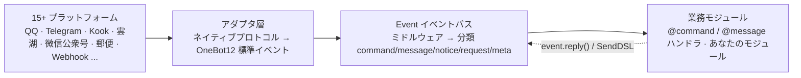
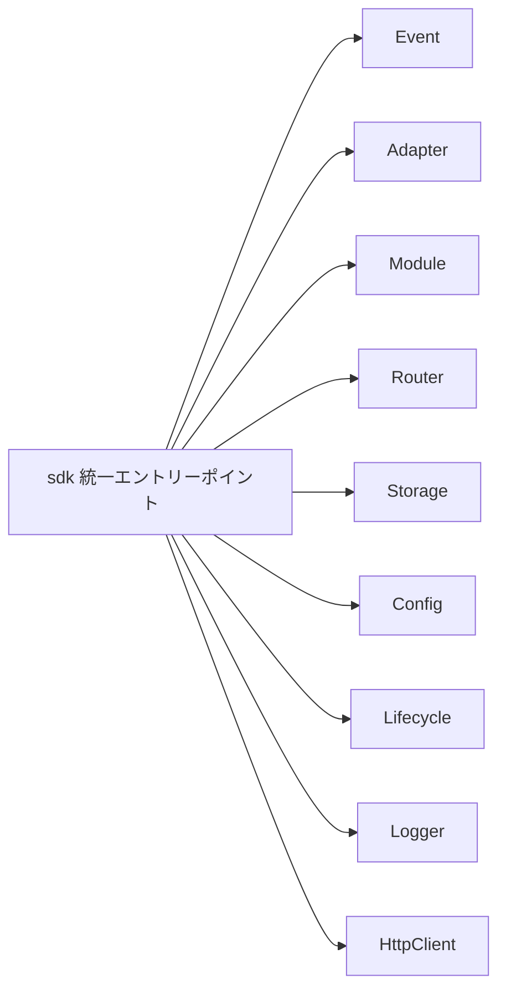

[English](README.md) | [简体中文](README.zh-CN.md) | [繁體中文](README.zh-TW.md) | [日本語](README.ja.md) | [Русский](README.ru.md)

> ✦ **こんにちは、小eris（えりす）です！** ErisPulse のマスコットで、ドキュメントの案内役です。デモでエラーが出ても安心してください、私が代わりにテストしています～

# ErisPulse

**一度書くだけで、QQ / Telegram / Kook / 雲湖 / 微信公式アカウント / OneBot12 / ... など、複数プラットフォームにデプロイ可能。**

OneBot12 標準インターフェースを基盤とした、イベント駆動型のモジュール化された非同期ロボットフレームワーク。業務コードは一度だけ記述し、アダプタが各プラットフォームの差異を隠蔽する。プラグインシステム、ホットリロード、そして完全な開発者ツールチェーンがすぐに使える。

<p>
  <a href="https://pypi.org/project/ErisPulse/"></a>
  <a href="https://pypi.org/project/ErisPulse/"></a>
  <a href="https://github.com/botuniverse/onebot-11"></a>
  <a href="https://12.onebot.dev/"></a>
  <a href="https://hub.docker.com/r/erispulse/erispulse"></a>
  <a href="https://github.com/ErisPulse/ErisPulse/blob/main/LICENSE"></a>
  <a href="https://pepy.tech/project/ErisPulse"></a>
  <a href="https://github.com/ErisPulse/ErisPulse/stargazers"></a>
  <a href="https://github.com/astral-sh/ruff"></a>
  <a href="https://socket.dev/pypi/package/erispulse"></a>
  <a href="https://www.erisdev.com"></a>
  <a href="https://deepwiki.com/ErisPulse/ErisPulse"></a>
  <a href="https://www.erisdev.com/#market"></a>
  <a href="https://github.com/ErisPulse/ErisPulse/discussions"></a>
</p>

<br clear="both">

---

<div align="center">

### 主な特徴

</div>

<table>
<tr>
<td width="33%" align="center" valign="top">
<br/>


### イベント駆動アーキテクチャ

OneBot12 の統一イベントモデルに基づき、一つのハンドラで全てのアダプタに対応可能

</td>
<td width="33%" align="center" valign="top">
<br/>


### クロスプラットフォーム互換性

QQ / Telegram / Kook / 雲湖 など 15 以上のプラットフォームに対応し、業務コードを変更せずに利用可能

</td>
<td width="33%" align="center" valign="top">
<br/>


### モジュール化設計

プラグインをホットプラグイン可能で、再起動なし。作用域はプラットフォーム / Bot / 会話ごとに管理可能

</td>
</tr>
<tr>
<td width="33%" align="center" valign="top">
<br/>


### ホットリロード

保存即有効、軽量で感覚的なホットリロード

</td>
<td width="33%" align="center" valign="top">
<br/>


### AI支援

自然言語で要件を記述し、直接利用可能なモジュールを生成可能

</td>
<td width="33%" align="center" valign="top">
<br/>


### 簡潔でエレガント

チェーン式 API：@ユーザー、返信、再試行、一括送信を一行で完了可能

</td>
</tr>
</table>

---

## 動作原理

ErisPulse はアダプタ層を介してプラットフォームの差異を隠蔽し、業務コードはイベント自体のみを意識するようにします：



- **アダプタ層**は各プラットフォームのネイティブプロトコルを OneBot12 標準イベントに変換し、業務モジュールはプラットフォームの差異を見ません
- **Event イベントバス**はまずミドルウェアチェーンを実行し、次にイベントの種類に応じて5種類のハンドラに分類します
- **あなたのコード**はデコレータを使ってイベントをサブスクライブし、`event.reply()` または SendDSL を使って返信します——返信メッセージは同じ経路を逆流してプラットフォームに戻ります

モジュールの完全な構成、初期化の流れ、ライフサイクルイベントなどの設計詳細は、[アーキテクチャ概要](docs/ja/architecture.md)をご覧ください。

---

## 快速開始

### 一鍵インストールスクリプト（推奨）

インストールスクリプトは、Docker、Python、uv などの環境を自動的に検出し、最適なインストール方法を選択します。多言語（中国語/English/日本語/Русский/繁體中文）に対応しています。

Windows (PowerShell):
```powershell
irm https://get.erisdev.com/install.ps1 -OutFile install.ps1; powershell -ExecutionPolicy Bypass -File install.ps1
```

macOS / Linux:
```bash
curl -fsSL https://get.erisdev.com/install.sh -o install.sh && chmod +x install.sh && ./install.sh
```

<table>
<tr>
<td align="center" width="50%">

**Docker インストールのデモ**

<video src="https://github.com/user-attachments/assets/a367a466-4678-46a9-b101-073a86388ede" controls width="100%"></video>

</td>
<td align="center" width="50%">

**pip インストールのデモ**

<video src="https://github.com/user-attachments/assets/a2df4009-dba6-411e-b79d-4454a168d063" controls width="100%"></video>

</td>
</tr>
</table>

### Docker を使用する（推奨）

```bash
docker pull erispulse/erispulse:latest
```

<details>
<summary>Docker Hub が利用できない場合</summary>

Docker Hub にアクセスできない場合は、GitHub Container Registry を使用できます。

```bash
docker pull ghcr.io/erispulse/erispulse:latest
```

ghcr.io のイメージを使用する場合は、`docker-compose.yml` の image を変更する必要があります。
```yaml
image: ghcr.io/erispulse/erispulse:latest
```

</details>

<details>
<summary>クイックスタート</summary>

```bash
# docker-compose.yml をダウンロード
curl -O https://raw.githubusercontent.com/ErisPulse/ErisPulse/main/docker-compose.yml

# Dashboard のログイントークンを設定して起動
ERISPULSE_DASHBOARD_TOKEN=your-token docker compose up -d
```

起動後、`http://<host>:8000/Dashboard` にアクセスし、設定したトークンで Dashboard 管理パネルにログインします。

> イメージには ErisPulse フレームワークと Dashboard 管理パネルが内蔵されており、`linux/amd64` および `linux/arm64` アーキテクチャをサポートしています。
>
> **永続化**：設定ファイルやインストール済みのモジュール/アダプターは、ホストにマウントされたボリュームを通じて永続化され、コンテナの再起動後も失われません。フレームワーク自体のアップデートは、Dashboard からホットアップデートで完了します。

</details>

<details>
<summary>Docker 環境変数</summary>

| 変数 | デフォルト値 | 説明 |
|------|--------|------|
| `ERISPULSE_DASHBOARD_TOKEN` | 空 | Dashboard のログイントークン（設定すると自動的に設定ファイルに書き込まれます） |
| `ERISPULSE_PORT` | `8000` | Dashboard のポートマッピング |
| `ERISPULSE_TAG` | `latest` | イメージのタグ、`dev` に設定するとプレリリースイメージを使用できます |
| `CONTAINER_NAME` | `erispulse` | コンテナ名 |
| `TZ` | `Asia/Shanghai` | コンテナのタイムゾーン |
| `LANG` | `en_US.UTF-8` | システム言語、起動時のインターフェース言語を自動検出します |
| `ERISPULSE_LANG` | 空 | 起動時のインターフェース言語を強制指定：`zh` / `zh_TW` / `en` / `ja` / `ru`（`LANG` を上書きします） |

</details>

### 1Panel アプリストア

[1Panel](https://1panel.cn) アプリストアから ErisPulse をワンクリックインストールできます。詳しくは [ErisPulse-1Panel](https://github.com/ErisPulse/ErisPulse-1Panel) を参照してください。

```bash
bash <(curl -sL https://get-1panel.erisdev.com/install.sh)
```

ErisPulse は 1Panel のサードパーティアプリストアに登録されており、[okxlin/appstore](https://github.com/okxlin/appstore) サードパーティリポジトリを使用してインストールできます。

### pip を使用したインストール

```bash
pip install ErisPulse
```

`epsdk` をグローバルなコマンドラインツールとして使用したい場合、仮想環境にインストールせず、`uv tool install` を推奨します。

```bash
uv tool install ErisPulse
```

> 上記の一鍵インストールスクリプトを使用することもできます。環境を自動的に検出し、設定を誘導します（スクリプトメニューには「グローバル CLI インストール（uv tool）」の方法も用意されています）。

### プロジェクトの初期化

```bash
# インタラクティブな初期化
epsdk init

# ファスト初期化（プロジェクト名を指定）
epsdk init -q -n my_bot
```

### 最初のロボットを作成する

`main.py` ファイルを作成します：

<table>
<tr>
<td width="50%" valign="top">

**コマンドハンドラー**

```python
from ErisPulse import sdk
from ErisPulse.Core.Event import command

@command("hello", help="挨拶メッセージを送信")
async def hello_handler(event):
    user_name = event.get_user_nickname() or "友達"
    await event.reply(f"こんにちは、{user_name}！")

@command("ping", help="ロボットがオンラインかどうかをテスト")
async def ping_handler(event):
    await event.reply("Pong！ロボットは正常に動作しています。")

if __name__ == "__main__":
    import asyncio
    asyncio.run(sdk.run(keep_running=True))
```

</td>
<td width="50%" valign="top">

**動作の説明**

`/hello` を送信

ロボットは `こんにちは、{ユーザー名}！` と返信します。

---

`/ping` を送信

ロボットは `Pong！ロボットは正常に動作しています。` と返信します。

---

**実行方法**

```bash
epsdk run main.py
# または開発モード
epsdk run main.py --reload
```

</td>
</tr>
</table>

詳細な説明は以下のドキュメントをご覧ください：
- [クイックスタートガイド](docs/ja/quick-start.md)
- [入門ガイド](docs/ja/getting-started/)

---

## 同じコード。複数のプラットフォーム。

*まったく同じコマンドハンドラ。異なるプラットフォーム。ビジネスロジックを一切変更することなく利用可能。*

<table>
<tr>
<td align="center" width="33%">

**Kook**


</td>
<td align="center" width="33%">

**QQ**


</td>
<td align="center" width="33%">

**云湖**


</td>
</tr>
</table>

---

## 鏈式送信 DSL

@ ユーザー、返信、再試行、タイムアウト、成功コールバック——複雑な送信ロジックを、1 つのチェーンで完結：

```python
yunhu = sdk.adapter.get("yunhu")

# 単発送信：@ユーザー + 返信 + 再試行 + 成功コールバック
await (yunhu.Send.To("group", "123").At("456").Reply("msg_789")
       .Retry(3).Timeout(10)
       .Hook(lambda r: print("送信成功！")).Text("你好"))

# バッチ送信：1 つのチェーンで複数メッセージを送信
results = await (yunhu.Send.To("user", "123").Build()
                 .Text("通知一").Image("pic.jpg").Retry(2).send_all())
```

> Hook / Retry / Timeout / OnProgress / Defer / Build などのすべてのチェーンメソッドは、[SendDSL ドキュメント](docs/ja/developer-guide/adapters/send-dsl.md)をご覧ください。

---

## 複数ラウンドの対話の例

情報を収集し、入力を検証し、確認を提出する際、対話の状態を自分で管理する必要はありません。

```python
from ErisPulse.Core.Event import command

@command("register")
async def register_handler(event):
    conv = event.conversation(timeout=60)
    await conv.say("ようこそ登録へ！")
    data = await conv.collect([
        {"key": "name", "prompt": "お名前を入力してください"},
        {"key": "age", "prompt": "年齢を入力してください",
         "validator": lambda e: e.get_text().strip().isdigit(),
         "retry_prompt": "年齢は数字でなければなりません。再度入力してください"},
    ])
    if data and await conv.confirm(f"登録を確認しますか？お名前: {data['name']}, 年齢: {data['age']}"):
        await event.reply(f"登録が完了しました！{data['name']}さん、ようこそ！")
```

> オプションの選択（choose）、分岐のジャンプ（branch / goto）、永続化などの完全な機能については、[Conversation 複数ラウンド対話](docs/ja/advanced/conversation.md)をご覧ください。

---

## コアモジュール

`sdk` のエントリーポイントであり、すべてのコア機能を統合します。



| モジュール | 説明 |
|------|------|
| **Event** | イベントシステム。command / message / notice / request / meta の 5 種類のイベントと Conversation モジュールによるマルチホップ対話機能を提供します。|
| **Adapter** | アダプタ管理。BaseAdapter 基底クラスによりイベントの変換と SendDSL の送信を統一し、QQ / Telegram / Kook / 雲湖 / 微信公式アカウントなど 15 以上のプラットフォームをサポートします。|
| **Module** | モジュール管理。BaseModule 基底クラスと依存関係の宣言、トポロジカルソートによるロードを提供します。|
| **SendDSL** | チェーン式送信。@/返信/再試行/タイムアウト/一括送信などの複雑な処理を 1 行で実現します。|
| **Router** | HTTP/WebSocket ルーティングシステム（FastAPI + Uvicorn）|
| **Storage** | SQLite をベースとしたキー/値ストアと一般的な SQL チェーン式クエリを提供します。|
| **Config** | TOML 形式の設定管理 |
| **Lifecycle** | ライフサイクルイベントフック（core.init / adapter.* / module.*）|
| **Logger** | モジュール化されたロギングシステム。サブロギング機能をサポートします。|
| **HttpClient** | 統一された HTTP/WS クライアント（aiohttp をベース）。内部にリトライ機構と ErisPulse の例外体系を備えています。|

初期化プロセス、ライフサイクルイベント、モジュールのロード戦略などの詳細設計については、[アーキテクチャ概要](docs/ja/architecture.md)をご覧ください。

---

## スコープ（Scope）—— 3次元の権限制御

モジュールのコードを一切変更せずに、設定で「どの範囲で有効か」を一括で宣言：

```toml
[ErisPulse.scope.platforms.onebot11]
modules = ["Chat", "Tool*"]           # ① モジュール次元：このプラットフォームではこれらのモジュールのみを開放（glob / 正規表現）

[ErisPulse.scope.identity.users.onebot11]
deny = ["u_bad", "spam_*"]            # ② 身元次元：ブラックリストに登録されたユーザーのイベントは直接破棄

[ErisPulse.scope.actions.MyModule]
send = { allow = ["Text"] }           # ③ 出力次元：このモジュールではテキストのみ送信を許可
api = { deny = ["set_*", "leave_*"] } #    管理系のAPIは禁止
```

```python
# 実行時にも呼び出し可能で、即座に有効（ドット区切りパスの辞書式読み書きに対応）
sdk.scope.set_action("MyModule", "api", deny=["set_*"])
```

> 詳細は [作用域（scope）](docs/ja/advanced/scope.md) を参照

---

## イベントのオーバーライド —— モジュールのコードを変更せずに、任意のイベントタイプの動作を上書き

トリガーの単語を変更したり、コマンドに管理者制限を追加したり、モジュールのソースコードを変更せずに、設定を反映させることができます：

```toml
# メッセージハンドラのトリガー条件を上書き（コード内の条件と AND 演算）
# meta/message/notice/request/command すべてのタイプに対応
[ErisPulse.event.overrides.message.ChatModule]
pattern = "闲聊*"

# コマンド実装のパラメータを上書き（master / hidden / aliases / prefix など、ユーザーの設定が優先）
[ErisPulse.event.overrides.command.MyModule.restart]
master = true
```

> 詳細は [イベントのオーバーライド](docs/ja/getting-started/event-handling.md) を参照してください。

---

## エコシステム

ErisPulse は単なるフレームワークではありません。ゼロから車輪を再発明する必要なく、インストールしてすぐに始められます。

<table>
<tr>
<td align="center" width="25%">

**フレームワーク**

コアランタイム

イベント & メッセージモデルの統一

</td>
<td align="center" width="25%">

**ダッシュボード**

可視化管理

プラグイン · ログ · 設定

[オンラインデモ →](https://dashdemo.erisdev.com/)

</td>
<td align="center" width="25%">

**AI Builder**

自然言語 → 使用可能なモジュール

[今すぐ体験 →](https://builder.erisdev.com)

</td>
<td align="center" width="25%">

**モジュールマーケット**

すぐに使えるプラグイン

[モジュールを閲覧 →](https://www.erisdev.com/#market)

</td>
</tr>
<tr>
<td align="center" width="25%">

**アダプター**

15+ のプラットフォーム接続

</td>
<td align="center" width="25%">

**ErisPulse-App**

公式のマルチデバイスクライアント

スマートフォンで直接実行 · デスクトップのトレイに常駐

[ダウンロード & インストール →](https://github.com/ErisPulse/ErisPulse-App/releases)

</td>
<td align="center" width="25%">

**Docker**

マルチアーキテクチャ対応

`erispulse/erispulse`

</td>
<td align="center" width="25%">

**ドキュメント & CLI**

[erisdev.com](https://www.erisdev.com)

`epsdk` フッターツール

</td>
</tr>
</table>

---

## サポートされるプラットフォーム

アダプターの貢献を歓迎します！どこから始めたらいいか分からない？ [貢献ガイド](docs/ja/contributing/README.md) をご覧ください。

| アダプター | 説明 |
|--------|------|
|  [Kook](https://github.com/shanfishapp/ErisPulse-KookAdapter) | Kook（開黒啦）即時メッセージングプラットフォーム |
|  [Matrix](https://github.com/ErisPulse/ErisPulse-MatrixAdapter) | Matrix で分散型コミュニケーションプロトコル |
|  [OneBot11](https://github.com/ErisPulse/ErisPulse-OneBot11Adapter) | OneBot v11 一般的なロボットプロトコル |
|  [OneBot12](https://github.com/ErisPulse/ErisPulse-OneBot12Adapter) | OneBot v12 標準プロトコル |
|  [QQ](https://github.com/ErisPulse/ErisPulse-QQBotAdapter) | QQ 公式ロボットプラットフォーム |
|  [Sandbox](https://github.com/ErisPulse/ErisPulse-SandboxAdapter) | ブラウザでのデバッグ、実際のプラットフォームに接続する必要なし |
|  [Terminal](https://github.com/ErisPulse/ErisPulse-TerminalAdapter) | コマンドラインによるチャット、ゼロ設定で開発・デバッグ |
|  [Telegram](https://github.com/ErisPulse/ErisPulse-TelegramAdapter) | グローバルな即時メッセージングプラットフォーム |
|  [メール](https://github.com/ErisPulse/ErisPulse-EmailAdapter) | メールプロトコルの送受信アダプター |
|  [Yunhu](https://github.com/ErisPulse/ErisPulse-YunhuAdapter) | 企業向け即時メッセージングプラットフォーム（ロボット接続） |
|  [Yunhu ユーザー](https://github.com/wsu2059q/ErisPulse-YunhuUserAdapter) | Yunhu ユーザープロトコルに基づく接続アダプター |
| [花楓カフェ](https://github.com/ErisPulse/ErisPulse-Ideaura/) | Allons! \(・ω・) / |
|  [Discord](https://github.com/ErisPulse/ErisPulse-DiscordAdapter) | グローバルなコミュニティコミュニケーションプラットフォーム、サーバー、チャンネル、プライベートメッセージに対応 |
|  [Webhook](https://github.com/ErisPulse/ErisPulse-WebhookAdapter) | 一般的な HTTP ブリッジアダプター、任意のシステムに接続 |
|  [WeChat 公衆号](https://github.com/ErisPulse/ErisPulse-WechatMpAdapter) | WeChat 公式の公衆号プラットフォーム |

アダプターの詳細情報は [アダプター詳細紹介](docs/ja/platform-guide/README.md) をご覧ください。

---

## コミュニティ

私たちと交流しましょう：

- Telegram: <https://t.me/ErisPulse>
- QQ グループ: <https://qm.qq.com/q/TOwnCmypcy>
- 雲湖グループ: <https://yhfx.jwznb.com/share?key=VWJL4fTWXepa&ts=1781889199>

プロジェクトが役立つと思われましたら、ぜひ[愛发电](https://ifdian.net/a/YingXinche)で継続的な開発を支援してください！

---

## Star History

ErisPulse が役立ったなら、ぜひ Star ⭐ を押してください。これは他の開発者がプロジェクトを知る最も直接的な方法です。

[](https://star-history.com/#ErisPulse/ErisPulse&Date)

---

### 貢献ガイド

ErisPulse プロジェクトの健全性は、皆様の貢献によって支えられています！あらゆる形での貢献を歓迎します：

1. **問題の報告** — [GitHub Issues](https://github.com/ErisPulse/ErisPulse/issues) でバグ報告を送信
2. **機能リクエスト** — [コミュニティディスカッション](https://github.com/ErisPulse/ErisPulse/discussions) で新しいアイデアを提案
3. **コード貢献** — PR を送信する前に [コードスタイル](docs/ja/styleguide/) と [貢献ガイド](CONTRIBUTING.md) をご確認ください
4. **ドキュメントの改善** — ドキュメントやサンプルコードを補完してください

**初めての貢献ですか？** ここから始めましょう 👉 [初めての貢献実践](docs/ja/contributing/first-contribution.md)

[コミュニティディスカッションに参加](https://github.com/ErisPulse/ErisPulse/discussions)

---

<div align="center">

### 謝辞


本プロジェクトの一部のコードは [sdkFrame](https://github.com/runoneall/sdkFrame) を基にしています。コアアダプターの標準化層は、[OneBot12 規格](https://12.onebot.dev/) を参考にしており、その恩恵を受けています。

ErisPulse の初期の探求と成長は、雲湖開発者コミュニティのサポートに支えられています。多くのアイデア、アダプター、実践的な経験は、ここから生まれました。

また、ErisPulse、OneBot エコシステム、およびオープンソースコミュニティに貢献されたすべての開発者やプロジェクト作者に感謝いたします。

</div>