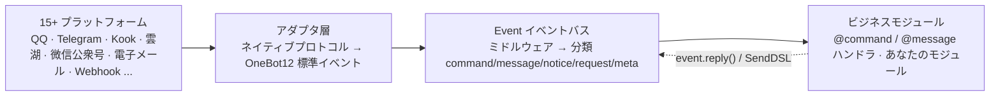
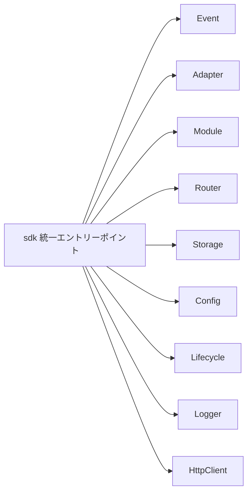

[English](README.md) | [简体中文](README.zh-CN.md) | [繁體中文](README.zh-TW.md) | **日本語** | [Русский](README.ru.md)

# ErisPulse

**一度書くだけで、QQ / Telegram / Kook / 雲湖 / 微信公衆号 / OneBot12 / ... など複数プラットフォームにデプロイ可能。**

OneBot12 標準インターフェースを基にした、イベント駆動型のモジュラーアシンクロニスロボットフレームワーク。ビジネスロジックは一度書くだけで、アダプタが各プラットフォームの差異を隠蔽する。プラグインシステム、ホットリロード、および完全な開発者ツールチェーンがすぐに使える。

<p>
  <a href="https://pypi.org/project/ErisPulse/"></a>
  <a href="https://pypi.org/project/ErisPulse/"></a>
  <a href="https://github.com/botuniverse/onebot-11"></a>
  <a href="https://12.onebot.dev/"></a>
  <a href="https://hub.docker.com/r/erispulse/erispulse"></a>
  <a href="https://github.com/ErisPulse/ErisPulse/blob/main/LICENSE"></a>
  <a href="https://pepy.tech/project/ErisPulse"></a>
  <a href="https://github.com/astral-sh/ruff"></a>
  <a href="https://socket.dev/pypi/package/erispulse"></a>
  <a href="https://www.erisdev.com"></a>
  <a href="https://deepwiki.com/ErisPulse/ErisPulse"></a>
  <a href="https://www.erisdev.com/#market"></a>
  <a href="https://github.com/ErisPulse/ErisPulse/discussions"></a>
</p>

<br clear="both">

---

<div align="center">

### 核心特性

</div>

<table>
<tr>
<td width="33%" align="center" valign="top">
<br/>


### イベント駆動アーキテクチャ

OneBot12 の統一イベントモデルに基づき、1つのハンドラで全てのアダプタに対応

</td>
<td width="33%" align="center" valign="top">
<br/>


### クロスプラットフォーム互換性

QQ / Telegram / Kook / 雲湖 など 15+ プラットフォーム、ビジネスロジックは変更なし

</td>
<td width="33%" align="center" valign="top">
<br/>


### モジュラーアーキテクチャ

プラグインのホットプラグイン / アンプラグインで再起動不要、作用域はプラットフォーム / Bot / セッションごとに制御

</td>
</tr>
<tr>
<td width="33%" align="center" valign="top">
<br/>


### ホットリロード

保存即有効、軽量で感覚なしのリロード

</td>
<td width="33%" align="center" valign="top">
<br/>


### AI補助

自然言語でニーズを説明し、即座に実行可能なモジュールを生成

</td>
<td width="33%" align="center" valign="top">
<br/>


### 簡潔でエレガント

チェーン式API：@ユーザー、返信、再試行、一括送信を1行で完了

</td>
</tr>
</table>

---

## 動作原理

ErisPulse はアダプタ層でプラットフォームの差異を隠蔽し、ビジネスロジックはイベント自体にのみ関心を持つようにします：



- **アダプタ層**は各プラットフォームのネイティブプロトコルを OneBot12 標準イベントに変換し、ビジネスモジュールはプラットフォームの差異を見ない
- **Event バス**はミドルウェアチェーンを実行した後、イベントタイプに応じて5種類のハンドラに分類する
- **あなたのコード**はデコレータでイベントをサブスクライブし、`event.reply()` または SendDSL で返信する — 返信メッセージは同じ経路を逆流してプラットフォームに戻る

モジュールの完全な構成、初期化プロセス、ライフサイクルイベントなどの設計詳細は、[アーキテクチャ概要](docs/ja/architecture.md)をご覧ください。

---

## 速習

### 1クリックインストールスクリプト（推奨）

インストールスクリプトは、環境（Docker、Python、uv）を自動検出し、最も適したインストール方法を導き、多言語（中国語/English/日本語/Русский/繁體中文）をサポートします。

Windows (PowerShell):
```powershell
irm https://get.erisdev.com/install.ps1 -OutFile install.ps1; powershell -ExecutionPolicy Bypass -File install.ps1
```

macOS / Linux:
```bash
curl -fsSL https://get.erisdev.com/install.sh -o install.sh && chmod +x install.sh && ./install.sh
```

<table>
<tr>
<td align="center" width="50%">

**Docker インストールデモ**

<video src="https://github.com/user-attachments/assets/a367a466-4678-46a9-b101-073a86388ede" controls width="100%"></video>

</td>
<td align="center" width="50%">

**pip インストールデモ**

<video src="https://github.com/user-attachments/assets/a2df4009-dba6-411e-b79d-4454a168d063" controls width="100%"></video>

</td>
</tr>
</table>

### Docker を使用する（推奨）

```bash
docker pull erispulse/erispulse:latest
```

<details>
<summary>Docker Hub が利用できない？</summary>

Docker Hub にアクセスできない場合は、GitHub Container Registry を使用できます：

```bash
docker pull ghcr.io/erispulse/erispulse:latest
```

ghcr.io のイメージを使用する場合、`docker-compose.yml` の image を変更する必要があります：
```yaml
image: ghcr.io/erispulse/erispulse:latest
```

</details>

<details>
<summary>クイックスタート</summary>

```bash
# docker-compose.yml のダウンロード
curl -O https://raw.githubusercontent.com/ErisPulse/ErisPulse/main/docker-compose.yml

# Dashboard ログイントークンを設定して起動
ERISPULSE_DASHBOARD_TOKEN=your-token docker compose up -d
```

起動後、`http://<host>:8000/Dashboard` にアクセスし、設定したトークンで Dashboard 管理パネルにログインします。

> イメージには ErisPulse フレームワークと Dashboard 管理パネルが内蔵されており、`linux/amd64` および `linux/arm64` アーキテクチャをサポートします。
>
> **永続化**：設定ファイルとインストールされたモジュール/アダプタはホストにマウントされたボリュームによって永続化され、コンテナの再起動後も失われません。フレームワーク自体の更新は Dashboard でホットアップデートされます。

</details>

<details>
<summary>Docker 環境変数</summary>

| 変数 | デフォルト値 | 説明 |
|------|--------|------|
| `ERISPULSE_DASHBOARD_TOKEN` | 空 | Dashboard ログイントークン（設定すると自動的に設定ファイルに書き込まれます）|
| `ERISPULSE_PORT` | `8000` | Dashboard ポートマッピング |
| `ERISPULSE_TAG` | `latest` | イメージタグ、`dev` に設定するとプレリリースイメージを使用します |
| `CONTAINER_NAME` | `erispulse` | コンテナ名 |
| `TZ` | `Asia/Shanghai` | コンテナのタイムゾーン |
| `LANG` | `en_US.UTF-8` | システム言語、起動時のインターフェース言語を自動検出します |
| `ERISPULSE_LANG` | 空 | 強制起動時のインターフェース言語：`zh` / `zh_TW` / `en` / `ja` / `ru`（`LANG` を上書きします）|

</details>

### 1Panel アプリストア

[1Panel](https://1panel.cn) アプリストアから ErisPulse をワンクリックでインストールできます。詳しくは [ErisPulse-1Panel](https://github.com/ErisPulse/ErisPulse-1Panel) を参照してください。

```bash
bash <(curl -sL https://get-1panel.erisdev.com/install.sh)
```

ErisPulse は 1Panel のサードパーティアプリストアに登録されており、[okxlin/appstore](https://github.com/okxlin/appstore) サードパーティリポジトリを使用してインストールできます。

### pip を使用してインストール

```bash
pip install ErisPulse
```

`epsdk` をグローバルなコマンドラインツールとして使用したい場合、`uv tool install` を推奨します：

```bash
uv tool install ErisPulse
```

> 上記の 1 クリックインストールスクリプトを使用して、環境を自動検出し、設定を誘導することもできます（スクリプトメニューには「グローバル CLI インストール（uv tool）」の方法も提供されています）。

### プロジェクトの初期化

```bash
# インタラクティブな初期化
epsdk init

# 速やかな初期化（プロジェクト名を指定）
epsdk init -q -n my_bot
```

### 最初のロボットを作成する

`main.py` ファイルを作成します：

<table>
<tr>
<td width="50%" valign="top">

**コマンドハンドラ**

```python
from ErisPulse import sdk
from ErisPulse.Core.Event import command

@command("hello", help="挨拶メッセージを送信")
async def hello_handler(event):
    user_name = event.get_user_nickname() or "友達"
    await event.reply(f"こんにちは、{user_name}！")

@command("ping", help="ロボットがオンラインかどうかをテスト")
async def ping_handler(event):
    await event.reply("Pong！ロボットは正常に動作しています。")

if __name__ == "__main__":
    import asyncio
    asyncio.run(sdk.run(keep_running=True))
```

</td>
<td width="50%" valign="top">

**効果説明**

`/hello` を送信

ロボットが返信：`こんにちは、{ユーザー名}！`

---

`/ping` を送信

ロボットが返信：`Pong！ロボットは正常に動作しています。`

---

**実行方法**

```bash
epsdk run main.py
# または開発モード
epsdk run main.py --reload
```

</td>
</tr>
</table>

詳細な説明は、以下のドキュメントをご覧ください：
- [速習ガイド](docs/ja/quick-start.md)
- [入門ガイド](docs/ja/getting-started/)

---

## 同じコードで複数のプラットフォーム

*まったく同じコマンドハンドラ。異なるプラットフォーム。ビジネスロジックを一切変更する必要はありません。*

<table>
<tr>
<td align="center" width="33%">

**Kook**


</td>
<td align="center" width="33%">

**QQ**


</td>
<td align="center" width="33%">

**雲湖**


</td>
</tr>
</table>

---

## チェーン送信 DSL

@ユーザー、返信、再試行、タイムアウト、成功コールバック — 複雑な送信ロジックを1行でチェーンで記述可能：

```python
yunhu = sdk.adapter.get("yunhu")

# 単発送信：@ユーザー + 返信 + 再試行 + 成功コールバック
await (yunhu.Send.To("group", "123").At("456").Reply("msg_789")
       .Retry(3).Timeout(10)
       .Hook(lambda r: print("送信成功！")).Text("こんにちは"))

# 一括送信：1つのチェーンで複数のメッセージを送信
results = await (yunhu.Send.To("user", "123").Build()
                 .Text("通知1").Image("pic.jpg").Retry(2).send_all())
```

> Hook / Retry / Timeout / OnProgress / Defer / Build などのチェーンメソッドは、[SendDSL ドキュメント](docs/ja/developer-guide/adapters/send-dsl.md)をご覧ください。

---

## マルチホップ対話例

情報を収集し、入力を検証し、送信を確認する — 対話ステータスを手動で管理する必要はありません：

```python
from ErisPulse.Core.Event import command

@command("register")
async def register_handler(event):
    conv = event.conversation(timeout=60)
    await conv.say("登録へようこそ！")
    data = await conv.collect([
        {"key": "name", "prompt": "名前を入力してください"},
        {"key": "age", "prompt": "年齢を入力してください",
         "validator": lambda e: e.get_text().strip().isdigit(),
         "retry_prompt": "年齢は数字でなければなりません。再度入力してください"},
    ])
    if data and await conv.confirm(f"登録を確認しますか？名前: {data['name']}, 年齢: {data['age']}"):
        await event.reply(f"登録が完了しました！{data['name']}さん、ようこそ！")
```

> 選択肢付き質問（choose）、分岐移動（branch / goto）、永続化などの完全な機能は、[Conversation マルチホップ対話](docs/ja/advanced/conversation.md)をご覧ください。

---

## コアモジュール

1つの `sdk` エントリーポイントで、すべてのコア機能を統合します：



| モジュール | 説明 |
|------|------|
| **Event** | イベントシステム、command / message / notice / request / meta 5種類のイベントと Conversation マルチホップ対話 |
| **Adapter** | アダプタ管理、BaseAdapter 基底クラスによるイベント変換と SendDSL 送信、QQ / Telegram / Kook / 雲湖 / 微信公衆号 など 15+ プラットフォームをサポート |
| **Module** | モジュール管理、BaseModule 基底クラスと依存関係の宣言、トポロジカルソートによるロード |
| **SendDSL** | チェーン式送信、@/返信/再試行/タイムアウト/一括送信などの複雑なロジックを1行で完了 |
| **Router** | HTTP/WebSocket ルーティングシステム（FastAPI + Uvicorn）|
| **Storage** | SQLite に基づくキー/値ストアと一般的な SQL チェーン式クエリ |
| **Config** | TOML 設定管理 |
| **Lifecycle** | ライフサイクルイベントフック（core.init / adapter.* / module.*）|
| **Logger** | モジュール化されたロガー、サブロガーをサポート |
| **HttpClient** | 統一された HTTP/WS クライアント（aiohttp に基づく）、再試行と ErisPulse の例外体系を内蔵 |

初期化プロセス、ライフサイクルイベント、モジュールロード戦略などの設計詳細は、[アーキテクチャ概要](docs/ja/architecture.md)をご覧ください。

---

## スコープ（Scope）——3次元の権限制御

モジュールコードを一切変更せずに、設定で「どの範囲で有効か」を一括宣言可能：

```toml
[ErisPulse.scope.platforms.onebot11]
modules = ["Chat", "Tool*"]           # ① モジュール次元：このプラットフォームではこれらのモジュールのみ有効（glob / 正規表現）

[ErisPulse.scope.identity.users.onebot11]
deny = ["u_bad", "spam_*"]            # ② 身分次元：ブラックリストユーザーのイベントは直接破棄

[ErisPulse.scope.actions.MyModule]
send = { allow = ["Text"] }           # ③ 出力次元：このモジュールはテキストのみ送信可能
api = { deny = ["set_*", "leave_*"] } #    管理系 API は禁止
```

```python
# 実行時にも呼び出し可能、即時有効（ドット区切りのパスによる辞書式読み書きをサポート）
sdk.scope.set_action("MyModule", "api", deny=["set_*"])
```

> 詳細は [スコープ（scope）](docs/ja/advanced/scope.md) をご覧ください。

---

## イベントの上書き——モジュールコードを変更せず、任意のイベントタイプの動作を上書き可能

トリガーを変更したり、コマンドに管理者制限を加えたり、モジュールソースコードを変更せず、設定で有効化可能：

```toml
# メッセージハンドラのトリガー条件を上書き（コード内の条件と AND）
[ErisPulse.event.overrides.message.ChatModule]
pattern = "雑談*"

# コマンド実装のパラメータを上書き（master / hidden / aliases / prefix など、ユーザー優先）
[ErisPulse.event.overrides.command.MyModule.restart]
master = true
```

> 詳細は [イベントの上書き](docs/ja/getting-started/event-handling.md) をご覧ください。

---

## エコシステム

ErisPulse はフレームワークにとどまらず、すぐに使えるように設計されています。ゼロから車輪を作り直す必要はありません。

<table>
<tr>
<td align="center" width="25%">

**フレームワーク**

コアランタイム

統一イベント & メッセージモデル

</td>
<td align="center" width="25%">

**Dashboard**

ビジュアル管理

プラグイン · ログ · 設定

[オンラインデモ →](https://dashdemo.erisdev.com/)

</td>
<td align="center" width="25%">

**AI Builder**

自然言語 → 実行可能なモジュール

[体験する →](https://builder.erisdev.com)

</td>
<td align="center" width="25%">

**モジュール市場**

すぐに使えるプラグイン

[モジュールを見る →](https://www.erisdev.com/#market)

</td>
</tr>
<tr>
<td align="center" width="25%">

**アダプタ**

15+ プラットフォームの接続

</td>
<td align="center" width="25%">

**ErisPulse-App**

公式マルチデバイスクライアント

スマホで直接実行 · デスクトップトレイに常駐

[ダウンロードインストール →](https://github.com/ErisPulse/ErisPulse-App/releases)

</td>
<td align="center" width="25%">

**Docker**

マルチアーキテクチャ対応

`erispulse/erispulse`

</td>
<td align="center" width="25%">

**ドキュメント & CLI**

[erisdev.com](https://www.erisdev.com)

`epsdk` フッターツール

</td>
</tr>
</table>

---

## サポートされるプラットフォーム

アダプタの貢献を歓迎します！どこから始めればよいか分からない場合は、[貢献ガイド](docs/ja/contributing/README.md)をご覧ください。

| アダプタ | 説明 |
|--------|------|
|  [Kook](https://github.com/shanfishapp/ErisPulse-KookAdapter) | Kook（開黒啦）即時通訊プラットフォーム |
|  [Matrix](https://github.com/ErisPulse/ErisPulse-MatrixAdapter) | Matrix 分散型通訊プロトコル |
|  [OneBot11](https://github.com/ErisPulse/ErisPulse-OneBot11Adapter) | OneBot v11 一般ロボットプロトコル |
|  [OneBot12](https://github.com/ErisPulse/ErisPulse-OneBot12Adapter) | OneBot v12 標準プロトコル |
|  [QQ](https://github.com/ErisPulse/ErisPulse-QQBotAdapter) | QQ 官方ロボットプラットフォーム |
|  [Sandbox](https://github.com/ErisPulse/ErisPulse-SandboxAdapter) | ブラウザ側デバッグ、実際のプラットフォームに接続する必要なし |
|  [Terminal](https://github.com/ErisPulse/ErisPulse-TerminalAdapter) | コマンドライン即チャット、設定ゼロで開発・デバッグ |
|  [Telegram](https://github.com/ErisPulse/ErisPulse-TelegramAdapter) | グローバルな即時通訊プラットフォーム |
|  [Email](https://github.com/ErisPulse/ErisPulse-EmailAdapter) | 電子メールプロトコル送受信アダプタ |
|  [雲湖](https://github.com/ErisPulse/ErisPulse-YunhuAdapter) | 企業向け即時通訊プラットフォーム（ロボット接続） |
|  [雲湖ユーザー](https://github.com/wsu2059q/ErisPulse-YunhuUserAdapter) | 雲湖ユーザープロトコルに基づく接続アダプタ |
| [花楓珈琲館](https://github.com/ErisPulse/ErisPulse-Ideaura/) | Allons! \(・ω・) / |
|  [Discord](https://github.com/ErisPulse/ErisPulse-DiscordAdapter) | グローバルなコミュニティ通訊プラットフォーム、サーバー、チャンネル、プライベートメッセージをサポート |
|  [Webhook](https://github.com/ErisPulse/ErisPulse-WebhookAdapter) | 一般的な HTTP ブリッジアダプタ、任意のシステムに接続 |
|  [微信公衆号](https://github.com/ErisPulse/ErisPulse-WechatMpAdapter) | 微信公式公衆号プラットフォーム |

アダプタの詳細については、[アダプタ詳細](docs/ja/platform-guide/README.md)をご覧ください。

---

## コミュニティ

私たちと交流しましょう：

- Telegram: <https://t.me/ErisPulse>
- QQ グループ: <https://qm.qq.com/q/TOwnCmypcy>
- 雲湖グループ: <https://yhfx.jwznb.com/share?key=VWJL4fTWXepa&ts=1781889199>

---

### 貢献ガイド

ErisPulse プロジェクトの健全性は、皆さんの力が必要です！さまざまな形での貢献を歓迎します：

1. **問題報告** — [GitHub Issues](https://github.com/ErisPulse/ErisPulse/issues) にバグ報告を提出
2. **機能リクエスト** — [コミュニティディスカッション](https://github.com/ErisPulse/ErisPulse/discussions) で新しいアイデアを提案
3. **コード貢献** — PR を提出する前に [コードスタイル](docs/ja/styleguide/) と [貢献ガイド](CONTRIBUTING.md) を読むこと
4. **ドキュメント改善** — ドキュメントやサンプルコードを改善する

**初めて貢献する？** ここから始めましょう 👉 [初めての貢献実戦](docs/ja/contributing/first-contribution.md)

[コミュニティディスカッションに参加する](https://github.com/ErisPulse/ErisPulse/discussions)

---

<div align="center">

### お礼


本プロジェクトの一部のコードは [sdkFrame](https://github.com/runoneall/sdkFrame) に基づき、コアアダプタの標準化層は [OneBot12 規格](https://12.onebot.dev/) を参考にし、受益しています。

ErisPulse の初期の探求と成長は、雲湖開発者コミュニティのサポートに欠かせません。多くのアイデア、アダプタ、実践的な経験がここから生まれました。

また、ErisPulse、OneBot エコシステム、およびオープンソースコミュニティに貢献したすべての開発者とプロジェクト作者に感謝します。

</div>