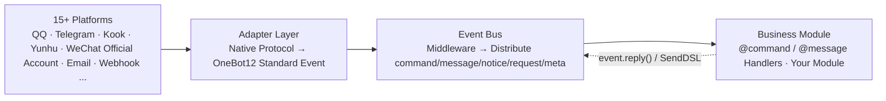
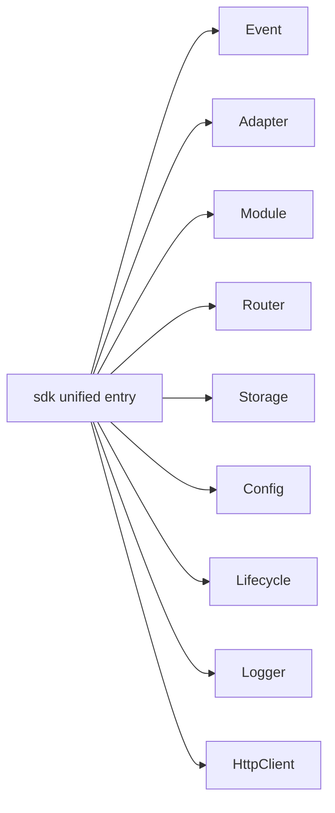

[English](README.md) | [简体中文](README.zh-CN.md) | [繁體中文](README.zh-TW.md) | [日本語](README.ja.md) | [Русский](README.ru.md)

> ✦ **Hi, I'm Eris (小eris)!** — ErisPulse's mascot and your guide through these docs. If something breaks in a demo, it's probably me testing it for you.

# ErisPulse

**Write once, deploy to QQ / Telegram / Kook / Yunhu / WeChat Official Account / OneBot12 / ... multiple platforms.**

A modular, asynchronous robot framework based on the OneBot12 standard interface and event-driven architecture. Business code is written once, and adapters handle platform differences; the plugin system, hot reload, and complete developer toolchain are ready to use out of the box.

<p>
  <a href="https://pypi.org/project/ErisPulse/"></a>
  <a href="https://pypi.org/project/ErisPulse/"></a>
  <a href="https://github.com/botuniverse/onebot-11"></a>
  <a href="https://12.onebot.dev/"></a>
  <a href="https://hub.docker.com/r/erispulse/erispulse"></a>
  <a href="https://github.com/ErisPulse/ErisPulse/blob/main/LICENSE"></a>
  <a href="https://pepy.tech/project/ErisPulse"></a>
  <a href="https://github.com/ErisPulse/ErisPulse/stargazers"></a>
  <a href="https://github.com/astral-sh/ruff"></a>
  <a href="https://socket.dev/pypi/package/erispulse"></a>
  <a href="https://www.erisdev.com"></a>
  <a href="https://deepwiki.com/ErisPulse/ErisPulse"></a>
  <a href="https://www.erisdev.com/#market"></a>
  <a href="https://github.com/ErisPulse/ErisPulse/discussions"></a>
</p>

<br clear="both">

---

<div align="center">

### Core Features

</div>

<table>
<tr>
<td width="33%" align="center" valign="top">
<br/>


### Event-Driven Architecture

Unified event model based on OneBot12, a single handler adapts to all adapters

</td>
<td width="33%" align="center" valign="top">
<br/>


### Cross-Platform Compatibility

Over 15 platforms including QQ / Telegram / Kook / Yunhu, business code requires zero changes

</td>
<td width="33%" align="center" valign="top">
<br/>


### Modular Design

Plugins can be hot-plugged without restarting, scopes are managed by platform / Bot / session

</td>
</tr>
<tr>
<td width="33%" align="center" valign="top">
<br/>


### Hot Reload

Save and apply changes instantly, hot reload is lightweight and seamless

</td>
<td width="33%" align="center" valign="top">
<br/>


### AI Assistance

Describe requirements in natural language, directly generate usable modules

</td>
<td width="33%" align="center" valign="top">
<br/>


### Clean and Elegant

Chainable API: @ user, reply, retry, batch send, all in one line

</td>
</tr>
</table>

---

## How It Works

ErisPulse shields platform differences through an adapter layer, allowing business code to focus solely on events themselves:



- The **Adapter Layer** converts native protocols from each platform into OneBot12 standard events, so business modules are unaware of platform differences.
- The **Event Bus** executes middleware chains first, then distributes events to five types of handlers based on event types.
- Your code subscribes to events via decorators and replies using `event.reply()` or SendDSL — replies flow back along the same path to the platform.

For detailed information about the complete module composition, initialization process, and lifecycle events, see [Architecture Overview](docs/en/architecture.md).

---


## Quick Start

### One-Click Installation Script (Recommended)

The installation script automatically detects your environment (Docker, Python, uv), guides you to choose the most suitable installation method, and supports multiple languages (Chinese/English/Japanese/Russian/Traditional Chinese).

Windows (PowerShell):
```powershell
irm https://get.erisdev.com/install.ps1 -OutFile install.ps1; powershell -ExecutionPolicy Bypass -File install.ps1
```

macOS / Linux:
```bash
curl -fsSL https://get.erisdev.com/install.sh -o install.sh && chmod +x install.sh && ./install.sh
```

<table>
<tr>
<td align="center" width="50%">

**Docker Installation Demo**

<video src="https://github.com/user-attachments/assets/a367a466-4678-46a9-b101-073a86388ede" controls width="100%"></video>

</td>
<td align="center" width="50%">

**pip Installation Demo**

<video src="https://github.com/user-attachments/assets/a2df4009-dba6-411e-b79d-4454a168d063" controls width="100%"></video>

</td>
</tr>
</table>

### Using Docker (Recommended)

```bash
docker pull erispulse/erispulse:latest
```

<details>
<summary>Unable to access Docker Hub?</summary>

If Docker Hub is inaccessible, you can use GitHub Container Registry:

```bash
docker pull ghcr.io/erispulse/erispulse:latest
```

When using the ghcr.io image, modify the `docker-compose.yml` file to change the image:
```yaml
image: ghcr.io/erispulse/erispulse:latest
```

</details>

<details>
<summary>Quick Start</summary>

```bash
# Download docker-compose.yml
curl -O https://raw.githubusercontent.com/ErisPulse/ErisPulse/main/docker-compose.yml

# Set Dashboard login token and start
ERISPULSE_DASHBOARD_TOKEN=your-token docker compose up -d
```

After starting, access `http://<host>:8000/Dashboard` and log in to the Dashboard management panel using the set token.

> The image includes the ErisPulse framework and Dashboard management panel, supporting `linux/amd64` and `linux/arm64` architectures.
>
> **Persistence**: Configuration files and installed modules/adapters are persisted to the host machine via volume mounts, so they won't be lost after container restarts. Framework updates are completed through hot updates in the Dashboard.

</details>

<details>
<summary>Docker Environment Variables</summary>

| Variable | Default Value | Description |
|----------|---------------|-------------|
| `ERISPULSE_DASHBOARD_TOKEN` | Empty | Dashboard login token (automatically written to configuration when set) |
| `ERISPULSE_PORT` | `8000` | Dashboard port mapping |
| `ERISPULSE_TAG` | `latest` | Image tag; can be set to `dev` to use pre-release images |
| `CONTAINER_NAME` | `erispulse` | Container name |
| `TZ` | `Asia/Shanghai` | Container timezone |
| `LANG` | `en_US.UTF-8` | System language, automatically detects startup interface language |
| `ERISPULSE_LANG` | Empty | Force startup interface language: `zh` / `zh_TW` / `en` / `ja` / `ru` (overrides `LANG`) |

</details>

### 1Panel App Store

Install ErisPulse one-click via the [1Panel](https://1panel.cn) app store. See [ErisPulse-1Panel](https://github.com/ErisPulse/ErisPulse-1Panel) for details.

```bash
bash <(curl -sL https://get-1panel.erisdev.com/install.sh)
```

ErisPulse is available in the 1Panel third-party app store and can be installed using the [okxlin/appstore](https://github.com/okxlin/appstore) third-party repository.

### Using pip to Install

```bash
pip install ErisPulse
```

If you want to use `epsdk` as a global command-line tool without entering a virtual environment, it is recommended to use `uv tool install`:

```bash
uv tool install ErisPulse
```

> You can also use the one-click installation script above, which automatically detects the environment and guides configuration (the script menu also provides the "Global CLI Installation (uv tool)" option).

### Initialize Project

```bash
# Interactive initialization
epsdk init

# Quick initialization (specify project name)
epsdk init -q -n my_bot
```

### Create Your First Bot

Create a `main.py` file:

<table>
<tr>
<td width="50%" valign="top">

**Command Handler**

```python
from ErisPulse import sdk
from ErisPulse.Core.Event import command

@command("hello", help="Send a greeting message")
async def hello_handler(event):
    user_name = event.get_user_nickname() or "friend"
    await event.reply(f"Hello, {user_name}!")

@command("ping", help="Test if the bot is online")
async def ping_handler(event):
    await event.reply("Pong! The bot is running normally.")

if __name__ == "__main__":
    import asyncio
    asyncio.run(sdk.run(keep_running=True))
```

</td>
<td width="50%" valign="top">

**Effect Explanation**

Send `/hello`

Bot replies: `Hello, {username}!`

---

Send `/ping`

Bot replies: `Pong! The bot is running normally.`

---

**Run Method**

```bash
epsdk run main.py
# Or run in development mode
epsdk run main.py --reload
```

</td>
</tr>
</table>

For more detailed instructions, see:
- [Quick Start Guide](docs/en/quick-start.md)
- [Getting Started Guide](docs/en/getting-started/)

---

## The Same Code. Multiple Platforms.

*Identical command handlers. Different platforms. No changes to business logic required.*

<table>
<tr>
<td align="center" width="33%">

**Kook**


</td>
<td align="center" width="33%">

**QQ**


</td>
<td align="center" width="33%">

**Yunhu**


</td>
</tr>
</table>

---

## Chained Send DSL

Mention users, reply, retry, timeout, success callback — complex sending logic, all written in one chain:

```python
yunhu = sdk.adapter.get("yunhu")

# Single send: mention user + reply + retry + success callback
await (yunhu.Send.To("group", "123").At("456").Reply("msg_789")
       .Retry(3).Timeout(10)
       .Hook(lambda r: print("Send successful!")).Text("Hello"))

# Batch send: send multiple messages in one chain
results = await (yunhu.Send.To("user", "123").Build()
                 .Text("Notification 1").Image("pic.jpg").Retry(2).send_all())
```

> All chained methods such as Hook / Retry / Timeout / OnProgress / Defer / Build, see [SendDSL documentation](docs/en/developer-guide/adapters/send-dsl.md).

---

## Multi-turn Conversation Examples

Collect information, validate input, and confirm submission without managing conversation state yourself:

```python
from ErisPulse.Core.Event import command

@command("register")
async def register_handler(event):
    conv = event.conversation(timeout=60)
    await conv.say("Welcome to register!")
    data = await conv.collect([
        {"key": "name", "prompt": "Please enter your name"},
        {"key": "age", "prompt": "Please enter your age",
         "validator": lambda e: e.get_text().strip().isdigit(),
         "retry_prompt": "Age must be a number, please re-enter"},
    ])
    if data and await conv.confirm(f"Confirm registration? Name: {data['name']}, Age: {data['age']}"):
        await event.reply(f"Registration successful! Welcome {data['name']}")
```

> For complete capabilities such as option-based questions (choose), branching jumps (branch / goto), and persistence, see [Conversation Multi-turn Dialogue](docs/en/advanced/conversation.md).

---


## Core Modules

A unified `sdk` entry point that connects all core capabilities:



| Module | Description |
|--------|-------------|
| **Event** | Event system, providing five types of events: command / message / notice / request / meta + Conversation for multi-turn dialogues |
| **Adapter** | Adapter management, BaseAdapter base class for unified event transformation and SendDSL sending, supports over 15 platforms such as QQ / Telegram / Kook / Yunhu / WeChat Official Account |
| **Module** | Module management, BaseModule base class + dependency declaration and topological sorting for loading |
| **SendDSL** | Chain-based sending, complex logic such as @/reply/retry/timeout/batch can be completed in one line |
| **Router** | HTTP/WebSocket routing system (FastAPI + Uvicorn) |
| **Storage** | Key-value storage based on SQLite + generic SQL chain query |
| **Config** | TOML configuration management |
| **Lifecycle** | Lifecycle event hooks (core.init / adapter.* / module.*) |
| **Logger** | Modular logging system, supports sub-loggers |
| **HttpClient** | Unified HTTP/WS client (based on aiohttp), built-in retry and ErisPulse exception system |

For more design details (initialization flow, lifecycle events, module loading strategy), see [Architecture Overview](docs/en/architecture.md).

## Scope —— Three-Dimensional Permission Control

Without modifying any module code, declare "what scope it applies to" in the configuration:

```toml
[ErisPulse.scope.platforms.onebot11]
modules = ["Chat", "Tool*"]           # ① Module level: Only these modules are enabled on this platform (glob / regex)

[ErisPulse.scope.identity.users.onebot11]
deny = ["u_bad", "spam_*"]            # ② Identity level: Events from blacklisted users are discarded

[ErisPulse.scope.actions.MyModule]
send = { allow = ["Text"] }           # ③ Outbound level: This module is only allowed to send text
api = { deny = ["set_*", "leave_*"] } #    and management APIs are prohibited
```

```python
# Runtime access is also supported, changes take effect immediately (supports dot-separated path dictionary-style read/write)
sdk.scope.set_action("MyModule", "api", deny=["set_*"])
```

> See [Scope](docs/en/advanced/scope.md)

---


## Event Override – Overwrite Behavior of Any Event Type Without Modifying Module Code

Change trigger words, add administrator restrictions to commands, and apply configurations without modifying module source code:

```toml
# Override message handler trigger conditions (AND with conditions in code; supports all types: meta/message/notice/request/command)
[ErisPulse.event.overrides.message.ChatModule]
pattern = "闲聊*"

# Override command implementation parameters (master / hidden / aliases / prefix, etc., user priority)
[ErisPulse.event.overrides.command.MyModule.restart]
master = true
```

> See [Event Override](docs/en/getting-started/event-handling.md)

---

## Ecosystem

ErisPulse is more than just a framework. Start building right away without having to reinvent the wheel.

<table>
<tr>
<td align="center" width="25%">

**Framework**

Core Runtime

Unified Event & Message Model

</td>
<td align="center" width="25%">

**Dashboard**

Visual Management

Plugins · Logs · Configuration

[Live Demo →](https://dashdemo.erisdev.com/)

</td>
<td align="center" width="25%">

**AI Builder**

Natural Language → Ready-to-Use Modules

[Experience Now →](https://builder.erisdev.com)

</td>
<td align="center" width="25%">

**Module Marketplace**

Plug-and-Play Plugins

[Explore Modules →](https://www.erisdev.com/#market)

</td>
</tr>
<tr>
<td align="center" width="25%">

**Adapters**

Integration with 15+ Platforms

</td>
<td align="center" width="25%">

**ErisPulse-App**

Official Multi-Platform Client

Run Directly on Mobile · Desktop Tray Icon

[Download & Install →](https://github.com/ErisPulse/ErisPulse-App/releases)

</td>
<td align="center" width="25%">

**Docker**

Multi-Architecture Support

`erispulse/erispulse`

</td>
<td align="center" width="25%">

**Documentation & CLI**

[erisdev.com](https://www.erisdev.com)

`epsdk` Scaffolding Tool

</td>
</tr>
</table>

---

## Supported Platforms

Welcome to contribute adapters! Not sure where to start? Check out the [Contribution Guide](docs/en/contributing/README.md).

| Adapter | Description |
|---------|-------------|
|  [Kook](https://github.com/shanfishapp/ErisPulse-KookAdapter) | Instant messaging platform Kook (Kaihei La) |
|  [Matrix](https://github.com/ErisPulse/ErisPulse-MatrixAdapter) | Decentralized communication protocol Matrix |
|  [OneBot11](https://github.com/ErisPulse/ErisPulse-OneBot11Adapter) | General robot protocol OneBot v11 |
|  [OneBot12](https://github.com/ErisPulse/ErisPulse-OneBot12Adapter) | OneBot v12 standard protocol |
|  [QQ](https://github.com/ErisPulse/ErisPulse-QQBotAdapter) | Official QQ robot platform |
|  [Sandbox](https://github.com/ErisPulse/ErisPulse-SandboxAdapter) | Web-based debugging, no real platform integration required |
|  [Terminal](https://github.com/ErisPulse/ErisPulse-TerminalAdapter) | Command-line chat, zero-configuration development and debugging |
|  [Telegram](https://github.com/ErisPulse/ErisPulse-TelegramAdapter) | Global instant messaging platform |
|  [Email](https://github.com/ErisPulse/ErisPulse-EmailAdapter) | Adapter for sending and receiving email protocol |
|  [Yunhu](https://github.com/ErisPulse/ErisPulse-YunhuAdapter) | Enterprise-level instant messaging platform (robot integration) |
|  [Yunhu User](https://github.com/wsu2059q/ErisPulse-YunhuUserAdapter) | Adapter based on the Yunhu user protocol |
| [Ideaura Café](https://github.com/ErisPulse/ErisPulse-Ideaura/) | Allons! \(・ω・) / |
|  [Discord](https://github.com/ErisPulse/ErisPulse-DiscordAdapter) | Global community communication platform, supports servers, channels, and private messages |
|  [Webhook](https://github.com/ErisPulse/ErisPulse-WebhookAdapter) | General HTTP bridge adapter, connects to any system |
|  [WeChat Official Account](https://github.com/ErisPulse/ErisPulse-WechatMpAdapter) | Official WeChat Official Account platform |

## Community

Connect with us:

- Telegram: <https://t.me/ErisPulse>
- QQ Group: <https://qm.qq.com/q/TOwnCmypcy>
- Yunhu Group: <https://yhfx.jwznb.com/share?key=VWJL4fTWXepa&ts=1781889199>

Found the project useful? Consider supporting us on [Ifdian](https://ifdian.net/a/YingXinche) to help us continue development!

---

## Star History

If ErisPulse has helped you, feel free to give it a Star ⭐—this is the most direct way to help more developers discover the project.

[](https://star-history.com/#ErisPulse/ErisPulse&Date)

---

### Contribution Guide

The health of the ErisPulse project still needs your contribution! We welcome all forms of contributions:

1. **Report Issues** — Submit bug reports on [GitHub Issues](https://github.com/ErisPulse/ErisPulse/issues)
2. **Feature Requests** — Propose new ideas through [Community Discussions](https://github.com/ErisPulse/ErisPulse/discussions)
3. **Code Contributions** — Before submitting a PR, please read the [Code Style](docs/en/styleguide/) and [Contribution Guide](CONTRIBUTING.md)
4. **Documentation Improvements** — Help improve documentation and example code

**First-time contributor?** Start here 👉 [First Contribution Guide](docs/en/contributing/first-contribution.md)

[Join the community discussion](https://github.com/ErisPulse/ErisPulse/discussions)

---

<div align="center">

### Acknowledgements


Part of the code in this project is based on [sdkFrame](https://github.com/runoneall/sdkFrame), and the core adapter standardization layer references and benefits from the [OneBot12 Specification](https://12.onebot.dev/).

The early exploration and growth of ErisPulse would not have been possible without the support of the Yunhu developer community, where many ideas, adapters, and practical experiences originated.

We also thank all developers and project authors who have contributed to ErisPulse, the OneBot ecosystem, and the open-source community.

</div>