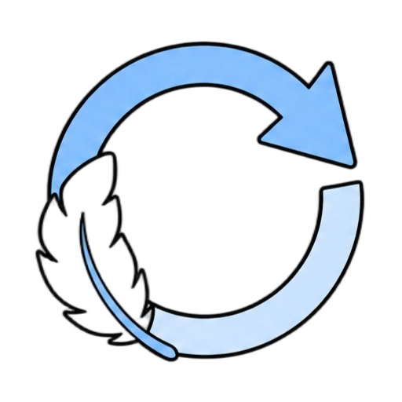
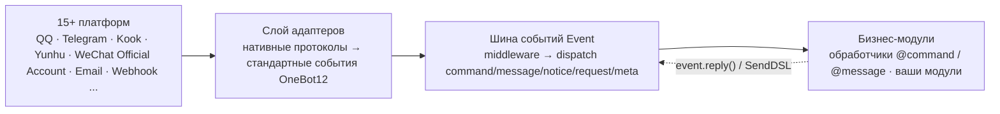
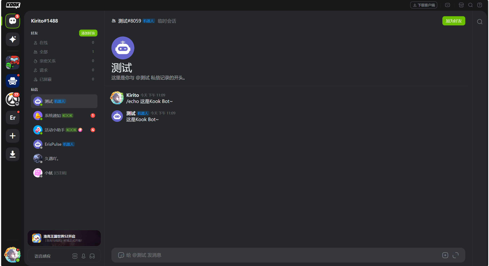
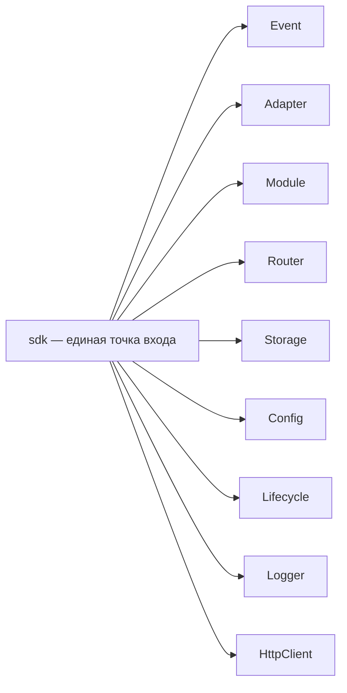

[English](README.md) | [简体中文](README.zh-CN.md) | [繁體中文](README.zh-TW.md) | [日本語](README.ja.md) | [Русский](README.ru.md)

# ErisPulse

**Пишите один раз — разворачивайте на QQ / Telegram / Kook / Yunhu / WeChat Official Account / OneBot12 / ... и множестве других платформ.**

Событийно-ориентированный модульный асинхронный фреймворк для ботов на основе стандартного интерфейса OneBot12. Бизнес-код пишется один раз, адаптеры скрывают различия между платформами; система плагинов, горячая перезагрузка и полный набор инструментов разработчика — всё из коробки.

<p>
  <a href="https://pypi.org/project/ErisPulse/"></a>
  <a href="https://pypi.org/project/ErisPulse/"></a>
  <a href="https://github.com/botuniverse/onebot-11"></a>
  <a href="https://12.onebot.dev/"></a>
  <a href="https://hub.docker.com/r/erispulse/erispulse"></a>
  <a href="https://github.com/ErisPulse/ErisPulse/blob/main/LICENSE"></a>
  <a href="https://pepy.tech/project/ErisPulse"></a>
  <a href="https://github.com/ErisPulse/ErisPulse/stargazers"></a>
  <a href="https://github.com/astral-sh/ruff"></a>
  <a href="https://socket.dev/pypi/package/erispulse"></a>
  <a href="https://www.erisdev.com"></a>
  <a href="https://deepwiki.com/ErisPulse/ErisPulse"></a>
  <a href="https://www.erisdev.com/#market"></a>
  <a href="https://github.com/ErisPulse/ErisPulse/discussions"></a>
</p>

<br clear="both">

---

<div align="center">

### Ключевые возможности

</div>

<table>
<tr>
<td width="33%" align="center" valign="top">
<br/>


### Событийно-ориентированная архитектура

Единая модель событий на базе OneBot12 — один handler подходит ко всем адаптерам

</td>
<td width="33%" align="center" valign="top">
<br/>


### Кроссплатформенная совместимость

15+ платформ — QQ / Telegram / Kook / Yunhu и другие — без единого изменения бизнес-кода

</td>
<td width="33%" align="center" valign="top">
<br/>


### Модульная архитектура

Горячая замена плагинов без перезапуска, scope управляется по платформе / боту / сессии

</td>
</tr>
<tr>
<td width="33%" align="center" valign="top">
<br/>



### Горячая перезагрузка

Изменения применяются сразу при сохранении — hot reload лёгкий и незаметный

</td>
<td width="33%" align="center" valign="top">
<br/>


### AI-помощник

Опишите требования на естественном языке — получите готовый к использованию модуль

</td>
<td width="33%" align="center" valign="top">
<br/>


### Простота и элегантность

Цепочки API: @ пользователя, ответ, повтор, массовая отправка — всё одной строкой

</td>
</tr>
</table>

---

## Как это работает

ErisPulse скрывает различия между платформами через слой адаптеров, позволяя бизнес-коду заботиться только о событиях:



- **Слой адаптеров** преобразует нативные протоколы платформ в стандартные события OneBot12, и бизнес-модули не видят различий между платформами
- **Шина Event** сначала выполняет цепочку middleware, затем распределяет события по типам в пять категорий обработчиков
- **Ваш код** подписывается на события декораторами и отвечает через `event.reply()` или SendDSL — ответное сообщение идёт тем же путём обратно к платформе

Подробности дизайна — состав модулей, процесс инициализации, события жизненного цикла и др. — см. в [обзоре архитектуры](docs/ru/architecture.md).

---

## Быстрый старт

### Скрипт установки в один клик (рекомендуется)

Скрипт установки автоматически определит ваше окружение (Docker, Python, uv), поможет выбрать наиболее подходящий способ установки и поддерживает несколько языков (китайский / English / 日本語 / Русский / традиционный китайский).

Windows (PowerShell):
```powershell
irm https://get.erisdev.com/install.ps1 -OutFile install.ps1; powershell -ExecutionPolicy Bypass -File install.ps1
```

macOS / Linux:
```bash
curl -fsSL https://get.erisdev.com/install.sh -o install.sh && chmod +x install.sh && ./install.sh
```

<table>
<tr>
<td align="center" width="50%">

**Демонстрация установки через Docker**

<video src="https://github.com/user-attachments/assets/a367a466-4678-46a9-b101-073a86388ede" controls width="100%"></video>

</td>
<td align="center" width="50%">

**Демонстрация установки через pip**

<video src="https://github.com/user-attachments/assets/a2df4009-dba6-411e-b79d-4454a168d063" controls width="100%"></video>

</td>
</tr>
</table>

### Установка через Docker (рекомендуется)

```bash
docker pull erispulse/erispulse:latest
```

<details>
<summary>Docker Hub недоступен?</summary>

Если Docker Hub недоступен, можно использовать GitHub Container Registry:

```bash
docker pull ghcr.io/erispulse/erispulse:latest
```

При использовании образа из ghcr.io нужно изменить image в `docker-compose.yml`:
```yaml
image: ghcr.io/erispulse/erispulse:latest
```

</details>

<details>
<summary>Быстрый запуск</summary>

```bash
# Скачать docker-compose.yml
curl -O https://raw.githubusercontent.com/ErisPulse/ErisPulse/main/docker-compose.yml

# Задать токен входа в Dashboard и запустить
ERISPULSE_DASHBOARD_TOKEN=your-token docker compose up -d
```

После запуска откройте `http://<host>:8000/Dashboard` и войдите в панель управления Dashboard с помощью заданного токена.

> Образ включает фреймворк ErisPulse и панель управления Dashboard, поддерживает архитектуры `linux/amd64` и `linux/arm64`.
>
> **Персистентность**: файлы конфигурации и установленные модули/адаптеры сохраняются на хост-машину через монтирование томов и не теряются при перезапуске контейнера. Обновление самого фреймворка выполняется через горячее обновление в Dashboard.

</details>

<details>
<summary>Переменные окружения Docker</summary>

| Переменная | По умолчанию | Описание |
|------|--------|------|
| `ERISPULSE_DASHBOARD_TOKEN` | пусто | Токен входа в Dashboard (после задания автоматически записывается в конфигурацию) |
| `ERISPULSE_PORT` | `8000` | Проброс порта Dashboard |
| `ERISPULSE_TAG` | `latest` | Тег образа; установите `dev`, чтобы использовать pre-release образ |
| `CONTAINER_NAME` | `erispulse` | Имя контейнера |
| `TZ` | `Asia/Shanghai` | Часовой пояс контейнера |
| `LANG` | `en_US.UTF-8` | Язык системы; автоматически определяет язык стартового интерфейса |
| `ERISPULSE_LANG` | пусто | Принудительный язык стартового интерфейса: `zh` / `zh_TW` / `en` / `ja` / `ru` (переопределяет `LANG`) |

</details>

### Магазин приложений 1Panel

Установите ErisPulse в один клик через магазин приложений [1Panel](https://1panel.cn), подробнее см. [ErisPulse-1Panel](https://github.com/ErisPulse/ErisPulse-1Panel).

```bash
bash <(curl -sL https://get-1panel.erisdev.com/install.sh)
```

ErisPulse также доступен в стороннем магазине приложений 1Panel — установка через сторонний репозиторий [okxlin/appstore](https://github.com/okxlin/appstore).

### Установка через pip

```bash
pip install ErisPulse
```

Если хотите использовать `epsdk` как глобальный CLI-инструмент без виртуального окружения, рекомендуется `uv tool install`:

```bash
uv tool install ErisPulse
```

> Также можно воспользоваться скриптом установки в один клик выше: он сам определит окружение и проведёт настройку (в меню скрипта есть и вариант «глобальная установка CLI (uv tool)»).

### Инициализация проекта

```bash
# Интерактивная инициализация
epsdk init

# Быстрая инициализация (с указанием имени проекта)
epsdk init -q -n my_bot
```

### Создание первого бота

Создайте файл `main.py`:

<table>
<tr>
<td width="50%" valign="top">

**Обработчик команд**

```python
from ErisPulse import sdk
from ErisPulse.Core.Event import command

@command("hello", help="Отправить приветственное сообщение")
async def hello_handler(event):
    user_name = event.get_user_nickname() or "друг"
    await event.reply(f"Привет, {user_name}!")

@command("ping", help="Проверить, на связи ли бот")
async def ping_handler(event):
    await event.reply("Pong! Бот работает штатно.")

if __name__ == "__main__":
    import asyncio
    asyncio.run(sdk.run(keep_running=True))
```

</td>
<td width="50%" valign="top">

**Описание результата**

Отправьте `/hello`

Бот отвечает: `Привет, {имя пользователя}!`

---

Отправьте `/ping`

Бот отвечает: `Pong! Бот работает штатно.`

---

**Как запустить**

```bash
epsdk run main.py
# или режим разработки
epsdk run main.py --reload
```

</td>
</tr>
</table>

Подробные инструкции смотрите в:
- [Руководстве по быстрому старту](docs/ru/quick-start.md)
- [Руководстве для начинающих](docs/ru/getting-started/)

---

## Один и тот же код. Несколько платформ.

*Абсолютно одинаковые обработчики команд. Разные платформы. Ни единого изменения бизнес-логики.*

<table>
<tr>
<td align="center" width="33%">

**Kook**



</td>
<td align="center" width="33%">

**QQ**


</td>
<td align="center" width="33%">

**Yunhu**


</td>
</tr>
</table>

## Экосистема модулей

Экосистема модулей, поддерживаемая командой и сообществом — панель управления [Dashboard](https://github.com/ErisPulse/ErisPulse-Dashboard), AI-нативная серверная прямо в чате [MyServer](https://github.com/wsu2059q/ErisPulse-MyServer), модуль AI-агентов [QvQChat](https://github.com/wsu2059q/ErisPulse-QvQChat), а также десятки функциональных модулей от сообщества:

<table>
<tr>
<td align="center" width="33%">

**Dashboard** — Веб-панель управления


</td>
<td align="center" width="33%">

**MyServer** — AI-нативная серверная прямо в чате


</td>
<td align="center" width="33%">

**QvQChat** — Модуль AI-агентов


</td>
</tr>
</table>

Маркет модулей: https://www.erisdev.com/#market

---


---

## Цепочечная отправка DSL

@ пользователя, ответ, повтор, таймаут, callback при успехе — сложная логика отправки записывается одной цепочкой:

```python
yunhu = sdk.adapter.get("yunhu")

# Одиночная отправка: @пользователь + ответ + повторы + callback при успехе
await (yunhu.Send.To("group", "123").At("456").Reply("msg_789")
       .Retry(3).Timeout(10)
       .Hook(lambda r: print("Отправка успешна!")).Text("Привет"))

# Массово: несколько сообщений одной цепочкой
results = await (yunhu.Send.To("user", "123").Build()
                 .Text("Уведомление 1").Image("pic.jpg").Retry(2).send_all())
```

> Все цепочечные методы — Hook / Retry / Timeout / OnProgress / Defer / Build и др. — описаны в [документации SendDSL](docs/ru/developer-guide/adapters/send-dsl.md).

---

## Пример многошагового диалога

Сбор информации, валидация ввода, подтверждение отправки — без ручного управления состоянием диалога:

```python
from ErisPulse.Core.Event import command

@command("register")
async def register_handler(event):
    conv = event.conversation(timeout=60)
    await conv.say("Добро пожаловать в регистрацию!")
    data = await conv.collect([
        {"key": "name", "prompt": "Введите имя"},
        {"key": "age", "prompt": "Введите возраст",
         "validator": lambda e: e.get_text().strip().isdigit(),
         "retry_prompt": "Возраст должен быть числом, введите ещё раз"},
    ])
    if data and await conv.confirm(f"Подтвердить регистрацию? Имя: {data['name']}, возраст: {data['age']}"):
        await event.reply(f"Регистрация успешна! Добро пожаловать, {data['name']}")
```

> Полные возможности — вопросы с выбором (choose), ветвления (branch / goto), персистентность и др. — см. в [Conversation: многошаговые диалоги](docs/ru/advanced/conversation.md).

---

## Основные модули

Один вход `sdk`, объединяющий все ключевые возможности:



| Модуль | Описание |
|------|------|
| **Event** | Система событий: пять типов событий command / message / notice / request / meta + многошаговые диалоги Conversation |
| **Adapter** | Управление адаптерами: базовый класс BaseAdapter унифицирует преобразование событий и отправку через SendDSL, поддержка 15+ платформ: QQ / Telegram / Kook / Yunhu / WeChat Official Account и др. |
| **Module** | Управление модулями: базовый класс BaseModule + декларация зависимостей и загрузка в топологическом порядке |
| **SendDSL** | Цепочечная отправка: сложная логика — @, ответ, повтор, таймаут, массовая отправка — в одну строку |
| **Router** | Система маршрутизации HTTP/WebSocket (FastAPI + Uvicorn) |
| **Storage** | Хранилище «ключ-значение» на базе SQLite + универсальные цепочечные SQL-запросы |
| **Config** | Управление конфигурацией TOML |
| **Lifecycle** | Хуки событий жизненного цикла (core.init / adapter.* / module.*) |
| **Logger** | Модульная система логирования с поддержкой дочерних логгеров |
| **HttpClient** | Единый HTTP/WS клиент (на базе aiohttp) со встроенными повторами и системой исключений ErisPulse |

Подробнее о дизайне (процесс инициализации, события жизненного цикла, стратегия загрузки модулей) см. в [обзоре архитектуры](docs/ru/architecture.md).

---

## Scope — трёхмерная плоскость управления разрешениями

Не изменяя код модулей, единообразно объявляйте в конфигурации «в каких пределах они действуют»:

```toml
[ErisPulse.scope.platforms.onebot11]
modules = ["Chat", "Tool*"]           # ① Измерение модулей: на этой платформе открыты только эти модули (glob / regex)

[ErisPulse.scope.identity.users.onebot11]
deny = ["u_bad", "spam_*"]            # ② Измерение идентификации: события пользователей из чёрного списка отбрасываются сразу

[ErisPulse.scope.actions.MyModule]
send = { allow = ["Text"] }           # ③ Исходящее измерение: этому модулю разрешено отправлять только текст
api = { deny = ["set_*", "leave_*"] } #    и запрещены API управления
```

```python
# Также можно настраивать во время выполнения — применяется мгновенно (чтение/запись как в словарь с поддержкой точечных путей)
sdk.scope.set_action("MyModule", "api", deny=["set_*"])
```

> Подробнее см. [Scope](docs/ru/advanced/scope.md)

---

## Переопределение событий — меняйте поведение любых типов событий, не трогая код модулей

Сменить слово-триггер или добавить команде ограничение по администратору — исходный код модуля не трогается, достаточно конфигурации:

```toml
# Переопределение условий срабатывания обработчиков сообщений (AND с условиями в коде; поддерживаются все типы: meta/message/notice/request/command)
[ErisPulse.event.overrides.message.ChatModule]
pattern = "болталка*"

# Переопределение параметров команд (master / hidden / aliases / prefix и др., приоритет у пользователя)
[ErisPulse.event.overrides.command.MyModule.restart]
master = true
```

> Подробнее см. [Переопределение событий](docs/ru/getting-started/event-handling.md)

---

## Экосистема

ErisPulse — это больше, чем фреймворк. Установил — и начал, не нужно изобретать всё с нуля.

<table>
<tr>
<td align="center" width="25%">

**Фреймворк**

Основной runtime

Единая модель событий и сообщений

</td>
<td align="center" width="25%">

**Dashboard**

Визуальное управление

Плагины · Логи · Конфигурация

[Онлайн-демо →](https://dashdemo.erisdev.com/)

</td>
<td align="center" width="25%">

**AI Builder**

Естественный язык → готовый модуль

[Попробовать сейчас →](https://builder.erisdev.com)

</td>
<td align="center" width="25%">

**Маркет модулей**

Плагины, готовые к работе сразу после установки

[Смотреть модули →](https://www.erisdev.com/#market)

</td>
</tr>
<tr>
<td align="center" width="25%">

**Адаптеры**

Подключение 15+ платформ

</td>
<td align="center" width="25%">

**ErisPulse-App**

Официальный клиент для множества платформ

Запуск прямо с телефона · Постоянно в трее на рабочем столе

[Скачать и установить →](https://github.com/ErisPulse/ErisPulse-App/releases)

</td>
<td align="center" width="25%">

**Docker**

Поддержка мультиархитектуры

`erispulse/erispulse`

</td>
<td align="center" width="25%">

**Документация & CLI**

[erisdev.com](https://www.erisdev.com)

`epsdk` — инструмент-скафолд

</td>
</tr>
</table>

---

## Поддерживаемые платформы

Будем рады вашим адаптерам! Не знаете, с чего начать? Смотрите [руководство для контрибьюторов](docs/ru/contributing/README.md).

| Адаптер | Описание |
|--------|------|
|  [Kook](https://github.com/shanfishapp/ErisPulse-KookAdapter) | Платформа мгновенных сообщений Kook (Kaiheila) |
|  [Matrix](https://github.com/ErisPulse/ErisPulse-MatrixAdapter) | Децентрализованный протокол связи Matrix |
|  [OneBot11](https://github.com/ErisPulse/ErisPulse-OneBot11Adapter) | Универсальный протокол ботов OneBot v11 |
|  [OneBot12](https://github.com/ErisPulse/ErisPulse-OneBot12Adapter) | Стандартный протокол OneBot v12 |
|  [SnowLuma](https://github.com/ErisPulse/ErisPulse-SnowLumaAdapter) | Адаптер OneBot v11 на основе бэкенда SnowLuma (NTQQ hook) |
|  [QQ](https://github.com/ErisPulse/ErisPulse-QQBotAdapter) | Официальная платформа ботов QQ |
|  [Песочница](https://github.com/ErisPulse/ErisPulse-SandboxAdapter) | Отладка в веб-интерфейсе без подключения к реальной платформе |
|  [Терминал](https://github.com/ErisPulse/ErisPulse-TerminalAdapter) | Командная строка как чат — разработка и отладка с нулевой настройкой |
|  [Telegram](https://github.com/ErisPulse/ErisPulse-TelegramAdapter) | Глобальная платформа мгновенных сообщений |
| [Bilibili](https://github.com/ErisPulse/ErisPulse-BilibiliAdapter) | Личные сообщения Bilibili, вход по Cookie / QR-коду |
|  [Почта](https://github.com/ErisPulse/ErisPulse-EmailAdapter) | Адаптер приёма и отправки электронной почты |
|  [Yunhu](https://github.com/ErisPulse/ErisPulse-YunhuAdapter) | Корпоративная платформа мгновенных сообщений (подключение ботов) |
|  [Yunhu User](https://github.com/wsu2059q/ErisPulse-YunhuUserAdapter) | Адаптер подключения на основе пользовательского протокола Yunhu |
| [Oopz](https://github.com/ErisPulse/ErisPulse-OopzAdapter) | Голосовое сообщество Oopz (протокол сообщества, вход через аккаунт пользователя, рекомендуется использовать запасной аккаунт) |
| [Кафе Хуафэн](https://github.com/ErisPulse/ErisPulse-Ideaura/) | Allons! \(・ω・) / |
|  [Discord](https://github.com/ErisPulse/ErisPulse-DiscordAdapter) | Глобальная платформа для сообществ с поддержкой серверов, каналов и личных сообщений |
| [Minecraft](https://github.com/ErisPulse/ErisPulse-MinecraftAdapter) | Сервер Minecraft Java Edition (RCON), выполнение команд и прослушивание логов |
|  [Webhook](https://github.com/ErisPulse/ErisPulse-WebhookAdapter) | Универсальный HTTP-адаптер-мост для интеграции с любыми системами |
|  [WeChat Official Account](https://github.com/ErisPulse/ErisPulse-WechatMpAdapter) | Официальная платформа публичных аккаунтов WeChat |
| [WeCom](https://github.com/ErisPulse/ErisPulse-WeComAdapter) | Бот собственного приложения WeCom, приём колбэков и проактивные сообщения |
| [WeChat ClawBot](https://github.com/ErisPulse/ErisPulse-WechatClaw) | Официальный канал WeChat ClawBot (iLink Bot API), привязка личного аккаунта по QR-коду |

Подробнее в [подробном описании адаптеров](docs/ru/platform-guide/README.md)

---

## Сообщество

Общайтесь с нами:

- Telegram: <https://t.me/ErisPulse>
- QQ-группа: <https://qm.qq.com/q/TOwnCmypcy>
- Группа Yunhu: <https://yhfx.jwznb.com/share?key=VWJL4fTWXepa&ts=1781889199>

Проект оказался полезен? Поддержите нашу дальнейшую разработку на [Afdian](https://ifdian.net/a/YingXinche)!

---

## Спонсоры

ErisPulse — открытый проект под лицензией MIT: весь код и документация навсегда останутся бесплатными и открытыми, и спонсорство этого не изменит.

[](https://ifdian.net/a/YingXinche)

---

## Star History

Если ErisPulse вам помог, поставьте Star ⭐ — это самый прямой способ показать проект большему числу разработчиков.

[](https://star-history.com/#ErisPulse/ErisPulse&Date)

---

### Руководство по внесению вклада

Для благополучия проекта ErisPulse нужна и ваша помощь! Мы приветствуем любые формы вклада:

1. **Сообщения об ошибках** — создавайте баг-репорты в [GitHub Issues](https://github.com/ErisPulse/ErisPulse/issues)
2. **Запросы функций** — делитесь новыми идеями в [обсуждениях сообщества](https://github.com/ErisPulse/ErisPulse/discussions)
3. **Вклад в код** — перед отправкой PR прочитайте [стиль кода](docs/ru/styleguide/) и [руководство по внесению вклада](CONTRIBUTING.md)
4. **Улучшение документации** — помогайте развивать документацию и примеры кода

**Первый вклад?** Начните здесь 👉 [Первый вклад на практике](docs/ru/contributing/first-contribution.md)

[Присоединяйтесь к обсуждениям сообщества](https://github.com/ErisPulse/ErisPulse/discussions)

---

<div align="center">

### Благодарности


Слой стандартизации основных адаптеров опирается на [спецификацию OneBot12](https://12.onebot.dev/) и извлекает из неё пользу.

Раннее развитие ErisPulse было бы невозможно без поддержки сообщества разработчиков Yunhu — многие идеи, адаптеры и практический опыт родились именно там.

Также благодарим всех разработчиков и авторов проектов, внёсших вклад в ErisPulse, экосистему OneBot и сообщество open source.

</div>