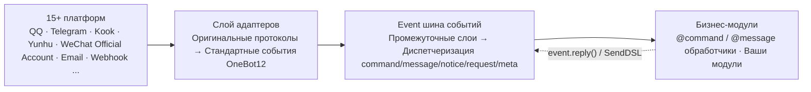
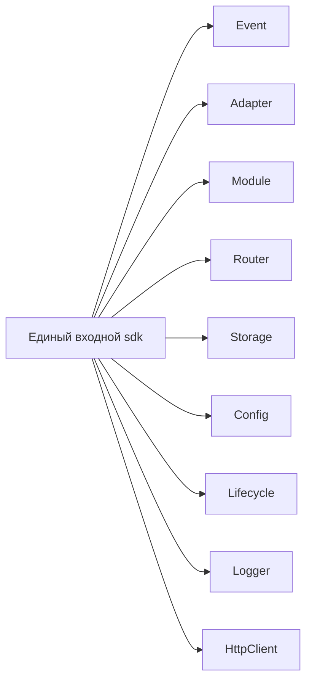

[English](README.md) | [简体中文](README.zh-CN.md) | [繁體中文](README.zh-TW.md) | [日本語](README.ja.md) | **Русский**

# ErisPulse

**Написано один раз, развернуто на QQ / Telegram / Kook / Yunhu / WeChat Official Account / OneBot12 / ... нескольких платформах.**

Модульная асинхронная фреймворк-рамка для роботов на основе стандартного интерфейса OneBot12, основанная на событийно-ориентированном подходе. Бизнес-код пишется только один раз, адаптеры скрывают различия между платформами; система плагинов, горячая перезагрузка и полный набор инструментов разработчика готовы к использованию.

<p>
  <a href="https://pypi.org/project/ErisPulse/"></a>
  <a href="https://pypi.org/project/ErisPulse/"></a>
  <a href="https://github.com/botuniverse/onebot-11"></a>
  <a href="https://12.onebot.dev/"></a>
  <a href="https://hub.docker.com/r/erispulse/erispulse"></a>
  <a href="https://github.com/ErisPulse/ErisPulse/blob/main/LICENSE"></a>
  <a href="https://pepy.tech/project/ErisPulse"></a>
  <a href="https://github.com/astral-sh/ruff"></a>
  <a href="https://socket.dev/pypi/package/erispulse"></a>
  <a href="https://www.erisdev.com"></a>
  <a href="https://deepwiki.com/ErisPulse/ErisPulse"></a>
  <a href="https://www.erisdev.com/#market"></a>
  <a href="https://github.com/ErisPulse/ErisPulse/discussions"></a>
</p>

<br clear="both">

---

<div align="center">

### Основные особенности

</div>

<table>
<tr>
<td width="33%" align="center" valign="top">
<br/>


### Архитектура на основе событий

На основе единой модели событий OneBot12, один обработчик для всех адаптеров

</td>
<td width="33%" align="center" valign="top">
<br/>


### Совместимость с различными платформами

QQ / Telegram / Kook / Yunhu и 15+ платформ, бизнес-код без изменений

</td>
<td width="33%" align="center" valign="top">
<br/>


### Модульная архитектура

Плагины подключаются и отключаются без перезапуска, управление с помощью платформ / ботов / сессий

</td>
</tr>
<tr>
<td width="33%" align="center" valign="top">
<br/>


### Горячая перезагрузка

Сохранение и применение изменений без перезапуска

</td>
<td width="33%" align="center" valign="top">
<br/>


### Помощь ИИ

Описание требований естественным языком, генерация готовых модулей

</td>
<td width="33%" align="center" valign="top">
<br/>


### Простота и элегантность

Цепочечный API: @пользователя, ответ, повтор, массовая отправка — всё в одной строке

</td>
</tr>
</table>

---

## Принцип работы

ErisPulse скрывает различия между платформами через слой адаптеров, позволяя бизнес-коду сосредоточиться только на событиях:



- **Слой адаптеров** преобразует протоколы платформ в стандартные события OneBot12, бизнес-модули не видят различий между платформами
- **Event шина событий** сначала выполняет цепочку промежуточных слоев, затем диспетчеризует события по пяти типам обработчиков
- **Ваш код** подписывается на события с помощью декораторов, использует `event.reply()` или SendDSL для ответа — сообщения возвращаются обратно на платформу по тому же пути

Детали архитектуры, структуры модулей, процесса инициализации, жизненного цикла событий и т.д. см. в [Обзоре архитектуры](docs/ru/architecture.md).

---

## Быстрый старт

### Сценарий установки (рекомендуется)

Сценарий установки автоматически определяет среду (Docker, Python, uv), предлагает подходящий способ установки и поддерживает несколько языков (китайский / English / японский / Русский / традиционный китайский).

Windows (PowerShell):
```powershell
irm https://get.erisdev.com/install.ps1 -OutFile install.ps1; powershell -ExecutionPolicy Bypass -File install.ps1
```

macOS / Linux:
```bash
curl -fsSL https://get.erisdev.com/install.sh -o install.sh && chmod +x install.sh && ./install.sh
```

<table>
<tr>
<td align="center" width="50%">

**Демонстрация установки через Docker**

<video src="https://github.com/user-attachments/assets/a367a466-4678-46a9-b101-073a86388ede" controls width="100%"></video>

</td>
<td align="center" width="50%">

**Демонстрация установки через pip**

<video src="https://github.com/user-attachments/assets/a2df4009-dba6-411e-b79d-4454a168d063" controls width="100%"></video>

</td>
</tr>
</table>

### Использование Docker (рекомендуется)

```bash
docker pull erispulse/erispulse:latest
```

<details>
<summary>Не работает Docker Hub?</summary>

Если Docker Hub недоступен, можно использовать GitHub Container Registry:

```bash
docker pull ghcr.io/erispulse/erispulse:latest
```

При использовании образа ghcr.io необходимо изменить `docker-compose.yml`:
```yaml
image: ghcr.io/erispulse/erispulse:latest
```

</details>

<details>
<summary>Быстрый запуск</summary>

```bash
# Скачать docker-compose.yml
curl -O https://raw.githubusercontent.com/ErisPulse/ErisPulse/main/docker-compose.yml

# Установить токен для доступа к Dashboard и запустить
ERISPULSE_DASHBOARD_TOKEN=your-token docker compose up -d
```

После запуска перейдите на `http://<host>:8000/Dashboard` и войдите в панель управления с установленным токеном.

> Образ содержит фреймворк ErisPulse и панель управления Dashboard, поддерживает архитектуры `linux/amd64` и `linux/arm64`.
>
> **Длительное хранение:** конфигурационные файлы и установленные модули/адаптеры сохраняются на хост-машине через тома, при перезапуске контейнера они не теряются. Обновление фреймворка выполняется через горячую перезагрузку в Dashboard.

</details>

<details>
<summary>Переменные среды Docker</summary>

| Переменная | Значение по умолчанию | Описание |
|------|--------|------|
| `ERISPULSE_DASHBOARD_TOKEN` | пусто | Токен доступа к Dashboard (автоматически записывается в конфигурацию) |
| `ERISPULSE_PORT` | `8000` | Порт для Dashboard |
| `ERISPULSE_TAG` | `latest` | Тег образа, можно установить `dev` для предварительного выпуска |
| `CONTAINER_NAME` | `erispulse` | Имя контейнера |
| `TZ` | `Asia/Shanghai` | Часовой пояс контейнера |
| `LANG` | `en_US.UTF-8` | Язык системы, автоматически определяется язык интерфейса запуска |
| `ERISPULSE_LANG` | пусто | Принудительный язык интерфейса запуска: `zh` / `zh_TW` / `en` / `ja` / `ru` (переопределяет `LANG`) |

</details>

### 1Panel приложение в магазине

Установите ErisPulse через [1Panel](https://1panel.cn) приложение в магазине, подробности см. в [ErisPulse-1Panel](https://github.com/ErisPulse/ErisPulse-1Panel).

```bash
bash <(curl -sL https://get-1panel.erisdev.com/install.sh)
```

ErisPulse доступен в магазине приложений 1Panel, можно использовать [okxlin/appstore](https://github.com/okxlin/appstore) сторонний репозиторий.

### Использование pip

```bash
pip install ErisPulse
```

Если вы хотите использовать `epsdk` как глобальный командный инструмент, не в виртуальной среде, рекомендуется `uv tool install`:

```bash
uv tool install ErisPulse
```

> Также можно использовать сценарий установки, который автоматически определяет среду и настраивает (в меню сценария также доступен способ глобальной установки CLI через `uv tool`).

### Инициализация проекта

```bash
# Интерактивная инициализация
epsdk init

# Быстрая инициализация (указание имени проекта)
epsdk init -q -n my_bot
```

### Создание первого бота

Создайте файл `main.py`:

<table>
<tr>
<td width="50%" valign="top">

**Обработчик команд**

```python
from ErisPulse import sdk
from ErisPulse.Core.Event import command

@command("hello", help="Отправить приветственное сообщение")
async def hello_handler(event):
    user_name = event.get_user_nickname() or "друг"
    await event.reply(f"Привет, {user_name}!")

@command("ping", help="Проверить, работает ли бот")
async def ping_handler(event):
    await event.reply("Pong! Бот работает нормально.")

if __name__ == "__main__":
    import asyncio
    asyncio.run(sdk.run(keep_running=True))
```

</td>
<td width="50%" valign="top">

**Описание результатов**

Отправка `/hello`

Бот отвечает: `Привет, {имя пользователя}!`

---

Отправка `/ping`

Бот отвечает: `Pong! Бот работает нормально.`

---

**Способы запуска**

```bash
epsdk run main.py
# или в режиме разработки
epsdk run main.py --reload
```

</td>
</tr>
</table>

Более подробные инструкции см. в:
- [Руководство по быстрому запуску](docs/ru/quick-start.md)
- [Введение](docs/ru/getting-started/)

---

## Один и тот же код. Разные платформы.

*Одинаковые обработчики команд. Разные платформы. Без изменений бизнес-логики.*

<table>
<tr>
<td align="center" width="33%">

**Kook**


</td>
<td align="center" width="33%">

**QQ**


</td>
<td align="center" width="33%">

**Yunhu**


</td>
</tr>
</table>

---

## Цепочка отправки DSL

@пользователя, ответ, повтор, таймаут, успешный обратный вызов — сложную логику отправки можно описать одной цепочкой:

```python
yunhu = sdk.adapter.get("yunhu")

# Отправка одного сообщения: @пользователя + ответ + повтор + обратный вызов
await (yunhu.Send.To("group", "123").At("456").Reply("msg_789")
       .Retry(3).Timeout(10)
       .Hook(lambda r: print("Отправка успешна!")).Text("Привет"))

# Массовая отправка: одна цепочка для нескольких сообщений
results = await (yunhu.Send.To("user", "123").Build()
                 .Text("Уведомление 1").Image("pic.jpg").Retry(2).send_all())
```

> Все цепочные методы, такие как Hook / Retry / Timeout / OnProgress / Defer / Build, см. в [Документации SendDSL](docs/ru/developer-guide/adapters/send-dsl.md).

---

## Пример многошагового диалога

Сбор информации, проверка ввода, подтверждение отправки — не нужно управлять состоянием диалога:

```python
from ErisPulse.Core.Event import command

@command("register")
async def register_handler(event):
    conv = event.conversation(timeout=60)
    await conv.say("Добро пожаловать! Регистрация начата.")
    data = await conv.collect([
        {"key": "name", "prompt": "Введите имя"},
        {"key": "age", "prompt": "Введите возраст",
         "validator": lambda e: e.get_text().strip().isdigit(),
         "retry_prompt": "Возраст должен быть числом, повторите ввод"},
    ])
    if data and await conv.confirm(f"Подтвердить регистрацию? Имя: {data['name']}, возраст: {data['age']}"):
        await event.reply(f"Регистрация успешна! Добро пожаловать, {data['name']}")
```

> Полный функционал, включая опросы с вариантами (choose), ветвления (branch / goto), сохранение состояния, см. в [Многошаговом диалоге](docs/ru/advanced/conversation.md).

---

## Основные модули

Единый входной `sdk`, объединяющий все основные возможности:



| Модуль | Описание |
|------|------|
| **Event** | Система событий, предоставляющая пять типов событий: command / message / notice / request / meta + многошаговой диалог |
| **Adapter** | Управление адаптерами, базовый класс BaseAdapter для унифицированного преобразования событий и SendDSL, поддержка 15+ платформ: QQ / Telegram / Kook / Yunhu / WeChat Official Account |
| **Module** | Управление модулями, базовый класс BaseModule + декларация зависимостей и топологическая сортировка загрузки |
| **SendDSL** | Цепочечная отправка, @пользователя / ответ / повтор / таймаут / массовая отправка — всё в одной строке |
| **Router** | Система маршрутизации HTTP/WebSocket (FastAPI + Uvicorn) |
| **Storage** | Хранилище на основе SQLite + универсальный SQL-чейн-запрос |
| **Config** | Управление конфигурацией в формате TOML |
| **Lifecycle** | Хуки жизненного цикла (core.init / adapter.* / module.*) |
| **Logger** | Модульная система логирования, поддержка под-логгеров |
| **HttpClient** | Единый HTTP/WS-клиент (на основе aiohttp), встроенные повторы и исключения ErisPulse |

Детали архитектуры (процесс инициализации, события жизненного цикла, стратегия загрузки модулей), см. в [Обзоре архитектуры](docs/ru/architecture.md).

---

## Области видимости (Scope) — трёхмерное управление правами

Без изменения кода модуля, в конфигурации можно объявить "в каком диапазоне действует":

```toml
[ErisPulse.scope.platforms.onebot11]
modules = ["Chat", "Tool*"]           # ① Модульный уровень: на этой платформе доступны только эти модули (glob / регулярное выражение)

[ErisPulse.scope.identity.users.onebot11]
deny = ["u_bad", "spam_*"]            # ② Уровень идентификации: события пользователей из черного списка игнорируются

[ErisPulse.scope.actions.MyModule]
send = { allow = ["Text"] }           # ③ Уровень исходящих действий: этот модуль может отправлять только текст
api = { deny = ["set_*", "leave_*"] } #    и запрещает управление API
```

```python
# Также можно изменять в рантайме, сразу применяется (поддержка точечных путей в виде словаря)
sdk.scope.set_action("MyModule", "api", deny=["set_*"])
```

> Подробнее см. в [Области видимости (scope)](docs/ru/advanced/scope.md)

---

## Переопределение событий — без изменения кода модуля, переопределить поведение любого типа события

Изменить триггер, добавить ограничение администратора, не трогая исходный код модуля, конфигурация применяется мгновенно:

```toml
# Переопределение условия триггера обработчика сообщений (AND с условиями в коде; поддержка всех типов: meta/message/notice/request/command)
[ErisPulse.event.overrides.message.ChatModule]
pattern = "闲聊*"

# Переопределение реализации команды (параметры master / hidden / aliases / prefix и др., приоритет у пользователя)
[ErisPulse.event.overrides.command.MyModule.restart]
master = true
```

> Подробнее см. в [Переопределении событий](docs/ru/getting-started/event-handling.md)

---

## Экосистема

ErisPulse — это не просто фреймворк. Установите и начните работать, не нужно создавать колесо с нуля.

<table>
<tr>
<td align="center" width="25%">

**Фреймворк**

Основной рантайм

Единая модель событий и сообщений

</td>
<td align="center" width="25%">

**Dashboard**

Визуальное управление

Плагины · Логи · Конфигурация

[Онлайн-демо →](https://dashdemo.erisdev.com/)

</td>
<td align="center" width="25%">

**AI Builder**

Естественный язык → Готовые модули

[Опыт использования →](https://builder.erisdev.com)

</td>
<td align="center" width="25%">

**Модульный рынок**

Готовые плагины

[Просмотр модулей →](https://www.erisdev.com/#market)

</td>
</tr>
<tr>
<td align="center" width="25%">

**Адаптеры**

Подключение к 15+ платформам

</td>
<td align="center" width="25%">

**ErisPulse-App**

Официальный мультиплатформенный клиент

Работает на телефоне · Запускается в трее

[Скачать и установить →](https://github.com/ErisPulse/ErisPulse-App/releases)

</td>
<td align="center" width="25%">

**Docker**

Поддержка нескольких архитектур

`erispulse/erispulse`

</td>
<td align="center" width="25%">

**Документация и CLI**

[erisdev.com](https://www.erisdev.com)

`epsdk` инструмент для создания проектов

</td>
</tr>
</table>

---

## Поддерживаемые платформы

Мы приветствуем вклад в развитие адаптеров! Не знаете, с чего начать? Посмотрите [Руководство по вкладу](docs/ru/contributing/README.md).

| Адаптер | Описание |
|--------|------|
|  [Kook](https://github.com/shanfishapp/ErisPulse-KookAdapter) | Платформа мгновенных сообщений Kook (开黑啦) |
|  [Matrix](https://github.com/ErisPulse/ErisPulse-MatrixAdapter) | Децентрализованный протокол связи Matrix |
|  [OneBot11](https://github.com/ErisPulse/ErisPulse-OneBot11Adapter) | Общий протокол роботов OneBot v11 |
|  [OneBot12](https://github.com/ErisPulse/ErisPulse-OneBot12Adapter) | Стандартный протокол OneBot v12 |
|  [QQ](https://github.com/ErisPulse/ErisPulse-QQBotAdapter) | Официальная платформа роботов QQ |
|  [Sandbox](https://github.com/ErisPulse/ErisPulse-SandboxAdapter) | Веб-дебаг, без подключения к реальной платформе |
|  [Terminal](https://github.com/ErisPulse/ErisPulse-TerminalAdapter) | Терминал как чат, разработка без настроек |
|  [Telegram](https://github.com/ErisPulse/ErisPulse-TelegramAdapter) | Глобальная платформа мгновенных сообщений |
|  [Email](https://github.com/ErisPulse/ErisPulse-EmailAdapter) | Адаптер для отправки и получения по протоколу Email |
|  [Yunhu](https://github.com/ErisPulse/ErisPulse-YunhuAdapter) | Корпоративная платформа мгновенных сообщений (подключение роботов) |
|  [Yunhu User](https://github.com/wsu2059q/ErisPulse-YunhuUserAdapter) | Адаптер на основе пользовательского протокола Yunhu |
| [花枫咖啡馆](https://github.com/ErisPulse/ErisPulse-Ideaura/) | Allons! \(・ω・) / |
|  [Discord](https://github.com/ErisPulse/ErisPulse-DiscordAdapter) | Глобальная платформа для сообществ, поддержка серверов, каналов и личных сообщений |
|  [Webhook](https://github.com/ErisPulse/ErisPulse-WebhookAdapter) | Общий адаптер HTTP-моста, подключение к любым системам |
|  [WeChat Official Account](https://github.com/ErisPulse/ErisPulse-WechatMpAdapter) | Официальная платформа WeChat Official Account |

Смотрите [подробное описание адаптеров](docs/ru/platform-guide/README.md)

---

## Сообщество

Общайтесь с нами:

- Telegram: <https://t.me/ErisPulse>
- QQ группа: <https://qm.qq.com/q/TOwnCmypcy>
- Yunhu группа: <https://yhfx.jwznb.com/share?key=VWJL4fTWXepa&ts=1781889199>

---

### Руководство по вкладу

Здоровье проекта ErisPulse зависит от вашей помощи! Мы приветствуем любые формы вклада:

1. **Сообщение об ошибках** — отправьте отчёт об ошибке в [GitHub Issues](https://github.com/ErisPulse/ErisPulse/issues)
2. **Запрос функции** — предложите новую идею в [обсуждениях](https://github.com/ErisPulse/ErisPulse/discussions)
3. **Вклад в код** — перед отправкой PR прочтите [стиль кода](docs/ru/styleguide/) и [руководство по вкладу](CONTRIBUTING.md)
4. **Улучшение документации** — помогите улучшить документацию и примеры кода

**Первый вклад?** Начните здесь 👉 [Первый практический вклад](docs/ru/contributing/first-contribution.md)

[Присоединиться к обсуждениям](https://github.com/ErisPulse/ErisPulse/discussions)

---

<div align="center">

### Благодарности


Некоторый код проекта основан на [sdkFrame](https://github.com/runoneall/sdkFrame), а адаптерная стандартизированная часть вдохновлена и опирается на [спецификацию OneBot12](https://12.onebot.dev/).

Ранние исследования и развитие ErisPulse не обошлись без поддержки сообщества разработчиков Yunhu, многие идеи, адаптеры и опытные практики родились здесь.

Также благодарим всех, кто внес свой вклад в ErisPulse, OneBot-экосистему и открытые проекты.