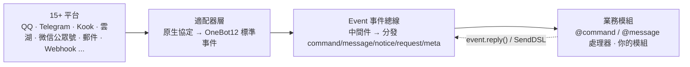
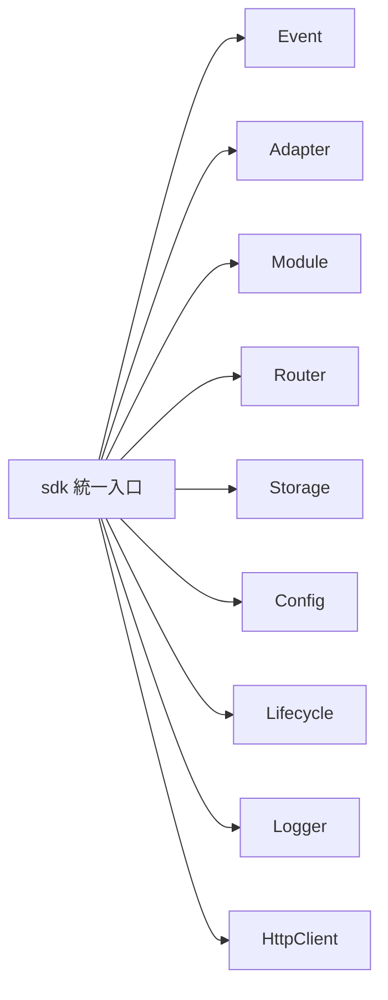

[English](README.md) | [简体中文](README.zh-CN.md) | **繁體中文** | [日本語](README.ja.md) | [Русский](README.ru.md)

# ErisPulse

**一次編寫，部署到 QQ / Telegram / Kook / 雲湖 / 微信公眾號 / OneBot12 / ... 多個平台。**

基於 OneBot12 標準介面，事件驅動的模組化非同步機器人框架。業務程式碼只寫一遍，介面卡負責遮蔽各平台差異；外掛系統、熱重載與完整開發者工具鏈開箱即用。

<p>
  <a href="https://pypi.org/project/ErisPulse/"></a>
  <a href="https://pypi.org/project/ErisPulse/"></a>
  <a href="https://github.com/botuniverse/onebot-11"></a>
  <a href="https://12.onebot.dev/"></a>
  <a href="https://hub.docker.com/r/erispulse/erispulse"></a>
  <a href="https://github.com/ErisPulse/ErisPulse/blob/main/LICENSE"></a>
  <a href="https://pepy.tech/project/ErisPulse"></a>
  <a href="https://github.com/ErisPulse/ErisPulse/stargazers"></a>
  <a href="https://github.com/astral-sh/ruff"></a>
  <a href="https://socket.dev/pypi/package/erispulse"></a>
  <a href="https://www.erisdev.com"></a>
  <a href="https://deepwiki.com/ErisPulse/ErisPulse"></a>
  <a href="https://www.erisdev.com/#market"></a>
  <a href="https://github.com/ErisPulse/ErisPulse/discussions"></a>
</p>

<br clear="both">

---

<div align="center">

### 核心特性

</div>

<table>
<tr>
<td width="33%" align="center" valign="top">
<br/>


### 事件驅動架構

基於 OneBot12 的統一事件模型，一份 handler 適配所有介面卡

</td>
<td width="33%" align="center" valign="top">
<br/>


### 跨平台相容

QQ / Telegram / Kook / 雲湖 等 15+ 平台，業務程式碼零改動

</td>
<td width="33%" align="center" valign="top">
<br/>


### 模組化設計

外掛熱插拔無需重啟，作用域按平台 / Bot / 對話管控

</td>
</tr>
<tr>
<td width="33%" align="center" valign="top">
<br/>


### 熱重載

儲存即生效，熱重載輕盈無感

</td>
<td width="33%" align="center" valign="top">
<br/>


### AI 輔助

自然語言描述需求，直接生成可用模組

</td>
<td width="33%" align="center" valign="top">
<br/>


### 簡潔優雅

鏈式 API：@ 使用者、回覆、重試、批次發送一行完成

</td>
</tr>
</table>

---

## 工作原理

ErisPulse 透過適配器層屏蔽平台差異，讓業務程式碼只關心事件本身：



- **適配器層**將各平台原生協定轉換為 OneBot12 標準事件，業務模組看不到平台差異
- **Event 總線**先執行中間件鏈，再按事件類型分發到五類處理器
- **你的程式碼**透過裝飾器訂閱事件，使用 `event.reply()` 或 SendDSL 回覆——回覆訊息沿同一條路徑逆流回平台

完整的模組組成、初始化流程、生命週期事件等設計細節，請見[架構概覽](docs/zh-TW/architecture.md)。

## 快速開始

### 一鍵安裝腳本（推薦）

安裝腳本會自動偵測您的環境（Docker、Python、uv），引導選擇最適合的安裝方式，支援多語言（中文/English/日本語/Русский/繁體中文）。

Windows (PowerShell):
```powershell
irm https://get.erisdev.com/install.ps1 -OutFile install.ps1; powershell -ExecutionPolicy Bypass -File install.ps1
```

macOS / Linux:
```bash
curl -fsSL https://get.erisdev.com/install.sh -o install.sh && chmod +x install.sh && ./install.sh
```

<table>
<tr>
<td align="center" width="50%">

**Docker 安裝示範**

<video src="https://github.com/user-attachments/assets/a367a466-4678-46a9-b101-073a86388ede" controls width="100%"></video>

</td>
<td align="center" width="50%">

**pip 安裝示範**

<video src="https://github.com/user-attachments/assets/a2df4009-dba6-411e-b79d-4454a168d063" controls width="100%"></video>

</td>
</tr>
</table>

### 使用 Docker (推薦)

```bash
docker pull erispulse/erispulse:latest
```

<details>
<summary>Docker Hub不可用？</summary>

如果 Docker Hub 無法存取，可以使用 GitHub Container Registry：

```bash
docker pull ghcr.io/erispulse/erispulse:latest
```

使用 ghcr.io 鏡像時，需要修改 `docker-compose.yml` 中的 image：
```yaml
image: ghcr.io/erispulse/erispulse:latest
```

</details>

<details>
<summary>快速啟動</summary>

```bash
# 下載 docker-compose.yml
curl -O https://raw.githubusercontent.com/ErisPulse/ErisPulse/main/docker-compose.yml

# 設定 Dashboard 登入令牌並啟動
ERISPULSE_DASHBOARD_TOKEN=your-token docker compose up -d
```

啟動後訪問 `http://<host>:8000/Dashboard`，使用設定的令牌登入 Dashboard 管理面板。

> 鏡像內建 ErisPulse 框架和 Dashboard 管理面板，支援 `linux/amd64` 和 `linux/arm64` 架構。
>
> **持久化**：配置檔案和已安裝的模組/適配器透過卷掛載持久化到主機，容器重啟後不會遺失。框架自身的更新透過 Dashboard 熱更新完成。

</details>

<details>
<summary>Docker 環境變數</summary>

| 變數 | 預設值 | 說明 |
|------|--------|------|
| `ERISPULSE_DASHBOARD_TOKEN` | 空 | Dashboard 登入令牌（設定後自動寫入配置）|
| `ERISPULSE_PORT` | `8000` | Dashboard 端口映射 |
| `ERISPULSE_TAG` | `latest` | 鏡像 tag，可設為 `dev` 使用預發布鏡像 |
| `CONTAINER_NAME` | `erispulse` | 容器名稱 |
| `TZ` | `Asia/Shanghai` | 容器時區 |
| `LANG` | `en_US.UTF-8` | 系統語言，自動偵測啟動介面語言 |
| `ERISPULSE_LANG` | 空 | 強制啟動介面語言：`zh` / `zh_TW` / `en` / `ja` / `ru`（覆蓋 `LANG`）|

</details>

### 1Panel 應用商店

透過 [1Panel](https://1panel.cn) 應用商店一鍵安裝 ErisPulse，詳見 [ErisPulse-1Panel](https://github.com/ErisPulse/ErisPulse-1Panel)。

```bash
bash <(curl -sL https://get-1panel.erisdev.com/install.sh)
```

ErisPulse 已上架 1Panel 第三方應用商店，可使用 [okxlin/appstore](https://github.com/okxlin/appstore) 第三方倉庫安裝。

### 使用 pip 安裝

```bash
pip install ErisPulse
```

想把 `epsdk` 當全域命令列工具、不進虛擬環境使用時，推薦 `uv tool install`：

```bash
uv tool install ErisPulse
```

> 也可以使用上方的一鍵安裝腳本，自動偵測環境並引導配置（腳本選單中同樣提供「全域 CLI 安裝（uv tool）」方式）。

### 初始化專案

```bash
# 互動式初始化
epsdk init

# 快速初始化（指定專案名稱）
epsdk init -q -n my_bot
```

### 創建第一個機器人

建立 `main.py` 檔案：

<table>
<tr>
<td width="50%" valign="top">

**命令處理器**

```python
from ErisPulse import sdk
from ErisPulse.Core.Event import command

@command("hello", help="發送問候訊息")
async def hello_handler(event):
    user_name = event.get_user_nickname() or "朋友"
    await event.reply(f"你好，{user_name}！")

@command("ping", help="測試機器人是否在線")
async def ping_handler(event):
    await event.reply("Pong！機器人運行正常。")

if __name__ == "__main__":
    import asyncio
    asyncio.run(sdk.run(keep_running=True))
```

</td>
<td width="50%" valign="top">

**效果說明**

發送 `/hello`

機器人回覆：`你好，{使用者名稱}！`

---

發送 `/ping`

機器人回覆：`Pong！機器人運行正常。`

---

**運行方式**

```bash
epsdk run main.py
# 或開發模式
epsdk run main.py --reload
```

</td>
</tr>
</table>

更多詳細說明請參閱：
- [快速開始指南](docs/zh-TW/quick-start.md)
- [入門指南](docs/zh-TW/getting-started/)

---

## 同一份程式碼。多個平台。

*完全相同的命令處理器。不同的平台。無需修改任何業務邏輯。*

<table>
<tr>
<td align="center" width="33%">

**Kook**


</td>
<td align="center" width="33%">

**QQ**


</td>
<td align="center" width="33%">

**雲湖**


</td>
</tr>
</table>

---

## 鏈式發送 DSL

@ 用戶、回覆、重試、超時、成功回調——複雜的發送邏輯，一條鏈寫完：

```python
yunhu = sdk.adapter.get("yunhu")

# 單發：@用戶 + 回覆 + 重試 + 成功回調
await (yunhu.Send.To("group", "123").At("456").Reply("msg_789")
       .Retry(3).Timeout(10)
       .Hook(lambda r: print("發送成功！")).Text("你好"))

# 批量：一條鏈發多條訊息
results = await (yunhu.Send.To("user", "123").Build()
                 .Text("通知一").Image("pic.jpg").Retry(2).send_all())
```

> Hook / Retry / Timeout / OnProgress / Defer / Build 等全部鏈式方法，見 [SendDSL 文檔](docs/zh-TW/developer-guide/adapters/send-dsl.md)。

---

## 多輪對話示例

收集資訊、驗證輸入、確認提交，不用自己管對話狀態：

```python
from ErisPulse.Core.Event import command

@command("register")
async def register_handler(event):
    conv = event.conversation(timeout=60)
    await conv.say("歡迎註冊！")
    data = await conv.collect([
        {"key": "name", "prompt": "請輸入姓名"},
        {"key": "age", "prompt": "請輸入年齡",
         "validator": lambda e: e.get_text().strip().isdigit(),
         "retry_prompt": "年齡必須是數字，請重新輸入"},
    ])
    if data and await conv.confirm(f"確認註冊？姓名: {data['name']}, 年齡: {data['age']}"):
        await event.reply(f"註冊成功！歡迎 {data['name']}")
```

> 選項問答（choose）、分支跳轉（branch / goto）、持久化等完整功能，請見 [Conversation 多輪對話](docs/zh-TW/advanced/conversation.md)。

---

## 核心模組

一個 `sdk` 入口，串起全部核心能力：



| 模組 | 說明 |
|------|------|
| **Event** | 事件系統，提供 command / message / notice / request / meta 五類事件 + Conversation 多輪對話 |
| **Adapter** | 適配器管理，BaseAdapter 基類統一事件轉換與 SendDSL 發送，支援 QQ / Telegram / Kook / 雲湖 / 微信公眾號 等 15+ 平台 |
| **Module** | 模組管理，BaseModule 基類 + 依賴宣告與拓撲排序載入 |
| **SendDSL** | 鏈式發送，@/回覆/重試/超時/批量等複雜邏輯一行完成 |
| **Router** | HTTP/WebSocket 路由系統（FastAPI + Uvicorn）|
| **Storage** | 基於 SQLite 的鍵值儲存 + 通用 SQL 鏈式查詢 |
| **Config** | TOML 配置管理 |
| **Lifecycle** | 生命週期事件鉤子（core.init / adapter.* / module.*）|
| **Logger** | 模組化日誌系統，支援子日誌器 |
| **HttpClient** | 統一 HTTP/WS 客戶端（基於 aiohttp），內建重試與 ErisPulse 異常體系 |

更多設計詳情（初始化流程、生命週期事件、模組載入策略），見[架構概覽](docs/zh-TW/architecture.md)。

## 作用域（Scope）——三維權限控制面

不改任何模組程式碼，在配置中統一宣告"什麼範圍內生效"：

```toml
[ErisPulse.scope.platforms.onebot11]
modules = ["Chat", "Tool*"]           # ① 模組維度：該平台只開放這些模組（glob / 正則）

[ErisPulse.scope.identity.users.onebot11]
deny = ["u_bad", "spam_*"]            # ② 身份維度：黑名單使用者的事件直接丟棄

[ErisPulse.scope.actions.MyModule]
send = { allow = ["Text"] }           # ③ 出站維度：該模組只許發文本
api = { deny = ["set_*", "leave_*"] } #    並禁止管理類 API
```

```python
# 運行時同樣可調，立即生效（支援點分路徑的字典式讀寫）
sdk.scope.set_action("MyModule", "api", deny=["set_*"])
```

> 詳見 [作用域（scope）](docs/zh-TW/advanced/scope.md)

---

## 事件覆寫——不改模組代碼，覆寫任意事件類型的行為

換個觸發詞、給命令加管理員限制，不動模組原始碼，設定即生效：

```toml
# 覆寫訊息處理器觸發條件（與程式碼內條件 AND；meta/message/notice/request/command 全類型支援）
[ErisPulse.event.overrides.message.ChatModule]
pattern = "閒聊*"

# 覆寫命令實現參數（master / hidden / aliases / prefix 等，使用者優先）
[ErisPulse.event.overrides.command.MyModule.restart]
master = true
```

> 詳見 [事件覆寫](docs/zh-TW/getting-started/event-handling.md)

---

## 生態

ErisPulse 不僅是框架。裝上就能開始，不需要從零造輪子。

<table>
<tr>
<td align="center" width="25%">

**框架**

核心執行時

統一事件 & 消息模型

</td>
<td align="center" width="25%">

**Dashboard**

視覺化管理

插件 · 日誌 · 配置

[線上示範 →](https://dashdemo.erisdev.com/)

</td>
<td align="center" width="25%">

**AI Builder**

自然語言 → 可用模組

[立即體驗 →](https://builder.erisdev.com)

</td>
<td align="center" width="25%">

**模組市場**

即裝即用的插件

[瀏覽模組 →](https://www.erisdev.com/#market)

</td>
</tr>
<tr>
<td align="center" width="25%">

**適配器**

15+ 平台接入

</td>
<td align="center" width="25%">

**ErisPulse-App**

官方多端客戶端

手機直接運行 · 桌面托盤常駐

[下載安裝 →](https://github.com/ErisPulse/ErisPulse-App/releases)

</td>
<td align="center" width="25%">

**Docker**

多架構支援

`erispulse/erispulse`

</td>
<td align="center" width="25%">

**文檔 & CLI**

[erisdev.com](https://www.erisdev.com)

`epsdk` 腳手架工具

</td>
</tr>
</table>

---

## 支援的平台

歡迎您貢獻適配器！不知道從哪入手？看 [貢獻指南](docs/zh-TW/contributing/README.md)。

| 適配器 | 說明 |
|--------|------|
|  [Kook](https://github.com/shanfishapp/ErisPulse-KookAdapter) | Kook（開黑啦）即時通訊平台 |
|  [Matrix](https://github.com/ErisPulse/ErisPulse-MatrixAdapter) | Matrix 去中心化通訊協定 |
|  [OneBot11](https://github.com/ErisPulse/ErisPulse-OneBot11Adapter) | OneBot v11 通用機器人協定 |
|  [OneBot12](https://github.com/ErisPulse/ErisPulse-OneBot12Adapter) | OneBot v12 標準協定 |
|  [QQ](https://github.com/ErisPulse/ErisPulse-QQBotAdapter) | QQ 官方機器人平台 |
|  [沙箱](https://github.com/ErisPulse/ErisPulse-SandboxAdapter) | 網頁端調試，無需接入真實平台 |
|  [終端](https://github.com/ErisPulse/ErisPulse-TerminalAdapter) | 命令列即聊天，零配置開發調試 |
|  [Telegram](https://github.com/ErisPulse/ErisPulse-TelegramAdapter) | 全球性即時通訊平台 |
|  [郵件](https://github.com/ErisPulse/ErisPulse-EmailAdapter) | 郵件協定收發適配器 |
|  [雲湖](https://github.com/ErisPulse/ErisPulse-YunhuAdapter) | 企業級即時通訊平台（機器人接入） |
|  [雲湖使用者](https://github.com/wsu2059q/ErisPulse-YunhuUserAdapter) | 基於雲湖使用者協定的接入適配器 |
| [花楓咖啡館](https://github.com/ErisPulse/ErisPulse-Ideaura/) | Allons! \(・ω・) / |
|  [Discord](https://github.com/ErisPulse/ErisPulse-DiscordAdapter) | 全球性社群通訊平台，支援伺服器、頻道、私信 |
|  [Webhook](https://github.com/ErisPulse/ErisPulse-WebhookAdapter) | 通用 HTTP 橋接適配器，對接任意系統 |
|  [微信公眾號](https://github.com/ErisPulse/ErisPulse-WechatMpAdapter) | 微信官方公眾號平台 |

查看 [適配器詳情介紹](docs/zh-TW/platform-guide/README.md)

---

## 社群

與我們交流：

- Telegram：<https://t.me/ErisPulse>
- QQ 群：<https://qm.qq.com/q/TOwnCmypcy>
- 雲湖群：<https://yhfx.jwznb.com/share?key=VWJL4fTWXepa&ts=1781889199>

覺得專案有用？歡迎在[愛發電](https://ifdian.net/a/YingXinche)支持我們持續開發！

---

## Star History

如果 ErisPulse 幫到了你，歡迎點個 Star ⭐——這是讓更多開發者看到專案的最直接方式。

[](https://star-history.com/#ErisPulse/ErisPulse&Date)

---

### 貢獻指南

ErisPulse 專案的健全性還需要您的一份力！我們歡迎各種形式的貢獻：

1. **回報問題** — 在 [GitHub Issues](https://github.com/ErisPulse/ErisPulse/issues) 提交 bug 回報
2. **功能請求** — 透過 [社群討論](https://github.com/ErisPulse/ErisPulse/discussions) 提出新想法
3. **程式碼貢獻** — 提交 PR 前請閱讀 [程式碼風格](docs/zh-TW/styleguide/) 及 [貢獻指南](CONTRIBUTING.md)
4. **文件改進** — 幫助完善文件和範例程式碼

**第一次貢獻？** 從這裡開始 👉 [首次貢獻實戰](docs/zh-TW/contributing/first-contribution.md)

[加入社群討論](https://github.com/ErisPulse/ErisPulse/discussions)

---

<div align="center">

### 致謝


本專案部分程式碼基於 [sdkFrame](https://github.com/runoneall/sdkFrame)，核心轉接器標準化層參考並受益於 [OneBot12 規範](https://12.onebot.dev/)。

ErisPulse 的早期探索與成長離不開雲湖開發者社群的支持，許多想法、轉接器和實踐經驗都誕生於此。

同時感謝所有為 ErisPulse、OneBot 生態系以及開源社群做出貢獻的開發者與專案作者。

</div>