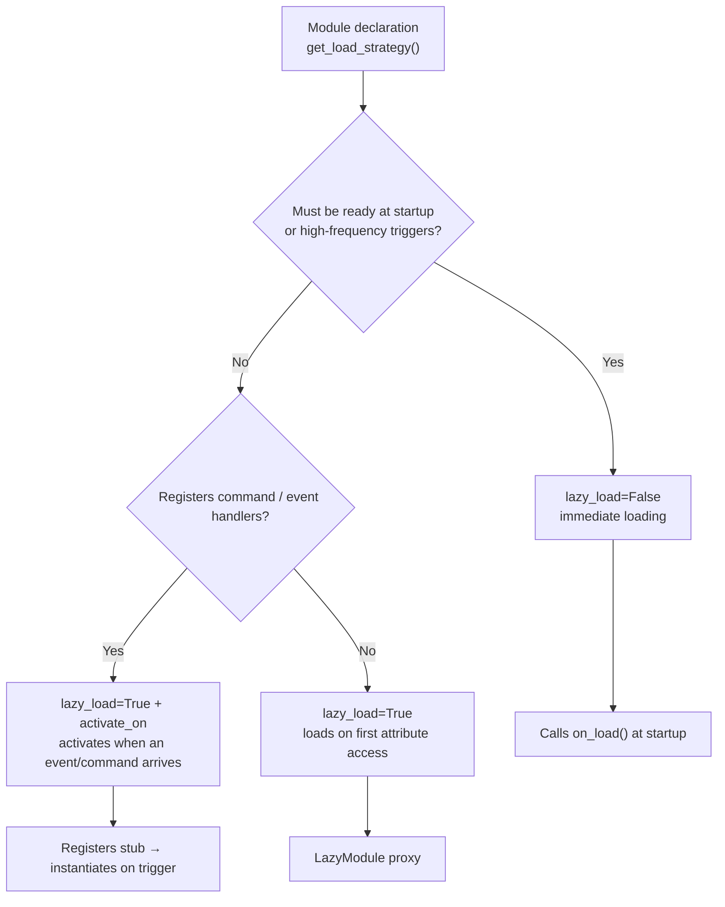

# Lazy-Loading Module System

> [!TIP]
> **When to read this**: When using lazy-loaded modules or `activate_on` event-driven activation. Skip it if not needed; it does not affect the use of any other features.


The lazy-loading module system of the ErisPulse SDK allows modules to defer initialization until they are **actually accessed** — during startup, only placeholder proxies are registered, and modules that are never used consume no startup time or memory.

## Overview

The lazy-loading module system is one of ErisPulse's core features. It works in the following ways:

- **Deferred initialization**: A module is only actually loaded and initialized the first time it is accessed
- **Transparent usage**: For developers, lazy-loaded modules are almost indistinguishable from regular modules in usage
- **Automatic dependency management**: Module dependencies are automatically initialized when used
- **Lifecycle support**: For modules inheriting from `BaseModule`, lifecycle methods are called automatically

## How It Works

### The LazyModule Class

The core of the lazy-loading system is the `LazyModule` class, a wrapper that only actually initializes the module on first access.

### Initialization Process

When a module is first accessed, `LazyModule` performs the following operations:

1. Retrieves the `__init__` parameter information of the module class
2. Decides whether to pass in the `sdk` reference based on the parameters
3. Sets the module's `moduleInfo` attribute
4. For modules inheriting from `BaseModule`, calls the `on_load` method
5. Triggers the `module.init` lifecycle event

## Event-Driven Lazy Activation (activate_on)

> [!NOTE]
> This feature requires ErisPulse **2.8.0+**.

Modules with `lazy_load=True` are by default only loaded on **first attribute access**. If a module registers command/event handlers,
the traditional approach is to set `lazy_load=False` for immediate loading. `activate_on` provides a third option: **declare triggers,
and the module is automatically activated when the first matching event/command arrives** — it neither stays resident in memory nor loses its trigger entry points.

```python
from ErisPulse.loaders import ModuleLoadStrategy

class MyModule(BaseModule):
    @staticmethod
    def get_load_strategy():
        return ModuleLoadStrategy(
            lazy_load=True,
            activate_on=[
                # ---- Event triggers (passively arriving; no user awareness required) ----
                "message",                                    # Type-level: any message event
                {"notice": "group_member_increase"},          # Type + a single detail_type
                {"message": ["private", "group"]},            # Type + multiple detail_types

                # ---- Command triggers (active input; placeholder commands visible to Help) ----
                {"command": "roll"},                          # Shorthand: command name
                {"command": ["roll", "dice"]},                # List of command names
                {"command": {                                 # dict declaration (name is required)
                    "name": "dice",
                    "help": "Roll a dice",
                    "usage": "/dice",
                    "group": "Entertainment",
                    "aliases": ["d"],
                    "hidden": False,
                }},
            ],
        )
```

### Command dict Declaration Parameters

The dict form mirrors the user-level parameters of the `@command()` decorator, used to register placeholder commands before the module is loaded:

| Parameter | Type | Default | Description |
|------|------|------|------|
| `name` | `str` | **Required** | Command name; must match `@command(name)` in `on_load`, otherwise after activation the placeholder is unregistered and the command no longer exists |
| `help` | `str` | Fallback chain | Description shown in Help; if not declared, values are taken via the fallback chain (see below) |
| `usage` | `str` | Auto-generated | Usage line, default `{prefix}{name}` |
| `group` | `str` | `None` | Command group |
| `aliases` | `list[str]` | `[]` | Aliases registered at the same time; **typing an alias also triggers activation** |
| `hidden` | `bool` | `False` | When `True`, the placeholder command is likewise hidden (aligned with the hidden semantics of the real command after activation); users who know the command name can still trigger it by typing it |

`priority` / `permission` / `master` are **not supported**: the placeholder command's sole mission is to trigger activation;
permission checks are performed by the real command after activation (intercepting permissions at the placeholder stage would instead break "activation by typing the command").

### Placeholder Command help Fallback Chain

The command description shown by Help before the module is loaded is taken in the following order (stopping at the first hit):

1. Command-level `help` in the dict declaration (most precise)
2. `description` from the module's `get_meta()`
3. The module's `__description__` attribute
4. The package metadata's `Summary` (PyPI package brief)
5. Generic hint: "This command comes from lazy-loaded module X; first use will automatically load that module"

### Trigger Semantics

- **Event stubs**: Registered with the corresponding event manager at an extremely low priority (`ACTIVATION_STUB_PRIORITY`),
  firing as a fallback after all regular handlers; after activation, the current event is forwarded to the module's real handlers
- **Command stubs**: Placeholder commands are registered; after activation, the placeholder is unregistered and the real command takes over the current trigger
- **Re-entrancy prevention**: `asyncio.Lock` guarantees that the module is activated only once under concurrent triggers
- **Scope filtering**: Stubs carry the module's owner identity and do not trigger when the module is not enabled for that Bot / session / platform
- **Failure semantics**: Failed activation enters a cooldown period (`ACTIVATE_RETRY_COOLDOWN_SECS`, 30 seconds);
  events are short-circuited during the cooldown to avoid repeated attempts; after the cooldown ends, the next trigger retries automatically, with the stub retained throughout
- **Deduplication**: When commands with the same name are declared as a mix of shorthand + dict, they are deduplicated (dict takes precedence); a dict missing `name`,
  or an event `detail_type` mistakenly written as a dict, produces a warning and is ignored

> For the architecture diagram and complete semantics, see [Architecture Overview](../architecture.md#event-driven-lazy-activation-activate_on-trigger-architecture).

## Lazy-Load Dormancy (dormant_after)

> [!NOTE]
> This feature requires ErisPulse **2.11.0+**.

After a lazily-activated module has been idle for a long time, the framework can put it into **dormancy**: runtime resources are released (owned tasks / connections / event registrations),
while the lazy-load proxy and registration stubs are kept — the module returns to the "registered but not loaded" state, and the next attribute access /
`module.call` / `activate_on` event **transparently wakes it up** (re-instantiating it and running `on_load`),
with no wake-up API needed. The system state after dormancy is exactly the same as "never activated".

### Declaration

```python
@staticmethod
def get_load_strategy():
    return ModuleLoadStrategy(
        lazy_load=True,
        dormant_after="30m",   # Auto-dormant after 30 minutes idle; not declared = never dormant (default)
    )
```

The duration syntax is exactly the same as the `cooldown` of command governance (`90s` / `1h30m` / `1d`). The sweeper scans at fixed intervals
(60 seconds), so the actual dormancy time = threshold + at most one scan interval; you can also put a module to sleep manually at any time:
`await sdk.module.sleep("module_name")`. Explicit `unload` still performs a full unload (the lazy proxy is removed as well).

### State Continuation

Before dormancy, the framework triggers `on_before_unload(reason="dormant")` (the first step of the unload pipeline, with resources still intact);
the module saves its state to `sdk.storage` and restores it in `on_load` after wake-up:

```python
async def on_before_unload(self, event):
    if event["reason"] in ("dormant", "reload", "disable"):
        await self.sdk.storage.aset(f"{self._module_name}:counter", self._count)

async def on_load(self, event):
    self._count = await self.sdk.storage.aget(f"{self._module_name}:counter") or 0
```

### Semantics and Boundaries

- **Dependency safety**: Dependents of a lazy module access it via the persistent proxy (`sdk.<Name>`) or `module.call`,
  and behavior is consistent before and after dormancy; directly holding references to real instances is an anti-pattern (visible to the leak auditor)
- **Events not delivered**: A dormant module no longer receives events — modules that need event-based wake-up should also declare `activate_on`
  (the event wakes the module first, then is forwarded); when troubleshooting "commands not responding", check whether the module is in a dormant state
- **Wake-up failures are self-healing**: A failed wake-up (re-initialization) enters a 30-second cooldown; after the cooldown, the next access retries automatically,
  without permanent failure

## Configuring Lazy Loading

### Global Configuration

Enable/disable global lazy loading in the configuration file:

```toml
[ErisPulse.framework]
enable_lazy_loading = true  # true = enable lazy loading (default), false = disable lazy loading
```

### Module-Level Control

Modules can control the loading strategy by implementing the `get_load_strategy()` static method:

```python
from ErisPulse.Core.Bases import BaseModule
from ErisPulse.loaders import ModuleLoadStrategy

class MyModule(BaseModule):
    @staticmethod
    def get_load_strategy():
        """Returns the module loading strategy"""
        return ModuleLoadStrategy(
            lazy_load=False,  # Returning False means immediate loading
            priority=100      # Loading priority; higher values mean higher priority
        )
```

## Using Lazy-Loaded Modules

### Basic Usage

For developers, lazy-loaded modules are almost indistinguishable from regular modules in usage:

```python
# Access a lazy-loaded module via the SDK
from ErisPulse import sdk

# The following access triggers the module's lazy loading
result = await sdk.my_module.my_method()
```

### Unified Module Access Entry Point

Whether accessed via SDK attributes, module manager attributes, or queried via `module.get()`,
for lazy-loaded modules that are "registered but not yet loaded", the same lazy-loading proxy is returned; accessing its attributes is what actually triggers initialization:

```python
# All three approaches return the lazy-loading proxy (when the module is not loaded), with consistent, transparent behavior
sdk.my_module          # Entry point that triggers loading
sdk.module.my_module   # Also returns the lazy-loading proxy
sdk.module.get("my_module")  # Also returns the lazy-loading proxy; it does not itself trigger loading

# Only accessing any attribute of the proxy actually initializes the module
result = await sdk.my_module.my_method()
```

`module.get()` is a **query** interface and does not itself trigger loading:
- Module loaded → returns the real instance
- Module registered but not loaded → returns the lazy-loading proxy (initialization occurs on attribute access)
- Module not registered → returns `None`

To explicitly trigger loading, use `await sdk.load_module("my_module")`.

### Asynchronous Initialization

For modules that require asynchronous initialization, explicit loading is recommended first:

```python
# Explicitly load the module first
await sdk.load_module("my_module")

# Then use the module
result = await sdk.my_module.my_method()
```

### Synchronous Initialization

For modules that do not require asynchronous initialization, direct access works:

```python
# Direct access automatically initializes synchronously
result = sdk.my_module.some_sync_method()
```

## Best Practices

When choosing a loading strategy, refer to the following decision flow:



### Scenarios Where Lazy Loading Is Recommended (lazy_load=True)

- Passively invoked utility modules (e.g., data query modules, format converters, etc. — only needed when called by other modules)
- Modules that register command/event handlers but are not used frequently — declare triggers with `activate_on`; the module is automatically activated when the first matching event/command arrives, without giving up lazy loading

### Scenarios Where Disabling Lazy Loading Is Recommended (lazy_load=False)

- Modules that need to be ready immediately at startup (e.g., core modules that provide foundational services for other modules)
- Frequently triggered listeners (need to process every message) — `activate_on` forwarding incurs a one-time activation overhead; immediate loading is more direct in high-frequency scenarios
- Scheduled task modules
- Modules that must be initialized at application startup

> The `priority` parameter controls the initialization order among immediately-loaded modules; higher values are initialized first. Modules with the same priority are loaded in registration order.

## Notes

1. If your module uses lazy loading and no other module ever calls it within ErisPulse, your module will never be initialized.
2. If your module contains components such as Event listeners or other actively listening components, you have two options: declare `activate_on` triggers (keeping lazy loading, automatically activating when events arrive), or declare that it needs to be loaded immediately (`lazy_load=False`); otherwise your module's normal operation will be affected.
3. We do not recommend disabling lazy loading unless you have special needs; otherwise it may cause problems such as dependency management and lifecycle event issues.
4. In the `activate_on` command dict declaration, `name` must match the real command name registered by `@command()` in the module's `on_load` — otherwise, after the module is activated, the placeholder command is unregistered and a command whose declaration does not match its implementation will not exist.

## Related Documents

Choose based on your next step:

- **Unsure which loading strategy to choose (immediate / lazy / activate_on)** → [Module Best Practices](../developer-guide/modules/best-practices.md)
- **How background tasks, connections, and other resources are reclaimed during dormancy and unloading** → [Ownership (owner) System](ownership.md)
- **Developing a module from scratch** → [Module Development Guide](../developer-guide/modules/getting-started.md)