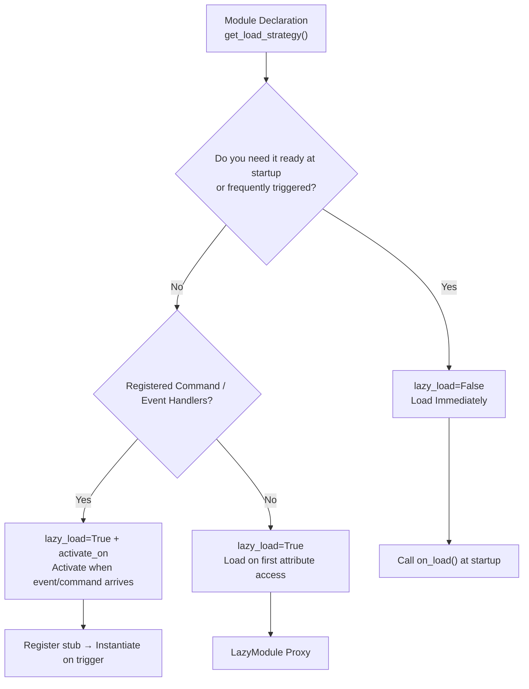

# Lazy-Loaded Module System

> [!TIP]
> **When to read this**: When using lazy-loaded modules or activate_on event-driven activation. Skip if not needed, as it does not affect the use of other features.

The ErisPulse SDK provides a powerful lazy-loaded module system that allows modules to be initialized only when needed, significantly improving application startup speed and memory efficiency.

## Overview

The lazy-loaded module system is one of the core features of ErisPulse, which works as follows:

- **Lazy Initialization**: Modules are only loaded and initialized when they are first accessed.
- **Transparent Usage**: For developers, lazy-loaded modules are almost indistinguishable from regular modules in usage.
- **Automatic Dependency Management**: Module dependencies are automatically initialized when they are used.
- **Lifecycle Support**: For modules that inherit from `BaseModule`, lifecycle methods are automatically invoked.

## Working Principle

### LazyModule Class

The core of the lazy loading system is the `LazyModule` class, which acts as a wrapper that actually initializes the module only when it is first accessed.

### Initialization Process

When a module is first accessed, `LazyModule` performs the following operations:

1. Retrieves the `__init__` parameter information of the module class.
2. Determines whether to pass the `sdk` reference based on the parameters.
3. Sets the `moduleInfo` attribute of the module.
4. For modules that inherit from `BaseModule`, calls the `on_load` method.
5. Triggers the `module.init` lifecycle event.

## Event-Driven Lazy Activation (`activate_on`)

> [!NOTE]
> This feature requires ErisPulse **2.8.0+**.

Modules with `lazy_load=True` are loaded by default only on the **first attribute access**. If a module registers command/event handlers, the traditional approach is to set `lazy_load=False` for immediate loading. `activate_on` provides a third option: **declaring triggers, and automatically activating the module when the first matching event/command arrives**—keeping it out of memory unless needed, while not losing the trigger entry point.

```python
from ErisPulse.loaders import ModuleLoadStrategy

class MyModule(BaseModule):
    @staticmethod
    def get_load_strategy():
        return ModuleLoadStrategy(
            lazy_load=True,
            activate_on=[
                # ---- Event triggers (passive arrival, no user awareness) ----
                "message",                                    # Type-level: any message event
                {"notice": "group_member_increase"},          # Type + single detail_type
                {"message": ["private", "group"]},            # Type + multiple detail_type

                # ---- Command triggers (active input, placeholder commands visible in Help) ----
                {"command": "roll"},                          # Shorthand: command name
                {"command": ["roll", "dice"]},                # List of command names
                {"command": {                                 # Dict declaration (name is required)
                    "name": "dice",
                    "help": "Roll a dice",
                    "usage": "/dice",
                    "group": "Entertainment",
                    "aliases": ["d"],
                    "hidden": False,
                }},
            ],
        )
```

### Command Dict Declaration Parameters

The dict form mirrors the user-level parameters of the `@command()` decorator, used to register placeholder commands before module loading:

| Parameter | Type | Default | Description |
|-----------|------|---------|-------------|
| `name` | `str` | **Required** | Command name; must match `@command(name)` in `on_load`, otherwise the placeholder is unregistered and the command does not exist after activation |
| `help` | `str` | Fallback chain | Description displayed in Help; if not declared, falls back to the chain (see below) |
| `usage` | `str` | Auto-generated | Usage line, defaulting to `{prefix}{name}` |
| `group` | `str` | `None` | Command group |
| `aliases` | `list[str]` | `[]` | Aliases are registered simultaneously; **inputting an alias also triggers activation** |
| `hidden` | `bool` | `False` | If `True`, the placeholder command is also hidden (aligning with the hiding semantics of the real command after activation); users who know the command name can still trigger it by input |

**Not supported**: `priority` / `permission` / `master`: The placeholder command's role is only to trigger activation; permission checks are performed by the real command after activation (blocking permissions during the placeholder phase would otherwise make "activating by command input" ineffective).

### Placeholder Command Help Fallback Chain

When the module is not loaded, the command description shown in Help is taken from the following sequence (the first found value is used):

1. Command-level `help` declared in the dict (most precise)
2. Module `get_meta()`'s `description`
3. Module `__description__` attribute
4. Package metadata's `Summary` (PyPI package summary)
5. Generic prompt: "This command comes from a lazy-loaded module X, which will be automatically loaded on first use"

### Trigger Semantics

- **Event stub**: Registered to the corresponding event manager at a very low priority (`ACTIVATION_STUB_PRIORITY`), acting as a fallback after all ordinary handlers; after activation, the current event is forwarded to the module's real handler
- **Command stub**: Registers a placeholder command; after activation, the placeholder is unregistered, and the real command takes over the current trigger
- **Reentrancy protection**: An `asyncio.Lock` ensures activation occurs only once even under concurrent triggers
- **Scope filtering**: The stub carries the module owner's identity; it does not trigger if the module is not enabled for the Bot / session / platform
- **Failure semantics**: Activation failure enters a cooldown period (`ACTIVATE_RETRY_COOLDOWN_SECS`, 30 seconds); during cooldown, events are short-circuited to avoid repeated attempts; after cooldown, the trigger is automatically retried, and the stub remains throughout
- **Deduplication**: When mixing shorthand and dict declarations for the same command name, deduplication occurs (dict takes precedence); if `name` is missing in dict or `detail_type` is miswritten as dict for events, a warning is issued and the entry is ignored

> For an architecture diagram and full semantics, see [Architecture Overview](../architecture.md#event-driven-lazy-activationactivate-on-trigger-architecture).

## Dormant After (Lazy Loading Sleep)

> [!NOTE]
> This feature requires ErisPulse **2.11.0+**.

After a lazy-loaded module remains idle for an extended period, the framework can **put it to sleep**: releasing runtime resources (associated tasks / connections / event registrations), while retaining the lazy-loading proxy and registration stubs. The module returns to a "registered but unloaded" state, and is transparently awakened next time a property is accessed, `module.call`, or an `activate_on` event occurs (it is re-instantiated and `on_load` is executed again), without requiring any explicit wake-up API. After being put to sleep, the system state is identical to that of a module that has never been activated.

### Declaration Method

```python
@staticmethod
def get_load_strategy():
    return ModuleLoadStrategy(
        lazy_load=True,
        dormant_after="30m",   # Automatically put to sleep after 30 minutes of inactivity; omitting this means never sleeping (default)
    )
```

The duration syntax is identical to the `cooldown` used in command governance (`90s` / `1h30m` / `1d`). The cleanup scanner runs at a fixed interval (60 seconds) and the actual sleep time is the threshold plus at most one scan interval; manual sleep can also be triggered at any time: `await sdk.module.sleep("module name")`. Explicit `unload` still completely unloads the module (including removing the lazy proxy).

### State Continuation

Before being put to sleep, the framework triggers `on_before_unload(reason="dormant")` (the first step in the unload pipeline, with resources still intact), and the module saves its state to `sdk.storage`. After being awakened, the state is restored in `on_load`:

```python
async def on_before_unload(self, event):
    if event["reason"] in ("dormant", "reload", "disable"):
        await self.sdk.storage.aset(f"{self._module_name}:counter", self._count)

async def on_load(self, event):
    self._count = await self.sdk.storage.aget(f"{self._module_name}:counter") or 0
```

### Semantics and Boundaries

- **Safe for Dependencies**: Lazy modules are accessed by their dependents through persistent proxies (`sdk.<Name>`) or `module.call`, and their behavior remains consistent before and after being put to sleep; directly holding a reference to the actual instance is an anti-pattern (visible to the leak auditor)
- **Events Not Delivered**: A module that is put to sleep no longer receives events—modules that require event-based awakening should also declare `activate_on` (the event first awakens then forwards); when troubleshooting "no command response," confirm whether the module is in a dormant state
- **Self-Healing on Wake-Up Failure**: If the wake-up (re-initialization) fails, a 30-second cooldown is entered, after which subsequent access automatically retries, preventing permanent failure

## Configuring Lazy Loading

### Global Configuration

Enable or disable global lazy loading in the configuration file:

```toml
[ErisPulse.framework]
enable_lazy_loading = true  # true=enable lazy loading (default), false=disable lazy loading
```

### Module-Level Control

Modules can control their loading strategy by implementing the `get_load_strategy()` static method:

```python
from ErisPulse.Core.Bases import BaseModule
from ErisPulse.loaders import ModuleLoadStrategy

class MyModule(BaseModule):
    @staticmethod
    def get_load_strategy():
        """Returns the module loading strategy"""
        return ModuleLoadStrategy(
            lazy_load=False,  # Return False to indicate immediate loading
            priority=100      # Loading priority, higher value means higher priority
        )
```

## Using Lazy-Loaded Modules

### Basic Usage

For developers, lazy-loaded modules are almost indistinguishable from regular modules in usage:

```python
# Accessing a lazy-loaded module through the SDK
from ErisPulse import sdk

# The following access triggers the module's lazy loading
result = await sdk.my_module.my_method()
```

### Unified Module Access Entry

Whether accessed through SDK attributes, module manager attributes, or via `module.get()`, for "registered but not yet loaded" lazy-loaded modules, the same lazy-loading proxy is returned. Accessing its attributes triggers the actual initialization:

```python
# All three methods return the same lazy-loading proxy (when the module is not loaded), behaving consistently and transparently to the user
sdk.my_module          # Entry point that triggers loading
sdk.module.my_module   # Also returns the lazy-loading proxy
sdk.module.get("my_module")  # Also returns the lazy-loading proxy, itself does not trigger loading

# Accessing any attribute of the proxy triggers the actual initialization of the module
result = await sdk.my_module.my_method()
```

`module.get()` is a **query** interface and does not trigger loading by itself:
- If the module is already loaded → returns the actual instance
- If the module is registered but not yet loaded → returns the lazy-loading proxy (initialization occurs when an attribute is accessed)
- If the module is not registered → returns `None`

To explicitly trigger loading, use `await sdk.load_module("my_module")`.

### Asynchronous Initialization

For modules requiring asynchronous initialization, it is recommended to load them explicitly first:

```python
# Explicitly load the module first
await sdk.load_module("my_module")

# Then use the module
result = await sdk.my_module.my_method()
```

### Synchronous Initialization

For modules that do not require asynchronous initialization, you can access them directly:

```python
# Direct access will automatically initialize synchronously
result = sdk.my_module.some_sync_method()
```

## Best Practices

When choosing a loading strategy, you can refer to the following decision flow:



### Recommended Scenarios for Lazy Loading (lazy_load=True)

- Passive utility modules (e.g., data query modules, format converters, etc., which are only needed when called by other modules)
- Modules that register command/event handlers but are not frequently used — use `activate_on` to declare triggers, and activate automatically when the first matching event/command arrives, without giving up lazy loading

### Recommended Scenarios for Disabling Lazy Loading (lazy_load=False)

- Modules that need to be ready immediately at startup (e.g., core modules that provide foundational services to other modules)
- High-frequency listeners (e.g., every message must be processed) — `activate_on` forwarding has some activation overhead, so immediate loading is more direct in high-frequency scenarios
- Scheduled task modules
- Modules that need to be initialized at application startup

> The `priority` parameter controls the initialization order of immediately loaded modules; higher values are initialized first. Modules with the same priority are loaded in registration order.

## Notes

1. If your module uses lazy loading, and other modules have never been called within ErisPulse, your module will never be initialized.
2. If your module contains modules that listen for Events, or other actively listening modules, you have two options: declare an `activate_on` trigger (to keep lazy loading and automatically activate when the event arrives), or declare that it needs to be loaded immediately (`lazy_load=False`), otherwise it may affect the normal operation of your module.
3. We do not recommend disabling lazy loading unless there is a special requirement, otherwise it may cause issues such as dependency management and lifecycle events.
4. In the `activate_on` command dict declaration, `name` must be consistent with the actual command name registered in the module's `on_load` with `@command()`—otherwise, after the module is activated, the placeholder command will be unregistered, and a command with inconsistent declaration and implementation will not exist.

## Related Documentation

- [Module Development Guide](../developer-guide/modules/getting-started.md) - Learn how to develop modules
- [Best Practices](../developer-guide/modules/best-practices.md) - Learn more about best practices