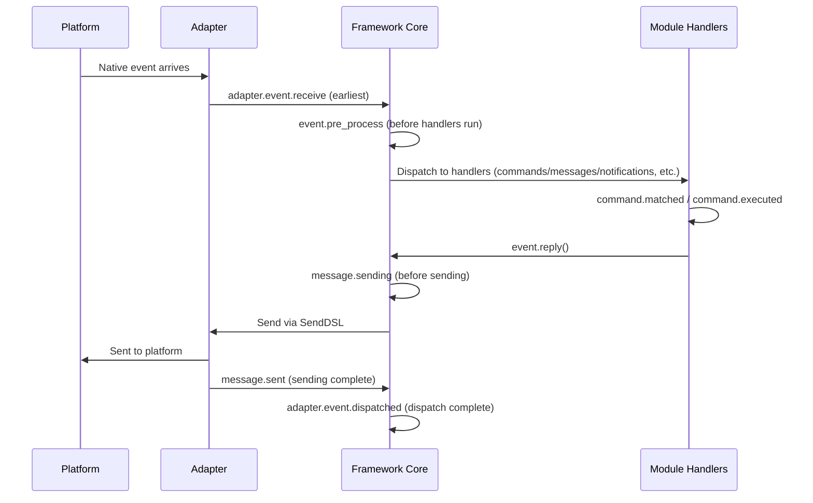

# Lifecycle Management

> [!TIP]
> **When you need to read this**: When you need to subscribe to framework lifecycle events (startup / loading / status changes). Skip it otherwise; it does not affect your use of other features.

> **What you'll know after reading**: The registration / triggering / directed propagation mechanisms of lifecycle events, the differences among the four triggering APIs and how to choose between them, as well as the data formats of every hook breakpoint pre-built into the framework (core / module / adapter / server / message, etc.).
>
> **Not covered here**: The lifecycle methods that modules themselves must implement (`on_load` / `on_unload`, see the
> [Module Development Guide](../developer-guide/modules/getting-started.md)); the ins and outs of each stage of the
> startup chain (see [Startup Process and Manual Control](startup.md)).


If you want to be notified and run your own logic (auditing, statistics, alerting, linkage) at nodes such as module load failure, configuration modification, message sending, and command execution, simply subscribe to the framework's lifecycle events — the framework pre-builds hook breakpoints at every key node, and you can plug in with a single line of `@sdk.lifecycle.on("event_name")`. A complete list of all breakpoints is provided at the end of this article.

The system supports three triggering methods:
- `await lifecycle.emit("event", data)` — Lightweight version, passes arbitrary data (directed delivery when `to="Owner"`)
- `lifecycle.emit_sync("event", data)` — Synchronous version (for non-async contexts)
- `await lifecycle.submit_event("event", ...)` — Legacy-compatible version, automatically builds the standard event format

## Event Handling Mechanism

### Registering Handlers

```python
from ErisPulse import sdk

# Decorator pattern
@sdk.lifecycle.on("module.load")
async def on_module_load(data):
    print(f"Module loaded: {data}")

# Programmatic registration
sdk.lifecycle.register("module.load", on_module_load, priority=10)

# Unregister
sdk.lifecycle.unregister("module.load", on_module_load)

# Batch unregistration by owner (automatically invoked by the framework when a module/adapter is unloaded)
removed = sdk.lifecycle.unregister_by_owner("MyModule")
print(f"Cleaned up {removed} lifecycle hooks")
```

### Priority

Handlers support the `priority` parameter; higher values execute first (consistent with the module loader):

```python
@sdk.lifecycle.on("adapter.event.receive", priority=10)  # Executes first
async def first_handler(data):
    pass

@sdk.lifecycle.on("adapter.event.receive", priority=0)  # Executes later
async def second_handler(data):
    pass
```

### Dot-Structured Events

When a specific event is triggered, its parent events are triggered as well:
- Triggering `module.load` also triggers `module`
- Triggering `adapter.event.receive` also triggers `adapter.event` and `adapter`

### Wildcards

Register `*` to capture all events:

```python
@sdk.lifecycle.on("*")
async def on_anything(data):
    print(f"Event received: {data}")
```

### Directed Propagation (emit to=)

> [!NOTE]
> This feature requires ErisPulse **2.8.0+**.

When `emit()` specifies the `to` parameter, it enters directed propagation: the event is only dispatched to handlers registered under that owner's identity (hooks registered by a module within `on_load` are automatically attributed to that module); other modules and wildcard `*` handlers are unaware of it.

```python
# Sender: the event is only delivered to hooks registered by the Chat module
await sdk.lifecycle.emit("message_received", {"text": "hi"}, to="Chat")

# Subscriber (inside the Chat module): registers a hook with the same name; the owner is recorded automatically at registration
@sdk.lifecycle.on("message_received")
async def on_message_received(data): ...

@sdk.lifecycle.on("message")   # Dot-structured parent prefix works the same way (filtered by owner)
async def on_any(data): ...
```

- If the target owner has no registered hooks → the event is **not consumed** (you can probe in advance with `has_handlers()`)
- When `data` is a dict, `_trace_id` is attached automatically (existing values are not overwritten)
- `emit_sync` / `submit_event` also support the `to=` parameter
- For the three-tier model of inter-module communication (RPC / directed / broadcast), see
  [Inter-Module Communication](module-communication.md)

### One-Time Registration (once)

Since 2.7.0, handlers registered via `lifecycle.once()` are **automatically unregistered after being triggered once**, suitable for one-time hooks such as "first-time readiness":

```python
@sdk.lifecycle.once("core.init.complete")
async def on_first_ready(data):
    print("First readiness; will not trigger again afterwards")
```

- Same priority parameter semantics as `on()` (higher `priority` values execute first)
- Automatic unregistration; no manual `unregister` needed
- Both synchronous and asynchronous handlers are supported

### Listener Query (has_handlers)

In hot-path short-circuit scenarios, you can first use `has_handlers()` to check whether any listeners exist, avoiding unnecessary event traversal and task scheduling:

```python
if sdk.lifecycle.has_handlers("message.sending"):
    await sdk.lifecycle.emit("message.sending", send_ctx)
```

- Covers three kinds of matching: **exact event names, wildcard `*`, and parent events**
- Returns `False` when there are no listeners at all, so `emit` can be safely skipped

## Hook Breakpoints Overview

The typical sequence of lifecycle events from the moment a message enters the framework from a platform until processing completes:



The framework has the following hook breakpoints built in. Users can listen to any breakpoint via `@sdk.lifecycle.on()` to implement custom logic.

### Core Initialization

| Hook Name | Trigger Timing | Data |
|---------|---------|------|
| `core.init.start` | SDK initialization starts | `{}` |
| `core.init.stage` | Each initialization stage starts (emitted in the background) | `{"stage": str}`, values: `discovery` / `adapter_register` / `adapter_start` / `module_register` / `module_init` / `adapter_start_deferred` / `router_start` |
| `core.init.complete` | SDK initialization completes | `{"duration": float, "success": bool, "stages": {stage: float}, "adapters": {"enabled": [str], "disabled": [str]}, "modules": {"enabled": [str], "disabled": [str]}, "error": str(only on failure)}` |
| `core.uninit.complete` | SDK uninitialization completes | `{"duration": float, "success": bool, "adapters_closed": int, "modules_unloaded": int, "module_properties_cleared": int, "module_properties_to_clear": [str], "error": str(only on failure)}` |

**Example: Startup progress display**

```python
@sdk.lifecycle.on("core.init.stage")
def show_stage(data):
    print(f"[Startup] Entering stage: {data['stage']}")
```

### Configuration Changes

| Hook Name | Trigger Timing | Data |
|---------|---------|------|
| `config.set` | A configuration item is modified | `{"key": str, "old_value": Any, "new_value": Any}` |
| `config.updated` | Full-tree changes detected after config.toml is edited externally | `{"old_config": dict, "new_config": dict, "config_file": str}` |

**Example: Configuration auditing**

```python
@sdk.lifecycle.on("config.set")
def audit_config(data):
    print(f"[Audit] {data['key']}: {data['old_value']} -> {data['new_value']}")
```

### Module Lifecycle

| Hook Name | Trigger Timing | Data |
|---------|---------|------|
| `module.register` | Module class registered with the manager | `{"module_name": str, "success": bool}` |
| `module.load` | Module loading completes (instantiation succeeded); on failure the payload additionally carries `"error": str, "traceback": str` (the failure details can also be queried via `module.last_error(name)`) | `{"module_name": str, "success": bool}` |
| `module.init` | Module initialization finished (including lazy loading) | `{"module_name": str, "success": bool}` |
| `module.before_unload` | First step of the unload pipeline (before `on_unload` and resource reclamation; the module instance hook `on_before_unload` is triggered synchronously) | `{"module_name": str, "reason": str}`; `reason` values: `unload` / `reload` / `disable` / `cascade` / `dormant` |
| `module.sleep` | Module dormancy completes (lazy-load sleep: resources are released; access automatically wakes it up) | `{"module_name": str, "success": bool}` |
| `module.unload` | Module unloaded or disabled (`disable` notifies dependents on par with `unload`; the `on_dependency_lost` contract includes "disable") | `{"module_name": str, "success": bool, "reason": str}`; `reason` values: `unload` / `reload` / `disable` / `cascade` / `dormant` |
| `module.rollback` | Hot-reload failure rollback completes (after snapshot restoration + replaying the old instance's `on_load`) | `{"module_name": str, "success": bool}`; `success` indicates whether replaying `on_load` succeeded (when False, the old instance remains in a finalized state) |
| `module.reload` | Module hot reload completes (including cascading reload of dependents) | `{"module_name": str, "success": bool, "full": bool, "duration_ms": int}`; single-module reloads additionally carry `"identity_changed": bool` (False = old code may still be running in-process, e.g. cached C extensions) and `"version_old": str, "version_new": str`; for a full reload (`reload_all`), `module_name` is `"All"` and the payload additionally carries `"results": dict[str, bool]` |

> **Module instance hook `on_before_unload`**: An optional lifecycle method corresponding to the `module.before_unload` event — `event["reason"]` marks the intent, making it suitable for saving state to `sdk.storage` before resources are released and restoring it in `on_load` after wake-up / reload (the state continuity of lazy-load dormancy is based on this). A hook failure only logs a warning and does not block the unload flow.

### Adapter Lifecycle

| Hook Name | Trigger Timing | Data |
|---------|---------|------|
| `adapter.load` | Adapter registration completes | `{"platform": str, "success": bool}` |
| `adapter.reload` | Adapter code-level hot reload completes | `{"adapter_name": str, "success": bool, "full": bool, "duration_ms": int, "identity_changed": bool, "version_old": str, "version_new": str, "was_started": bool, "source": str}`; `identity_changed=False` = old code may still be running in-process |
| `adapter.rollback` | Adapter hot-reload failure rollback completes (after restoring the old registered state) | `{"adapter_name": str, "replayed": bool, "success": bool}`; `replayed=True` means the old instance's `start()` has been replayed, and `success` indicates whether the replay succeeded |
| `adapter.start` | Adapter starts | `{"platforms": [str]}` |
| `adapter.status.change` | Adapter status changes | `{"platform": str, "status": str, "retry_count": int, "error": str(only on failure)}`; full status values: `starting` / `started` / `start_failed` / `stopping` / `stopped` / `stop_failed` / `skipped-dependency` / `disabled` |
| `adapter.stop` | Adapter shuts down | `{"platforms": [str]}` |
| `adapter.stopped` | Adapter shutdown completes | `{"platforms": [str]}` |
| `adapter.bot.online` | Bot comes online | `{"platform": str, "bot_id": str, "info": dict, "status": str}` |
| `adapter.bot.offline` | Bot goes offline | `{"platform": str, "bot_id": str, "status": str}` |

### Event Receiving and Processing

| Hook Name | Trigger Timing | Data |
|---------|---------|------|
| `adapter.event.receive` | An external platform event is received (earliest) | `{"platform": str, "event_type": str, "raw_event_type": str}` |
| `adapter.event.blocked` | Middleware vetoes the event (returns `False`; the event is discarded and does not enter any handler) | `{"middleware": str, "platform": str, "event_type": str, "detail_type": str, "event": dict, "_trace_id": str}` |
| `adapter.event.dispatched` | Event dispatch completes | `{"platform": str, "event_type": str, "raw_event_type": str, "onebot_handlers_count": int}` |
| `event.pre_process` | Before an event handler starts executing | `{"event_type": str, "platform": str, "detail_type": str}` |

**Example: Event statistics**

```python
event_counter = {}

@sdk.lifecycle.on("adapter.event.receive")
def count_events(data):
    platform = data["platform"]
    event_counter[platform] = event_counter.get(platform, 0) + 1

@sdk.lifecycle.on("adapter.event.dispatched")
def log_unhandled(data):
    if data["onebot_handlers_count"] == 0:
        print(f"[Unhandled] {data['platform']}/{data['event_type']}")
```

### Message Sending

| Hook Name | Trigger Timing | Data |
|---------|---------|------|
| `message.sending` | A message is about to be sent | `{"platform": str, "method": str, "detail_type": str, "target_id": str, "bot_id": str}` |
| `message.sent` | Message sending completes | `{"platform": str, "method": str, "detail_type": str, "target_id": str, "bot_id": str}` |

**Example: Message sending audit**

```python
@sdk.lifecycle.on("message.sending")
def log_sending(data):
    print(f"[Sending] -> {data['platform']}/{data['detail_type']}/{data['target_id']} via {data['method']}")
```

### Command System

| Hook Name | Trigger Timing | Data |
|---------|---------|------|
| `command.matched` | A command is matched and about to execute | `{"command": str, "args": list[str], "platform": str, "user_id": str}` |
| `command.executed` | Command execution completes | `{"command": str, "args": list[str], "platform": str, "user_id": str, "success": bool, "error": str(only on failure)}` |

**Example: Command statistics**

```python
@sdk.lifecycle.on("command.matched")
def count_commands(data):
    print(f"[Command] /{data['command']} from {data['user_id']}@{data['platform']}")
```

### HTTP Routing

| Hook Name | Trigger Timing | Data |
|---------|---------|------|
| `server.request` | HTTP request received | `{"method": str, "path": str, "client_ip": str, "request_id": str}` |
| `server.response` | HTTP response sent | `{"method": str, "path": str, "status_code": int, "client_ip": str, "request_id": str}` |

> `request_id` is the [X-Request-ID request correlation ID](router.md#request-correlation-idx-request-id): it preferentially reuses the client's request header when present, otherwise a UUID is generated automatically, and it can be used to chain the request and response events together.

**Example: Request logging**

```python
@sdk.lifecycle.on("server.response")
def log_http(data):
    print(f"[HTTP] {data['method']} {data['path']} -> {data['status_code']}")
```

### WebSocket

| Hook Name | Trigger Timing | Data |
|---------|---------|------|
| `server.start` | Router server starts | `{"base_url": str, "host": str, "port": int, "success": bool, "error": str(only on failure)}` |
| `server.stop` | Router server stops | `{}` |
| `server.websocket.connect` | WebSocket connection established | `{"path": str, "module_name": str, "client_ip": str}` |
| `server.websocket.disconnect` | WebSocket connection dropped | `{"path": str, "module_name": str, "reason": str, "error": str(only on exception)}` |

**Example: WebSocket connection monitoring**

```python
@sdk.lifecycle.on("server.websocket.connect")
def on_ws_connect(data):
    print(f"[WS] Connected: {data['path']} from {data['client_ip']}")

@sdk.lifecycle.on("server.websocket.disconnect")
def on_ws_disconnect(data):
    print(f"[WS] Disconnected: {data['path']} ({data['reason']})")
```

### Storage Connection Status

Establishment, failure, and recovery of the storage backend connection pool (all emitted in the background, without blocking storage operations):

| Hook Name | Trigger Timing | Data |
|---------|---------|------|
| `storage.ready` | Storage backend connection pool is ready (first successful pool creation per event loop) | `{"backend": str}` |
| `storage.unreachable` | Connection retries exhausted, entering cooldown (operations fail fast during this period) | `{"backend": str, "error": str, "cooldown": float}` |
| `storage.recovered` | Reconnection succeeds after the cooldown ends; storage is available again | `{"backend": str}` |

**Example: Storage failure alerting**

```python
@sdk.lifecycle.on("storage.unreachable")
def alert_storage_down(data):
    print(f"[Alert] Storage backend {data['backend']} unreachable: {data['error']}, auto-reconnecting in {data['cooldown']}s")

@sdk.lifecycle.on("storage.recovered")
def notify_storage_back(data):
    print(f"[Recovery] Storage backend {data['backend']} is available again")
```

### HTTP Client

Request and connection events of `sdk.client` (all emitted in the background):

| Hook Name | Trigger Timing | Data |
|---------|---------|------|
| `client.request.success` | HTTP request succeeds | `{"method": str, "url": str, "status": int, "elapsed": float}` |
| `client.request.failed` | HTTP request fails for good after retries are exhausted | `{"method": str, "url": str, "error": str, "attempts": int, "elapsed": float}` |
| `client.ws.connect` | WebSocket connection established | `{"url": str}` |

### Internationalization

| Hook Name | Trigger Timing | Data |
|---------|---------|------|
| `i18n.language.changed` | Framework language switch (`i18n.set_language`) | `{"language": str, "previous": str}` |

## Standard Event Definitions

```python
STANDARD_EVENTS = {
    "core": ["init.start", "init.stage", "init.complete", "uninit.complete"],
    "module": ["load", "before_unload", "init", "sleep", "unload", "register", "reload"],
    "adapter": [
        "load", "start", "status.change", "reload", "stop", "stopped",
        "event.receive", "event.blocked", "event.dispatched",
        "bot.online", "bot.offline",
    ],
    "server": [
        "start", "stop",
        "request", "response",
        "websocket.connect", "websocket.disconnect",
    ],
    "event": ["pre_process"],
    "message": ["sending", "sent"],
    "command": ["matched", "executed"],
    "config": ["set", "updated"],
    "storage": ["ready", "unreachable", "recovered"],
    "client": ["request.success", "request.failed", "ws.connect"],
    "i18n": ["language.changed"],
}
```

## Complete API Reference

### Registration and Unregistration

| Method | Description |
|------|------|
| `@lifecycle.on(event, *, priority=0)` | Decorator-based handler registration |
| `lifecycle.register(event, handler, *, priority=0)` | Programmatic registration |
| `lifecycle.unregister(event, handler=None)` | Unregister (when handler=None, all handlers for that event are unregistered) |

### Triggering

| Method | Description |
|------|------|
| `await lifecycle.emit(event, data=None, *, to=None)` | Asynchronous trigger; handlers execute **in parallel** (not blocking each other; all complete by the time it returns), non-None return values are replayed in priority order, chain-replacing the data; when `to` specifies an owner, delivery is directed |
| `lifecycle.fire(event, data=None, *, to=None)` | **Background emission (fire-and-forget)**: handlers execute in parallel within background tasks, without waiting, with no return value; zero overhead when there are no listeners. Suitable for high-frequency hot paths and purely observational events; use `emit` for shutdown sequences and order-sensitive consumption (e.g. `config.set`) |
| `lifecycle.emit_sync(event, data=None, *, to=None)` | Synchronous trigger; async handlers are scheduled via create_task |
| `await lifecycle.submit_event(event_type, *, source, msg, data, to=None, background=False)` | Legacy-compatible; automatically builds the standard event format; when `background=True`, it goes through `fire` background emission |

**Comparison of the four triggering APIs**:

| Method | Call Form | Waits for Handlers to Complete | Typical Scenarios |
|------|---------|------------------|---------|
| `emit` | `await` (async) | **Waits** — handlers execute in parallel, all complete by return time, return values are chained and replayed | Normal triggering; must be used for order-sensitive consumption (`config.set`) and shutdown sequences |
| `fire` | Direct call (returns synchronously) | **Does not wait** — background tasks execute in parallel, no return value; zero overhead with no listeners | High-frequency hot paths and purely observational events (`server.request` / `storage.ready`) |
| `emit_sync` | Direct call (synchronous) | Sync handlers complete immediately; async handlers are scheduled via `create_task` (return values cannot be passed back) | Triggering events in non-async contexts (synchronous code) |
| `submit_event` | `await` (async) | Waits (does not wait, same as `fire`, when `background=True`) | Legacy-compatible: automatically builds the standard event format (`source` / `msg` / `timestamp`) |

### Utilities

| Method | Description |
|------|------|
| `lifecycle.start_timer(timer_id)` | Starts a timer |
| `lifecycle.get_duration(timer_id)` | Gets the elapsed duration (in seconds) |
| `lifecycle.stop_timer(timer_id)` | Stops the timer and returns the duration |
| `lifecycle.list_hooks()` | Lists all registered hooks and their handler counts |
| `lifecycle.clear()` | Clears all handlers and timers |

## Example Usage in a Module

```python
from ErisPulse.Core.Bases import BaseModule
from ErisPulse import sdk

class Main(BaseModule):
    async def on_load(self, event):
        # Implement simple message statistics
        self.msg_count = 0
        
        @sdk.lifecycle.on("adapter.event.receive")
        async def count(data):
            if data["event_type"] == "message":
                self.msg_count += 1
        
        # Monitor all commands
        @sdk.lifecycle.on("command.matched")
        async def log_cmd(data):
            sdk.logger.info(f"Command executed: /{data['command']} by {data['user_id']}")
        
        # Configuration change auditing
        @sdk.lifecycle.on("config.set")
        def audit(data):
            sdk.logger.info(f"Config changed: {data['key']} = {data['new_value']}")
```

## Background Task Ownership and Automatic Cancellation

> [!NOTE]
> This feature requires ErisPulse **2.8.0+**.

If asyncio background tasks created by a module are not cancelled in `on_unload`, they hold a reference to `self`, preventing the module instance from being reclaimed (old instances linger after hot reload). The framework provides the following fallback mechanisms:

- **`self.spawn(coro)`** (recommended within modules): tasks are automatically attributed to the module name; when the module is unloaded, the framework cancels unfinished tasks as a fallback **after** `on_unload` and logs a warning
- **`spawn_background(coro)`** (`ErisPulse.runtime`): automatically captures the current `owner_scope` context; `cancel_owner_tasks(owner)` cancels by ownership, and `cancel_all_background_tasks()` serves as a fallback for `sdk.uninit()`
- **Adapters**: on shutdown, background tasks registered under the platform are likewise cancelled as a fallback

**Tasks before main-loop registration** (2.12+): `spawn_background()` and `run_main_loop()`
no longer create a temporary event loop when no main loop is available; instead, they enter a
pending queue (capped at `PENDING_TASK_QUEUE_MAX`, default 1024); the queue is flushed all at once
when `sdk.run()` registers the main loop.
When the queue is full, new tasks are dropped with a warning; cancelling by owner also removes that owner's pending tasks;
lingering tasks at exit are warned about and dropped. `run_main_loop()` returns `None` on the enqueue path.

```python
async def on_load(self, event):
    # Recommended: use self.spawn() for background tasks; the framework automatically cancels them as a fallback on unload
    self.spawn(self._poll())

async def on_unload(self, event):
    # For fine-grained control, it is still recommended to cancel yourself and await finalization
    if self._poll_task:
        self._poll_task.cancel()
        await asyncio.gather(self._poll_task, return_exceptions=True)

async def _poll(self):
    while True:
        await asyncio.sleep(60)
        ...
```

> [!IMPORTANT]
> The framework's fallback is a **forced cancel** (`cancel_owner_tasks`), which happens after `on_unload` returns. Therefore, tasks that need graceful finalization (flushing buffers, persisting state, closing connections) **must** perform their own `cancel()` + `await` inside `on_unload` — don't expect the fallback to preserve your finalization logic. The framework only guarantees "no tasks holding `self` linger"; it does not guarantee "gracefulness". For tasks whose results you need to `await`, `await` them directly; don't hand them off to background tasks.

## Notes

1. **Handlers can be synchronous or asynchronous**: the system detects and calls them correctly automatically
2. **Data passing**: in `emit()` mode, non-None values returned by handlers modify the data passed to subsequent handlers
3. **Event naming conventions**: dot-structured event names are recommended for easier parent-level listening
4. **Error isolation**: an exception in one handler does not affect the execution of other handlers
5. **Synchronous trigger limitation**: in `emit_sync()`, async handlers are scheduled in a fire-and-forget manner; return values cannot be passed back
6. **Lifecycle cleanup**: when `sdk.uninit()` is called, all registered handlers and timers are cleaned up
7. **Loading priority**: if you need to listen to events during framework initialization, it is recommended to set a high priority and disable lazy loading

## Related Documentation

Choose based on your next intent:

- **To see how events flow through the full chain from adapter to handler** → [Architecture Overview](../architecture.md)
- **Which lifecycle methods to implement when writing modules (on_load / on_unload)** → [Module Development Guide](../developer-guide/modules/getting-started.md)
- **To cover background tasks and resource reclamation with a fallback** → [Ownership (Owner) System](ownership.md)
- **Each stage of the startup chain (the source of `core.init.*` events)** → [Startup Process and Manual Control](startup.md)
- **Usage recommendations for lifecycle events** → [Module Best Practices](../developer-guide/modules/best-practices.md)