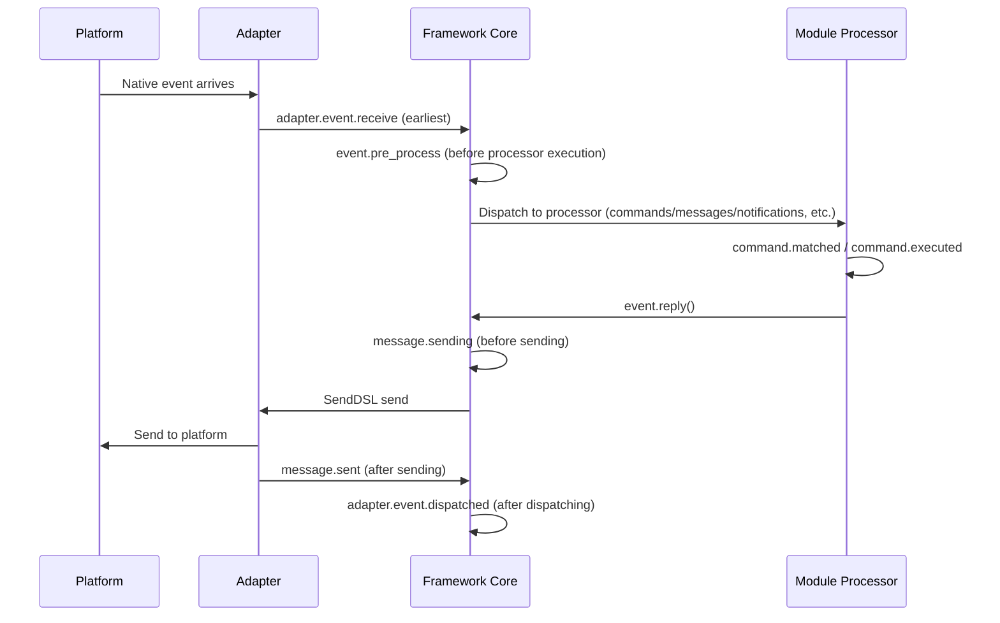

# Lifecycle Management

> [!TIP]
> **When to read this**: When you need to subscribe to framework lifecycle events (startup / loading / state change). Skip if not needed, as it won't affect the use of other features.

> **What you'll learn**: The registration / triggering / targeted propagation mechanism of lifecycle events, the differences and selection among the four sets of triggering APIs, and the complete list of pre-buried hook breakpoints in the framework (core / module / adapter / server / message) along with their respective data formats.
>
> **This section does not cover**: Lifecycle methods that modules themselves need to implement (`on_load` / `on_unload`, see [Module Development Guide](../developer-guide/modules/getting-started.md)); the detailed flow of startup stages (see [Startup Flow and Manual Control](startup.md)).

To receive notifications and execute your own logic at key points such as module loading failure, configuration modification, message sending, or command execution (for auditing, statistics, alerting, or interoperation), simply subscribe to the framework's lifecycle events. The framework pre-buried hook breakpoints at each critical node, and you can integrate with `@sdk.lifecycle.on("event name")` in a single line. The complete list of breakpoints is provided at the end of this document.

The system supports three triggering methods:
- `await lifecycle.emit("event", data)` — A concise version, passing arbitrary data (targeted delivery when `to="Owner"`)
- `lifecycle.emit_sync("event", data)` — The synchronous version (used in non-async contexts)
- `await lifecycle.submit_event("event", ...)` — Compatible with the old version, automatically constructs the standard event format

## Event Handling Mechanism

### Registering Handlers

```python
from ErisPulse import sdk

# Decorator pattern
@sdk.lifecycle.on("module.load")
async def on_module_load(data):
    print(f"Module loaded: {data}")

# Programmatic registration
sdk.lifecycle.register("module.load", on_module_load, priority=10)

# Unregister
sdk.lifecycle.unregister("module.load", on_module_load)

# Batch unregister by owner (automatically called by framework during module/adapter unload)
removed = sdk.lifecycle.unregister_by_owner("MyModule")
print(f"Cleaned up {removed} lifecycle hooks")
```

### Priority

Handlers support the `priority` parameter, where a higher value means earlier execution (consistent with the module loader):

```python
@sdk.lifecycle.on("adapter.event.receive", priority=10)  # Executes first
async def first_handler(data):
    pass

@sdk.lifecycle.on("adapter.event.receive", priority=0)  # Executes later
async def second_handler(data):
    pass
```

### Dot-Structure Events

When a specific event is triggered, its parent events are also triggered:
- Triggering `module.load` also triggers `module`
- Triggering `adapter.event.receive` also triggers `adapter.event` and `adapter`

### Wildcards

Register `*` to capture all events:

```python
@sdk.lifecycle.on("*")
async def on_anything(data):
    print(f"Received event: {data}")
```

### Directed Propagation (`emit to=`)

> [!NOTE]
> This feature requires ErisPulse **2.8.0+**.

When `emit()` specifies the `to` parameter, it enters directed propagation: the event is only distributed to handlers registered under the specified owner (hooks registered in a module's `on_load` automatically belong to the module), while other modules and wildcard `*` handlers are not notified.

```python
# Emitter: Event only delivered to hooks registered by the Chat module
await sdk.lifecycle.emit("message_received", {"text": "hi"}, to="Chat")

# Subscriber (within Chat module): Register a hook with the same name; owner is automatically recorded during registration
@sdk.lifecycle.on("message_received")
async def on_message_received(data): ...

@sdk.lifecycle.on("message")   # Dot-structure parent prefixes also apply (filtered by owner)
async def on_any(data): ...
```

- If the target owner has no registered hooks → the event is **not consumed** (use `has_handlers()` to detect beforehand)
- If `data` is a dict, `_trace_id` is automatically included (does not overwrite existing values)
- `emit_sync` / `submit_event` also support the `to=` parameter
- Three-layer module communication model (RPC / directed / broadcast) is described in [Module Communication](module-communication.md)

### One-time Registration (`once`)

Since 2.7.0, handlers registered via `lifecycle.once()` are automatically unregistered after one trigger, suitable for one-time hooks such as "first ready":

```python
@sdk.lifecycle.once("core.init.complete")
async def on_first_ready(data):
    print("First ready, will not trigger again")
```

- Same priority semantics as `on()` (`priority` value higher means earlier execution)
- Automatic unregistration, no need for manual `unregister`
- Supports both synchronous and asynchronous handlers

### Listener Query (`has_handlers`)

In hot-path short-circuit scenarios, use `has_handlers()` to check if there are listeners beforehand, avoiding unnecessary event traversal and task scheduling:

```python
if sdk.lifecycle.has_handlers("message.sending"):
    await sdk.lifecycle.emit("message.sending", send_ctx)
```

- Covers **exact event name**, **wildcard `*`**, and **parent event** matching
- Returns `False` if there are no listeners, allowing safe skipping of `emit`

## Overview of Hook Breakpoints

A typical lifecycle event sequence diagram of a message from platform entry to framework processing completion:



The framework provides the following built-in hook breakpoints, and users can listen to any breakpoint to implement custom logic via `@sdk.lifecycle.on()`.

### Core Initialization

| Hook Name | Trigger Timing | Data |
|---------|---------|------|
| `core.init.start` | SDK initialization starts | `{}` |
| `core.init.stage` | Each initialization stage begins (emitted in background) | `{"stage": str}`; values: `discovery` / `adapter_register` / `adapter_start` / `module_register` / `module_init` / `adapter_start_deferred` / `router_start` |
| `core.init.complete` | SDK initialization completes | `{"duration": float, "success": bool, "stages": {stage: float}, "adapters": {"enabled": [str], "disabled": [str]}, "modules": {"enabled": [str], "disabled": [str]}, "error": str (only on failure)}` |
| `core.uninit.complete` | SDK de-initialization completes | `{"duration": float, "success": bool, "adapters_closed": int, "modules_unloaded": int, "module_properties_cleared": int, "module_properties_to_clear": [str], "error": str (only on failure)}` |

**Example: Displaying Startup Progress**

```python
@sdk.lifecycle.on("core.init.stage")
def show_stage(data):
    print(f"[Startup] Entering stage: {data['stage']}")
```

### Configuration Changes

| Hook Name | Trigger Timing | Data |
|---------|---------|------|
| `config.set` | A configuration item is modified | `{"key": str, "old_value": Any, "new_value": Any}` |
| `config.updated` | Entire configuration tree is detected changed after editing config.toml externally | `{"old_config": dict, "new_config": dict, "config_file": str}` |

**Example: Configuration Audit**

```python
@sdk.lifecycle.on("config.set")
def audit_config(data):
    print(f"[Audit] {data['key']}: {data['old_value']} -> {data['new_value']}")
```

### Module Lifecycle

| Hook Name | Trigger Timing | Data |
|---------|---------|------|
| `module.register` | A module class is registered to the manager | `{"module_name": str, "success": bool}` |
| `module.load` | Module loading completes (instance successfully created); on failure, payload additionally carries `"error": str, "traceback": str` (failure context can also be queried via `module.last_error(name)`) | `{"module_name": str, "success": bool}` |
| `module.init` | Module initialization completes (including lazy loading) | `{"module_name": str, "success": bool}` |
| `module.before_unload` | First step in the unload pipeline (before `on_unload` and resource release; module instance hook `on_before_unload` is triggered synchronously) | `{"module_name": str, "reason": str}`; `reason` values: `unload` / `reload` / `disable` / `cascade` / `dormant` |
| `module.sleep` | Module hibernation completes (lazy loading sleep: resources are released, automatically awakened on access) | `{"module_name": str, "success": bool}` |
| `module.unload` | Module is unloaded or disabled (`disable` and `unload` provide equivalent notifications to dependents; `on_dependency_lost` contract includes "disabled") | `{"module_name": str, "success": bool}` |
| `module.reload` | Module hot reload completes (including cascading reload of dependencies) | `{"module_name": str, "success": bool, "full": bool, "duration_ms": int}`; single module additionally carries `"identity_changed": bool` (False = old code may still be running in the process, e.g., C extension cache) and `"version_old": str, "version_new": str`; during full reload (`reload_all`), `module_name` is `"All"`, payload additionally carries `"results": dict[str, bool]` |

> **Module instance hook `on_before_unload`**: The optional lifecycle method corresponding to the `module.before_unload` event—`event["reason"]` indicates the reason, suitable for saving state to `sdk.storage` before resource release, and restoring it in `on_load` after awakening/reload (lazy loading hibernation state continuation is based on this). Hook failure only alerts, does not block the unload process.

### Adapter Lifecycle

| Hook Name | Trigger Timing | Data |
|---------|---------|------|
| `adapter.load` | Adapter registration completes | `{"platform": str, "success": bool}` |
| `adapter.reload` | Adapter code-level hot reload completes | `{"adapter_name": str, "success": bool, "full": bool, "duration_ms": int, "identity_changed": bool, "version_old": str, "version_new": str, "was_started": bool, "source": str}`; `identity_changed=False` = old code may still be running in the process |
| `adapter.start` | Adapter starts | `{"platforms": [str]}` |
| `adapter.status.change` | Adapter status changes | `{"platform": str, "status": str, "retry_count": int, "error": str (only on failure)}`; complete status values: `starting` / `started` / `start_failed` / `stopping` / `stopped` / `stop_failed` / `skipped-dependency` / `disabled` |
| `adapter.stop` | Adapter stops | `{"platforms": [str]}` |
| `adapter.stopped` | Adapter stop completes | `{"platforms": [str]}` |
| `adapter.bot.online` | Bot goes online | `{"platform": str, "bot_id": str, "info": dict, "status": str}` |
| `adapter.bot.offline` | Bot goes offline | `{"platform": str, "bot_id": str, "status": str}` |

### Event Reception and Processing

| Hook Name | Trigger Timing | Data |
|---------|---------|------|
| `adapter.event.receive` | External platform event is received (earliest) | `{"platform": str, "event_type": str, "raw_event_type": str}` |
| `adapter.event.blocked` | Middleware blocks the event (returns `False`, event is discarded and does not enter any processor) | `{"middleware": str, "platform": str, "event_type": str, "detail_type": str, "event": dict, "_trace_id": str}` |
| `adapter.event.dispatched` | Event dispatch completes | `{"platform": str, "event_type": str, "raw_event_type": str, "onebot_handlers_count": int}` |
| `event.pre_process` | Event processor begins execution | `{"event_type": str, "platform": str, "detail_type": str}` |

**Example: Event Counting**

```python
event_counter = {}

@sdk.lifecycle.on("adapter.event.receive")
def count_events(data):
    platform = data["platform"]
    event_counter[platform] = event_counter.get(platform, 0) + 1

@sdk.lifecycle.on("adapter.event.dispatched")
def log_unhandled(data):
    if data["onebot_handlers_count"] == 0:
        print(f"[Unhandled] {data['platform']}/{data['event_type']}")
```

### Message Sending

| Hook Name | Trigger Timing | Data |
|---------|---------|------|
| `message.sending` | Message is about to be sent | `{"platform": str, "method": str, "detail_type": str, "target_id": str, "bot_id": str}` |
| `message.sent` | Message sending completes | `{"platform": str, "method": str, "detail_type": str, "target_id": str, "bot_id": str}` |

**Example: Message Sending Audit**

```python
@sdk.lifecycle.on("message.sending")
def log_sending(data):
    print(f"[Sending] -> {data['platform']}/{data['detail_type']}/{data['target_id']} via {data['method']}")
```

### Command System

| Hook Name | Trigger Timing | Data |
|---------|---------|------|
| `command.matched` | Command is matched and about to execute | `{"command": str, "args": list[str], "platform": str, "user_id": str}` |
| `command.executed` | Command execution completes | `{"command": str, "args": list[str], "platform": str, "user_id": str, "success": bool, "error": str (only on failure)}` |

**Example: Command Counting**

```python
@sdk.lifecycle.on("command.matched")
def count_commands(data):
    print(f"[Command] /{data['command']} from {data['user_id']}@{data['platform']}")
```

### HTTP Routing

| Hook Name | Trigger Timing | Data |
|---------|---------|------|
| `server.request` | HTTP request is received | `{"method": str, "path": str, "client_ip": str, "request_id": str}` |
| `server.response` | HTTP response is sent | `{"method": str, "path": str, "status_code": int, "client_ip": str, "request_id": str}` |

> `request_id` is the [X-Request-ID request correlation ID](router.md#request-correlation-idx-request-id): it is prioritized from the client request header, otherwise a UUID is generated automatically. It can be used to link the request and response events.

**Example: Request Logging**

```python
@sdk.lifecycle.on("server.response")
def log_http(data):
    print(f"[HTTP] {data['method']} {data['path']} -> {data['status_code']}")
```

### WebSocket

| Hook Name | Trigger Timing | Data |
|---------|---------|------|
| `server.start` | Router server starts | `{"base_url": str, "host": str, "port": int, "success": bool, "error": str (only on failure)}` |
| `server.stop` | Router server stops | `{}` |
| `server.websocket.connect` | WebSocket connection is established | `{"path": str, "module_name": str, "client_ip": str}` |
| `server.websocket.disconnect` | WebSocket connection is disconnected | `{"path": str, "module_name": str, "reason": str, "error": str (only on abnormal disconnection)}` |

**Example: WebSocket Connection Monitoring**

```python
@sdk.lifecycle.on("server.websocket.connect")
def on_ws_connect(data):
    print(f"[WS] Connection: {data['path']} from {data['client_ip']}")

@sdk.lifecycle.on("server.websocket.disconnect")
def on_ws_disconnect(data):
    print(f"[WS] Disconnection: {data['path']} ({data['reason']})")
```

### Storage Connection Status

Establishment, failure, and recovery of the storage backend connection pool (all emitted in background, do not block storage operations):

| Hook Name | Trigger Timing | Data |
|---------|---------|------|
| `storage.ready` | Storage backend connection pool is ready (first successful pool creation per event loop) | `{"backend": str}` |
| `storage.unreachable` | Connection retry exhaustion enters cooldown period (during which operations fail quickly) | `{"backend": str, "error": str, "cooldown": float}` |
| `storage.recovered` | Cooldown ends, reconnection succeeds, storage is restored | `{"backend": str}` |

**Example: Storage Failure Alert**

```python
@sdk.lifecycle.on("storage.unreachable")
def alert_storage_down(data):
    print(f"[Alert] Storage backend {data['backend']} is unreachable: {data['error']}, automatic reconnection in {data['cooldown']}s")

@sdk.lifecycle.on("storage.recovered")
def notify_storage_back(data):
    print(f"[Recovery] Storage backend {data['backend']} is restored and available")
```

### HTTP Client

Request and connection events of `sdk.client` (all emitted in background):

| Hook Name | Trigger Timing | Data |
|---------|---------|------|
| `client.request.success` | HTTP request succeeds | `{"method": str, "url": str, "status": int, "elapsed": float}` |
| `client.request.failed` | HTTP request finally fails after exhausting retries | `{"method": str, "url": str, "error": str, "attempts": int, "elapsed": float}` |
| `client.ws.connect` | WebSocket connection is established | `{"url": str}` |

### Internationalization

| Hook Name | Trigger Timing | Data |
|---------|---------|------|
| `i18n.language.changed` | Framework language switch (`i18n.set_language`) | `{"language": str, "previous": str}` |

## Standard Event Definitions

```python
STANDARD_EVENTS = {
    "core": ["init.start", "init.stage", "init.complete", "uninit.complete"],
    "module": ["load", "before_unload", "init", "sleep", "unload", "register", "reload"],
    "adapter": [
        "load", "start", "status.change", "reload", "stop", "stopped",
        "event.receive", "event.blocked", "event.dispatched",
        "bot.online", "bot.offline",
    ],
    "server": [
        "start", "stop",
        "request", "response",
        "websocket.connect", "websocket.disconnect",
    ],
    "event": ["pre_process"],
    "message": ["sending", "sent"],
    "command": ["matched", "executed"],
    "config": ["set", "updated"],
    "storage": ["ready", "unreachable", "recovered"],
    "client": ["request.success", "request.failed", "ws.connect"],
    "i18n": ["language.changed"],
}
```

## Complete API Reference

### Registration and Unregistration

| Method | Description |
|--------|-------------|
| `@lifecycle.on(event, *, priority=0)` | Decorator to register a handler |
| `lifecycle.register(event, handler, *, priority=0)` | Programmatic registration |
| `lifecycle.unregister(event, handler=None)` | Unregister (removes all handlers for the event if handler=None) |

### Triggering

| Method | Description |
|--------|-------------|
| `await lifecycle.emit(event, data=None, *, to=None)` | Asynchronously trigger; handlers execute **in parallel** (non-blocking, returns when all complete), and non-None return values are replayed in priority order to chain and replace data; `to` specifies owner for directed delivery |
| `lifecycle.fire(event, data=None, *, to=None)` | **Fire and forget (fire-and-forget)**: Handlers execute in background tasks in parallel, no waiting, no return value; zero overhead if no listeners; suitable for high-frequency hot paths and pure observation events; use `emit` for shutdown sequences and order-sensitive consumption (e.g. `config.set`) |
| `lifecycle.emit_sync(event, data=None, *, to=None)` | Synchronously trigger; asynchronous handlers are scheduled with create_task |
| `await lifecycle.submit_event(event_type, *, source, msg, data, to=None, background=False)` | Backward compatibility, automatically builds standard event format; `background=True` uses `fire` for background firing |

**Comparison of the four trigger APIs**:

| Method | Invocation Style | Wait for Handlers to Complete | Typical Scenarios |
|--------|------------------|-------------------------------|-------------------|
| `emit` | `await` (asynchronous) | **Wait**—handlers execute in parallel, return when all complete, return values replayed in priority order | Regular triggering; order-sensitive consumption (`config.set`) and shutdown sequences must use it |
| `fire` | Direct call (synchronous return) | **Do not wait**—handlers execute in background tasks in parallel, no return value; zero overhead if no listeners | High-frequency hot paths and pure observation events (`server.request` / `storage.ready`) |
| `emit_sync` | Direct call (synchronous) | Synchronous handlers complete immediately; asynchronous handlers are scheduled with `create_task` (return values cannot be returned) | Triggering events in non-async contexts (synchronous code) |
| `submit_event` | `await` (asynchronous) | Wait (same as `fire` if `background=True`) | Backward compatibility: automatically builds standard event format (`source` / `msg` / `timestamp`) |

### Utilities

| Method | Description |
|--------|-------------|
| `lifecycle.start_timer(timer_id)` | Start timing |
| `lifecycle.get_duration(timer_id)` | Get elapsed time (in seconds) |
| `lifecycle.stop_timer(timer_id)` | Stop timing and return elapsed time |
| `lifecycle.list_hooks()` | List all registered hooks and the number of handlers |
| `lifecycle.clear()` | Clear all handlers and timers |

## Example Usage in Module

```python
from ErisPulse.Core.Bases import BaseModule
from ErisPulse import sdk

class Main(BaseModule):
    async def on_load(self, event):
        # Implement simple message counting
        self.msg_count = 0
        
        @sdk.lifecycle.on("adapter.event.receive")
        async def count(data):
            if data["event_type"] == "message":
                self.msg_count += 1
        
        # Monitor all commands
        @sdk.lifecycle.on("command.matched")
        async def log_cmd(data):
            sdk.logger.info(f"Command executed: /{data['command']} by {data['user_id']}")
        
        # Configuration change audit
        @sdk.lifecycle.on("config.set")
        def audit(data):
            sdk.logger.info(f"Configuration change: {data['key']} = {data['new_value']}")
```

## Background Task Ownership and Automatic Cancellation

> [!NOTE]
> This feature requires ErisPulse **2.8.0+**.

Background asyncio tasks created by a module that are not canceled in `on_unload` will hold a reference to `self`, preventing the module instance from being collected (old instances remain after hot reload). The framework provides the following fallback mechanism:

- **`self.spawn(coro)`** (recommended within module): Task automatically belongs to module name; framework automatically cancels unfinished tasks and logs warnings after `on_unload` when the module is unloaded
- **`spawn_background(coro)`** (from `ErisPulse.runtime`): Automatically captures current `owner_scope` context; `cancel_owner_tasks(owner)` cancels by ownership, `cancel_all_background_tasks()` is provided for `sdk.uninit()` fallback
- **Adapters**: Background tasks under platform name are also automatically canceled when adapter stops

```python
async def on_load(self, event):
    # Recommended: Use self.spawn() for background tasks, framework automatically cancels them after unload
    self.spawn(self._poll())

async def on_unload(self, event):
    # For fine control, still recommend manually canceling and waiting for cleanup
    if self._poll_task:
        self._poll_task.cancel()
        await asyncio.gather(self._poll_task, return_exceptions=True)

async def _poll(self):
    while True:
        await asyncio.sleep(60)
        ...
```

> [!IMPORTANT]
> Framework fallback is **forced cancellation** (`cancel_owner_tasks`), which occurs after `on_unload` returns. Therefore, tasks requiring graceful cleanup (flush buffers, persist state, close connections) **must** manually `cancel()` and `await` completion in `on_unload` — do not rely on fallback to preserve cleanup logic. Framework only guarantees "no lingering tasks holding `self`", not "graceful". For tasks requiring `await` results, directly `await`, do not throw them into background tasks.

## Notes

1. **Handlers can be synchronous or asynchronous**: The system automatically identifies and correctly calls them
2. **Data passing**: In `emit()` mode, non-None values returned by handlers modify the data passed to subsequent handlers
3. **Event naming convention**: Use dot-structure naming for events, making parent listening easier
4. **Error isolation**: Exception in a single handler does not affect execution of other handlers
5. **Synchronous trigger limitation**: In `emit_sync()`, asynchronous handlers are scheduled fire-and-forget, return values cannot be returned
6. **Lifecycle cleanup**: When `sdk.uninit()` is called, all registered handlers and timers are cleared
7. **Loading priority**: If you need to listen to events during the framework initialization phase, it is recommended to set a high priority and disable lazy loading

## Related Documentation

Choose based on your next intent:

- **Want to see how events flow from adapters to processors end-to-end** → [Architecture Overview](../architecture.md)
- **What lifecycle methods should be implemented when writing modules (on_load / on_unload)** → [Module Development Guide](../developer-guide/modules/getting-started.md)
- **Want to handle background tasks and resource cleanup** → [Ownership (owner) System](ownership.md)
- **Startup phase stages (source of `core.init.*` events)** → [Startup Process and Manual Control](startup.md)
- **Recommended usage of lifecycle events** → [Module Best Practices](../developer-guide/modules/best-practices.md)