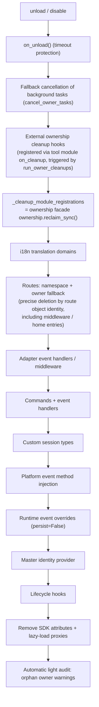

# Ownership (owner) System

> [!TIP]
> **When to read this**: when troubleshooting resource leaks, understanding the unload cleanup chain, or declaring owned resources. Skip it if not needed — it will not affect your use of other features.

> **What you'll learn**: how the owner context automatically attributes resources, the panorama table of owned resources, the full timing of the cleanup chain on unload/disable, and which resources are not cleaned up on unload (design boundaries).
>
> **Not covered here**: the permission determination of "when a resource takes effect" (see [Scope (scope)](scope.md)); recommended patterns for background tasks and the boundaries of forced cancellation (see [Lifecycle Management · Background Task Ownership and Auto-Cancellation](lifecycle.md#background-task-ownership-and-auto-cancellation)).


Ownership is the cornerstone of the "plug-and-play" nature of modules: every framework resource a module registers during loading is automatically recorded under its name, and is reclaimed with one action on unload/disable — module authors only need to declare resources, with no need to hand-write cleanup logic.

> **Related systems**: scope decides "whether a resource takes effect" at event dispatch time, while ownership decides "who owns a resource and whose unload triggers its reclamation" during the lifecycle.
> See [Unified Control Plane (scope)](scope.md) for details on scope, and
> [Lifecycle Management](lifecycle.md#background-task-ownership-and-auto-cancellation) for details on background tasks.

{!--< tips >!--}
1. Ownership is automatically recorded by `current_owner` at the **moment of registration**, requiring zero changes to module code
2. Unload/disable share the same cleanup chain (`_cleanup_module_registrations`); each step only warns on failure without interrupting
3. Resources with user-configuration semantics (persisted overrides / scope rules / command ACLs) are **not** cleaned up when a module is unloaded
4. External handles hosted by tool modules can be hooked into the cleanup chain with `on_cleanup(cb)`, and are automatically called back when the other module unloads (see [Tool Module Guide](#tool-module-guide-hosting-handles-of-other-modules))
{!--< /tips >!--}

## The Owner Context Mechanism

The owner is passed through the context variable `current_owner` (`ErisPulse.runtime.context`):

```python
from ErisPulse.runtime import owner_scope, get_current_owner

with owner_scope("MyModule"):
    # All resources registered within this block are automatically owned by MyModule
    assert get_current_owner() == "MyModule"
```

The framework automatically injects the owner at the following points (module/adapter code needs no manual wrapping):

| Timing | Owner value | Location |
|------|----------|------|
| Module `load()` | Module name | Throughout instantiation + `on_load` |
| Adapter `start()` / `restart()` | Platform name | Throughout adapter startup |
| `activate_on` lazy-load stub registration | Module name | Placeholder command/handler registration |
| Event handler execution | Name of the module the handler belongs to | Handler / command entry re-injection |

Runtime re-injection means: when a command handler declared in a module's `on_load` calls registration-style APIs **while running** (such as `sdk.adapter.on()` or `overrides.*.set(persist=False)`), those calls are likewise automatically attributed to the module.

## Ownership Resource Panorama

The following resources registered by a module within its loading context are all recorded with ownership and automatically reclaimed on unload/disable:

| Resource | Registration | Cleanup call |
|------|----------|----------|
| Commands | `@command()` / command dict declaration | `command.unregister_by_owner()` |
| Event handlers | `@message` / `@notice` / `@request` / `@meta` | `handler.unregister_by_owner()` |
| Adapter event listeners | `sdk.adapter.on()` / `raw=True` | `adapter.unregister_handlers_by_owner()` |
| Adapter middleware | `@sdk.adapter.middleware` | Same as above |
| Routes (HTTP/WS/SSE) | `router.http()` / `websocket()` / `sse()` | Double fallback by namespace + by owner |
| Router middleware | `@router.middleware()` / `add_middleware()` | `router.unregister_all_by_owner()` |
| Dashboard home entries | `router.register_home_entry()` | `unregister_home_entries_by_owner()` |
| Custom session types | `register_custom_type()` | `unregister_custom_types_by_owner()` |
| Platform event method injection | `register_event_method()` / `register_event_mixin()` | `unregister_event_methods_by_owner()` (automatically reclaimed on module unload; old closures no longer leak) |
| Background tasks | `self.spawn()` | `cancel_owner_tasks()` |
| External ownership cleanup hooks (hosted by tool modules) | `runtime.on_cleanup(cb)` | `run_owner_cleanups()` (triggered within the unload/disable/adapter shutdown chain) |
| Lifecycle hooks | `lifecycle.register()` | `lifecycle.unregister_by_owner()` |
| Master identity provider | `master.provider` | `master.unregister_by_owner()` |
| i18n translation keys | `I18nClass` declaration (domain = module name) | `i18n.unregister_domain()` |
| Event overrides (runtime) | `overrides.*.set(persist=False)` | `overrides.unregister_by_owner()` |
| Interaction sessions (wait_reply pending / leases) | `event.wait_reply()` / `sdk.interaction.acquire()` | `interaction.cancel_by_owner()` (the waiting side immediately receives the cancellation) |
| Context data | Recorded by owner in `runtime/context` | Precisely cleaned per module |

The corresponding adapter-side resources (with the platform name as owner) are reclaimed by `_cleanup_adapter_resources` during adapter `shutdown()` / `restart()`, which additionally covers:

| Resource | Cleanup call |
|------|----------|
| The adapter's own `on()` handlers and middleware | `adapter.unregister_handlers_by_owner(platform)` |
| Platform event method extensions (`EventMixin`) | `unregister_platform_event_methods(platform)` |
| Custom session types | `unregister_custom_types_by_owner(platform)` |
| Interaction sessions (pending wait_reply / leases on that platform) | `interaction.cancel_by_platform(platform)` |
| i18n translation domains (domain = config key) | `i18n.unregister_domain(config_key)` |
| Fine-grained namespace routes | `router.unregister_all_by_owner(platform)` |

## Unload/Disable Cleanup Sequence

`unload()` and `disable()` share the same cleanup chain (each step has its own try/except;
failures are only logged and **do not interrupt subsequent cleanup**):



`sdk.uninit()` has an additional global fallback on exit: shutdown all adapters → unload all modules → `router.stop()` (clears routes/middleware/home entries) → `cancel_all_background_tasks()` → clear event handlers and hooks.

## Unified Ownership Facade (ownership)

The sixteen steps of the cleanup chain converge under the unified ownership facade `ErisPulse.Core.ownership`;
four verbs cover "unregistration, counting, scanning, auditing" — each subsystem's own `*_by_owner`
unregistration functions remain unchanged and serve as the facade's internal implementation:

| Verb | Purpose |
|------|------|
| `ownership.reclaim(owner)` | Unified unregistration of all resources under an owner (task cancellation → cleanup hooks → registration-style resources; full async version) |
| `ownership.reclaim_sync(owner)` | Unregistration of registration-style resources (synchronous version, for synchronous unload paths) |
| `ownership.counts(owner=None)` | Read-only count of an owner's registered resources (None means all owners) |
| `ownership.orphans()` | Orphan scan: resources still registered while their owner has been unregistered (a concrete leak list) |
| `ownership.audit(owner, deep=)` | Leak audit report (counts + orphans + optional gc instance census) |

```python
from ErisPulse.Core import ownership

ownership.reclaim_sync("MyModule")       # {'commands': 1, 'routes_http': 2, ...}
ownership.counts("MyModule")             # Count of registered resources
ownership.orphans()                      # [{"owner": "ghost", "total": 2, ...}]
```

**Audit entry points**:

- **Automatic light audit** after unload/reload: issues a WARNING whenever orphan owner resources are found (zero-overhead counting scan)
- `sdk.module.audit(name, deep=True)`: a gc census of module instances — when an instance cannot be reclaimed, it reports the type of the referencing party (locating "who is holding onto the old instance"); incurs a global pause cost, use only for explicit troubleshooting
- Deep census is an explicit operation: no config key, no automatic repair

## Nested Lifecycles (ownership.nest)

Allows one module (the parent) to host a group of other owners (children); when the parent is reclaimed, the children are reclaimed as a whole. Typical scenarios: child plugins running inside a script engine module, Dashboard-hosted panel extensions, tool modules managing external registry entries on behalf of others.

```python
from ErisPulse.Core import ownership

ownership.nest("ScriptEngine", "ScriptEngine.plugin_a")
ownership.nest("ScriptEngine", "ScriptEngine.plugin_b")

ownership.nested_children("ScriptEngine")
# frozenset({"ScriptEngine.plugin_a", "ScriptEngine.plugin_b"})

ownership.unnest("ScriptEngine", "ScriptEngine.plugin_a")
```

| Item | Convention |
|----|------|
| Reclaim order | Children before parents; siblings in reverse registration order (later-registered are reclaimed first) |
| Reclaim scope | Resource level (tasks / connections / routes / commands / tracked resources / cleanup hooks), **does not trigger the child's module-level `on_unload`** |
| Cycle detection | `nest` rejects self-cycles and existing reverse chains, returns `False` and warns |
| Child dies first | When a child is independently reclaimed (`reclaim` / `reclaim_sync`), it is automatically `unnest`ed; the parent keeps no dangling relation |
| Timeout | Each child's reclamation is bounded by `CLEANUP_CALLBACK_TIMEOUT_SECS`; on timeout, warn, remove the parent-child relation, and continue |
| Observability | `ownership.counts(parent)` adds a `nested` count; `ownership.orphans()` computes the transitive closure of nesting relations, and residual relations whose parent has disappeared are still exposed |

**Why the child's `on_unload` is not triggered**: a full module unload requires the manager-level flow (lazy proxies, sdk attributes, event broadcasts), while the `ownership` facade only handles resource reclamation; cross-layer calls would introduce unload-lock reentrancy risk. When the child's `on_unload` is needed, the parent should explicitly call it in its own `on_unload`:

```python
await self.sdk.module.unload(child, reason="cascade")
```

Synchronous entry points (such as `sdk.module.disable`) first mark an async cascade and reclaim child resources in a background task;
`reclaim_sync` only cascades the child's registration-style resources on its own when no async cascade is in progress.

## Hot-Reload Failure Rollback

Hot reload follows "**snapshot before unload → automatic recovery on failure → replay on_load**": when the new version has syntax errors,
missing dependencies, or fails to load, the old instance and registration state (registry entries, sdk attributes, sys.modules
entries) are automatically restored; then the old instance's `on_load` is **replayed** within its ownership context (with `reason`
set to `"rollback"`), re-establishing the external resources severed during the unload phase; afterwards a
`module.rollback` event is emitted (payload `{module_name, success}`).

Adapter hot-reload failures likewise restore the old registration state; when the old instance was originally running and its old startup task had finished,
`start()` is replayed after rollback, and an `adapter.rollback` event is emitted (payload
`{adapter_name, replayed, success}`). Unload side effects such as disconnection / bot offline remain irreversible.

Boundary notes:

- Replay failure or timeout **only warns** — there is no rollback of the rollback: the old instance stays in its "finalized" state
  (consistent with 2.11.2 and earlier behavior); the log states this explicitly
- References to the old instance manually cached at runtime by third parties are outside recovery scope
- If the target package has already been uninstalled (entry-point gone), the unload is treated as successful and no rollback is performed
- The `on_unload` payload carries a `reason` (`unload` / `reload` / `disable` /
  `cascade` / `dormant` / `load-failed`); modules may defer closing
  resources that need to survive across reloads when `reason` is `reload`

For the complete capability boundaries of hot reload, cross-loop semantics, and module-side guidelines, see the next section.

## Hot-Reload Boundaries

Hot reload can replace code, rebuild registrations, and roll back failed reloads — but it **is not a process restart**.
What gets reclaimed are the **runtime resources registered in the ownership system**; resources belonging to no owner, data with
user-configuration semantics, and references cached inside third-party libraries do not disappear with a reload.

### Capability Boundaries

| Object | Behavior after reload | Notes |
|------|-----------|------|
| Module code / class definitions | Supported, re-imported | Old `sys.modules` entries are cleaned up |
| `on_unload` / `on_load` | Supported, triggered in order | `on_load` is replayed on failure rollback (see previous section) |
| Commands / handlers / routes / lifecycle hooks | Supported, automatically unregistered then re-registered | Cleaned via the ownership reclamation chain |
| `spawn_background` / `spawn_later` / `spawn_thread` | Supported, cancelled by owner | Threads are only registered for observation and cannot be force-killed |
| Any `asyncio.create_task` on the main loop | Supported, automatically owned and cancelled | Intercepted by the task factory (including creations inside third-party libraries) |
| Tasks spawned on the storage bridge loop | Supported, automatically owned and cancelled | The bridge loop has a task factory installed as well |
| Resources registered via `ownership.track()` | Supported, call `release()` | Loop-bound resources beyond the task factory's reach |
| `on_cleanup` hooks | Supported, triggered | Tool modules use this to drop hosted handles |
| Persisted overrides (`persist=True`) / config files | Not touched, kept | User assets |
| Object references cached inside third-party libraries | Not touched | Invisible to the framework; modules must release them themselves |
| Event loops the module itself creates / raw threads | Not reclaimed | See the guidelines below |

### Three-Layer Resource Governance

1. **Transparent interception layer** — event-loop-level task factories. Any task created within an owner context is automatically owned,
   covering the main loop and the storage bridge loop.
2. **Ownership-aware scheduling layer** — `spawn_background` / `spawn_later` / `spawn_thread`.
3. **Cooperative registration layer** — `ownership.track()` / `on_cleanup()`, for resources structurally
   out of reach (loop-bound connection pools, third-party clients).

### Event Loop Boundaries

| Loop | Created by | Task factory | Purpose |
|------|--------|-----------|------|
| Main loop | `sdk.run()` / `sdk.init()` | Installed | All business code |
| Storage bridge loop | `AsyncBridge` (first synchronous storage call) | Installed | Background execution of synchronous storage APIs |
| Temporary loop | `spawn_background` fallback | Not installed, closed after use | Last resort when the main loop is not ready |

**The temporary loop is a last resort**: it synchronously blocks the calling thread, and any sub-tasks spawned inside the coroutine after the loop closes are lost (the log shows a `temp_loop_fallback` warning). Seeing this warning means a module scheduled background tasks at the wrong time.

**Cross-loop cancellation is best-effort**: when `cancel_owner_tasks` finds tasks on other still-running loops, it posts cancellation via `call_soon_threadsafe` and logs a `cross_loop_task_residual` warning, but does **not wait** for them to finish (cross-loop waiting is unsafe). If you see this warning, check whether you created your own event loop.

### Module-Side Guidelines

```python
# Recommended
spawn_background(self._poll())            # Ownership-aware background task
spawn_later(30, lambda: self._cleanup())  # Ownership-aware delayed task
spawn_thread("poller", self._loop_body)   # Ownership-aware thread (entry automatically carries the owner)
ownership.track(pool)                     # Explicitly register a loop-bound resource
await sdk.storage.aget(key)               # In async contexts, use the async API directly

# Avoid
asyncio.create_task(self._poll())         # Bare call: no reference, easily GC'd
asyncio.new_event_loop()                  # Self-created loop: completely out of the ownership system's reach
threading.Thread(target=self._loop_body)  # Raw thread: entry has no owner context
self._storage.get(key)                    # Synchronous storage call in an async context: blocks the main loop
```

### Troubleshooting Checklist

1. Log shows `cross_loop_task_residual`? → Some resource ended up on a self-created loop
2. Log shows `temp_loop_fallback`? → A background task was scheduled before the main loop was ready
3. Error `attached to a different loop`? → Check whether you created your own loop or reused connection objects across loops
4. `ownership.orphans()` returns output? → Some resources under an owner survived after unload

## Design Boundaries: Which Resources Are Not Cleaned Up on Unload

Ownership only reclaims **runtime resources registered by module code**. The following resources have **user-configuration semantics**
(the user controls them and may have configured them deliberately) and persist with the configuration after the module is unloaded:

| Resource | Semantics | Notes |
|------|------|------|
| `overrides.*.set(persist=True)` | Persisted override | Written to the config file, effective across restarts; not deleted on module unload (explicit user configuration) |
| Scope rules such as `scope.set_action()` | Permission control plane | Managed by the user/Dashboard; unloading the module does not reclaim the rules |
| `overrides.acl.set(persist=True)` | Command ACL | Same as above |
| Conversation `save()` persistence | Multi-turn conversation archives | Data assets are not cleaned up |

Runtime temporary writes (`persist=False`) are reclaimed along with the owner — **whether something is persisted is the dividing line between "user assets" and "module runtime state"**.

## Internal Implementation: How Ownership Works

**In one sentence**: the attribution chain (contextvar propagation) decides "who gets credited", and the cancellation chain (the task registry) decides "whether something can be cancelled at unload time" — the two chains operate independently; correct resource cleanup requires both.

The ownership system consists of **two independent chains**; understanding their division of labor is the prerequisite for troubleshooting ownership issues:

### The Attribution Chain (contextvar Propagation)

ContextVars such as `current_owner` in `runtime/context.py` are responsible for **attribution** —
"to whom are the resources registered / calls initiated by this code at this moment credited". Propagation follows Python
contextvars semantics:

| Execution path | Does the context propagate? | Attribution result |
|---------|----------------|---------|
| Synchronous call chain / `await` chain | ✅ Propagates | Correct attribution |
| `asyncio.create_task` inside `owner_scope` | ✅ Propagates (the task copies the context at creation time) | Framework calls **inside** the task are attributed correctly |
| `run_in_executor` / raw threads | ❌ Does not propagate | Attribution lost |
| Self-created event loops | ❌ Does not propagate | Attribution lost |

> Attribution ≠ registration: context propagation only affects "who gets credited"; whether a resource can be cleaned up
> depends on whether it entered the cancellation chain described below.

### The Cancellation Chain (Task Registry)

The `_owner_tasks` registry in `runtime/tasks.py` is responsible for the **lifecycle** —
"which unfinished tasks exist under an owner, to be cancelled collectively at unload". Tasks enter the registry via:

1. **Explicit scheduling**: `spawn_background()` / `self.spawn()` → captures
   `current_owner` at creation (or an explicit `owner=` argument) → registered into the table;
2. **Automatic registration via Task Factory** (2.8.3): `install_owner_task_factory()`
   is installed on the main event loop at framework startup — **any** task creation (including
   `create_task` inside third-party libraries) passes through the factory, which reads `current_owner` and registers the task if it is not None.

The registry cleans itself up: each task carries a `done_callback` and is removed from the table upon completion — no leaks.

### Cancellation Timing (Module Unload)

```
module.unload()
  → on_unload(event)                    # Module cleans itself up (fallback timeout protection)
  → Framework unregisters this owner's commands/events/hooks/routes
  → cancel_owner_tasks(owner)           # Registry-based fallback cancellation
      → task.cancel() one by one        # Excluding the task currently executing the cancellation logic itself
      → await gather(pending, timeout)  # Wait for reclamation (timeout no longer blocks)
```

### Troubleshooting Approach

- **Resource not cleaned up** → Check the registry: does `get_owner_tasks("MyModule")` contain the task?
  If not, the registration path bypassed the ownership chain (import time / thread / independent loop); locate the issue against the table above.
- **Wrong attribution** → Check the value of `get_current_owner()` at the moment of the error; the attribution of asynchronously deferred execution
  (callbacks/tasks) is taken from the context at creation time, not at execution time.

## Module Author Guide

### Recommended Patterns

```python
from ErisPulse import sdk
from ErisPulse.Core.Event import command
from ErisPulse.runtime import owner_scope, spawn_background

class MyModule(BaseModule):
    async def on_load(self, event):
        # Framework resources: automatically owned, no manual cleanup needed
        self.task = self.spawn(self.polling())      # Background task
        sdk.router.register_home_entry("My Module", "/my")  # Home entry

        # Module-owned resources: wrap in owner_scope to bring them into the ownership system
        with owner_scope("MyModule"):
            self.client.on_event(self._handle)      # Hypothetical custom registration

    async def on_unload(self, event):
        # Framework resources have been automatically reclaimed; only clean up owned resources not covered by owner_scope
        await self.client.close()
```

### Caveats

- **Registration at import time has no ownership**: hooks/handlers registered at module top level (at import time) happen before
  `owner_scope`, are treated as framework-level resources (owner=None), and are **not cleaned up**.
  Always register inside `on_load()`.
- **i18n registration with a custom domain**: if the domain of `i18n.register(domain=...)` is
  not equal to the module name, it will not be automatically reclaimed; keep domain = module name.
- **`self.spawn()` is recommended for background tasks**: since 2.8.3, a bare `asyncio.create_task` is also **implicitly owned automatically**
  (auto-registered by the Task Factory, with fallback cancellation at unload); but `self.spawn()` remains the recommended pattern —
  it supports scheduling from non-main-loop threads back to the main loop, an explicit `owner=` argument, and fire-and-forget GC protection.
  In versions **before 2.8.3**, bare tasks are not owned; you must use `self.spawn()`.
- Cleanup chain "failures only warn": an exception in one cleanup step does not block the reclamation of the remaining resources; it is visible
  at DEBUG/WARNING log levels, and TRACE can be enabled during troubleshooting.

### Registration Timing → Ownership Result Reference Table

| Registration scenario | Ownership result | Notes |
|---------|---------|------|
| Registered inside `on_load()` via framework APIs (command/event/lifecycle/route decorators) | Owned by the module | Automatically unregistered at unload |
| Registered at module top level (import time) | **No ownership** (owner=None) | Not cleaned up; do not use |
| Background tasks created via `self.spawn()` | Owned by the module | Automatically cancelled at unload |
| Registered inside `owner_scope("Name")` via third-party APIs | Owned by the module | Relies on the third-party callback executing synchronously within the scope |
| Bare `asyncio.create_task` (including `loop.create_task` / `ensure_future`) | **Automatically owned** (Task Factory, 2.8.3+) | Reads `current_owner` at the moment of creation; automatically registered within an owner context, with fallback cancellation at unload; see [Internal Implementation](#internal-implementation-how-ownership-works) below |
| Tasks created inside third-party library async callbacks (aiohttp / APScheduler etc.) | **Automatically owned** (Task Factory, 2.8.3+) | If `current_owner` is already injected when the callback executes (e.g. during framework handler execution), the task is registered automatically |
| `run_in_executor` (thread pool) | **No ownership** (not an asyncio.Task) | Threads are not governed by the task factory; manage their lifecycle yourself |
| Registration in an independent event loop (self-created loop) | **No ownership** | The Task Factory is only installed on the main loop; contextvars also do not propagate across event loops |

> Principle: **ownership follows the `current_owner` context at the moment of registration**; any async deferral,
> thread pool, or independent loop leaves that context — when ownership is needed, explicitly enter `owner_scope`.

## Tool Module Guide: Hosting Handles of Other Modules

**Scenario**: "tool modules" such as schedulers, registries, and connection pools hold things on behalf of other modules —
when the other module calls `sdk.Cron.on_trigger(handler)` in its `on_load`, a callback pointing to that module's instance is stored in your container. The framework automatically cleans up everything the other module registered as framework resources, but it cannot clean up the
**references inside your private container**: after the other module unloads, your container still holds its instance, so it cannot be
reclaimed by GC (memory leak; the `purge` leak diagnostics report it as "unreclaimable").

**Solution**: call `on_cleanup()` in the same function where you register the other module's items;
the framework will automatically call your cleanup function when the other module unloads / disables:

```python
from ErisPulse.Core.Bases import BaseModule
from ErisPulse.runtime import off_cleanup, on_cleanup

class CronModule(BaseModule):
    def __init__(self):
        self._entries = {}  # {module name: list of callbacks hosted for that module}

    def on_trigger(self, handler):
        # Automatically identifies the calling module's name (correct for both direct
        # calls in on_load / module.call); the return value is the resolved owner,
        # usable directly as the registry key
        owner = on_cleanup(self._drop)
        self._entries.setdefault(owner, []).append(handler)

    def _drop(self, owner: str):
        """Called automatically by the framework when the other module is unloaded/disabled: just drop its handles"""
        self._entries.pop(owner, None)

    async def on_unload(self, event):
        off_cleanup(self._drop)  # ③ Unregister the hook before unloading yourself, to avoid the hook table holding self
```

Behaviors guaranteed by the framework:

| Concern | Behavior |
|--------|------|
| Trigger timing | When the other module is unloaded / disabled, or on adapter shutdown — all triggered within the framework cleanup chain, earlier than the purge leak diagnostics |
| Caller identification | Direct calls take `current_owner`; calls via `module.call()` take the caller (`current_caller`); you may also specify explicitly with `on_cleanup(cb, owner="module name")`. **Mandatory validation**: if the owner cannot be resolved (all three sources missing), raises `ValueError` — private tool modules should register hooks within their own loading context |
| Callback signature | `cb(owner: str)`, sync / async both accepted; async has timeout protection (`CLEANUP_CALLBACK_TIMEOUT_SECS`, default 10 seconds) |
| Fault tolerance | An exception / timeout in a single callback is only logged, without affecting other hooks or the cleanup chain |
| Duplicate registration | The same `(owner, callback)` is idempotently deduplicated |

**When it's not needed**: if what the other module registered are framework resources (commands, event handlers, routes,
background tasks…), the framework already cleans them up fully automatically (see the [Ownership Resource Panorama](#ownership-resource-panorama) above).
Only handles of the other module held in your private container need `on_cleanup`.
For a quick-reference version from the module development perspective, see
[Best Practices · Tool Modules](../developer-guide/modules/best-practices.md#tool-modules-catch-unload-notifications-when-hosting-things-for-others).

## Related Documentation

Choose by your next intent:

- **To control "whether a resource takes effect" (the permission plane)** → [Scope (scope)](scope.md) — ownership governs "who owns a resource and whose unload reclaims it", while scope governs "when a resource takes effect"
- **Fallback cancellation of background tasks / timers** → [Lifecycle Management · Background Task Ownership and Auto-Cancellation](lifecycle.md#background-task-ownership-and-auto-cancellation)
- **Canary releases isolated under a separate owner** → [Shadow Modules and Graduation](shadow.md)
- **Quick reference and recommended patterns from the module development perspective** → [Module Best Practices](../developer-guide/modules/best-practices.md)