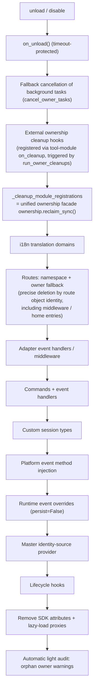

# Ownership (owner) System

> [!TIP]
> **When to read this**: when troubleshooting resource leaks, understanding the unload cleanup chain, or declaring owned resources. Skip it otherwise; it does not affect the use of other features.

> **After reading, you will know**: how the owner context automatically attributes resources, the panorama table of owned resources, the
> complete timeline of the cleanup chain on unload/disable, and which resources are not cleaned up on unload (design boundaries).
>
> **Not covered here**: permission checks for "when resources take effect" (see [Scope (scope)](scope.md));
> recommended patterns for background tasks and forced-cancellation boundaries (see [Lifecycle Management · Background Task Ownership and Auto-Cancellation](lifecycle.md#background-task-ownership-and-auto-cancellation)).


Ownership is the cornerstone of a module's "plug-and-play" behavior: every framework resource a module registers while loading is automatically recorded under its name,
and on unload/disable everything recorded is reclaimed with one call — module authors only need to declare resources, with no hand-written cleanup logic.

> **Related systems**: scope decides "whether a resource takes effect" during event dispatch,
> while ownership decides "who a resource belongs to and who reclaims it on unload" across the lifecycle.
> For scope details see [Unified Control Plane (scope)](scope.md); for background tasks see
> [Lifecycle Management](lifecycle.md#background-task-ownership-and-auto-cancellation).

{!--< tips >!--}
1. Ownership is recorded automatically via `current_owner` at the **moment of registration**, requiring zero changes to module code
2. Unload/disable share the same cleanup chain (`_cleanup_module_registrations`); each step that fails only warns and does not abort
3. User-configuration-semantic resources (persisted overrides / scope rules / command ACL) are **not** cleaned up on module unload
4. External handles hosted by tool modules can hook into the cleanup chain via `on_cleanup(cb)`; the callback fires automatically when the other module unloads (see [Tool Module Guide](#tool-module-guide-hosting-handles-of-other-modules))
{!--< /tips >!--}

## The owner Context Mechanism

Ownership is passed via the context variable `current_owner` (`ErisPulse.runtime.context`):

```python
from ErisPulse.runtime import owner_scope, get_current_owner

with owner_scope("MyModule"):
    # Every resource registered in this block is automatically attributed to MyModule
    assert get_current_owner() == "MyModule"
```

The framework automatically injects the owner at the following moments (module/adapter code needs no manual wrapping):

| Moment | owner value | Location |
|------|----------|------|
| Module `load()` | module name | instantiation + the entire `on_load` |
| Adapter `start()` / `restart()` | platform name | the entire adapter startup |
| `activate_on` lazy-load stub registration | module name | placeholder command/handler registration |
| During event handler execution | owning module name of the handler | handler / command entry re-injection |

Runtime re-injection means: when a command handler declared in `on_load` **is running** and calls
registration-style APIs (such as `sdk.adapter.on()`, `overrides.*.set(persist=False)`),
they are likewise automatically attributed to this module.

### bind_owner: Stitching Ownership into Callbacks and Thread Entry Points

`owner_scope` applies to a code block; `bind_owner(fn)` "stitches" the context into the function itself —
it captures `current_owner` at the wrapping instant, and thereafter, no matter who calls it or from which thread or event loop, it executes
under the original owner. New threads start with an empty context by default (on trigger paths from Timer / watcher / third-party
thread pools, `current_owner` is None), so tasks created inside them do not enter the ownership table and cannot be
cancelled on module unload (one source of cross-loop residue); after wrapping, ownership travels with the call:

```python
from ErisPulse.runtime import bind_owner

class MyModule(BaseModule):
    async def on_load(self, event):
        # Wrap before handing off to a third-party scheduler / thread pool:
        external_scheduler.submit(bind_owner(self._poll))

    async def _poll(self):
        # While running, current_owner == "MyModule", so it can be properly reclaimed on unload
        ...
```

- `async` functions remain `async`, with ownership in effect across all `await`s; plain functions are covered only during synchronous execution
- Framework-owned entry points (`self.spawn()` / command handlers) already carry ownership automatically; this function is only for
  **trigger paths outside the framework** (external schedulers, `threading.Timer`, callback registries, etc.)

## Owned Resources Overview

The following resources registered by a module within its loading context are all recorded with ownership and are automatically reclaimed on unload/disable:

| Resource | Registration | Cleanup call |
|------|----------|----------|
| Commands | `@command()` / command dict declaration | `command.unregister_by_owner()` |
| Event handlers | `@message` / `@notice` / `@request` / `@meta` | `handler.unregister_by_owner()` |
| Adapter event listeners | `sdk.adapter.on()` / `raw=True` | `adapter.unregister_handlers_by_owner()` |
| Adapter middleware | `@sdk.adapter.middleware` | same as above |
| Routes (HTTP/WS/SSE) | `router.http()` / `websocket()` / `sse()` | namespace-based + owner-based double fallback |
| Route middleware | `@router.middleware()` / `add_middleware()` | `router.unregister_all_by_owner()` |
| Dashboard home entries | `router.register_home_entry()` | `unregister_home_entries_by_owner()` |
| Custom session types | `register_custom_type()` | `unregister_custom_types_by_owner()` |
| Platform event method injection | `register_event_method()` / `register_event_mixin()` | `unregister_event_methods_by_owner()` (automatically reclaimed on module unload; old closures no longer leak) |
| Background tasks | `self.spawn()` | `cancel_owner_tasks()` |
| External ownership cleanup hooks (tool-module hosted) | `runtime.on_cleanup(cb)` | `run_owner_cleanups()` (triggered within the unload/disable/adapter-shutdown chains) |
| Lifecycle hooks | `lifecycle.register()` | `lifecycle.unregister_by_owner()` |
| Master identity-source provider | `master.provider` | `master.unregister_by_owner()` |
| i18n translation keys | `I18nClass` declaration (domain = module name) | `i18n.unregister_domain()` |
| Event overrides (runtime) | `overrides.*.set(persist=False)` | `overrides.unregister_by_owner()` |
| Interaction sessions (wait_reply waits / leases) | `event.wait_reply()` / `sdk.interaction.acquire()` | `interaction.cancel_by_owner()` (the waiting side is cancelled immediately) |
| Context data | recorded per owner in `runtime/context` | precisely cleaned per module |

The corresponding resources on the adapter side (with the platform name as owner) are reclaimed by `_cleanup_adapter_resources`
on adapter `shutdown()` / `restart()`, additionally including:

| Resource | Cleanup call |
|------|----------|
| Adapter's own `on()` handlers and middleware | `adapter.unregister_handlers_by_owner(platform)` |
| Platform event method extensions (`EventMixin`) | `unregister_platform_event_methods(platform)` |
| Custom session types | `unregister_custom_types_by_owner(platform)` |
| Interaction sessions (pending wait_reply / leases on that platform) | `interaction.cancel_by_platform(platform)` |
| i18n translation domains (domain = config key) | `i18n.unregister_domain(config key)` |
| Fine-grained namespace routes | `router.unregister_all_by_owner(platform)` |

## Unload/Disable Cleanup Sequence

`unload()` and `disable()` share the same cleanup chain (each step wrapped in its own try/except;
failures are only logged and **do not abort subsequent cleanup**):



On exit, `sdk.uninit()` has an additional global fallback: all adapters shutdown → all modules unload →
`router.stop()` (clears routes/middleware/home entries) → `cancel_all_background_tasks()` →
clear event handlers and hooks.

## Unified Ownership Facade (ownership)

The sixteen steps of the cleanup chain converge under the unified ownership facade `ErisPulse.Core.ownership`;
four verbs cover "deregister, count, scan, audit" — each subsystem's own `*_by_owner`
deregistration functions remain unchanged, serving as the facade's internal implementation:

| Verb | Purpose |
|------|------|
| `ownership.reclaim(owner)` | Deregister all resources under an owner in one place (task cancellation → cleanup hooks → registration-style resources; full async version) |
| `ownership.reclaim_sync(owner)` | Deregistration of registration-style resources (sync version, for synchronous unload paths) |
| `ownership.counts(owner=None)` | Read-only count of an owner's registered resources (None for all owners) |
| `ownership.orphans()` | Orphan scan: resources still registered while their owner is gone (hard evidence of leaks) |
| `ownership.audit(owner, deep=)` | Leak audit report (counts + orphans + optional gc instance census) |

```python
from ErisPulse.Core import ownership

ownership.reclaim_sync("MyModule")       # {'commands': 1, 'routes_http': 2, ...}
ownership.counts("MyModule")             # counts of registered resources
ownership.orphans()                      # [{"owner": "ghost", "total": 2, ...}]
```

**Audit entry points**:

- **Automatic light audit after unload / reload**: a WARNING is raised as soon as orphan-owner resources are found (zero-overhead counting scan)
- `sdk.module.audit(name, deep=True)`: gc census of module instances — when instances cannot be collected,
  it reports the types of the parties holding references (to pinpoint "who is gripping the old instance"); carries a global pause cost, for explicit troubleshooting only
- The deep census is an explicit operation: no config keys, no automatic repair

## Nested Lifetimes (ownership.nest)

> This feature requires ErisPulse **2.12+**.

Allows one module (the parent) to host a set of other owners (children); when the parent is reclaimed, the children are reclaimed as a whole. Typical scenarios:
running child plugins inside a script-engine module, Dashboard-hosted panel extensions, and tool modules managing external registry entries on behalf of others.

```python
from ErisPulse.Core import ownership

ownership.nest("ScriptEngine", "ScriptEngine.plugin_a")
ownership.nest("ScriptEngine", "ScriptEngine.plugin_b")

ownership.nested_children("ScriptEngine")
# frozenset({"ScriptEngine.plugin_a", "ScriptEngine.plugin_b"})

ownership.unnest("ScriptEngine", "ScriptEngine.plugin_a")
```

| Item | Convention |
|----|------|
| Reclaim order | Children before the parent; among siblings, reverse registration order (later-registered reclaimed first) |
| Reclaim scope | Resource level (tasks / connections / routes / commands / tracked resources / cleanup hooks); the child's module-level `on_unload` is **not** triggered |
| Cycle detection | `nest` rejects self-loops and already-existing reverse links, returns `False` and warns |
| Child dies first | When a child is reclaimed independently (`reclaim` / `reclaim_sync`), it is automatically `unnest`ed; the parent side keeps no dangling relationship |
| Timeout | Each child's reclamation is bounded by `CLEANUP_CALLBACK_TIMEOUT_SECS`; on timeout it warns, removes the parent-child relationship, and continues |
| Observability | `ownership.counts(parent)` gains a `nested` count; `ownership.orphans()` takes the transitive closure over nesting relationships, so residual relationships whose parent has vanished are still exposed |

**Why the child's `on_unload` is not triggered**: a complete module unload must go through the manager-level flow (lazy proxies,
sdk attributes, event broadcast), whereas the `ownership` facade only handles resource reclamation; a cross-layer call would introduce
unload-lock re-entry risk. When the child's `on_unload` is needed, the parent explicitly calls it inside its own `on_unload`:

```python
await self.sdk.module.unload(child, reason="cascade")
```

Synchronous entry points (such as `sdk.module.disable`) first mark an async cascade; a background task reclaims the child resources;
`reclaim_sync` cascades the child's registration-style resources on its own only when no async cascade is in progress.

## Hot-Reload Failure Rollback

Hot reload works as "**snapshot before unload → automatic restore on failure → replay of on_load**": on syntax errors in the new version,
missing dependencies, or load failure, the old instance and registration state (registry entries, sdk attributes, sys.modules
entries) are automatically restored; then, within the ownership context, the old instance's `on_load` is **replayed** (`reason`
is `"rollback"`), so external resources disconnected during the unload phase are re-established; afterwards a
`module.rollback` event is emitted (payload `{module_name, success}`).

Adapter hot-reload failures likewise restore the old registration state; if the old instance was in a running state and its old startup task had already finished,
`start()` is replayed after rollback, and an `adapter.rollback` event is emitted (payload
`{adapter_name, replayed, success}`). Unload side effects such as disconnection / bot offline remain
irreversible. Replay and the `adapter.rollback` event require ErisPulse **2.12+**.

Boundary notes:

- Replay failure or timeout **only warns**; there is no rollback of the rollback — the old instance stays in the "already finalized" state
  (same behavior as 2.11.2 and earlier); the log states this explicitly
- References to the old instance manually cached at runtime by third parties are not within the restore scope
- If the target package has already been uninstalled (the entry-point disappeared), unload is treated as successful and no rollback is performed
- The `on_unload` payload carries `reason` (`unload` / `reload` / `disable` /
  `cascade` / `dormant` / `load-failed`); a module may, on `reload`, defer closing
  resources that must survive across reloads

For the full capability boundaries of hot reload, cross-loop semantics, and module-side guidelines, see the next section.

## Hot-Reload Boundaries

Hot reload can replace code, rebuild registrations, and roll back failed reloads — but it is **not a process restart**.
What gets reclaimed are the **runtime resources registered in the ownership system**; resources belonging to no owner, user-
configuration-semantic data, and references cached inside third-party libraries do not disappear with a reload.

### Capability boundaries

| Object | Behavior after reload | Notes |
|------|-----------|------|
| Module code / class definitions | Supported, re-imported | Old `sys.modules` entries are cleaned up |
| `on_unload` / `on_load` | Supported, triggered in order | `on_load` is replayed on failed rollback (see previous section) |
| Commands / handlers / routes / lifecycle hooks | Supported, automatically deregistered then re-registered | Cleaned via the ownership reclamation chain |
| `spawn_background` / `spawn_later` / `spawn_thread` | Supported, cancelled by owner | Threads are only observed; they cannot be force-killed |
| Any `asyncio.create_task` on the main loop | Supported, automatically attributed and cancelled | Intercepted by the task factory (including tasks created inside third-party libraries) |
| Tasks spawned on the storage bridge loop | Supported, automatically attributed and cancelled | The bridge loop also has a task factory installed |
| Resources registered via `ownership.track()` | Supported, `release()` is called | Loop-bound resources beyond the task factory's reach |
| `on_cleanup` hooks | Supported, triggered | Tool modules use them to discard hosted handles |
| Persisted overrides (`persist=True`) / config files | Not touched, kept | User assets |
| Object references cached inside third-party libraries | Not touched | Invisible to the framework; modules must drop them themselves |
| Event loops / raw threads the module itself `new`ed | Not reclaimed | See the guidelines below |

### Three layers of resource governance

1. **Transparent interception layer** — event-loop-level task factories. Any task created inside an owner context is automatically attributed,
   covering the main loop and the storage bridge loop.
2. **Ownership-aware scheduling layer** — `spawn_background` / `spawn_later` / `spawn_thread`.
3. **Cooperative registration layer** — `ownership.track()` / `on_cleanup()`, for resources structurally
   out of reach (Loop-bound connection pools, third-party clients).

### Event loop boundaries

| Loop | Created by | Task factory | Purpose |
|------|--------|-----------|------|
| Main loop | `sdk.run()` / `sdk.init()` | Installed | All business code |
| Storage bridge loop | `AsyncBridge` (first synchronous storage call) | Installed | Background execution of synchronous storage APIs |
| Temporary loop | `spawn_background` fallback | Not installed, closed after use | Last resort when the main loop is not ready |

**The temporary loop is a last resort**: it synchronously blocks the calling thread, and once the loop closes, sub-tasks spawned inside
coroutines are lost (the log carries a `temp_loop_fallback` warning). Seeing that warning means the module scheduled
a background task at the wrong moment.

**Cross-loop cancellation is best-effort**: when `cancel_owner_tasks` finds a task on another still-running loop,
it delivers the cancellation via `call_soon_threadsafe` and logs a `cross_loop_task_residual`
warning, but **does not wait** for it to finish (waiting across loops is unsafe). Seeing that warning should prompt a check for self-built
event loops.

### Module-side guidelines

```python
# Recommended
spawn_background(self._poll())            # ownership-aware background task
spawn_later(30, lambda: self._cleanup())  # ownership-aware delayed task
spawn_thread("poller", self._loop_body)   # ownership-aware thread (entry carries owner automatically)
ownership.track(pool)                     # explicitly register Loop-bound resources
await sdk.storage.aget(key)               # use the async API directly in async contexts

# Avoid
asyncio.create_task(self._poll())         # bare call: unreferenced, easily GC'd
asyncio.new_event_loop()                  # self-built loop: entirely unreachable by the ownership system
threading.Thread(target=self._loop_body)  # raw thread: entry has no owner context
self._storage.get(key)                    # synchronous storage call in async context: blocks the main loop
```

### Troubleshooting checklist

1. Log contains `cross_loop_task_residual`? → some resource lives on a self-built loop
2. Log contains `temp_loop_fallback`? → a background task was scheduled before the main loop was ready
3. Error `attached to a different loop`? → check for self-built loops or cross-loop reuse of connection objects
4. `ownership.orphans()` returns output? → some owner's resources survived unload

## Design Boundaries: Which Resources Are Not Cleaned Up on Unload

Ownership only reclaims **runtime resources registered by module code**. The following resources carry **user-configuration semantics**
(user-controlled, possibly intentional), and persist with the configuration after module unload:

| Resource | Semantics | Notes |
|------|------|------|
| `overrides.*.set(persist=True)` | Persisted override | Written to the config file, effective across restarts; not deleted on module unload (explicit user configuration) |
| Scope rules such as `scope.set_action()` | Permission control plane | Managed by the user/Dashboard; unloading a module does not reclaim the rules |
| `overrides.acl.set(persist=True)` | Command ACL | Same as above |
| Conversation `save()` persistence | Multi-turn conversation archive | Data assets are not cleaned up |

Runtime temporary writes (`persist=False`) are reclaimed with the owner — **whether something is persisted is the
dividing line between "user assets" and "module runtime state"**.

## Internal Implementation: How Ownership Works

**In one sentence**: the attribution chain (contextvar propagation) decides "who it is recorded under," and the cancellation chain (task registry) decides "whether it can be cancelled on unload" — the two chains operate independently; correct cleanup requires both.

The ownership system consists of **two independent chains**; understanding their division of labor is the prerequisite for troubleshooting ownership issues:

### The attribution chain (contextvar propagation)

ContextVars such as `current_owner` in `runtime/context.py` handle **attribution** —
"under whose name the resources registered / calls initiated by this piece of code right now are recorded". Propagation follows Python
contextvars semantics:

| Execution path | Is the context propagated? | Attribution result |
|---------|----------------|---------|
| Synchronous call chains / `await` chains | ✅ propagated | Correct attribution |
| `asyncio.create_task` inside `owner_scope` | ✅ propagated (the task copies the context at creation time) | Framework calls **inside** the task are correctly attributed |
| `run_in_executor` / raw threads | ❌ not propagated | Attribution lost |
| Self-built event loops | ❌ not propagated | Attribution lost |

> Attribution ≠ registration: context propagation only affects "who it is recorded under"; whether a resource can be cleaned up
> depends on whether it entered the cancellation chain below.

### The cancellation chain (task registry)

The `_owner_tasks` registry in `runtime/tasks.py` handles the **lifecycle** —
"which unfinished tasks an owner has, to be cancelled together on unload". Paths by which tasks enter the registry:

1. **Explicit scheduling**: `spawn_background()` / `self.spawn()` → captures
   `current_owner` at creation (or an explicit `owner=` argument) → registered in the table;
2. **Automatic registration via Task Factory** (2.8.3): `install_owner_task_factory()`
   is installed on the main event loop at framework startup — **any** task creation (including
   `create_task` calls inside third-party libraries) passes through the factory, which reads `current_owner`; if it is not None, the task is registered.

The registry self-cleans: every task carries a `done_callback`, removed from the table upon completion — no leaks.

### Cancellation timeline (module unload)

```
module.unload()
  → on_unload(event)                    # module self-cleanup (with fallback timeout protection)
  → the framework deregisters the owner's commands/events/hooks/routes
  → cancel_owner_tasks(owner)           # task registry fallback cancellation
      → task.cancel() one by one        # excluding the task currently executing the cancellation logic itself
      → await gather(pending, timeout)  # wait for reclamation (no longer blocks after timeout)
```

### Troubleshooting approach

- **A resource was not cleaned up** → check the registry: does `get_owner_tasks("MyModule")` contain the task;
  if not, the registration path bypassed the ownership chain (import time / thread / separate loop); locate it against the table above.
- **Wrong attribution** → check the value of `get_current_owner()` at the moment of the error; for asynchronously deferred execution
  (callbacks/tasks), attribution comes from the context at creation time, not execution time.

## Guide for Module Authors

### Recommended patterns

```python
from ErisPulse import sdk
from ErisPulse.Core.Event import command
from ErisPulse.runtime import owner_scope, spawn_background

class MyModule(BaseModule):
    async def on_load(self, event):
        # Framework resources: automatically owned, no manual cleanup needed
        self.task = self.spawn(self.polling())      # background task
        sdk.router.register_home_entry("My Module", "/my")  # home entry

        # Module-owned resources: wrap them in owner_scope to enter the ownership system
        with owner_scope("MyModule"):
            self.client.on_event(self._handle)      # hypothetical custom registration

    async def on_unload(self, event):
        # Framework resources are already reclaimed automatically; only clean up owned resources not covered by owner_scope
        await self.client.close()
```

### Caveats

- **Import-time registration has no ownership**: hooks/handlers registered at module top level (at import time) happen
  before `owner_scope` and are treated as framework-level resources (owner=None), hence **not cleaned up**.
  Always register inside `on_load()`.
- **i18n registration with a custom domain**: if the domain of `i18n.register(domain=...)` differs from
  the module name, it will not be reclaimed automatically; keep domain = module name.
- **Prefer `self.spawn()` for background tasks**: since 2.8.3, bare `asyncio.create_task` calls are also **automatically implicitly owned**
  (the Task Factory registers them automatically, with fallback cancellation on unload); but `self.spawn()` remains the recommended pattern —
  it supports scheduling from non-main-loop threads back to the main loop, explicit `owner=` specification, and fire-and-forget GC protection.
  In versions **before 2.8.3**, bare tasks are not owned; you must use `self.spawn()`.
- The cleanup chain "warns only on failure": an exception in a single cleanup step does not block reclamation of the remaining resources; visible at
  DEBUG/WARNING log levels; enable TRACE when troubleshooting.

### Registration Timing → Ownership Outcome Table

| Registration scenario | Ownership outcome | Notes |
|---------|---------|------|
| Registered inside `on_load()` via framework APIs (command/event/lifecycle/route decorators) | Owned by the module | Automatically deregistered on unload |
| Registered at module top level (import time) | **No ownership** (owner=None) | Not cleaned up; do not use |
| Background tasks created via `self.spawn()` | Owned by the module | Automatically cancelled on unload |
| Registered inside `owner_scope("Name")` via third-party APIs | Owned by the module | Relies on the third-party callback executing synchronously within the scope |
| Bare `asyncio.create_task` (incl. `loop.create_task` / `ensure_future`) | **Automatically owned** (Task Factory, 2.8.3+) | Reads `current_owner` at the creation instant; automatically registered inside an owner context, with fallback cancellation on unload; see [Internal Implementation](#internal-implementation-how-ownership-works) below |
| Tasks created inside third-party library async callbacks (aiohttp / APScheduler etc.) | **Automatically owned** (Task Factory, 2.8.3+) | If `current_owner` has been injected when the callback runs (e.g. during framework handler execution), the task is registered automatically |
| `run_in_executor` (thread pool) | **No ownership** (not an asyncio.Task) | Threads are not governed by the task factory; manage their lifecycle yourself |
| Registration inside an independent event loop (self-built loop) | **No ownership** | The Task Factory is installed only on the main loop; contextvars also do not propagate across event loops |

> Principle: **ownership follows the `current_owner` context at the moment of registration**; any asynchronous deferral,
> thread pool, or independent loop escapes that context — when you need ownership, enter `owner_scope` explicitly.

## Tool Module Guide: Hosting Handles of Other Modules

**Scenario**: "tool modules" such as scheduled-task managers, registries, and connection pools keep things on behalf of other modules —
when the other side calls `sdk.Cron.on_trigger(handler)` in its `on_load`, your container stores
a callback pointing to the other side's instance. The framework automatically cleans up everything the other side registered as framework resources, but it cannot clean up
the references in your **private container**: after the other module unloads, your container still holds its instance, so it cannot be
GC-collected (a memory leak; the `purge` leak diagnostics report it as "uncollectable").

**Solution**: call `on_cleanup()` in the same function where you register the other side's things;
the framework will automatically call your cleanup function when the other side unloads / is disabled:

```python
from ErisPulse.Core.Bases import BaseModule
from ErisPulse.runtime import off_cleanup, on_cleanup

class CronModule(BaseModule):
    def __init__(self):
        self._entries = {}  # {module name: list of callbacks hosted for that module}

    def on_trigger(self, handler):
        # Automatically identifies the calling module's name (correct for direct calls in on_load and via module.call alike);
        # the return value is the resolved owner, usable directly as a record key
        owner = on_cleanup(self._drop)
        self._entries.setdefault(owner, []).append(handler)

    def _drop(self, owner: str):
        """Called automatically by the framework when the other module is unloaded/disabled: just discard its handle"""
        self._entries.pop(owner, None)

    async def on_unload(self, event):
        off_cleanup(self._drop)  # ③ deregister the hook before unloading yourself, to avoid the hook table holding self
```

Framework-guaranteed behavior:

| Concern | Behavior |
|--------|------|
| Trigger timing | When the other module unloads / is disabled, or an adapter shuts down — all triggered within the framework cleanup chain, before purge leak diagnostics |
| Caller identification | Direct calls take `current_owner`; calls via `module.call()` take the caller (`current_caller`); you may also specify explicitly with `on_cleanup(cb, owner="module name")`. **Strict validation**: if the owner cannot be resolved (all three sources missing), a `ValueError` is raised — private tool modules should register hooks within their own loading context |
| Callback signature | `cb(owner: str)`, sync or async; async ones carry timeout protection (`CLEANUP_CALLBACK_TIMEOUT_SECS`, 10 seconds by default) |
| Fault tolerance | An exception / timeout in a single callback is only logged, without affecting the remaining hooks or the cleanup chain |
| Duplicate registration | The same `(owner, callback)` is idempotently deduplicated |

**When you do not need this**: if what the other side registers are framework resources (commands, event handlers, routes,
background tasks...), the framework already cleans them up fully automatically (see [Owned Resources Overview](#owned-resources-overview) above).
Only handles of the other side held in your private container need `on_cleanup`.
For the quick-reference version from the module development perspective, see
[Best Practices · Tool Modules](../developer-guide/modules/best-practices.md#tool-modules-catch-the-unload-notification-when-hosting-others-things).

## Related Documentation

Choose by your next intent:

- **Want to control "whether a resource takes effect" (the permission plane)** → [Scope (scope)](scope.md) — ownership governs "who a resource belongs to and who reclaims it on unload", scope governs "when a resource takes effect"
- **Fallback cancellation of background tasks / timers** → [Lifecycle Management · Background Task Ownership and Auto-Cancellation](lifecycle.md#background-task-ownership-and-auto-cancellation)
- **Isolate with an independent owner for canary releases** → [Shadow Modules and Canary Promotion](shadow.md)
- **Quick reference and recommended patterns from the module development perspective** → [Module Best Practices](../developer-guide/modules/best-practices.md)