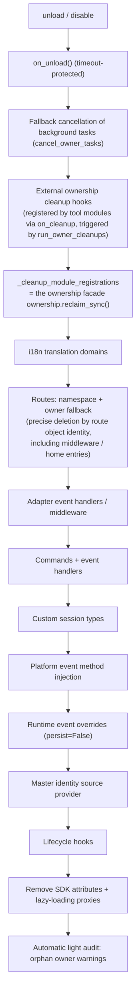

# Ownership (owner) System

> [!TIP]
> **When to read this**: when troubleshooting resource leaks, understanding the unload cleanup chain, or declaring owned resources. Skip it otherwise; nothing else depends on it.

> **What you will know after reading**: how the owner context automatically attributes resources, a panoramic table of owned resources, the complete sequencing of the cleanup chain on unload/disable, and which resources are NOT cleaned up on unload (design boundaries).
>
> **Not covered here**: permission decisions on "when a resource takes effect" (see [Scope (scope)](scope.md)); recommended patterns for background tasks and the boundaries of forced cancellation (see [Lifecycle Management · Background Task Ownership and Auto Cancellation](lifecycle.md#background-task-ownership-and-auto-cancellation)).


Ownership is the cornerstone of modules' "plug-and-play" design: every framework resource a module registers while loading is automatically attributed to it by name, and is reclaimed with one click by that attribution on unload/disable—module authors only need to declare resources, without hand-writing cleanup logic.

> **Related systems**: scope decides "whether a resource takes effect" at event dispatch time;
> ownership decides, over the lifecycle, "who a resource belongs to and whose unload reclaims it".
> For scope details see [Unified Control Plane (scope)](scope.md); for background tasks see
> [Lifecycle Management](lifecycle.md#background-task-ownership-and-auto-cancellation).

{!--< tips >!--}
1. Ownership is recorded automatically by `current_owner` at the **moment of registration**, with zero changes to module code
2. Unload/disable share the same cleanup chain (`_cleanup_module_registrations`); a failure at any step only warns and does not interrupt
3. Resources with user-configuration semantics (persisted overrides / scope rules / command ACL) are **not** cleaned up on module unload
4. External handles hosted by tool modules can be hooked into the cleanup chain with `on_cleanup(cb)`, and are called back automatically when the owning module unloads (see [Tool Module Guide](#tool-module-guide-managing-handles-of-other-modules))
{!--< /tips >!--}

## The owner Context Mechanism

The owner is passed via the context variable `current_owner` (`ErisPulse.runtime.context`):

```python
from ErisPulse.runtime import owner_scope, get_current_owner

with owner_scope("MyModule"):
    # All resources registered within this block are automatically attributed to MyModule
    assert get_current_owner() == "MyModule"
```

The framework automatically injects the owner at the following points (no manual wrapping needed in module/adapter code):

| When | owner value | Location |
|------|----------|------|
| Module `load()` | Module name | Throughout instantiation + `on_load` |
| Adapter `start()` / `restart()` | Platform name | Throughout adapter startup |
| `activate_on` lazy-load stub registration | Module name | Placeholder command/handler registration |
| During event handler execution | The handler's owning module name | Re-injection at handler / command entry |

Runtime re-injection means: when command handlers declared in `on_load` call registration APIs **while running** (e.g., `sdk.adapter.on()`, `overrides.*.set(persist=False)`), those registrations are likewise automatically attributed to the module.

## Panorama of Owned Resources

The following resources registered by a module within its loading context all record ownership and are automatically reclaimed on unload/disable:

| Resource | Registration | Cleanup call |
|------|----------|----------|
| Commands | `@command()` / command dict declaration | `command.unregister_by_owner()` |
| Event handlers | `@message` / `@notice` / `@request` / `@meta` | `handler.unregister_by_owner()` |
| Adapter event listeners | `sdk.adapter.on()` / `raw=True` | `adapter.unregister_handlers_by_owner()` |
| Adapter middleware | `@sdk.adapter.middleware` | Same as above |
| Routes (HTTP/WS/SSE) | `router.http()` / `websocket()` / `sse()` | Dual fallback by namespace + by owner |
| Route middleware | `@router.middleware()` / `add_middleware()` | `router.unregister_all_by_owner()` |
| Dashboard home entries | `router.register_home_entry()` | `unregister_home_entries_by_owner()` |
| Custom session types | `register_custom_type()` | `unregister_custom_types_by_owner()` |
| Platform event method injection | `register_event_method()` / `register_event_mixin()` | `unregister_event_methods_by_owner()` (automatically reclaimed on module unload; old closures no longer leak) |
| Background tasks | `self.spawn()` | `cancel_owner_tasks()` |
| External ownership cleanup hooks (hosted by tool modules) | `runtime.on_cleanup(cb)` | `run_owner_cleanups()` (triggered within the unload/disable/adapter shutdown chain) |
| Lifecycle hooks | `lifecycle.register()` | `lifecycle.unregister_by_owner()` |
| Master identity source provider | `master.provider` | `master.unregister_by_owner()` |
| i18n translation keys | `I18nClass` declaration (domain = module name) | `i18n.unregister_domain()` |
| Event overrides (runtime) | `overrides.*.set(persist=False)` | `overrides.unregister_by_owner()` |
| Interaction sessions (wait_reply waits / leases) | `event.wait_reply()` / `sdk.interaction.acquire()` | `interaction.cancel_by_owner()` (the waiting party immediately receives the cancellation) |
| Context data | `runtime/context` recorded per owner | Precise per-module cleanup |

The corresponding resources on the adapter side (with the platform name as owner) are reclaimed by `_cleanup_adapter_resources` when the adapter `shutdown()`s / `restart()`s, additionally including:

| Resource | Cleanup call |
|------|----------|
| The adapter's own `on()` handlers and middleware | `adapter.unregister_handlers_by_owner(platform)` |
| Platform event method extensions (`EventMixin`) | `unregister_platform_event_methods(platform)` |
| Custom session types | `unregister_custom_types_by_owner(platform)` |
| Interaction sessions (pending wait_reply / leases on that platform) | `interaction.cancel_by_platform(platform)` |
| i18n translation domains (domain = config key) | `i18n.unregister_domain(config_key)` |
| Fine-grained namespace routes | `router.unregister_all_by_owner(platform)` |

## Unload/Disable Cleanup Sequence

`unload()` and `disable()` share the same cleanup chain (each step wrapped in an independent try/except; failures are only logged and **do not interrupt subsequent cleanup**):



`sdk.uninit()` has an additional global fallback on exit: all adapters shutdown → all modules unload →
`router.stop()` (clears routes/middleware/home entries) → `cancel_all_background_tasks()` →
clear event handlers and hooks.

## The Unified Ownership Facade (ownership)

The sixteen steps of the cleanup chain converge under the unified ownership facade `ErisPulse.Core.ownership`;
four verbs cover "unregistration, counting, scanning, auditing"—each subsystem's own `*_by_owner`
unregistration functions remain unchanged, serving as the facade's internal implementation:

| Verb | Purpose |
|------|------|
| `ownership.reclaim(owner)` | Unifies unregistration of all resources under the owner (task cancellation → cleanup hooks → registration-type resources; full async version) |
| `ownership.reclaim_sync(owner)` | Unregisters registration-type resources (sync version, for synchronous unload paths) |
| `ownership.counts(owner=None)` | Read-only counting of an owner's registered resources (None for all owners) |
| `ownership.orphans()` | Orphan scan: resources still registered while their owner is gone (concrete leak list) |
| `ownership.audit(owner, deep=)` | Leak audit report (counts + orphans + optional gc instance census) |

```python
from ErisPulse.Core import ownership

ownership.reclaim_sync("MyModule")       # {'commands': 1, 'routes_http': 2, ...}
ownership.counts("MyModule")             # counts of registered resources
ownership.orphans()                      # [{"owner": "ghost", "total": 2, ...}]
```

**Audit entry points**:

- **Automatic light audit** after unload/reload: a WARNING is raised as soon as orphaned owner resources are found (zero-overhead counting scan)
- `sdk.module.audit(name, deep=True)`: gc census of module instances—when instances are uncollectable, it reports the type of the referring party (locating "who is holding the old instance"); it carries a global pause cost and is intended only for explicit troubleshooting
- The deep census is an explicit operation: no config key is provided and no automatic repair is performed

## Nested Lifecycles (ownership.nest)

> The feature in this section requires ErisPulse **2.12+**.

Allows one module (the parent) to host another batch of owners (children); when the parent is reclaimed, the children are reclaimed as a whole. Typical scenarios: sub-plugins running inside a script engine module, Dashboard-hosted panel extensions, tool modules managing external registry entries on behalf of others.

```python
from ErisPulse.Core import ownership

ownership.nest("ScriptEngine", "ScriptEngine.plugin_a")
ownership.nest("ScriptEngine", "ScriptEngine.plugin_b")

ownership.nested_children("ScriptEngine")
# frozenset({"ScriptEngine.plugin_a", "ScriptEngine.plugin_b"})

ownership.unnest("ScriptEngine", "ScriptEngine.plugin_a")
```

| Item | Convention |
|----|------|
| Reclamation order | Children before parents; among siblings, in reverse registration order (later-registered ones reclaimed first) |
| Reclamation scope | Resource level (tasks / connections / routes / commands / tracked resources / cleanup hooks); **does not trigger the child's module-level `on_unload`** |
| Cycle detection | `nest` rejects self-cycles and already-existing reverse links, returning `False` with a warning |
| Child reclaimed first | When a child is independently reclaimed (`reclaim` / `reclaim_sync`), it is automatically `unnest`ed; no dangling relation is kept on the parent side |
| Timeout | Each child's reclamation is bounded by `CLEANUP_CALLBACK_TIMEOUT_SECS`; on timeout it warns, removes the parent-child relation, and continues |
| Observability | `ownership.counts(parent)` adds a `nested` count; `ownership.orphans()` takes the transitive closure over nesting relations, so residual relations whose parent has vanished are still exposed |

**Why the child's `on_unload` is not triggered**: a full module unload must go through the manager-level flow (lazy proxies, sdk attributes, event broadcasting), while the `ownership` facade is only responsible for resource reclamation; cross-layer invocation would introduce unload-lock re-entrancy risks. If the child's `on_unload` is needed, the parent should invoke it explicitly within its own `on_unload`:

```python
await self.sdk.module.unload(child, reason="cascade")
```

Synchronous entry points (such as `sdk.module.disable`) first mark an async cascade, and a background task reclaims the child resources; `reclaim_sync` only cascades the child's registration-type resources by itself when no async cascade is in progress.

## Hot-Reload Failure Rollback

Hot reload follows "**snapshot before unload → automatic recovery on failure → replay on_load**": on syntax errors in the new version, missing dependencies, or load failures, the old instance and registration state (registry entries, sdk attributes, sys.modules entries) are automatically restored, then the old instance's `on_load` is **replayed within the ownership context** (`reason` is `"rollback"`), so external resources disconnected during the unload phase are re-established; afterwards the `module.rollback` event is emitted (payload `{module_name, success}`).

Adapter hot-reload failures likewise restore the old registration state; if the old instance was in the running state and the old startup task had already finished, `start()` is replayed after rollback and the `adapter.rollback` event is emitted (payload `{adapter_name, replayed, success}`). Unload side effects such as disconnections / bot offline remain irreversible. The replay and the `adapter.rollback` event require ErisPulse **2.12+**.

Boundary notes:

- Replay failure or timeout **only warns**—the rollback is not rolled back—the old instance stays in its "wrapped-up" state (consistent with 2.11.2 and earlier behavior), and the log explicitly says so
- References to the old instance manually cached by third parties at runtime are not covered by recovery
- If the target package was already uninstalled (entry-point gone), the unload is treated as successful and no rollback is performed
- The `on_unload` payload carries `reason` (`unload` / `reload` / `disable` / `cascade` / `dormant` / `load-failed`); modules may defer closing resources that must survive across reloads when `reason` is `reload`

For the complete capability boundaries of hot reload, cross-loop semantics, and module-side guidelines, see the next section.

## Hot-Reload Boundaries

Hot reload can replace code, rebuild registrations, and roll back failed reloads—but it is **not a process restart**. What is reclaimed is **runtime resources registered in the ownership system**; resources belonging to no owner, data with user-configuration semantics, and references cached inside third-party libraries will not vanish with a reload.

### Capability Boundaries

| Object | Behavior after reload | Notes |
|------|-----------|------|
| Module code / class definitions | Supported, re-imported | Old `sys.modules` entries are cleaned up |
| `on_unload` / `on_load` | Supported, triggered in order | `on_load` is replayed on failure rollback (see previous section) |
| Commands / handlers / routes / lifecycle hooks | Supported, automatically unregistered and re-registered | Cleaned via the ownership reclamation chain |
| `spawn_background` / `spawn_later` / `spawn_thread` | Supported, cancelled by owner | Threads are only registered for observation and cannot be force-killed |
| Any `asyncio.create_task` on the main loop | Supported, automatically owned and cancelled | Intercepted by the task factory (including creation inside third-party libraries) |
| Tasks spawned on the storage bridge loop | Supported, automatically owned and cancelled | The bridge loop has a task factory installed as well |
| Resources registered via `ownership.track()` | Supported, calls `release()` | Loop-bound resources beyond the reach of the task factory |
| `on_cleanup` hooks | Supported, triggered | Tool modules use this to drop hosted handles |
| Persisted overrides (`persist=True`) / config files | Not touched, preserved | User assets |
| Object references cached inside third-party libraries | Not touched | Invisible to the framework; modules must drop the references themselves |
| Event loops / bare threads created by the module itself | Not reclaimed | See the guidelines below |

### Three-Layer Resource Governance

1. **Seamless interception layer**—event-loop-level task factories. Any task creation within the owner context is automatically attributed, covering the main loop and the storage bridge loop.
2. **Ownership-aware scheduling layer**—`spawn_background` / `spawn_later` / `spawn_thread`.
3. **Cooperative registration layer**—`ownership.track()` / `on_cleanup()`, for resources structurally out of reach (Loop-bound connection pools, third-party clients).

### Event Loop Boundaries

| Loop | Created by | Task factory installed | Purpose |
|------|--------|-----------|------|
| Main loop | `sdk.run()` / `sdk.init()` | Installed | All business code |
| Storage bridge loop | `AsyncBridge` (first synchronous storage call) | Installed | Background execution of the synchronous storage API |
| Temporary loop | `spawn_background` fallback | Not installed, closed after use | Last resort when the main loop is not ready |

**The temporary loop is a last resort**: it synchronously blocks the calling thread, and sub-tasks spawned inside coroutines after the loop closes are lost (a `temp_loop_fallback` warning appears in the log). Seeing that warning means the module scheduled a background task at the wrong time.

**Cross-loop cancellation is best-effort**: when `cancel_owner_tasks` finds tasks on other still-running loops, it posts the cancellation via `call_soon_threadsafe` and logs a `cross_loop_task_residual` warning, but **does not wait** for their completion (waiting across loops is unsafe). Seeing that warning, you should check whether an event loop was created manually.

### Module-Side Guidelines

```python
# Recommended
spawn_background(self._poll())            # Ownership-aware background task
spawn_later(30, lambda: self._cleanup())  # Ownership-aware delayed task
spawn_thread("poller", self._loop_body)   # Ownership-aware thread (entry automatically carries the owner)
ownership.track(pool)                     # Explicitly register a Loop-bound resource
await sdk.storage.aget(key)               # Use the async API directly in async contexts

# Avoid
asyncio.create_task(self._poll())         # Bare call: unreferenced, easily GC'd
asyncio.new_event_loop()                  # Self-built loop: entirely out of the ownership system's reach
threading.Thread(target=self._loop_body)  # Bare thread: entry has no owner context
self._storage.get(key)                    # Synchronous storage call in an async context: blocks the main loop
```

### Troubleshooting Checklist

1. `cross_loop_task_residual` in the log? → Some resource ended up on a self-built loop
2. `temp_loop_fallback` in the log? → A background task was scheduled before the main loop was ready
3. `attached to a different loop` error? → Check whether you created a loop yourself or reused connection objects across loops
4. `ownership.orphans()` returns output? → Some resources under an owner survived after unload

## Design Boundary: Which Resources Are Not Cleaned Up on Unload

Ownership only reclaims **runtime resources registered by module code**. The following resources have **user-configuration semantics** (control belongs to the user and may be deliberately configured), and persist with the configuration after module unload:

| Resource | Semantics | Notes |
|------|------|------|
| `overrides.*.set(persist=True)` | Persisted override | Written to the config file, effective across restarts; not deleted on module unload (explicit user configuration) |
| Scope rules such as `scope.set_action()` | Permission control plane | Managed by the user/Dashboard; unloading a module does not reclaim rules |
| `overrides.acl.set(persist=True)` | Command ACL | Same as above |
| Conversation `save()` persistence | Multi-turn conversation archives | Data assets are not cleaned up |

Runtime temporary writes (`persist=False`) are reclaimed with the owner—**whether or not something is persisted is the dividing line between "user assets" and "module runtime state"**.

## Internal Implementation: How Ownership Works

**In one sentence**: the attribution chain (contextvar propagation) decides "who gets credited", while the cancellation chain (the task registry) decides "whether it can be cancelled on unload"—the two chains operate independently, and correct resource cleanup requires both.

The ownership system consists of **two independent chains**; understanding their division of labor is the prerequisite for troubleshooting ownership issues:

### The Attribution Chain (contextvar Propagation)

ContextVars such as `current_owner` in `runtime/context.py` are responsible for **attribution**—"who gets credited for the resources this code registers / the calls it initiates right now". Propagation follows Python contextvars semantics:

| Execution path | Does context propagate | Attribution result |
|---------|----------------|---------|
| Synchronous call chain / `await` chain | ✅ Propagates | Correct attribution |
| `asyncio.create_task` inside `owner_scope` | ✅ Propagates (the task copies the context at creation time) | Framework calls **inside** the task are correctly attributed |
| `run_in_executor` / bare threads | ❌ Does not propagate | Attribution lost |
| Self-built event loops | ❌ Does not propagate | Attribution lost |

> Attribution ≠ registration: context propagation only affects "who gets credited"; whether a resource can be cleaned up depends on whether it entered the cancellation chain described below.

### The Cancellation Chain (Task Registry)

The `_owner_tasks` registry in `runtime/tasks.py` is responsible for **lifecycle**—"which unfinished tasks exist under an owner, to be cancelled together on unload". Ways a task enters the registry:

1. **Explicit scheduling**: `spawn_background()` / `self.spawn()` → captures `current_owner` at creation (or an explicit `owner=` argument) → registers into the table;
2. **Automatic registration via the Task Factory** (2.8.3): `install_owner_task_factory()` is installed on the main event loop at framework startup—**any** task creation (including `create_task` inside third-party libraries) reads `current_owner` as it passes through the factory, and is registered if it is not None.

The registry self-cleans: every task carries a `done_callback` and is removed from the table upon completion—no leaks.

### Cancellation Sequence (Module Unload)

```
module.unload()
  → on_unload(event)                    # module cleans up itself (fallback timeout protection)
  → framework unregisters this owner's commands/events/hooks/routes
  → cancel_owner_tasks(owner)           # fallback cancellation via the task registry
      → task.cancel() one by one        # excluding the task currently executing the cancellation logic itself
      → await gather(pending, timeout)  # wait for reclamation (no longer blocks on timeout)
```

### Troubleshooting Approach

- **Resource not cleaned up** → check the registry: does `get_owner_tasks("MyModule")` contain the task? If not, the registration path bypassed the ownership chain (import time / thread / independent loop); locate it against the table above.
- **Wrong attribution** → check the value of `get_current_owner()` at the moment of the error; for asynchronously deferred execution (callbacks/tasks), attribution comes from the context at creation time, not at execution time.

## Module Author Guide

### Recommended Patterns

```python
from ErisPulse import sdk
from ErisPulse.Core.Event import command
from ErisPulse.runtime import owner_scope, spawn_background

class MyModule(BaseModule):
    async def on_load(self, event):
        # Framework resources: automatically owned, no manual cleanup needed
        self.task = self.spawn(self.polling())      # background task
        sdk.router.register_home_entry("My Module", "/my")  # home entry

        # Module-owned resources: wrap them in owner_scope to bring them into the ownership system
        with owner_scope("MyModule"):
            self.client.on_event(self._handle)      # hypothetical custom registration

    async def on_unload(self, event):
        # Framework resources have been reclaimed automatically; only clean up owned
        # resources that owner_scope cannot cover
        await self.client.close()
```

### Caveats

- **Registrations at import time have no owner**: hooks/handlers registered at module top level (at import time) happen before `owner_scope`, and are treated as framework-level resources (owner=None) that are **not cleaned up**. Always register inside `on_load()`.
- **i18n registrations with a custom domain**: if the domain of `i18n.register(domain=...)` is not equal to the module name, it will not be automatically reclaimed; keep domain = module name.
- **`self.spawn()` is recommended for background tasks**: since 2.8.3, bare `asyncio.create_task` is also **automatically and implicitly owned** (automatically registered by the Task Factory, with fallback cancellation on unload); but `self.spawn()` remains the recommended pattern—it supports scheduling back to the main loop from non-main-loop threads, explicit `owner=` specification, and fire-and-forget GC protection. In versions **before 2.8.3**, bare tasks are not owned, and `self.spawn()` is mandatory.
- The cleanup chain "warns only on failure": an exception in a single cleanup step does not block reclamation of the remaining resources; it is visible at DEBUG/WARNING log levels, and TRACE can be enabled for troubleshooting.

### Registration Timing → Ownership Result Reference Table

| Registration scenario | Ownership result | Notes |
|---------|---------|------|
| Registered inside `on_load()` via framework APIs (command/event/lifecycle/route decorators) | Owned by the module | Automatically unregistered on unload |
| Registered at module top level (import time) | **No owner** (owner=None) | Not cleaned up; do not use |
| Background tasks created by `self.spawn()` | Owned by the module | Automatically cancelled on unload |
| Registered via third-party APIs inside `owner_scope("Name")` | Owned by the module | Requires the third-party callback to execute synchronously within the scope |
| Bare `asyncio.create_task` (including `loop.create_task` / `ensure_future`) | **Automatically owned** (Task Factory, 2.8.3+) | Reads `current_owner` at the moment of creation; automatically registered within the owner context, with fallback cancellation on unload; see [Internal Implementation](#internal-implementation-how-ownership-works) below |
| Tasks created inside third-party library async callbacks (aiohttp / APScheduler, etc.) | **Automatically owned** (Task Factory, 2.8.3+) | If `current_owner` is already injected when the callback runs (e.g., during framework handler execution), the task is automatically registered |
| `run_in_executor` (thread pool) | **No owner** (not an asyncio.Task) | Threads are not governed by the task factory; manage their lifecycle yourself |
| Registrations in an independent event loop (self-built loop) | **No owner** | The Task Factory is only installed on the main loop; contextvars also do not propagate across event loops |

> Principle: **ownership follows the `current_owner` context at the moment of registration**; any asynchronous deferral, thread pool, or independent loop leaves that context—enter `owner_scope` explicitly when ownership is needed.

## Tool Module Guide: Managing Handles of Other Modules

**Scenario**: "tool modules" such as cron schedulers, registries, and connection pools keep things on behalf of other modules—when the other party calls `sdk.Cron.on_trigger(handler)` inside its `on_load`, a callback pointing to its instance is stored in your container. The framework automatically cleans up all framework resources the other party registered, but it cannot clean up **the references inside your private container**: after the other party unloads, your container still holds its instance, so it cannot be GC'd (a memory leak; the `purge` leak diagnostics report it as "uncollectable").

**Solution**: call `on_cleanup()` in the same function where you register the other party's items; the framework will automatically call your cleanup function when the other party unloads / is disabled:

```python
from ErisPulse.Core.Bases import BaseModule
from ErisPulse.runtime import off_cleanup, on_cleanup

class CronModule(BaseModule):
    def __init__(self):
        self._entries = {}  # {module name: list of callbacks hosted for that module}

    def on_trigger(self, handler):
        # Automatically identifies the calling module's name (correct both when called
        # directly in on_load and via module.call); the return value is the resolved
        # owner, usable directly as the attribution key
        owner = on_cleanup(self._drop)
        self._entries.setdefault(owner, []).append(handler)

    def _drop(self, owner: str):
        """Called automatically by the framework when the other module is unloaded/disabled: just drop its handle"""
        self._entries.pop(owner, None)

    async def on_unload(self, event):
        off_cleanup(self._drop)  # ③ unregister the hook before unloading yourself, to avoid the hook table holding self
```

Behavior guaranteed by the framework:

| Concern | Behavior |
|--------|------|
| Trigger timing | The other module's unload / disable, or adapter shutdown—all triggered within the framework cleanup chain, before purge leak diagnostics |
| Caller identification | Direct calls use `current_owner`; calls received via `module.call()` use the caller (`current_caller`); you may also specify explicitly with `on_cleanup(cb, owner="module-name")`. **Mandatory validation**: if the owner cannot be resolved (all three sources missing), a `ValueError` is raised—private tool modules should register hooks within their own loading context |
| Callback signature | `cb(owner: str)`, sync or async; async has timeout protection (`CLEANUP_CALLBACK_TIMEOUT_SECS`, default 10 seconds) |
| Fault tolerance | An exception / timeout in a single callback is only logged, without affecting other hooks or the cleanup chain |
| Duplicate registration | Identical `(owner, callback)` pairs are idempotently deduplicated |

**When it is not needed**: if what the other party registered are framework resources (commands, event handlers, routes, background tasks…), the framework already cleans them all up automatically (see [Panorama of Owned Resources](#panorama-of-owned-resources) above). Only handles of the other party held in your private container need `on_cleanup`.
For a quick-reference version from the module development perspective, see
[Best Practices · Tool Modules](../developer-guide/modules/best-practices.md#tool-modules-catch-the-unload-notification-when-hosting-others-things).

## Related Documents

Choose by your next intent:

- **Want to control "when resources take effect" (the permission plane)** → [Scope (scope)](scope.md)—ownership governs "who a resource belongs to and whose unload reclaims it", while scope governs "when a resource takes effect"
- **Fallback cancellation of background tasks / timers** → [Lifecycle Management · Background Task Ownership and Auto Cancellation](lifecycle.md#background-task-ownership-and-auto-cancellation)
- **Canary releases isolated under an independent owner** → [Shadow Modules and Canary Graduation](shadow.md)
- **Quick reference and recommended patterns from the module development perspective** → [Module Best Practices](../developer-guide/modules/best-practices.md)