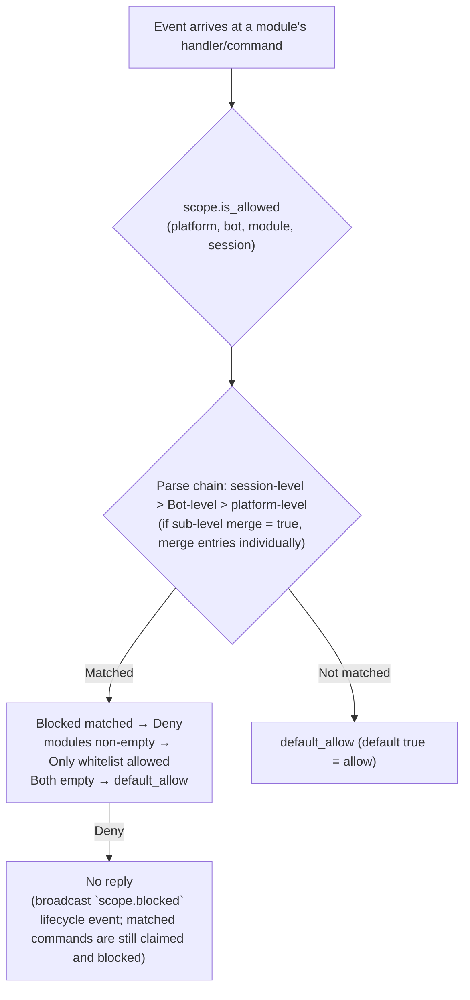

# Scope

> [!TIP]
> **When to read this**: When you need to control module availability, event admission, or outbound action restrictions. Skip if not needed, it does not affect the use of other features.

> **After reading you will know**: The configuration paths, priority and rejection behaviors for the three scope dimensions (module availability / event admission / outbound actions), the usage of runtime API, and how interception is observable (via the `scope.blocked` event).
>
> **This section does not cover**: Resource ownership and unloading (see [Ownership (owner) system](ownership.md)); command ACL and event overrides (see [Event Handling Introduction](../getting-started/event-handling.md)).

> [!NOTE]
> This feature requires ErisPulse **2.8.0+**.

Scope answers four questions: **Which modules are available, which events are received, what text a module processes, and what actions a module can perform outwardly**. Control is entirely user-driven: at the top level during module / adapter / processor / outbound call registration (via `ErisPulse.scope` or runtime `sdk.scope`), the event pipeline automatically reads and executes the configuration at entry, processor filtering, and outbound gate.

| Dimension | Controls what | Rejection behavior | Configuration path |
|------|---------|---------|---------|
| **① Module** | Which modules are available (platform / Bot / session three levels) | Filtered modules do not trigger or reply (broadcast `scope.blocked` event; matched commands are still claimed and blocked) | `scope.platforms / bots / sessions` |
| **② Identity** | Whether to receive events (adapter / Bot / session / user four levels) | Completely discard at entry (broadcast `scope.blocked` event) | `scope.identity.*` |
| **③ Outbound** | What outbound calls a module can initiate (messages / API / requests, method-level white/blacklists) | Fail response (`retcode=34601`) | `scope.actions` |

> **Related systems**: Commands are special message event handlers, their user white/blacklists (ACL) and implementation parameter overrides are managed by the command system (`ErisPulse.event.command`), see [Event Handling Introduction](../getting-started/event-handling.md) and [Configuration Guide](../user-guide/configuration.md).

{!--< tips >!--}
1. Import the singleton via `from ErisPulse.Core import scope` (`sdk.scope` is the same object)
2. Check: `scope.is_allowed(...)` / `scope.is_identity_allowed(...)` /
   `scope.is_action_allowed(...)` correspond to the three gates ①②③
3. Read/write: Dimensional parameter methods (IDE can auto-complete) —
   `scope.set_module(...)` / `scope.set_identity(...)` / `scope.set_action(...)`;
   There are also dictionary-style fallback methods `scope.get(path)` / `scope.set(path, v)` / `scope.delete(path)`
4. Event handler text condition overrides are covered in
   [Event Handling Introduction · Event Override](../getting-started/event-handling.md#event-override-overwrite-any-event-type-behavior-without-modifying-module-code);
   Command ACL / parameter overrides are covered in [Event Handling Introduction](../getting-started/event-handling.md)
{!--< /tips >!--}

## Matching Entry Syntax (Unified Across the System)

All "name lists" in scope (module names, identity keys, outbound entries) use the same matching syntax (`ErisPulse.Core.text_match`):

| Syntax | Example | Description |
|------|------|------|
| Exact name | `"Chat"` | Full value comparison, **case-insensitive** |
| Glob | `"Tool*"`、`"spam_*"` | `*` for any string / `?` for single character / `[seq]` for character set, case-insensitive |
| Regular Expression | `"re:^Danger.*"` | Declared with `re:` prefix, regular expression `search` match, default case-insensitive |

- Invalid regular expressions **silently degrade** to "no match" (no error, no crash)
- Decorator parameters (`pattern=` / `regex=`) have fixed semantics: `pattern` is glob, `regex` is the regular expression source (without `re:` prefix); regular expression entries in scope configuration **must** have the `re:` prefix

## Global Fallback: `default_allow`

`default_allow` is the **single global fallback switch** (default `true`),
affecting two decision dimensions:

- **Module dimension**: If no binding is matched → `default_allow` decides allow / deny
- **Identity dimension**: If no strategy is matched → `default_allow` decides allow / deny

Setting it to `false` enables "implicit deny" strict mode: whitelist-style management,
**all unexplicitly allowed are denied**.

> **Exception**: The ③ outbound dimension is **not** affected by `default_allow` — it is an independent tightening switch,
> defaulting to full allow, only explicit rules restrict (framework-layer owner-empty calls are always allowed).
> This strict global mode won't accidentally cut off all module message replies.
> Command ACL has its own `ErisPulse.event.command.default_allow` fallback, independent of this.

## Configuration File

```toml
[ErisPulse.scope]
default_allow = true        # Global fallback (false = implicit deny strict mode)
cache_size = 1024           # LRU cache size

# ── ① Module Dimension (Priority: session > Bot > platform) ──
[ErisPulse.scope.platforms.onebot11]
modules = ["Chat", "Tool*"]   # Whitelist: exact name / glob / re: regex
blocked = ["re:^Danger"]
[ErisPulse.scope.bots.onebot11."123456"]
modules = ["Chat"]
merge = true                  # Append on top of platform-level binding (default is full override)
[ErisPulse.scope.sessions.onebot11."789012345"]
modules = ["Chat"]

# ── ② Identity Dimension (Priority: user > session > Bot > adapter) ──
[ErisPulse.scope.identity.adapters.onebot11]
deny = true                   # Discard all events from this adapter
[ErisPulse.scope.identity.bots.onebot11."123456"]
deny = true
[ErisPulse.scope.identity.sessions.onebot11."g_blocked"]
deny = true
[ErisPulse.scope.identity.users.onebot11]
allow = ["u_admin"]           # User keys support glob / re: regex
deny = ["u_bad", "spam_*"]

# ── ③ Outbound Dimension (Default: full allow, only explicit rules restrict) ──
[ErisPulse.scope.actions.MyModule]
send = { deny = true }                                    # Disable all sending
api = { allow = ["get_*"] }                               # Only allow standard query APIs
request = { deny = true }                                 # Disable request handling
```

## ① Module Dimension

**In one sentence**: Control "which modules are available in this context" via platform / Bot / session three-level binding; filtered modules do not trigger or reply (matched commands are still claimed and blocked).

Answer "which modules are available in a certain context". Default is fully open; filtering starts only after configuration binding,
**modules and adapters require no changes**.



- **Parse priority**: session-level > Bot-level > platform-level, higher priority bindings **fully override** lower priority; if sub-level binding sets `merge = true`, it changes to **entry-by-entry union** with lower priority (each of modules / blocked is merged individually, `merge` itself is a control key, not an entry)
- **Default semantics**: Filtered modules' commands and handlers do not trigger or reply, visible in TRACE-level logs (core.scope.denied); interception also broadcasts the `scope.blocked` lifecycle event (subscribe to observe who was blocked and why); matched **commands** are still claimed and blocked — command text is no longer passed to lower-level message handlers, eliminating the ambiguity of "command rejected then message handler responds again"
- **Framework-level handlers** (scope_exempt=True or owner is empty) are unaffected; module names that are empty (framework-layer resources) are always allowed
- **Session-aware help and command queries**: Command query APIs (command.help /
  get_command / get_commands / get_group_commands / get_visible_commands,
  and module.get_commands_overview) all support optional event= or explicit
  platform= / bot_id= / session_id= keywords — commands from modules unavailable in the current session
  no longer appear in the results (get_command returns None, single-command help is treated as "unregistered",
  consistent with default semantics); if no context is provided, behavior remains full

### Binding Inheritance (merge)

The default semantics of full override are clear and predictable; when you need to **append** to the upper level, write `merge = true` in the sub-level:

```toml
[ErisPulse.scope.platforms.onebot11]
modules = ["Chat", "Tool"]      # Platform-level: allow Chat, Tool

[ErisPulse.scope.bots.onebot11."123456"]
modules = ["Music"]
merge = true                    # The actual effective modules for this Bot = ["Chat", "Tool", "Music"]
```

- **Merge rules**: `modules` and `blocked` each take the **union**; `blocked` inside the binding still takes precedence over `modules`
- **Chain merge**: Platform → Bot → Session, each level independently decides `merge` or override

## ② Identity Dimension (Event Admission)

**In one sentence**: Use user / session / Bot / adapter four-level strategies to completely discard "events that should not be received" at the distribution entry, with deny taking precedence over allow.

Answer "whose events are received or not". Events that are rejected are **completely discarded at the distribution entry** —
they do not enter middleware or any handler (including framework-level), visible only in TRACE-level logs (core.scope.identity_denied).

- **Parse priority**: user > session > Bot > adapter, take the most specific configured strategy; deny takes precedence over allow
- Each level binding is a binary strategy: `{ allow = true }` or `{ deny = true }`
- User keys support glob / regex (e.g. `"spam_*"` to block a batch of spam users)
- Typical use case — upper-level deny, individual allow for "exceptional allow":

```toml
[ErisPulse.scope.identity.adapters.onebot11]
deny = true
[ErisPulse.scope.identity.users.onebot11]
allow = ["u_admin"]   # Even if adapter-level denied, u_admin's events are still allowed
```

## ③ Outbound Dimension (Restricting Module Outbound Calls)

**In one sentence**: Restrict module-initiated outbound calls (messages / API / requests) with method-level white/blacklists, and rejected calls do not initiate any network request, directly returning `retcode=34601`.

Restrict module-initiated **outbound actions**: message sending / standard API actions / request operations.
The three actions correspond to the underlying DSL: `Event.reply` and `Send` (send), `Api` / `call_api` (api), and `Request`'s accept/reject (request). Outbound calls initiated by the module during event handler execution carry the module owner, which is uniformly judged by this dimension.

### Rule Form (Inline Table)

Each action's rule is an inline table: `{ allow = [...], deny = true|[...] }`.
Only one rule per action is allowed (TOML keys are not repeatable, choose between full deny or fine-grained):

```toml
[ErisPulse.scope.actions.MyModule]
send = { deny = true }                                  # Disable all message sending (Event.reply / Send DSL)
# Or fine-grained method-level: send = { allow = ["Text", "Image*"], deny = ["File"] }
api = { allow = ["get_*"] }                             # Only allow query-type standard APIs
# Or action-level blacklist: api = { deny = ["set_*", "leave_*"] }
request = { deny = true }                               # Disable request handling accept/reject
```

- `send` entries match **send method names** (`Text` / `Image` / `File` ...),
  `api` entries match **standard action names** (`get_group_info` / `set_group_name` ...)
- Entries support exact names / glob / `re:` regex (consistent with the unified system syntax, case-insensitive)
- Writing `allow` as a single string is equivalent to a single-entry list: `send = { allow = "Text" }`

### Decision Semantics

**Default: fully allow** — Unconfigured, or owner is empty (internal framework calls) are allowed.
After configuration, the following order is used for judgment:

1. `deny = true` → Reject
2. `deny` list matches the call name → Reject
3. `allow` list is non-empty and the call name is not matched (or the call has no name) → Reject
4. Otherwise, allow

Rejected calls do not initiate any network request, directly returning the standard failure response
(`retcode = 34601`, see [api-response §5.3](../standards/api-response.md#53-framework-extended-return-code-34xxx-customized-low-three-digits-in-the-platform-error-segment)).

The three actions are independent, and only one can be limited.

```python
# Runtime API
sdk.scope.set_action("MyModule", "send", deny=True)              # Disable all message sending
sdk.scope.set_action("MyModule", "send", allow=["Text"])         # Allow only text messages
sdk.scope.is_action_allowed("MyModule", "send", name="Image")    # False
sdk.scope.is_action_allowed("MyModule", "api", name="get_user_info")  # Judged by rules
sdk.scope.delete_action("MyModule", "send")                      # Restore allow
sdk.scope.get_action("MyModule", "send")                         # Current rule for this action
```

## Runtime API

The scope runtime API is layered into three parts: **decision** (three questions), **dimensional read/write** (each dimension has `set` / `get` / `delete` parameterized methods, fully typed signatures, IDE auto-complete), and **dictionary-style fallback** (dot-separated paths directly access any section).

```python
from ErisPulse import sdk

scope = sdk.scope
```

### Decision (Three Questions)

```python
scope.is_allowed("onebot11", "123456", "Chat")                 # ① Module dimension
scope.is_allowed("onebot11", "123456", "Chat", "789012345")    # With session level
scope.is_allowed("onebot11", "123456", None)                   # Framework-layer resource -> True

scope.is_identity_allowed("onebot11", "123456", "group_9", "u1")   # ② Identity dimension

scope.is_action_allowed("MyModule", "send")                    # ④ Outbound dimension
scope.is_action_allowed("MyModule", "send", name="Image")      # Fine-grained method-level
```

### ① Module Dimension

```python
# Binding (level determined by parameters: session_id > bot_id > platform-level)
scope.set_module("onebot11", bot_id="123456", modules=["Chat", "Tool*"])
scope.set_module("onebot11", blocked=["re:^Danger"])                       # Platform-level
scope.set_module("onebot11", bot_id="123456", session_id="g9", modules=["Chat"])  # Session-level
scope.set_module("onebot11", bot_id="123456", modules=["Music"], merge=True)      # Union with existing entries
scope.set_module("onebot11", bot_id="123456", modules=["Chat"], persist=False)    # Runtime only

# Read / Delete
scope.get_module("onebot11", bot_id="123456")   # {"modules": ["Chat"], "blocked": []}
scope.delete_module("onebot11", bot_id="123456")
```

> `merge=True` is **write-time union** (merge entries with existing bindings at this level); the `merge = true` configuration key at parse time across levels is covered in the above [Binding Inheritance](#binding inheritance merge) — these are independent mechanisms.

> **Runtime Binding (persist=False) Semantics**: Runtime bindings are saved in a separate overlay layer,
> **any subsequent configuration writes / hot reloads will not overwrite them** (the configuration tree is rebuilt and automatically reapplied in write order, including runtime deletions). They are not persisted to disk, and are lost after process restart; runtime bindings written by a module are cleaned up when the module is unloaded. Subsequent `persist=True` writes (user-persistent semantics) to the same path will replace the runtime rules.

### ② Identity Dimension

```python
# Binding strategies (level determined by parameters: user > session > bot > adapter; allow / deny chosen)
scope.set_identity("onebot11", user_id="u_bad", deny=True)
scope.set_identity("onebot11", user_id="spam_*", deny=True)    # Key supports glob / re: regex
scope.set_identity("onebot11", bot_id="123456", session_id="g9", allow=True)

# Read / Delete
scope.get_identity("onebot11", user_id="u_bad")   # {"deny": True}
scope.delete_identity("onebot11", user_id="u_bad")
```

### ③ Outbound Dimension

```python
# Set restriction rules (allow: str|list; deny: bool|str|list; whole rule replacement semantics)
scope.set_action("MyModule", "send", deny=True)                    # Disable all sending
scope.set_action("MyModule", "send", allow=["Text"])               # Allow only text messages
scope.set_action("MyModule", "api", deny=["set_*", "leave_*"])     # Disable management APIs

# Read / Delete
scope.get_action("MyModule", "send")       # {"allow": ["Text"]} original rule
scope.delete_action("MyModule", "send")    # Remove single action
scope.delete_action("MyModule")            # Remove all action restrictions for this module
```

### General

```python
scope.get("platforms")   # Dictionary-style fallback: dot-separated path to read any section
scope.topology()         # Full configuration tree (for Dashboard)
scope.stats()
# {"module_calls": .., "module_filtered": .., "identity_checks": .., "identity_denied": ..,
#  "action_checks": .., "action_denied": .., "cache_hits": .., "cache_misses": ..}
scope.reset_stats()
scope.clear()           # Clear all configuration (only in-memory effect)
```

### Advanced: Dictionary-style Dot-separated Path Fallback

Dimensional methods cover daily scenarios; when you need to directly access any node (or future added dimensions), use the dictionary-style API — `get` / `set` / `delete` accept dot-separated paths (deep dict merge, immediate read after write),
and provide `scope[path]` / `scope[path] = v` / `del scope[path]` / `path in scope` protocols:

```python
scope.set("bots.onebot11.123456", {"modules": ["Chat"], "blocked": []})
scope.set("identity.users.onebot11.u_bad", {"deny": True})
scope.get("actions.MyModule.send")

scope["platforms.onebot11"]        # Read (throws KeyError if not exists)
scope["platforms.onebot11"] = {...}  # Write
del scope["platforms.onebot11"]      # Delete
"actions.MyModule" in scope          # Existence check
```

## Interception Observability: `scope.blocked` Event

When scope interception (module filtering / identity rejection) occurs, it broadcasts the lifecycle event **`scope.blocked`**,
making "who was blocked, at which level" subscribable, countable, and presentable in the Dashboard — interception does not reply by default, but is no longer an opaque black box.

| Field | Description |
|------|------|
| `dimension` | `"module"` (module dimension filtering) / `"identity"` (identity admission rejection) |
| `module` | The filtered module name (only module dimension) |
| `platform` / `bot_id` / `session_id` / `user_id` | The context where the interception occurred |

```python
from ErisPulse.Core.lifecycle import lifecycle

@lifecycle.on("scope.blocked")
def on_blocked(data):
    print(f"Blocked: {data['dimension']} {data.get('module') or data.get('user_id')}")
```

- The event is broadcast via `fire` background (zero overhead if no listeners, does not slow hot paths)
- Repeated interception with cache hits **does not** broadcast repeatedly — each combination is broadcast only once when the cache expires
- Distinct from `adapter.event.blocked` (event-level discard): that is event-level discard, this
  event is scope admission gate module / identity filtering

## Cache and Hot Reload

- `is_allowed` / `is_identity_allowed` / `is_action_allowed` results are cached with **LRU** (configurable via `scope.cache_size`), invalidated automatically by `set` / `delete` /
  configuration hot reload (`config.updated` / `config.set`)
- All dimension configurations take effect **immediately**, no restart required
- Scope is "event-by-event" judgment, does not remember across events: configuration changes, next event follows new rules

## Configuration Format Validation

Configuration format is validated section by section during loading / hot reload: invalid sections (e.g., `platforms` written as a string), invalid outbound rules (e.g., `allow` written as a number), unknown action names, unknown top-level keys (e.g., `alow` with a typo) will output **WARNING** and ignore the corresponding section / entry, while other valid configurations remain effective — errors no longer silently fail.

## Common Issues and Considerations

### 1. Configuration Hierarchy and Overriding

- Module dimension: session-level > Bot-level > platform-level, **full override** (if sub-level `merge = true`, entries are unioned individually). To "platform allows Chat, Bot adds Music", you can write `merge = true` in the Bot-level, or list both
- Identity dimension: user > session > Bot > adapter, take the **most specific** configured strategy (can do exception allow)
- Command user white/blacklists: exact command names take precedence over glob keys (see `event.command.acl`)

### 2. Module/Command Not Responding

First suspect scope rather than the module itself:

```python
from ErisPulse import sdk

print(sdk.scope.is_allowed(event.get_platform(), bot_id, "MyModule", session_id))
print(sdk.scope.is_identity_allowed(event.get_platform(), bot_id, session_id, user_id))
print(sdk.scope.stats())   # module_filtered / identity_denied > 0 indicates interception records
```

Filtered modules default to no reply (module dimension and identity dimension, avoiding rule exposure), but broadcast the `scope.blocked` lifecycle event and statistics continue to accumulate;
commands rejected by ACL will reply "insufficient permissions" explicitly.

### 3. Outbound Action Rejected When Troubleshooting

```python
from ErisPulse import sdk

print(sdk.scope.get("actions.MyModule"))
print(sdk.scope.stats())   # action_denied > 0 indicates intercepted calls
```

Interception is **explicit**: rejected calls return the standard failure response (`retcode = 34601`) without initiating a network request.

### 4. Session Identifier Isolation Across Platforms

The `(platform, session_id)` combination is the unique identifier. `scope.sessions.onebot11."789"` only applies to onebot11, not affecting a session with the same `789` on telegram. The same applies to identity dimension user keys.

## Topology Tree API

`ModuleManager.get_topology()` and `AdapterManager.get_topology()` provide module/adapter ownership relationship data,
`sdk.get_topology()` aggregates them (including scope):

```python
from ErisPulse import sdk

topology = sdk.get_topology()
# {
#   "modules": {                                   # Module → owned resources
#     "Chat": {
#       "loaded": True, "enabled": True,
#       "commands": ["chat", "translate"],
#       "handlers": {"message": 2, "notice": 1},
#       "routes": {"http": ["/Chat/api"], "ws": [], "sse": []},
#       "lifecycle_hooks": 3,
#     }
#   },
#   "adapters": {                                  # Adapter → Bot → Scope
#     "onebot11": {
#       "status": "started", "enabled": True,
#       "bots": {"123456": {"status": "online", "scope": {...}}},
#       "scope": {"modules": [...], "blocked": [...]},
#     }
#   },
#   "scope": {                                     # Scope (module / identity / outbound actions)
#     "platforms": {...}, "bots": {...}, "sessions": {...},
#     "identity": {"adapters": {...}, "bots": {...}, "sessions": {...}, "users": {...}},
#     "actions": {...},
#   },
# }
```

- Module topology aggregates commands registered by the module, event handlers, HTTP/WS/SSE routes, and lifecycle hooks, facilitating the drawing of module resource trees.
- Adapter topology aggregates status of each adapter, status of subordinate Bots, and platform-level/Bot-level scope bindings (module dimension).
- **JSON-safe output**: `get_topology(json_safe=...)` defaults to `True`, returning structures directly serializable via `json.dumps` — module `info` retains only pure data's `meta` sub-table (discarding `module_class` / `strategy` runtime objects), and other nodes (including arbitrary objects inserted by adapter authors into Bot `info`) are sanitized (class objects take `__name__`, unserializable objects fall back to `str()`). Dashboards / WebUI can directly serialize the return; for original objects, pass `json_safe=False`.

## Related Documentation

Choose the next step based on intent:

- **To control resource ownership and unload recycling** → [Ownership (owner) system](ownership.md) — Scope governs "whether resources are active," ownership governs "who owns resources and who unloads them"
- **To audit cross-module calls** → [Module Communication](module-communication.md) — How `module.call` passes through the outbound gate with the caller's identity
- **To gray-scale release a new module version** → [Shadow Modules and Gray-scale Promotion](shadow.md) — Run in parallel with a separate owner
- **To check configuration section syntax and hot reload behavior** → [Configuration Guide](../user-guide/configuration.md)