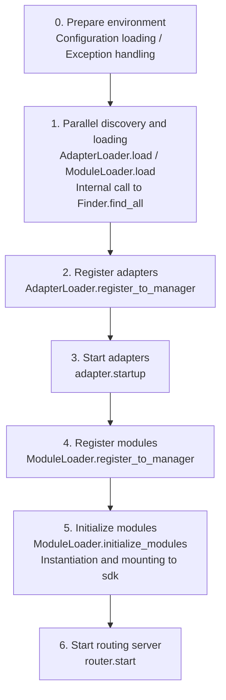

# Startup Flow and Manual Control

> [!TIP]
> **When to read this**: When you need to manually drive the startup chain, customize the startup order, or troubleshoot startup failures. If not needed, skip it; it won't affect the use of other features.

ErisPulse's `await sdk.run()` / `await sdk.init()` encapsulates the entire startup chain into a "one-line code." However, when you need to fully customize the startup process (e.g., partial loading, dynamic registration, hot-plugging, injecting custom loading strategies), you need to understand what happens inside this chain and how to manually drive each step.

This document breaks down the startup chain into independent steps, explains the responsibilities of each step, the call order, and provides an example of a manual full startup.

> This document assumes you have run through [the first bot](../getting-started/first-bot.md) and understand the two `keep_running` modes of `sdk.run()`. This document focuses on the internal breakdown of the `init()` chain and lower-level entry points such as `init()`/`init_task()`/`init_sync()`.

## Overview of SDK Top-Level Entry Points

In addition to the two `keep_running` modes of `run()`, the SDK provides several lower-level initialization entry points, differing in **asynchronicity, return value, and whether exceptions are wrapped**:

| Entry Point | Asynchronicity | Return Value | Exception Handling | Applicable Scenarios |
|-------------|----------------|--------------|--------------------|----------------------|
| `await sdk.run(True)` | async, blocks to maintain | `None` (auto `uninit` on shutdown) | Module/adapter errors are intercepted, not crashing the process | Pure bot application |
| `await sdk.run(False)` | async, does not block | `None` (does not auto-unload) | Same as above | Initialize then execute custom logic |
| `await sdk.init()` | async, requires await | `bool` | Internal capture of component exceptions, returns `False` on failure | Manual control of lifecycle (paired with `uninit()`) |
| `sdk.init_task()` | async, returns Task without blocking | `asyncio.Task` | Same as `init()` | Concurrently execute other initializations, or when event loop is not running |
| `sdk.init_sync()` | **Synchronous**, blocks current thread | `bool` | Same as `init()` | Command-line scripts, synchronous entry without event loop |

> **Common misconception**: `await sdk.init()` **does not equal** `await sdk.run(keep_running=False)`. Two differences: ① `init()` returns `bool` (returns `False` on failure), `run()` returns `None`; ② `init()` only performs initialization, **does not auto-unload**, while `run()` automatically `uninit()` when the event loop ends. Therefore, when you need to manually pair unloading or customize the lifecycle, use `init()` + `uninit()`.

## Startup Flow Overview

`sdk.init()` (specifically, its internal `Initializer.init()`) initiates the entire framework in the following order:



Corresponding core components:

| Layer | Component | Responsibility |
|-------|-----------|----------------|
| Discovery | `AdapterFinder` / `ModuleFinder` | **Discover** adapters/modules from entry-points of installed packages |
| Loading | `AdapterLoader` / `ModuleLoader` | Discovery + import + metadata reading + enable/disable judgment, return object lists |
| Registration | `*Loader.register_to_manager` | Register objects to corresponding managers |
| Management | `sdk.adapter` / `sdk.module` | Maintain adapter/module instances, provide startup/shutdown interfaces |
| Initialization | `ModuleLoader.initialize_modules` | Create module instances and mount to `sdk` (handle dependency topological sorting) |
| Routing | `sdk.router` | HTTP / WebSocket server |

> **Important**: `Finder` and `Loader` are two layers. `Loader` internally **holds** a `Finder` (`AdapterLoader` has `AdapterFinder`, `ModuleLoader` has `ModuleFinder`). In most scenarios, you only need to use `Loader`; `Finder` is only used when you need "list only, not import."

## Detailed Explanation of Each Step

### 1. Discovery Layer: Finder

Finder only finds "which packages provide adapters/modules," without importing or instantiating.

```python
from ErisPulse.finders import AdapterFinder, ModuleFinder

adapter_finder = AdapterFinder()
module_finder = ModuleFinder()

# Find all installed adapters/modules entry-points
adapter_entries = adapter_finder.find_all()    # list[EntryPoint]
module_entries = module_finder.find_all()      # list[EntryPoint]

# Find a single one by name
entry = module_finder.find_by_name("MyModule")  # EntryPoint | None
```

Each `EntryPoint` can be loaded via `.load()` to get the corresponding class, but usually you don't need to manually call this—Loader will handle it.

#### Pluggable Extension Point: entry-points

The discovery protocol of Finder is Python's entry-points: any installed package declares its corresponding group in `pyproject.toml`, and it is discovered upon installation and disappears upon uninstallation, with zero framework changes. The groups opened by the framework:

| Group | Discoverer | Registered Content |
|-------|------------|--------------------|
| `erispulse.adapter` | `AdapterFinder` (read at load time) | Adapter class |
| `erispulse.module` | `ModuleFinder` (read at load time) | Module class |
| `erispulse.storage.backends` | `create_storage()` (scan before creating storage instance) | Storage backend class |

For example, a custom storage backend only needs to declare the group and import path:

```toml
[project.entry-points."erispulse.storage.backends"]
mydb = "my_erispulse_backend:MyStorage"
```

```toml
# User side: enable with one line of configuration
[ErisPulse.storage]
backend = "mydb"
```

Adapters / modules only need to declare the group, see the [Publishing Guide](../developer-guide/publishing.md) for the writing style. For scenarios that don't use entry-points (runtime dynamic registration), you can directly call the registration function after importing:

```python
from ErisPulse.Core.storage import register_storage_backend

from my_erispulse_backend import MyStorage

register_storage_backend("mydb", MyStorage)
```

The complete contract for storage backends (base class, dialect, capability declaration) is available in [Storage Backends](storage-backends.md).

### 2. Loading Layer: Loader

Loader performs "import + metadata reading + enable/disable judgment" on top of Finder.

```python
from ErisPulse.loaders import AdapterLoader, ModuleLoader
from ErisPulse import sdk

adapter_loader = AdapterLoader()
module_loader = ModuleLoader()

# load() internally: calls finder.find_all() → processes each entry-point → returns a triple
adapter_objs, enabled_adapters, disabled_adapters = await adapter_loader.load(sdk.adapter)
module_objs, enabled_modules, disabled_modules = await module_loader.load(sdk.module)
```

The triple returned by `load()`:

| Return Value | Meaning |
|--------------|---------|
| `objs` (`dict`) | Name → Object (adapter class / module wrapper object) |
| `enabled` (`list[str]`) | Enabled names (not disabled in configuration) |
| `disabled` (`list[str]`) | Disabled names |

#### Diagnostic Information on Loading Failure

When an adapter/module throws an exception during loading or initialization, the framework skips that component and continues loading other components, while outputting a **summary of user code frames**, allowing you to locate the error position at the default INFO level without manually turning on DEBUG:

```
[ERROR] [ModuleLoader] Failed to load module MyModule from entry-point, skipped: 'NoneType' object has no attribute 'platform'
  → MyModule/Core.py:42 in on_load
      adapter = sdk.platform
  → AttributeError: 'NoneType' object has no attribute 'platform'
  → Note: Increase log level to DEBUG to view full stack trace; check the implementation code of module MyModule
```

The diagnostic information is generated by the `ErisPulse.runtime.diagnostics` module, automatically filtering out framework internal frames and retaining only your code frames. If you need to reuse this in custom loading logic:

```python
from ErisPulse.runtime import log_diagnostic

try:
    risky_init()
except Exception as e:
    log_diagnostic(e)  # Automatically extracts user code frames and writes to ERROR log
```

This module also provides two low-level functions: `extract_user_frame()` (returns structured frame information) and `format_diagnostic_block()` (returns multi-line text).

### 3. Registration Layer: register_to_manager

Register the objects produced by the Loader to the manager, allowing `sdk.adapter` / `sdk.module` to recognize them.

```python
# Register adapters (returns bool, indicating success of all)
await adapter_loader.register_to_manager(enabled_adapters, adapter_objs, sdk.adapter)

# Register modules
await module_loader.register_to_manager(enabled_modules, module_objs, sdk.module)
```

After registration, adapters are registered to the adapter manager, and modules are registered to the module manager, but **neither is started/initialized yet**.

### 4. Start Adapters

```python
# Start all registered adapters
await sdk.adapter.startup()
# Or specify platform
await sdk.adapter.startup("yunhu")
await sdk.adapter.startup(["yunhu", "telegram"])
```

> Registration ≠ Startup. `register_to_manager` only registers; `startup` calls the adapter's `start()`, establishing a connection with the platform.

### 5. Initialize Modules

Modules have an additional step—**instantiation** and mounting to `sdk` (so you can call `sdk.MyModule.xxx`). This step also handles module dependencies and topological sorting.

```python
success = await module_loader.initialize_modules(
    enabled_modules, module_objs, sdk.module, sdk
)
```

After successful instantiation, the module appears on `sdk.<ModuleName>`.

### 6. Start Routing Server

```python
await sdk.router.start(
    host="0.0.0.0",
    port=8000,
    ssl_certfile=None,
    ssl_keyfile=None,
)
```

The routing server is responsible for receiving webhook / WebSocket callbacks from adapters. Without starting it, server-mode adapters cannot receive messages.

## Complete Manual Startup Example

The following code **equivalent to** the core process of `await sdk.init()`, but exposes each step, allowing you to insert custom logic at any step:

```python
import asyncio
from ErisPulse import sdk
from ErisPulse.loaders import AdapterLoader, ModuleLoader

async def manual_startup():
    # 0. Prepare environment (load configuration, register global exception handler)
    #    _prepare_environment is a pre-step inside init(); manual flow also needs to call it,
    #    otherwise Loader won't read configuration and will misjudge all adapters/modules as disabled.
    if not await sdk._prepare_environment():
        print("Environment preparation failed")
        return False

    # 1. Create loaders (each internally holds a Finder)
    adapter_loader = AdapterLoader()
    module_loader = ModuleLoader()

    # 2. Parallel discovery and loading (consistent with internal gather in init())
    (adapter_objs, enabled_adapters, disabled_adapters), \
    (module_objs, enabled_modules, disabled_modules) = await asyncio.gather(
        adapter_loader.load(sdk.adapter),
        module_loader.load(sdk.module),
    )

    # 3. Register adapters
    await adapter_loader.register_to_manager(
        enabled_adapters, adapter_objs, sdk.adapter
    )

    # 4. Start adapters
    if enabled_adapters:
        await sdk.adapter.startup()

    # 5. Register modules
    await module_loader.register_to_manager(
        enabled_modules, module_objs, sdk.module
    )

    # 6. Initialize modules (instantiation + mounting to sdk)
    if enabled_modules:
        await module_loader.initialize_modules(
            enabled_modules, module_objs, sdk.module, sdk
        )

    # 7. Start routing server
    await sdk.router.start(host="0.0.0.0", port=8000)

    print("Manual startup complete")
    return True

async def main():
    ok = await manual_startup()
    if ok:
        # Block to maintain running (manual flow won't auto-block)
        await asyncio.Event().wait()

if __name__ == "__main__":
    asyncio.run(main())
```

### When to Use Manual Startup?

In most cases, **manual startup is not needed**, as `await sdk.run()` already handles all the above steps. Manual startup is only valuable in these scenarios:

- **Partial loading**: Load only specific adapters/modules, skip others
- **Dynamic registration**: Register new adapters/modules at runtime based on conditions
- **Custom order**: Need to disrupt the default loading order (e.g., start a module before an adapter)
- **Inject strategies**: Inject custom strict mode managers, loading strategies, etc. into Loader
- **Debugging/diagnosis**: Manually drive at a certain step when failure occurs to locate the problem

## Fine-Grained Runtime Control

### Local Plugin Hot Reload

`sdk.enable_plugin_hot_reload()` monitors the local plugin directory (`plugins/`) for source code changes and automatically reloads:
`epsdk run` has already automatically enabled this, no need to manually call; for **bare `sdk.run()` startup**, if plugin hot reload is needed,
call it once before `run()` (only covers the local plugin directory, does not affect pip-installed modules/adapters):

```python
sdk.enable_plugin_hot_reload()
sdk.run()
```

Even after using `sdk.run()` to complete startup, you can still control each subsystem individually at runtime, without restarting the entire SDK:

### Adapter Hot Start/Stop

```python
# Hot restart a specific adapter (fix connection, does not affect other platforms)
await sdk.adapter.shutdown("yunhu")
await sdk.adapter.startup("yunhu")

# Bring up a new platform at runtime
await sdk.adapter.startup("telegram")

# Temporarily take down a platform
await sdk.adapter.shutdown("telegram")
```

> `adapter.startup()` requires the adapter to be **registered** to the manager. Registration occurs within `init()`/`run()`, so this is fine-grained control after startup.

### Routing Server

```python
# Temporarily take down webhook server
await sdk.router.stop()

# Restart (e.g., after changing port)
await sdk.router.start(host="0.0.0.0", port=9000)
```

### Module On-Demand Loading

```python
# Manually load a (possibly lazy-loaded) module
await sdk.load_module("MyModule")
```

## Graceful Shutdown

Since version 2.7.0, `sdk.shutdown()` provides **programmatic graceful shutdown**: set a shutdown event to allow the main loop hanging on `await sdk.run(keep_running=True)` to return, triggering `uninit()` for resource cleanup.

```python
# Call from any coroutine to trigger graceful exit (run() hangs and returns, then auto uninit)
sdk.shutdown()
```

Typical use cases:

```python
async def shutdown_after_idle():
    await asyncio.sleep(3600)
    sdk.shutdown()  # Gracefully exit after 1 hour of idle
```

**Signal Handling**: `run()` internally registers `SIGTERM` / `SIGHUP` handlers, converting system signals into graceful shutdown—when stopping services via container orchestration (Docker `docker stop`) or `systemd`, the process will go through `uninit()` cleanup instead of being forcefully killed. It also registers a `SIGUSR1` handler to trigger an in-process soft restart (`sdk.restart`)—`epsdk restart` sends this signal to the PID 1 instance inside containers (terminating means the container exits, cannot be externally restarted) to trigger component hot reload. The SIGUSR1 hot restart channel requires ErisPulse **2.12+**.

- Windows does not support `loop.add_signal_handler`, so signal handlers are automatically skipped (still use `sdk.shutdown()` or Ctrl+C to trigger shutdown)
- Repeatedly calling `sdk.shutdown()` is safe (no operation after the event is set)

## Unload Process

The reverse operation of startup is `await sdk.uninit()`, which cleans up in the opposite order:

1. Close all adapters (`adapter.shutdown()`)
2. Unload all modules
3. Clean up all event handlers
4. Clean up managers and module attributes on SDK

In manual startup scenarios, remember to call `uninit()` before exiting to ensure graceful shutdown:

```python
try:
    await asyncio.Event().wait()   # Maintain running
finally:
    await sdk.uninit()
```

## Restart

The SDK provides two restart methods, neither requiring you to manually unload first—the framework handles it automatically:

| Method | Call | Behavior | Applicable Scenarios |
|--------|------|----------|----------------------|
| Hot Restart | `await sdk.restart()` | **Code-level hot reload** of components within the same process: all modules go through a unified reload pipeline (global syntax pre-check / snapshot rollback / identity verification), adapters first **re-discover entry-points** (newly installed/uninstalled adapters at runtime take effect immediately) then reload code-level one by one | Hot update module code after pip upgrade or installation of components |
| Hard Restart | `await sdk.hard_restart()` | `uninit()` then exit the process with **exit code 42**, restarted by an external supervisor | Framework itself upgrade (new framework code only takes effect in a new process), C extension side effects, suspected resource leaks |

```python
# Hot Restart: Code-level hot reload of components (most commonly used; newly installed adapters at runtime are also pulled in)
await sdk.restart()

# Hard Restart: Exit the process, handed over to an external supervisor (see below "Supervisor Guide")
await sdk.hard_restart("sdk self-update")  # Optional reason for supervisor display
```

> **Two points to note**:
> 1. Both methods execute the restart in the background, **immediately returning `True` to indicate "restart task scheduled,"** not "restart completed." The actual restart occurs in the background, avoiding interruption of the current event chain.
> 2. The principle of `hard_restart()` is: after unloading and flushing configuration, exit the process with **exit code 42** (`HARD_RESTART_EXIT_CODE`)—**it does not start a new process itself**; it must be restarted by an external supervisor detecting exit code 42. If running directly with `python main.py` and no supervisor, the process exits with code 42 and **does not automatically restart** (the framework will warn).

> **Hot Restart Mutual Exclusion and Merging** (since 2.11.1): All hot reload operations (single module reload / full reload / adapter reload / sleep / new plugin hot load) are mutually exclusive throughout—concurrent triggers during a save storm will not run in parallel, and new requests during an ongoing restart are automatically merged (requests falling during ordinary reload lock periods are also merged and queued), with at most one additional run after completion. When saving files with syntax errors, the entire reload will be **rejected by a pre-check** before unloading (listing all error files and line numbers at once), adapters skip the current reload, `restart` fails, and all old instances continue serving; after fixing, `restart` again.

### When to Use Hard Restart?

Hot restart covers most scenarios (pip upgrade/install components, hot update module code, **including newly installed adapters at runtime**). The following scenarios require hard restart:

- **Framework upgrade**: After upgrading ErisPulse itself, the new framework code only takes effect in a new process (Python does not re-import loaded framework code).
- **Binary library (C extension) side effects**: Hot restart occurs within the same process and cannot release C extensions, open file descriptors, threads, and other process-level resources; hard restart switches to a new process, thoroughly clearing these side effects.
- **Resource leak troubleshooting**: When suspected memory or handle leaks exist, hard restart provides a clean environment.

> The "Framework Restart" function in the Dashboard management panel calls `hard_restart()` underneath.

### Exit Code 42 Contract

Hard restart involves cross-process collaboration: **SDK is responsible for exiting (code 42), supervisor is responsible for restarting**.

| Role | Behavior |
|------|----------|
| SDK (when hard restarted) | `uninit()` → flush configuration → write hard restart marker (reason / PID, for supervisor display) → `os._exit(42)` |
| Supervisor | Detects child process exit code 42 → displays hard restart reason → restarts the same command |

> `sdk.is_supervised()` can query whether the current process is started by a supervisor (detects environment variable `ERISPULSE_SUPERVISED`). The CLI `run` command injects this marker automatically when starting a subprocess; external supervisors like systemd / Docker do not inject it, so `is_supervised()` returns `False`, and a warning is issued if a hard restart is detected without a supervisor.

### Supervisor Guide

Choose a supervisor suitable for you to make hard restart effective:

#### 1. CLI run command (development/simple deployment, recommended)

`epsdk run main.py` has a built-in supervision loop: detects child process exit codes, restarts immediately if 42 is detected (and displays the hard restart reason); for other abnormal exit codes, retries with exponential backoff; `Ctrl+C` first gracefully terminates the child process (code 0 is considered normal exit, not restarted).

```bash
epsdk run main.py
```

`epsdk run --reload` (development hot reload mode, since 2.11.1) also uses the "supervisor process + reload worker subprocess" structure: worker processes reload on `.py` file save in runtime (not full framework restart); hard restart is handled by the supervisor process restarting a new worker, making new code effective after framework upgrade.

#### Fine-Grained Reload Determination (2.12+)

After saving `.py` files, choose the smallest reload unit based on runtime source code ownership, not path string guessing:

| Changed File | Handling |
|--------------|----------|
| In plugin directory (`ErisPulse.framework.plugins_dir`) | Handled by plugin hot reload watcher, dev watcher does not trigger repeatedly |
| Source code of loaded modules (including `pip install -e` and site-packages) | `sdk.reload_module(module name)` |
| Source code of registered adapters | `sdk.reload_adapter(platform name)` |
| Entry script | Process-level restart (exit code 42, restarted by supervisor) |
| Framework source code (inside `ErisPulse` package) | Process-level restart |
| Multiple owners / cannot be assigned | Conservative process-level restart |

`epsdk upgrade` and other bulk upgrade scenarios can use `sdk.reload_all_modules()` to reload all registered modules at once (in dependency topological order, skip single module failure without rollback), without restarting the process.

Script mode (`epsdk run main.py --reload`) does not workerize the script: the script subprocess mounts a dev watcher, and writes `component_reload_pid` to `.erispulse/runtime.json`; the parent process sees this marker, handles module/adapter/plugin changes in the subprocess, and only restarts the script process for entry script or framework source code changes.

#### 2. systemd (Linux servers)

`RestartForceExitStatus=42` makes exit code 42 trigger a restart (default `on-failure` only applies to non-zero codes):

```ini
[Service]
ExecStart=/usr/bin/python3 /opt/mybot/main.py
Restart=on-failure
RestartForceExitStatus=42
RestartSec=2
User=mybot
```

#### 3. Docker / docker-compose

Inside a container, PID 1 is the application process; exit code 42 causes the container to exit—use the `restart` policy to make it automatically restart:

```yaml
services:
  bot:
    build: .
    restart: unless-stopped   # Restart on any exit (including 42)
```

> Inside a container, `epsdk restart` triggers an in-process hot restart (SIGUSR1) for PID 1 instances, not exiting the container; full process restart is handled by the `restart` policy. See [Deployment → Container Restart (PID 1 Instance)](../user-guide/deployment.md#container-restart-pid-1-instance).

#### 4. PM2 (Node ecosystem operations)

```bash
pm2 start main.py --name mybot --interpreter python3
# 42 is treated as an exit code, PM2 defaults to restarting; set restart_delay to debounce
pm2 set mybot.restart_delay 2000
```

#### 5. supervisord

```ini
[program:mybot]
command=python3 /opt/mybot/main.py
autorestart=true
exitcodes=0,2,42    # 42 is also treated as "normal exit requiring restart"
```

#### 6. Pure Python Custom Supervisor

```python
import subprocess, sys, time

while True:
    p = subprocess.Popen([sys.executable, "main.py"])
    code = p.wait()
    if code == 42:          # Hard restart request
        time.sleep(0.5)
        continue
    if code == 0:           # Normal exit
        break
    time.sleep(3)           # Abnormal exit, backoff retry
```

> **Behavior without supervisor**: Running directly with `python main.py`, calling `hard_restart()` exits the process with code 42 and does not restart. In this case, you should integrate with any of the above supervisors.

## Related Documentation

- [Create Your First Bot](../getting-started/first-bot.md) - Introduction to the two basic modes of `keep_running`
- [Lifecycle Management](lifecycle.md) - Listen to startup events such as `core.init.start` / `core.init.complete`
- [Lazy Loading System](lazy-loading.md) - Module lazy loading mechanism and `load_module`