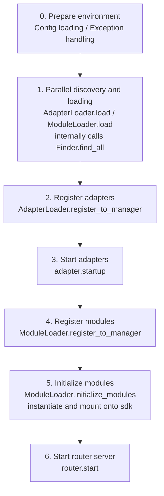

# Startup Flow and Manual Control

> [!TIP]
> **When to read this**: When you need to manually drive the startup chain, customize the startup order, or troubleshoot startup failures. If not, skip it — it won't affect the use of any other features.


ErisPulse's `await sdk.run()` / `await sdk.init()` wraps the entire startup chain into "one line of code". But when you need to fully customize the startup process (e.g., partial loading, dynamic registration, hot-plugging, injecting custom loading strategies), you need to understand what actually happens inside this chain and how to drive each step manually.

This article breaks the startup chain into independent stages, explains each one's responsibilities and calling order, and provides a full manual startup example.

> This article assumes you have already completed [Your First Bot](../getting-started/first-bot.md) and understand the two modes `sdk.run(keep_running=True/False)`. It focuses on breaking down the chain **inside** `init()`, along with the lower-level entry points `init()`/`init_task()`/`init_sync()`.

## SDK Top-level Entry Points Overview

Besides the two `keep_running` modes of `run()`, the SDK also provides several lower-level initialization entry points, which differ in **asynchronicity, return value, and whether exceptions are wrapped**:

| Entry Point | Async Nature | Return Value | Exception Handling | Applicable Scenarios |
|------|--------|--------|----------|----------|
| `await sdk.run(True)` | async, blocks to keep running | `None` (automatically `uninit` on shutdown) | Module/adapter errors are intercepted and won't drag down the process | Pure bot applications |
| `await sdk.run(False)` | async, non-blocking | `None` (no automatic unloading) | Same as above | Running custom logic after initialization |
| `await sdk.init()` | async, needs await | `bool` | Component exceptions are caught internally; returns `False` on failure | Manually controlling the lifecycle (paired with `uninit()`) |
| `sdk.init_task()` | async, returns a Task without blocking | `asyncio.Task` | Same as `init()` | Running other initialization concurrently, or when the event loop is not yet running |
| `sdk.init_sync()` | **Synchronous**, blocks the current thread | `bool` | Same as `init()` | Command-line scripts, synchronous entry points without an event loop |

> **Common misconception**: `await sdk.init()` is **not equivalent to** `await sdk.run(keep_running=False)`. Two differences: ① `init()` returns a `bool` (returns `False` on failure) while `run()` returns `None`; ② `init()` only performs initialization and **does not automatically unload**, whereas `run()` automatically calls `uninit()` when the event loop ends. Therefore, when you need to manually pair the unload step or customize the lifecycle, use `init()` + `uninit()`.

## Startup Chain Overview

`sdk.init()` (more precisely, its internal `Initializer.init()`) brings up the entire framework in the following order:



The corresponding core components:

| Layer | Component | Responsibility |
|----|------|------|
| Discovery | `AdapterFinder` / `ModuleFinder` | **Discover** adapters/modules from the entry-points of installed packages |
| Loading | `AdapterLoader` / `ModuleLoader` | Discovery + import + reading metadata + determining enabled/disabled, returning object inventories |
| Registration | `*Loader.register_to_manager` | Register objects with the corresponding managers |
| Management | `sdk.adapter` / `sdk.module` | Maintain adapter/module instances and provide start/stop interfaces |
| Initialization | `ModuleLoader.initialize_modules` | Create module instances and mount them onto `sdk` (handles dependency topological sorting) |
| Routing | `sdk.router` | HTTP / WebSocket server |

> **Important**: `Finder` and `Loader` are two layers. The `Loader` internally **already holds** a `Finder` (`AdapterLoader` comes with `AdapterFinder`, `ModuleLoader` comes with `ModuleFinder`). In the vast majority of scenarios you only need the `Loader`; you would only use a `Finder` on its own when you need "listing without importing".

## Detailed Breakdown of Each Stage

### 1. Discovery Layer: Finder

The Finder is only responsible for "finding out which packages provide adapters/modules"; it neither imports nor instantiates.

```python
from ErisPulse.finders import AdapterFinder, ModuleFinder

adapter_finder = AdapterFinder()
module_finder = ModuleFinder()

# Find all installed adapter/module entry-points
adapter_entries = adapter_finder.find_all()    # list[EntryPoint]
module_entries = module_finder.find_all()      # list[EntryPoint]

# Find a single one by name
entry = module_finder.find_by_name("MyModule")  # EntryPoint | None
```

Each `EntryPoint` can be `.load()`ed to obtain the corresponding class, but you usually don't need to call it manually — the Loader does that.

### 2. Loading Layer: Loader

On top of the Finder, the Loader does "import + reading metadata + determining enabled/disabled".

```python
from ErisPulse.loaders import AdapterLoader, ModuleLoader
from ErisPulse import sdk

adapter_loader = AdapterLoader()
module_loader = ModuleLoader()

# Inside load(): calls finder.find_all() → processes each entry-point → returns a triple
adapter_objs, enabled_adapters, disabled_adapters = await adapter_loader.load(sdk.adapter)
module_objs, enabled_modules, disabled_modules = await module_loader.load(sdk.module)
```

The triple returned by `load()`:

| Return Value | Meaning |
|--------|------|
| `objs` (`dict`) | Name → object (adapter class / module wrapper object) |
| `enabled` (`list[str]`) | Names that are enabled (not disabled in configuration) |
| `disabled` (`list[str]`) | Names that are disabled |

#### Diagnostic Information on Load Failure

When a module/adapter throws an exception during the loading or initialization stage, the framework skips that component and continues loading the others, while outputting a **user code frame summary** so you can pinpoint the error location at the default INFO level without manually re-enabling DEBUG:

```
[ERROR] [ModuleLoader] Failed to load module MyModule from entry-point, skipped: 'NoneType' object has no attribute 'platform'
  → MyModule/Core.py:42 in on_load
      adapter = sdk.platform
  → AttributeError: 'NoneType' object has no attribute 'platform'
  → Hint: Raise the log level to DEBUG to see the full stack trace; check the implementation code of module MyModule
```

Diagnostic information is generated by the `ErisPulse.runtime.diagnostics` module, which automatically filters out framework internal frames and keeps only your code frames. To reuse it in custom loading logic:

```python
from ErisPulse.runtime import log_diagnostic

try:
    risky_init()
except Exception as e:
    log_diagnostic(e)  # Automatically extract user code frames and write to the ERROR log
```

The module also provides two low-level functions: `extract_user_frame()` (returns structured frame information) and `format_diagnostic_block()` (returns multi-line text).

### 3. Registration Layer: register_to_manager

Register the objects produced by the Loader with the managers so that `sdk.adapter` / `sdk.module` can recognize them.

```python
# Register adapters (returns bool, indicating whether all succeeded)
await adapter_loader.register_to_manager(enabled_adapters, adapter_objs, sdk.adapter)

# Register modules
await module_loader.register_to_manager(enabled_modules, module_objs, sdk.module)
```

After registration, the adapters are registered with the adapter manager and the modules are registered with the module manager, but **none of them have been started/instantiated yet**.

### 4. Starting Adapters

```python
# Start all registered adapters
await sdk.adapter.startup()
# Or specify platforms
await sdk.adapter.startup("yunhu")
await sdk.adapter.startup(["yunhu", "telegram"])
```

> Registration ≠ starting. `register_to_manager` merely registers; `startup` is what actually calls the adapter's `start()` and establishes the connection with the platform.

### 5. Initializing Modules

Modules have one more step than adapters — they need to be **instantiated** and mounted onto `sdk` (so that you can call `sdk.MyModule.xxx`). This step also handles dependency declarations between modules and topological sorting.

```python
success = await module_loader.initialize_modules(
    enabled_modules, module_objs, sdk.module, sdk
)
```

After successful instantiation, the module appears at `sdk.<ModuleName>`.

### 6. Starting the Router Server

```python
await sdk.router.start(
    host="0.0.0.0",
    port=8000,
    ssl_certfile=None,
    ssl_keyfile=None,
)
```

The router server is responsible for receiving Webhook / WebSocket callbacks from adapters. Without starting it, adapters running in server mode cannot receive messages.

## Complete Manual Startup Example

The following code is **equivalent to** the core flow of `await sdk.init()`, but every step is exposed to you, and you can insert custom logic at any stage:

```python
import asyncio
from ErisPulse import sdk
from ErisPulse.loaders import AdapterLoader, ModuleLoader

async def manual_startup():
    # 0. Prepare the environment (load configuration, register global exception handling)
    #    _prepare_environment is a prerequisite step inside init(); the manual flow
    #    also needs to call it first, otherwise the Loader cannot read the configuration
    #    and will misjudge all adapters/modules as disabled.
    if not await sdk._prepare_environment():
        print("Environment preparation failed")
        return False

    # 1. Create loaders (each internally holds a Finder)
    adapter_loader = AdapterLoader()
    module_loader = ModuleLoader()

    # 2. Parallel discovery and loading (using gather, consistent with init() internally)
    (adapter_objs, enabled_adapters, disabled_adapters), \
    (module_objs, enabled_modules, disabled_modules) = await asyncio.gather(
        adapter_loader.load(sdk.adapter),
        module_loader.load(sdk.module),
    )

    # 3. Register adapters
    await adapter_loader.register_to_manager(
        enabled_adapters, adapter_objs, sdk.adapter
    )

    # 4. Start adapters
    if enabled_adapters:
        await sdk.adapter.startup()

    # 5. Register modules
    await module_loader.register_to_manager(
        enabled_modules, module_objs, sdk.module
    )

    # 6. Initialize modules (instantiate + mount onto sdk)
    if enabled_modules:
        await module_loader.initialize_modules(
            enabled_modules, module_objs, sdk.module, sdk
        )

    # 7. Start the router server
    await sdk.router.start(host="0.0.0.0", port=8000)

    print("Manual startup completed")
    return True

async def main():
    ok = await manual_startup()
    if ok:
        # Block to keep running (the manual flow does not block automatically)
        await asyncio.Event().wait()

if __name__ == "__main__":
    asyncio.run(main())
```

### When Should You Start Manually?

In the vast majority of cases, **you don't need** to start manually — `await sdk.run()` already does all of the above. Manual startup is only valuable in these scenarios:

- **Partial loading**: load only the specified adapters/modules and skip the rest
- **Dynamic registration**: register new adapters/modules at runtime based on conditions
- **Custom order**: need to change the default loading order (e.g., start a certain module before starting adapters)
- **Injecting strategies**: inject custom strict-mode managers, loading strategies, etc. into the Loader
- **Debugging/diagnostics**: when a stage fails, drive it manually to pinpoint the problem

## Runtime Fine-grained Control

### Local Plugin Hot Reload

`sdk.enable_plugin_hot_reload()` monitors source code changes in the local plugin directory (`plugins/`) and automatically reloads:
`epsdk run` already enables it automatically, so no manual call is needed; if you need plugin hot reload when **starting with a bare `sdk.run()`**,
call it once before `run()` (it only covers the local plugin directory and does not affect pip-installed modules/adapters):

```python
sdk.enable_plugin_hot_reload()
sdk.run()
```


Even if startup was completed with `sdk.run()`, you can still individually control each subsystem at runtime without restarting the entire SDK:

### Adapter Hot Start/Stop

```python
# Hot-restart an adapter (repair the connection without affecting other platforms)
await sdk.adapter.shutdown("yunhu")
await sdk.adapter.startup("yunhu")

# Bring up a new platform while running
await sdk.adapter.startup("telegram")

# Temporarily take a platform offline
await sdk.adapter.shutdown("telegram")
```

> `adapter.startup()` requires that the adapter **has been registered** with the manager. Registration happens inside `init()`/`run()`, so this is fine-grained control **after** startup.

### Router Server

```python
# Temporarily take the webhook server offline
await sdk.router.stop()

# Restart (e.g., after changing the port)
await sdk.router.start(host="0.0.0.0", port=9000)
```

### On-demand Module Loading

```python
# Manually load a (possibly lazily loaded) module
await sdk.load_module("MyModule")
```

## Graceful Shutdown

Since 2.7.0, `sdk.shutdown()` provides **programmatic graceful shutdown**: it sets the shutdown event so that the main loop suspended in `await sdk.run(keep_running=True)` returns, which then triggers `uninit()` to complete resource cleanup.

```python
# Call from any coroutine to trigger a graceful exit (run() returns from suspension and automatically uninits)
sdk.shutdown()
```

Typical use case:

```python
async def shutdown_after_idle():
    await asyncio.sleep(3600)
    sdk.shutdown()  # Graceful exit after 1 hour of idleness
```

**Signal handling**: `run()` internally registers `SIGTERM` / `SIGHUP` handlers, converting system signals into graceful shutdown — when container orchestration (Docker `docker stop`) or `systemd` stops the service, the process goes through `uninit()` cleanup instead of being forcibly killed. It also registers a `SIGUSR1` handler that converts the signal into an in-process soft restart (`sdk.restart()`) — `epsdk restart` sends this signal instead to trigger component hot reload for PID 1 instances inside containers (terminating them would exit the container, and they cannot be relaunched externally). The SIGUSR1 hot-restart channel requires ErisPulse **2.12+**.

- Windows does not support `loop.add_signal_handler`; the signal handlers are automatically skipped (you can still trigger shutdown via `sdk.shutdown()` or Ctrl+C)
- Repeatedly calling `sdk.shutdown()` is safe (calling again after the event is set is a no-op)

## Unloading Process

The reverse of startup is `await sdk.uninit()`, which cleans up in reverse order:

1. Shut down all adapters (`adapter.shutdown()`)
2. Unload all modules
3. Clear all event handlers
4. Clean up the managers and the module attributes on the SDK

In manual startup scenarios, remember to call `uninit()` before exiting to ensure a graceful shutdown:

```python
try:
    await asyncio.Event().wait()   # Keep running
finally:
    await sdk.uninit()
```

## Restart

The SDK provides two restart methods, neither of which requires you to unload first — the framework handles it itself:

| Method | Call | Behavior | Applicable Scenarios |
|------|------|------|----------|
| Hot restart | `await sdk.restart()` | **Component-level, code-level hot reload** within the same process: all modules go through a unified reload pipeline (aggregate syntax pre-check / snapshot rollback / identity verification), and adapters first **re-discover entry-points** (adapters newly installed/uninstalled at runtime take effect immediately) and are then code-level reloaded one by one | Making code take effect after pip upgrading or installing components, hot-updating modules |
| Hard restart | `await sdk.hard_restart()` | After `uninit()`, exits the process with **exit code 42**, and an external supervisor brings up a brand-new process | Framework self-upgrade (upgraded framework code only takes effect in a new process), C extension side effects, suspected resource leaks |

```python
# Hot restart: component-level, code-level hot reload (the most common; newly pip-installed adapters are also brought up)
await sdk.restart()

# Hard restart: exit the process and let an external supervisor restart it (see the "Supervisor Guide" below)
await sdk.hard_restart("sdk self-update")  # Optional reason for the supervisor to display
```

> **Two notes**:
> 1. Both methods execute the restart via a background task; **returning `True` immediately means "the restart task has been scheduled"**, not "the restart is complete". The actual restart happens in the background to avoid interrupting the current event chain.
> 2. `hard_restart()` works as follows: after unloading and flushing the configuration to disk, it exits the process with **exit code 42** (`HARD_RESTART_EXIT_CODE`) — **it does not itself spawn a new process**; an external supervisor must detect exit code 42 and restart it. If you run `python main.py` directly with no supervisor at all, the process simply ends after exiting with code 42 and **will not restart automatically** (the framework will print a warning).

> **Hot restart mutual exclusion and merging** (since 2.11.1): All hot reload operations (single-module reload / full reload / adapter reload / sleep / hot-loading of new plugins) are mutually exclusive for their entire duration — consecutive triggers under a save storm will not run concurrently or interleave; an in-progress restart automatically merges new requests as they arrive (requests landing during the lock-held period of an ordinary reload are likewise merged and queued), and at most one extra round is run after completion. When a file containing syntax errors is saved, the entire reload round is rejected by the **aggregate syntax pre-check** before unloading (listing all offending files and line numbers at once); the adapter layer skips that reload round, `restart` reports failure, and all old instances keep serving; once fixed, just call `restart` again.

### When Should You Use a Hard Restart?

Hot restarts already cover the vast majority of scenarios (pip upgrading/installing components, hot-updating module code, **including adapters newly installed while running**). A hard restart is only needed in the following scenarios:

- **Framework self-upgrade**: after upgrading the ErisPulse core itself, the new framework code only takes effect in a brand-new process (Python will not re-import already loaded framework code).
- **Binary library (C extension) side effects**: a hot restart happens within the same process and cannot release process-level resources such as C extensions, open file descriptors, or threads; a hard restart switches to a brand-new process, and these side effects are completely wiped out.
- **Resource leak investigation**: when you suspect a memory or handle leak, a hard restart gets you a clean environment.

> The "Framework Restart" feature in the Dashboard admin panel calls `hard_restart()` under the hood.

### The Exit Code 42 Contract

A hard restart is cross-process collaboration: **the SDK handles exiting (with code 42), and the supervisor handles bringing it back up**.

| Role | Behavior |
|------|------|
| SDK (when hard-restarting) | `uninit()` → flush configuration to disk → write the hard-restart marker (reason / PID, for the supervisor to display) → `os._exit(42)` |
| Supervisor | Detects the child process exiting with code 42 → displays the hard-restart reason → restarts the same command |

> `sdk.is_supervised()` can query whether the current process was started by a supervisor (by detecting the `ERISPULSE_SUPERVISED` environment variable). The CLI `run` command automatically injects this marker when launching the subprocess; external supervisors such as systemd / Docker do not inject it, so `is_supervised()` returns `False`, and in that case the framework will print a "no supervisor detected" warning after a hard restart.

### Supervisor Guide

Pick the supervisor that fits you to make hard restarts actually take effect:

#### 1. CLI run Command (Development/Simple Deployment, Recommended)

`epsdk run main.py` has a built-in supervision loop: it detects the subprocess exit code, restarting immediately when it is 42 (and displaying the hard-restart reason); other abnormal exit codes are automatically retried with exponential backoff; `Ctrl+C` first gracefully terminates the subprocess (code 0 is treated as a normal exit and will not be relaunched).

```bash
epsdk run main.py
```

`epsdk run --reload` (development hot reload mode, since 2.11.1) uses the same "supervisor process + reload worker subprocess" structure: saving a `.py` file inside the worker triggers **component-level hot reload** (not a full framework restart); a hard restart is carried out by the supervisor process re-launching a brand-new worker, so after upgrading the framework the new code takes effect immediately.

#### Fine-Grained Reload Decision (2.12+)

After a `.py` file is saved, the smallest reload unit is chosen based on runtime source ownership rather than guessed from path strings:

| Changed File | Handling |
|----------|------|
| Inside the plugin directory (`ErisPulse.framework.plugins_dir`) | Handled by the plugin hot reload watcher; the dev watcher does not trigger again |
| Source of loaded modules (including `pip install -e` and site-packages) | `sdk.reload_module(module_name)` |
| Source of registered adapters | `sdk.reload_adapter(platform_name)` |
| Entry script | Process-level restart (exit code 42, relaunched by the supervisor) |
| The framework's own source (inside the `ErisPulse` package) | Process-level restart |
| Matches multiple owners simultaneously / ownership cannot be determined | Conservatively falls back to a process-level restart |

In bulk upgrade scenarios such as `epsdk upgrade`, you can use `sdk.reload_all_modules()` to reload all registered
modules in one go (in dependency topological order; a failed module is skipped without rollback), with no need to restart the process.

Script mode (`epsdk run main.py --reload`) does not turn the script into a worker: the dev watcher is mounted
inside the script subprocess, and `component_reload_pid` is written to `.erispulse/runtime.json`; once the parent process
sees this marker, module/adapter/plugin changes are handed over to the subprocess, and only entry-script or framework-source
changes restart the script process.

#### 2. systemd (Linux Servers)

`RestartForceExitStatus=42` makes exit code 42 also trigger a restart (by default `on-failure` only applies to non-zero codes):

```ini
[Service]
ExecStart=/usr/bin/python3 /opt/mybot/main.py
Restart=on-failure
RestartForceExitStatus=42
RestartSec=2
User=mybot
```

#### 3. Docker / docker-compose

Inside a container, PID 1 is the application process; after exit code 42 the container exits — use the `restart` policy to let it restart automatically:

```yaml
services:
  bot:
    build: .
    restart: unless-stopped   # Restarts on any exit (including 42)
```

> Inside a container, `epsdk restart` performs an in-process SIGUSR1 hot restart for PID 1 instances and does not exit the container;
> whole-process restart is carried by the `restart` policy. See [Deployment → Restarting Inside Containers](../user-guide/deployment.md#restarting-inside-containers-pid-1-instances).

#### 4. PM2 (Node Ecosystem Operations)

```bash
pm2 start main.py --name mybot --interpreter python3
# 42 counts as an exit code and PM2 restarts by default; set restart_delay for debouncing
pm2 set mybot.restart_delay 2000
```

#### 5. supervisord

```ini
[program:mybot]
command=python3 /opt/mybot/main.py
autorestart=true
exitcodes=0,2,42    # 42 is also treated as "a normal exit that needs a restart"
```

#### 6. Pure-Python Custom Supervisor

```python
import subprocess, sys, time

while True:
    p = subprocess.Popen([sys.executable, "main.py"])
    code = p.wait()
    if code == 42:          # Hard restart request
        time.sleep(0.5)
        continue
    if code == 0:           # Normal exit
        break
    time.sleep(3)           # Abnormal exit, retry with backoff
```

> **Behavior without a supervisor**: when running `python main.py` directly, after calling `hard_restart()` the process exits with code 42 and will not restart. In that case you should hook up one of the supervisors above.

## Related Documentation

- [Your First Bot](../getting-started/first-bot.md) - Introduction to the two basic `keep_running` modes
- [Lifecycle Management](lifecycle.md) - Listening to startup events like `core.init.start` / `core.init.complete`
- [Lazy Loading System](lazy-loading.md) - Module lazy loading mechanism and `load_module`