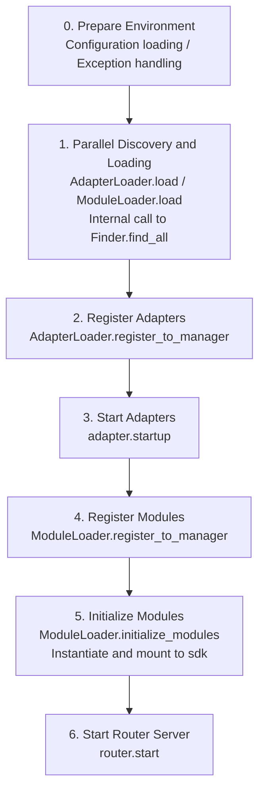

# Startup Flow and Manual Control

> [!TIP]
> **When to read this** : When you need to manually drive the startup chain, customize the startup sequence, or troubleshoot startup failures. Skip if not needed; it won't affect the use of other features.

ErisPulse's `await sdk.run()` / `await sdk.init()` encapsulates the entire startup chain into a single line of code. However, when you need to fully customize the startup process (e.g., partial loading, dynamic registration, hot-plug, injecting custom loading strategies), you need to understand what happens inside this chain and how to manually drive each step.

This article breaks down the startup chain into independent components, explains their respective responsibilities, call order, and provides an example of manual full startup.

> This article assumes you have run through [the first bot](../getting-started/first-bot.md) and understand the two `keep_running` modes of `sdk.run()`. This article focuses on the internal breakdown of the `init()` chain, as well as lower-level entry points such as `init()` / `init_task()` / `init_sync()`.

## Overview of SDK Top-Level Entry Points

In addition to the two `keep_running` modes of `run()`, the SDK also provides several lower-level initialization entry points, differing in **asynchronicity, return values, and exception handling**:

| Entry | Asynchronicity | Return Value | Exception Handling | Use Case |
|------|--------|--------|----------|----------|
| `await sdk.run(True)` | async, blocking to maintain | `None` (automatically `uninit` on shutdown) | Module/adapter errors are intercepted, not crashing the process | Pure bot application |
| `await sdk.run(False)` | async, non-blocking | `None` (no automatic unloading) | Same as above | Execute custom logic after initialization |
| `await sdk.init()` | async, requires await | `bool` | Internal capture of component exceptions, returns `False` on failure | Manual lifecycle control (paired with `uninit()`) |
| `sdk.init_task()` | async, returns Task without blocking | `asyncio.Task` | Same as `init()` | Concurrent initialization or when event loop is not running |
| `sdk.init_sync()` | **Synchronous**, blocking current thread | `bool` | Same as `init()` | Command-line scripts, synchronous entry without event loop |

> **Common Misconception**: `await sdk.init()` **is not equivalent to** `await sdk.run(keep_running=False)`. Two differences: ① `init()` returns `bool` (returns `False` on failure), `run()` returns `None`; ② `init()` only performs initialization, **does not automatically unload**, whereas `run()` automatically calls `uninit()` when the event loop ends. Therefore, when you need to manually pair unloading or customize the lifecycle, use `init()` + `uninit()`.

## Overview of the Startup Chain

`sdk.init()` (specifically its internal `Initializer.init()`) starts the entire framework in the following order:



Corresponding core components:

| Layer | Component | Responsibility |
|----|------|------|
| Discovery | `AdapterFinder` / `ModuleFinder` | **Discover** adapters/modules from entry-points of installed packages |
| Loading | `AdapterLoader` / `ModuleLoader` | Discovery + import + metadata reading + enable/disable judgment, return object lists |
| Registration | `*Loader.register_to_manager` | Register objects to corresponding managers |
| Management | `sdk.adapter` / `sdk.module` | Maintain adapter/module instances, provide start/stop interfaces |
| Initialization | `ModuleLoader.initialize_modules` | Create module instances and mount to `sdk` (handle dependency topological sorting) |
| Routing | `sdk.router` | HTTP / WebSocket server |

> **Important**: `Finder` and `Loader` are two layers. `Loader` internally **already holds** a `Finder` (e.g., `AdapterLoader` has its own `AdapterFinder`, `ModuleLoader` has its own `ModuleFinder`). In most scenarios, you only need to use `Loader`; only when you need "list without importing" will you use `Finder` alone.

## Detailed Explanation of Each Component

### 1. Discovery Layer: Finder

Finder only finds out which packages provide adapters/modules, without importing or instantiating.

```python
from ErisPulse.finders import AdapterFinder, ModuleFinder

adapter_finder = AdapterFinder()
module_finder = ModuleFinder()

# Find all installed adapters/modules entry-points
adapter_entries = adapter_finder.find_all()    # list[EntryPoint]
module_entries = module_finder.find_all()      # list[EntryPoint]

# Find a single by name
entry = module_finder.find_by_name("MyModule")  # EntryPoint | None
```

Each `EntryPoint` can be `.load()` to get the corresponding class, but usually you don't need to call it manually—`Loader` will do it.

### 2. Loading Layer: Loader

Loader performs "import + metadata reading + enable/disable judgment" on top of Finder.

```python
from ErisPulse.loaders import AdapterLoader, ModuleLoader
from ErisPulse import sdk

adapter_loader = AdapterLoader()
module_loader = ModuleLoader()

# load() internally: calls finder.find_all() → processes each entry-point → returns triplets
adapter_objs, enabled_adapters, disabled_adapters = await adapter_loader.load(sdk.adapter)
module_objs, enabled_modules, disabled_modules = await module_loader.load(sdk.module)
```

The three-tuple returned by `load()`:

| Return Value | Meaning |
|--------|------|
| `objs` (`dict`) | Name → Object (adapter class / module wrapper object) |
| `enabled` (`list[str]`) | Enabled names (not disabled in configuration) |
| `disabled` (`list[str]`) | Disabled names |

#### Diagnostic Information on Loading Failures

When a module/adapter throws an exception during loading or initialization, the framework skips that component and continues loading other components, while outputting a **summary of user code frames**, allowing you to locate the error position at the default INFO level without manually enabling DEBUG:

```
[ERROR] [ModuleLoader] Failed to load module MyModule from entry-point, skipped: 'NoneType' object has no attribute 'platform'
  → MyModule/Core.py:42 in on_load
      adapter = sdk.platform
  → AttributeError: 'NoneType' object has no attribute 'platform'
  → Hint: Increase log level to DEBUG to view full stack trace; check the implementation code of module MyModule
```

The diagnostic information is generated by the `ErisPulse.runtime.diagnostics` module and automatically filters out internal framework frames, keeping only your code frames. If you need to reuse it in custom loading logic:

```python
from ErisPulse.runtime import log_diagnostic

try:
    risky_init()
except Exception as e:
    log_diagnostic(e)  # Automatically extract user code frames and write to ERROR log
```

This module also provides two low-level functions: `extract_user_frame()` (returns structured frame information) and `format_diagnostic_block()` (returns multi-line text).

### 3. Registration Layer: register_to_manager

Register the objects produced by Loader to the manager, so that `sdk.adapter` / `sdk.module` can recognize them.

```python
# Register adapters (returns bool, indicating if all succeeded)
await adapter_loader.register_to_manager(enabled_adapters, adapter_objs, sdk.adapter)

# Register modules
await module_loader.register_to_manager(enabled_modules, module_objs, sdk.module)
```

After registration, adapters are registered to the adapter manager and modules to the module manager, but they are **not yet started/initialized**.

### 4. Start Adapters

```python
# Start all registered adapters
await sdk.adapter.startup()
# Or specify a platform
await sdk.adapter.startup("yunhu")
await sdk.adapter.startup(["yunhu", "telegram"])
```

> Registration ≠ Startup. `register_to_manager` only registers; `startup` calls the adapter's `start()`, establishing a connection with the platform.

### 5. Initialize Modules

Modules require an extra step—**instantiation** and mounting to `sdk` (so you can call `sdk.MyModule.xxx`). This step also handles module dependencies and topological sorting.

```python
success = await module_loader.initialize_modules(
    enabled_modules, module_objs, sdk.module, sdk
)
```

After successful instantiation, modules appear on `sdk.<ModuleName>`.

### 6. Start Router Server

```python
await sdk.router.start(
    host="0.0.0.0",
    port=8000,
    ssl_certfile=None,
    ssl_keyfile=None,
)
```

The router server is responsible for receiving webhooks/websocket callbacks from adapters. Without starting it, server-mode adapters cannot receive messages.

## Complete Manual Startup Example

The following code is **equivalent to** the core flow of `await sdk.init()`, but each step is exposed, allowing you to insert custom logic at any step:

```python
import asyncio
from ErisPulse import sdk
from ErisPulse.loaders import AdapterLoader, ModuleLoader

async def manual_startup():
    # 0. Prepare Environment (load configuration, register global exception handler)
    #    _prepare_environment is a pre-step inside init(); manual flow must call it first,
    #    otherwise Loader won't read configuration, and all adapters/modules will be misjudged as disabled.
    if not await sdk._prepare_environment():
        print("Environment preparation failed")
        return False

    # 1. Create loaders (each internally holds a Finder)
    adapter_loader = AdapterLoader()
    module_loader = ModuleLoader()

    # 2. Parallel discovery and loading (consistent with internal use in init())
    (adapter_objs, enabled_adapters, disabled_adapters), \
    (module_objs, enabled_modules, disabled_modules) = await asyncio.gather(
        adapter_loader.load(sdk.adapter),
        module_loader.load(sdk.module),
    )

    # 3. Register adapters
    await adapter_loader.register_to_manager(
        enabled_adapters, adapter_objs, sdk.adapter
    )

    # 4. Start adapters
    if enabled_adapters:
        await sdk.adapter.startup()

    # 5. Register modules
    await module_loader.register_to_manager(
        enabled_modules, module_objs, sdk.module
    )

    # 6. Initialize modules (instantiation + mount to sdk)
    if enabled_modules:
        await module_loader.initialize_modules(
            enabled_modules, module_objs, sdk.module, sdk
        )

    # 7. Start router server
    await sdk.router.start(host="0.0.0.0", port=8000)

    print("Manual startup complete")
    return True

async def main():
    ok = await manual_startup()
    if ok:
        # Block to maintain running (manual flow does not automatically block)
        await asyncio.Event().wait()

if __name__ == "__main__":
    asyncio.run(main())
```

### When to Use Manual Startup?

In most cases, **manual startup is not needed**; `await sdk.run()` already handles all of the above. Manual startup is only valuable in these scenarios:

- **Partial Loading**: Load only specified adapters/modules, skipping others
- **Dynamic Registration**: Register new adapters/modules at runtime based on conditions
- **Custom Order**: Need to reorder the default loading sequence (e.g., start a module before an adapter)
- **Inject Strategies**: Inject custom strict mode managers, loading strategies, etc., into Loader
- **Debugging/Diagnosis**: Manually drive at a certain step to locate issues when a failure occurs

## Runtime Fine-Grained Control

Even when using `sdk.run()` to complete the startup, you can still control subsystems individually at runtime without restarting the entire SDK:

### Hot Restart of Adapters

```python
# Hot restart an adapter (repair connection, does not affect other platforms)
await sdk.adapter.shutdown("yunhu")
await sdk.adapter.startup("yunhu")

# Bring up a new platform during runtime
await sdk.adapter.startup("telegram")

# Temporarily take down a platform
await sdk.adapter.shutdown("telegram")
```

> `adapter.startup()` requires the adapter to be **registered** to the manager. Registration happens inside `init()`/`run()`, so this is fine-grained control after startup.

### Router Server

```python
# Temporarily take down webhook server
await sdk.router.stop()

# Restart (e.g., after changing port)
await sdk.router.start(host="0.0.0.0", port=9000)
```

### Lazy Module Loading

```python
# Manually load a module (possibly lazy-loaded)
await sdk.load_module("MyModule")
```

## Graceful Shutdown

Since version 2.7.0, `sdk.shutdown()` provides **programmatic graceful shutdown**: set a shutdown event to make the main loop hanging in `await sdk.run(keep_running=True)` return, triggering `uninit()` to complete resource cleanup.

```python
# Call from any coroutine to trigger graceful exit (run() hangs and returns, then automatically uninit)
sdk.shutdown()
```

Typical use cases:

```python
async def shutdown_after_idle():
    await asyncio.sleep(3600)
    sdk.shutdown()  # Gracefully exit after 1 hour of idle
```

**Signal Handling**: `run()` internally registers `SIGTERM` / `SIGHUP` handlers, converting system signals into graceful shutdown—when container orchestration (Docker `docker stop`) or `systemd` stops the service, the process will go through `uninit()` cleanup instead of being forcefully killed.

- Windows does not support `loop.add_signal_handler`, so the signal handler is automatically skipped (still use `sdk.shutdown()` or Ctrl+C to trigger shutdown)
- Repeatedly calling `sdk.shutdown()` is safe (no operation after the event is set)

## Unload Process

The reverse operation of startup is `await sdk.uninit()`, which cleans up in the reverse order:

1. Shut down all adapters (`adapter.shutdown()`)
2. Unload all modules
3. Clean up all event handlers
4. Clean up managers and module attributes on SDK

In manual startup scenarios, remember to call `uninit()` before exiting to ensure graceful shutdown:

```python
try:
    await asyncio.Event().wait()   # Maintain running
finally:
    await sdk.uninit()
```

## Restart

The SDK provides two restart methods, neither requiring you to manually unload first—the framework handles it:

| Method | Call | Behavior | Use Case |
|------|------|------|----------|
| Hot Restart | `await sdk.restart()` | **Code-level hot reload at the component level** within the same process: all modules go through a unified reload pipeline (global syntax pre-check / snapshot rollback / identity verification), adapters first **re-discover entry-points** (newly installed/uninstalled adapters during runtime take effect immediately) then reload code-level one by one | Hot reload after pip upgrades or installing components, hot update module code |
| Hard Restart | `await sdk.hard_restart()` | `uninit()` followed by **exit with code 42**, letting an external supervisor restart a new process | Framework self-upgrade (new framework code only takes effect in a new process), C extension side effects, suspected resource leaks |

```python
# Hot Restart: Component-level code hot reload (most common; newly installed adapters during runtime are also pulled in)
await sdk.restart()

# Hard Restart: Exit process, let external supervisor restart (see below "Supervisor Guide")
await sdk.hard_restart("sdk self-update")  # Optional reason for supervisor display
```

> **Two Notes**:
> 1. These methods execute restart in the background and **immediately return `True` to indicate "restart task scheduled"**, not "restart completed". Actual restart happens in the background, avoiding interruption of the current event chain.
> 2. The principle of `hard_restart()` is: after unloading and flushing configuration, exit the process with **exit code 42** (`HARD_RESTART_EXIT_CODE`)—**it does not start a new process itself**. It must be restarted by an external supervisor detecting exit code 42. If running directly with `python main.py` and no supervisor, the process exits with code 42 and **does not automatically restart** (the framework will warn).

> **Hot Restart Mutual Exclusion and Merging** (since 2.11.1): All hot reload operations (single module reload, full reload, adapter reload, hibernation) are mutually exclusive throughout—during a save storm, consecutive triggers will not be concurrently interleaved, and if a new request is received during an ongoing restart, it will be automatically merged, with at most one round completed afterward. When saving a file with syntax errors, the entire reload will be **rejected by a pre-check** before unloading (listing all error files and line numbers at once), and all old instances continue serving.

### When to Use Hard Restart?

Hot restart covers most scenarios (pip upgrades/installing components, hot updating module code, **including newly installed adapters during runtime**). The following scenarios require hard restart:

- **Framework Self-Upgrades**: After upgrading ErisPulse itself, the new framework code only takes effect in a new process (Python does not re-import loaded framework code).
- **Binary Library (C Extension) Side Effects**: Hot restart occurs within the same process, unable to release C extensions, open file descriptors, threads, and other process-level resources; hard restart switches to a new process, thoroughly clearing these side effects.
- **Resource Leak Diagnosis**: When suspected memory or handle leaks exist, hard restart provides a clean environment.

> The "Framework Restart" feature in the Dashboard management panel calls `hard_restart()` underneath.

### Exit Code 42 Contract

Hard restart is cross-process collaboration: **SDK handles the exit (code 42), supervisor handles the restart**.

| Role | Behavior |
|------|------|
| SDK (when hard restarted) | `uninit()` → flush configuration → write hard restart marker (reason / PID, for supervisor display) → `os._exit(42)` |
| Supervisor | Detect sub-process exit code 42 → display hard restart reason → restart the same command |

> `sdk.is_supervised()` can query whether the current process was started by a supervisor (detects environment variable `ERISPULSE_SUPERVISED`). The CLI `run` command automatically injects this marker when starting a subprocess; external supervisors like systemd / Docker do not inject it, so `is_supervised()` returns `False`, and the framework will warn "no supervisor detected" after hard restart.

### Supervisor Guide

Choose the supervisor that suits you to make hard restart truly effective:

#### 1. CLI run command (development/simple deployment, recommended)

`epsdk run main.py` includes an internal supervision loop: detects sub-process exit codes, restarts immediately if code 42 is detected (and displays the hard restart reason); other abnormal exit codes retry automatically with exponential backoff; `Ctrl+C` first gracefully terminates the sub-process (code 0 is considered normal exit, no restart).

```bash
epsdk run main.py
```

`epsdk run --reload` (development hot reload mode, since 2.11.1) also follows the "supervisor process + reload worker sub-process" structure: worker saves `.py` files to trigger **component-level hot reload** (no full framework restart); hard restart is performed by the supervisor process restarting a new worker, making the new code effective after framework upgrades.

#### 2. systemd (Linux server)

`RestartForceExitStatus=42` makes exit code 42 trigger restart (default `on-failure` only works for non-zero codes):

```ini
[Service]
ExecStart=/usr/bin/python3 /opt/mybot/main.py
Restart=on-failure
RestartForceExitStatus=42
RestartSec=2
User=mybot
```

#### 3. Docker / docker-compose

Inside the container, PID 1 is the application process; exit code 42 causes the container to exit—use `restart` policy to automatically restart it:

```yaml
services:
  bot:
    build: .
    restart: unless-stopped   # Restart on any exit (including 42)
```

#### 4. PM2 (Node ecosystem operations)

```bash
pm2 start main.py --name mybot --interpreter python3
# 42 is treated as an exit code, PM2 defaults to restart; set restart_delay to debounce
pm2 set mybot.restart_delay 2000
```

#### 5. supervisord

```ini
[program:mybot]
command=python3 /opt/mybot/main.py
autorestart=true
exitcodes=0,2,42    # 42 also considered "normal exit requiring restart"
```

#### 6. Pure Python Custom Supervisor

```python
import subprocess, sys, time

while True:
    p = subprocess.Popen([sys.executable, "main.py"])
    code = p.wait()
    if code == 42:          # Hard restart request
        time.sleep(0.5)
        continue
    if code == 0:           # Normal exit
        break
    time.sleep(3)           # Abnormal exit, retry with backoff
```

> **Behavior without a supervisor**: Running directly with `python main.py`, calling `hard_restart()` exits the process with code 42 and does not restart. In this case, you should integrate one of the above supervisors.

## Related Documentation

- [Creating Your First Bot](../getting-started/first-bot.md) - Introduction to the two basic `keep_running` modes
- [Lifecycle Management](lifecycle.md) - Listening to startup events like `core.init.start` / `core.init.complete`
- [Lazy Loading System](lazy-loading.md) - Module lazy loading mechanism and `load_module`