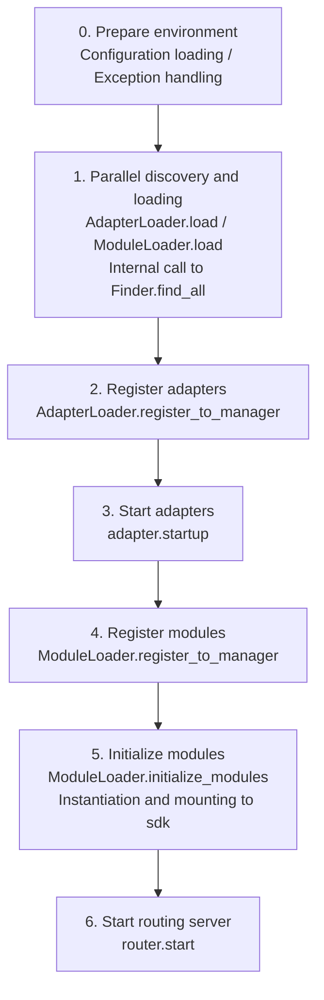

# Startup Flow and Manual Control

> [!TIP]
> **When to read this**: When you need to manually drive the startup sequence, customize the boot order, or troubleshoot startup failures. Skip if not needed, as it does not affect other features.

ErisPulse's `await sdk.run()` / `await sdk.init()` encapsulates the entire startup sequence into a single line of code. However, when you need to fully customize the startup process (e.g., partial loading, dynamic registration, hot-plugging, injecting custom loading strategies), you need to understand what happens inside this chain and how to manually drive each step.

This article breaks down the startup chain into independent steps, explains the responsibilities of each step, their calling order, and provides an example of manually initiating the full startup process.

> This article assumes you have already run through [the first bot](../getting-started/first-bot.md) and are familiar with the two `keep_running` modes of `sdk.run()`. This article focuses on the internal breakdown of the `init()` chain and lower-level entry points such as `init()`/`init_task()`/`init_sync()`.

## Overview of SDK Top-Level Entry Points

In addition to the two `keep_running` modes of `run()`, the SDK provides several lower-level initialization entry points, differing in **asynchronicity, return values, and whether exceptions are wrapped**:

| Entry Point | Asynchronicity | Return Value | Exception Handling | Use Case |
|-------------|----------------|--------------|--------------------|----------|
| `await sdk.run(True)` | async, blocks and maintains | `None` (automatically `uninit` on shutdown) | Module/adapter errors are intercepted, not crashing the process | Pure bot applications |
| `await sdk.run(False)` | async, non-blocking | `None` (no automatic unloading) | Same as above | Perform custom logic after initialization |
| `await sdk.init()` | async, requires `await` | `bool` | Internal capture of component exceptions, returns `False` on failure | Manual lifecycle control (paired with `uninit()`) |
| `sdk.init_task()` | async, returns `Task` and does not block | `asyncio.Task` | Same as `init()` | Concurrently execute other initialization or when event loop is not running |
| `sdk.init_sync()` | **synchronous**, blocks the current thread | `bool` | Same as `init()` | Command-line scripts, synchronous entry without event loop |

> **Common misconception**: `await sdk.init()` **is not equivalent to** `await sdk.run(keep_running=False)`. Two differences: ① `init()` returns `bool` (returns `False` on failure), `run()` returns `None`; ② `init()` only performs initialization, **does not automatically unload**, whereas `run()` automatically calls `uninit()` when the event loop ends. Therefore, when you need to manually pair unloading or customize the lifecycle, use `init()` + `uninit()`.

## Startup Chain Overview

`sdk.init()` (specifically its internal `Initializer.init()`) initiates the entire framework in the following order:



Corresponding core components:

| Layer | Component | Responsibility |
|-------|-----------|----------------|
| Discovery | `AdapterFinder` / `ModuleFinder` | **Discover** adapters/modules from entry-points of installed packages |
| Loading | `AdapterLoader` / `ModuleLoader` | Discovery + Import + Metadata reading + Enable/disable judgment, returns object list |
| Registration | `*Loader.register_to_manager` | Register objects to corresponding managers |
| Management | `sdk.adapter` / `sdk.module` | Maintain adapter/module instances, provide start/stop interfaces |
| Initialization | `ModuleLoader.initialize_modules` | Create module instances and mount to `sdk` (handle dependency topological sorting) |
| Routing | `sdk.router` | HTTP / WebSocket server |

> **Important**: `Finder` and `Loader` are two layers. `Loader` internally **holds** a `Finder` (e.g., `AdapterLoader` has its own `AdapterFinder`, `ModuleLoader` has its own `ModuleFinder`). In most scenarios, you only need to use `Loader`; you only use `Finder` alone when you need to "list without importing."

## Detailed Explanation of Each Step

### 1. Discovery Layer: Finder

`Finder` only finds which packages provide adapters/modules, without importing or instantiating.

```python
from ErisPulse.finders import AdapterFinder, ModuleFinder

adapter_finder = AdapterFinder()
module_finder = ModuleFinder()

# Find all installed adapters/modules entry-points
adapter_entries = adapter_finder.find_all()    # list[EntryPoint]
module_entries = module_finder.find_all()      # list[EntryPoint]

# Find a single entry by name
entry = module_finder.find_by_name("MyModule")  # EntryPoint | None
```

Each `EntryPoint` can be `.load()` to get the corresponding class, but usually you don't need to manually call it—`Loader` will handle it.

### 2. Loading Layer: Loader

`Loader` does "import + read metadata + enable/disable judgment" on top of `Finder`.

```python
from ErisPulse.loaders import AdapterLoader, ModuleLoader
from ErisPulse import sdk

adapter_loader = AdapterLoader()
module_loader = ModuleLoader()

# load() internally: calls finder.find_all() → processes each entry-point → returns triple
adapter_objs, enabled_adapters, disabled_adapters = await adapter_loader.load(sdk.adapter)
module_objs, enabled_modules, disabled_modules = await module_loader.load(sdk.module)
```

The three-tuple returned by `load()`:

| Return Value | Meaning |
|--------------|---------|
| `objs` (`dict`) | Name → Object (adapter class / module wrapper object) |
| `enabled` (`list[str]`) | Names that are enabled (not disabled in configuration) |
| `disabled` (`list[str]`) | Names that are disabled |

#### Diagnostic Information on Loading Failures

When a module/adapter throws an exception during loading or initialization, the framework skips that component and continues loading other components, while outputting a **user code frame summary**. This allows you to locate the error position at the default INFO level without manually enabling DEBUG:

```
[ERROR] [ModuleLoader] Failed to load module MyModule from entry-point, skipped: 'NoneType' object has no attribute 'platform'
  → MyModule/Core.py:42 in on_load
      adapter = sdk.platform
  → AttributeError: 'NoneType' object has no attribute 'platform'
  → Hint: Increase log level to DEBUG to view full stack trace; check the implementation code of module MyModule
```

The diagnostic information is generated by the `ErisPulse.runtime.diagnostics` module, automatically filtering out framework internal frames and retaining only your code frames. If you need to reuse it in custom loading logic:

```python
from ErisPulse.runtime import log_diagnostic

try:
    risky_init()
except Exception as e:
    log_diagnostic(e)  # Automatically extract user code frames and write to ERROR log
```

This module also provides two low-level functions: `extract_user_frame()` (returns structured frame information) and `format_diagnostic_block()` (returns multi-line text).

### 3. Registration Layer: register_to_manager

Registers the objects produced by `Loader` to the managers, allowing `sdk.adapter` / `sdk.module` to recognize them.

```python
# Register adapters (returns bool, indicating success for all)
await adapter_loader.register_to_manager(enabled_adapters, adapter_objs, sdk.adapter)

# Register modules
await module_loader.register_to_manager(enabled_modules, module_objs, sdk.module)
```

After registration, adapters are registered to the adapter manager, modules are registered to the module manager, but **neither are started/initialized**.

### 4. Start Adapters

```python
# Start all registered adapters
await sdk.adapter.startup()
# Or specify a platform
await sdk.adapter.startup("yunhu")
await sdk.adapter.startup(["yunhu", "telegram"])
```

> Registration ≠ Startup. `register_to_manager` only registers; `startup` calls the adapter's `start()`, establishing a connection with the platform.

### 5. Initialize Modules

Modules have an extra step—they need to be **instantiated** and mounted to `sdk` (so you can call `sdk.MyModule.xxx`). This step also handles module dependencies and topological sorting.

```python
success = await module_loader.initialize_modules(
    enabled_modules, module_objs, sdk.module, sdk
)
```

After successful instantiation, modules appear on `sdk.<ModuleName>`.

### 6. Start Routing Server

```python
await sdk.router.start(
    host="0.0.0.0",
    port=8000,
    ssl_certfile=None,
    ssl_keyfile=None,
)
```

The routing server is responsible for receiving webhook/WebSocket callbacks from adapters. Without starting it, server-mode adapters cannot receive messages.

## Complete Manual Startup Example

The following code is **equivalent** to the core process of `await sdk.init()`, but exposes each step, allowing you to insert custom logic at any point:

```python
import asyncio
from ErisPulse import sdk
from ErisPulse.loaders import AdapterLoader, ModuleLoader

async def manual_startup():
    # 0. Prepare environment (load configuration, register global exception handling)
    #    _prepare_environment is a pre-step inside init(); the manual process also needs to call it first,
    #    otherwise Loader won't read the configuration and will incorrectly disable all adapters/modules.
    if not await sdk._prepare_environment():
        print("Environment preparation failed")
        return False

    # 1. Create loaders (each internally holds a Finder)
    adapter_loader = AdapterLoader()
    module_loader = ModuleLoader()

    # 2. Parallel discovery and loading (consistent with init() using gather)
    (adapter_objs, enabled_adapters, disabled_adapters), \
    (module_objs, enabled_modules, disabled_modules) = await asyncio.gather(
        adapter_loader.load(sdk.adapter),
        module_loader.load(sdk.module),
    )

    # 3. Register adapters
    await adapter_loader.register_to_manager(
        enabled_adapters, adapter_objs, sdk.adapter
    )

    # 4. Start adapters
    if enabled_adapters:
        await sdk.adapter.startup()

    # 5. Register modules
    await module_loader.register_to_manager(
        enabled_modules, module_objs, sdk.module
    )

    # 6. Initialize modules (instantiation + mounting to sdk)
    if enabled_modules:
        await module_loader.initialize_modules(
            enabled_modules, module_objs, sdk.module, sdk
        )

    # 7. Start routing server
    await sdk.router.start(host="0.0.0.0", port=8000)

    print("Manual startup complete")
    return True

async def main():
    ok = await manual_startup()
    if ok:
        # Block and maintain running (manual process does not automatically block)
        await asyncio.Event().wait()

if __name__ == "__main__":
    asyncio.run(main())
```

### When to Use Manual Startup?

In most cases, **manual startup is not needed**—`await sdk.run()` already handles all the above steps. Manual startup is only valuable in these scenarios:

- **Partial loading**: Load only specific adapters/modules, skipping others
- **Dynamic registration**: Register new adapters/modules at runtime based on conditions
- **Custom order**: Need to disrupt the default loading order (e.g., start a module before an adapter)
- **Inject strategies**: Inject custom strict mode managers, loading strategies, etc., into Loader
- **Debugging/diagnosis**: Manually drive at a certain step to locate issues when it fails

## Runtime Fine-Grained Control

### Local Plugin Hot Reload

`sdk.enable_plugin_hot_reload()` monitors the local plugin directory (`plugins/`) for source code changes and automatically reloads:
`epsdk run` automatically enables this, no need to manually call; for **bare `sdk.run()` startup**, if plugin hot reload is needed,
call once before `run()` (only covers the local plugin directory, does not affect pip-installed modules/adapters):

```python
sdk.enable_plugin_hot_reload()
sdk.run()
```

Even after using `sdk.run()` to complete startup, you can still control subsystems individually at runtime without restarting the entire SDK:

### Adapter Hot Start/Stop

```python
# Hot restart a specific adapter (fix connection, does not affect other platforms)
await sdk.adapter.shutdown("yunhu")
await sdk.adapter.startup("yunhu")

# Start a new platform at runtime
await sdk.adapter.startup("telegram")

# Temporarily take a platform offline
await sdk.adapter.shutdown("telegram")
```

> `adapter.startup()` requires the adapter to be **registered** to the manager. Registration happens inside `init()`/`run()`, so this is fine-grained control after startup.

### Routing Server

```python
# Temporarily take the webhook server offline
await sdk.router.stop()

# Restart (e.g., after changing the port)
await sdk.router.start(host="0.0.0.0", port=9000)
```

### Modules On-Demand Loading

```python
# Manually load a (possibly lazy-loaded) module
await sdk.load_module("MyModule")
```

## Graceful Shutdown

Since version 2.7.0, `sdk.shutdown()` provides **programmatic graceful shutdown**: set a shutdown event to allow the main loop hanging on `await sdk.run(keep_running=True)` to return, triggering `uninit()` to complete resource cleanup.

```python
# Call from any coroutine to trigger graceful exit (run() hangs and returns, then automatically uninit)
sdk.shutdown()
```

Typical use cases:

```python
async def shutdown_after_idle():
    await asyncio.sleep(3600)
    sdk.shutdown()  # Gracefully exit after 1 hour of idle
```

**Signal Handling**: `run()` internally registers `SIGTERM` / `SIGHUP` handlers, converting system signals into graceful shutdown—when container orchestration (Docker `docker stop`) or `systemd` stops the service, the process completes `uninit()` cleanup instead of being forcefully killed. It also registers a `SIGUSR1` handler to convert into an in-process soft restart (`sdk.restart`)—`epsdk restart` sends this signal to the PID 1 instance inside containers (which terminates and exits the container, making external restart impossible) to trigger component hot reload. The `SIGUSR1` hot restart channel requires ErisPulse **2.12+**.

- Windows does not support `loop.add_signal_handler`, so signal handlers are automatically skipped (still use `sdk.shutdown()` or Ctrl+C to trigger shutdown)
- Repeatedly calling `sdk.shutdown()` is safe (no operation after the event is set)

## Unload Process

The reverse operation of startup is `await sdk.uninit()`, which cleans up in the opposite order:

1. Close all adapters (`adapter.shutdown()`)
2. Unload all modules
3. Clean up all event handlers
4. Clean up managers and module attributes on SDK

In manual startup scenarios, remember to call `uninit()` before exiting to ensure graceful shutdown:

```python
try:
    await asyncio.Event().wait()   # Maintain running
finally:
    await sdk.uninit()
```

## Restart

The SDK provides two restart methods, both do not require you to manually unload first— the framework handles it automatically:

| Method | Call | Behavior | Use Case |
|--------|------|----------|----------|
| Hot Restart | `await sdk.restart()` | **Code-level hot reload at the component layer** within the same process: all modules go through a unified reload pipeline (global syntax pre-check / snapshot rollback / identity verification), adapters first **re-discover entry-points** (newly installed/uninstalled adapters during runtime take effect immediately) then reload code-level | Pip upgrades or installations of components to make code effective, hot updates to modules |
| Hard Restart | `await sdk.hard_restart()` | `uninit()` followed by exiting the process with **exit code 42**, restarted by an external supervisor | Framework self-upgrade (only new processes will have the upgraded framework code), C extension side effects, suspected resource leaks |

```python
# Hot restart: component-level code hot reload (most common; newly installed adapters during runtime are also pulled in)
await sdk.restart()

# Hard restart: exit the process, handed over to external supervisor (see below "Supervisor Guide")
await sdk.hard_restart("sdk self-update")  # Optional reason for supervisor display
```

> **Two points to note**:
> 1. Both methods execute the restart in the background task and **immediately return `True` to indicate "restart task scheduled"**, not "restart completed." The actual restart happens in the background, avoiding interruption of the current event chain.
> 2. The principle of `hard_restart()` is: uninit and flush configuration, then exit the process with **exit code 42** (`HARD_RESTART_EXIT_CODE`)—**it does not start a new process itself**, it must be restarted by an external supervisor detecting exit code 42. If you directly run `python main.py` without any supervisor, the process exits with code 42 and **does not automatically restart** (the framework will warn).

> **Mutual Exclusion and Merging of Hot Restarts** (since 2.11.1): All hot reload operations (single module reload / full reload / adapter reload / sleep / new plugin hot load) are mutually exclusive throughout the process—concurrent triggers during save storms will not cross-execute, and new requests received during an ongoing restart are automatically merged (requests landing during a regular reload lock period are also merged and queued), with at most one additional run completed after the completion. When saving files with syntax errors, the entire reload will be **rejected by a summary-style syntax pre-check** before unloading (listing all error files and line numbers at once), adapters skip this round of reload, `restart` fails, and all old instances continue serving; after fixing, `restart` can be called again.

### When to Use Hard Restart?

Hot restart already covers most scenarios (pip upgrades/installations of components, hot updates to module code, **including newly installed adapters during runtime**). The following scenarios require hard restart:

- **Framework self-upgrade**: After upgrading ErisPulse itself, the new framework code only takes effect in a new process (Python does not re-import loaded framework code).
- **Binary library (C extension) side effects**: Hot restart is performed in the same process and cannot release C extensions, open file descriptors, threads, and other process-level resources; hard restart switches to a new process, completely clearing these side effects.
- **Resource leak troubleshooting**: When suspected memory or handle leaks, hard restart provides a clean environment.

> The "Framework Restart" function in the Dashboard management panel internally calls `hard_restart()`.

### Exit Code 42 Contract

Hard restart is cross-process collaboration: **SDK is responsible for exiting (code 42), supervisor is responsible for restarting**.

| Role | Behavior |
|------|----------|
| SDK (when hard restarted) | `uninit()` → flush configuration → write hard restart marker (reason / PID, for supervisor display) → `os._exit(42)` |
| Supervisor | Detect child process exit code as 42 → display hard restart reason → restart the same command |

> `sdk.is_supervised()` can query whether the current process is started by a supervisor (detects environment variable `ERISPULSE_SUPERVISED`). The CLI `run` command injects this marker when starting a subprocess; external supervisors like `systemd` / `Docker` do not inject it, `is_supervised()` returns `False`, and in this case, after hard restart, the framework will warn "supervisor not detected."

### Supervisor Guide

Choose a supervisor suitable for your needs to make hard restart truly effective:

#### 1. CLI run command (development/simple deployment, recommended)

`epsdk run main.py` includes a built-in supervision loop: detects the child process exit code, restarts immediately if it is 42 (and displays the hard restart reason); for other abnormal exit codes, it retries with exponential backoff; `Ctrl+C` first gracefully terminates the child process (code 0 is considered normal exit, no restart).

```bash
epsdk run main.py
```

`epsdk run --reload` (development hot reload mode, since 2.11.1) also uses the "supervisor process + reload worker subprocess" structure: the worker saves `.py` files and triggers **component-level hot reload** (not full framework restart); hard restart is handled by the supervisor process restarting a new worker, making the upgraded framework code effective immediately.

#### Fine-Grained Reload Determination (since 2.12+)

After saving `.py`, choose the smallest reload unit based on the runtime source code ownership, not path string guessing:

| Changed file | Handling |
|--------------|----------|
| Inside plugin directory (`ErisPulse.framework.plugins_dir`) | Handled by plugin hot reload watcher, dev watcher does not trigger repeatedly |
| Source code of loaded modules (including `pip install -e` and site-packages) | `sdk.reload_module(module_name)` |
| Source code of registered adapters | `sdk.reload_adapter(platform_name)` |
| Entry script | Process-level restart (exit code 42, restarted by supervisor) |
| Framework source code (inside `ErisPulse` package) | Process-level restart |
| Matches multiple owners / cannot be assigned | Conservative process-level restart |

Script mode (`epsdk run main.py --reload`) does not workerize the script: the script subprocess mounts the dev watcher and writes `component_reload_pid` to `.erispulse/runtime.json`; the parent process sees this marker and handles module/adapter/plugin changes in the subprocess, only restarting the script process for entry script or framework source code changes.

#### 2. systemd (Linux server)

`RestartForceExitStatus=42` makes exit code 42 trigger a restart (default `on-failure` only applies to non-zero codes):

```ini
[Service]
ExecStart=/usr/bin/python3 /opt/mybot/main.py
Restart=on-failure
RestartForceExitStatus=42
RestartSec=2
User=mybot
```

#### 3. Docker / docker-compose

Inside the container, PID 1 is the application process; after exit code 42, the container exits—use the `restart` policy to make it automatically restart:

```yaml
services:
  bot:
    build: .
    restart: unless-stopped   # Restart on any exit (including 42)
```

> Inside the container, `epsdk restart` performs an in-process hot restart via SIGUSR1 for the PID 1 instance, not exiting the container; full process restart is handled by the `restart` policy. See [Deployment → Container Restart (PID 1 Instance)](../user-guide/deployment.md#container-restart-pid-1-instance).

#### 4. PM2 (Node ecosystem operations)

```bash
pm2 start main.py --name mybot --interpreter python3
# 42 is treated as an exit code, PM2 defaults to restarting; set restart_delay to debounce
pm2 set mybot.restart_delay 2000
```

#### 5. supervisord

```ini
[program:mybot]
command=python3 /opt/mybot/main.py
autorestart=true
exitcodes=0,2,42    # 42 is also treated as "normal exit requiring restart"
```

#### 6. Pure Python Custom Supervisor

```python
import subprocess, sys, time

while True:
    p = subprocess.Popen([sys.executable, "main.py"])
    code = p.wait()
    if code == 42:          # Hard restart request
        time.sleep(0.5)
        continue
    if code == 0:           # Normal exit
        break
    time.sleep(3)           # Abnormal exit, backoff retry
```

> **Behavior without a supervisor**: Running directly with `python main.py`, calling `hard_restart()` exits the process with code 42 and does not restart. In this case, you should integrate any of the above supervisors.

## Related Documentation

- [Create Your First Bot](../getting-started/first-bot.md) - Introduction to the two basic `keep_running` modes
- [Lifecycle Management](lifecycle.md) - Listen to startup events such as `core.init.start` / `core.init.complete`
- [Lazy Loading System](lazy-loading.md) - Module lazy loading mechanism and `load_module`