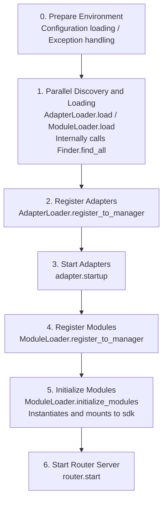

# Startup Process and Manual Control

> [!TIP]
> **When to read this**: When you need to manually drive the startup chain, customize the startup sequence, or troubleshoot startup failures. Skip if not needed, as it does not affect the use of other features.

ErisPulse's `await sdk.run()` / `await sdk.init()` encapsulates the entire startup chain into a single line of code. However, when you need to fully customize the startup process (e.g., partial loading, dynamic registration, hot-plugging, injecting custom loading strategies), you need to understand what happens inside this chain and how to manually drive each step.

This document breaks down the startup chain into independent components, explains their respective responsibilities, invocation order, and provides an example of manually initiating the complete startup process.

> This document assumes you have already run [the first bot](../getting-started/first-bot.md) and understand the two modes of `sdk.run(keep_running=True/False)`. This document focuses on the internal breakdown of the `init()` chain and lower-level entry points such as `init()`/`init_task()`/`init_sync()`.

## Overview of SDK Top-Level Entry Points

In addition to the two `keep_running` modes of `run()`, the SDK provides several lower-level initialization entry points, differing in **asynchronous behavior, return values, and exception handling**:

| Entry Point | Asynchronous | Return Value | Exception Handling | Use Cases |
|-------------|--------------|--------------|--------------------|-----------|
| `await sdk.run(True)` | async, blocks to maintain | `None` (uninit automatically on shutdown) | Module/adapter errors are intercepted, not dragging down the process | Pure bot application |
| `await sdk.run(False)` | async, non-blocking | `None` (no automatic uninit) | Same as above | Perform custom logic after initialization |
| `await sdk.init()` | async, requires await | `bool` | Internal capture of component exceptions, returns `False` on failure | Manual lifecycle control (paired with `uninit()`) |
| `sdk.init_task()` | async, returns Task without blocking | `asyncio.Task` | Same as `init()` | Concurrently execute other initializations or when event loop is not running |
| `sdk.init_sync()` | **Synchronous**, blocks current thread | `bool` | Same as `init()` | Command-line scripts, synchronous entry without event loop |

> **Common misconception**: `await sdk.init()` **is not equivalent to** `await sdk.run(keep_running=False)`. Two differences: ① `init()` returns `bool` (returns `False` on failure), `run()` returns `None`; ② `init()` only performs initialization, **does not automatically uninit**, while `run()` automatically calls `uninit()` when the event loop ends. Therefore, when needing to manually pair uninit or customize lifecycle, use `init()` + `uninit()`.

## Overview of Startup Chain

`sdk.init()` (specifically its internal `Initializer.init()`) initiates the entire framework in the following order:



Corresponding core components:

| Layer | Component | Responsibility |
|-------|-----------|----------------|
| Discovery | `AdapterFinder` / `ModuleFinder` | **Discover** adapters/modules from entry-points of installed packages |
| Loading | `AdapterLoader` / `ModuleLoader` | Discovery + Import + Read metadata + Determine enable/disable, return object list |
| Registration | `*Loader.register_to_manager` | Register objects to corresponding managers |
| Management | `sdk.adapter` / `sdk.module` | Maintain adapter/module instances, provide start/stop interfaces |
| Initialization | `ModuleLoader.initialize_modules` | Create module instances and mount to `sdk` (handle dependency topological sort) |
| Routing | `sdk.router` | HTTP / WebSocket server |

> **Important**: `Finder` and `Loader` are two layers. `Loader` internally **already holds** a `Finder` (`AdapterLoader` has `AdapterFinder`, `ModuleLoader` has `ModuleFinder`). In most scenarios, you only need to use `Loader`, and only use `Finder` directly when you need "list only, no import".

## Detailed Explanation of Each Component

### 1. Discovery Layer: Finder

Finder only finds "which packages provide adapters/modules", without importing or instantiating.

```python
from ErisPulse.finders import AdapterFinder, ModuleFinder

adapter_finder = AdapterFinder()
module_finder = ModuleFinder()

# Find all installed adapters/modules entry-points
adapter_entries = adapter_finder.find_all()    # list[EntryPoint]
module_entries = module_finder.find_all()      # list[EntryPoint]

# Find single by name
entry = module_finder.find_by_name("MyModule")  # EntryPoint | None
```

Each `EntryPoint` can be loaded via `.load()` to get the corresponding class, but usually you don't need to call it manually—Loader will do it.

### 2. Loading Layer: Loader

Loader does "import + read metadata + determine enable/disable" on top of Finder.

```python
from ErisPulse.loaders import AdapterLoader, ModuleLoader
from ErisPulse import sdk

adapter_loader = AdapterLoader()
module_loader = ModuleLoader()

# load() internally: calls finder.find_all() → processes each entry-point → returns triple
adapter_objs, enabled_adapters, disabled_adapters = await adapter_loader.load(sdk.adapter)
module_objs, enabled_modules, disabled_modules = await module_loader.load(sdk.module)
```

The three-tuple returned by `load()`:

| Return Value | Meaning |
|--------------|---------|
| `objs` (`dict`) | Name → Object (adapter class / module wrapper object) |
| `enabled` (`list[str]`) | Enabled names (not disabled in configuration) |
| `disabled` (`list[str]`) | Disabled names |

#### Diagnostic Information on Loading Failure

When a module/adapter throws an exception during loading or initialization, the framework skips that component and continues loading others, while outputting a **summary of user code frames** so you can locate the error position at the default INFO level without manually turning on DEBUG:

```
[ERROR] [ModuleLoader] Failed to load module MyModule from entry-point, skipped: 'NoneType' object has no attribute 'platform'
  → MyModule/Core.py:42 in on_load
      adapter = sdk.platform
  → AttributeError: 'NoneType' object has no attribute 'platform'
  → Note: Raise log level to DEBUG to view full stack trace; check implementation code of module MyModule
```

The diagnostic information is generated by the `ErisPulse.runtime.diagnostics` module, which automatically filters out internal framework frames and retains only your code frames. If you need to reuse this in custom loading logic:

```python
from ErisPulse.runtime import log_diagnostic

try:
    risky_init()
except Exception as e:
    log_diagnostic(e)  # Automatically extract user code frames and write to ERROR log
```

This module also provides two low-level functions: `extract_user_frame()` (returns structured frame information) and `format_diagnostic_block()` (returns multi-line text).

### 3. Registration Layer: register_to_manager

Registers the objects produced by Loader to the manager, allowing `sdk.adapter` / `sdk.module` to recognize them.

```python
# Register adapters (returns bool, indicating if all succeeded)
await adapter_loader.register_to_manager(enabled_adapters, adapter_objs, sdk.adapter)

# Register modules
await module_loader.register_to_manager(enabled_modules, module_objs, sdk.module)
```

After registration, adapters are registered to the adapter manager and modules are registered to the module manager, but **they are not started/initialized yet**.

### 4. Start Adapters

```python
# Start all registered adapters
await sdk.adapter.startup()
# Or specify a platform
await sdk.adapter.startup("yunhu")
await sdk.adapter.startup(["yunhu", "telegram"])
```

> Registration ≠ Startup. `register_to_manager` only registers; `startup` calls the adapter's `start()`, establishing a connection with the platform.

### 5. Initialize Modules

Modules have an extra step compared to adapters—they need to be **instantiated** and mounted to `sdk` (so you can call `sdk.MyModule.xxx`). This step also handles module dependencies and topological sorting.

```python
success = await module_loader.initialize_modules(
    enabled_modules, module_objs, sdk.module, sdk
)
```

After successful instantiation, modules appear on `sdk.<ModuleName>`.

### 6. Start Router Server

```python
await sdk.router.start(
    host="0.0.0.0",
    port=8000,
    ssl_certfile=None,
    ssl_keyfile=None,
)
```

The router server is responsible for receiving callbacks from adapters (Webhook / WebSocket). Without starting it, server-mode adapters cannot receive messages.

## Complete Manual Startup Example

The following code is **equivalent to** the core process of `await sdk.init()`, but each step is exposed to you, allowing you to insert custom logic at any step:

```python
import asyncio
from ErisPulse import sdk
from ErisPulse.loaders import AdapterLoader, ModuleLoader

async def manual_startup():
    # 0. Prepare Environment (load configuration, register global exception handling)
    #    _prepare_environment is a pre-step in init(); the manual process also needs to call it first,
    #    otherwise Loader cannot read the configuration and will misjudge all adapters/modules as disabled.
    if not await sdk._prepare_environment():
        print("Environment preparation failed")
        return False

    # 1. Create loaders (each internally holds a Finder)
    adapter_loader = AdapterLoader()
    module_loader = ModuleLoader()

    # 2. Parallel Discovery and Loading (consistent with internal use of gather in init())
    (adapter_objs, enabled_adapters, disabled_adapters), \
    (module_objs, enabled_modules, disabled_modules) = await asyncio.gather(
        adapter_loader.load(sdk.adapter),
        module_loader.load(sdk.module),
    )

    # 3. Register adapters
    await adapter_loader.register_to_manager(
        enabled_adapters, adapter_objs, sdk.adapter
    )

    # 4. Start adapters
    if enabled_adapters:
        await sdk.adapter.startup()

    # 5. Register modules
    await module_loader.register_to_manager(
        enabled_modules, module_objs, sdk.module
    )

    # 6. Initialize modules (instantiation + mount to sdk)
    if enabled_modules:
        await module_loader.initialize_modules(
            enabled_modules, module_objs, sdk.module, sdk
        )

    # 7. Start router server
    await sdk.router.start(host="0.0.0.0", port=8000)

    print("Manual startup completed")
    return True

async def main():
    ok = await manual_startup()
    if ok:
        # Block to maintain running (manual process does not automatically block)
        await asyncio.Event().wait()

if __name__ == "__main__":
    asyncio.run(main())
```

### When to Use Manual Startup?

In most cases, **manual startup is not necessary**, as `await sdk.run()` already handles all the above steps. Manual startup is only valuable in these scenarios:

- **Partial Loading**: Only load specific adapters/modules, skipping others
- **Dynamic Registration**: Register new adapters/modules at runtime based on conditions
- **Custom Order**: Need to disrupt the default loading order (e.g., start a module before an adapter)
- **Inject Strategies**: Inject custom strict mode managers or loading strategies into Loader
- **Debugging/Diagnosis**: Manually drive at a certain step when a failure occurs to locate the issue

## Fine-Grained Runtime Control

Even when using `sdk.run()` to complete the startup, you can still individually control subsystems at runtime without having to restart the entire SDK:

### Hot Restart/Stop of Adapters

```python
# Hot restart an adapter (fix connection, does not affect other platforms)
await sdk.adapter.shutdown("yunhu")
await sdk.adapter.startup("yunhu")

# Bring up a new platform at runtime
await sdk.adapter.startup("telegram")

# Temporarily take down a platform
await sdk.adapter.shutdown("telegram")
```

> `adapter.startup()` requires the adapter to have been **registered** to the manager. Registration occurs within `init()`/`run()`, so this is fine-grained control **after** startup.

### Router Server

```python
# Temporarily take down webhook server
await sdk.router.stop()

# Restart (e.g., after changing port)
await sdk.router.start(host="0.0.0.0", port=9000)
```

### Lazy Module Loading

```python
# Manually load a module (possibly lazy-loaded)
await sdk.load_module("MyModule")
```

## Graceful Shutdown

As of version 2.7.0, `sdk.shutdown()` provides **programmatic graceful shutdown**: set the shutdown event to allow the main loop, which is suspended by `await sdk.run(keep_running=True)`, to return, thus triggering `uninit()` to complete resource cleanup.

```python
# Call from any coroutine to trigger graceful exit (run() suspended returns and automatically uninit)
sdk.shutdown()
```

Typical use cases:

```python
async def shutdown_after_idle():
    await asyncio.sleep(3600)
    sdk.shutdown()  # Gracefully exit after 1 hour of idle
```

**Signal Handling**: `run()` internally registers `SIGTERM` / `SIGHUP` handlers, converting system signals into graceful shutdown—when container orchestration (Docker `docker stop`) or `systemd` stops the service, the process completes `uninit()` cleanup instead of being forcibly killed.

- Windows does not support `loop.add_signal_handler`, so the signal handler is automatically skipped (still use `sdk.shutdown()` or Ctrl+C to trigger shutdown)
- Repeatedly calling `sdk.shutdown()` is safe (no operation after the event is set)

## Uninit Process

The reverse operation of startup is `await sdk.uninit()`, which cleans up in the opposite order:

1. Close all adapters (`adapter.shutdown()`)
2. Unload all modules
3. Clean up all event handlers
4. Clean up managers and module attributes on SDK

In manual startup scenarios, remember to call `uninit()` before exiting to ensure graceful shutdown:

```python
try:
    await asyncio.Event().wait()   # Maintain running
finally:
    await sdk.uninit()
```

## Restart

The SDK provides two restart methods, both of which do not require you to manually uninstall first—the framework handles it automatically:

| Method | Call | Behavior | Applicable Scenarios |
|------|------|------|----------|
| Hot Restart | `await sdk.restart()` | Hot reload at the component layer code level within the same process: all modules and adapters follow a unified reload pipeline (syntax pre-check / snapshot rollback / identity verification), without overall `uninit()` / `init()` | To make code changes effective after pip upgrading components, or for hot module updates |
| Hard Restart | `await sdk.hard_restart()` | Exit the process with exit code 42 after `uninit()`, and let an external supervisor launch a new process | When suspecting memory/resource leaks, or needing a completely clean restart |

```python
# Hot restart: component layer code-level hot reload (most commonly used)
await sdk.restart()

# Hard restart: exit the process and let an external supervisor restart it (see "Supervisor Guide" below)
await sdk.hard_restart()
```

> **Two points to note**:
> 1. Both methods execute the restart as a background task, immediately returning `True` to indicate that the "restart task has been scheduled," not that the restart has completed. The actual restart occurs in the background, avoiding interruption of the current event chain.
> 2. The principle of `hard_restart()` is: after uninstalling and flushing configuration, the process exits with **exit code 42** (`HARD_RESTART_EXIT_CODE`) — it **does not launch a new process itself**. It must be restarted by an external supervisor that detects exit code 42. If you run `python main.py` directly without any supervisor, the process ends after exiting with code 42, and **does not automatically restart** (the framework will issue a warning message).

### When should I use a hard restart?

A hard restart is not just a "more thorough restart." It is more suitable, and even more efficient, in the following scenarios compared to a hot restart:

- **Side effects of binary libraries (C extensions):** Hot restart occurs within the same process and cannot release C extensions, open file descriptors, threads, and other process-level resources. A hard restart switches to a new process, thoroughly clearing these side effects.
- **Resource leak troubleshooting:** When suspecting memory or handle leaks, a hard restart provides a clean environment.
- **Frequent restarts sensitive to performance:** A hard restart avoids the overhead of unloading and reloading within the same process, making it more efficient than a hot restart.

> The "Framework Restart" function in the Dashboard management panel internally calls `hard_restart()`.

### Exit Code 42 Contract

A hard restart involves cross-process collaboration: **the SDK is responsible for exiting (code 42), and the supervisor is responsible for launching**.

| Role | Behavior |
|------|------|
| SDK (when hard restarted) | `uninit()` → flush configuration to disk → `os._exit(42)` |
| Supervisor | Detects child process exit code 42 → restart the same command |

> `sdk.is_supervised()` can query whether the current process was started by a supervisor (detects the environment variable `ERISPULSE_SUPERVISED`). The CLI `run` command injects this mark automatically when starting a child process; external supervisors like systemd or Docker do not inject it, so `is_supervised()` returns `False`, and the framework will issue a "supervisor not detected" warning after a hard restart.

### Supervisor Guide

Choose a supervisor suitable for your needs to make hard restart truly effective:

#### 1. CLI run command (development/simple deployment, recommended)

`epsdk run main.py` includes a built-in supervision loop: it detects the child process exit code, restarts immediately if it is 42; otherwise, it retries with exponential backoff for abnormal exit codes; `Ctrl+C` first gracefully terminates the child process (code 0 is considered normal exit, and no restart is triggered).

```bash
epsdk run main.py
```

#### 2. systemd (Linux server)

`RestartForceExitStatus=42` makes exit code 42 trigger a restart (by default `on-failure` only applies to non-zero codes):

```ini
[Service]
ExecStart=/usr/bin/python3 /opt/mybot/main.py
Restart=on-failure
RestartForceExitStatus=42
RestartSec=2
User=mybot
```

#### 3. Docker / docker-compose

The container's PID 1 is the application process. After exiting with code 42, the container exits — use the `restart` policy to make it automatically restart:

```yaml
services:
  bot:
    build: .
    restart: unless-stopped   # Restart on any exit (including 42)
```

#### 4. PM2 (Node ecosystem operations)

```bash
pm2 start main.py --name mybot --interpreter python3
# 42 is treated as an exit code, PM2 defaults to restarting; set restart_delay to prevent jitter
pm2 set mybot.restart_delay 2000
```

#### 5. supervisord

```ini
[program:mybot]
command=python3 /opt/mybot/main.py
autorestart=true
exitcodes=0,2,42    # 42 is also treated as "normal exit requiring restart"
```

#### 6. Pure Python custom supervisor

```python
import subprocess, sys, time

while True:
    p = subprocess.Popen([sys.executable, "main.py"])
    code = p.wait()
    if code == 42:          # Hard restart request
        time.sleep(0.5)
        continue
    if code == 0:           # Normal exit
        break
    time.sleep(3)           # Abnormal exit, retry with backoff
```

> **Behavior without a supervisor:** Running directly with `python main.py`, calling `hard_restart()` causes the process to exit with code 42 and not restart. In this case, you should integrate one of the above supervisors.

## Related Documentation

- [Create the First Bot](../getting-started/first-bot.md) - Introduction to the two basic modes of `keep_running`
- [Lifecycle Management](lifecycle.md) - Listen to startup events such as `core.init.start` / `core.init.complete`
- [Lazy Loading System](lazy-loading.md) - Module lazy loading mechanism and `load_module`