以下是 ErisPulse SDK 模块开发文档（知识库）。请基于文档内容回答；
文档未覆盖的 API 以 SDK 源码 docstring 为准，不要编造不存在的接口或行为。


---


================
ErisPulse 模块开发指南
================


====
框架理解
====


### 架构概览

# Architecture Overview

> [!TIP]
> **When to read this**: When you want to understand what the framework is doing behind the scenes—how a message flows, the order in which modules are initialized, what happens during hot reload, or when troubleshooting "why the framework behaves this way." If you only want to write handlers, see [Getting Started with Event Handling](getting-started/event-handling.md); otherwise, skip this.

A message from a user to a bot reply goes through several stages: adapter transformation, middleware, scope filtering, and priority-based scheduling. Modules are not all loaded at startup. This article uses diagrams to clearly illustrate this chain and explain what you can intervene at each stage.

## SDK Core Architecture

The following diagram shows the core modules of the SDK and their relationships:

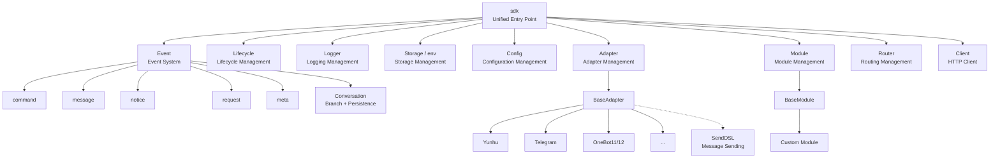

### Core Module Description

| Module | Description |
|--------|-------------|
| **Event** | Event system, providing five types of event handling: command / message / notice / request / meta, and Conversation for multi-turn dialogue |
| **Adapter** | Adapter manager, managing registration, startup, and shutdown of multi-platform adapters |
| **Module** | Module manager, managing plugin registration, loading, and unloading, supporting dependency declaration and topological sorting |
| **Lifecycle** | Lifecycle manager, providing event-driven lifecycle hooks |
| **Storage** | SQLite-based key-value storage system, supporting generic SQL chain query |
| **Config** | TOML-formatted configuration file management |
| **Logger** | Modular logging system, supporting sub-loggers |
| **Router** | HTTP/WebSocket routing management, encapsulating underlying backends (currently FastAPI + Uvicorn) through an abstraction layer, supporting decorator routing, middleware, grouping, rate limiting, CORS |
| **Client** | Unified HTTP/WS client (previously `HttpClient` before 2.8.0, retains compatibility alias), encapsulating underlying request libraries (currently aiohttp) through an abstraction layer, providing request statistics, retry, logging, WebSocket client, ErisPulse exception system, etc. The client and server-side WebSocket share the `WebSocketConnectionBase` base class |

## Initialization Process

The following diagram shows the complete initialization process of `sdk.init()`:

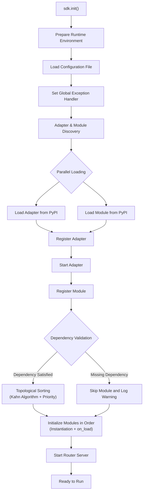

### Detailed Initialization Stages

> The complete initialization chain breakdown (Finder / Loader / Manager / Router), underlying entry points (`init()` / `init_task()` / `init_sync()`), and manual full startup are detailed in [Startup Process and Manual Control](advanced/startup.md).

## Event Handling Process

The following diagram shows the complete flow of messages from the platform to the handler:

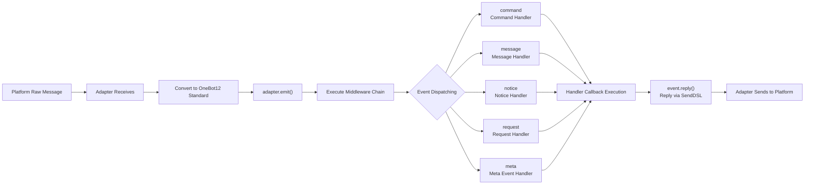

### Detailed Event Handling Chain

The above diagram shows the result; below, we break down what the framework does behind `adapter.emit()`—this is a three-layer dispatch chain:

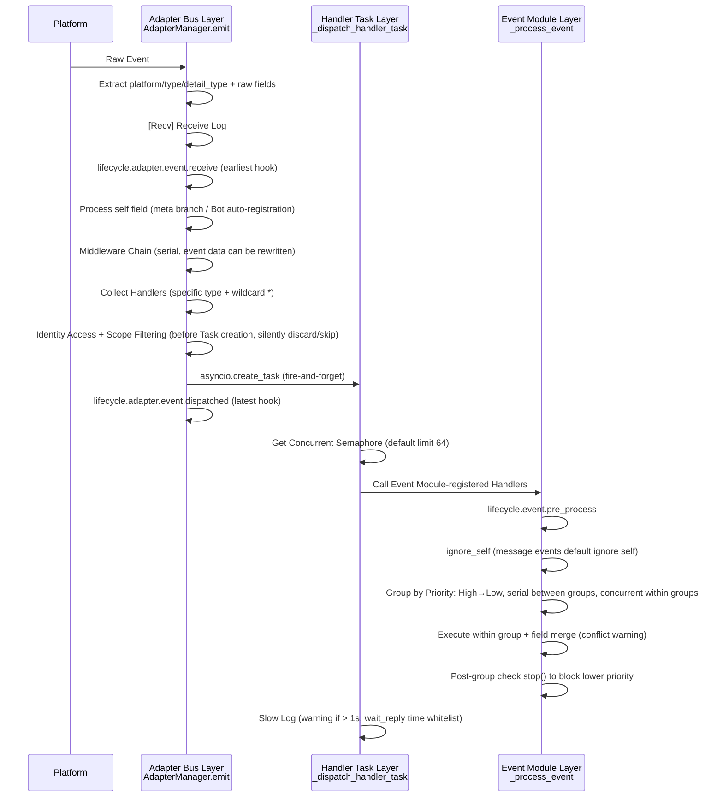

**What the framework does at each step and what you can intervene:**

| Stage | What the framework does | What you can intervene |
|-------|-------------------------|------------------------|
| Receive | Extract standard fields, preserve `{platform}_raw` raw data; write `[Recv]` log | Listen to `adapter.event.receive` to get earliest event |
| self field | Meta event goes through connect/disconnect/heartbeat branch; normal event auto-registers Bot and triggers `adapter.bot.online` | Listen to `adapter.bot.online` / `bot.offline` |
| Middleware | **Serial** execution, if returned value is not None, replace event data | Register middleware to rewrite/intercept event |
| Dispatch Collection | First get specific type handler, then get `*` wildcard handler | — |
| Identity Dimension | At dispatch entry, decide whether to receive event by User>Session>Bot>Adapter (`scope.is_identity_allowed`), **discard entire event if denied** | `ErisPulse.scope.identity` binding |
| Scope Filtering | Determine `scope.is_allowed` by module owner (session level > Bot level > platform level), **silently skip if not passed** | Configure scope whitelist/blacklist |
| Scheduling | Each matching handler gets independent `asyncio.Task`, `emit()` **returns immediately without waiting for handler completion** | — |
| Priority | High priority group executes first; **serial between groups, concurrent within groups** (each group holds event copy, changes merged back, conflicts warn) | `@command(..., priority=N)` / specify priority during registration |
| Blocking | After each group, check `event.is_stopped()`, if triggered, **do not execute lower priority** | `event.mark_processed(stop=True)` / `event.done()` |

> **Common Misunderstandings**:
> 1. **Scope filtering is silent**—filtered handlers do not report errors or respond, only visible in TRACE-level logs (`core.scope.denied`). If "my module didn't receive a message," first check scope binding.
> 2. **Handlers are inherently concurrent**—the framework already creates independent Tasks for each handler, you **do not need** to wrap them in `asyncio.create_task` again.
> 3. **No blocking within the same priority group**—`mark_processed(stop=True)` only blocks lower priority groups, not already concurrent handlers within the same group.
> 4. **Slow log threshold is fixed at 1 second**—handlers taking over 1s will be warned in logs (`wait_reply` time is excluded from duration), but execution is not interrupted.

> Details on scope's module-level three-tier binding, identity-level access and outbound action restrictions are in [Scope (scope)](advanced/scope.md); event scope text filtering and command user ACL are in [Event Handling Introduction](getting-started/event-handling.md); concurrency limit configuration is in [Configuration Guide](user-guide/configuration.md#Framework Configuration).

## Lifecycle Events

The following diagram shows the order in which lifecycle events are triggered by the framework components:

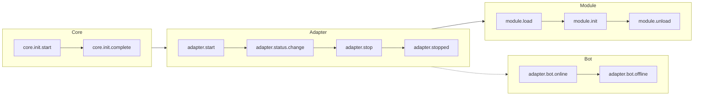

### Listening to Lifecycle Events

> The complete event listening methods (`lifecycle.on()` / `once()` / `has_handlers()`), all lifecycle event lists and data formats are detailed in [Lifecycle Management](advanced/lifecycle.md).

## Module Loading Strategy

ErisPulse supports three module loading strategies, declared by `get_load_strategy()` returning a `ModuleLoadStrategy`:

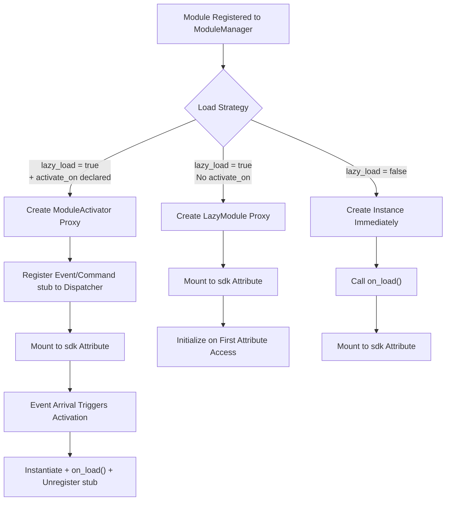

> For more details, see [Lazy Loading System](advanced/lazy-loading.md), [Lifecycle Management](advanced/lifecycle.md), and module documentation.

### Event-Driven Lazy Activation (`activate_on`) Trigger Architecture

> [!NOTE]
> This feature requires ErisPulse **2.8.0+**.

`activate_on` allows modules to load only when the **first matching event/command arrives**, avoiding constant memory usage while ensuring no events are lost:

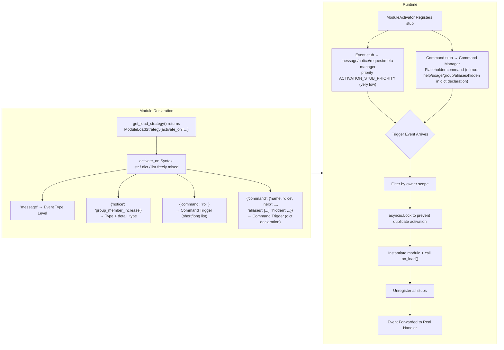

**Trigger Semantics Key Points:**

> The complete `activate_on` syntax (str / dict / list), command dict declaration, placeholder command help fallback chain, scope filtering, and failure semantics are in [Lazy Loading System](advanced/lazy-loading.md#Event-Driven-Lazy-Activation-activate_on).

## Local Plugin Folder Architecture

> [!NOTE]
> This feature requires ErisPulse **2.8.0+**.

Local plugins (`plugins/` directory) do not require packaging for release; the framework automatically discovers and loads them at startup:

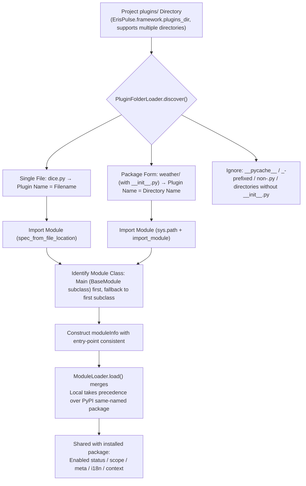

**Conventions and Features:**

- Plugin name source: filename for single file, directory name for package form
- Local plugin `moduleInfo.meta.source == "plugin_folder"`, seamlessly coexists with PyPI installed package modules
- Same name takes local precedence (for local override debugging), disabled entries are removed simultaneously

## Module Hot Reload Architecture

Hot reload is consistent for **all module sources**: local plugins (`plugins/` directory), runtime registration (`sdk.module.register()`), and PyPI installed package modules can all be hot reloaded via `sdk.reload_module()` / `sdk.module.reload()`—**default is full reload** (clear import cache by top-level package name and re-import dependent code, `full=False` is a lightweight escape route); `sdk.reload_all_modules()` / `sdk.module.reload_all()` can fully reload all registered modules at once (call after pip batch upgrade to make all effective):

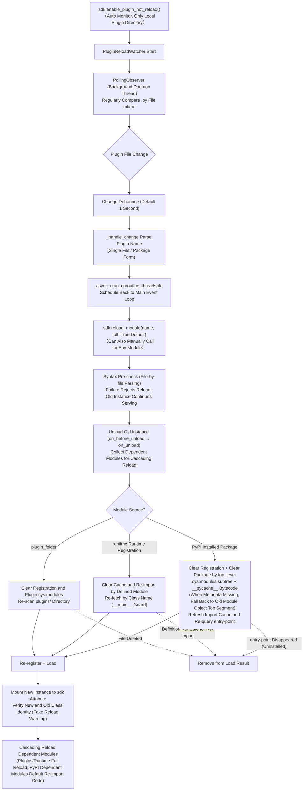

**Differences Only in Discovery Phase for Three Sources**, Pre-check, Unload, and Cascading Reload are Fully Consistent:

- **Local Plugin** (`moduleInfo.meta.source == "plugin_folder"`): Clear sys.modules corresponding to plugin name and re-scan plugins/ directory; if file is deleted, remove from load result
- **Runtime Registration** (`source == "runtime"`): Re-import by defined module, re-fetch by class name and re-register; classes defined in `__main__` / without source file are rejected for re-import (guard warning, avoid re-executing entry script)
- **PyPI Installed Package**: Clear package's sys.modules subtree by `meta.top_level`, refresh import cache (break entry-point 60-second cache) and re-query and re-import; if entry-point disappears (pip uninstalled), remove from load result

**Default Semantics and Reliability Guarantees (2.11):**

- **Reload = Full Reload**: By default, clear sys.modules by top-level package name and re-import dependent code; `full=False` only clears metadata, PyPI dependent modules directly re-instantiate (performance escape for large dependency trees)
- **Syntax Pre-check Gate**: Before entering the unload process, parse each file for syntax, failure rejects reload—old instance is not unloaded, continues serving, syntax errors never put the module into a "half-dead state" (exceeds file count limit for large packages skips pre-check)
- **Cache Fallback**: When `top_level` metadata is missing, clear range by "old module object `__name__` prefix → module class `__module__` prefix" two-tier deduction; clear source file bytecode cache (pycache) during reload, small changes in the same second and length take effect
- **Identity Verification**: After successful reload, assert the change of new and old class identity, if unchanged (C extension cache not cleared), explicitly warn and carry `identity_changed: false` with `module.reload` event; `module.get_info()` exposes "registered version ≠ running version" via `running_identity` / `stale` fields
- **Failure Traceability**: Load failure scene (exception + traceback) can be directly queried via `module.last_error(name)` / `get_info()["last_error"]`, failure path also clears import cache of this module—"after modifying code, reload once again" will definitely read new code
- Reload will force activate modules that were previously lazy-loaded (explicit log); `reload_all_modules()` keeps lazy-loading strategy, only re-activates modules that were loaded before reload, dormant modules remain dormant
- `reload_all_modules()` reloads in dependency topological order, single module failure only records diagnostics and skips (no overall rollback—on_unload side effects are irreversible, consistent with the best-effort semantics of single module hot reload); scenarios where reload failure has been rolled back are similarly indicated in logs, old instances are in a terminated state

## Adapter Hot Reload Architecture

Adapter code-level hot reload (2.11) is structurally identical to the module pipeline: `sdk.adapter.reload(adapter_name)` / `sdk.reload_adapter(adapter_name)` executes for both **local plugin** and **PyPI installed package** sources—

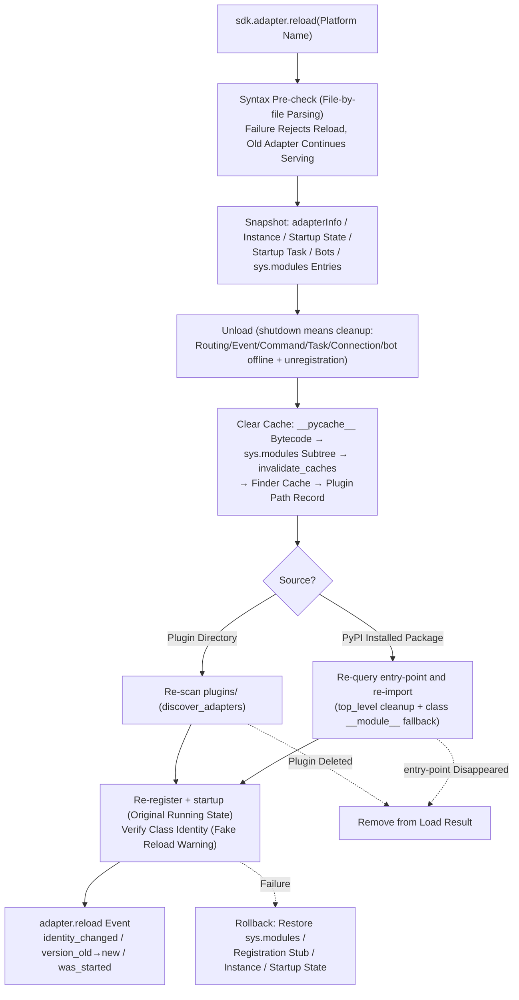

**Differences from Module Pipeline:**

- Adapter has no lazy loading or dependency cascading: Reload **does not cascade** dependent other adapters (only warnings—dependent parties indirectly consume through the registry, no instance-level cascading semantics)
- Startup is an asynchronous chain (`startup` dispatched via `_run_adapter`, including dependency skipping and exponential backoff retry): Startup temporarily failing **does not judge reload failure** (code has been replaced), results are broadcast via `adapter.status.change`
- The instance reuse trap of `register()` (same class object reuses old instance) is covered by the "pyc cleanup + sys.modules clear + identity verification" three-piece set
- Lifecycle events: `adapter.reload` (payload carries `adapter_name` / `success` / `full` / `duration_ms` / `identity_changed` / `version_old→new` / `was_started` / `source`)

> [!NOTE]
> This feature requires ErisPulse **2.8.0+**.


====
快速上手
====


### 快速开始

# Quick Start

> **This is your first step.** Run an ErisPulse robot from scratch in 5 minutes—see the result first, then expand each step.

## 60-Second Demo: Let the Bot Reply to You First

**1. Install** (Python >= 3.10):

```bash
pip install ErisPulse
```

**2. Initialize the project.** The wizard will prompt you to set the project name, select the platform adapter to connect, and complete the configuration, then generate `main.py` and `config/config.toml`:

```bash
epsdk init
```

**3. Open `main.py`, and replace it with these 9 lines of code:**

```python
from ErisPulse import sdk
from ErisPulse.Core.Event import command

@command("ping", help="Test if the bot is online")
async def ping_handler(event):
    await event.reply("Pong! The bot is running normally.")

if __name__ == "__main__":
    import asyncio
    asyncio.run(sdk.run(keep_running=True))
```

**4. Run**:

```bash
epsdk run main.py
```

The terminal will output framework startup logs and adapter connection information. At this point, send `/ping` to the bot in your connected platform; it will reply:

> Pong! The bot is running normally.

Seeing this reply confirms that the framework, adapter, and event handling chain are all working. If it doesn't work, go directly to the [Troubleshooting section](#troubleshooting) at the end of the document; if it works, continue reading to see what other options are available at each step.

## Install ErisPulse: Three Ways

The above uses the most direct pip method. Choose according to your environment:

### Install with pip

Ensure your Python version is >= 3.10, then install using pip:

```bash
pip install ErisPulse
```

If you have already installed [uv](https://github.com/astral-sh/uv), you can also use `uv pip install ErisPulse` for faster installation.

When you only want to install the `epsdk` command-line tool globally without polluting the project environment, it is recommended to use `uv tool install`:

```bash
uv tool install ErisPulse
```

After installation, `epsdk` will be globally available: when running within a project directory, it will automatically detect the project's `.venv` (installing `epsdk install` into the project environment, and running `epsdk run` using the project environment), while the framework itself is provided by the tool environment. See [Installation Reference](user-guide/installation.md) for details.

### One-Click Installation Script (Recommended for New Environments)

The installation script will automatically detect your environment (Docker, Python, uv), and guide you to select the most suitable installation method, supporting multiple languages (Chinese/English/Japanese/Russian/Traditional Chinese).

Windows (PowerShell):
```powershell
irm https://get.erisdev.com/install.ps1 -OutFile install.ps1; powershell -ExecutionPolicy Bypass -File install.ps1
```

macOS / Linux:
```bash
curl -fsSL https://get.erisdev.com/install.sh -o install.sh && chmod +x install.sh && ./install.sh
```

The script will guide you through:

- **Docker Installation** (recommended if Docker is detected): Choose image source (Docker Hub / GHCR), version channel (stable / pre-release), Dashboard management panel configuration, and port settings
- **Global CLI Installation (uv tool, recommended)**: Install `epsdk` as a global command, without virtual environments; uv automatically manages Python (even if the system version is too low); when running within a project directory, it automatically detects the project's `.venv`
- **Traditional Installation**: Automatically create a virtual environment, select the ErisPulse version, and optionally install the Dashboard management panel module

### Using Docker

The Docker image comes with the ErisPulse framework and the Dashboard management panel, supporting `linux/amd64` and `linux/arm64` architectures.

```bash
# Download docker-compose.yml
curl -O https://raw.githubusercontent.com/ErisPulse/ErisPulse/main/docker-compose.yml

# Set the Dashboard token and start
ERISPULSE_DASHBOARD_TOKEN=your-token docker compose up -d
```

<details>
<summary>Is Docker Hub unavailable?</summary>

Use the GitHub Container Registry image, and modify the `image` in `docker-compose.yml`:

```yaml
image: ghcr.io/erispulse/erispulse:latest
```

</details>

After starting, access `http://<host>:8000/Dashboard` and log in using the set token.

## Initialize Project

### Interactive Initialization (Recommended)

```bash
epsdk init
```

This will start an interactive wizard that guides you through:
- Project name setting
- Log level configuration
- Server configuration (host and port)
- Adapter selection and configuration
- Project structure creation

### Quick Initialization

```bash
# Quick mode with a specified project name
epsdk init -q -n my_bot

# Or just specify the project name
epsdk init -n my_bot
```

### Manual Project Creation

If you prefer to create the project manually:

```bash
mkdir my_bot && cd my_bot
epsdk init
```

## Installing Modules

### Installing via CLI

```bash
epsdk install Yunhu AIChat
```

### Viewing Available Modules

```bash
epsdk list-remote
```

### Interactive Installation

Without specifying a package name, enter the interactive installation interface:

```bash
epsdk install
```

## Running the Project

```bash
# Run normally
epsdk run main.py

# Hot reload mode (recommended for development)
epsdk run main.py --reload
```

## Enable IDE Completion (Optional)

ErisPulse dynamically discovers modules/adapters, and IDEs cannot complete platform-specific methods by default.  
Run the following command to generate type stubs:

```bash
epsdk types
```

After generation, use the imported types as variable annotations to obtain precise completion (see [IDE Completion Guide](./getting-started/ide-completion.md)):

```python
from _ep_types import Yunhu
from ErisPulse import sdk

adapter: Yunhu = sdk.adapter.get("yunhu")
await adapter.Send.To("group", "123").Board(...)  # Completion for platform-specific methods
```

## Project Structure

After initialization, the project structure is as follows:

```
my_bot/
├── config/
│   └── config.toml          # Configuration file
└── main.py                  # Entry file

```

## Configuration File

Basic `config.toml` configuration:

```toml
[ErisPulse.server]
host = "0.0.0.0"
port = 8000

[ErisPulse.logger]
level = "INFO"

[Yunhu_Adapter]
# Adapter configuration
```


### 创建第一个机器人

# Create Your First Bot

> [!TIP]
> **When to read this**: Your bot is already running, and you want to write your first `/hello` command handler and understand what `sdk.run` and command decorators do. If you haven't installed ErisPulse, initialized a project, or run the project yet, complete the "Install", "Initialize Project", and "Run Project" steps in [5-Minute Quick Start](../quick-start.md) first; otherwise, skip this section.

Running through the quick start is just the first step—this guide walks you through writing your first command handler and explains what each line of code does within the framework.

## Step 1: Write Your First Command

Open `main.py` and write a simple command handler:

```python
from ErisPulse import sdk
from ErisPulse.Core.Event import command

@command("hello", help="Send a greeting message")
async def hello_handler(event):
    """Handle the hello command"""
    user_name = event.get_user_nickname() or "friend"
    await event.reply(f"Hello, {user_name}! I am the ErisPulse bot.")

@command("ping", help="Test if the bot is online")
async def ping_handler(event):
    """Handle the ping command"""
    await event.reply("Pong! The bot is running normally.")

async def main():
    """Main entry function"""
    print("Starting ErisPulse...")
    
    # keep_running=True (default): The framework blocks and stays running until a shutdown signal is received (e.g., Ctrl+C)
    await sdk.run(keep_running=True)

if __name__ == "__main__":
    import asyncio
    asyncio.run(main())
```

### `keep_running` Parameter

`sdk.run(keep_running)` controls whether the framework blocks and remains running:

- **`keep_running=True` (default)**: `run()` will block indefinitely until a shutdown signal (e.g., Ctrl+C) is received, suitable for pure bot applications.
- **`keep_running=False`**: `run()` returns immediately after initialization. **The framework is not unloaded**—active adapters/modules continue processing message events as background tasks. You can then proceed with your own logic until the event loop ends and the framework shuts down. For example:

```python
async def main():
    await sdk.run(keep_running=False)   # Returns immediately after initialization
    # The framework is running in the background, here you can continue doing other things
    while True:
        await asyncio.sleep(3600)
        print("Check every hour")
```

> Besides the two modes of `run()`, there are also more granular ways to manually control the lifecycle, such as `init()`/`uninit()` and individually starting/stopping adapters/routes. See [Startup Process and Manual Control](../advanced/startup.md).

## Step 2: Run the Robot

```bash
# Run normally
epsdk run main.py

# Development mode (supports hot reload)
epsdk run main.py --reload
```

## Step 3: Test the Bot

Send the following command in your chat platform:

```
/hello
```

You should receive a reply from the bot.

## Code Explanation

### Command Decorator

```python
@command("hello", help="Send a greeting message")
```

- `hello`: The command name, which users invoke via `/hello`
- `help`: The help description, displayed in the `/help` command

### Event Parameters

```python
async def hello_handler(event):
```

The `event` parameter is an Event object, containing:
- Message content: `event.get_text()`
- Sender information: `event.get_user_id()`, `event.get_user_nickname()`
- Platform information: `event.get_platform()`
- Group information: `event.get_group_id()`
- Raw data: `event.get_raw()`

> For a complete list of Event object methods, refer to [Event Wrapper Class Details](../developer-guide/modules/event-wrapper.md).

### Sending a Reply

```python
await event.reply("Reply content")
```

`event.reply()` is a convenient method for sending messages back to the sender.

## Extensions: Adding More Features

ErisPulse provides rich event handling and data processing capabilities:

- **Message Listening**: Use `@message.on_message()` to listen to various types of messages → [Event Handling Introduction](event-handling.md)
- **Notification Listening**: Use `@notice.on_friend_add()` and others to listen to system notifications → [Event Handling Introduction](event-handling.md)
- **Data Storage**: Use `sdk.storage.get/set` to persist data → [Common Tasks Examples](common-tasks.md)

## FAQ

### No response from command?

1. Check if the adapter is correctly configured, and confirm that the `status` of the adapter in `config/config.toml` is set to `true`.
2. Check the terminal log output to confirm if there are any error messages (especially those with `ERROR` level).
3. Confirm that the command prefix is correct (the default is `/`), and check the `[ErisPulse.event.command]` section in the configuration file.
4. Confirm that the command name is spelled correctly, and pay attention to case sensitivity settings.

### How to change the command prefix?

Add the following to `config.toml`:

```toml
[ErisPulse.event.command]
prefix = "!"
case_sensitive = false
```

### How to support multiple platforms?

ErisPulse uses the OneBot12 standard to unify the event formats of different platforms. Handlers registered with `@command` and `@message` will automatically receive events from all platforms. You can distinguish the source platform using `event.get_platform()`:

```python
@command("hello")
async def hello_handler(event):
    platform = event.get_platform()
    
    if platform == "yunhu":
        await event.reply("你好！来自云湖")
    elif platform == "telegram":
        await event.reply("Hello! From Telegram")
    else:
        await event.reply("你好！")
```

> For more multi-platform adaptation techniques, please refer to [Common Tasks Examples](common-tasks.md#multi-platform-adaptation).

## What's Next

- **Continue along the learning path**: Read [Basic Concepts](basic-concepts.md) to understand what the framework behind command handlers does.
- **Want to handle more message types**: [Event Handling Introduction](event-handling.md), how to write handlers for messages / notifications / requests / meta-events.
- **Want to add practical features**: [Common Tasks Examples](common-tasks.md), ready-to-use code for persistence, scheduled tasks, and permission control.


### 基础概念

# Core Concepts

> [!NOTE]
> **L1 Core Must-Read** — The 2nd article in the "L1 Core Five Articles" on the documentation homepage (Module Development Introduction → **Core Concepts** → Event Wrapper → Configuration File Explanation → Exception Handling).

What components does a message pass through from the user's sending to the bot's reply? What are the responsibilities of adapters and modules? After reading this, you can answer design questions when writing handlers yourself, rather than just copying examples.

## Event-Driven Architecture

ErisPulse adopts an event-driven architecture, where all interactions are passed and processed through events.

### Event Flow

```
User sends message
      │
      ▼
Platform receives
      │
      ▼
Adapter receives native platform event
      │
      ▼
Converts to OneBot12 standard event
      │
      ▼
Submits to event system
      │
      ▼
Distributes to registered handlers
      │
      ▼
Module processes event
      │
      ▼
Sends response via adapter
      │
      ▼
Platform displays to user
```

### OneBot12 Standard

ErisPulse uses OneBot12 as the core event standard. OneBot12 is a general-purpose chatbot application interface standard, defining a unified event format.

All adapters convert platform-specific events into OneBot12 format to ensure code consistency.

## Core Components

### 1. SDK Object

The SDK is the unified entry point for all features, providing access to core components.

```python
from ErisPulse import sdk

# Access core modules
sdk.storage    # Storage system
sdk.config     # Configuration system
sdk.logger     # Logging system
sdk.adapter    # Adapter system
sdk.module     # Module system
sdk.router     # Router system
sdk.client     # HTTP client
sdk.lifecycle  # Lifecycle system
```

> [!WARNING]
> **Import from root** : `from ErisPulse.Core import adapter` / `import ErisPulse.Core.adapter`
> These write methods bind to the **manager instance** (`AdapterManager` singleton) rather than the submodule — `ErisPulse.Core`
> package's re-export will mask the same-named submodule. When writing tests, patches, or needing the module object itself, always use
> `from ErisPulse import sdk` root import (where `sdk.adapter` is the manager instance).

### 2. Event Object

The Event object encapsulates event data and provides convenient access methods.

```python
@command("info")
async def info_handler(event):
    # Get event information
    event_id = event.get_id()
    user_id = event.get_user_id()
    platform = event.get_platform()
    text = event.get_text()
    
    # Send reply
    await event.reply(f"User: {user_id}, Platform: {platform}")
```

### 3. Adapters

Adapters serve as bridges between ErisPulse and external platforms.

**Responsibilities:**
- Receive native platform events
- Convert them into OneBot12 standard format
- Send standard format events back to the platform

**Example Adapters:**
- Yunhu Adapter: Communicates with the Yunhu platform
- Telegram Adapter: Communicates with the Telegram Bot API
- OneBot11 Adapter: Communicates with OneBot11 compatible applications
- Email Adapter: Handles email sending and receiving

### 4. Modules

Modules are the basic units of functional extension, capable of:

- Registering event handlers
- Implementing business logic
- Calling adapters to send messages
- Using services provided by core modules

#### Module Discovery Mechanism

ErisPulse discovers installed modules through Python's `importlib.metadata.entry_points`. Modules declare entry points in `pyproject.toml`:

```toml
[project.entry-points."erispulse.module"]
MyModule = "my_package:Main"
```

When the SDK initializes, it scans all entry points in the `erispulse.module` group, registers the module class to the `ModuleManager`, and then initializes them in topological order based on dependencies.

#### Minimal Viable Module

```python
from ErisPulse.Core.Bases import BaseModule
from ErisPulse import sdk

class Main(BaseModule):
    def __init__(self):
        self.sdk = sdk
        self.logger = sdk.logger.get_child("MyModule")

    async def on_load(self, event):
        self.logger.info("Module loaded")

    async def on_unload(self, event):
        self.logger.info("Module unloaded")
```

#### Module Lifecycle

- **Registration**: The SDK discovers the module class and registers it with the manager
- **Loading**: Creates a module instance, calls `on_load(event)` (`event = {"module_name": "MyModule"}`)
- **Unloading**: Calls `on_unload(event)`, cleans up resources

#### Loading Strategy

Declare the module's loading behavior via `get_load_strategy()`:

```python
from ErisPulse.loaders import ModuleLoadStrategy

class Main(BaseModule):
    @staticmethod
    def get_load_strategy():
        return ModuleLoadStrategy(
            lazy_load=True,   # Whether to lazy load (default True)
            priority=0        # Load priority; higher values initialize earlier
        )
```

- **`lazy_load=True` (default)**: The module initializes only when first accessed via `sdk.MyModule`, reducing startup time
- **`lazy_load=False`**: The module initializes immediately when the SDK starts, suitable for modules needing to listen to lifecycle events or perform scheduled tasks
- **`priority`**: Modules with the same priority load in registration order; higher values initialize earlier

> For detailed explanations of the lazy loading mechanism, see [Lazy Loading System](../advanced/lazy-loading.md).

## Event Types

ErisPulse supports five types of events:

| Event Type | Decorator | Description |
|---------|--------|------|
| Message Event | `@message.on_message()` | Any message sent by the user (private chat, group chat) |
| Command Event | `@command("name")` | Messages starting with a command prefix (e.g., `/hello`) |
| Notice Event | `@notice.on_friend_add()` etc. | System notifications (friend added, group member changes, etc.) |
| Request Event | `@request.on_friend_request()` etc. | User requests (friend requests, group invitations) |
| Meta Event | `@meta.on_connect()` etc. | System-level events (connection, disconnection, heartbeat) |

> For detailed usage and code examples of each event type, see [Event Handling Introduction](event-handling.md).

## Core Module Descriptions

### Storage (Storage)

A key-value storage system based on SQLite, used for persistent data.

```python
# Set value
sdk.storage.set("key", "value")

# Get value
value = sdk.storage.get("key", "default_value")

# Batch operations
sdk.storage.set_multi({
    "key1": "value1",
    "key2": "value2"
})

# Transactions
with sdk.storage.transaction():
    sdk.storage.set("key1", "value1")
    sdk.storage.set("key2", "value2")
```

### Config (Configuration)

TOML-based configuration file management.

```python
# Get configuration
config = sdk.config.getConfig("MyModule", {})

# Set configuration
sdk.config.setConfig("MyModule", {"key": "value"})

# Read nested configuration
value = sdk.config.getConfig("MyModule.subkey", "default")
```

### Logger (Logging)

A modular logging system.

```python
# Log messages
sdk.logger.info("This is an info message")
sdk.logger.warning("This is a warning message")
sdk.logger.error("This is an error message")

# Get child logger
child_logger = sdk.logger.get_child("submodule")
child_logger.info("Submodule log message")
```

**Attribute Access Syntactic Sugar**

In addition to using the `get_child()` method, you can also create a child logger using **attribute access**, which is a more concise **syntactic sugar** writing style:

```python
# Create child logger via attribute access
sdk.logger.mymodule.info("Module message")

# Supports nested access
sdk.logger.mymodule.database.info("Database message")
```

### Router (Routing)

HTTP and WebSocket routing management, based on FastAPI + Uvicorn. Supports decorator routing, middleware, grouping, rate limiting, and CORS.

```python
from ErisPulse.Core import HttpRequest

@sdk.router.get("MyModule", "/api")
async def handler(request: HttpRequest):
    data = await request.json()
    return {"status": "ok"}
```

> For the complete routing API (WebSocket, middleware, rate limiting, CORS, etc.), see [Router Manager](../advanced/router.md).

### Client (Network Client)

A unified network client, aggregating HTTP requests, WebSocket connections, connection pool management, automatic retries, timeout control, request statistics, and lifecycle event integration.

```python
from ErisPulse.Core import client

# HTTP request
resp = await client.get("https://api.example.com/users")
data = await resp.json()

# Request with retries and timeout
resp = await client.get(url, timeout=30, max_retries=3)

# WebSocket connection
ws = await client.ws_connect("wss://example.com/ws")
async for text in ws.iter_text():
    await ws.send_text(f"Echo: {text}")
```

> For the complete network client API, see [Network Client](../advanced/http-client.md).

## SendDSL Message Sending

Adapters provide a chain-call interface for message sending.

### Basic Sending

```python
# Get adapter instance
yunhu = sdk.adapter.get("yunhu")

# Send message
await yunhu.Send.To("user", "U1001").Text("Hello")

# Specify sender account
await yunhu.Send.Using("bot1").To("group", "G1001").Text("Group message")
```

### Chain Modifiers

```python
# @ user
await yunhu.Send.To("group", "G1001").At("U2001").Text("@ message")

# Reply to message
await yunhu.Send.To("group", "G1001").Reply("msg123").Text("Reply")

# @ all
await yunhu.Send.To("group", "G1001").AtAll().Text("Announcement")
```

### Event Reply Methods

The Event object provides convenient reply methods:

```python
@command("test")
async def test_handler(event):
    # Simple text reply
    await event.reply("Reply content")
    
    # Send image
    await event.reply("http://example.com/image.jpg", method="Image")
    
    # Send voice
    await event.reply("http://example.com/voice.mp3", method="Voice")
```

## Lazy Loading System

ErisPulse enables module lazy loading by default, where modules are initialized only when first accessed (e.g., `sdk.MyModule`), significantly improving startup speed.

```python
from ErisPulse.loaders import ModuleLoadStrategy

class Main(BaseModule):
    @staticmethod
    def get_load_strategy():
        return ModuleLoadStrategy(
            lazy_load=True,   # Enable lazy loading (default)
            priority=0        # Load priority; higher values initialize earlier
        )
```

**Scenarios requiring disabling lazy loading (`lazy_load=False`):**
- Modules listening to lifecycle events (e.g., `core.init.complete`)
- Modules starting scheduled tasks or background services
- Modules needing to complete initialization before other modules load

> For detailed lazy loading mechanisms and precautions, see [Lazy Loading System](../advanced/lazy-loading.md).


### 事件处理入门

# Getting Started with Event Handling

> [!TIP]
> **When to read this**: Read this if you want your bot to respond to messages, commands, notifications, or requests, or if you need to implement reply waiting / multi-turn conversations, or troubleshoot "why isn't my command triggering". If you only want to understand the framework design, [Basic Concepts](basic-concepts.md) is all you need; otherwise, feel free to skip this.

Event handlers are where the bot "understands" users and reacts to them. This guide provides copy-paste-ready code patterns for the five event types, covering practical scenarios such as argument parsing, permissions, throttling, and multi-turn interaction.

## Overview of Event Types

ErisPulse supports the following event types:

| Event Type | Description | Applicable Scenarios |
|---------|------|---------|
| Message Event | Any message sent by a user | Chatbot, content filtering |
| Command Event | Message starting with a command prefix | Command processing, function entry |
| Notice Event | System notifications (friend addition, group member changes, etc.) | Welcome messages, status notifications |
| Request Event | User requests (friend requests, group invitations) | Automatic request handling |
| Meta Event | System-level events (connection, heartbeat) | Connection monitoring, status checks |

## Message Event Handling

> **Tip**: It is recommended to use the `Event` type annotation in event handlers to get IDE auto-completion and type checking support.

```python
from ErisPulse.Core.Event import Event  # Import Event type for annotation
```

### Listening to All Messages

```python
from ErisPulse.Core.Event import message, Event

@message.on_message()
async def message_handler(event: Event):
    text = event.get_text()
    user_id = event.get_user_id()
    sdk.logger.info(f"Received message from {user_id}: {text}")
```

### Listening to Private Messages

```python
@message.on_private_message()
async def private_handler(event: Event):
    user_id = event.get_user_id()
    await event.reply(f"Hello, {user_id}! This is a private message.")
```

### Listening to Group Messages

```python
@message.on_group_message()
async def group_handler(event: Event):
    group_id = event.get_group_id()
    user_id = event.get_user_id()
    sdk.logger.info(f"Message sent in group {group_id} by {user_id}")
```

### Listening to @ Messages

```python
@message.on_at_message()
async def at_handler(event: Event):
    # Get list of mentioned users
    mentions = event.get_mentions()
    await event.reply(f"You mentioned these users: {mentions}")
```

### Wildcard and Regex Listening

All four message decorators (`on_message` / `on_private_message` / `on_group_message` /
`on_at_message`) support `pattern` (glob wildcard) and `regex` (regex), and messages that do not match will **not trigger** the handler:

```python
# Glob wildcard: * any string, ? single character, [seq] character set
@message.on_message(pattern="签到*")
async def signin_handler(event: Event):
    await event.reply("Sign-in successful")

# Regex: match amount
@message.on_message(regex=r"\d+\s*元")
async def price_handler(event: Event):
    await event.reply(f"Received amount: {event.get_text()}")

# Both pattern and regex given → both must match
@message.on_message(pattern="*元", regex=r"\d+\s*元")
async def combined_handler(event: Event):
    pass
```

`wait_reply` also supports these two parameters (see [Wait Reply Functionality](../developer-guide/modules/event-wrapper.md#wait-reply-functionality)).

## Command Event Handling

### Basic Commands

```python
from ErisPulse.Core.Event import command

@command("help", help="Display help information")
async def help_handler(event):
    help_text = """
Available commands:
/help - Display help
/ping - Test connection
/info - View information
    """
    await event.reply(help_text)
```

### Command Aliases

```python
@command(["help", "h"], aliases=["帮助"], help="Display help information")
async def help_handler(event):
    await event.reply("Help information...")
```

Users can call using any of the following:
- `/help`
- `/h`
- `/帮助`

### Command Arguments

```python
@command("echo", help="Echo message")
async def echo_handler(event):
    # Get command arguments
    args = event.get_command_args()
    
    if not args:
        await event.reply("Please enter a message to echo")
    else:
        await event.reply(f"You said: {' '.join(args)}")
```

Arguments preserve the original case entered by the user (even if case-insensitive is configured, case normalization for command matching does not affect argument content).

### Declared Parameters and Options (args= / options=)

Manually parsing arguments requires handling type conversion and error messages yourself. After declaring `args=` / `options=`, the framework automatically parses command arguments and **injects them by name** after permission checks pass; when user input is incorrect, it automatically replies with localized error messages and usage (without throwing an exception crash); `/help <command>` will also automatically display usage:

```python
@command(
    "roll",
    args="<count:int> [sides:int=6]",
    options={"verbose": "-v/--verbose", "label": "--label"},
    help="Roll dice",
)
async def roll_handler(event, count: int, sides: int = 6, verbose: bool = False, label: str = ""):
    total = sum(random.randint(1, sides) for _ in range(count))
    await event.reply(f"Rolled {count} {sides}-sided dice, total points: {total}")
```

`args=` positional parameter syntax: `<count:int>` is required, `[sides:int=6]` is optional (with default value). Supported types:

| Type | Example Input | Description |
|------|---------|------|
| `str` | `hello` | Text (default type) |
| `int` / `float` | `3` / `0.5` | Number |
| `bool` | `是` / `yes` / `はい` / `да` / `true` / `no` / `取消` | Boolean, reuses confirmation words from `Event.confirm()` |
| `literal` | `<mode:literal=fast|slow>` | Enum, accepts only listed values; optional form defaults to first |
| `duration` | `90s`、`1h30m`、`1d` | Duration, converted to float in seconds |
| `rest` | `<text:rest>` | Remaining full text (must be at the end) |

`options=` is declared as a dictionary: key is the handler parameter name, value is the flag form (multiple aliases separated by `/`). Parameters annotated as `bool` are boolean flags (appear as `True`); others (default as `str`) are options with values, supporting `--label hello` and `--label=hello` value formats, with type following the handler annotation. Options are recognized and removed first, remaining tokens are parsed according to `args=` (the `rest` covers the remaining text after option removal).

**Behavior Points**:

- Permission checks precede parameter parsing—users without permission will not trigger parsing
- Parsing fails (type mismatch / missing parameter / too many parameters / unknown option) automatically replies with localized error + usage, command is still claimed
- Declared parameter names must exist in the handler signature, otherwise a `ValueError` is thrown during registration
- Commands without declaring `args=` / `options=` behave exactly the same (backward compatibility)

### Command Governance (cooldown= / rate_limit= / usage_limit= / deprecated=)

Handwritten cooldown timing, rate limiting window, usage quota, deprecation prompts can be replaced with declarations, all four can be combined.

**Cooldown**—duration syntax is consistent with the `duration` type in `args=` (e.g., `"30s"`, `"1h30m"`, `"1d"`):

```python
@command("daily", cooldown="1d", cooldown_key="user", cooldown_reply="Signed in today")
async def daily_handler(event):
    await event.reply("Sign-in successful!")
```

**Rate Limit**—sliding window declaration `"count/window"` (e.g., `"5/minute"`, `"10/s"`, `"3/2m"`):

```python
@command("search", rate_limit="5/minute", rate_limit_key="user")
async def search_handler(event):
    await event.reply("Search results")
```

**Usage Limit**—total usage limit within a period (e.g., `"100/day"`, `"10/hour"`, `"500/30d"`), exceeding the limit rejects execution:

```python
@command("translate", usage_limit="100/day", usage_limit_key="user",
         usage_limit_reply="Daily translation count exhausted")
async def translate_handler(event):
    ...
```

Unlike cooldown/limiting, usage counting is **persisted in storage** (KV key `erispulse.usage.<key>`, not lost on restart): if storage is unreachable, it automatically degrades to pure in-memory counting and logs a warning (count resets on restart in this case). Counting automatically resets with the usage period switch, and cleanup occurs when the module is unloaded.

**Deprecated**—automatically replies with deprecation text upon call; `deprecated_reject=True` rejects execution:

```python
@command("oldcmd", deprecated="Please use /newcmd", deprecated_reject=True)
async def old_handler(event): ...
```

Key granularity (`cooldown_key=` / `rate_limit_key=`): `"user"` (default, shared by the same user), `"session"` (shared by the same session, like the same group), `"global"` (shared by all users and sessions).

**Behavior Points**:

- Cooldown / rate limiting / usage limit hits default to **silent discard** (symmetrical to scope silence); if `cooldown_reply=` / `rate_limit_reply=` / `usage_limit_reply=` is declared, reply with the text when hit
- Command hits claim the command—governed commands won't leak to lower priority message handlers
- Governance checks occur after all permission checks and parameter parsing pass, before actual execution: users without permission don't trigger, parameter errors don't consume
- When cooldown and rate limiting are declared simultaneously, cooldown is checked first (cooldown hits don't occupy the rate limiting window); usage limits are checked after cooldown/limiting
- `deprecated=` defaults to replying with the text and **continues execution**; `deprecated_reject=True` rejects execution (`command.executed` hook records `success=False, error="deprecated"`)
- `/help` list and single command help automatically display deprecation markers and text
- Cooldown and rate limiting status are in-process memory, automatically cleaned up when the module is unloaded; cross-process sharing / persistence on restart is out of scope (**usage quota counting excepted**—persisted via storage, see above)
- Declaration is validated at registration (fail-fast): illegal syntax, key granularity not in whitelist, reply not paired with main declaration all throw `ValueError`

### Handler Throttling (throttle=) and Debouncing (debounce=)

Message handler anti-spam declaration—same key events are processed at most once within the interval, others are silently discarded:

```python
from ErisPulse import sdk

@sdk.message.on_message(throttle="2s", throttle_key="user")
async def handler(event): ...
```

Debounce and throttling are complementary: **only the last one within the window is executed**, previous pending tasks are automatically canceled (suitable for search suggestion scenarios where processing happens after the user stops typing):

```python
@sdk.message.on_message(debounce="2s", debounce_key="user")
async def search(event): ...
```

`on_message` / `on_private_message` / `on_group_message` / `on_at_message` all support it; `throttle_key=` / `debounce_key=` use the same key granularity as command governance (`user` / `session` / `global`), duration syntax is consistent with `duration`. Throttling and `pattern=` / `regex=` conditions are overlapped and effective (all must match to trigger); discarded within the interval only logs TRACE; declaration is validated at registration; `throttle=` and `debounce=` semantics are mutually exclusive (throw `ValueError` if both are declared).

> **Debounce does not interrupt midway**: Only pending tasks that have not crossed the waiting window are canceled; tasks already past the window and currently executing are not canceled by new events (avoid partial side effects if stopped at any await point).

### Dependency Injection (Depends)

Common dependencies (database sessions, configuration reading, etc.) can be extracted into dependency functions. Handlers declare them as `Depends(dependency function)` with a default value, and the framework automatically calls the dependency function with the context object before calling and injects it by name:

```python
from ErisPulse.Core import Depends

async def get_session(event):
    return await sdk.module.call("DB", "get_session")

@command("admin")
async def admin_handler(event, db=Depends(get_session)):
    ...
```

Request-level caching is enabled by default: within the same event distribution, the same dependency function is parsed only once, and all injection points share the result (e.g., `get_db` only creates a database session once per event); it is not reused across requests. Use `Depends(get_db, use_cache=False)` to disable caching for a single dependency.

Covers all framework injection points—command handlers, event handlers (`message.on_message()` etc.), lifecycle hooks (`sdk.lifecycle.on`), SSE route handlers. The first parameter of the dependency function is the context object of the injection point (event scenario is `Event`, lifecycle is event `data`, route is `HttpRequest` / `SseEmitter`); both synchronous and asynchronous dependency functions can be declared.

**Syntax sugar for declaring other module services**:

```python
@command("query")
async def query_handler(event, session=Depends.module("DB", "get_session")):
    ...
```

`Depends.module(module name, method name, *fixed arguments)` is equivalent to calling `sdk.module.call(...)` inside the dependency function. Module instantiation (`__init__`) is not covered—there is no context object during instantiation; for FastAPI hosted HTTP routes, use FastAPI's native `fastapi.Depends`.

**Behavior Points**:

- Declaration is validated at registration (fail-fast): throws `ValueError` if the dependency is not callable, or if it conflicts with `args=` / `options=` parameters
- Exceptions thrown by the dependency function are handled in the same way as the handler's own exceptions (command automatically replies with errors)
- Handlers without declaring `Depends` have zero overhead (no reflection during distribution)
- For FastAPI hosted HTTP routes, use FastAPI's native `fastapi.Depends`

### Command Groups

```python
@command("admin.reload", group="admin", help="Reload module")
async def reload_handler(event):
    await event.reply("Module reloaded")

@command("admin.stop", group="admin", help="Stop bot")
async def stop_handler(event):
    await event.reply("Bot stopped")
```

The `group` parameter is only used for help list categorization; the above example's `admin.reload` is a **single command name** (the dot is just a naming style, users need to input `/admin.reload`).

### Subcommands

Command names support **multi-token** forms separated by spaces, enabling subcommands like `/admin add`, `/admin user ban`:

```python
@command("admin", help="Admin commands")
async def admin_handler(event):
    await event.reply("Usage: /admin add | /admin remove")

@command("admin add", help="Add admin")
async def admin_add_handler(event):
    target = event.get_command_args()[0]
    await event.reply(f"Added {target}")

@command("admin remove", aliases=["a remove"], help="Remove admin")
async def admin_remove_handler(event):
    await event.reply("Removed")
```

Matching rules (**longest prefix match**):

- `/admin add x` prioritizes matching `admin add`, `event.get_command_args()` returns `["x"]` (arguments after the subcommand name)
- Only `admin` is registered, `/admin add x` matches `admin`, `get_command_args()` returns `["add", "x"]` (historical behavior unchanged)
- Aliases support multi-token forms (e.g., `a remove`), single-token aliases (e.g., `a`) can also point to subcommands
- When parent and child commands are registered simultaneously, unregistered subcommands (e.g., `/admin list x`) fall back to the parent command

**Permission Inheritance**: When subcommands do not declare `permission`, they automatically inherit the permission of the nearest ancestor command that declared it on the parent chain—protecting `/admin` automatically protects all its subcommands; the permission declared by the subcommand itself takes precedence:

```python
def is_admin(event):
    return event.get_user_id() in {"user123"}

@command("admin", permission=is_admin, help="Admin commands")
async def admin_handler(event):
    ...

# No need to repeat permission declaration, automatically inherits is_admin
@command("admin add", help="Add admin")
async def admin_add_handler(event):
    ...
```

Note: `master=True` and `hidden` **do not** inherit, they need to be declared separately on the subcommand; user ACL (whitelist/blacklist) matches by full command name, glob rules like `"admin*"` can cover entire subcommand groups.

In the `/help` command overview, subcommands are automatically indented under visible parent commands (e.g., `admin` → `admin add` indented one level, `admin user` → `admin user ban` indented two levels).

### Command Permissions and Access Control

Command permissions are divided into three layers, checked from top to bottom (if the upper layer rejects, the lower layer is not checked):

```python
# ① Command Permission ACL (user-side configuration): By user whitelist/blacklist of the command, rejects with "permission denied"
# ② master=True — Only the framework owner can execute (framework automatically checks, rejects with "permission denied")
@command("restart", master=True, help="Restart module")
async def restart_handler(event):
    await event.reply("Module restarted")

# ③ permission=call function — The command's own control logic (returns True to execute)
def is_admin(event):
    return event.get_user_id() in {"user123", "user456"}

@command("panel", permission=is_admin, help="Admin panel")
async def panel_handler(event):
    await event.reply("Welcome to the admin panel")
```

**Command User ACL** (`ErisPulse.event.command.acl`): Users can configure user whitelist/blacklist for any command, command names support exact and glob patterns (e.g., `"roll*"`), rejects with "permission denied":

```toml
# config.toml — Allow only 123456 to execute restart; 666 is always rejected
[ErisPulse.event.command.acl.restart]
allow = ["onebot11:123456"]
deny = ["onebot11:666"]
```

Order of judgment: `deny` hits → reject; `allow` is non-empty and does not hit → reject; if ACL is not configured, follow `event.command.default_allow` (false = strict mode, no ACL means reject; true means leave to developer default `master=True` / `permission`). Runtime API (command names support glob):

```python
from ErisPulse.Core.Event import command

command.allow_user("restart", "onebot11", "123456")   # Allow list
command.deny_user("restart", "onebot11", "666")       # Deny list
command.remove_acl("restart")                          # Clear whitelist/blacklist
command.get_acl("restart")                             # Query current list
```

> Command handlers are imported from event package: `from ErisPulse.Core.Event import command`; can also access via SDK event package: `sdk.Event.command` (both are the same singleton). In modules, they are usually imported with the command decorator (`from ErisPulse.Core.Event import command`).

Cross-command / cross-user **event-level** access control (whether to receive messages from a person / group / Bot) goes through the **identity dimension** of the scope ( `scope.identity` ); **module-level** availability (which modules can be used) goes through the **module dimension** of the scope ( `scope.platforms / bots / sessions` ).
See [Scope](../advanced/scope.md).

> Suggestion: Use `master=True` / `permission` for command internal logic that needs to be linked with business logic; use the identity dimension of the scope for access control based on users / groups; use the module dimension of the scope for controlling module availability.

### Command Priority

```python
# The higher the priority value, the earlier it executes
@message.on_message(priority=10)
async def high_priority_handler(event):
    await event.reply("High-priority handler")

@message.on_message(priority=1)
async def low_priority_handler(event):
    await event.reply("Low-priority handler")
```

### Parallel Event Handling

ErisPulse's event system uses a scheduling model where handlers of the same priority run in parallel, and handlers of different priorities run serially:

```
Event arrives
    ↓
priority=10 group: [handler C || handler D] parallel → merge results
    ↓ (if not interrupted)
priority=0 group: [handler A || handler B] parallel → merge results
    ↓
...
```

- **Parallel within the same priority**: Handlers of the same priority run simultaneously, improving throughput
- **Serial across different priorities**: Groups of different priorities run in order (the higher the value, the earlier it runs), ensuring that high-priority handlers run first
- **Copy-On-Write**: Handlers do not create a copy unless they make modifications, ensuring zero overhead
- **Conflict handling**: When multiple handlers of the same priority modify the same field, the last modification is used, and a warning log is recorded
- **Interruption mechanism**: After any handler calls `event.done()` (default) or `event.done(claim=False)`, subsequent lower-priority groups are skipped. The difference between claiming and blocking is explained in the next section [Link Control: Claiming and Blocking](#link-control-claiming-and-blocking)

```python
# Example: Parallel execution of handlers with the same priority
@message.on_message(priority=0)
async def handler_a(event):
    # Process task A
    event['result_a'] = process_a()

@message.on_message(priority=0)
async def handler_b(event):
    # Executes in parallel with handler_a
    event['result_b'] = process_b()

# Serial execution of different priorities
@message.on_message(priority=10)
async def handler_c(event):
    # Highest priority, executed first
    pass
```

> **Concurrency limit**: All matching handlers' tasks are created immediately, but a semaphore limits the number of concurrent executions, with a default upper limit of **64** (`ErisPulse.framework.handler_max_concurrency`, supports hot updates). Tasks exceeding the limit queue on the semaphore, waiting for previous tasks to complete before entering. This is your "pressure relief valve" during event peaks.
>
> **Slow logs**: If a single handler takes more than **1 second**, the framework logs a WARNING (`handler_slow`). The waiting time for `wait_reply` is excluded from the timing, so it won't misreport slow due to "waiting for a reply."

## Middleware: Rewrite or Reject Before Distribution

Middleware executes in order before event distribution, serving as the proper implementation point for scenarios such as firewalls, rate limiting, and event desensitization:

```python
from ErisPulse.Core import adapter

@adapter.middleware
async def firewall(data):
    if _is_banned(data.get("user_id")):
        return False          # Reject: Event is discarded, not entering any handler, no outbound side effects
    data["checked"] = True    # Return dict: Rewrite event payload (consistent with historical behavior)
    # Return None: Allow, payload unchanged (historical behavior)
    return data
```

| Return Value | Behavior |
|--------|------|
| `False` | **Reject**: Event is immediately discarded, not entering any handler |
| `dict` | Rewrite event payload and continue distribution |
| `None` | Allow, payload unchanged |

When rejected, the framework outputs a TRACE log and triggers the `adapter.event.blocked` lifecycle hook (carrying the middleware name and full event), providing audit for "why the event was not responded to."

## Command Dispatch Decision Chain: Why a Command Didn't Trigger

A command message sequentially passes through: **command text judgment → command name/alias match (suggests spelling if not matched) → match claims → scope → user ACL → owner → permission → cooldown/limit → usage limit (deprecated, notice/rejected) → parameter parsing → execution** (middleware can reject at the event level, see the previous section). If any step is not met, it terminates; governance hits are silently discarded by default (symmetrical to scope silence); permission rejections reply to the user, and deprecation replies or rejects according to the declaration.

In testing, `ErisPulse-Testing`'s `dispatch()` directly returns this decision chain (`DispatchTrace`, `trace.explain()` outputs step-by-step causality), and in production, `ErisPulse.Core.Event.start_dispatch_trace()` can collect the same record.

Additionally, `ErisPulse.runtime` provides two sets of diagnostic APIs: `explain_module(module name)` answers "why the module didn't load" (not registered / lazy loaded / disabled by configuration / missing dependencies / SDK version not satisfied, each item gives a reason), `explain_event(event)` answers "why the event didn't respond" (adapter not registered / identity blacklisted / module session blocked / command not matched); with `format_report()` renders human-readable conclusions.

## Scope Filtering: Why My Module Didn't Receive the Message

After an event arrives, there are two **silent** filters (neither reply nor error):

1. **Identity dimension** (`ErisPulse.scope.identity`): When the event enters the distribution entry point, it is judged by user > group > Bot > adapter whether to receive or not.
   Events rejected by this dimension are **completely discarded**, and no handler (including the command dispatcher) will be triggered.
2. **Module dimension** (`ErisPulse.scope`): When the event reaches a module's handler/command, it is judged by session > Bot > platform whether the module is available; if it does not pass, it is **silently skipped**.

```toml
# Example 1: All messages in a group are not propagated
[ErisPulse.scope.identity.sessions.onebot11."group_123"]
deny = true

# Example 2: Blocking MyModule in a certain Bot
[ErisPulse.scope.bots.onebot11."123456"]
blocked = ["MyModule"]
```

At this point, when a message from this group arrives, the commands and event handlers of `MyModule` **will not be scheduled**. This is not a bug, but a filtering mechanism—when troubleshooting "module response," first check the scope's identity and module binding.

- Filter logs are only visible at **TRACE** level ( `core.scope.identity_denied` / `core.scope.denied` ), and default INFO does not show any trace
- Framework-level handlers (such as the command dispatcher `scope_exempt=True`) are not affected by the **module dimension** but are affected by the **identity dimension** (the entire event has been discarded)
- There is a third filter before command execution: command user ACL (rejects with "permission denied," see above)
- The fourth filter is **event overwriting** (see next section)

> [!NOTE]
> **Relationship between scope filtering and event claiming (claim)**: Both silent filters occur before handler **scheduling**—handlers that are filtered out do not have the opportunity to execute, and naturally do not participate in the `event.done()` / `mark_processed()` claiming status. Whether an event has been claimed is determined only by **actual executed** handlers (command match claims, reply match claims, explicit calls); event rejection itself neither claims nor blocks (silently skips, the message continues through the remaining distribution chain).

> Scope configuration, matching syntax, and runtime API are described in [Scope](../advanced/scope.md).

## Event Overwriting: Overwrite Any Event Type Behavior Without Modifying Module Code

> [!NOTE]
> This feature requires ErisPulse **2.8.0+**.

Event handlers, when registered, declare parameters ( `pattern` / `regex` / `master` / `hidden` etc.) only as **developer defaults**.
A unified overwriting system allows users to overwrite any module's behavior by **event type**—OneBot12 standard types ( meta / message / notice / request ) and ErisPulse extended types ( command ) each have their own set of overwritable parameters:

| Event Type | Overwritable Parameters | Purpose |
|---------|-----------|------|
| `message` | `pattern` / `regex` / `detail_types` | Text trigger conditions + message subtype whitelist |
| `notice` | `detail_types` / `pattern` / `regex` | Notice subtype whitelist + text conditions |
| `request` | `detail_types` / `pattern` / `regex` | Request subtype whitelist + text conditions |
| `meta` | `detail_types` | Meta event subtype whitelist (connect / heartbeat etc.) |
| `command` | `master` / `hidden` / `aliases` / `prefix` / `help` / `usage` | Command implementation parameters (user priority) |
| `acl` (command-specific) | `allow` / `deny` | Command user whitelist/blacklist (by command name glob) |

```toml
# message: Overwrite text trigger condition (AND with code-level condition)
[ErisPulse.event.overrides.message.ChatModule]
pattern = "闲聊*"

# notice: Only respond to specific notice subtypes
[ErisPulse.event.overrides.notice.MyModule]
detail_types = ["group_increase"]

# command: Overwrite implementation parameters (user priority—can tighten or loosen developer default)
[ErisPulse.event.overrides.command.MyModule.restart]
master = true
hidden = true

# acl: Command user whitelist/blacklist (cross-command glob)
[ErisPulse.event.overrides.acl."roll*"]
allow = ["onebot11:u_vip"]

# ACL fallback (false = strict mode: no ACL means reject)
acl_default_allow = true
```

Runtime API (`from ErisPulse.Core.Event import overrides` or `sdk.Event.overrides`, **type sub-namespace**—each type has symmetric `set` / `get` / `delete` three-piece sets):

```python
from ErisPulse.Core.Event import overrides

overrides.message.set("ChatModule", pattern="闲聊*")   # message text condition
overrides.notice.set("MyModule", detail_types=["group_increase"])
overrides.command.set("MyModule", "restart", master=True)  # command parameter
overrides.acl.set("roll*", deny=["onebot11:u_bad"])    # command user blacklist

overrides.message.get("ChatModule")     # {"pattern": "闲聊*"}
overrides.message.delete("ChatModule")  # Restore developer default
```

- Overwrite conditions and handler code-level conditions **both take effect** (AND semantics); `command` parameter overwrite and developer declaration **deep merge** (overwrite priority)
- `detail_types`: Events without `detail_type` are allowed (not mistakenly kill unknown events)
- `pattern` / `regex`: Events without text (connect / heartbeat etc.) are not constrained, directly allowed
- `command` overwrite key `master` synchronously maps to storage key `must_master`; disabling commands uniformly goes through `acl` deny
- **Key name mapping explanation**: The parameter name `master` for `overrides.command.set("My", "restart", master=True)` is only a configuration alias; the actual storage key and the key name in the `get()` return value are unified as **`must_master`** ( `get()` returns `{"must_master": true}` )—runtime judgment reads the storage key, please do not read by the `master` key name
- Configuration changes take effect immediately (hot update), format validation warnings (unknown parameters / bad entries are ignored)

## Link Control: Claiming and Blocking

> [!NOTE]
> `event.done()` / `event.mark_processed()` `claim=` / `stop=` parameters for this feature require ErisPulse **2.7.1+**.

ErisPulse decouples the two orthogonal semantics of "claiming" and "blocking," unifying control through `event.done()`, which is convenient for stacking logging, auditing, permission, and other observation layers around command processing.

**Accurate definitions of the two concepts:**

- **Claiming (claim)**: Mark the event as processed by this handler (write to `_processed`). The command dispatcher sees claimed events and **skips duplicates**—preventing the same message from being processed by multiple command handlers. Typical scenario: After a command matches, claim it, preventing the command dispatcher from intervening again.
- **Blocking (stop)**: Prevent the event from propagating to **lower-priority** handlers (write to `_propagation_stopped`). Lower-priority handlers will no longer see the event. Typical scenario: A high-priority handler has fully processed the event and does not want lower-priority handlers to execute.

| `event.done(...)` | Claim | Block | Scenario |
|-------------------|------|------|------|
| `event.done()` | ✔ | ✔ | Standard practice for command / handler completion |
| `event.done(stop=False)` | ✔ | ✘ | Only claim: lower-priority observers (logging / statistics) still see it |
| `event.done(claim=False)` | ✘ | ✔ | Only block (e.g., firewall / rate limiting), but do not do command deduplication |

`event.done(claim=, stop=)` is an alias for `event.mark_processed(claim=, stop=)`, with identical parameters and behavior.

```python
@command("help")
async def help_cmd(event):
    event.done()            # Claim + Block (standard practice for command completion)

@message.on_message(priority=50)
async def observer(event):
    event.done(stop=False)  # Only claim: lower-priority still executes (logging / statistics)

@message.on_message(priority=100)
async def firewall(event):
    if denied(event):
        event.done(claim=False)  # Only block: lower-priority does not execute, but no deduplication
```

### Command and Reply Block Configuration

**Command match claims immediately**: Once a message matches a registered command name (including subcommands/aliases), regardless of subsequent scope or permission checks, it is claimed and defaults to blocking propagation—commands rejected by permissions will no longer leak to lower-priority message handlers (eliminating "double response" of commands being rejected and then responding again in `on_message`).

Blocking can be configured to allow lower-priority observers (logging / auditing / permissions) to still see these messages:

```toml
[ErisPulse.event.command]
block = false   # Command messages continue to flow to lower-priority handlers (claim is unaffected, will not be re-consumed)

[ErisPulse.event.wait_reply]
block = false   # Reply messages consumed by wait_reply continue to flow to lower-priority handlers
```

> Note: `block` only controls **blocking** (stop), not **claiming** (claim)—commands that match will never be re-consumed by message handlers; messages that do not match any command flow as usual to message handlers.

## Notice Event Handling

### Friend Addition

```python
from ErisPulse.Core.Event import notice

@notice.on_friend_add()
async def friend_add_handler(event):
    user_id = event.get_user_id()
    nickname = event.get_user_nickname() or "New friend"
    await event.reply(f"Welcome to add me as a friend, {nickname}!")
```

### Group Member Increase

```python
@notice.on_group_increase()
async def member_increase_handler(event):
    group_id = event.get_group_id()
    user_id = event.get_user_id()
    await event.reply(f"Welcome new member {user_id} to group {group_id}")
```

### Group Member Decrease

```python
@notice.on_group_decrease()
async def member_decrease_handler(event):
    group_id = event.get_group_id()
    user_id = event.get_user_id()
    await event.reply(f"Member {user_id} left group {group_id}")
```

## Request Event Handling

### Friend Request

```python
from ErisPulse.Core.Event import request

@request.on_friend_request()
async def friend_request_handler(event):
    user_id = event.get_user_id()
    comment = event.get_comment()
    
    sdk.logger.info(f"Received friend request: {user_id}, comment: {comment}")
    
    # You can handle the request through the adapter API
    # Refer to each adapter's documentation for specific implementation
```

### Group Invitation Request

```python
@request.on_group_request()
async def group_request_handler(event):
    group_id = event.get_group_id()
    user_id = event.get_user_id()
    
    await event.reply(f"Received invitation to group {group_id} from {user_id}")
```

## Meta Event Handling

### Connection Event

```python
from ErisPulse.Core.Event import meta

@meta.on_connect()
async def connect_handler(event):
    platform = event.get_platform()
    sdk.logger.info(f"{platform} platform connected")

@meta.on_disconnect()
async def disconnect_handler(event):
    platform = event.get_platform()
    sdk.logger.warning(f"{platform} platform disconnected")
```

### Heartbeat Event

```python
@meta.on_heartbeat()
async def heartbeat_handler(event):
    platform = event.get_platform()
    sdk.logger.debug(f"{platform} heartbeat check")
```

### Bot Status Query

After the adapter sends a meta event, the framework automatically tracks the bot status, and you can query it at any time:

```python
from ErisPulse import sdk

# Check if a bot is online
if sdk.adapter.is_bot_online("telegram", "123456"):
    telegram = sdk.adapter.get("telegram")
    await telegram.Send.To("user", "123456").Text("Bot is online")

# List all online bots
bots = sdk.adapter.list_bots()
for platform, bot_list in bots.items():
    for bot_id, info in bot_list.items():
        print(f"{platform}/{bot_id}: {info['status']}")

# Get full status summary
summary = sdk.adapter.get_status_summary()
```

## Interactive Handling

### Using the reply method to send replies

The `event.reply()` method supports various modifier parameters, making it convenient to send messages with features like @, reply, etc.:

```python
# Simple reply
await event.reply("Hello")

# Send different types of messages
await event.reply("http://example.com/image.jpg", method="Image")  # Image
await event.reply("http://example.com/voice.mp3", method="Voice")  # Voice

# @ a single user
await event.reply("Hello", at_users=["user123"])

# @ multiple users
await event.reply("Hello everyone", at_users=["user1", "user2", "user3"])

# Reply to a message
await event.reply("Reply content", reply_to="msg_id")

# @ all members
await event.reply("Announcement", at_all=True)

# Combination usage: @ user + reply to message
await event.reply("Content", at_users=["user1"], reply_to="msg_id")
```

### Waiting for user reply

```python
@command("ask", help="Ask user")
async def ask_handler(event):
    await event.reply("Please enter your name:")
    
    # Wait for user reply, timeout 30 seconds
    reply = await event.wait_reply(timeout=30)
    
    if reply:
        name = reply.get_text()
        await event.reply(f"Hello, {name}!")
    else:
        await event.reply("Timeout, please re-enter.")
```

> [!TIP]
> **Commands remain available during waiting** (2.8.3+): Messages starting with a command prefix and matching a registered command (e.g., `/cancel`) will **execute the command** rather than serve as a reply, keeping the wait suspended—users can cancel/switch at any time, and the command executes while continuing the reply. For the old behavior of "waiting swallowing all text," configure `ErisPulse.event.wait_reply.cmdpass = true`, or use `wait_reply(cmdpass=True)` once.

### Waiting reply with validation

```python
@command("age", help="Ask age")
async def age_handler(event):
    def validate_age(event_data):
        """Validate age is valid"""
        try:
            age = int(event_data.get_text())
            return 0 <= age <= 150
        except ValueError:
            return False
    
    await event.reply("Please enter your age (0-150):")
    
    reply = await event.wait_reply(
        timeout=60,
        validator=validate_age
    )
    
    if reply:
        age = int(reply.get_text())
        await event.reply(f"Your age is {age} years old")
    else:
        await event.reply("Invalid input or timeout")
```

### Waiting reply with callback

```python
@command("confirm", help="Confirm action")
async def confirm_handler(event):
    async def handle_confirmation(reply_event):
        text = reply_event.get_text().lower()
        
        if text in ["是", "yes", "y"]:
            await event.reply("Action confirmed!")
        else:
            await event.reply("Action canceled.")
    
    await event.reply("Confirm to execute this action? (Yes/No)")
    
    await event.wait_reply(
        timeout=30,
        callback=handle_confirmation
    )
```

### Confirmation dialog (confirm)

Wait for user confirmation or negation, automatically recognize built-in Chinese and English confirmation words:

```python
@command("confirm", help="Confirm action")
async def confirm_handler(event):
    if await event.confirm("Are you sure to execute this action?"):
        await event.reply("Confirmed, executing...")
    else:
        await event.reply("Canceled")

# Custom confirmation words
if await event.confirm("Continue?", yes_words={"go", "continue"}, no_words={"stop", "stop"}):
    pass
```

### Selection menu (choose)

Users can reply with option number or option text:

```python
@command("choose", help="Choose")
async def choose_handler(event):
    choice = await event.choose(
        "Please select a color:",
        ["red", "green", "blue"]
    )
    
    if choice is not None:
        colors = ["red", "green", "blue"]
        await event.reply(f"You selected: {colors[choice]}")
    else:
        await event.reply("Timeout, no selection made")
```

**Merge mode**: `merge_prompt=True` combines options into the prompt message, sending in a single message using the specified `method`:

```python
# Send merged prompt + options using Markdown
choice = await event.choose(
    "## Please select a color\n{options}\nPlease reply with the number",
    ["red", "green", "blue"],
    method="Markdown",
    merge_prompt=True,
)
```

> The `{options}` placeholder controls the insertion position of options; if not written, it appends to the end of the prompt. You can customize the placeholder using the `placeholder` parameter (e.g., `placeholder="[choices]"`). `options_format="auto"` (default) automatically chooses the style based on method: unordered list for Markdown, ordered list for Html, plain text list for others. For text methods (Text/Markdown/Html, etc.), options are merged by default to the end; for non-text methods (Image, etc.), options are split by default into two messages.

### Form collection (collect)

Multi-step collection of user input:

```python
@command("register", help="Register")
async def register_handler(event):
    data = await event.collect([
        {"key": "name", "prompt": "Please enter your name:"},
        {"key": "age", "prompt": "Please enter your age:", 
         "validator": lambda e: e.get_text().isdigit()},
        {"key": "email", "prompt": "Please enter your email:"}
    ])
    
    if data:
        await event.reply(f"Registration successful!\nName: {data['name']}\nAge: {data['age']}\nEmail: {data['email']}")
    else:
        await event.reply("Registration timeout or invalid input")
```

### Wait for any event (wait_for)

Wait for an event that meets certain conditions, not limited to the same user:

```python
@command("wait_member", help="Wait for new member")
async def wait_member_handler(event):
    await event.reply("Waiting for group member join...")
    
    evt = await event.wait_for(
        event_type="notice",
        condition=lambda e: e.get_detail_type() == "group_member_increase",
        timeout=120
    )
    
    if evt:
        await event.reply(f"Welcome new member: {evt.get_user_id()}")
    else:
        await event.reply("Timeout")
```

### Multi-turn conversation (conversation)

Create an interactive multi-turn conversation context:

```python
@command("survey", help="Questionnaire survey")
async def survey_handler(event):
    conv = event.conversation(timeout=60)
    
    await conv.say("Welcome to the survey!")
    
    while conv.is_active:
        reply = await conv.wait()
        
        if reply is None:
            await conv.say("Conversation timeout, goodbye!")
            break
        
        text = reply.get_text()
        
        if text == "Exit":
            await conv.say("Goodbye!")
            break
        
        await conv.say(f"You said: {text}, continue entering or reply 'Exit' to end")
```

### Built-in confirmation words

ErisPulse includes built-in confirmation word sets:

- **Confirmation words** (`CONFIRM_YES_WORDS`): 是, yes, y, confirm, sure, ok, true, yes, agree, no problem, ...
- **Negation words** (`CONFIRM_NO_WORDS`): no, n, cancel, no, don't, no way, cancel, false, wrong, reject, not allowed, ...

## Event Data Access

### Common methods of Event object

```python
@command("info")
async def info_handler(event):
    # Basic information
    event_id = event.get_id()
    event_time = event.get_time()
    event_type = event.get_type()
    detail_type = event.get_detail_type()
    
    # Sender information
    user_id = event.get_user_id()
    nickname = event.get_user_nickname()
    
    # Message content
    message_segments = event.get_message()
    alt_message = event.get_alt_message()
    text = event.get_text()
    
    # Group information
    group_id = event.get_group_id()
    
    # Bot information
    self_id = event.get_self_user_id()
    self_platform = event.get_self_platform()
    
    # Raw data
    raw_data = event.get_raw()
    raw_type = event.get_raw_type()
    
    # Platform information
    platform = event.get_platform()
    
    # Message type judgment
    is_private = event.is_private_message()
    is_group = event.is_group_message()
    is_at = event.is_at_message()
    
    # Command information
    if event.is_command():
        cmd_name = event.get_command_name()
        cmd_args = event.get_command_args()
        cmd_raw = event.get_command_raw()
```

### Platform-specific methods

In addition to built-in methods, each platform adapter registers platform-specific methods, making it convenient to access platform-specific data.

```python
from ErisPulse.Core.Event import message

@message.on_message()
async def handle_message(event):
    platform = event.get_platform()

    # Call platform-specific methods based on the platform
    if platform == "telegram":
        chat_type = event.get_chat_type()      # Telegram-specific method
    elif platform == "email":
        subject = event.get_subject()           # Email-specific method
```

If you are unsure whether a platform has registered a particular method, you can query which methods are registered for a specific platform:

```python
from ErisPulse.Core.Event import get_platform_event_methods

methods = get_platform_event_methods("telegram")
# ["get_chat_type", "is_bot_message", ...]
```

> For platform-specific methods registered by each platform, please refer to the corresponding [platform documentation](../platform-guide/).

## Event Handling Best Practices

### 1. Exception Handling

```python
@command("process")
async def process_handler(event):
    try:
        # Business logic
        result = await do_some_work()
        await event.reply(f"Result: {result}")
    except ValueError as e:
        # Expected business error
        await event.reply(f"Parameter error: {e}")
    except Exception as e:
        # Unexpected error
        sdk.logger.error(f"Processing failed: {e}")
        await event.reply("Processing failed, please try again later")
```

### 2. Logging

```python
@message.on_message()
async def message_handler(event):
    user_id = event.get_user_id()
    text = event.get_text()
    
    sdk.logger.info(f"Processing message: {user_id} - {text}")
    
    # Use the module's own logger
    from ErisPulse import sdk
    logger = sdk.logger.get_child("MyHandler")
    logger.debug(f"Detailed debug information")
```

### 3. Conditional Handling

```python
@message.on_message(priority=0)
async def conditional_handler(event):
    """Conditional handling - judge within the handler"""
    # Only process messages from specific users
    if event.get_user_id() in ["bot1", "bot2"]:
        return
    
    # Only process messages containing specific keywords
    if "keyword" not in event.get_text():
        return
    
    await event.reply("Condition met, processing message")
```


### IDE 补全

# Type Stub Generation (IDE Completion)

> [!TIP]
> **When to read this**: If IDE completion doesn't surface an adapter's platform-specific methods (such as Yunhu's `Board`) or a module's custom methods, simply run the `epsdk types` command to generate type stubs; otherwise, skip this.

ErisPulse dynamically discovers modules/adapters via entry-points, so the concrete types of user classes cannot be known statically from entry points.
The `epsdk types` command scans installed modules/adapters and generates a type stub file, allowing users to use these types as variable annotations and thereby get IDE completion.

## Core Design Principles

Stub files **export only types** and provide no runtime instances:

- All imports are under ``TYPE_CHECKING``, **zero runtime overhead, no behavior changes**
- Type names use PascalCase form of entry-point names (e.g., ``yunhu`` → ``Yunhu``), matching the names passed to ``sdk.adapter.get()`` / ``sdk.module.get()``
- Users use ``sdk.module.get(...)`` / ``sdk.adapter.get(...)`` as usual to get instances in their code, only using imported types for **variable annotations**

## Basic Usage

Run the following command in the project root directory:

```bash
epsdk types
```

This will generate `_ep_types.py` in the current directory, containing types for all installed modules/adapters.

## Using in Code

```python
from _ep_types import MyModule, Yunhu
from ErisPulse import sdk

# By using the imported types as variable annotations, IDE will provide completion for the class's methods
my_mod: MyModule = sdk.module.get("MyModule")
my_mod.hello()                  # ← IDE completes hello

my_adapter: Yunhu = sdk.adapter.get("yunhu")
await my_adapter.Send.To("group", "123").Board(...)   # ← Completes platform-specific methods
```

## How It Works

1. Scan `erispulse.adapter` / `erispulse.module` entry-points
2. Inspect each adapter/module's actual class information (including module path and qualified name) within the target Python environment via a subprocess
3. Generate a `.py` file, where:
   - All `from xxx import Yyy as Zzz` statements are included under `TYPE_CHECKING`
   - `Zzz` is the PascalCase form of the entry-point name
4. The IDE reads the `TYPE_CHECKING` section to provide code completion; no code is executed at runtime

Example of generated stubs:

```python
# _ep_types.py (auto-generated)
from typing import TYPE_CHECKING

if TYPE_CHECKING:
    # Adapters
    from MyAdapter.Core import MyAdapter as MyAdapter
    from YunhuAdapter.Core import YunhuAdapter as Yunhu

    # Modules
    from MyModule.Core import Main as MyModule

    __all__ = ['MyAdapter', 'Yunhu', 'MyModule']
```

## Command Options

| Option | Description |
|--------|-------------|
| `-o, --output PATH` | Specify the output file path (default: `./_ep_types.py`) |
| `--force` | Overwrite existing stub files |
| `--adapters-only` | Scan only adapters |
| `--modules-only` | Scan only modules |

## When to Regenerate

- After installing/uninstalling new modules or adapters
- After modules/adapters update their public APIs
- When IDE auto-completion fails or types are outdated

## Relationship with SendDSL Standard Methods

The `SendDSL` base class already has built-in standard sending methods (Text/Image/Voice/Video/File), and any instance of `SendDSL` obtained through any method can complete these methods.  
The `types` command is mainly used to complete **platform-specific methods** (such as `Board` for Yunhu, `Dice` for Sandbox) and **module-specific methods**.


====
模块开发
====


### 模块开发入门

# Getting Started with Module Development

> [!NOTE]  
> **L1 Core Reading** — One of the five core documents in the "Reading Path" on the homepage, essential for module development.

By following this guide, you will create a runnable module that responds to the `/hello` command, and gain an understanding of the module's project structure, registration method, and load/unload hooks — all subsequent module documentation is built upon this foundation.

## Project Structure

A standard module structure:

```
MyModule/
├── pyproject.toml
├── README.md
├── LICENSE
└── MyModule/
    ├── __init__.py
    └── Core.py
```

## pyproject.toml Configuration

```toml
[project]
name = "ErisPulse-MyModule"
version = "1.0.0"
description = "Module function description"
readme = "README.md"
requires-python = ">=3.10"
license = { file = "LICENSE" }
authors = [ { name = "yourname", email = "your@mail.com" } ]
dependencies = []

[project.urls]
"homepage" = "https://github.com/yourname/MyModule"

[project.entry-points."erispulse.module"]
"MyModule" = "MyModule:Main"
```

## __init__.py

```python
from .Core import Main
```

## Core.py - Core Module

```python
from ErisPulse import sdk
# Recommended root import (2.10+): Common symbols are directly imported from the root package, deep paths are still compatible
from ErisPulse import BaseModule, command

class Main(BaseModule):
    def __init__(self, sdk):
        self.sdk = sdk
        self.logger = sdk.logger.get_child("MyModule")
        self.storage = sdk.storage
    
    @staticmethod
    def get_load_strategy():
        """Return the module loading strategy"""
        from ErisPulse.loaders import ModuleLoadStrategy
        return ModuleLoadStrategy(
            lazy_load=True,
            priority=0,
            depends=[],  # Optional: list of other modules this module depends on
            # Optional: event-driven lazy activation - declare triggers, module automatically loads when first matching event/command arrives
            # activate_on=[{"command": {"name": "hello", "help": "Send a greeting"}}],
        )
    
    async def on_load(self, event):
        """Called when the module is loaded"""
        @command("hello", help="Send a greeting")
        async def hello_command(event):
            name = event.get_user_nickname() or "friend"
            await event.reply(f"Hello, {name}!")
        
        self.logger.info("Module loaded")
    
    async def on_unload(self, event):
        """Called when the module is unloaded"""
        self.logger.info("Module unloaded")
```

> **Configuration Reading**: The basic example above does not use configuration. To read configuration, it is recommended to declare a nested `ConfigClass` and access it via `self.cfg` for real-time reading (see [Module Core Concepts](core-concepts.md#recommended-declarative-configuration)). The old method of manually calling `_load_config()` is deprecated.

## Testing Module

### Local Testing

```bash
# Install the module in the project directory
epsdk install ./MyModule

# Run the project
epsdk run main.py --reload
```

### Test Commands

Send a command to test:

```
/hello
```

## Core Concepts

### BaseModule Base Class

All modules must inherit from `BaseModule`, providing the following methods:

| Method | Description | Required |
|--------|-------------|----------|
| `__init__(self, sdk)` | Constructor (framework passes `sdk` instance) | No |
| `get_load_strategy()` | Returns the load strategy | No |
| `get_meta()` | Returns module metadata (optional) | No |
| `on_load(self, event)` | Called when the module is loaded | Yes |
| `on_unload(self, event)` | Called when the module is unloaded | Yes |

### Module Meta Information

> [!NOTE]
> This feature requires ErisPulse **2.8.0+**.

Declare module metadata (what the module does, its category, etc.) via `get_meta()`.  
Metadata is the **general introduction data** of a module, consumed by help modules, dashboard module lists, module stores, and other interfaces/ecosystem modules.

Similar to `get_load_strategy()` returning `ModuleLoadStrategy`, **it is recommended to return an instance of the `ModuleMeta` configuration class** (with type hints and IDE completion), but direct return of a dict is also supported:

```python
class MyModule(BaseModule):
    @staticmethod
    def get_meta() -> ModuleMeta:
        return ModuleMeta(
            name="Weather",               # Display name (default registration name)
            description="Query city weather",  # Module description
            version="1.0.0",
            author="ErisDev",
            group="Tools",               # Function group
            tags=["Weather", "Query"],
        )
```

Alternative dict-based approach:

```python
class MyModule(BaseModule):
    @staticmethod
    def get_meta() -> dict:
        return {
            "name": "Weather",
            "description": "Query city weather",
            "version": "1.0.0",
            "author": "ErisDev",
            "group": "Tools",
            "tags": ["Weather", "Query"],
        }
```

- `module.get_meta("MyModule")` retrieves the parsed metadata (class declaration > registered info, automatically completing the module's command name).
- `module.get_commands_overview()` aggregates "module meta + its registered commands (aliases/groups/help)" into a module-organized command overview.
- The module owner of a command can be obtained via `cmd_info["owner"]` (automatically injected by the context system during registration).

#### i18n Support for Meta Fields

The values of meta information fields can be plain strings or i18n dictionaries `{"i18n": "key.path", "default": "fallback text"}` (consistent with the `description` configuration convention).  
Translation keys are declared and registered via `I18nClass`. When reading with `module.get_meta()`, the values are automatically resolved into the current language text:

```python
class MyModule(BaseModule):
    class I18nClass(BaseI18n):
        meta_description: I18nKey = I18nKey(
            default="Weather lookup",
            zh_CN="查询城市天气",
            en="Weather lookup",
        )

    @staticmethod
    def get_meta() -> ModuleMeta:
        return ModuleMeta(
            name="Weather",
            description={"i18n": "MyModule.meta_description", "default": "Weather lookup"},
        )
```

### SDK Object

Access core features through the `sdk` object:

```python
from ErisPulse import sdk

sdk.storage    # Storage system
sdk.config     # Configuration system
sdk.logger     # Logging system
sdk.adapter    # Adapter system
sdk.router     # Routing system
sdk.lifecycle  # Lifecycle system
```


### 模块核心概念

# Module Core Concepts

> [!NOTE]
> **L1 Core Must-Read** — one of the five core documents in the "Reading Path" on the homepage, essential for module development.

This article gives you a clear picture of a module's complete lifecycle from loading to unloading, along with how to use declarative configuration and storage — what the framework automatically handles for you and what you need to write yourself. After reading it, you'll know exactly where you stand.

## Module Lifecycle

### Load Strategy

```python
from ErisPulse.Core.Bases import BaseModule
from ErisPulse.loaders import ModuleLoadStrategy

class MyModule(BaseModule):
    @staticmethod
    def get_load_strategy():
        """Returns the module load strategy"""
        return ModuleLoadStrategy(
            lazy_load=True,   # Lazy load or immediate load
            priority=0,       # Load priority (higher values load first)
            depends=["OtherModule"]  # Optional: declare other modules this one depends on
        )
```

> If a module declared in `depends` is not registered, the current module will be skipped and a warning logged. Load order is determined by topological sorting; modules at the same level are sorted by `priority` in descending order.

> [!NOTE]
> **Cascading Unload / Cascading Reload** (ErisPulse **2.8.0+**): when unloading a module that other modules depend on, the dependent modules are **unloaded first in cascade** (the logs explain the cascade chain); when hot-reloading any module (local plugin / runtime registration / PyPI-installed package), the modules that depend on it are likewise **reloaded in cascade**, preventing dependents from continuing to run while holding stale instance references. Declared circular dependencies are rejected with a `RuntimeError` at load time.
>
> **reload Is a Full Reload** (ErisPulse **2.11.0+**): `reload()` by default clears the import cache by top-level package name and re-imports dependent code, performs an automatic syntax pre-check before unloading (on failure, unloading is refused and the old instance keeps serving), and verifies code identity after success (fake-reload warnings / `stale` flag); load failure details can be queried directly via `sdk.module.last_error(name)` (including the traceback).

### on_load Method

Called when the module loads, used to initialize resources and register event handlers:

```python
async def on_load(self, event):
    # Register event handlers
    @command("hello", help="Greeting command")
    async def hello_handler(event):
        await event.reply("Hello!")
    
    # Use the SDK built-in HTTP client (connection pool managed automatically, no need to create a session manually)
    # Send requests simply via sdk.client
```

### on_unload Method

Called when the module unloads, used to clean up resources:

```python
async def on_unload(self, event):
    # Clean up custom resources
    # sdk.client is managed by the framework, no need to close it manually
    
    # Cancel event handlers (handled automatically by the framework)
    self.logger.info("Module unloaded")
```

> For background task creation and cleanup (`self.spawn()` / framework fallback cancellation), see [Lifecycle Management](../../advanced/lifecycle.md#background-task-ownership-and-automatic-cancellation).

### on_before_unload Method

> [!NOTE]
> This hook requires ErisPulse **2.11.0+**.

An optional hook triggered as the **first step** of the unload pipeline (before `on_unload` and resource reclamation) — at this point all of the module's resources are still intact, making it the right place to save state to `sdk.storage` before unload / dormancy / reload, to be restored on the next `on_load` (lazy-load dormancy state continuation is based on this):

```python
async def on_before_unload(self, event):
    # event["reason"] indicates the purpose: unload / reload / disable / cascade / dormant
    if event["reason"] in ("reload", "dormant"):
        await self.sdk.storage.aset(f"{self._module_name}:state", self.collect_state())
```

Hook failures only produce a warning and do not block the unload process; modules that do not declare this hook behave unchanged. For dormancy / wake-up semantics, see [Lazy-Load Dormancy](../../advanced/lazy-loading.md#lazy-load-dormancy-dormant_after).

### Unload and Full Unload (purge)

> [!NOTE]
> This feature requires ErisPulse **2.8.0+**.

By default, `unload()` only **cancels loading** (unloads the instance and resources) but keeps the registration stub (module class and metadata) — the module can still be rediscovered by discover and re-instantiated with `load()`, without needing to `register()` again.

When a **full unload** is needed (releasing module class references and cleaning `sys.modules` so the plugin and its exclusive dependencies can be garbage collected), pass `purge=True`:

```python
# Unload only: keeps the registration stub, can be re-loaded at any time with load()
await sdk.module.unload("MyModule")

# Full unload: deletes the registration stub + cleans sys.modules (plugin sources)
await sdk.module.unload("MyModule", purge=True)
```

| Semantics | `unload()` default | `unload(purge=True)` |
|------|-----------------|----------------------|
| Unload instance and resources (events/tasks/routes/lifecycle/i18n) | ✅ | ✅ |
| Keep registration stub (module class and metadata) | ✅ | ❌ Deleted |
| Clean `sys.modules` (plugin folder sources only) | ❌ | ✅ |
| Module class can be garbage collected | ❌ | ✅ |
| Reload | `load()` works directly | Requires `register()` + `load()` first |

> With `purge=True`, dependents unloaded in cascade are purged as well; after unloading, the framework runs `gc.collect()` and checks whether the module class/instance can be collected, warning in the logs about lingering references (including the referencers, DEBUG level).

### Full Lifecycle Overview

Tying the methods above together, here is **everything the framework does behind the scenes** when loading and unloading a module:

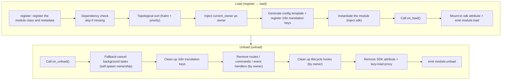

**What the framework does for you during loading** (you only write `on_load`; the rest is done automatically):

| Step | What the framework does automatically |
|------|-------------|
| Owner injection | During instantiation the module name is wrapped with `owner_scope` — commands/events/hooks/background tasks registered in your `on_load` are **automatically attributed to this module**, and cleaned up in one go by owner at unload |
| Config template | For modules declaring `ConfigClass`, the framework automatically generates/fills the `ErisPulse.<ModuleName>` config section |
| i18n translation keys | For modules declaring `I18nClass`, translation keys are registered automatically (and unregistered automatically at unload) |
| Dependency topology | Sorted by `depends` declarations to ensure depended-on modules load first; circular dependencies are rejected with a `RuntimeError` |
| SDK mounting | After instantiation, mounted to `sdk.<ModuleName>` so that you can access it via `sdk.MyModule.xxx` |

**What the framework cleans up for you at unload** (corresponding to U1→U7 above): after `on_unload` finishes, fallback cleanup runs — background tasks are force-cancelled (those created via `self.spawn`; do graceful wrap-up yourself in `on_unload`), i18n keys, routes, command/event handlers, and lifecycle hooks, and finally the SDK attribute is removed. `purge=True` additionally deletes the registration stub + cleans `sys.modules`.

> This automatic cleanup is exactly what backs the promise that "you only write `on_load`/`on_unload` and never need to unregister manually" — using owner attribution, the framework turns "whoever registers it cleans it up" into a one-click operation.

## The SDK Object

### Accessing Core Modules

```python
from ErisPulse import sdk

# Access all core modules via the sdk object
sdk.logger.info("Log")
sdk.storage.set("key", "value")
config = sdk.config.getConfig("MyModule")
```

### Inter-Module Communication

```python
# Access other modules
other_module = sdk.OtherModule
result = await other_module.some_method()
```

## Adapter Send Method Queries

Because the new standard specification requires overriding the `__getattr__` method to implement the fallback send mechanism, `hasattr` can no longer be used to check whether a method exists. Starting from `2.3.5`, the ability to query send methods has been added.

### Listing Supported Send Methods

```python
# List all send methods supported by the platform
methods = sdk.adapter.list_sends("onebot11")
# Returns: ["Text", "Image", "Voice", "Markdown", ...]
```

### Getting Method Details

```python
# Get detailed information about a method
info = sdk.adapter.send_info("onebot11", "Text")
# Returns:
# {
#     "name": "Text",
#     "parameters": [
#         {"name": "text", "type": "str", "default": null, "annotation": "str"}
#     ],
#     "return_type": "Awaitable[Any]",
#     "docstring": "Send a text message..."
# }
```

## Configuration Management

### Declarative Configuration (Recommended)

Since v2.5.2, modules can declare a config class via `ConfigClass`, using the same config Schema system as adapters. Configuration is read in real time via `self.cfg` and takes effect immediately after modification:

```python
from dataclasses import dataclass, field
from ErisPulse.Core.Bases import BaseModule
from ErisPulse.Core.Bases import BaseConfig

@dataclass
class MyModuleConfig(BaseConfig):
    api_key: str = field(
        default="",
        metadata={
            "description": {"i18n": "my_module.api_key", "default": "API key"},
            "required": True,
            "secret": True,
            "ui": {"widget": "password", "group": "basic", "order": 1},
        },
    )
    timeout: int = field(
        default=30,
        metadata={
            "description": {"i18n": "my_module.timeout", "default": "Timeout (seconds)"},
            "ui": {"widget": "number", "group": "advanced", "order": 2},
        },
    )

class MyModule(BaseModule):
    ConfigClass = MyModuleConfig

    def __init__(self, sdk):
        self.sdk = sdk
        self.logger = sdk.logger.get_child("MyModule")

    async def on_load(self, event):
        self.logger.info("Module loaded")

    async def on_unload(self, event):
        pass

    async def do_something(self):
        cfg = self.cfg  # Read in real time, type-safe
        api_key = cfg.api_key
        timeout = cfg.timeout
```

`BaseConfig` is a general-purpose config base class suitable for adapters, modules, external projects, and any other scenario. Config fields support i18n multilingual descriptions (see the [i18n documentation](../../advanced/i18n.md#multilingual-config-fields)).

> [!NOTE]
> The lifecycle of modules (including adapters) — loading, unloading, enabling/disabling, etc. — is managed uniformly by the framework (the `module manager` / `scope` provide query and control APIs). `ConfigClass` should only carry business parameters; modules do not need to nest additional logic inside that decides "whether I should start".

The config Schema system also supports (v2.8.0+, see [adapter core-concepts](../adapters/core-concepts.md#metadata-conventions)):

- **Automatic field descriptions from docstrings**: when metadata `description` is not declared, fallbacks are automatically extracted from the docstring's `:ivar field: description` entries or the `Attributes:` section
- **Nested dataclass configuration**: when a field's type is a nested dataclass, schema/template/validation are processed recursively and rendered as nested groups in the WebUI
- **`example` fields not persisted**: fields with `metadata={"example": True}` are not written to config.toml, only recorded in `config.full.example` (suitable for verbose, rarely touched advanced config items); once the user sets them manually they persist normally

### Declarative Translation Keys (v2.7.0+)

Since v2.7.0, modules can also declare translation keys centrally via a nested `I18nClass`, just like declaring `ConfigClass`. The framework **automatically registers** all declared translation keys at load time — no need to call `i18n.register()` manually — and registration happens before config template generation, ensuring that the i18n keys referenced in config descriptions are already available.

```python
from ErisPulse.Core.Bases import BaseConfig, BaseI18n, I18nKey

class MyModule(BaseModule):
    # Config class (optional)
    @dataclass
    class ConfigClass(BaseConfig):
        welcome_msg: str = field(
            default="Welcome",
            metadata={
                "description": {"i18n": "mymodule.welcome_msg", "default": "Welcome message"},
            },
        )

    # Translation key collection class (optional)
    class I18nClass(BaseI18n):
        # Attribute names are automatically concatenated into the full key path: <ModuleName>.<AttributeName>
        welcome_msg: I18nKey = I18nKey(
            default="Welcome Message",   # Language-independent fallback
            zh_CN="Welcome message",
            zh_TW="Welcome message",
            en="Welcome Message",
            ja="ウェルカムメッセージ",
            ru="Приветственное сообщение",
        )
        hello: I18nKey = I18nKey(
            default="Hello, {name}!",
            zh_CN="Hello, {name}!",
            zh_TW="Hello, {name}!",
            en="Hello, {name}!",
            ja="こんにちは、{name}！",
            ru="Привет, {name}!",
        )
```

For details, see [i18n Recommended Approach](../../advanced/i18n.md#recommended-approach-declaring-translation-keys-via-i18nclass-v270).

### Manual Config Reading (Deprecated)

> **Deprecated**: Please use [Declarative Configuration](#declarative-configuration-recommended) + `self.cfg` real-time reading instead.

```python
class MyModule(BaseModule):
    def __init__(self, sdk):
        self.sdk = sdk

    def _load_config(self):
        config = self.sdk.config.getConfig("MyModule")
        if not config:
            self.sdk.config.setConfig("MyModule", {"api_key": "", "timeout": 30})
            return {"api_key": "", "timeout": 30}
        return config
```

## Storage System

### Basic Usage

```python
# Store data
sdk.storage.set("user:123", {"name": "Zhang San"})

# Get data
user = sdk.storage.get("user:123", {})

# Delete data
sdk.storage.delete("user:123")
```

### Using Transactions

```python
# Use transactions to ensure data consistency
with sdk.storage.transaction():
    sdk.storage.set("key1", "value1")
    sdk.storage.set("key2", "value2")
    # If any operation fails, all changes are rolled back
```

## Event Handling

### Registering Event Handlers

```python
from ErisPulse.Core.Event import command, message

# Register a command
@command("info", help="Get information")
async def info_handler(event):
    await event.reply("This is the information")

# Register a message handler
@message.on_group_message()
async def group_handler(event):
    sdk.logger.info(f"Group message received: {event.get_text()}")
```

### Event Handler Lifecycle

The framework automatically manages event handler registration and unregistration; you only need to register them in `on_load`.

## Lazy Loading Mechanism

### How It Works

```python
# The module is initialized only on first access
result = await sdk.my_module.some_method()
# ↑ This triggers module initialization
```

### Immediate Loading

For modules that need to be initialized immediately (such as listeners, timers):

```python
@staticmethod
def get_load_strategy():
    return ModuleLoadStrategy(
        lazy_load=False,  # Immediate loading
        priority=100
    )
```

## Error Handling

### Catching Exceptions

```python
async def handle_event(self, event):
    try:
        # Business logic
        await self.process_event(event)
    except ValueError as e:
        self.logger.warning(f"Invalid parameter: {e}")
        await event.reply(f"Invalid parameter: {e}")
    except Exception as e:
        self.logger.error(f"Processing failed: {e}")
        raise
```

### Logging

```python
# Use different log levels
self.logger.debug("Debug message")    # Detailed debug information
self.logger.info("Running status")      # Normal operation information
self.logger.warning("Warning message")  # Warning message
self.logger.error("Error message")    # Error message
self.logger.critical("Fatal error") # Fatal error
```


### Event 包装类详解

# Event Wrapper Class in Detail

> [!NOTE]
> **L1 Core Must-Read** — One of the five core documents in the "Reading Path" on the homepage, essential for module development.

The reason the `event` parameter in handlers can directly call `.get_text()` / `.reply()` / `.wait_reply()` is the Event wrapper class. This document is its complete method reference — consult it as needed when writing event handlers; the method signatures and behaviors here are authoritative.

## Adding Type Annotations to the event Parameter

The `event` parameter of an event handler is the **Event wrapper class** (a dict subclass). It is strongly recommended to add a type annotation to it:

```python
from ErisPulse.Core.Event import Event

@message.on_private_message()
async def handler(event: Event):
    text = event.get_text()   # IDE auto-completes all convenience methods
    await event.reply(text)   # Typos can be caught during static checks
```

Without the annotation, the IDE cannot recognize methods on Event (`get_text()` / `reply()` / `wait_reply()` / platform extension methods get no completion hints), and you would have to spell them from memory.

> **Note the distinction**: the `event` in event handler callbacks is the **Event wrapper class** (annotated as `Event`); the `event` in module lifecycle methods `on_load` / `on_unload` is a plain **dict** (annotated as `dict`). Do not confuse the two.

## Core Features

- **Fully dict-compatible**: Event inherits from dict
- **Convenience methods**: Provides a large number of convenience methods
- **Dot-style access**: Supports accessing event fields with dot notation
- **Backward compatible**: All methods are optional

## Core Field Methods

```python
from ErisPulse.Core.Event import command

@command("info")
async def info_command(event: Event):
    event_id = event.get_id()
    platform = event.get_platform()
    time = event.get_time()
    print(f"ID: {event_id}, Platform: {platform}, Time: {time}")
```

## Message Event Methods

```python
from ErisPulse.Core.Event import message

@message.on_private_message()
async def private_handler(event: Event):
    text = event.get_text()
    user_id = event.get_user_id()
    nickname = event.get_user_nickname()
    await event.reply(f"Hello, {nickname}!")
```

## Message Type Detection

```python
from ErisPulse.Core.Event import message

@message.on_group_message()
async def group_handler(event: Event):
    is_private = event.is_private_message()
    is_group = event.is_group_message()
    is_at = event.is_at_message()
    await event.reply(f"Type: {'Private' if is_private else 'Group'}")
```

## Reply Functionality

```python
from ErisPulse.Core.Event import command

@command("ask")
async def ask_command(event: Event):
    await event.reply("Please enter your name:")
    reply = await event.wait_reply(timeout=30)
    if reply:
        name = reply.get_text()
        await event.reply(f"Hello, {name}!")

@command("price")
async def price_command(event: Event):
    await event.reply("Please enter the amount (e.g., 5 yuan):")
    # The reply must match the regex, otherwise keep waiting until timeout
    reply = await event.wait_reply(timeout=30, regex=r"\d+\s*yuan")
    if reply:
        await event.reply(f"Amount received: {reply.get_text()}")
```

## Advanced Interactive Sessions

> [!NOTE]
> The capabilities in this section require ErisPulse **2.8.0+**.

```python
# Session timed reminder: remind after 5 minutes without a reply; auto-cancelled once the user replies
reminder = event.remind(300, "Are you still there? Reply 'exit' if you don't want to chat anymore")
reminder.cancel()  # Can also be cancelled manually

# Timeout escalation: guaranteed to fire at the deadline (not cancelled by a reply), e.g., notify the owner when an issue has been unhandled for a long time
event.escalate(1800, lambda e: notify_master("Ticket timed out"))

# Multi-way wait: wait for "approve" and "reject" at the same time; first reply wins
which, reply = await event.select(
    event.expect(pattern="approve*", user="10001"),
    event.expect(pattern="reject*", user="10002"),
    timeout=60,
)
if which is None:
    await event.reply("Approval not received before timeout")

# Session-level wait: replies from anyone in the same group can match (group collaboration)
reply = await event.wait_reply(session=True, prompt="Could any expert help answer this?")

# Session inbox: the last 20 messages of the current session (includes the bot; the foundation for AI context / anti-repetition)
messages = await event.history(20)

# Message transaction: automatically recalls messages sent within the transaction when an exception occurs
async with event.message_tx():
    await event.reply("Processing, please wait...")
    result = await do_something()
    await event.reply(f"Done: {result}")
```

## Getting Command Information

```python
from ErisPulse.Core.Event import command

@command("cmdinfo")
async def cmdinfo_command(event: Event):
    cmd_name = event.get_command_name()
    cmd_args = event.get_command_args()
    await event.reply(f"Command: {cmd_name}, Args: {cmd_args}")
```

## Notice Event Methods

```python
from ErisPulse.Core.Event import notice

@notice.on_friend_add()
async def friend_add_handler(event: Event):
    await event.reply("Thanks for adding me as a friend!")
```

## Method Quick Reference

### Core Methods

#### Basic Event Information
- `get_id()` - Get the event ID
- `get_time()` - Get the event timestamp (Unix seconds)
- `get_type()` - Get the event type (message/notice/request/meta)
- `get_detail_type()` - Get the event detail type (private/group/friend, etc.)
- `get_platform()` - Get the platform name

#### Bot Information
- `get_self_platform()` - Get the bot platform name
- `get_self_user_id()` - Get the bot user ID
- `get_self_account_id()` - Get the bot account ID (multi-bot mode)
- `get_self_info()` - Get the full bot info dictionary

#### Session Identifiers
- `get_target_id()` - Get the unified target ID (returns `group_id` for group chats, `channel_id` for channels, `user_id` for private chats; takes the first non-empty value in the order group → channel → guild → thread → user)
- `get_session_id()` - Get the unique session identifier, in the format `{platform}:{detail_type}:{target_id}`

### Message Event Methods

#### Message Content
- `get_message()` - Get the message segment array (OneBot12 format)
- `get_alt_message()` - Get the alternative message text
- `get_text()` - Get the plain text content (alias of `get_alt_message()`)
- `get_message_text()` - Get the plain text content (alias of `get_alt_message()`)

#### Sender Information
- `get_user_id()` - Get the sender's user ID
- `get_user_nickname()` - Get the sender's nickname
- `get_sender()` - Get the full sender info dictionary

#### Group/Channel Information
- `get_group_id()` - Get the group ID (group chat messages)
- `get_channel_id()` - Get the channel ID (channel messages)
- `get_guild_id()` - Get the guild ID (guild messages)
- `get_thread_id()` - Get the thread/sub-channel ID (thread messages)

#### @Message Related
- `has_mention()` - Whether the message mentions the bot
- `get_mentions()` - Get the list of all mentioned user IDs

### Message Type Detection

#### Basic Checks
- `is_message()` - Whether it is a message event
- `is_private_message()` - Whether it is a private message
- `is_group_message()` - Whether it is a group message
- `is_at_message()` - Whether it is an @ message (alias of `has_mention()`)

### Notice Event Methods

#### Notice Operator
- `get_operator_id()` - Get the operator ID
- `get_operator_nickname()` - Get the operator's nickname

#### Notice Type Checks
- `is_notice()` - Whether it is a notice event
- `is_group_member_increase()` - Group member increase event
- `is_group_member_decrease()` - Group member decrease event
- `is_friend_add()` - Friend add event (matches `detail_type == "friend_increase"`)
- `is_friend_delete()` - Friend delete event (matches `detail_type == "friend_decrease"`)

### Request Event Methods

#### Request Information
- `get_comment()` - Get the request comment

#### Request Type Checks
- `is_request()` - Whether it is a request event
- `is_friend_request()` - Whether it is a friend request
- `is_group_request()` - Whether it is a group request

### Reply Functionality

#### Basic Reply
- `reply(content, method="Text", at_sender=False, quote=False, at_users=None, reply_to=None, at_all=False, via=None, **kwargs)` - General-purpose reply method
  - `content`: Content to send (text, URL, etc.)
  - `method`: Send method, defaults to "Text"; options include "Image"/"Voice"/"Video"/"File", etc.
  - `at_sender`: Whether to @ the sender (user_id extracted automatically)
  - `quote`: Whether to quote-reply to the current message (message_id extracted automatically)
  - `at_users`: List of users to @, e.g. `["user1", "user2"]`
  - `reply_to`: Manually specify the message ID to reply to
  - `at_all`: Whether to @ all members
  - `**kwargs`: Extra parameters (e.g., user_id for the Mention method)

- `reply_ob12(message)` - Reply using OneBot12 message segments
  - `message`: OneBot12 message segment list or dict; can be built together with MessageBuilder

#### Platform Capability Queries
- `supports(method)` - Check whether the current platform supports a given send method (e.g., `"Image"`, `"Voice"`); returns `bool`
- `available_methods()` - List all send methods available on the current platform; returns a list of method names

#### Forwarding

> **Note**: Forwarding must be implemented via the adapter's Send DSL; the Event wrapper class itself does not provide a direct forwarding method.

```python
# Forward a message to a group
adapter = sdk.adapter.get(event.get_platform())
target_id = event.get_group_id()  # Or specify another group ID
await adapter.Send.To("group", target_id).Text(event.get_text())
```

### Waiting for Replies

- `wait_reply(prompt=None, timeout=60.0, callback=None, validator=None, method="Text", pattern=None, regex=None)` - Wait for a user reply
  - `prompt`: Prompt message; sent to the user if provided
  - `timeout`: Wait timeout in seconds, defaults to 60 seconds
  - `callback`: Callback function executed when a reply is received
  - `validator`: Validation function used to check whether the reply is valid
  - `method`: Method used to send the prompt message, defaults to "Text"
  - `pattern`: Glob wildcard (`*` / `?` / `[seq]`); the reply text must match, otherwise keep waiting
  - `regex`: Regular expression; the reply text must match (choose either `pattern` or `regex`), otherwise keep waiting
  - Returns the Event object of the user's reply; returns None on timeout

#### Interaction Methods

- `confirm(prompt=None, timeout=60.0, yes_words=None, no_words=None, method="Text", hint=False)` - Confirmation dialog
  - Returns `True` (confirmed) / `False` (denied) / `None` (timeout)
  - Built-in auto-recognition of Chinese and English confirmation words; custom word sets are supported
  - `method`: Send method, defaults to "Text"; non-text methods such as "Image"/"Markdown" are supported for sending the prompt
  - `hint`: Whether to automatically append a confirmation-word hint at the end of the prompt (e.g., "(yes/no)"); defaults to False

- `choose(prompt, options, timeout=60.0, method="Text", options_format="auto", merge_prompt=False, placeholder="{options}")` - Choice menu
  - `options`: List of option texts
  - Returns the option index (0-based); returns `None` on timeout
  - `method`: Send method, defaults to "Text"; text-based methods (Text/Markdown/md/Html/h5) merge the options at the end by default
  - `options_format`: Option format (default: "auto", automatically selects a built-in style based on method)
    - `"auto"`: Markdown → unordered list (`- 1. Option`), Html → ordered list (`<ol>`), others → plain text list
    - `"list"`: One per line, e.g. ``1. Option A\n2. Option B``
    - `"inline"`: Single-line display, e.g. ``1.A | 2.B``
    - `"md"`: Markdown unordered list
    - `"html"`: Html ordered list
    - `callable`: Custom function that receives ``list[str]`` and returns ``str``
  - `merge_prompt`: Whether to force merging into a single message; defaults to False
    - `False` (default): text-based methods merge automatically; non-text methods send the prompt first and then the options as Text
    - `True`: merged into a single message regardless of method, sent with the user-specified method
  - `placeholder`: Placeholder for inserting the options, defaults to `{options}`; positions in the prompt containing this marker are replaced with the option text; if set to an empty string, the options are always appended to the end

- `collect(fields, timeout_per_field=60.0)` - Form collection
  - `fields`: List of fields; each item contains `key`, `prompt`, an optional `validator`, and an optional `method`
  - Returns a `{key: value}` dict; returns `None` if any field times out
  - Each field supports a `method` key to specify the send method, e.g. use `{"key": "avatar", "prompt": "Please send an avatar", "method": "Image"}` when collecting an image
  - Each field can have an optional `options` key (a list); when provided, the field becomes a multiple-choice question (the choose logic is invoked automatically)
  - Each field can have optional `options_format`, `merge_prompt`, and `placeholder` keys to control the option format, message merging behavior, and placeholder

- `wait_for(event_type="message", condition=None, timeout=60.0)` - Wait for any event
  - `condition`: Filter function; it matches when the function returns `True`
  - Returns the matching Event object; returns `None` on timeout

- `conversation(timeout=60.0)` - Create a multi-turn conversation context
  - Returns a `Conversation` object supporting `say()`/`wait()`/`confirm()`/`choose()`/`collect()`/`stop()`
  - The `is_active` property indicates whether the conversation is active

#### Interaction Method Examples

**confirm() - Confirmation dialog:**

```python
@command("delete", help="Delete data")
async def delete_handler(event: Event):
    if await event.confirm("Are you sure you want to delete all data?"):
        sdk.storage.delete("all_data")
        await event.reply("Data deleted")
    else:
        await event.reply("Cancelled")
```

**confirm() - With hint:**

```python
# hint=True appends "(yes/no)" at the end of the prompt
if await event.confirm("Continue?", hint=True):
    await event.reply("Continued")
# What the user sees: Continue? (yes/no)
```

**choose() - Choice menu:**

```python
@command("color", help="Choose a color")
async def color_handler(event: Event):
    choice = await event.choose("Please choose a color:", ["Red", "Green", "Blue"])
    if choice is not None:
        colors = ["Red", "Green", "Blue"]
        await event.reply(f"You chose: {colors[choice]}")
```

**choose() - Option formatting and message merging:**

```python
# inline format: options displayed on the same line
choice = await event.choose("Please choose:", ["A", "B", "C"], options_format="inline")
# Output: 1.A | 2.B | 3.C

# Custom format
choice = await event.choose("Please choose:", ["Cat", "Dog"],
    options_format=lambda opts: " / ".join(opts))
# Output: Cat / Dog

# options_format="auto" (default): automatically selects a built-in style based on method
# Markdown → unordered list
choice = await event.choose(
    "## Please choose", ["Cat", "Dog"],
    method="Markdown",  # auto recognizes it as an md list
)
# Output:
# ## Please choose
# - 1. Cat
# - 2. Dog

# Html → ordered list
choice = await event.choose(
    "<h2>Please choose</h2>", ["Cat", "Dog"],
    method="Html", merge_prompt=True,  # auto recognizes it as an html list
)
# Output:
# <h2>Please choose</h2>
# <ol><li>1. Cat</li><li>2. Dog</li></ol>

# Merge mode + placeholder
choice = await event.choose(
    "## Please choose\n{options}\nPlease reply with a number",
    ["Cat", "Dog"],
    method="Markdown", merge_prompt=True,
)

# Custom placeholder
choice = await event.choose(
    "Please choose: [choices]",
    ["Cat", "Dog"],
    placeholder="[choices]",
)
```

**collect() - Form collection:**

```python
@command("register", help="Register")
async def register_handler(event: Event):
    data = await event.collect([
        {"key": "name", "prompt": "Please enter your name:"},
        {"key": "age", "prompt": "Please enter your age:",
         "validator": lambda e: e.get_text().isdigit()},
    ])
    if data:
        await event.reply(f"Registration successful! {data['name']}, {data['age']} years old")
```

**reply with non-Text methods:**

```python
await event.reply("http://example.com/img.jpg", method="Image")
await event.reply("http://example.com/audio.mp3", method="Voice")

from ErisPulse.Core.Event import MessageBuilder
segments = MessageBuilder.text("Take a look at this image:").image("http://example.com/img.jpg").build()
await event.reply_ob12(segments)
```

> For complete multi-turn conversation usage, see [Conversation Multi-Turn Dialog](../../advanced/conversation.md).

### Command Information

#### Command Basics
- `get_command_name()` - Get the command name
- `get_command_args()` - Get the command argument list
- `get_command_raw()` - Get the raw command text
- `get_command_info()` - Get the full command info dictionary
- `is_command()` - Whether it is a command

### Raw Data

- `get_raw()` - Get the platform's raw event data
- `get_raw_type()` - Get the platform's raw event type

### Platform Extension Methods

Adapters can register platform-specific methods on the Event wrapper class. These methods are only available on Event instances of the corresponding platform; accessing them from other platforms raises an `AttributeError`.

Platform methods take effect through `Event.__getattribute__` with higher priority than built-in methods, so they can override built-in interaction methods such as `confirm`, `choose`, `collect`, and `wait_reply` to provide platform-specific implementations (e.g., buttons, cards). The built-in implementations are exported as `_builtin_*` functions for overriders to call.

```python
# Email event - email methods only
event = Event({"platform": "email", "email_raw": {"subject": "Hello"}})
event.get_subject()      # ✅ returns "Hello"
event.get_chat_type()    # ❌ AttributeError

# Telegram event - Telegram methods only
event = Event({"platform": "telegram", "telegram_raw": {"chat": {"type": "private"}}})
event.get_chat_type()    # ✅ returns "private"
event.get_subject()      # ❌ AttributeError

# Built-in methods are always available
event.get_text()         # ✅ any platform
event.reply("hi")        # ✅ any platform
```

### Querying Registered Methods

```python
from ErisPulse.Core.Event import get_platform_event_methods

methods = get_platform_event_methods("email")
# ["get_subject", "get_from", ...]
```

### `hasattr` and `dir` Support

```python
hasattr(event, "get_subject")   # Returns True only when platform="email"
"get_subject" in dir(event)     # Same as above
```

### Cross-Platform Extensions (Wildcard)

`register_event_method` and `register_event_mixin` accept `"*"` as the platform name, making the registered methods available on Event instances of **all platforms**. This suits features that need cross-platform reuse, such as AI chat and context management.

```python
from ErisPulse.Core.Event.wrapper import register_event_method

@register_event_method("*")
async def ai_chat(self, prompt: str):
    # self is an Event instance; event data and built-in methods are accessible
    await self.reply(f"AI: {prompt}")
```

After registration, event handlers on any platform can call `event.ai_chat(...)`.

Method resolution priority (from high to low): platform-specific methods → wildcard methods → built-in methods → dict key access.

> For how adapter developers register extension methods, see [Event System API - Cross-Platform Extensions](../../api-reference/event-system.md#cross-platform-extensions-wildcard).


### 模块开发最佳实践

# Module Development Best Practices

> [!TIP]
> **When to read this**: Recommended after you finish writing your first module (engineering best practices). Skip it if not needed—doing so will not affect the use of any other features.


This section summarizes the engineering conventions for module development: asynchronous operations must not block the event loop, configuration should be declarative, and resources hosted on behalf of others must be released upon unloading—following these guidelines helps you avoid the most common pitfalls in module development, such as memory leaks, residual background tasks, and hot-reload failures.

## Module Design

### 1. Single Responsibility Principle

Each module should only be responsible for one core function:

```python
# Good design: each module handles only one function
class WeatherModule(BaseModule):
    """Weather query module"""
    pass

class NewsModule(BaseModule):
    """News query module"""
    pass

# Bad design: one module handles multiple unrelated functions
class UtilityModule(BaseModule):
    """Contains weather, news, jokes, and other functions"""
    pass
```

### 2. Module Naming Convention

```toml
[project]
name = "ErisPulse-ModuleName"  # Use ErisPulse- prefix
```

### 3. Clear Configuration Management

It is recommended to use declarative configuration (`ConfigClass` + `BaseConfig`) to gain type safety, automatic template generation, and WebUI form support:

```python
from dataclasses import dataclass, field
from ErisPulse.Core.Bases import BaseConfig

@dataclass
class MyModuleConfig(BaseConfig):
    api_url: str = field(default="https://api.example.com", metadata={
        "description": {"i18n": "my_module.api_url", "default": "API URL"},
    })
    timeout: int = field(default=30, metadata={
        "description": {"i18n": "my_module.timeout", "default": "Timeout (seconds)"},
    })
    cache_ttl: int = field(default=3600, metadata={
        "description": {"i18n": "my_module.cache_ttl", "default": "Cache TTL (seconds)"},
    })

class MyModule(BaseModule):
    ConfigClass = MyModuleConfig

    async def do_something(self):
        cfg = self.cfg  # Type-safe, real-time reading
        await self._fetch(cfg.api_url, timeout=cfg.timeout)
```

You can also continue using manual configuration storage reading and writing (see [Module Core Concepts](core-concepts.md#configuration-management)).

### Declarative Translation Keys (v2.7.0+)

Modules can centrally declare translation keys via `I18nClass`, and the framework automatically registers them to the i18n system, eliminating the need to manually call `i18n.register()`.

```python
from ErisPulse.Core.Bases import BaseI18n, I18nKey

class MyModule(BaseModule):
    class I18nClass(BaseI18n):
        # Business translation keys with placeholders
        welcome: I18nKey = I18nKey(
            default="Welcome, {name}!",
            zh_CN="欢迎你，{name}！",
            zh_TW="歡迎你，{name}！",
            en="Welcome, {name}!",
            ja="ようこそ、{name}！",
            ru="Добро пожаловать, {name}!",
        )
        # Configuration field description translations
        api_url: I18nKey = I18nKey(
            default="API URL",
            zh_CN="API 地址",
            zh_TW="API 位址",
            en="API URL",
            ja="API URL",
            ru="API URL",
        )
```

See [i18n documentation](../../advanced/i18n.md#recommended-usage-declaring-translation-keys-via-i18nclass-v270) for detailed usage.

## Asynchronous Programming

### 1. Using Asynchronous Libraries

```python
# Recommended: use the SDK's built-in HTTP client (async, with automatic logging and statistics)
from ErisPulse.Core import client

class MyModule(BaseModule):
    async def fetch_data(self, url):
        resp = await client.get(url)
        return await resp.json()

# Can also be used via sdk.client (equivalent behavior)
from ErisPulse import sdk

class MyModule(BaseModule):
    async def fetch_data(self, url):
        resp = await sdk.client.get(url)
        return await resp.json()

# Do not import aiohttp directly (makes it harder for the framework to manage uniformly)
import aiohttp

class MyModule(BaseModule):
    async def fetch_data(self, url):
        async with aiohttp.ClientSession() as session:
            async with session.get(url) as response:
                return await response.json()

# Do not use requests (synchronous, blocks the event loop)
import requests

class MyModule(BaseModule):
    def fetch_data(self, url):
        return requests.get(url).json()  # blocks the event loop
```

### 2. Proper Async Operations

```python
from ErisPulse.Core.Event import Event  # the event: Event annotation enables IDE autocompletion

async def handle_command(self, event: Event):
    # Time-consuming operations whose results are needed: await directly (clear lifecycle)
    result = await self._long_operation()

async def on_load(self, event: dict):
    # Background tasks (polling/scheduled/fire-and-forget): use self.spawn();
    # when the module is unloaded, the framework cancels them as a fallback after on_unload,
    # avoiding leaks caused by holding self
    self.spawn(self._poll())
```

> [!NOTE]
> For background tasks, prefer `self.spawn()` (ErisPulse **2.8.0+**). From **2.8.3 onward**, bare
> `asyncio.create_task` calls are also implicitly attributed to the module automatically
> (auto-registered by the Task Factory, cancelled as a fallback on unload, no longer leaking `self` references);
> `self.spawn()` remains the recommended approach—it supports dispatching back to the main loop
> from non-main-loop threads and explicit `owner=` designation.
> In versions **before 2.8.3**, bare tasks are not attributed and hold `self` references,
> preventing module instances from being garbage-collected (hot-reload leaks); you must use `self.spawn()`.
> For details, see [Lifecycle Management](../../advanced/lifecycle.md#background-task-attribution-and-automatic-cancellation).

### 3. Resource Management

```python
async def on_load(self, event):
    # The SDK client already manages the connection pool automatically; no need to create sessions manually
    pass
    
async def on_unload(self, event):
    # If you use a custom client, remember to clean up resources
    pass
```

## Event Handling

### 1. Use Event Wrapper Class

```python
# Use convenient methods of Event wrapper class
@command("info")
async def info_command(event: Event):
    user_id = event.get_user_id()
    nickname = event.get_user_nickname()
    await event.reply(f"Hello, {nickname}!")

# Rather than directly accessing dictionary
@command("info")
async def info_command(event: Event):
    user_id = event["user_id"]  # Less clear, prone to errors
```

### 2. Reasonable Use of Lazy Loading

```python
# Low-frequency command module: declare activate_on trigger, automatically activates on first matching command arrival (maintain lazy loading)
class CommandModule(BaseModule):
    @staticmethod
    def get_load_strategy():
        return ModuleLoadStrategy(lazy_load=True, activate_on=[
            {"command": {"name": "dice", "help": "Roll a dice", "aliases": ["d"]}},
        ])

# Low-frequency listener module: declare event trigger, automatically activates on event arrival
class ListenerModule(BaseModule):
    @staticmethod
    def get_load_strategy():
        return ModuleLoadStrategy(lazy_load=True, activate_on=[
            {"notice": "group_member_increase"},
        ])

# High-frequency triggers (every message needs processing) or modules that must be ready at startup: load immediately
class HotListenerModule(BaseModule):
    @staticmethod
    def get_load_strategy():
        return ModuleLoadStrategy(lazy_load=False)

# Utility modules are suitable for lazy loading
class UtilityModule(BaseModule):
    @staticmethod
    def get_load_strategy():
        return ModuleLoadStrategy(lazy_load=True)
```

> The complete syntax of `activate_on` (event three forms / command shorthand and dict declaration / help fallback chain) is detailed in
> [Lazy Loading Module System](../../advanced/lazy-loading.md#event-driven-lazy-activation-activate_on).

### 3. Event Handler Registration

```python
async def on_load(self, event):
    # Register event handlers in on_load
    @command("hello")
    async def hello_handler(event: Event):
        await event.reply("Hello!")
    
    @message.on_group_message()
    async def group_handler(event: Event):
        self.logger.info("Received group message")
    
    # No need to manually unregister, framework handles automatically
```

## Utility Module: When Hosting Other Things, You Must Catch "Unload Notification"

**When is it needed**: Your module holds things for other modules (timers, subscribers, connections, cache entries...). If these references are not discarded after the other module unloads, the other instance can never be recycled—this is the most common source of memory leaks in utility modules.

```python
from ErisPulse.Core.Bases import BaseModule
from ErisPulse.runtime import off_cleanup, on_cleanup

class MyToolModule(BaseModule):
    def __init__(self):
        self._entries = {}  # {module name: hosted things}

    def register(self, entry):
        owner = on_cleanup(self._drop)   # ① Register cleanup chain on registration, automatically recognize caller
        self._entries.setdefault(owner, []).append(entry)

    def _drop(self, owner: str):
        self._entries.pop(owner, None)   # ② When the other module unloads, framework automatically calls: discard its things

    async def on_unload(self, event):
        off_cleanup(self._drop)          # ③ Unregister hook before unloading self
```

That's it. The framework ensures:

- When the other module is **unloaded / disabled** (or adapter closed), `_drop("other module name")` will definitely be called
- **Caller identification is automatic**: The caller directly calls `sdk.MyToolModule.register(...)` in `on_load`, or calls via `sdk.module.call("MyToolModule", "register", ...)`; both can correctly identify who it is
- No need to worry about timing—the hook triggers in the framework cleanup chain, earlier than leak detection, no false positives

Consequences of not hooking in: The instance cannot be recycled when the other `purge` unloads completely (leak diagnosis reports "un回收able"); if the other module does not unregister you in `on_unload`, the leak is permanent.

**Ordinary modules (not hosting other things) do not need to care about this**—framework resources (commands / handlers / routing / background tasks...) are automatically cleaned up on unload.

> Trigger timing, caller identification rules, timeout and fault tolerance details are detailed in
> [Ownership System · Utility Module Guide](../../advanced/ownership.md#utility-module-guide-hosting-handles-from-other-modules).

## Error Handling

### 1. Categorized Exception Handling

```python
from ErisPulse.Core.Bases.errors import ClientError

async def handle_event(self, event: Event):
    try:
        result = await self._process(event)
    except ValueError as e:
        # Expected business error
        self.logger.warning(f"Business warning: {e}")
        await event.reply(f"Parameter error: {e}")
    except ClientError as e:
        # Network error (sdk.client's underlying aiohttp exception is automatically converted)
        self.logger.error(f"Network error {e.method} {e.url}: {e}")
        await event.reply("Network request failed, please try again later")
    except Exception as e:
        # Unexpected error
        self.logger.error(f"Unknown error: {e}", exc_info=True)
        await event.reply("Processing failed, please contact the administrator")
        raise
```

### 2. Timeout Handling

```python
# Recommended to use SDK built-in client (with timeout and retry)
from ErisPulse.Core import client
from ErisPulse.Core.Bases.errors import ClientTimeoutError

async def fetch_with_timeout(self, url, timeout=30):
    try:
        resp = await client.get(url, timeout=timeout)
        return await resp.json()
    except ClientTimeoutError:
        self.logger.warning(f"Request timeout: {url}")
        raise
```

## Storage System

### 1. Use Transactions

```python
# Use transaction to ensure data consistency
async def update_user(self, user_id, data):
    with self.sdk.storage.transaction():
        self.sdk.storage.set(f"user:{user_id}:profile", data["profile"])
        self.sdk.storage.set(f"user:{user_id}:settings", data["settings"])

# ❌ Not using transaction may cause data inconsistency
async def update_user(self, user_id, data):
    self.sdk.storage.set(f"user:{user_id}:profile", data["profile"])
    # If this fails, the above setting cannot be rolled back
    self.sdk.storage.set(f"user:{user_id}:settings", data["settings"])
```

### 2. Batch Operations

```python
# Use batch operations to improve performance
def cache_multiple_items(self, items):
    self.sdk.storage.set_multi({
        f"item:{k}": v for k, v in items.items()
    })

# ❌ Multiple calls are inefficient
def cache_multiple_items(self, items):
    for k, v in items.items():
        self.sdk.storage.set(f"item:{k}", v)
```

## Logging

### 1. Reasonable Use of Log Levels

```python
# DEBUG: Detailed debug information (only during development)
self.logger.debug(f"Input parameters: {params}")

# INFO: Normal operation information
self.logger.info("Module loaded")
self.logger.info(f"Processing request: {request_id}")

# WARNING: Warning information, does not affect main functionality
self.logger.warning(f"Configuration item {key} not set, using default value")
self.logger.warning("API response slow, may need optimization")

# ERROR: Error information
self.logger.error(f"API request failed: {e}")
self.logger.error(f"Event processing failed: {e}", exc_info=True)

# CRITICAL: Fatal error, needs immediate handling
self.logger.critical("Database connection failed, bot cannot run normally")
```

### 2. Structured Logging

```python
# Use structured logging for easier parsing
self.logger.info(f"Processing request: request_id={request_id}, user_id={user_id}, duration={duration}ms")

# ❌ Use unstructured logging
self.logger.info(f"Processing request, from user {user_id}, took {duration} milliseconds")
```

## Performance Optimization

### 1. Use Caching

```python
class MyModule(BaseModule):
    def __init__(self):
        self._cache = {}
        self._cache_lock = asyncio.Lock()
    
    async def get_data(self, key):
        async with self._cache_lock:
            if key in self._cache:
                return self._cache[key]
            
            # Get from database
            data = await self._fetch_from_db(key)
            
            # Cache data
            self._cache[key] = data
            return data
```

### 2. Avoid Blocking Operations

```python
# Use asynchronous operations
async def process_message(self, event: Event):
    # Asynchronous processing
    await self._async_process(event)

# ❌ Blocking operation
async def process_message(self, event: Event):
    # Synchronous operation, blocks the event loop
    result = self._sync_process(event)
```

## Security

### 1. Sensitive Data Protection

```python
# Sensitive data stored in configuration (declarative ConfigClass, secret fields not in logs/export)
from dataclasses import dataclass, field
from ErisPulse.Core.Bases import BaseModule, BaseConfig

@dataclass
class MyModuleConfig(BaseConfig):
    api_key: str = field(
        default="",
        metadata={"description": "API key", "secret": True},
    )

class MyModule(BaseModule):
    ConfigClass = MyModuleConfig

    def check_api_key(self):
        if not self.cfg.api_key or self.cfg.api_key == "YOUR_API_KEY_HERE":
            raise ValueError("Please configure a valid API key in config.toml")

# ❌ Hardcoded sensitive data
class MyModule(BaseModule):
    API_KEY = "sk-1234567890"  # Don't do this!
```

### 2. Input Validation

```python
# Validate user input
async def process_command(self, event: Event):
    user_input = event.get_text()
    
    # Validate input length
    if len(user_input) > 1000:
        await event.reply("Input too long, please re-enter")
        return
    
    # Validate input format
    if not re.match(r'^[a-zA-Z0-9]+$', user_input):
        await event.reply("Invalid input format")
        return
```

## Testing

### 1. Unit Tests

```python
import pytest
from ErisPulse.Core.Bases import BaseModule

class TestMyModule:
    def test_config_defaults(self):
        """Test configuration default values"""
        config = MyModule.ConfigClass()
        assert config.timeout == 30
```

### 2. Integration Tests

```python
@pytest.mark.asyncio
async def test_command_handling():
    """Test command handling"""
    module = MyModule()
    await module.on_load({})
    
    # Simulate command event
    event = create_test_command_event("hello")
    await module.handle_command(event)
```

## Deployment

### 1. Version Management

```toml
[project]
name = "ErisPulse-MyModule"
version = "1.0.0"
```

Follow semantic versioning:
- MAJOR.MINOR.PATCH
- Major version: incompatible API changes
- Minor version: backward-compatible feature additions
- Patch version: backward-compatible bug fixes

### 2. README Header

The README generated by `epsdk create` already includes the ErisPulse header (Logo + badge row). Two recommended modes:

**Mode A — Only ErisPulse Logo (Default):**

```markdown
<div align="center">


# MyModule

**One-sentence description**

<p>
  <a href="https://pypi.org/project/ErisPulse-MyModule/"></a>
  <a href="https://pypi.org/project/ErisPulse-MyModule/"></a>
  <a href="./LICENSE"></a>
  <a href="https://github.com/ErisPulse/ErisPulse"></a>
</p>

</div>
```

**Mode B — Module Icon × ErisPulse Logo (with custom icon):**

```markdown
<div align="center">


<span style="font-size:44px;color:#c8c8c8;margin:0 18px;vertical-align:middle;">×</span>


# MyModule
(Badge row same as above)
</div>
```

You can add GitHub Stars, Downloads, and other badges as needed. The logo can also be downloaded to the project locally (`.github/assets/ErisPulseLogo.png`) and referenced with a relative path.


### 数据模型层（ORM）

# Data Model Layer (ORM)

> [!TIP]
> **When to read this**: When you need data models, automatic table creation, or relationship mapping. If not needed, skip this section; it does not affect the use of other features.

Starting from version 2.9.0, the framework includes a built-in declarative data model layer: by inheriting from `Model` and declaring fields using `Field`, you gain automatic table creation and CRUD capabilities. The models are directly built on top of the built-in storage layer—SQLite / MySQL / PostgreSQL is determined by the `ErisPulse.storage.backend` configuration. **Switching backends requires no changes to your model code.**

## Declaring Models

```python
from ErisPulse.Core.Bases import Model, Field

class User(Model):
    id: int = Field(primary_key=True, autoincrement=True)
    name: str = Field(max_length=64)
    age: int = Field(default=0, ge=0, le=150)
    role: str = Field(default="user", choices=["user", "admin"])
    tags: list = Field(default_factory=list)          # JSON column, automatically serialized on read/write
    bio: str = Field(default="", description={"i18n": "user.bio", "default": "Biography"})
```

- The table name defaults to the class name in snake_case (`UserProfile → user_profile`), and can be overwritten using `__tablename__ = "xxx"`
- The constraint list for `Field` is consistent with the declarative configuration class (`choices` / `ge` / `le` / `max_length`, `description` also supports i18n dictionaries); the validator engine is the same as that used for configuration validation

## Field Parameters

| Parameter | Description |
|-----------|-------------|
| `default` | Default value (required if not provided and not auto-incremented → NOT NULL) |
| `default_factory` | Factory for mutable default values (e.g., `list`) |
| `primary_key` | Primary key |
| `autoincrement` | Auto-incrementing primary key (implicitly a primary key, auto-filled after `create`) |
| `max_length` | Maximum string length (generates `VARCHAR(n)`, validates on write) |
| `nullable` | Whether NULL is allowed (default False) |
| `index` | Generates a regular index |
| `unique` | Unique constraint |
| `choices` / `ge` / `le` | Enum / numeric range (validates on write) |
| `description` | Description (i18n dictionary, same format as configuration class) |
| `column_type` | Override the SQL column type definition |

## Table Creation and CRUD

```python
await User.create_table()                      # Idempotent (IF NOT EXISTS)

user = await User.create(name="Alice", age=20) # Insert (auto-incremented primary key automatically filled back)
got = await User.get(id=user.id)               # Equality query for the first record

users = await User.where(User.age > 18).order_by("-age").limit(10).all()
first = await User.where(User.name == "Alice").first()
total = await User.count(User.age > 18)

user.age = 21
await user.save()                              # Update by primary key (first validates constraints); if primary key is missing, falls back to insert (auto-incremented primary key is also filled back into the instance)
await user.delete()                            # Delete by primary key

await User.update_all(User.age > 18, role="adult")  # Bulk update
await User.delete_all(User.age > 100)               # Bulk delete
```

Query expressions support `> >= < <= == !=` and `in_([...])`, as well as `&` (AND) / `|` (OR) combinations:

```python
await User.where((User.age > 18) & User.name.in_(["Alice", "Bob"])).all()
```

## Transactions

ORM reads and writes share the same transaction routing as the framework's storage layer: when inside a `storage.atransaction()` environment, `create` / `save` / `delete` and queries automatically reuse the transaction connection, committing or rolling back together with the transaction, without independent commits.

```python
async with storage.atransaction():
    await User.create(name="Alice")
    ...  # If an exception is thrown within the block, the above INSERT is rolled back
```

## Relationship with Declarative Configuration Class

Model declarations and `ConfigClass` (`@dataclass + field(metadata=...)`) **share the same underlying system**—constraint lists, validator engine (`validate_field_constraints`), and type category registry (`python_type_category`); however, the class bases are intentionally separated: configuration fields are ordinary values (TOML round-trip, hot reload on load), while model fields are column descriptors (class access = query expression, instance access = row value). One declaration syntax, two distinct bases.

### When to Use Which Declaration

| Dimension | Configuration Class `field(metadata=...)` | Model Field `Field()` |
|-----------|-------------------------------------------|------------------------|
| Use Case | Module behavior parameters (few, human-readable, requiring hot reload) | Business data records (multiple rows, programmatic read/write, requiring queries) |
| Storage Form | `config.toml` (comments preserved, TOML round-trip) | Database table (automatic table creation, SQL dialect) |
| Value Form | Ordinary value (`dataclass` attribute direct read) | Descriptor (class access = column expression, instance access = row value) |
| Constraint Declaration | `metadata={"choices": ..., "min": ..., "max": ...}` | `Field(choices=..., ge=..., le=..., max_length=...)` |
| Shared Underlying | Validator engine + constraint list + type category registry (same set) | Same as above |

Rule of thumb: **Use configuration classes for "how the module runs," and models for "what data the user generates."**

## Boundaries and Notes

- The backend is determined by the global storage configuration; models can overwrite the `__storage__` class attribute to use a custom `BaseStorage` instance (for testing injection)
- `list` / `dict` fields (including parameterized generics like `list[int]`, `dict[str, int]`) are stored as JSON text columns, automatically serialized on read/write
- Constraints are automatically validated before writing (`create` / `save`), failing to throw `ValueError` (localized message)
- Automatic migration is delivered for **new column** scenarios (see below); column type changes and column removal require manual handling
- When storage connection fails, the behavior is consistent with the storage layer: the framework does not crash, and automatic reconnection occurs after cooling

## Automatic Migration (Phase Two)

`create_table()` automatically compares existing columns with model fields when the table already exists: **new fields** automatically execute `ALTER TABLE ADD COLUMN` (migrating column to remove `NOT NULL` constraint, filling NULL for existing rows), and new fields with `index=True` are synchronized with index creation. No manual migration scripts are required.

```python
# After v1 launch, model evolution: adding email / bio fields
class User(Model):
    __tablename__ = "orm_users"

    id: int = Field(primary_key=True, autoincrement=True)
    name: str = Field(max_length=64)
    age: int = Field(default=0)
    email: str = Field(default="")     # New: next `create_table()` automatically ADD COLUMN
    bio: str = Field(default="")

await User.create_table()              # Idempotent: only migrates new columns
```

**Boundary**: Only supports adding columns; primary key changes, column type changes, and column removal require manual handling (to avoid destructive ALTER misoperations).

## Foreign Keys (Foundation for Relationship Mapping)

`foreign_key="table.column"` declares column-level foreign key constraints, generating `REFERENCES` clause in DDL:

```python
class Post(Model):
    __tablename__ = "posts"

    id: int = Field(primary_key=True, autoincrement=True)
    author: int = Field(foreign_key="orm_users.id")

    content: str = Field(max_length=255)
```

## Relationship Mapping (relationship)

In the model class body, declare `relationship()` as a class attribute; **the direction is automatically determined by where the foreign key column is declared**:

```python
from ErisPulse.Core.Bases import Model, Field, relationship

class User(Model):
    __tablename__ = "orm_users"

    id: int = Field(primary_key=True, autoincrement=True)
    name: str = Field(max_length=64)

    posts = relationship("Post", foreign_key="author")   # Foreign key in the other table → has-many

class Post(Model):
    __tablename__ = "posts"

    id: int = Field(primary_key=True, autoincrement=True)
    author: int = Field(foreign_key="orm_users.id")
    content: str = Field(max_length=255)

    writer = relationship("User", foreign_key="author")  # Foreign key in this table → belongs-to
```

**Has-Many**: The instance attribute returns a query set, and all `QuerySet` chainable capabilities are available; `create` automatically fills the primary key of this table into the foreign key column of the other table:

```python
alice = await User.get(name="Alice")

posts = await alice.posts.all()                          # All posts of this user
latest = await alice.posts.order_by("-id").first()
total = await alice.posts.count()
hot = await alice.posts.where(Post.content != "").all()  # Add conditions from the other table's fields
await alice.posts.delete()                               # Delete only this user's posts

new_post = await alice.posts.create(content="hi")        # author automatically = alice.id
```

**Belongs-To**: Direct `await` returns the other instance (returns `None` if no match or foreign key is NULL):

```python
post = await Post.get(id=1)
writer = await post.writer          # User instance or None
await writer.posts.count()          # Bidirectional access
```

**Key Points**:

- `related` accepts a class name string (lazily resolved by the model class name registry, order of definition on both sides is irrelevant) or directly passes the model class
- Relationship queries and the other model use their respective storage backends (cross-backend JOINs are not supported—relationship queries are independent SQL statements)
- Relationship queries are not cached; each access is an immediate query; use `User.where(...)` for any custom queries


=====
发布与工具
=====


### 发布模块到模块商店

# Publishing and Module Store Guide

> [!TIP]
> **When to read this**: When publishing your work to PyPI / the Module Store. Skip it otherwise; it does not affect the use of other features.

Publish the modules or adapters you develop to the ErisPulse Module Store, so that other users can easily discover and install them.

## Module Store Overview

The ErisPulse Module Store is a centralized module registry where users can browse, search, and install community-contributed modules and adapters via CLI tools.

### Browsing and Discovery

```bash
# List all packages available remotely
epsdk list-remote

# View modules only
epsdk list-remote -t modules

# View adapters only
epsdk list-remote -t adapters

# Force refresh the remote package list
epsdk list-remote -r
```

You can also visit the [ErisPulse official website](https://www.erisdev.com/#market) to browse the Module Store online.

### Supported Submission Types

| Type | Description | Entry-point Group |
|------|------|----------------|
| Module | Extends bot functionality and implements business logic | `erispulse.module` |
| Adapter | Connects to new messaging platforms | `erispulse.adapter` |

## Quick Publish

The whole process takes just three steps: configure the project → publish to PyPI → submit to the Module Store.

### 1. Configure pyproject.toml

Make sure your project directory contains `pyproject.toml` and `README.md`, and configure entry-points according to the type:

#### Module

```toml
[project]
name = "ErisPulse-MyModule"
version = "1.0.0"
description = "Module description"
requires-python = ">=3.10"
license = { text = "MIT" }
authors = [ { name = "yourname" } ]
dependencies = [
    "ErisPulse>=2.0.0",
]

[project.entry-points."erispulse.module"]
"MyModule" = "MyModule:Main"
```

#### Adapter

```toml
[project]
name = "ErisPulse-MyAdapter"
version = "1.0.0"
description = "Adapter description"
requires-python = ">=3.10"

[project.entry-points."erispulse.adapter"]
"myplatform" = "MyAdapter:MyAdapter"
```

> **Note**: It is recommended that package names start with `ErisPulse-` so users can easily identify them. The entry-point key (e.g., `"MyModule"`) will serve as the module's access name in the SDK.

### 2. Publish to PyPI

```bash
# Build + publish (requires a PyPI account)
pip install build twine
python -m build
python -m twine upload dist/*
```

Verify the installation after a successful publish:

```bash
pip install ErisPulse-MyModule
```

### 3. Submit to the Module Store

Go to the [ErisPulse Module Store](https://www.erisdev.com/#market), click "Submit Module", log in, and fill in the module information.

Supported login methods: **GitHub**, **Codeberg**, and **Yunhu** — choose any one of them.

Key information to fill in:
- Module name, description, and repository URL
- Minimum SDK version: if unsure, simply enter the version number of the [latest ErisPulse release](https://pypi.org/project/ErisPulse/)

Submissions take effect immediately, and users can install via the module source. The module will be marked as "Unverified" and changed to "Verified" once it passes review by maintainers.

> **About verification status**:
> - "Unverified" only means the module has not yet been officially reviewed; it does not indicate any problem with the module
> - When installing an unverified module via `epsdk install`, users will receive a risk warning and must confirm before the installation can continue

### 4. Manage Published Modules

After clicking "Submit Module" on the Module Store and logging in, switch to the "My Modules" tab, where you can:

- **Edit** — Modify the module description, repository URL, tags, and other information; the version number is automatically synced from PyPI
- **Delete** — Remove the module from the Module Store (irreversible)

> Modules that were just submitted may take a few minutes to appear in the "My Modules" list.

## Updating Published Modules

1. Update `version` in `pyproject.toml`
2. Rebuild and upload: `python -m build && python -m twine upload dist/*`
3. The Module Store will automatically sync the latest version from PyPI

Users can upgrade with `epsdk upgrade MyModule`.

## Pre-Publish Checklist

Before pushing to PyPI, please confirm the following items one by one:

### Code Quality

- [ ] All public APIs have type annotations (function signatures and return values)
- [ ] All public methods have docstrings (`"""..."""` format, including `:param` / `:return` / `:raises`)
- [ ] Passes `ruff check` (no warnings)
- [ ] Test coverage ≥ 80%
- [ ] All `pytest` test cases pass

### Compatibility

- [ ] `pyproject.toml` declares the minimum SDK version: `dependencies = ["ErisPulse>=x.y.z"]`
- [ ] The module declares the runtime minimum SDK version in `get_meta()` via `ModuleMeta(min_sdk_version="x.y.z")` (adapters use the class attribute `min_sdk_version`) — when the SDK in the user's environment is too old, the framework clearly reports an error and skips loading it, instead of throwing hard-to-diagnose runtime exceptions
- [ ] Tested on Python 3.10 / 3.11 / 3.12 / 3.13
- [ ] Tested on target operating systems (Windows / Linux / macOS, as applicable)
- [ ] No circular import dependencies

### Configuration

- [ ] If using declarative configuration (`ConfigClass` + `BaseConfig` / `BotAccountConfig`), configuration fields have `description` (i18n format recommended) and `ui` metadata
- [ ] If i18n translation keys are registered, all 5 languages are covered (zh-CN / zh-TW / en / ja / ru)
- [ ] Sensitive fields are marked with `secret=True`

### Documentation

- [ ] `README.md` includes installation instructions and basic usage examples
- [ ] `README.md` explains how to configure it (config file example + environment variables)
- [ ] `CHANGELOG.md` records all changes
- [ ] Adapters have updated platform feature documentation (supported Send types, event types, etc.)

### Publishing

- [ ] The version number in `pyproject.toml` has been updated
- [ ] Build passes: `python -m build`
- [ ] Pushed to PyPI: `python -m twine upload dist/*`
- [ ] Installation verified: `pip install ErisPulse-xxx && epsdk run`

## Development Mode Testing

Before the official release, you can test locally using editable mode:

```bash
epsdk install -e /path/to/MyModule
# or
pip install -e /path/to/MyModule
```

## FAQ

### Must package names start with `ErisPulse-`?

It is not mandatory, but strongly recommended. It helps users identify ErisPulse ecosystem packages on PyPI.

### Can a single package register multiple modules?

Yes. Simply configure multiple key-value pairs in `entry-points`:

```toml
[project.entry-points."erispulse.module"]
"ModuleA" = "MyPackage:ModuleA"
"ModuleB" = "MyPackage:ModuleB"
```

### How long does the review take?

Usually completed within 1-3 business days. You can check the verification status under "My Modules" on the Module Store.

## Distributing Applications via Docker Images

If your application is not suitable for publishing to PyPI (e.g., it contains private dependencies or requires a pre-configured environment), you can publish a Docker image via **GitHub Container Registry (GHCR)**, allowing other users to start it with a single `docker pull`.

### Use Cases

- You have a **complete bot application** (module + configuration + entry script) and want one-click distribution
- The module/adapter depends on **private packages** or has a special installation process, making it unsuitable for PyPI
- You want to provide an **out-of-the-box** deployment solution to lower the barrier for users

### 1. Create a Dockerfile

Build on top of the official ErisPulse image; you only need to add your module:

```dockerfile
FROM erispulse/erispulse:latest

LABEL org.opencontainers.image.title="ErisPulse-MyModule" \
      org.opencontainers.image.description="Module description" \
      org.opencontainers.image.url="https://github.com/yourname/ErisPulse-MyModule" \
      org.opencontainers.image.source="https://github.com/yourname/ErisPulse-MyModule"

COPY pyproject.toml README.md ./
COPY MyModule/ ./MyModule/

RUN uv pip install --system -e .
```

If the module requires additional system dependencies (such as an SSH client), add the following after `RUN uv pip install`:

```dockerfile
RUN apt-get update && apt-get install -y --no-install-recommends \
    openssh-client \
    && rm -rf /var/lib/apt/lists/*
```

> `erispulse/erispulse:latest` already includes ErisPulse, ErisPulse-Dashboard, the Python runtime, and uv, so there is no need to install them again.

### 2. Create a GitHub Actions Workflow

Create `.github/workflows/docker-publish.yml`:

```yaml
name: Publish Docker Image

on:
  workflow_dispatch:
  push:
    branches:
      - main
    tags:
      - "v*"

permissions:
  contents: read
  packages: write

env:
  REGISTRY: ghcr.io
  IMAGE_NAME: ${{ github.repository_owner }}/my-bot

jobs:
  docker-publish:
    runs-on: ubuntu-latest

    steps:
      - name: Checkout code
        uses: actions/checkout@v4

      - name: Set up QEMU (multi-architecture support)
        uses: docker/setup-qemu-action@v3

      - name: Set up Docker Buildx
        uses: docker/setup-buildx-action@v3

      - name: Log in to GitHub Container Registry
        uses: docker/login-action@v3
        with:
          registry: ${{ env.REGISTRY }}
          username: ${{ github.actor }}
          password: ${{ secrets.GITHUB_TOKEN }}

      - name: Extract Docker metadata
        id: meta
        uses: docker/metadata-action@v5
        with:
          images: ${{ env.REGISTRY }}/${{ env.IMAGE_NAME }}
          tags: |
            type=semver,pattern={{version}}
            type=semver,pattern={{major}}.{{minor}}
            type=raw,value=latest

      - name: Build and push Docker image
        uses: docker/build-push-action@v6
        with:
          context: .
          file: ./Dockerfile
          platforms: linux/amd64,linux/arm64
          push: true
          tags: ${{ steps.meta.outputs.tags }}
          labels: ${{ steps.meta.outputs.labels }}
          cache-from: type=gha
          cache-to: type=gha,mode=max
```

> `GITHUB_TOKEN` is automatically provided by GitHub Actions; there is no need to create the secret manually.

### 3. Trigger the Build

Pushing code or creating a tag will trigger an automatic build:

```bash
# Trigger by pushing to the main branch
git push origin main

# Or trigger by creating a tag
git tag v1.0.0
git push origin v1.0.0
```

You can also trigger it manually from the **Actions** page of the GitHub repository.

### 4. Set the Image to Public

GHCR images are **private** by default; you need to set them to Public on GitHub so other users can pull them without logging in:

1. Go to the repository → **Packages** → click the corresponding Package
2. **Package settings** → **Danger Zone** → **Change visibility** → **Public**

### 5. User Usage

After the build completes, users can start it with a single `docker run` command:

```bash
docker run -d \
  --name my-bot \
  -p 8000:8000 \
  -v $(pwd)/config:/app/config \
  -e TZ=Asia/Shanghai \
  -e ERISPULSE_DASHBOARD_TOKEN=your-token \
  --restart unless-stopped \
  ghcr.io/<your-username>/my-bot:latest
```

Or use `docker-compose.yml`:

```yaml
services:
  my-bot:
    image: ghcr.io/<your-username>/my-bot:latest
    container_name: my-bot
    ports:
      - "8000:8000"
    volumes:
      - ./config:/app/config
    environment:
      - TZ=Asia/Shanghai
      - ERISPULSE_DASHBOARD_TOKEN=${ERISPULSE_DASHBOARD_TOKEN:-}
    restart: unless-stopped
```

### Publishing to Docker Hub as Well

Extend the workflow by adding a Docker Hub login step before the login step, and add the Docker Hub address to `images`:

```yaml
      - name: Log in to Docker Hub
        uses: docker/login-action@v3
        with:
          registry: docker.io
          username: ${{ secrets.DOCKERHUB_USERNAME }}
          password: ${{ secrets.DOCKERHUB_TOKEN }}

      - name: Extract Docker metadata
        id: meta
        uses: docker/metadata-action@v5
        with:
          images: |
            docker.io/<your-dockerhub-username>/my-bot
            ghcr.io/${{ github.repository_owner }}/my-bot
```

> You need to add `DOCKERHUB_USERNAME` and `DOCKERHUB_TOKEN` under the repository **Settings → Secrets**.

### Docker Image vs PyPI Publishing

| Feature | Docker Image (GHCR) | PyPI Publishing |
|------|---------------------|-----------|
| Distribution method | Run with a single `docker pull` | `pip install` + manual configuration |
| Scope | Complete applications/solutions | Individual modules/adapters |
| Private dependencies | Natively supported | Requires a private PyPI source |
| Module Store | Not applicable | Can be submitted to the Module Store |
| Multi-architecture | Supports amd64/arm64 | Architecture-independent |

The two approaches are not mutually exclusive — you can publish modules to the Module Store via PyPI while also providing an out-of-the-box Docker image via GHCR.


### 模块测试（ErisPulse-Testing）

# Module Testing (ErisPulse-Testing)

> [!TIP]
> **When to read this**: When writing automated tests for your own modules. If not needed, feel free to skip — this won't affect the use of any other features.

[ErisPulse-Testing](https://github.com/ErisPulse/ErisPulse-Testing) is the official testing toolkit:
providing `TestBot`, test event factories, outbound message capture, and assertion interfaces, making module testing as easy as writing ordinary pytest tests.

```bash
pip install ErisPulse-Testing
```

> A development-time tool with a one-way dependency on the framework and zero runtime intervention. For smoke tests that actually connect to adapter platforms, use `tests/devs/test_adapter.py` from the framework repository.

## Quick Start

```python
import pytest
from ErisPulse.Core.Event.command import command
from ErisPulse_Testing import TestBot, create_command_event

async def test_daily(make_testbot):
    async with make_testbot(prefix="/") as bot:
        @command("daily", cooldown="1d", cooldown_reply="Already checked in today")
        async def daily(event):
            await event.reply("Check-in successful!")

        await bot.dispatch(create_command_event("daily", user_id="123"))
        assert bot.last_reply.text == "Check-in successful!"

        await bot.dispatch(create_command_event("daily", user_id="123"))
        bot.assert_reply_contains("Already checked in today")   # Second attempt hits the cooldown
```

`TestBot` is recommended to be used with `async with`: on startup it registers the MockAdapter (capturing all outbound messages), disables event deduplication, and applies config overrides; on exit it automatically cleans up the framework's global state, so test cases do not pollute one another.

Accompanying pytest fixtures (automatically available after installation):

- `testbot`: function-scoped standard TestBot (platform=`test`, prefix `/`)
- `make_testbot(**kwargs)`: factory with customizable parameters (`prefix` / `config` / `platform` / `bot_id` ...)

It is recommended to set `asyncio_mode = "auto"` (`[tool.pytest.ini_options]`) in your test project's configuration, or add `@pytest.mark.asyncio` to your test cases.

## Event Factories

| Function | Description |
|------|------|
| `create_message_event(text, user_id=..., group_id=None, ...)` | Message event; an empty `group_id` means a private chat |
| `create_command_event("roll 3", prefix="/")` | Command message (prefix added automatically; not duplicated if already present) |
| `create_notice_event(type, ...)` | Notice event (e.g., `friend_add`) |
| `create_request_event(type, ...)` | Request event (e.g., friend request) |
| `create_meta_event("connect", ...)` | Meta event (connect brings the Bot online) |

All events use a unique uuid `id`, naturally bypassing the framework's event deduplication.

Note: Synthetic events **do not contain the platform's raw payloads** (`event.get_raw()` returns an empty dict). To determine scenarios such as group chat / private chat, use accessors like `event.is_group_message()` / `event.get_detail_type()` / `event.get_group_id()`, instead of reading raw data.

## TestBot API

### Dispatch

```python
trace = await bot.dispatch(event)          # Dispatch and wait for handlers to settle; returns the decision chain
await bot.dispatch(event, drain=False)     # First message of an interaction: don't wait (wait_reply handlers stay resident)
await bot.send_message("Hello")            # Shortcut for message dispatch
await bot.reply_as("18", user_id="u1")     # Simulate a user reply to wait_reply (automatically waits for the waiter to be ready)
```

`dispatch()` gathers all in-flight handler Tasks after emit; by the time it returns, processing is complete — **no need for sleep in tests**.

### Outbound Assertions

```python
bot.replies                # All outbound messages (list of SentMessage)
bot.last_reply.text        # Text of the most recent reply
bot.replies_to("123")      # Filter by target
bot.clear_replies()        # Isolate assertions between phases
bot.assert_replied()                       # Outbound messages exist
bot.assert_replied(contains="check-in", to="123")
bot.assert_not_replied()                   # No outbound messages at all
bot.assert_reply_contains("Check-in successful")       # An outbound message containing the specified text exists
await bot.wait_for_reply(timeout=2)        # Wait for an asynchronous reply to appear
```

`SentMessage` fields: `text` (the first text segment), `segments` (full message segments), `target_type` / `target_id` / `bot_id` (sending context), `has_modifier("at")`, and more.

### Module Loading

```python
await bot.load_module("MyModule")   # Registered module name (requires the framework's sdk.init() to complete entry-point discovery)
await bot.load_module(MyModule)     # Or a BaseModule subclass (automatic register + load, recommended)
await bot.unload_module("MyModule")
```

Commands / event handlers registered inside `on_load` belong to the module and are automatically cleaned up on unload, so you can directly assert that "commands stop working after unloading".
Note: The string form **does not perform entry-point scanning** (TestBot does not initialize the framework's discovery process); to test modules that are soft dependencies, pass the class object directly (or call `module.register` yourself and then pass the name).

### Dependency Replacement (requires EP>=2.9.0-dev)

```python
with bot.patch_dependency(get_session, fake_session) as mock:
    await bot.dispatch(create_command_event("query"))
    assert mock.called
```

What is replaced is the function referenced by the `Depends(get_session)` declaration in the command registry; upon exiting the with block, everything is automatically restored.

### Config Overrides

```python
bot = TestBot(prefix="//", config={
    "ErisPulse.event.command.case_sensitive": False,
    "MyModule.api_key": "test-key",     # Module config (readable via self.cfg)
})
```

Injected through the config memory layer; command prefixes and the like take effect immediately via hot reload. Two caveats:

1. **Persistence to disk**: Overrides will be written to `config/config.toml` under the cwd according to the framework's deferred disk-write policy (about 5 seconds by default) — please add `config/` to `.gitignore` in the repository of the project under test;
2. **Conflict with module runtime write-backs (known limitation)**: When a module under test writes back entire config sections (`self.cfg = ...`, e.g., subscription lists) alongside the dotted overrides here, there is a read/write consistency issue in ConfigManager — a module reading an entire section may not see the overridden values, and overrides may be overwritten by whole-section write-backs when persisted (fixed in ErisPulse 2.9.0-dev.2; 2.8.x is still affected). For test cases involving "runtime config write-backs" on 2.8.x, it is recommended to reset the relevant config sections in a fixture using whole-section write-backs.

## Dispatch Decision Chain (troubleshooting "why didn't the command trigger"; requires EP>=2.9.0-dev)

`dispatch()` returns a `DispatchTrace` — the causal chain of every decision point traversed during this dispatch:

```python
trace = await bot.dispatch(create_command_event("dailyx", user_id="123"))

trace.verdict        # executed / rejected / dropped / failed / no_match / passed
trace.explain()      # Line-by-line causal explanation (in the current language)
trace.command        # Name of the matched command (None if not matched)
trace.steps("cooldown")  # Filter decision records by phase

trace.assert_executed("daily")  # Assert execution (attaches the full causal chain on failure)
trace.assert_rejected()         # Assert rejection by a permission-related verdict
trace.assert_dropped()          # Assert silent dropping (cooldown, etc.)
trace.assert_no_match()         # Assert no command was matched
```

Verdict coverage: command text validation, command matching (with spelling suggestions when unmatched), scopes, user ACLs, owner checks, permission functions, silent cooldown drops, argument parsing, execution results, and middleware vetoes.

In production environments, you can likewise use the framework's built-in `ErisPulse.Core.Event.trace` (`start_dispatch_trace()` / `format_dispatch_trace()`) to collect and render decision chains.


### CLI 命令参考

# CLI Command Reference

> [!TIP]
> **When to read this**: When you forget the parameters of a `epsdk` command, want to script component management, or need to control the behavior of `run` / `stop` / `restart`, consult this section. For daily use of just `init` / `install` / `run`, remember one thing: `epsdk <command> --help` always provides parameter descriptions, so you don't need to read this entire document.

`epsdk` is ErisPulse's command-line tool: it initializes projects, installs/upgrades modules and adapters, interactively configures components, runs and stops robots, and diagnoses environments, all within a single command.

> **Tip**: The main help for `epsdk` (without a command) is grouped by category: **Project** (`init` / `create` / `run`), **Component Management** (`install` / `uninstall` / `upgrade` / `list` / `list-remote` / `types`), **Configuration and Diagnosis** (`config` / `doctor` / `i18n`), and **Others** (`self-update` / `version`).

## Package Management Commands

| Command | Alias | Parameters | Description |
|------|------|------|------|
| `install` | `i`, `add` | `[package]... [--upgrade/-U] [--pre] [-e PATH] [--user] [--no-deps] [-t DIR] [--index-url URL] [--extra-index-url URL] [--no-cache-dir] [-r FILE] [-c FILE] [--force-reinstall] [--ignore-installed] [--compile/--no-compile] [--prefix DIR] [--src DIR] [--config-settings SETTINGS] [--no-binary FORMAT] [--only-binary FORMAT] [--prefer-binary] [--build-isolation/--no-build-isolation] [--upgrade-strategy {eager,only-if-needed,to-satisfy-only}] [--break-system-packages] [--no-uv]` | Install modules/adapters |
| `uninstall` | `rm`, `remove` | `<package>... [--no-uv]` | Uninstall modules/adapters |
| `upgrade` | `up` | `[package]... [--force/-f] [--pre] [--no-uv]` | Upgrade specified modules or all |
| `self-update` | `su`, `update` | `[version] [--pre] [--force/-f] [--no-uv]` | Update the SDK itself |

## Diagnostic Commands

| Command | Alias | Parameters | Description |
|------|------|------|------|
| `doctor` | `diag` | `[--verbose] [--fix]` | Diagnose environment and output health report; `--fix` attempts automatic repair |

### install

Installs ErisPulse modules or adapter packages. If no package name is specified, enters interactive installation interface.

**Aliases:** `i`, `add`

**Parameters:**

| Parameter | Short | Description |
|------|--------|------|
| `[package]...` | | Packages to install, can specify multiple |
| `--upgrade` | `-U` | Upgrade to the latest version during installation |
| `--pre` | | Allow installation of pre-release versions |
| `--editable` | `-e` | Install in editable mode (requires specifying path) |
| `--user` | | Install to user site-packages directory |
| `--no-deps` | | Do not install dependencies |
| `--target` | `-t` | Install to specified directory |
| `--index-url` | | Specify PyPI mirror source address |
| `--extra-index-url` | | Additional PyPI mirror source address (can be specified multiple times) |
| `--no-cache-dir` | | Disable cache |
| `--requirement` | `-r` | Install from requirements file |
| `--constraint` | `-c` | Install from constraint file |
| `--force-reinstall` | | Force reinstallation |
| `--ignore-installed` | | Ignore already installed packages |
| `--compile` | | Compile .pyc files after installation |
| `--no-compile` | | Do not compile .pyc files after installation |
| `--prefix` | | Install to specified prefix directory |
| `--src` | | Source code directory used for editable installation |
| `--config-settings` | | Pass configuration to build backend (can be specified multiple times) |
| `--no-binary` | | Restrict not to use binary packages (format like `:all:`) |
| `--only-binary` | | Restrict to use only binary packages (format like `:all:`) |
| `--prefer-binary` | | Prefer binary packages |
| `--build-isolation` | | Enable build isolation |
| `--no-build-isolation` | | Disable build isolation |
| `--upgrade-strategy` | | Upgrade strategy: `eager`, `only-if-needed`, `to-satisfy-only` |
| `--break-system-packages` | | Allow modification of system package manager managed Python packages |
| `--no-uv` | | Use pip instead of uv |

**Examples:**

```bash
# Install a single module
epsdk install Weather

# Install multiple modules
epsdk install Yunhu Weather

# Install from mirror source and upgrade
epsdk install Weather -U --index-url https://pypi.tuna.tsinghua.edu.cn/simple

# Editable mode installation (development mode)
epsdk install -e ./my-adapter
```

### uninstall

Uninstalls installed ErisPulse modules or adapter packages. If no package name is specified, enters interactive uninstallation interface.

**Aliases:** `rm`, `remove`

**Parameters:**

| Parameter | Description |
|------|------|
| `<package>...` | Packages to uninstall, can specify multiple |
| `--no-uv` | Use pip instead of uv |

**Examples:**

```bash
# Uninstall a single module
epsdk uninstall Weather

# Uninstall multiple modules
epsdk uninstall Yunhu Weather
```

### upgrade

Upgrades installed ErisPulse components. If no package name is specified, upgrades all interactively.

**Aliases:** `up`

**Parameters:**

| Parameter | Short | Description |
|------|--------|------|
| `[package]...` | | Packages to upgrade, can specify multiple |
| `--force` | `-f` | Force upgrade, skip confirmation |
| `--pre` | | Allow upgrade to pre-release versions |
| `--no-uv` | | Use pip instead of uv |

**Examples:**

```bash
# Upgrade all packages
epsdk upgrade

# Upgrade specified package
epsdk upgrade Weather

# Force upgrade (skip confirmation)
epsdk upgrade -f
```

### self-update

Updates the ErisPulse SDK to the latest version.

**Aliases:** `su`, `update`

**Parameters:**

| Parameter | Short | Description |
|------|--------|------|
| `[version]` | | Target version number to update to |
| `--pre` | | Allow update to pre-release version |
| `--force` | `-f` | Force update, skip confirmation |
| `--no-uv` | | Use pip instead of uv |

**Examples:**

```bash
# Update to the latest stable version
epsdk self-update

# Update to a specified version
epsdk self-update 1.2.3

# Allow pre-release version
epsdk self-update --pre

# Force update
epsdk self-update -f
```

> [!NOTE]
> When installed via `uv tool install ErisPulse`, this command automatically switches to `uv tool upgrade ErisPulse` (if version is specified, it becomes `uv tool install ErisPulse==<version> --force`). Direct pip upgrades will have tool environment overwritten by uv’s manifest restore.
> On Windows, updates occur in a new console window: the current CLI must exit first to release file locks on tool environment, and the terminal can be reopened after the prompt completes.

---

## Information Query Commands

| Command | Alias | Parameters | Description |
|------|------|------|------|
| `list` | `l`, `ls` | `[--type/-t {modules,adapters,all}] [--outdated/-o]` | List installed components |
| `list-remote` | `lsr` | `[--type/-t {modules,adapters,all}] [--refresh/-r]` | List remote available components |
| `version` | `ver` | | Display SDK and Python version information (equivalent to `-V`) |

### list

Lists installed ErisPulse modules and adapters.

**Aliases:** `l`, `ls`

**Parameters:**

| Parameter | Short | Description |
|------|--------|------|
| `--type` | `-t` | Specify type: `modules`, `adapters`, `all` (default) |
| `--outdated` | `-o` | Only show upgradable packages |

**Examples:**

```bash
# List all installed components
epsdk list

# Only list modules
epsdk list -t modules

# Only list adapters
epsdk list -t adapters

# Only show upgradable packages
epsdk list -o
```

### list-remote

Lists ErisPulse modules and adapters available in the remote repository.

**Aliases:** `lsr`

**Parameters:**

| Parameter | Short | Description |
|------|--------|------|
| `--type` | `-t` | Specify type: `modules`, `adapters`, `all` (default) |
| `--refresh` | `-r` | Force refresh remote package list cache |

**Examples:**

```bash
# List all remote available components
epsdk list-remote

# Only list remote modules
epsdk list-remote -t modules

# Force refresh cache and list
epsdk list-remote -r
```

---

## Configuration Commands

| Command | Alias | Parameters | Description |
|------|------|------|------|
| `config` | `cfg`, `conf` | `[name] [--list/-l] [--json]` | Interactive configuration of adapter/module declarative configuration items |

### config

Interactive filling of adapter/module declarative configuration items. The wizard is driven by the adapter/module declared configuration class (`ConfigClass` / `AccountConfigClass`), automatically generating forms and validating, without manually writing `config.toml`.

Adapters additionally support multi-account (bot account) management: add/edit/delete accounts, and enable/disable switches.

**Aliases:** `cfg`, `conf`

**Parameters:**

| Parameter | Short | Description |
|------|--------|------|
| `[name]` | | Target name (adapter platform name or module name), leave empty to enter interactive selection |
| `--list` | `-l` | Only list configuration status of all targets, do not enter wizard |
| `--json` | | Output configuration status of all targets in JSON format (for CI / script consumption), do not enter wizard |

**Examples:**

```bash
# View configuration status of all adapters/modules
epsdk config --list

# Output configuration status in JSON format (for CI / script consumption)
epsdk config --json

# Interactive selection of target for configuration
epsdk config

# Directly configure specified adapter
epsdk config yunhu

# Directly configure specified module
epsdk config MyModule
```

**Explanation:**

- Configuration status is divided into four levels: `Ready` (validation passed), `Incomplete` (missing or validation failed required fields), `Not Configured` (never generated), `No Configuration` (target did not declare configuration class)
- Field values are marked with source information: existing configurations show `（Current: value）`, unconfigured fields show schema default value `（Default: value）`; pressing Enter retains the value
- Secret-type fields (declared `secret`) do not echo input, pressing Enter retains the set value
- In interactive selection mode, after completing a single wizard, it returns to the selection menu (status refreshed), allowing continuous configuration of multiple targets, leaving empty to exit
- Global form validation fails and re-entry is abandoned, this wizard terminates and does not write any configuration (to avoid generating "enabled but incomplete configuration" semi-finished states)
- After saving, immediately writes to `config/config.toml`, visible in Dashboard and running SDK; running adapters need to restart the process to apply new account configurations
- `epsdk install` (interactive installation) and `epsdk init` after successful adapter installation, if configuration declaration is detected, automatically guides into this wizard; command-line direct package installation only prints configuration prompt

---

## Control Commands

> [!TIP]
> `epsdk run` will automatically detect and use the `.venv` virtual environment in the project directory to run the robot
> (the interpreter can also be explicitly specified via the `ERISPULSE_PYTHON` environment variable). `epsdk install` /
> `uninstall` / `upgrade` / `list` also act on the project's virtual environment.

| Command | Alias | Parameters | Description |
|---------|-------|------------|-------------|
| `run` | `r` | `[script] [--reload] [--strict/--no-strict]` | Run a specified script or SDK |
| `stop` | — | `[--force] [--pid PID]` | Stop a running instance (started by `epsdk run`) |
| `restart` | — | `[--force] [--pid PID]` | Restart a running instance (stop and restart with original parameters) |

### run

Run an ErisPulse project script or directly start the SDK. Hot-reload mode is supported.

**Alias:** `r`

**Parameters:**

| Parameter | Description |
|-----------|-------------|
| `[script]` | The script file to run; if unspecified, run the SDK |
| `--reload` | Enable hot-reload mode, monitoring file changes to automatically trigger component-level code hot-reload (linked with the hot-reload system, no full process restart required) |
| `--strict` / `--no-strict` | Temporarily enable/disable strict mode (effective only for this run, not written to configuration); defaults to follow `ErisPulse.framework.strict_mode` |

**Examples:**

```bash
# Directly run the SDK
epsdk run

# Run a specified script file
epsdk run main.py

# Run with hot-reload mode (automatic code-level hot-reload triggered on file changes)
epsdk run main.py --reload

# SDK hot-reload mode
epsdk run --reload

# Temporary strict mode: exit if pre-check fails before startup, framework strict level temporarily raised to at least 1 for this run
epsdk run main.py --strict

# Temporary relaxed mode (strict_mode is enabled in configuration but want to run this time)
epsdk run main.py --no-strict
```

**Pre-start self-check:** Before `run` starts, the system quickly checks the parseability of `config/config.toml` and the completeness of required configurations for installed components. The strictness defaults to follow `ErisPulse.framework.strict_mode` (if non-zero, check failure results in exit; if zero, only a warning is issued and continues). Missing configuration files are considered normal for first-time startup, only a prompt is issued without failure evaluation. `--strict` temporarily enables: pre-check failure results in exit, and the framework strict level is temporarily raised to at least 1 (skipping non-compliant components, propagated via `ERISPULSE_FRAMEWORK_STRICT_MODE` environment variable to the running process, not written to configuration file); `--no-strict` temporarily relaxes. If self-check itself encounters an exception, it is automatically skipped, excluding network detection, and will not block startup.

### stop

Stop a running ErisPulse instance (started by `epsdk run` and executed in the same project directory).
When `run` starts, it writes the supervisor process PID, current framework subprocess PID, and the original startup command to
`.erispulse/runtime.json`. `stop` uses this to locate the instance.

**Stop sequence:** On POSIX systems, first send SIGINT to the supervisor process (same as Ctrl+C, an elegant shutdown path—
the finally chain automatically terminates the framework subprocess), escalating to SIGTERM / SIGKILL if timeout occurs; on Windows, there is no process signal semantics, so first terminate the framework subprocess and then the supervisor process (to avoid the supervisor mistakenly interpreting forced termination as a crash and restarting).

**Parameters:**

| Parameter | Description |
|-----------|-------------|
| `--force` | Skip graceful stop and directly force terminate |
| `--pid PID` | Directly specify the target process PID (overrides the runtime status file, used for non-standard startup methods) |

**Examples:**

```bash
# Stop the running instance of the current project
epsdk stop

# Force terminate
epsdk stop --force
```

### restart

Restart a running ErisPulse instance: after stopping according to the semantics of `stop`, restart using the **original startup command** recorded in the status file (foreground takes over the current terminal, and the new instance writes a new runtime status file).

**Parameters:** Same as `stop` (`--force` / `--pid PID`).

**Example:**

```bash
# Graceful restart (useful after pip upgrade of adapter/module to make code changes effective; code-level hot reload via sdk.reload_module / sdk.adapter.reload is also possible during runtime, no restart required)
epsdk restart
```

> [!NOTE]
> Startup methods such as `python main.py` that bypass `epsdk run` do not write runtime status files—processes started this way should be managed using system tools, or stopped by specifying the PID with `epsdk stop --pid <PID>`.

---

## Project Management Commands

| Command | Alias | Parameters | Description |
|------|------|------|------|
| `init` | — | `[path] [--project-name/-n <name>] [--path <dir>] [--adapter/-a <name>] [--quick/-q] [--force/-f] [--here] [--no-uv] [--no-venv]` | Initialize an ErisPulse project |
| `create` | — | `{module,adapter,pack} [--name/-n <name>] [--description/-d <desc>] [--author/-a <name>] [--email/-e <mail>] [--homepage <url>] [--output/-o <dir>] [--force/-f] [--local]` | Create module/adapter scaffolding; `pack` converts local plugins into publishable projects |

### init

Initialize a new ErisPulse project. Supports interactive and quick mode, generates `pyproject.toml` (dependency list) since 2.8.4, optionally creates project `.venv` virtual environment and installs framework and adapters, and supports **specifying any directory**.

**Parameters:**

| Parameter | Short | Description |
|------|--------|------|
| `[path]` | | Target path (can include parent directory, e.g. `../apps/mybot`; pure name equivalent to `--project-name`) |
| `--project-name` | `-n` | Project name |
| `--path` | | Project parent directory (combined with `-n` to specify creation location) |
| `--adapter` | `-a` | Pre-selected adapters to install (can be passed multiple times or separated by commas), skips adapter inquiry and selection when passed |
| `--quick` | `-q` | Quick mode, skips interactive wizard (default creates `.venv` and installs dependencies) |
| `--force` | `-f` | Force overwrite existing configuration files |
| `--here` | | Initialize in current directory, do not create subdirectory |
| `--no-uv` | | Use pip instead of uv |
| `--no-venv` | | Skip virtual environment creation and dependency installation |

**Examples:**

```bash
# Interactive initialization
epsdk init

# Quick initialization (creates my_bot/ in current directory, with pyproject.toml + .venv)
epsdk init -q -n my_bot

# Quick initialization and pre-install adapters (skips interactive, for scripts / CI scenarios)
epsdk init -q -n my_bot --adapter yunhu,telegram

# Initialize in any specified directory (../apps/mybot)
epsdk init ../apps/mybot

# Combine parent directory and project name
epsdk init -n my_bot --path ../apps

# Force overwrite existing configuration
epsdk init -f

# Initialize in current directory
epsdk init --here -n my_bot

# Generate project structure only, skip virtual environment creation
epsdk init --no-venv -n my_bot
```

init output: `main.py`, `pyproject.toml` (dependency list), `config/config.toml` + `config.full.example`, `config/ssl/`, `logs/`, `.gitignore`, `README.md`; if virtual environment creation is selected, additionally generates `.venv` and installs `erispulse` and selected adapters in it.

> [!NOTE]
> `.gitignore` is a grouped template: Python bytecode and build artifacts, virtual environment and `.env`, tool cache, editor and system files, and **excludes `config/` and `logs/` runtime directories as a whole**—`config.toml` contains sensitive information such as adapter tokens, not recommended for repository; share configuration skeleton using `config.full.example`.

> [!WARNING]
> **Do not use `uv run epsdk run` to run the bot**. `uv run` creates a **one-time isolated environment** when executed in a directory without `pyproject.toml`—adapters installed via `epsdk install` in it will not persist. Please use `epsdk run` in the project directory (automatically uses project `.venv`), or activate the virtual environment first before running.

### create

Creates scaffolding for ErisPulse modules or adapters; the `pack` subcommand converts local plugins (`plugins/` directory) into publishable standard projects.

**Parameters:**

| Parameter | Short | Description |
|------|--------|------|
| `{module,adapter,pack}` | | Type to create: `module` / `adapter` / `pack` (plugin to project) |
| `--name` | `-n` | Project name (PascalCase) |
| `--description` | `-d` | Project description |
| `--author` | `-a` | Author name |
| `--email` | `-e` | Author email |
| `--homepage` | | Project homepage URL |
| `--output` | `-o` | Output directory (default is current directory) |
| `--force` | `-f` | Force overwrite existing directories |
| `--local` | | Create local plugin (available for `module` / `adapter`): generates `plugins/<name>/` package structure,免打包安装 (no packaging installation) |

**Examples:**

```bash
# Interactive creation (guides selection of type and filling information)
epsdk create

# Directly create Module project
epsdk create module -n MyModule

# Create local plugin (placed in project plugins/ directory, automatically discovered on startup)
epsdk create module -n MyModule --local

# Create local adapter plugin (same as above, no packaging development)
epsdk create adapter -n MyAdapter --local

# Directly create Adapter project
epsdk create adapter -n MyAdapter

# Convert local plugin to publishable project (interactive selection of plugin → complete metadata → generate standard project)
epsdk create pack

# Complete parameters
epsdk create module -n MyModule -d "Module description" -a "Author" -e "mail@example.com"

# Specify output directory
epsdk create module -n MyModule -o ./projects

# Force overwrite existing directory
epsdk create module -n MyModule -f
```

---

## Language Commands

| Command | Alias | Parameters | Description |
|------|------|------|------|
| `i18n` | `language`, `lang` | `[lang] [--list/-l]` | View or switch CLI display language |

### i18n

View current CLI language, list supported languages, switch display language. If no parameter is specified, enter interactive selection interface.

**Aliases:** `language`, `lang`

**Parameters:**

| Parameter | Short | Description |
|------|--------|------|
| `[lang]` | | Language code to switch to (e.g., `zh-CN`, `en`, `ja`, `ru`) |
| `--list` | `-l` | List all supported languages |

**Examples:**

```bash
# Interactive language selection
epsdk i18n

# Switch to English
epsdk i18n en

# Switch to Japanese
epsdk i18n ja

# List all supported languages
epsdk i18n --list
```

---

## Type Stub Commands

| Command | Alias | Parameters | Description |
|------|------|------|------|
| `types` | `t`, `stub` | `[--output/-o <path>] [--force] [--adapters-only] [--modules-only]` | Generate type stub files to enable IDE completion |

### types

Scans installed ErisPulse modules and adapters, generates `.pyi` type stub files for them, enabling accurate code completion and type checking support in IDEs.

**Aliases:** `t`, `stub`

**Parameters:**

| Parameter | Short | Description |
|------|--------|------|
| `--output` | `-o` | Output path (default is `ep-stubs/` in current directory) |
| `--force` | | Force overwrite existing stub files |
| `--adapters-only` | | Generate type stubs only for adapters |
| `--modules-only` | | Generate type stubs only for modules |

> **Note:** `--adapters-only` and `--modules-only` are mutually exclusive; if both are specified, the latter takes precedence.

**Examples:**

```bash
# Generate type stubs for all installed modules and adapters
epsdk types

# Generate type stubs only for adapters
epsdk types --adapters-only

# Output to specified directory
epsdk types -o ./typings

# Force overwrite existing files
epsdk types --force
```

---

## Global Parameters

The following parameters apply to all commands:

| Parameter | Short | Description |
|------|--------|------|
| `--help` | `-h` | Display help information |
| `--version` | `-V` | Display version information |
| `--verbose` | `-v` | Display detailed output (can be stacked with `-vv`/`-vvv`) |
| `--no-color` | | Disable colored output (suitable for CI / log collection) |
| `--no-banner` | | Skip startup Banner (scripted calls / CI scenarios; non-interactive terminals and `ERISPULSE_NO_BANNER=1` automatically silent) |
| `--yes` | `-y` | Automatically confirm all interactive prompts (non-interactive runs) |

---

## Environment Diagnostics

### doctor

> [!NOTE]
> This command requires ErisPulse **2.7.0+**.

Diagnoses the current CLI runtime environment and outputs a health report. Used to troubleshoot issues like "why can't it be installed / connected".

| Parameter | Description |
|------|------|
| `--verbose` | Display detailed diagnostic information |
| `--fix` | Attempt to automatically fix repairable issues after diagnosis |

**Check items**:
- **Python**: Interpreter version and path
- **Installation backend**: Whether `uv` or `pip` is used
- **Target interpreter**: The actual Python environment where packages are installed
- **Configuration file**: Whether `config/config.toml` exists
- **Component configuration**: Completeness of declarative configuration for installed components ("installed but can't run" often due to missing required fields)
- **PyPI connectivity**: Whether PyPI can be accessed (and displays the number of discovered components)
- **System proxy**: Whether a proxy is detected

**Automatic repair (with `--fix`)**:
- `config.toml` missing → Generate initial configuration file according to current language (same source as `init` project creation)
- Component configuration "incomplete" → Launch interactive configuration wizard one by one to complete required fields (non-interactive environments prompt to use `epsdk config <name>`)
- Issues such as low Python version, PyPI access failure, requiring manual intervention → Only output action suggestions

```bash
# Environment diagnosis
epsdk doctor

# Using alias
epsdk diag

# Diagnose and attempt automatic repair
epsdk doctor --fix
```

---

## Interactive Installation

Running `epsdk install` without specifying a package name enters interactive installation:

```bash
epsdk install
```

The interactive interface provides:
1. Adapter selection
2. Module selection
3. Custom installation

## Common Usage

### Install Modules

```bash
# Install a single module
epsdk install Weather

# Install multiple modules
epsdk install Yunhu Weather

# Upgrade module
epsdk install Weather -U
```

### List Components

```bash
# List all components
epsdk list

# List only adapters
epsdk list -t adapters

# List only upgradable components
epsdk list -o

# View remote available components
epsdk list-remote
```

### Uninstall Components

```bash
# Uninstall a single component
epsdk uninstall Weather

# Uninstall multiple components
epsdk uninstall Yunhu Weather
```

### Configure Components

```bash
# View configuration status
epsdk config --list

# Interactive selection of target configuration
epsdk config

# Configure specified adapter
epsdk config yunhu
```

### Upgrade Components

```bash
# Upgrade all components
epsdk upgrade

# Upgrade specified component
epsdk upgrade Weather

# Force upgrade
epsdk upgrade -f
```

### Run Project

```bash
# Run normally
epsdk run main.py

# Hot-reload mode
epsdk run main.py --reload
```

### Switch Language

```bash
# Interactive language selection
epsdk i18n

# Directly switch to English
epsdk i18n en

# List supported languages
epsdk i18n --list
```

### Generate Type Stubs

```bash
# Generate all type stubs
epsdk types

# Generate only module type stubs
epsdk types --modules-only
```

### Initialize Project

```bash
# Interactive initialization
epsdk init

# Quick initialization
epsdk init -q -n my_bot
```

### Create Scaffolding

```bash
# Interactive creation (guides selection of type and filling information)
epsdk create

# Directly create Module project
epsdk create module -n MyModule

# Directly create Adapter project
epsdk create adapter -n MyAdapter

# Complete parameters
epsdk create module -n MyModule -d "Module description" -a "Author" -e "mail@example.com"

# Force overwrite existing directory
epsdk create module -n MyModule -f
```


======
API 参考
======


### 核心模块 API

# Core Module API

> [!TIP]
> **When to read this**: When you need to use core capabilities like storage, configuration, logging, module management, routing, or HTTP client, but can't remember the exact method signatures, quickly refer to this document. Skip if not needed.

This document provides a quick reference for ErisPulse core module APIs, including method signatures and brief descriptions. For detailed usage and examples, please click the "Full Documentation" links for each module.

## Storage Module

A key-value storage system based on configurable backends (SQLite/MySQL/PostgreSQL), supporting generic SQL chain query, with backend switching via configuration, see [Storage Backends](../advanced/storage-backends.md).

### Basic Operations

```python
from ErisPulse import sdk

sdk.storage.set("key", "value")
value = sdk.storage.get("key", default_value)
keys = sdk.storage.keys()
sdk.storage.delete("key")
```

### Batch Operations

```python
sdk.storage.set_multi({"key1": "val1", "key2": "val2"})
values = sdk.storage.get_multi(["key1", "key2"])
sdk.storage.delete_multi(["key1", "key2"])
```

### Transaction Operations

```python
with sdk.storage.transaction():
    sdk.storage.set("key1", "value1")
    sdk.storage.set("key2", "value2")
```

### Attribute Access

```python
sdk.storage.my_key          # equivalent to sdk.storage.get("my_key")
sdk.storage.my_key = "val"  # equivalent to sdk.storage.set("my_key", "val")
```

### SQL Chain Query

The Storage module provides a chain-call style generic SQL query builder, supporting CRUD operations for custom tables.

```python
sdk.storage.CreateTable("users", {
    "id": "INTEGER PRIMARY KEY AUTOINCREMENT",
    "name": "TEXT NOT NULL",
})

sdk.storage.Table("users").Insert({"name": "Alice"}).Execute()
rows = sdk.storage.Table("users").Select("name").Where("id > ?", 0).Execute()
```

> For the complete chain query API (Select/Insert/Update/Delete/Where/OrderBy/Limit, AlterTable, transactions, etc.), see [SQL Query Builder](../advanced/sql-builder.md).

### Storage Backend Abstraction

`StorageManager` inherits from `BaseStorage` abstract base class, supporting extension to other storage media (Redis, MySQL, etc.).

```python
from ErisPulse.Core.Bases.storage import BaseStorage, BaseQueryBuilder
```

### Asynchronous Interfaces

The Storage and Config modules both provide asynchronous methods (prefixed with `a`): **Asynchronous is the native main interface, synchronous methods are compatibility layers** (internal bridge to background event loop execution). Existing synchronous code does not need modification; in new code within asynchronous handlers, prefer asynchronous methods.

```python
# Asynchronous storage
value = await sdk.storage.aget("key")
await sdk.storage.aset("key", "value")
await sdk.storage.adelete("key")
keys = await sdk.storage.aget_all_keys()
await sdk.storage.aclear()

# Asynchronous batch operations
values = await sdk.storage.aget_multi(["k1", "k2"])
await sdk.storage.aset_multi({"k1": "v1", "k2": "v2"})
await sdk.storage.adelete_multi(["k1", "k2"])

# Asynchronous configuration
value = await sdk.config.agetConfig("MyModule.key")
await sdk.config.asetConfig("MyModule.key", "value")
await sdk.config.aforce_save()
await sdk.config.areload()
```

## Config Module

TOML-based configuration file management, supporting dot-separated key paths.

### API Overview

| Method | Description |
|------|------|
| `getConfig(key, default)` | Read configuration, supports dot paths like `"MyModule.subkey"` |
| `getAllConfig()` | Full configuration snapshot (deep copy, including uncommitted pending values) |
| `setConfig(key, value, immediate=False)` | Write configuration. If `immediate=True`, immediately save to file |
| `delConfig(key, immediate=False)` | Delete configuration key (distinct from setting to empty), remove from file; triggers `config.set` event (`new_value=None`) |
| `force_save()` | Forcefully write in-memory configuration to file |
| `reload()` | Reload configuration from file |
| `agetConfig(key, default)` | Asynchronously read configuration |
| `agetAllConfig()` | Asynchronously get full configuration snapshot |
| `asetConfig(key, value, immediate)` | Asynchronously write configuration |
| `adelConfig(key, immediate)` | Asynchronously delete configuration key (behavior same as `delConfig`) |
| `aforce_save()` | Asynchronously force save |
| `areload()` | Asynchronously reload |

### Examples

```python
config = sdk.config.getConfig("MyModule", {})
value = sdk.config.getConfig("MyModule.timeout", 30)

snapshot = sdk.config.getAllConfig()          # Full snapshot (deep copy)
sdk.config.delConfig("MyModule.deprecated")  # Delete key (delayed write)

sdk.config.setConfig("MyModule", {"key": "value"})
sdk.config.setConfig("MyModule.timeout", 60, immediate=True)

# Asynchronous interface (prefer in asynchronous handlers)
snapshot = await sdk.config.agetAllConfig()
await sdk.config.adelConfig("MyModule.deprecated")  # Asynchronously delete key
```

> `setConfig` defaults to delayed write (batch save every 5 seconds), setting `immediate=True` immediately persists to the configuration file. Configuration changes trigger the `config.set` lifecycle event.
> `delete` also supports delayed write and `config.set` event (`new_value=None`), existing `on_config_update` listeners require zero changes to detect deletion.

## Logger Module

Modular logging system, based on Rich output, supports child loggers and module-level control.

### Basic Usage

```python
sdk.logger.debug("Debug information")
sdk.logger.info("Runtime information")
sdk.logger.warning("Warning information")
sdk.logger.error("Error information")
sdk.logger.critical("Critical error")
```

### Child Loggers

```python
child_logger = sdk.logger.get_child("MyModule")
child_logger.info("Submodule log")

child_logger.get_child("utils")  # Supports nesting
```

### Log Level Control

```python
sdk.logger.set_level("DEBUG")                          # Global level
sdk.logger.set_module_level("MyModule", "DEBUG")       # Module level

# Supported levels (from low to high):
# TRACE, DEBUG, INFO, WARNING, ERROR, CRITICAL
# TRACE is the lowest level, outputs detailed framework internal debug information (event dispatch, routing registration, etc.)
sdk.logger.set_level("TRACE")                          # Enable all logs
```

### Log Subscription (Push Mode)

For modules like Dashboard to receive structured logs in real-time, supports level filtering and historical replay.

> **Explicitly subscribe to lower-level logs**: The `min_level` of a subscriber can be lower than the global log level. In this case, low-level logs are **only pushed to matching subscribers**, not output to console, nor written to memory, thus avoiding pollution of the main log stream.
>
> ```python
> # Global is INFO, still can individually subscribe to DEBUG logs
> @sdk.logger.handler("debug-tracer", min_level="DEBUG")
> def on_debug(log_data: dict): ...
> ```

```python
# Decorator approach
@sdk.logger.handler("my-handler", min_level="INFO")
def on_log(log_data: dict):
    # log_data = {
    #     "timestamp": "2026-06-29T22:00:00.123456",
    #     "level": "WARNING", "level_num": 30,
    #     "module": "ErisPulse.Core.adapter",
    #     "message": "Strict mode:...",
    # }
    pass

# Direct call approach
sdk.logger.handler("my-handler", min_level="INFO")(on_log)
sdk.logger.remove_handler("my-handler")
```

| Method | Description |
|------|------|
| `handler(id, *, min_level)(func)` | Decorator/inline call dual-use. If `id` is empty, use function name. `min_level` can be lower than global level (low-level logs only push to matching subscribers, not to console/memory). Registering automatically replays historical logs |
| `remove_handler(id)` | Remove subscriber |

### Output Control

```python
sdk.logger.set_output_file("app.log")
sdk.logger.save_logs("log.txt")
sdk.logger.get_logs("MyModule")
sdk.logger.set_memory_limit(1000)
```

## Adapter Module

Adapter manager, managing registration, startup, and shutdown of multi-platform adapters.

### API Overview

| Method | Description |
|------|------|
| `get(platform)` | Get adapter instance |
| `exists(platform)` | Check if adapter is registered |
| `enable(platform)` / `disable(platform)` | Enable/disable adapter |
| `is_enabled(platform)` | Check if enabled |
| `startup(platforms)` / `shutdown(platforms)` | Start/stop adapters |
| `is_running(platform)` | Check if adapter is running |
| `list_running()` | List all running adapters |
| `platforms` | Get list of all platform names |
| `get_info(platform)` | Adapter registration information (json-safe: meta + class name) |
| `get_meta(platform, resolve_i18n=True)` | Adapter introduction metadata (aligned with `module.get_meta`, supports i18n resolution) |

### Adapter Events

```python
@sdk.adapter.on("message")
async def handle_message(event):
    pass

@sdk.adapter.on("message", platform="yunhu")
async def handle_yunhu_message(event):
    pass
```

### Bot Status Query

```python
sdk.adapter.get_bot_info("telegram", "123456")
sdk.adapter.list_bots("telegram")
sdk.adapter.is_bot_online("telegram", "123456")
sdk.adapter.get_status_summary()
```

> For the complete adapter management API, see [Adapter System API](adapter-system.md).

## Module Module

Module manager, managing plugin registration, loading, and unloading.

### API Overview

| Method | Description |
|------|------|
| `get(name)` | Get module instance or lazy-loaded proxy (returns proxy if registered but not loaded) |
| `exists(name)` | Check if registered |
| `is_loaded(name)` | Check if loaded |
| `is_enabled(name)` | Check if enabled |
| `enable(name)` / `disable(name)` | Enable/disable module |
| `load(name)` / `unload(name)` | Load/unload module |
| `call(module, method, *args, timeout=None, **kwargs)` | Cross-module call to target module's service method (protocolized RPC) |
| `list_registered()` | List registered modules |
| `list_loaded()` | List loaded modules |
| `get_info(name)` | Get module information |
| `get_status_summary()` | Get module status summary |

### Attribute Access

```python
module = sdk.module.get("ModuleName")
module = sdk.module.ModuleName
module = sdk.ModuleName  # Equivalent shortcut
```

### Inter-Module Calls (RPC)

```python
# Protocolized call: typed errors / lazy module auto-wake-up / owner attribution / timeout semantics
result = await sdk.module.call("Chat", "get_history", session_id, n=20)
```

Difference between `module.call()` and direct service access `sdk.module.Chat.get_history(...)`:

| | `module.call()` | Direct attribute access |
|---|---|---|
| Target not registered/enabled | Throws `ModuleNotAvailableError` | Throws `AttributeError` |
| Lazy-loaded module | Auto-wake-up | Async module initialization throws RuntimeError |
| `current_owner` | Attributed to target module | Retains caller |
| Timeout | Default 30s, can be overridden | None |
| Scope audit | `actions.<caller>.call` | None |

### Service Contract (`meta.services`)

Service provider declares a white-listed external API in `get_meta()`'s `services` field (symmetrical with `commands`), tightening the call surface after declaration:

```python
class ChatModule(BaseModule):
    @staticmethod
    def get_meta() -> ModuleMeta:
        return ModuleMeta(services=["get_history", "translate"])

    async def get_history(self, session_id, n=20): ...
```

- **Default = Developer-agnostic**: If `services` is not declared, any **public** method can be called (backward compatibility), private methods with underscore are always forbidden; the main control for restrictions is on the user-side scope configuration
- After declaration: Only methods in the white-list are allowed, calling beyond the list throws `ServiceNotProvidedError`
- Caller restriction: `scope.set_action("CallerModule", "call", deny="Chat.get_history")`

**Service Description (`description`)**: `services` supports dict form to declare description for each service (supports plain string or i18n dict), for service directory / AI call point description consumption:

```python
return ModuleMeta(
    services=[
        "get_history",                              # Simple form: description automatically takes the first line of method docstring
        {"name": "translate", "description": "Translate text into specified language"},
        {"name": "summarize", "description": {"i18n": "Chat.meta.svc.summarize", "default": "Summarize conversation"}},
    ],
)
```

Description resolution priority: **Explicit description (i18n resolved to current language) > First line of method docstring > Empty string**.

### Service Directory (`services`)

```python
sdk.module.services()
# {'Chat': [{'name': 'get_history', 'signature': '(session_id, n=20)',
#            'description': 'Get conversation history'}]}

sdk.module.services("Chat")  # Query only specific module
```

Only lists modules that explicitly declare `meta.services`; each service includes method signature string and description text, providing data foundation for MCP (exposing call points to AI).

> Directed event delivery belongs to the lifecycle layer: `lifecycle.emit(event, data, to="ModuleName")`, see [Inter-Module Communication](../advanced/module-communication.md).

## Lifecycle Module

Event-driven lifecycle manager, providing event submission and listening functionality.

### API Overview

| Method | Description |
|------|------|
| `on(event, priority=0)` | Decorator to register event handler, supports dot matching and wildcard `*` |
| `register(event, handler, priority=0)` | Function-style registration of handler |
| `unregister(event, handler=None)` | Remove handler |
| `emit(event, data, to=None)` | Asynchronously trigger event; if `to` specifies owner, deliver only to that module |
| `emit_sync(event, data, to=None)` | Synchronously trigger event (in asynchronous handlers, scheduled via create_task) |
| `submit_event(event_type, msg, data, source, to=None)` | Submit standard format event (compatible with old version) |
| `start_timer(id)` / `stop_timer(id)` | Performance timer |

### Examples

```python
@sdk.lifecycle.on("module.init")
async def handle_module_init(event_data):
    print(f"Module initialized: {event_data}")

@sdk.lifecycle.on("module")
async def handle_any_module_event(event_data):
    print(f"Module event: {event_data}")

await sdk.lifecycle.emit("custom.event", {"key": "value"})

# Directed delivery: only deliver to hooks registered by Chat module
await sdk.lifecycle.emit("message_received", {"text": "hi"}, to="Chat")
```

> For the complete list of standard events and detailed usage, see [Lifecycle Management](../advanced/lifecycle.md).

## Router Module

HTTP/WebSocket routing manager, based on FastAPI + Uvicorn, supports decorator routing, middleware, grouping, rate limiting, CORS.

> For the complete routing API documentation (decorator routing, WebSocket, middleware, rate limiting, CORS, security headers, etc.), see [Router Manager](../advanced/router.md).

### Quick Reference

```python
# HTTP route
@sdk.router.get("MyModule", "/api")
async def handler(request: HttpRequest):
    return {"status": "ok"}

# WebSocket route
@sdk.router.ws("MyModule", "/ws")
async def ws_handler(ws: WebSocketConnection):
    async for text in ws.iter_text():
        await ws.send_text(f"Echo: {text}")

# Route grouping
group = sdk.router.group("MyModule", prefix="/v1")
@group.get("/users")
async def list_users(request: HttpRequest):
    return {"users": []}
```

## HTTP Client Module

Unified network client, aggregating HTTP requests, WebSocket connections, connection pool management, automatic retries, request statistics, and lifecycle event integration.

> For the complete network client documentation (request methods, response objects, WebSocket client, exception hierarchy, etc.), see [Network Client](../advanced/http-client.md).

### Quick Reference

```python
from ErisPulse.Core import client

# HTTP request
resp = await client.get("https://api.example.com/users")
data = await resp.json()

# WebSocket
ws = await client.ws_connect("wss://example.com/ws")
async for text in ws.iter_text():
    await ws.send_text(f"Echo: {text}")
```

## SDK Debugging

### dump_state()

Exports a snapshot of the current runtime state of the framework, for debugging and diagnostics.

```python
import json
state = sdk.dump_state()
print(json.dumps(state, indent=2, ensure_ascii=False, default=str))
```

The returned structure includes the status of the following subsystems:

| Field | Description |
|------|------|
| `sdk` | SDK initialization status, Python version, runtime platform, timestamp |
| `adapters` | List of registered/started adapters, online status of Bots per platform |
| `modules` | List of registered/enabled/disabled/lazy-loaded modules |
| `events` | Number of handlers for various event types (message/notice/request/meta/commands) |
| `router` | Server running status, number of HTTP/WebSocket routes |

> [!NOTE]
> Added in ErisPulse **2.5.2+**

## Interaction Sessions

Manages wait_reply suspension and session mutual exclusion leases (`sdk.interaction`).

### Common Methods

```python
# Session timeout reminder: 5 minutes without reply will remind, user reply cancels automatically
reminder = event.remind(300, "Still there?")
reminder.cancel()  # Manually cancel

# Timeout escalation: guaranteed delivery at the deadline (not cancelled by reply)
event.escalate(1800, lambda e: notify_master("30 minutes unhandled"))

# Multi-path waiting: first come, first served
which, reply = await event.select(
    event.expect(pattern="agree*", user="A"),
    event.expect(pattern="reject*", user="B"),
    timeout=60,
)

# Session-level waiting: reply from anyone in the same group can match
reply = await event.wait_reply(session=True, prompt="Can someone help answer?")

# Query current session ownership (who is interacting with this user)
owner = sdk.interaction.get_owner_of(event)

# Declare session mutual exclusion lease (returns None if occupied)
lease = sdk.interaction.acquire(event)
if lease:
    try:
        ...  # Exclusive interaction
    finally:
        lease.release()

# Context manager form (throws SessionOccupiedError if occupied)
with sdk.interaction.hold(event) as lease:
    ...

# Suspend session count
sdk.interaction.counts()  # {'waits': 2, 'leases': 1, 'timers': 3, 'owners': {'Chat': 3}}
```

When modules are unloaded or adapters are shut down, their suspended waits and timers are automatically canceled (waits immediately return `None`), and reply matches automatically recheck scope permissions (if user is blacklisted/module is unbound, wait is terminated).

> [!NOTE]
> This section's capabilities were added in ErisPulse **2.8.0+**

## Transcript Session Inbox

Automatic recording and querying of recent message flows per session (`sdk.transcript`), serving as a public foundation for AI conversation, anti-repetition, and other context-memory modules.

### Common Methods

```python
# Convenient query (recommended): recent 20 messages of current session (including user and bot, in ascending time order)
messages = await event.history(20)
for m in messages:
    print(m["role"], ":", m["text"])

# Manager API
sdk.transcript.append(event, "user", "text")
sdk.transcript.get(event, n=20)
sdk.transcript.clear(event)
```

Configuration (`ErisPulse.transcript`): `enabled` (default enabled), `max_per_session` (per-session limit, default 50), `ttl_hours` (global expiration time, default 168 hours). Data is stored in a separate SQLite table, with lazy cleanup for over-limit/expired entries.

> [!NOTE]
> This section's capabilities were added in ErisPulse **2.8.0+**


### 事件系统 API

# Event System API

> [!TIP]
> **When to read this**: Refer to this document when you need to register commands, listen to message/notice/request events, or use event interaction methods such as `event.reply()` / `wait_reply()` / `confirm()`. Skip it otherwise.

This document provides a detailed introduction to the ErisPulse Event System API.

The Event System dispatches platform events by type to five categories of handlers:

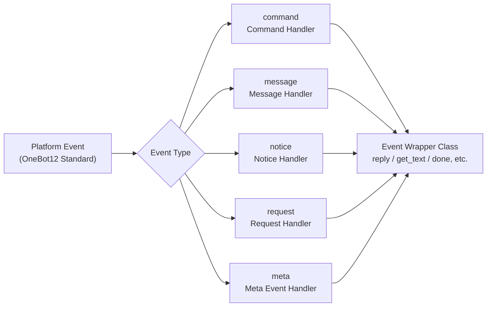

## Command Module

### Registering Commands

```python
from ErisPulse.Core.Event import command

# Basic command
@command("hello", help="Send a greeting")
async def hello_handler(event):
    await event.reply("Hello!")

# Command with aliases
@command(["help", "h"], aliases=["assist"], help="Show help")
async def help_handler(event):
    pass

# Command with permission
def is_admin(event):
    return event.get("user_id") in admin_ids

@command("admin", permission=is_admin, help="Admin command")
async def admin_handler(event):
    pass

# Hidden command
@command("secret", hidden=True, help="Secret command")
async def secret_handler(event):
    pass

# Command group
@command("admin.reload", group="admin", help="Reload module")
async def reload_handler(event):
    pass

# Subcommands (multi-token command names separated by spaces)
# Matching uses longest prefix: /admin add x hits admin add first (args is ["x"]);
# when a subcommand does not declare a permission, it inherits from the nearest
# ancestor command on the parent chain that declared one
@command("admin add", help="Add an admin")
async def admin_add_handler(event):
    pass
```

**Naming conflict rules**: Command names take precedence over aliases. When registering an alias that duplicates an existing command name, the alias takes no effect and a warning is emitted; when registering a command whose name duplicates an existing alias, the command name takes precedence and the dead alias is automatically removed — both kinds of conflicts produce WARNING logs, so no silent hijacking occurs.

### Command Information

All command query APIs support an optional **session context**: pass `event=` (an Event or dict) or explicit `platform=` / `bot_id=` / `session_id=` (explicit parameters take precedence when combined with `event`), which filters out commands of modules unavailable in the current session based on the scoped-module dimension (see advanced/scope.md for details). All are optional keyword arguments; when omitted, the original full-list behavior is retained.

```python
# Get command help
help_text = command.help()

# Session-aware help: list only commands available in the current session
help_text = command.help(event=event)

# Get a specific command (returns the effective parameters after merged overrides; returns None if unavailable in the session)
cmd_info = command.get_command("admin")
cmd_info = command.get_command("admin", event=event)

# Get all commands (filters commands of unavailable modules when session-aware)
all_commands = command.get_commands()
all_commands = command.get_commands(event=event)

# Get all commands in a command group (supports session-aware filtering)
admin_commands = command.get_group_commands("admin")
admin_commands = command.get_group_commands("admin", event=event)

# Get all visible commands
visible_commands = command.get_visible_commands()

# Session-aware visible commands (either event or explicit keywords suffice)
visible_commands = command.get_visible_commands(event=event)
visible_commands = command.get_visible_commands(
    platform=event.get("platform"),
    bot_id=event.get_self_account_id(),
    session_id=event.get_session_id(),
)
```

### Waiting for Replies

```python
# Wait for a user reply
@command("ask", help="Ask the user for information")
async def ask_command(event):
    reply = await command.wait_reply(
        event,
        prompt="Please enter your name:",  # already sent above
        timeout=30.0
    )
    
    if reply:
        name = reply.get_text()
        await event.reply(f"Hello, {name}!")

# Wait for a reply with validation
def validate_age(event_data):
    try:
        age = int(event_data.get_text())
        return 0 <= age <= 150
    except ValueError:
        return False

@command("age", help="Ask the user for their age")
async def age_command(event):
    await event.reply("Please enter your age:")
    
    reply = await command.wait_reply(
        event,
        timeout=60,
        validator=validate_age
    )
    
    if reply:
        age = int(reply.get_text())
        await event.reply(f"Your age is {age}")

# Wait for a reply with a callback
async def handle_confirmation(reply_event):
    text = reply_event.get_text().lower()
    if text in ["yes", "y"]:
        await event.reply("Operation confirmed!")
    else:
        await event.reply("Operation cancelled.")

@command("confirm", help="Confirm an operation")
async def confirm_command(event):
    await command.wait_reply(
        event,
        prompt="Please enter 'yes' or 'no':",
        callback=handle_confirmation
    )
```

## Message Module

### Message Events

```python
from ErisPulse.Core.Event import message

# Listen to all messages
@message.on_message()
async def message_handler(event):
    sdk.logger.info(f"Message received: {event.get_text()}")

# Listen to private messages
@message.on_private_message()
async def private_handler(event):
    user_id = event.get_user_id()
    sdk.logger.info(f"Private message from: {user_id}")

# Listen to group messages
@message.on_group_message()
async def group_handler(event):
    group_id = event.get_group_id()
    sdk.logger.info(f"Group message from: {group_id}")

# Listen to mention (@) messages
@message.on_at_message()
async def at_handler(event):
    mentions = event.get_mentions()
    sdk.logger.info(f"Mentioned users: {mentions}")
```

### Conditional Listening

```python
# Use priority to control execution order
@message.on_message(priority=10)  # higher value means higher priority
async def high_priority_handler(event):
    pass

# Implement conditional filtering inside the handler
@message.on_message()
async def filtered_handler(event):
    if "keyword" not in event.get_text():
        return
    # Process messages containing the keyword
    pass
```

## Notice Module

### Notice Events

```python
from ErisPulse.Core.Event import notice

# Friend added
@notice.on_friend_add()
async def friend_add_handler(event):
    user_id = event.get_user_id()
    await event.reply("Thanks for adding me as a friend!")

# Friend removed
@notice.on_friend_remove()
async def friend_remove_handler(event):
    user_id = event.get_user_id()
    sdk.logger.info(f"Friend removed: {user_id}")

# Group member increase
@notice.on_group_increase()
async def member_increase_handler(event):
    user_id = event.get_user_id()
    await event.reply(f"Welcome, new member!")

# Group member decrease
@notice.on_group_decrease()
async def member_decrease_handler(event):
    user_id = event.get_user_id()
    sdk.logger.info(f"Group member left: {user_id}")
```

## Request Module

### Request Events

```python
from ErisPulse.Core.Event import request

# Friend request
@request.on_friend_request()
async def friend_request_handler(event):
    user_id = event.get_user_id()
    comment = event.get_comment()
    sdk.logger.info(f"Friend request: {user_id}, comment: {comment}")

# Group invitation request
@request.on_group_request()
async def group_request_handler(event):
    group_id = event.get_group_id()
    user_id = event.get_user_id()
    sdk.logger.info(f"Group invitation: {group_id}, from: {user_id}")
```

## Meta Module

### Meta Events

```python
from ErisPulse.Core.Event import meta

# Connect event
@meta.on_connect()
async def connect_handler(event):
    platform = event.get_platform()
    sdk.logger.info(f"Platform {platform} connected")

# Disconnect event
@meta.on_disconnect()
async def disconnect_handler(event):
    platform = event.get_platform()
    sdk.logger.info(f"Platform {platform} disconnected")

# Heartbeat event
@meta.on_heartbeat()
async def heartbeat_handler(event):
    sdk.logger.debug("Heartbeat received")
```

### Bot Status Query

Once the adapter sends meta events, the framework automatically tracks Bot status. For query APIs and lifecycle event listening, refer to [Adapter System API - Bot Status Management](adapter-system.md#bot-status-management).

## Event Wrapper Class

Event handlers in the Event module receive an Event wrapper class instance, which inherits from dict and provides convenient methods. For the complete method list, parameter signatures, and behaviors, refer to [Event Wrapper Class in Detail](../developer-guide/modules/event-wrapper.md); this section is only a quick overview.

### Capability Overview

- **Event basic information**: `get_id()` / `get_time()` / `get_type()` / `get_detail_type()` / `get_platform()`
- **Bot information**: `get_self_platform()` / `get_self_user_id()` / `get_self_account_id()` / `get_self_info()`
- **Session identifiers**: `get_target_id()` (unified target ID, taking the first non-empty value in the order `group_id` → `channel_id` → `guild_id` → `thread_id` → `user_id`); `get_session_id()` (format `{platform}:{detail_type}:{target_id}`, e.g. `"telegram:private:12345"`)
- **Message content and sender**: `get_message()` / `get_alt_message()` / `get_text()` / `get_user_id()` / `get_sender()` / `get_group_id()` etc.
- **Message type checks**: `is_message()` / `is_private_message()` / `is_group_message()` / `is_at_message()` / `has_mention()` / `get_mentions()`
- **Reply**: `reply(content, method=..., at_sender=..., quote=..., at_users=..., reply_to=..., at_all=..., via=...)` / `reply_ob12()`; platform capability queries `supports()` / `available_methods()`; free-form send chain `send_chain()` — see [SendDSL in Detail](../developer-guide/adapters/send-dsl.md#method-2-eventsend_chain)
- **Command information**: `get_command_name()` / `get_command_args()` / `is_command()` etc.
- **Interactive conversations**: `wait_reply()` / `confirm()` / `choose()` / `collect()` / `wait_for()` / `conversation()`
- **Utilities**: `to_dict()` (filters internal keys) / `get_raw()` / `get_raw_type()`

> For complete parameter descriptions and examples of each method, see [Event Wrapper Class in Detail](../developer-guide/modules/event-wrapper.md);
> for advanced multi-turn conversations, see [Conversation Multi-turn Dialogues](../advanced/conversation.md).

### Chain Control

`event.done(claim=, stop=)` unifies control over two orthogonal semantics — "claim" and "stop":

- **Claim**: marks the event as processed (`_processed`); the command dispatcher uses this to skip deduplication
- **Stop**: prevents propagation to lower-priority handlers (`_propagation_stopped`)

```python
# Claim + stop (default)
event.done()

# Claim only, no stop (lower-priority observers can still see it)
event.done(stop=False)

# Stop only, no claim (e.g. firewall / rate limiting)
event.done(claim=False)

# mark_processed is the primary method; done is its alias
event.mark_processed()             # equivalent to event.done()
event.mark_processed(stop=False)   # equivalent to event.done(stop=False)

# Query status
event.is_processed()  # whether already claimed
event.is_stopped()    # whether propagation is stopped
```

### Platform Extension Methods

Adapters can register platform-specific methods for Event, which are only available on instances of the corresponding platform.

#### For Users: Using Platform Extension Methods

Once an adapter has registered platform-specific methods, you can call them directly in event handlers. Methods vary by platform; refer to the corresponding [platform documentation](../platform-guide/).

```python
from ErisPulse.Core.Event import message

@message.on_message()
async def handle_message(event):
    platform = event.get_platform()

    # Call platform-specific methods based on the platform
    if platform == "email":
        subject = event.get_subject()           # email-specific
        attachments = event.get_attachments()   # email-specific
```

#### Querying Methods Registered for a Platform

```python
from ErisPulse.Core.Event import get_platform_event_methods

# Check which methods are registered for a platform
methods = get_platform_event_methods("email")
# ["get_subject", "get_from", "get_attachments", ...]

# Dynamically check and call
for method_name in get_platform_event_methods(event.get_platform()):
    method = getattr(event, method_name)
    print(f"{method_name}: {method()}")
```

#### Platform Method Isolation

Methods registered for different platforms do not interfere with each other:

```python
# Email event - only email methods
event = Event({"platform": "email", "email_raw": {"subject": "Hello"}})
event.get_subject()      # ✅ "Hello"
event.get_chat_type()    # ❌ AttributeError

# Telegram event - only Telegram methods
event = Event({"platform": "telegram", "telegram_raw": {"chat": {"type": "private"}}})
event.get_chat_type()    # ✅ "private"
event.get_subject()      # ❌ AttributeError
```

#### `hasattr` / `dir` Support

```python
hasattr(event, "get_subject")   # returns True only when platform="email"
"get_subject" in dir(event)     # same as above
```

### For Adapters: Registering Platform Extension Methods

Adapters can register platform-specific methods for Event via decorators. The first parameter of the method is `self` (the Event instance), with free access to event data.

#### Registering a Single Method

```python
from ErisPulse.Core.Event import register_event_method

@register_event_method("email")
def get_subject(self):
    """Get the email subject"""
    return self.get("email_raw", {}).get("subject", "")

@register_event_method("email")
def get_from(self):
    """Get the sender"""
    return self.get("email_raw", {}).get("from", {})
```

#### Batch Registration (Mixin Class)

When there are many methods, batch registration with a Mixin class is recommended:

```python
from ErisPulse.Core.Event import register_event_mixin

class EmailEventMixin:
    def get_subject(self):
        return self.get("email_raw", {}).get("subject", "")

    def get_from(self):
        return self.get("email_raw", {}).get("from", {})

    def get_attachments(self):
        return self.get("email_raw", {}).get("attachments", [])

# Register all methods at once
register_event_mixin("email", EmailEventMixin)
```

#### Return Value Conventions

| Scenario | Return Value | Usage |
|------|--------|------------|
| Returning data (text, dicts, etc.) | Return the value directly | `subject = event.get_subject()` |
| Performing actions (sending messages, etc.) | Return an `asyncio.Task` | `task = event.do_something()`, `await` optional |

> **Recommendation**: Methods that do not return data should return an `asyncio.Task`, so users can decide whether to `await`. Even without `await`, the operation still completes.

```python
@register_event_method("email")
def forward_email(self, to_address: str):
    """Forward an email — returns a Task; users decide whether to await"""
    import asyncio
    return asyncio.create_task(
        self._do_forward(to_address)
    )

# Users can await the result
await event.forward_email("user@example.com")

# Or skip await; the operation runs in the background
event.forward_email("user@example.com")
```

#### Unregistering Methods

```python
from ErisPulse.Core.Event import unregister_event_method, unregister_platform_event_methods

# Unregister a single method
unregister_event_method("email", "get_subject")

# Unregister all methods of a platform (called when the adapter shuts down)
unregister_platform_event_methods("email")
```

#### Overriding Built-in Methods

`register_event_mixin` / `register_event_method` support overriding Event built-in methods (such as `confirm`, `choose`, `collect`, `wait_reply`, `reply`, etc.). Registered platform methods take precedence over built-in methods via `Event.__getattribute__`, so adapters can provide platform-specific interaction implementations.

Built-in implementations are exported as `_builtin_*` functions; overriders can call them as a fallback:

```python
from ErisPulse.Core.Event import register_event_mixin, _builtin_choose

class YunhuEventMixin:
    async def choose(self, prompt, options, timeout=60, method="Text"):
        # The Yunhu platform uses button components
        buttons = [[{"text": opt} for opt in options]]
        await self.reply(prompt)
        # ...wait for a button callback or a text reply...
        # Fall back to the built-in logic
        return await _builtin_choose(self, None, options, timeout, "Text")

register_event_mixin("yunhu", YunhuEventMixin)
```

## Cross-Platform Extensions (Wildcard)

`register_event_method` and `register_event_mixin` support passing `"*"` as the platform name; registered methods are available on Event instances of **all platforms**. This is suitable for feature modules that need cross-platform reuse, such as AI chat and context management.

### Registering Cross-Platform Methods

```python
from ErisPulse.Core.Event.wrapper import register_event_method

@register_event_method("*")
async def ai_chat(self, prompt: str):
    """self is the Event instance, with free access to event data and built-in methods"""
    await self.reply(f"AI: {prompt}")
```

After registration, event handlers on all platforms can call it:

```python
from ErisPulse.Core.Event import message

@message.on_message()
async def handler(event):
    await event.ai_chat(event.get_text())
```

### Method Resolution Priority

When accessing Event methods via attributes, the resolution order is:

1. **Platform-specific methods** (overrides for the current platform)
2. **Wildcard methods** (cross-platform methods registered with `"*"`)
3. **Built-in methods** (`reply`, `confirm`, etc.)
4. **Dictionary key access**

> Therefore, wildcard methods can override built-in methods (such as `reply`), but will in turn be overridden by platform-specific methods of the same name.

## Priority System

Event handlers support priorities; a higher value means higher priority:

```python
# Higher-priority handlers execute first
@message.on_message(priority=10)
async def high_priority_handler(event):
    pass

# Lower-priority handlers execute later
@message.on_message(priority=0)
async def low_priority_handler(event):
    pass
```


====
高级主题
====


### Conversation 多轮对话

# Conversation Multi-turn Dialogue

> [!TIP]
> **When to read this**: When you need a multi-turn dialogue state machine and checkpoint recovery. If not needed, you can skip this section, which won't affect the use of other features.

When a command requires continuously asking the user multiple steps of information (such as registration, collecting data, questionnaires, or setup wizards), use `Conversation` to string together "ask → wait for reply → validate → next step" within the same session. The conversation can be resumed from a checkpoint after timeout or restart.

## Creating a Conversation

Create a conversation using the `conversation()` method of the `Event` object:

```python
from ErisPulse.Core.Event import command

@command("quiz")
async def quiz_handler(event):
    conv = event.conversation(timeout=30)

    await conv.say("🎮 Welcome to the quiz!")

    answer = await conv.choose("Question 1: Who is the creator of Python?", [
        "Guido van Rossum",
        "James Gosling",
        "Dennis Ritchie",
    ])

    if answer is None:
        await conv.say("Timeout, try again next time!")
        return

    if answer == 0:
        await conv.say("Correct!")
    else:
        await conv.say("Incorrect, the correct answer is Guido van Rossum")

    conv.stop()
```

## Core API

### say(content, **kwargs)

Send a message, returning `self` to support method chaining:

```python
await conv.say("Line 1").say("Line 2").say("Line 3")
```

You can also specify the sending method:

```python
await conv.say("https://example.com/image.jpg", method="Image")
```

### wait(prompt=None, timeout=None)

Wait for a user reply, returning an `Event` object or `None` (if timeout):

```python
# Simple wait
resp = await conv.wait()
if resp:
    text = resp.get_text()

# Wait after sending a prompt
resp = await conv.wait(prompt="Please enter your name:")

# Use custom timeout (overrides the conversation default timeout)
resp = await conv.wait(prompt="Please reply within 10 seconds:", timeout=10)
```

### confirm(prompt=None, **kwargs)

Wait for the user to confirm (yes/no), returning `True` / `False` / `None` (if timeout):

```python
result = await conv.confirm("Are you sure you want to delete all data?")
if result is True:
    await conv.say("Deleted")
elif result is False:
    await conv.say("Cancelled")
else:
    await conv.say("Timeout, no reply")
```

Built-in recognized confirmation words: `yes/是/确认/确定/好/ok/true/对/嗯/行/同意/没问题/可以/当然...`

Built-in recognized denial words: `no/否/取消/不/不要/不行/cancel/false/错/不对/别/拒绝...`

### choose(prompt, options, **kwargs)

Wait for the user to select from options, returning the option index (0-based) or `None`:

```python
choice = await conv.choose("Please select a color:", ["Red", "Green", "Blue"])
if choice is not None:
    colors = ["Red", "Green", "Blue"]
    await conv.say(f"You selected {colors[choice]}")
```

Users can select by entering a number (`1`/`2`/`3`) or the option text (`Red`).

`options_format="auto"` (default) automatically chooses the built-in style based on the method: Markdown → unordered list, Html → ordered list, others → plain text list.
It also supports `"list"`, `"inline"`, `"md"`, `"html"`, or a custom function.

Supports `merge_prompt=True` to merge into a single message, and placeholder control for option insertion position (default `{options}`, customizable via `placeholder`):

```python
choice = await conv.choose(
    "## Please select\n{options}",
    ["Option A", "Option B"],
    method="Markdown",
    merge_prompt=True,
)

# Custom placeholder
choice = await conv.choose(
    "Please select: [choices]",
    ["Option A", "Option B"],
    placeholder="[choices]",
)
```

### collect(fields, **kwargs)

Collect information in multiple steps, returning a data dictionary or `None`:

```python
data = await conv.collect([
    {"key": "name", "prompt": "Please enter your name"},
    {"key": "age", "prompt": "Please enter your age",
     "validator": lambda e: e.get("alt_message", "").strip().isdigit(),
     "retry_prompt": "Age must be a number, please re-enter"},
    {"key": "city", "prompt": "Please enter your city"},
])

if data:
    await conv.say(f"Registration successful!\nName: {data['name']}\nAge: {data['age']}\nCity: {data['city']}")
else:
    await conv.say("Registration interrupted")
```

Field configuration:

| Parameter | Description | Default |
|-----------|-------------|---------|
| `key` | Field key name (required) | - |
| `prompt` | Prompt message | `"Please enter {key}"` |
| `validator` | Validation function, receives Event, returns bool | None |
| `retry_prompt` | Retry prompt on validation failure | `"Invalid input, please re-enter"` |
| `max_retries` | Maximum retry attempts | 3 |
| `condition` | Condition function, receives collected data dict, returns bool | None |

**Conditional fields**: Use `condition` to implement dynamic forms, where the field is only collected if the condition is met:

```python
data = await conv.collect([
    {"key": "has_car", "prompt": "Do you have a car? (Yes/No)"},
    {"key": "car_brand", "prompt": "Please enter the car model",
     "condition": lambda d: d.get("has_car", "").lower() in ("yes", "y")},
])
```

### stop()

Manually end the conversation, setting `is_active` to `False`:

```python
conv.stop()
```

### is_active

Whether the conversation is active:

```python
if conv.is_active:
    await conv.say("The conversation is still ongoing")
```

## Active State Management

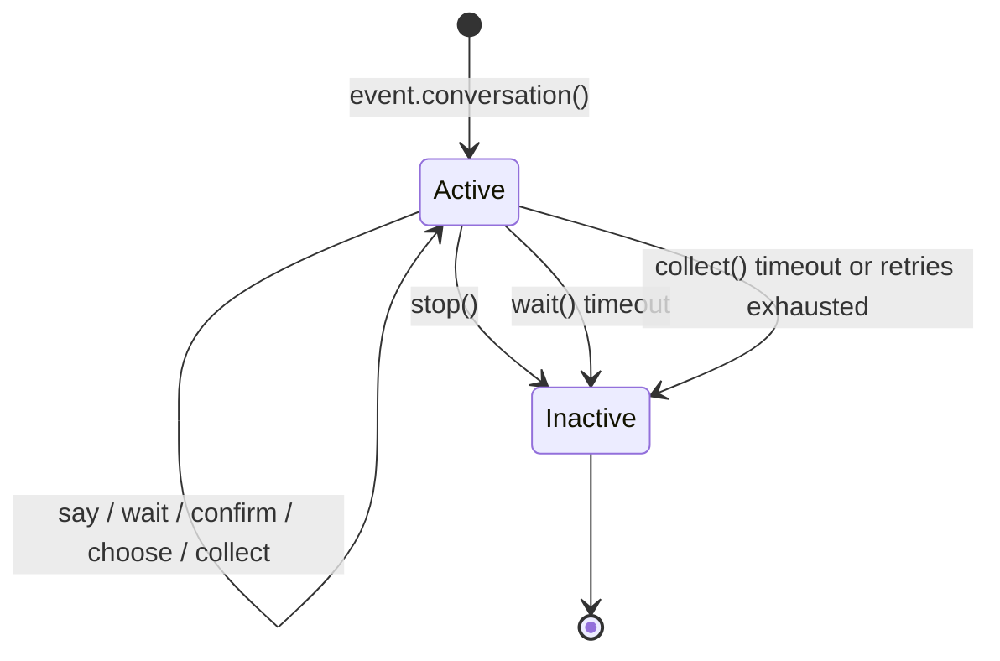

The conversation automatically becomes inactive under the following conditions:

1. The `stop()` method is called.
2. `wait()` returns `None` due to timeout.
3. `collect()` returns `None` due to timeout or exhausted retries.

After becoming inactive, all interactive methods (`wait`/`confirm`/`choose`/`collect`) immediately return `None` and do not continue to wait for user input.

## Branching and Jumping

### @conv.branch(name) Decorator

Use `branch()` to register conversation branches and `goto()` to jump between branches:

```python
@command("menu")
async def menu_handler(event):
    conv = event.conversation(timeout=60)

    @conv.branch("main")
    async def main_menu():
        await conv.say("=== Main Menu ===\n1. Personal Info\n2. Settings\n3. Exit")
        resp = await conv.wait()
        if resp is None:
            return
        text = resp.get_text().strip()
        if text == "1":
            await conv.goto("profile")
        elif text == "2":
            await conv.goto("settings")
        elif text == "3":
            await conv.say("Goodbye!")
            conv.stop()

    @conv.branch("profile")
    async def profile():
        await conv.say("=== Personal Info ===\nName: Alice\n0. Back")
        resp = await conv.wait()
        if resp and resp.get_text().strip() == "0":
            await conv.goto("main")

    @conv.branch("settings")
    async def settings():
        await conv.say("=== Settings ===\n1. Notification Switch\n0. Back")
        resp = await conv.wait()
        if resp and resp.get_text().strip() == "0":
            await conv.goto("main")

    await conv.start()  # Start from the first registered branch
```

### conv.start(name=None)

Start the conversation, defaulting to the first registered branch:

```python
await conv.start()          # Start from the first branch
await conv.start("settings") # Start from a specified branch
```

## Context and Persistence

### conv.context

Each conversation instance has a built-in `context` dictionary for sharing state between branches:

```python
@conv.branch("step1")
async def step1():
    conv.context["username"] = resp.get_text().strip()
    await conv.goto("step2")

@conv.branch("step2")
async def step2():
    name = conv.context.get("username", "Unknown")
    await conv.say(f"Hello, {name}!")
```

### save() / resume() / clear_saved()

Conversations support persistence, allowing recovery after timeout or interruption:

```python
# Save conversation state (usually not called manually, see "Automatic Checkpoint" below)
await conv.save()

# ... Later in the same session, resume ...
conv2 = event.conversation()
if await conv2.resume():
    await conv2.say("Welcome back! Continue the previous conversation")
else:
    await conv2.say("No previous conversation found")

# Clear saved conversation
await conv.clear_saved()
```

The storage key includes the target dimension (`conversation:{platform}:{user_id}:{target_id}`), ensuring conversations for the same user in different sessions do not overlap; old format (without target) archives are automatically migrated during `resume()`.

## Automatic Checkpoint and Restart Recovery

### Automatic Archiving

The framework automatically maintains checkpoints at the following times, usually without manually calling `save()`:

| Timing | Behavior |
|--------|----------|
| `goto()` / `start()` branch jump | Automatically save (current branch + context) |
| `stop()` / `wait()` timeout / `collect()` failure | Automatically clear (conversation final state) |

### Checkpoint TTL

Archives include timestamps, and those exceeding `ErisPulse.interaction.checkpoint_ttl` (default 24 hours) are cleaned up:

- **Lazy discard**: If an archive is found expired during resume, it is automatically discarded.
- **Background proactive cleanup**: The framework has a periodic GC task (lazy-started after first use of checkpoints) that actively enumerates and deletes expired archives, preventing indefinite accumulation of expired checkpoints in storage during long-running operations. Archives cleaned up by this process are treated as "no checkpoint" if a session message is received afterward.

```toml
[ErisPulse.interaction]
checkpoint_ttl = 86400  # seconds
```

### Automatic Recovery on Restart

After a framework restart, in-progress conversations (waiting coroutines in memory) are lost, but checkpoints remain. Register a **resume factory** via `register_resume_handler` so the framework can automatically resume conversations when the first message of that session is received after restart:

```python
from ErisPulse.Core.Event.wrapper import Conversation

@Conversation.register_resume_handler()  # Optional: platform="onebot11" to limit platform
def make_conversation(event) -> Conversation:
    # Factory responsibility: Rebuild conversation and re-register all branches
    conv = event.conversation(timeout=60)

    @conv.branch("menu")
    async def menu(conv, event):
        ...

    return conv
```

After registration, when a user in the `menu` branch sends their first message after a restart, the framework automatically: restores context → claims the message → continues the conversation from the archived branch. If no factory is registered, this mechanism incurs zero overhead.

### Resume Equals Takeover

Upon successful `resume()`, the framework automatically completes two tasks:

1. **Session takeover**: Automatically acquire the session's mutual exclusion lease — other modules can sense "this user is currently occupied by a conversation" via `sdk.interaction.get_owner_of(event)`; if the session is already occupied by another module, the resume is abandoned (returns False), avoiding conflicts between two conversations.
2. **History retrieval**: Retrieve the last 10 messages from the session inbox into `conv.recent_history` (so AI modules can maintain uninterrupted LLM context after recovery); `resume(with_history=0)` can disable this.

```python
if await conv.resume(with_history=20):
    for m in conv.recent_history:
        print(m["role"], ":", m["text"])
```

### Manual Resume (Without Automatic Mechanism)

```python
@command("continue")
async def continue_handler(event):
    conv = event.conversation()
    # ... register branches ...
    if await conv.resume():
        conv.goto(conv.get_current_branch())
```

## Typical Workflow Patterns

### Guided Registration

```python
@command("register")
async def register_handler(event):
    conv = event.conversation(timeout=60)

    await conv.say("Welcome to registration!")

    data = await conv.collect([
        {"key": "username", "prompt": "Please enter a username (3-20 characters)",
         "validator": lambda e: 3 <= len(e.get_text().strip()) <= 20},
        {"key": "email", "prompt": "Please enter an email address",
         "validator": lambda e: "@" in e.get_text() and "." in e.get_text(),
         "retry_prompt": "Invalid email format, please re-enter"},
    ])

    if not data:
        await event.reply("Registration cancelled")
        return

    confirmed = await conv.confirm(
        f"Confirm registration details?\nUsername: {data['username']}\nEmail: {data['email']}"
    )

    if confirmed:
        await conv.say("✅ Registration successful!")
    else:
        await conv.say("❌ Registration cancelled")
```

### Looping Conversation

```python
@command("chat")
async def chat_handler(event):
    conv = event.conversation(timeout=120)
    await conv.say("Entering conversation mode, type 'exit' to end")

    while conv.is_active:
        resp = await conv.wait()
        if resp is None:
            await conv.say("Timeout, conversation ended")
            break

        text = resp.get_text().strip()

        if text == "exit":
            await conv.say("Goodbye!")
            conv.stop()
        elif text == "help":
            await conv.say("Available commands: exit, help, status")
        elif text == "status":
            await conv.say("Conversation is active")
        else:
            await conv.say(f"You said: {text}")
```


### 交互会话系统

# Interactive Conversation System

> [!TIP]
> **When you need to read this**: When you need `wait_reply`, multi-turn conversations, timed reminders, conversation mutual exclusion, or session tracing. If not needed, you can skip it without affecting the use of other features.

> **What you will learn after reading**: The full parameter usage and cancellation reasons for `wait_reply`, the declarative multi-turn chain with `.got()`, session timers (remind / escalate), multi-path waiting (expect / select), and session mutual exclusion leases.

> **What this chapter does not cover**: Multi-turn conversation branch state machines and restart recovery (see [Conversation Multi-turn Conversations](conversation.md)); mailbox retention policy knobs and runtime overrides (see [Conversation Mailbox](transcript.md)).

> [!NOTE]
> This chapter requires ErisPulse **2.8.0+**.

ErisPulse has made "continuous interaction with users" into a framework-level infrastructure: from a single `wait_reply`, to timed reminders, multi-path waiting, session mutual exclusion, and restart recovery, all are scheduled by a unified **Interactive Conversation Manager** (`Core/Event/interaction.py`, `sdk.interaction`).

{!--< tips >!--}
Each capability covered in this article comes with its own **ownership (owner)**: interaction waiting, leases, and timers all record the module name at registration time. When a module is unloaded or an adapter is closed, the framework automatically cleans up and immediately notifies the waiting party instead of waiting for a timeout—this is an extension of the ownership system in the interaction dimension (see [Ownership System](ownership.md)).
{!--< /tips >!--}

## Waiting for Reply: wait_reply

**In one sentence**: Suspends the current coroutine to wait for the next message from the target user, returns the reply event on match, returns `None` on timeout or cancellation, `pattern` / `regex` / `validator` can filter out invalid replies.

`wait_reply` is the foundation of interactive sessions — it suspends the current coroutine and waits for the target user's next message as a "reply".

```python
from ErisPulse.Core.Event import command

@command("ask")
async def ask_command(event):
    reply = await event.wait_reply(prompt="Please enter your name:", timeout=30)
    if reply is None:
        await event.reply("Timed out.")
        return
    await event.reply(f"Hello, {reply.get_text()}!")
```

### All Parameters Overview

| Parameter | Description | Default |
|-----------|-------------|---------|
| `prompt` | The prompt message sent before suspension | None |
| `timeout` | Timeout for waiting (seconds) | 60 |
| `pattern` | Glob filter (`*` / `?` / `[seq]`), continues waiting if not matched | None |
| `regex` | Regular expression filter (must match both `pattern` and `regex` if both provided), continues waiting if not matched | None |
| `validator` | Validation function (receives Event, returns bool), continues waiting if failed | None |
| `callback` | Callback when reply is received (alternative to returning values) | None |
| `method` | Method for sending the prompt | "Text" |
| `session` | **Session-level waiting**: Any reply from anyone in the same session (group/channel) can match | False |

```python
# Only accepts numeric amounts, otherwise continues waiting
reply = await event.wait_reply("Please enter the amount:", regex=r"\d+\s*元", timeout=30)

# Session-level waiting: In group collaboration scenarios, any group member's reply can match
reply = await event.wait_reply(session=True, prompt="Which expert can help answer this?")
```

### The Boundary Between Waiting and Commands (Command Bypass)

During waiting, if a message containing a **registered command** (e.g., `/cancel`) is received, it is by default passed to the command dispatcher and not consumed as a reply (configuration item `ErisPulse.event.wait_reply.cmdpass`, if `True` it reverses — all messages are treated as replies). The text matching criterion is consistent with the command dispatcher: `alt_message` is prioritized, and if missing, falls back to message segment concatenation (effective for pure message segment adapters since 2.10.1).

### When Does Waiting Get Cancelled

Waiting is no longer "only waiting until timeout" — the following situations will **immediately terminate** the waiting (causing `wait_reply` to return `None`), rather than letting the caller wait until timeout:

| Trigger | Cancellation Reason (`InteractionCancelled.reason`) | Description |
|---------|----------------------------------------------------|-------------|
| Module owner is unloaded / disabled | `owner_unload` | Ownership cleanup: whoever registered the wait is cancelled when the owner disappears |
| Adapter shutdown / restart | `platform_stop` | All waits suspended by this platform are cancelled |
| New wait / lease replaces in the same session | `conflict` | See "Session Arbitration" below |
| Replier is blacklisted / owner module is unbound | `revoked` | Reply match **permission recheck**: scope identity dimension + module dimension |
| User reply matches | — | Normal path, returns reply event |

The underlying exception is `InteractionCancelled` (part of the `InteractionError` exception hierarchy), and `wait_reply` has converted it to return `None`. Callers needing the reason can directly use the low-level API `sdk.interaction.register()`.

### Complete Matching Chain for Reply Events

When a reply message arrives, the interaction manager performs the following sequential checks (executed **before** command matching, prioritizing conversation continuity — even if the message has been claimed by a higher-priority processor, the suspended conversation can still complete):

```
Session key match (exact user dimension → session-level fallback)
  → pattern / regex text filtering (continues waiting if not matched)
  → validator check (continues waiting if failed)
  → permission recheck (scope identity dimension + owner module dimension, fails to terminate waiting)
  → wake up waiting party + claim event (mark_processed)
```

## Declarative Multi-turn: `.got()` Chain (2.11+)

`@command` returns a **multi-turn control proxy**, declaring collection steps sequentially using `.got()`—steps receive collected values by parameter name (including command entry parameters), and types are automatically parsed according to `type=` or annotations. Underneath, it compiles into a Conversation: each step is a branch, automatic checkpoint saving, and **user replies resume from the saved step after restart** (the recovery factory is automatically registered during decoration and unregistered with module unload).

```python
@command("weather")
async def weather(event):
    pass  # Entry: the prompt of the first .got is automatically sent, no manual question needed

@weather.got("city", prompt="Please directly reply with the city name")
async def weather_city(event, city: str):
    await event.reply(f"{city}: Sunny, 25℃")

@weather.got("days", prompt="How many days to forecast?", type=int, retry_prompt="Please enter a number")
async def weather_days(event, city: str, days: int):
    await event.reply(f"{city} future {days} days...")
```

### Parameter Description

| Parameter | Description |
|-----------|-------------|
| `name` | Collected value name (injected into subsequent step functions by parameter name; unique within the flow, duplicate declarations cause registration-time errors) |
| `prompt` | Question automatically sent when entering this step |
| `timeout` | Single-step waiting timeout (seconds or "90s" / "1h30m" duration string, default 60s) |
| `type` | Value type (`int` / `float` / `str`…; if parsing fails, `retry_prompt` is automatically resent, up to `max_retries` times) |
| `validator` / `pattern` / `regex` | Reply filtering and validation (semantically consistent with [`wait_reply`](#waiting-for-replywait_reply)) |
| `session` | Session-level waiting (anyone in the same session can match) |
| `cmdpass` | Command pass three-state (default `/cancel` and other commands execute normally during waiting) |

### Semantics and Boundaries

- **Any step timeout / interruption → entire flow ends** and checkpoints are cleared (consistent with `wait_reply` semantics); intermediate results can be output at any time within step functions using `event.reply(...)`
- **Only one suspended interaction per user at a time**—the second flow's waiting will replace the previous one (`InteractionCancelled("conflict")`); for mutual exclusion prompts, please use [Session Lease](#session-mutual-exclusionacquire--hold--get_owner_of)
- Collected values exist only within the flow; for complex state that needs to be carried across restarts, use [Conversation](conversation.md) directly (`context` + `branch/goto` + manual checkpoint)
- `@command` returns a proxy object: calling behavior, `__name__`, docstring, and custom attributes are identical to the original function; `command.unregister(代理)` automatically unpacks

## Session Timers: remind / escalate

Turn "timeout" from a return value into a compositional primitive. Timers are attached to interactive sessions and automatically canceled with module unload or adapter shutdown, with a single session active remind limit of 5.

### remind: Gentle Reminder if No Reply

```python
@command("ticket")
async def ticket_command(event):
    await event.reply("The ticket has been submitted, the result will be notified here")
    # Remind gently after 5 minutes of no reply; any user reply automatically cancels it
    event.remind(300, "Are you still there? We will notify you as soon as there is a result")
    reply = await event.wait_reply(timeout=3600)
    ...
```

- `event.remind(delay, text=None, *, callback=None)`: Sends `text` (or executes `callback(event)`, supporting synchronous/asynchronous) to the current session upon expiration. **Mandatory check**: `text` and `callback` must be chosen exclusively (neither raises `ValueError`)
- Returns a `Reminder` handle: `reminder.cancel()` manually cancels, `reminder.expired` queries status
- Automatically cancels upon user reply in the session—this is the "reminder" semantics: reminders only appear when the user is silent
- Also available within `Conversation`: `conv.remind(120, "Are you still considering?")`

### escalate: Guaranteed Escalation at Deadline

```python
event.escalate(1800, lambda e: notify_master(f"Ticket not processed for 30 minutes: {event.get_command_args()}"))
```

The only difference from `remind` is that it is **not canceled by user reply**—escalation actions (notifying the master, transferring to human) are a "guaranteed timeout" promise, canceled only by manual `cancel()` / module unload / adapter shutdown.

| | `remind` | `escalate` |
|---|---|---|
| Expiration Behavior | Send text / execute callback | Execute callback |
| User Reply | **Automatically canceled** | Unaffected |
| Ownership Cleanup (Unload / Close Platform) | Canceled | Canceled |
| Single Session Limit | 5 | Unlimited (canceled by ownership cleanup as fallback) |

## Multi-Way Waiting: expect + select

**In one sentence**: `expect` only describes the expectation without registering any waiting, while `select` suspends multiple expectations at once, returning `(index, reply event)` as soon as any one matches, and automatically cleans up unmatched ones.

Suspend multiple expectations at once, **first come, first served**—typical scenarios: waiting for an admin approval while also waiting for a user to withdraw, or multi-person collaborative voting.

```python
which, reply = await event.select(
    event.expect(pattern="同意*", user="10001"),
    event.expect(pattern="拒绝*", user="10002"),
    event.expect(validator=lambda e: e.get_text() == "搁置", session=True),
    timeout=60,
)
if which is None:
    await event.reply("60 秒内未收到任何审批结果")
elif which == 0:
    await event.reply("已同意")
elif which == 1:
    await event.reply("已拒绝")
```

- `event.expect(...)` constructs an **expectation description** (without registering any waiting): supports `pattern` / `regex` / `validator` / `user` (limit reply sender) / `session` (anyone can reply)
- `event.select(*expectations, timeout=60)`: registers all expectations uniformly → returns `(index, reply event)` as soon as any one matches → unmet expectations are automatically canceled; returns `(None, None)` if all timeout. **Mandatory validation**: at least one expectation must be provided, otherwise a `ValueError` is thrown
- The matched event is marked as processed by the framework (`mark_processed`), so it won't be consumed again by other handlers

{!--< tips >!--}
Compared to manually orchestrating `asyncio.wait` in multi-threading: automatically cleans up unmet expectations, automatically acknowledges matched events, and all permission checks and cleanup are automatically handled—no need to manage any Future yourself.
{!--< /tips >!--}

> [!NOTE]
> Starting from 2.10.1, `select` is a **collective waiting**: all expectations are merged into a single entry + custom matching logic, and multiple paths with the same key (e.g., two different patterns for the same user) no longer cancel each other out; the first matched path returns. The matching criterion for reply text is `alt_message` priority + message segment fallback (consistent with command dispatching).
>
> Boundary clarification: `event.wait_for(...)` is directly attached to the adapter event bus, **not passing** through middleware and `detail_type` condition filtering (identity access is handled at the dispatch entry). For complete pipeline waiting, use `wait_reply` / `select`.

## Session Mutual Exclusion: acquire / hold / get_owner_of

Ownership moves from "resources" to "session"—"who is currently occupying this user" becomes a first-class query.

```python
# Query: who is currently interacting in this session? (Returns None if idle)
owner = sdk.interaction.get_owner_of(event)
if owner and owner != "MyModule":
    return  # Another module is already in conversation, avoid interruption

# Mutual exclusion lease: exclusively occupy the session (deny policy, returns None if occupied)
lease = sdk.interaction.acquire(event)          # Default TTL 1 hour, can pass ttl=
if lease is None:
    return  # Already occupied
try:
    ...  # Exclusive interaction
finally:
    lease.release()
```

Context manager form (throws `SessionOccupiedError` on failure):

```python
with sdk.interaction.hold(event) as lease:
    ...  # Lease automatically released on exit
```

Leases support `renew(ttl)` renewal; TTL is lazily expired—the expired lease is automatically cleaned up on next access.

`Conversation.resume()` automatically acquires the lease when resuming a conversation (see [Conversation Multi-turn Dialogue](conversation.md)'s "resume takes over")—the resumed conversation naturally holds the session, and other modules cannot intervene.

## Session Inbox: event.history

> Retention policy (7 days / maximum number of entries) and runtime override API, risks, and audit are covered in the [Session Inbox](transcript.md) special topic.

Unified record of recent message streams per session (both user and bot), serving as a **shared fact base** for AI context, anti-repetition, and behavioral analysis modules—modules no longer store history individually.

```python
messages = await event.history(20)   # Last 20 messages in the current session, ascending order
for m in messages:
    print(m["role"], ":", m["text"])  # role: "user" / "bot"
```

- Automatic recording: inbound messages (role=user) + bot outbound text (role=bot)
- Storage: separate SQLite table, retention policy = per session limit (default 50) + global TTL (default 7 days)
- Writing method: memory buffer + background batch persistence (delay up to 1 second), query interface automatically merges un-persisted buffer rows—reading your own writes in the same process is unaffected; normal exit (`sdk.uninit` / process exit) automatically flushes. **Hard crash / forced kill may lose recent about 1 second of records**: this base is positioned as a recent context cache, not suitable for audit-level persistence
- Configuration: `ErisPulse.transcript = {enabled = true, max_per_session = 50, ttl_hours = 168}`
- Manager API: `sdk.transcript.append() / get() / clear()`, `aflush()` / `flush()` manually flush

## Message Transaction: message_tx

All outbound sends within the transaction are automatically logged; **on abnormal exit, previously sent messages are automatically withdrawn in reverse order** (skipped if adapter does not implement `delete_message`, but the ledger is still recorded normally).

```python
async with event.message_tx():
    await event.reply("Processing, please wait")
    result = await do_something()          # Exception thrown here →
    await event.reply(f"Completed: {result}")   # The previous "processing" message is automatically withdrawn
```

Sends outside the transaction are not logged (zero overhead); `get_send_receipts()` can view receipts of messages already sent in the current transaction.

## Trace ID

Each inbound event automatically receives a trace ID (reusing `event["id"], generating one if missing), which is carried through:

- Handler context (`get_current_trace_id()` to read)
- Outbound sends (`[Send]` log line appends `[trace:...]`, `message.sending/sent` hooks have `trace_id` field)
- Lifecycle hook data (dict automatically adds `_trace_id`)
- Directed events (`lifecycle.emit(..., to=...)`) and message transaction receipts

When a message is processed by multiple modules, the same ID can be used to link the entire chain (logging / slow query / audit).

## Relationship with Other Systems

- **Ownership**: Waiting / leases / timers all record owner, and are reclaimed on unload (see [Ownership System](ownership.md))
- **Scope**: Reply match checks identity + module dimension; cross-module audit goes through outbound dimension (see [Scope](scope.md))
- **Conversation**: Multi-turn dialogue is a branch state machine above interactive sessions (see [Conversation](conversation.md)), and its waiting also enjoys all cancellation / recheck / ownership semantics in this page


### 模块间通信

# Inter-Module Communication

> [!TIP]
> **When to read this**: When you need cross-module calls (RPC), service contracts, directed events, or cold-start replay. Skip if not needed, as it won't affect the usage of other features.

> **After reading, you will know**: The selection mnemonic for the three-layer communication model (RPC / directed events / broadcast), `meta.services` service contracts and service directory, outbound audit configuration, lazy wake-up, and cold-start replay.
>
> **This section does not cover**: The registration / triggering / priority mechanism of the lifecycle event system itself (see [Lifecycle Management](lifecycle.md)); lazy loading configuration and `activate_on` declaration (see [Lazy Loading System](lazy-loading.md)).

> [!NOTE]
> This chapter requires ErisPulse **2.8.0+**.

ErisPulse's modules have a **three-layer communication model**, arranged from "point-to-point → directed → broadcast":

| Layer | API | Semantics | Typical Scenarios |
|---|---|---|---|
| **RPC** | `await sdk.module.call("Chat", "get_history", ...)` | Point-to-point request-response with contract / audit / timeout | Invoking capabilities of another module (e.g., fetching history, translation, refund) |
| **Directed Events** | `await lifecycle.emit("message_received", {...}, to="Chat")` | Distributed only to lifecycle hooks registered by the specified module | Upstream state change notification to downstream (e.g., "a new message was received") |
| **Broadcast** | `await lifecycle.emit("config.updated", {...})` | Framework-wide lifecycle events | Hot configuration updates, module up/down events |

{!--< tips >!--}
Selection Mnemonic: **Use `call` when you need a return value, use `emit(..., to=...)` to notify a specific module's hooks, and use `emit(...)` to notify everyone.**
{!--< /tips >!--}

## RPC: module.call

```python
result = await sdk.module.call("Chat", "get_history", session_id, n=20)
```

Difference from direct attribute access `sdk.module.Chat.get_history(...)` (unchanged):

| | `module.call()` | Direct attribute access |
|---|---|---|
| Target not registered / enabled | Throws `ModuleNotAvailableError` | Throws `AttributeError` |
| Lazy-loaded module | **Automatically wakes up** (event-driven modules use activation lock) | Async initialization throws RuntimeError |
| `current_owner` | Attributed to the **target module** (its internal wait_reply / send / logs are correctly attributed) | Maintains caller |
| Timeout | Default 30 seconds (`timeout=` overrides, None means no timeout) | None |
| Scope audit | Caller passes through outbound gate `actions.<caller>.call` | None |
| Contract validation | `meta.services` whitelist | None |

### Exception Hierarchy

```
ModuleError                      # Base class for module system exceptions
└── ModuleCallError              # Base class for cross-module calls (includes module / method attributes)
    ├── ModuleNotAvailableError  # Target not registered / enabled / activation failed
    ├── ServiceNotProvidedError  # Method not in services whitelist / private method / does not exist
    └── ModuleCallTimeoutError   # Coroutine method timeout
```

All are part of the `ErisPulseError` hierarchy, and can be caught via `from ErisPulse.Core import ModuleCallError`.

## Service Contract: meta.services

The service provider declares the whitelist of services offered externally in `get_meta()` (symmetrical to the `commands` field):

```python
from ErisPulse.Core.Bases import BaseModule, ModuleMeta

class ChatModule(BaseModule):
    @staticmethod
    def get_meta() -> ModuleMeta:
        return ModuleMeta(
            name="Chat",
            services=[
                "get_history",                                       # Simple form
                {"name": "translate", "description": "Translate text into a specified language"},  # With description
            ],
        )

    async def get_history(self, session_id, n=20): ...
    async def translate(self, text, target_lang): ...
    def _internal_helper(self): ...   # Methods with leading underscore are always prohibited from external calls
```

**By default, services are invisible to developers**:

- If `services` is not declared → all **public** methods are naturally callable via `module.call()` (consistent with direct attribute access),
  no declaration is required
- After declaration → the scope is restricted to the whitelist, calling outside the whitelist raises `ServiceNotProvidedError`—used to mark
  "these methods are the ones promised externally"
- The main control authority lies with the user: `scope.actions` configuration determines "who can call whom" (see audit below),
  the module author's `services` is only a service declaration, and the two layers are independent

**Service Descriptions**: Provide human- or AI-readable descriptions for each service—leave empty if not needed,
the description is automatically taken from the **first line of the method's docstring** (the framework already requires docstring style):

```python
async def translate(self, text, target_lang):
    """Translate text into a specified language"""    # ← This line automatically becomes the service description
    ...
```

**Parameter Hints**: The caller (especially AI agents) needs to know the meaning of each parameter. Leave empty if not needed,
hints are automatically taken from the **`:param:` lines** in the method's docstring:

```python
async def render_card(self, html, width=800, height=0):
    """Render HTML into an image file

    :param html: HTML text to render          ← Automatically becomes the parameter hint
    :param width: Canvas width in pixels, 0 for adaptive to content
    :param height: Canvas height in pixels, 0 for adaptive to content
    """
```

For fine-grained control (overriding docstring or multi-language support), use the dict form to declare `description` and `parameters`
(both support i18n dictionaries; `parameters` are merged with the docstring **by parameter**, explicit declaration within a single parameter takes precedence,
parameters declared that do not exist in the signature are filtered):

```python
services=[
    {"name": "translate", "description": "Translate text into a specified language"},
    {"name": "summarize", "description": {"i18n": "Chat.meta.svc.summarize", "default": "Summarize conversation"}},
    {
        "name": "render_card",
        "description": "Render HTML into an image file",
        "parameters": {"html": "HTML text", "width": "Width in pixels, 0 for adaptive"},
    },
]
```

## Service Directory: services()

```python
sdk.module.services()
# {'Chat': [{'name': 'get_history', 'signature': '(session_id, n=20)',
#            'description': 'Translate text into the specified language',
#            'parameters': {'session_id': 'Session ID', 'n': 'Number of entries to return'}}]}

sdk.module.services("Chat")   # Query only a specific module
```

- Only modules that explicitly declare `meta.services` are listed (modules without declaration do not appear in the directory)
- Each service includes a method signature string (extracted via `inspect.signature`), description text, and parameter hints
- **Lazily loaded modules are also included in the directory** (service discovery occurs before loading) — the caller can decide whether to `call()` to activate the target module
- Modules are also included in the topology: each entry in `sdk.module.get_topology()` contains a `services` field

{!--< tips >!--}
**MCP Roadmap**: The service directory (name + signature + description + parameter hints) naturally forms the shape of an MCP tool — each service becomes ``{"name", "description", "parameters"}``. In the future, the framework could directly expose ``services()`` as an MCP server endpoint, allowing AI to discover and invoke module capabilities; ``scope.actions.call`` auditing naturally becomes a security gate for AI calls.
{!--< /tips >!--}

## Outbound Audit: Who Can Call Whom

Each `module.call()` passes through the scope outbound gate as the **caller module**:

```toml
[ErisPulse.scope.actions.CallerModule.call]
deny = ["Chat.get_history"]        # Deny CallerModule from calling Chat's get_history
# allow = ["Chat.get_*"]           # Or whitelist: only allow calling Chat's get-* services
```

- `name` format is `<target module>.<method name>`, supporting exact / glob / `re:` regex
- Framework-level calls (without owner context, e.g., startup scripts) are not subject to audit constraints
- Denied calls throw `ModuleCallError` (TRACE log `core.module.call_denied`)

See [Scope (scope)](scope.md) for configuration details on the outbound dimension.

## Directed Events: lifecycle.emit with to parameter

Lifecycle events support directed propagation: when `to` specifies the target owner (owner), the event is only delivered to hooks registered by that owner (modules automatically register hooks in `on_load` and record the owner). Other modules and wildcard `*` handlers do not receive the event.

```python
from ErisPulse.Core.lifecycle import lifecycle

# Emitter: event is only delivered to hooks registered by Chat module
await lifecycle.emit("message_received", {"text": "hi", "from": "u1"}, to="Chat")

# Subscriber (inside Chat module): register same-name hook, owner is automatically recorded during registration
@lifecycle.on("message_received")
async def on_message_received(data): ...

@lifecycle.on("message")          # Point prefix also works (filtered by owner)
async def on_any(data): ...
```

Semantic details:

- If the target owner has no registered hooks → the event is **silently discarded** (does not send to non-existent places), use `lifecycle.has_handlers("message_received")` to probe in advance
- When `data` is a dict, it automatically carries `_trace_id` (without overriding existing values), integrating with full-chain tracing
- Broadcast and directed events share the same hook registration: `emit(...)` without `to` broadcasts to the entire framework, while with `to` the same event is only visible to the target module
- `emit_sync` / `submit_event` (compatibility API) also support `to=` parameter

> [!NOTE]
> Directed events are lightweight notifications, **do not perform target validation or lazy activation**; for target existence validation, contract audit, or return values, switch to [RPC: module.call](#rpcmodulecall).

## Lazy Loading and Invocation

`module.call()` transparently activates lazy-loaded modules:

- Event-driven lazy modules (`activate_on` declared) → Use activation lock `_activate()`, stub automatically unregisters after activation
- Regular lazy modules → Synchronous initialization or standard loading path (idempotent)
- Activation failure → `ModuleNotAvailableError`

That is: **the caller does not need to care whether the target module is loaded** and does not need to wait for it to be activated.

Directed events (`lifecycle.emit(..., to=...)`) do not perform lazy activation—target not loaded means no hooks, event silently discarded; use `module.call()` if you need to ensure delivery.

## Cold Start Replay

A newly installed / restarted module missed some chat messages—`get_load_strategy(replay=...)` allows the framework to replay the most recent messages from the session inbox to the module itself after it is ready:

```python
from ErisPulse.loaders import ModuleLoadStrategy

class MyAIModule(BaseModule):
    @staticmethod
    def get_load_strategy():
        return ModuleLoadStrategy(
            lazy_load=False,
            priority=100,
            replay="5m",        # Replay the last 5 minutes ("1h" / "300" seconds are also valid)
        )

    async def on_load(self, event):
        @message.on_message()
        async def handle(e):
            if e.get("replayed"):
                # Synthetic event: only supplement context, do not trigger side effects like sending
                ...
```

Semantic details:

- The data source is the [session inbox](interaction.md#session-inbox-eventhistory) (`sdk.transcript.recent()`), executed in the background after module loading, without blocking startup
- Synthetic events carry the `replayed: True` flag, along with complete `platform / detail_type / user_id / alt_message`, and are **only distributed to the module's own handlers**—other modules are unaffected by the replay
- If the inbox is not enabled / no records exist / the replay duration is invalid (`replay_invalid` warning), it is silently skipped

## Event Idempotency Deduplication

After platform websocket reconnection, the same event (with the same `event["id"]`) is often re-sent—event distribution entry deduplicates by id (capacity 4096), so the same id event is only distributed once.

```toml
[ErisPulse.framework]
event_dedupe = true   # Default on; turn off for test environments with fixed id synthetic events
```

The deduplication cache is automatically reset when adapters **register** (start of new connection lifecycle).


### MessageBuilder 详解

# MessageBuilder Detailed Explanation

> [!TIP]
> **When to read this**: When constructing complex/multi-segment messages. Skip if not needed, as it won't affect the use of other features.

`MessageBuilder` is a OneBot12 standard message segment builder provided by ErisPulse, used to construct structured message content, and is used in conjunction with `Send.Raw_ob12()`.

## Import Methods

`MessageBuilder` supports the following two import methods (both have the same effect; the first is recommended):

```python
from ErisPulse.Core.Event import MessageBuilder        # Recommended, import via package export
from ErisPulse.Core.Event.message_builder import MessageBuilder  # Directly import the module
```

## Dual Mode Mechanism

The `MessageBuilder` provides two usage modes, implemented through Python's descriptor mechanism (`__get__`), achieving different behaviors at the class and instance levels: when methods are called through the class, `__get__` returns the execution result of the static method; when called through an instance, it returns `self` to support method chaining.

### Chaining Mode (Instance)

Use by instantiating `MessageBuilder()`. Each method returns `self`, supporting method chaining, and finally use `.build()` to obtain the message segment list:

```python
from ErisPulse.Core.Event.message_builder import MessageBuilder

segments = (
    MessageBuilder()
    .text("Hello!")
    .image("https://example.com/photo.jpg")
    .build()
)
# [
#     {"type": "text", "data": {"text": "Hello!"}},
#     {"type": "image", "data": {"file": "https://example.com/photo.jpg"}}
# ]
```

### Quick Build Mode (Static)

Call methods directly through the class. Each method directly returns a list of message segments, suitable for single-segment messages:

```python
# Directly returns list[dict], no need for .build()
segments = MessageBuilder.text("Hello!")
# [{"type": "text", "data": {"text": "Hello!"}}]
```

## Message Segment Types

| Method | Type | Data Parameters | Description |
|------|------|---------|------|
| `text(text)` | text | `text` | Text message |
| `image(file)` | image | `file` | Image message |
| `audio(file)` | audio | `file` | Audio message |
| `video(file)` | video | `file` | Video message |
| `file(file, filename?)` | file | `file`, `filename` | File message |
| `mention(user_id, user_name?)` | mention | `user_id`, `user_name` | @Mention a user |
| `at(user_id, user_name?)` | mention | `user_id`, `user_name` | Alias of `mention` |
| `reply(message_id)` | reply | `message_id` | Reply to a message |
| `at_all()` | mention_all | - | @All members |
| `custom(type, data)` | Custom | Custom | Custom message segment |

## Using with Send

The constructed list of message segments is sent using `Send.Raw_ob12()`:

```python
from ErisPulse import sdk
from ErisPulse.Core.Event.message_builder import MessageBuilder

# Build and send using chaining
segments = (
    MessageBuilder()
    .mention("user123", "Zhang San")
    .text(" Please check this image")
    .image("https://example.com/photo.jpg")
    .build()
)
await sdk.adapter.myplatform.Send.To("group", "group456").Raw_ob12(segments)
```

### Replying with Event

```python
from ErisPulse.Core.Event import command

@command("report")
async def report_handler(event):
    await event.reply_ob12(
        MessageBuilder()
        .text("📊 Daily Report Summary\n")
        .text("Tasks completed today: 5\n")
        .text("Tasks in progress: 3")
        .build()
    )
```

## Utility Methods

### copy()

Creates a copy of the current builder, allowing multiple message variants to be created based on the same base content:

```python
base = MessageBuilder().text("Base content").mention("admin")

# Build different messages based on the same prefix
msg1 = base.copy().text(" Variant A").build()
msg2 = base.copy().text(" Variant B").image("img.jpg").build()
```

### clear()

Clears previously added message segments, allowing reuse of the same builder:

```python
builder = MessageBuilder()

for user_id in ["user1", "user2", "user3"]:
    builder.clear()
    msg = builder.mention(user_id).text(" Hello!").build()
    await adapter.Send.To("user", user_id).Raw_ob12(msg)
```

### len() / bool()

```python
builder = MessageBuilder()
print(bool(builder))   # False

builder.text("Hello")
print(len(builder))    # 1
print(bool(builder))   # True
```

## Custom Message Segments

Use the `custom()` method to add platform-specific message segments:

```python
# Add platform-specific message segments
segments = (
    MessageBuilder()
    .text("Please fill out the form:")
    .custom("yunhu_form", {"form_id": "12345"})
    .build()
)
```

> Custom message segments are only effective in the corresponding platform adapter; other adapters will ignore unrecognized message segments.

## Complete Examples

### Multi-element Message

```python
segments = (
    MessageBuilder()
    .reply(event.get_id())                    # Reply to the original message
    .mention(event.get_user_id())             # @ sender
    .text(" This is your query result:\n")    # Text
    .image("https://example.com/chart.png")   # Image
    .text("\nSee the attachment for detailed data:")
    .file("https://example.com/data.csv", filename="data.csv")
    .build()
)
await event.reply_ob12(segments)
```

### Static Factory + Chain Mixing

```python
# Quickly build a single-segment message
simple_msg = MessageBuilder.text("Simple text")

# Chain-build a complex message
complex_msg = (
    MessageBuilder()
    .at_all()
    .text(" 📢 Announcement:")
    .text("Meeting at 3 PM today")
    .build()
)
```


### HTTP 客户端

# Network Client

> [!TIP]
> **When to read this**: When you need to make outbound HTTP / WebSocket requests. Skip if not needed, it doesn't affect the use of other features.

ErisPulse provides a unified network client that aggregates HTTP requests, WebSocket connections, and connection pool management. Modules and adapters **must** use this client instead of directly importing third-party libraries such as `aiohttp`, `httpx`, or `requests`.

## Overview

The main functions of the network client are:

- **Unified interface**: Provides `get` / `post` / `put` / `delete` / `patch` / `request` methods
- **WebSocket client**: Establishes a client-side WebSocket connection via `ws_connect`
- **Automatic logging**: All requests are automatically logged and their statistics recorded
- **Lifecycle integration**: Each request triggers the `client.request` lifecycle event, and WS connections trigger the `client.ws.connect` event
- **Retry support**: Configurable automatic retry counts and intervals
- **Timeout control**: Independent connection and request timeouts
- **Connection pool reuse**: Connection pool management based on `aiohttp.ClientSession`
- **Exception system**: aiohttp exceptions are automatically converted to ErisPulse exceptions (ClientError system)

## Quick Start

### HTTP Requests

```python
from ErisPulse.Core import client

# GET request
resp = await client.get("https://httpbin.org/get")
data = await resp.json()
print(resp.status)  # 200

# POST request
resp = await client.post(
    "https://httpbin.org/post",
    json={"key": "value"},
)
data = await resp.json()
```

### WebSocket Connection

```python
from ErisPulse import client   # 2.10+ root import (ErisPulse.Core.client deep path is still compatible)

ws = await client.ws_connect("wss://example.com/ws")

async for text in ws.iter_text():
    await ws.send_text(f"Echo: {text}")
```

#### Outbound connections automatically join the pool (2.10+)

Connections established via `ws_connect` are **automatically registered** into the framework's connection pool (set `track=False` to disable):
They can be viewed via `connections.list(owner=...)` and broadcasted to; connections are automatically unregistered when closed or disconnected remotely;
**When modules are unloaded or adapters are stopped, the framework closes all outbound connections under their names**, preventing leaks.

```python
from ErisPulse import client, connections

ws = await client.ws_connect("wss://example.com/ws")
print(ws.id, ws.owner)   # Already registered: connection id and owner

# When the owner context is unavailable (e.g., tool thread callback), explicitly specify the owner so it can be automatically recycled on unload:
ws2 = await client.ws_connect("wss://example.com/ws2", owner="MyAdapter")
```

See [Connection Pool and Broadcasting](connections.md).

## HttpResponse

All request methods return an `HttpResponse` object:

```python
from ErisPulse.Core import client

resp = await client.get("https://httpbin.org/get")

resp.status       # int - HTTP status code (e.g., 200, 404)
resp.reason       # str | None - status description (e.g., "OK")
resp.headers      # response headers (case-insensitive)
resp.content_type # str | None - Content-Type
resp.url          # final URL (may change due to redirects)
resp.raw          # underlying native response object (currently aiohttp.ClientResponse)

# Read response body
body = await resp.read()       # bytes
text = await resp.text()       # str
data = await resp.json()       # parse JSON
text = await resp.text("gbk")  # specify encoding
```

## Request Methods

### GET

```python
from ErisPulse.Core import client

resp = await client.get(
    "https://api.example.com/users",
    params={"page": "1", "limit": "10"},
    headers={"Authorization": "Bearer token"},
)
```

### POST

```python
from ErisPulse.Core import client

# JSON request body
resp = await client.post(
    "https://api.example.com/users",
    json={"name": "Alice", "age": 30},
)

# Form request body
resp = await client.post(
    "https://api.example.com/login",
    data={"username": "admin", "password": "123"},
)

# Raw data
resp = await client.post(
    "https://api.example.com/upload",
    data=b"raw bytes",
    headers={"Content-Type": "application/octet-stream"},
)

# File upload (using files parameter, no need to import aiohttp)
# Format: {field name: file object/bytes/(filename, file)/(filename, file, content_type)}
resp = await client.post(
    "https://api.example.com/upload",
    data={"description": "avatar"},            # Optional: can carry regular form fields
    files={
        "file": ("photo.png", open("photo.png", "rb"), "image/png"),
    },
)

# Simplified syntax: directly pass file object
resp = await client.post(
    "https://api.example.com/upload",
    files={"file": open("photo.png", "rb")},
)

# Upload in-memory data directly (no need to write to disk)
import io

resp = await client.post(
    "https://api.example.com/upload",
    files={"file": ("data.txt", io.BytesIO(b"file content"), "text/plain")},
)
```

### PUT / DELETE / PATCH

```python
from ErisPulse.Core import client

resp = await client.put("https://api.example.com/users/1", json={"name": "Bob"})
resp = await client.delete("https://api.example.com/users/1")
resp = await client.patch("https://api.example.com/users/1", json={"age": 31})
```

### Generic request

```python
from ErisPulse.Core import client

resp = await client.request(
    "OPTIONS",
    "https://api.example.com/resource",
    headers={"Origin": "https://example.com"},
)
```

## Parameter Explanation

### HTTP Request Parameters

| Parameter | Type | Description |
|-----------|------|-------------|
| `url` | `str` | Request URL |
| `params` | `dict[str, str]` | Query parameters (optional) |
| `headers` | `dict[str, str]` | Additional request headers (optional) |
| `data` | `Any` | Request body (form or raw data) (optional) |
| `json` | `Any` | JSON request body (optional) |
| `files` | `dict[str, Any]` | File upload fields (optional, automatically builds multipart/form-data) |
| `timeout` | `float` | Timeout for this request (seconds) (optional, overrides default value) |
| `max_retries` | `int` | Maximum retry attempts for this request (optional, overrides default value) |

### ws_connect Parameters

| Parameter | Type | Description |
|-----------|------|-------------|
| `url` | `str` | WebSocket server URL |
| `headers` | `dict[str, str]` | Additional request headers (optional) |
| `heartbeat` | `float` | Heartbeat interval in seconds (optional) |

## Timeout and Retries

```python
from ErisPulse.Core import Client

# Create a client with custom timeouts
client = Client(
    timeout=60,           # Total request timeout 60s
    connect_timeout=5,    # Connection timeout 5s
    max_retries=3,        # Failures automatically retry 3 times
    retry_delay=2,        # Retry interval 2s
)

# Override timeout for a single request
resp = await client.get("https://slow-api.example.com/data", timeout=120)
```

> [!NOTE]
> The client class was renamed to `Client` starting from version 2.8.0 (`sdk.client` property name remains unchanged); the old name `HttpClient` is retained as a compatibility alias, so old code does not need modification.

## Custom Default Headers

```python
client = Client(
    headers={
        "Authorization": "Bearer token",
        "X-App-Id": "my-app",
    },
    user_agent="MyBot/1.0",
)
```

## Request Statistics

```python
from ErisPulse.Core import client

# View statistics
stats = client.stats
# {"total_requests": 42, "total_errors": 1, "total_bytes_sent": 0, "total_bytes_received": 0}

# Reset statistics
client.reset_stats()
```

## Lifecycle Events

### HTTP Request Events

The `client.request` event is triggered after each request completes, which can be used for monitoring:

```python
from ErisPulse.Core import lifecycle

@lifecycle.on("client.request")
async def on_request(event_data):
    print(f"{event_data['method']} {event_data['url']} -> {event_data['status']} ({event_data['elapsed']}s)")
```

### WebSocket Connection Events

The `client.ws.connect` event is triggered after each WebSocket connection is established:

```python
from ErisPulse.Core import lifecycle

@lifecycle.on("client.ws.connect")
async def on_ws_connect(event_data):
    print(f"WS Connection: {event_data['url']}")
```

## Context Management

```python
# As a context manager, automatically close the session
async with Client(timeout=30) as client:
    resp = await client.get("https://httpbin.org/get")
    data = await resp.json()
```

## WebSocket Client

Establish a WebSocket client connection via `client.ws_connect()`, returning a `ClientWebSocket` object. The client and server-side WebSocket share the same `WebSocketConnectionBase` base class, with identical send/receive/iter interfaces.

### Basic Usage

```python
from ErisPulse.Core import client

ws = await client.ws_connect("wss://example.com/ws", heartbeat=30)

await ws.send_text("Hello")
await ws.send_bytes(b"\x00\x01\x02")
await ws.send_json({"type": "ping"})
```

### Receiving Messages

#### Advanced Methods (Recommended)

Automatically filter message types, and throw `WebSocketDisconnect` on disconnection:

```python
from ErisPulse.Core import client
from ErisPulse.Core.Bases.errors import WebSocketDisconnect

ws = await client.ws_connect("wss://example.com/ws")

# Single message receive
text = await ws.receive_text()    # str
data = await ws.receive_bytes()   # bytes
obj = await ws.receive_json()     # dict / list

# Iterate receive (automatically stops on disconnection)
async for text in ws.iter_text():
    print(text)

async for data in ws.iter_bytes():
    print(data)

async for obj in ws.iter_json():
    print(obj)
```

#### Low-Level Methods

Use `receive()` and `iter_messages()` to handle raw message types, which allows distinguishing TEXT / BINARY / CLOSE / ERROR:

```python
from ErisPulse.Core import client
from ErisPulse.Core.Bases.websocket import WSMessage

ws = await client.ws_connect("wss://example.com/ws")

# Single message receive raw message
msg = await ws.receive()
# msg.type  -> WSMessage.TEXT / WSMessage.BINARY / WSMessage.CLOSE / WSMessage.ERROR
# msg.data  -> str | bytes | None

# Iterate raw messages (automatically stops on CLOSE/ERROR)
async for msg in ws.iter_messages():
    if msg.type == WSMessage.TEXT:
        print(f"Text: {msg.data}")
    elif msg.type == WSMessage.BINARY:
        print(f"Binary: {len(msg.data)} bytes")
```

### WSMessage

`WSMessage` is a unified WebSocket message type, independent of the underlying library:

| Property | Type | Description |
|----------|------|-------------|
| `type` | `str` | Message type: `WSMessage.TEXT` / `WSMessage.BINARY` / `WSMessage.CLOSE` / `WSMessage.ERROR` |
| `data` | `Any` | Message data |

### ClientWebSocket Properties

| Property | Type | Description |
|----------|------|-------------|
| `url` | `URL` | Connection URL |
| `headers` | `Headers` | Response headers |
| `closed` | `bool` | Whether the connection is closed |
| `raw` | `object` | Underlying native object (aiohttp.ClientWebSocketResponse) |

### Lifecycle Hooks

Consistent with `server-side WebSocketConnection`, supports `on_disconnect` and `on_error` callbacks:

```python
from ErisPulse.Core import client

ws = await client.ws_connect("wss://example.com/ws")

@ws.on_disconnect
async def handle_disconnect(ws, reason="unknown"):
    print(f"Connection disconnected: {reason}")

@ws.on_error
async def handle_error(ws, error=""):
    print(f"Connection error: {error}")
```

### Closing Connection

```python
await ws.close(code=1000, reason="Normal closure")
```

## Exception System

ErisPulse defines a unified exception hierarchy. Requests initiated via `sdk.client` will automatically convert underlying aiohttp exceptions into ErisPulse exceptions.

> **Backward Compatibility**: Old modules/adapters that directly use `aiohttp.ClientSession` are completely unaffected. Exception conversion only occurs when requests are initiated via `sdk.client`. Code that directly uses aiohttp still catches `aiohttp.ClientError` and other native exceptions. Both approaches can coexist.

### Exception Hierarchy

```
ErisPulseError
├── ClientError                  # Base class for all HTTP/WS client request exceptions
│   ├── ClientConnectionError    # Connection failed (DNS resolution failed, connection refused, network unreachable)
│   ├── ClientTimeoutError       # Connection timeout or request timeout
│   └── HTTPStatusError          # HTTP 4xx/5xx status code error
└── WebSocketError               # WebSocket exception base class
    └── WebSocketDisconnect      # WebSocket connection disconnected (common for both client and server)
```

### Exception Handling

```python
from ErisPulse.Core import client
from ErisPulse.Core.Bases.errors import (
    ClientError,
    ClientConnectionError,
    ClientTimeoutError,
    HTTPStatusError,
    WebSocketDisconnect,
    WebSocketError,
)

# HTTP request exception handling
try:
    resp = await client.get("https://api.example.com/data")
    data = await resp.json()
except ClientConnectionError:
    print("Unable to connect to the server")
except ClientTimeoutError:
    print("Request timeout")
except ClientError as e:
    print(f"Request failed: {e}")

# WebSocket exception handling
try:
    ws = await client.ws_connect("wss://example.com/ws")
    async for text in ws.iter_text():
        await ws.send_text(f"Echo: {text}")
except WebSocketDisconnect as e:
    print(f"Connection disconnected: code={e.code}, reason={e.reason}")
except WebSocketError as e:
    print(f"WebSocket error: {e}")
```

### Unified Exception Handling

Use `ClientError` to catch all HTTP/WS client request exceptions:

```python
from ErisPulse.Core.Bases.errors import ClientError

try:
    resp = await client.get("https://api.example.com/data")
except ClientError as e:
    print(f"Client error: {e}")
```

### HTTPStatusError

When you need to check the status code after a request and throw an exception, you can manually use:

```python
from ErisPulse.Core.Bases.errors import HTTPStatusError

resp = await client.get("https://api.example.com/data")
if resp.status >= 400:
    raise HTTPStatusError(resp.status, await resp.text())
```

## Using in Adapters

Adapters can use the global client or create their own client instance to send platform API requests:

```python
from ErisPulse.Core import client
from ErisPulse.Core.Bases import BaseAdapter
from ErisPulse.Core.Bases.errors import ClientError

class MyAdapter(BaseAdapter):
    async def call_api(self, endpoint, **params):
        try:
            resp = await client.post(
                f"https://api.platform.com/{endpoint}",
                json=params,
                headers={"Authorization": f"Bearer {self.token}"},
            )
            return await resp.json()
        except ClientError as e:
            self.logger.error(f"API call failed: {e}")
            raise
```

> You can also use `from ErisPulse import sdk` to access `sdk.client`, with the same effect.

## Best Practices

1. **Prefer the global client**: Use `from ErisPulse.Core import client` to get the global singleton for easier framework management and monitoring
2. **Avoid directly importing aiohttp**: Use `client` instead of `aiohttp.ClientSession` to allow future changes to the underlying implementation without code modification. Old code directly using aiohttp still works normally, and both approaches can coexist
3. **Use the ErisPulse exception system**: When using `sdk.client` for requests, catch `ClientError` instead of `aiohttp.ClientError` to ensure code independence from specific HTTP libraries. Old code using aiohttp directly is unaffected
4. **Set timeouts reasonably**: Set appropriate timeout values based on API response speed to avoid long blocking
5. **Use retry mechanisms**: Enable retries for unstable APIs to improve reliability
6. **Monitor request statistics**: Use `sdk.client.stats` or the `client.request` lifecycle event to monitor request situations
7. **Use advanced WebSocket methods**: Prefer advanced methods like `iter_text` / `iter_json`, and only use `iter_messages` when distinguishing message types is needed


### SQL 查询构建器

# SQL Query Builder

> [!TIP]
> **When to read this**: When you need chain-style SQL queries or custom storage backends. If not needed, you can skip it without affecting the use of other features.

The Storage module of ErisPulse provides a general-purpose SQL query builder with a chain-call style, supporting creation, querying, updating, and deletion operations for custom tables.

## Architecture Design

```
Bases/storage.py                    Core/storage.py
┌─────────────────────┐             ┌──────────────────────────┐
│  BaseStorage (ABC)  │◄────────────│  StorageManager          │
│  BaseQueryBuilder   │             │  (backend dispatch:      │
│    (ABC)            │             │   sqlite/mysql/postgres) │
└─────────────────────┘             │  SQLiteQueryBuilder      │
                                    │  AlterTableBuilder       │
                                    └──────────────────────────┘
```

- `BaseStorage` / `BaseQueryBuilder` are abstract base classes that define unified interfaces; the framework includes three built-in implementations: SQLite / MySQL / PostgreSQL (custom backends can also be extended following this pattern, see [Storage Backends](storage-backends.md))
- `StorageManager` dispatches the specific backend according to the `ErisPulse.storage.backend` configuration, with SQLite as the default, ensuring full backward compatibility

## Importing

```python
from ErisPulse import sdk
# or
from ErisPulse.Core import storage

# ABC base classes (for type annotation or custom implementation)
from ErisPulse.Core.Bases.storage import BaseStorage, BaseQueryBuilder
```

## Table Management

### Creating a Table

```python
sdk.storage.CreateTable("users", {
    "id": "INTEGER PRIMARY KEY AUTOINCREMENT",
    "name": "TEXT NOT NULL",
    "age": "INTEGER DEFAULT 0",
    "email": "TEXT"
})
```

### Checking if a Table Exists

```python
if sdk.storage.HasTable("users"):
    print("users table exists")
```

### Dropping a Table

```python
sdk.storage.DropTable("users")
```

### Modifying Table Structure

```python
# Adding a column
sdk.storage.AlterTable("users").AddColumn("email", "TEXT").Execute()

# Renaming a table
sdk.storage.AlterTable("users").RenameTo("members").Execute()

# Chaining multiple operations
sdk.storage.AlterTable("users") \
    .AddColumn("phone", "TEXT") \
    .AddColumn("address", "TEXT") \
    .Execute()
```

## Chainable Queries

### Inserting Data

```python
# Single row insertion (passing a dictionary)
sdk.storage.Table("users").Insert({"name": "Alice", "age": 30}).Execute()

# Batch insertion (passing a list of dictionaries)
sdk.storage.Table("users").InsertMulti([
    {"name": "Bob", "age": 25},
    {"name": "Charlie", "age": 35},
    {"name": "Dave", "age": 40}
]).Execute()
```

### Querying Data

> **Important**: `Select()` returns a `list[tuple]` (list of tuples), not a dictionary. You need to access values by column index.

```python
# Select all columns
rows = sdk.storage.Table("users").Select().Execute()
# rows: [(1, "Alice", 30), (2, "Bob", 25), ...]

# Select specific columns
rows = sdk.storage.Table("users").Select("name", "age").Execute()
# rows: [("Alice", 30), ("Bob", 25), ...]

# Access values by index
for row in rows:
    name = row[0]   # "Alice"
    age = row[1]    # 30
```

#### Converting Tuples to Dictionaries

It is recommended to call `ToDict()` directly on the chain; the SELECT result will automatically be returned as a dictionary (column name → value):

```python
# ToDict chain: result is list[dict], column names are automatically taken from query metadata (SELECT * is also supported)
rows = sdk.storage.Table("users").Select("name", "age").ToDict().Execute()
# rows: [{"name": "Alice", "age": 30}, {"name": "Bob", "age": 25}, ...]

for row in rows:
    print(row["name"], row["age"])

# ExecuteOne also works
row = sdk.storage.Table("users").Select("name", "age") \
    .Where("id = ?", 1) \
    .ToDict() \
    .ExecuteOne()
# row: {"name": "Alice", "age": 30} or None
```

> `ToDict()` is a chainable marker (returns self): chains without calling it retain the original `list[tuple]` behavior, fully backward compatible; `copy()` will preserve this flag.

Manual zip method (equivalent to ToDict, suitable for scenarios where the chain cannot be modified):

```python
columns = ["id", "name", "age"]
rows = sdk.storage.Table("users").Select(*columns).Execute()

# Method 1: zip in loop
for row in rows:
    record = dict(zip(columns, row))
    print(record["name"], record["age"])

# Method 2: convert to list of dictionaries at once
records = [dict(zip(columns, row)) for row in rows]
```

#### Getting a Single Record

```python
row = sdk.storage.Table("users").Select("name", "age") \
    .Where("id = ?", 1) \
    .ExecuteOne()

# row is a tuple or None
if row is not None:
    name = row[0]  # "Alice"
    age = row[1]   # 30
```

### Filtering Conditions

> `Where(condition, *params)` supports passing multiple parameters, corresponding to multiple `?` placeholders.

```python
# Single condition (one placeholder, one parameter)
rows = sdk.storage.Table("users").Select("name") \
    .Where("age > ?", 18) \
    .Execute()

# Using multiple placeholders in one Where
rows = sdk.storage.Table("users").Select("name") \
    .Where("age > ? AND age < ?", 20, 40) \
    .Execute()

# Multiple Where calls (AND connected)
rows = sdk.storage.Table("users").Select("name") \
    .Where("age > ?", 20) \
    .Where("age < ?", 40) \
    .Execute()
```

### Sorting and Pagination

```python
# Ascending order
rows = sdk.storage.Table("users").Select("name", "age") \
    .OrderBy("name") \
    .Execute()

# Descending order
rows = sdk.storage.Table("users").Select("name") \
    .OrderBy("age", desc=True) \
    .Execute()

# Pagination
rows = sdk.storage.Table("users").Select("name") \
    .OrderBy("id") \
    .Limit(10) \
    .Offset(20) \
    .Execute()
```

### Updating Data

```python
# Conditional update
sdk.storage.Table("users") \
    .Update({"age": 31}) \
    .Where("name = ?", "Alice") \
    .Execute()

# Full update
sdk.storage.Table("users") \
    .Update({"status": "active"}) \
    .Execute()
```

### Deleting Data

```python
# Conditional delete
sdk.storage.Table("users") \
    .Delete() \
    .Where("name = ?", "Bob") \
    .Execute()

# Full delete
sdk.storage.Table("users").Delete().Execute()
```

### Counting and Existence Check

```python
# Count
count = sdk.storage.Table("users").Count()
count = sdk.storage.Table("users").Where("age > ?", 18).Count()

# Existence check
exists = sdk.storage.Table("users").Where("name = ?", "Alice").Exists()
```

## Reusing Query Conditions

Use `copy()` to deep copy the builder and reuse base conditions:

```python
base = sdk.storage.Table("users").Where("age > ?", 20)

# Query based on the same condition
rows = base.copy().Select("name").OrderBy("name").Limit(5).Execute()

# Count based on the same condition
count = base.copy().Count()

# Existence check based on the same condition
exists = base.copy().Where("name = ?", "Alice").Exists()
```

## Resetting the Builder

```python
builder = sdk.storage.Table("users").Select("name").Where("age > ?", 18)
builder.clear()

# Rebuild the query
builder.Select("name", "age").Where("name = ?", "Alice")
rows = builder.Execute()
```

## Using in Transactions

Chainable operations fully support transactions:

```python
# Commit transaction
with sdk.storage.transaction():
    sdk.storage.Table("users").Insert({"name": "Eve", "age": 22}).Execute()
    sdk.storage.Table("users").Update({"age": 23}).Where("name = ?", "Eve").Execute()

# Rollback example
try:
    with sdk.storage.transaction():
        sdk.storage.Table("users").Delete().Where("name = ?", "Alice").Execute()
        raise Exception("force rollback")
except Exception:
    pass
# Alice's record still exists
```

## Asynchronous Native API

Starting from version 2.8.0, the storage layer uses asynchronous operations as the native primary interface. All terminating methods have corresponding asynchronous versions with an `a` prefix. It is recommended to use these in asynchronous handlers (to avoid temporary blocking of the event loop due to synchronous compatibility layers):

```python
# Asynchronous transaction
async with sdk.storage.atransaction():
    await sdk.storage.aset("key1", "value1")
    await sdk.storage.aset("key2", {"nested": True})

# Asynchronous chainable query
rows = await sdk.storage.Table("users").Select("name", "age").ToDict().aExecute()
row = await sdk.storage.Table("users").Select("*").Where("id = ?", 1).aExecuteOne()
total = await sdk.storage.Table("users").Where("age > ?", 18).aCount()
exists = await sdk.storage.Table("users").Where("name = ?", "Alice").aExists()

# Asynchronous KV operations
await sdk.storage.aset("app.name", "MyApp")
value = await sdk.storage.aget("app.name")
keys = await sdk.storage.aget_all_keys()
```

| Synchronous (Compatibility Layer) | Asynchronous Native |
|------|------|
| `get` / `set` / `delete` | `aget` / `aset` / `adelete` |
| `get_all_keys` / `clear` | `aget_all_keys` / `aclear` |
| `get_multi` / `set_multi` / `delete_multi` | `aget_multi` / `aset_multi` / `adelete_multi` |
| `transaction()` | `atransaction()` |
| `CreateTable` / `DropTable` / `HasTable` | `aCreateTable` / `aDropTable` / `aHasTable` |
| `Execute` / `ExecuteOne` / `Count` / `Exists` | `aExecute` / `aExecuteOne` / `aCount` / `aExists` |

## Return Value Description

| Operation | Return Type | Description |
|------|---------|------|
| `Select().Execute()` | `list[tuple]` | List of tuples, ordered by column |
| `Select().ExecuteOne()` | `tuple \| None` | Single tuple or None |
| `Insert().Execute()` | `int` | Number of affected rows |
| `InsertMulti().Execute()` | `int` | Number of inserted rows |
| `Update().Execute()` | `int` | Number of affected rows |
| `Delete().Execute()` | `int` | Number of affected rows |
| `Count()` | `int` | Number of matching rows |
| `Exists()` | `bool` | Whether exists |

### Example of Return Value Handling

```python
# Select returns tuples, access by index
rows = sdk.storage.Table("users").Select("name", "age").Execute()
first_name = rows[0][0]  # First row, first column (name)
first_age = rows[0][1]   # First row, second column (age)

# Recommended: Use column name list + zip to convert to dictionary, code is more readable
cols = ["name", "age"]
rows = sdk.storage.Table("users").Select(*cols).Execute()
for row in rows:
    d = dict(zip(cols, row))
    print(d["name"], d["age"])

# ExecuteOne returns a single tuple or None
row = sdk.storage.Table("users").Select("name").Where("id = ?", 1).ExecuteOne()
name = row[0] if row else None

# Insert/Update/Delete returns number of affected rows
affected = sdk.storage.Table("users").Delete().Where("age < ?", 18).Execute()
print(f"Deleted {affected} records")
```

## Parameterized Queries

All WHERE parameters use `?` placeholders, and parameters are passed as subsequent arguments to `Where()` (not as a tuple or list):

```python
# Correct ✓ — multiple parameters passed individually
sdk.storage.Table("users").Where("age > ? AND name = ?", 18, "Alice").Execute()

# Correct ✓ — multiple Where calls
sdk.storage.Table("users").Where("age > ?", 18).Where("name = ?", "Alice").Execute()

# Incorrect ✗ — do not pass a tuple
sdk.storage.Table("users").Where("age > ? AND name = ?", (18, "Alice")).Execute()
# This will treat the entire tuple as the value for the first placeholder

# Incorrect ✗ — SQL injection risk exists
sdk.storage.Table("users").Where(f"name = '{user_input}'").Execute()
```

### Where Parameter Passing Rules

```python
# Where(condition: str, *params: Any)
# params are variable arguments, passed one by one

# Single parameter
.Where("name = ?", "Alice")

# Multiple parameters
.Where("age > ? AND age < ?", 18, 60)

# LIKE query
.Where("name LIKE ?", "A%")

# IN query (need to manually construct placeholders)
.Where("name IN (?, ?, ?)", "Alice", "Bob", "Charlie")
```

## Custom Storage Backend

Starting from version 2.8.0, the abstract layer uses **asynchronous methods as the native contract**: inherit `BaseStorage` and implement asynchronous abstract methods. Synchronous `get/set/Execute` and others are provided automatically by the base class bridge:

```python
from ErisPulse.Core.Bases.storage import BaseStorage, BaseQueryBuilder

class MyQueryBuilder(BaseQueryBuilder):
    async def aExecute(self):
        # Implement specific execution logic
        ...

    async def aExecuteOne(self):
        ...

    async def aCount(self):
        ...

    async def aExists(self):
        ...


class MyStorage(BaseStorage):
    async def aget(self, key, default=None):
        ...

    async def aset(self, key, value):
        ...

    # Implement other asynchronous abstract methods and transaction connection hook ...
    def Table(self, table_name):
        return MyQueryBuilder(self, table_name)
```

> [!TIP]
> If you do not want to implement transaction connection routing (`conn` keyword argument), keep the class attribute
> `_SUPPORTS_CONN_ROUTING = False` (default), and transaction functionality is still available (with limited isolation).
> Pure SQL backends can directly inherit `Core/Bases/sql_base.py`'s `SQLStorageBase` +
> `SQLQueryBuilder`, requiring only connection management and dialect execution funnel implementation, see
> [Storage Backends](docs/en/storage-backends.md).


### 路由系统

# Router Manager

> [!TIP]
> **When to read this**: When you need HTTP/WebSocket/SSE routes (including connection pool broadcasting). Skip if not needed, as it does not affect the use of other features.

The ErisPulse Router Manager provides unified HTTP and WebSocket routing management, supporting multi-adapter route registration and lifecycle management. Underlyingly, it encapsulates an abstraction layer (currently FastAPI + Uvicorn).

## Overview

The main functions of the Router Manager are:

- **Decorator Routes**: Supports `@http` / `@get` / `@post` / `@put` / `@delete` / `@ws` decorators for quick registration.
- **Automatic Injection**: Route handlers do not need to import FastAPI types; the framework automatically injects the abstract object.
- **Route Grouping**: Supports `RouteGroup` with prefix and version number.
- **Route Middleware**: Supports request interception with glob pattern matching.
- **Rate Limiting**: Built-in sliding window rate limiting.
- **CORS Support**: One-click enable cross-origin resource sharing.
- **Security Headers**: Automatically adds security response headers.
- **Automatic Documentation**: Interactive documentation based on OpenAPI.
- **WebSocket Support**: Complete WebSocket connection management, custom authentication, and lifecycle hooks.
- **Lifecycle Integration**: Deeply integrated with the ErisPulse lifecycle system.
- **SSL/TLS Support**: Supports HTTPS and WSS secure connections.
- **Home Entry**: Supports modules registering quick entry buttons at the root route `/`, with internationalization support.

## Abstract Types

ErisPulse provides server-side abstraction types to allow modules to avoid direct dependencies on FastAPI:

| Abstract Type | FastAPI Correspondence | Description |
|---------------|------------------------|-------------|
| `HttpRequest` | `fastapi.Request` | HTTP request encapsulation, fully compatible interface |
| `WebSocketConnection` | `fastapi.WebSocket` | WebSocket connection encapsulation, additional lifecycle hooks provided |
| `WebSocketDisconnect` | `fastapi.WebSocketDisconnect` | WebSocket disconnection exception |

> `WebSocketConnection` inherits from `WebSocketConnectionBase`, sharing the same send/receive/iter/close interface with the client-side WebSocket (`ClientWebSocket`). The same business logic code can be used on both client and server.  
> The `.raw` attribute allows access to the underlying native FastAPI object. Code directly using FastAPI types is fully compatible.

## Decorator Routes (Recommended)

### Registration Forms: Single-Parameter (Recommended) and Dual-Parameter

Decorator routes support two forms, **single-parameter is recommended**—it aligns with command/event triggers, and the namespace is automatically assigned to the current module:

```python
from ErisPulse import router

# Single-parameter (Recommended): auto-assigns module_name/hello → actual path /my_module/hello
@router.get("/hello")
async def hello():
    return {"ok": True}

# Single-parameter WebSocket: @ws("chat") → /my_module/chat
@router.ws("chat")
async def chat(ws):
    ...

# Dual-parameter: explicitly specify module name (same rules, used when registering across modules/tool code)
@router.get("other_module", "/info")
async def get_info(request):
    return {"method": request.method, "path": str(request.url)}
```

> [!NOTE]
> The single-parameter form requires registration within the module/adapter **loading context** (the framework has injected the assignment during loading); calling it outside the context will raise a `ValueError` and prompt for explicit module name.

### HTTP Decorators

```python
from ErisPulse import router, HttpRequest

# You can also explicitly annotate with abstract types
@router.post("/data")
async def post_data(request: HttpRequest):
    data = await request.json()
    return {"received": data}

@router.put("/data/{item_id}")
async def update_data(request):
    return {"updated": True}

@router.delete("/data/{item_id}")
async def delete_data(request):
    return {"deleted": True}
```

> **Automatic Injection Rule**: When the handler's first parameter is named `request` or `req` and has no FastAPI type annotation, the framework automatically injects `HttpRequest`. Handlers without parameters or with non-request parameter names are unaffected.

#### Response Return Convention (2.10+)

Handler return values support a **tuple convention** (recommended syntax, clearly controlling status code), while dict/str/Response remain unchanged:

```python
@router.post("/login")
async def login(request):
    if not check_token(request):
        # (body, status_code) → 401 JSON
        return {"error": "unauthorized", "message": "token invalid"}, 401
    # (body, status_code, headers) can also include response headers
    return {"user_id": 1}, 200, {"X-Request-Cost": "12ms"}

# Or use the respond() helper function (message automatically merged into response body)
from ErisPulse import respond

@router.get("/me")
async def me():
    return respond({"user_id": 1}, status_code=200, message="ok")
```

Path/query parameters can be directly annotated using FastAPI native annotations (`item_id: int`, `page: int = 1`), and middleware is described in the [Route Middleware](#route-middleware) section.

### WebSocket Decorators

```python
from ErisPulse import WebSocketConnection, WebSocketDisconnect

# Basic WebSocket (single-parameter form)
@router.ws("ws")
async def websocket_handler(ws):
    async for msg in ws.iter_text():
        await ws.send_text(f"Echo: {msg}")

# WebSocket with lifecycle hooks
@router.ws("/ws/chat")
async def chat(ws: WebSocketConnection):
    @ws.on_disconnect
    async def on_disconnect(ws, reason="unknown"):
        print(f"User disconnected: {reason}")

    @ws.on_error
    async def on_error(ws, error=""):
        print(f"Connection error: {error}")

    async for msg in ws.iter_text():
        await ws.send_text(f"Echo: {msg}")

# WebSocket with authentication
async def ws_auth(ws: WebSocketConnection) -> bool:
    token = ws.query_params.get("token")
    return token == "secret"

@router.ws("secure_ws", auth_handler=ws_auth)
async def secure_ws_handler(ws):
    while True:
        data = await ws.receive_text()
        await ws.send_text(f"Echo: {data}")
```

> **Note**: WebSocket handlers and authentication handlers also support automatic injection. You can obtain `WebSocketConnection` without parameter annotations. Passing in the native object with `fastapi.WebSocket` is also possible, but abstract types are recommended.

### Automatic Connection Registration (Connection Pool, 2.10+)

Connections established via `@ws` / `@sse` are **automatically registered** into the framework connection pool by default (`track=False` to disable):  
Within the handler, `ws.id` / `ws.join_group(...)` are available, and any module can use `connections.list(namespace=...)` to view connections of the current module and broadcast to groups.  
See [Connection Pool and Broadcasting](connections.md).

## Traditional Registration Methods

```python
async def hello_handler(request):
    return {"message": "Hello World"}

# Basic registration
router.register_http_route(
    module_name="my_module",
    path="/hello",
    handler=hello_handler,
    methods=["GET"],
)

# With rate limiting and documentation information
router.register_http_route(
    module_name="my_module",
    path="/api/data",
    handler=data_handler,
    methods=["POST"],
    rate_limit="10/minute",
    summary="Data API",
    tags=["API"],
)
```

### WebSocket Registration

```python
from ErisPulse.Core import WebSocketConnection

async def websocket_handler(ws: WebSocketConnection):
    async for msg in ws.iter_text():
        await ws.send_text(f"Echo: {msg}")

# Basic registration
router.register_websocket(
    module_name="my_module",
    path="/ws",
    handler=websocket_handler,
)

# Registration with authentication (recommended)
async def auth_handler(ws: WebSocketConnection) -> bool:
    token = ws.query_params.get("token")
    return token == "secret"

router.register_websocket(
    module_name="my_module",
    path="/secure_ws",
    handler=websocket_handler,
    auth_handler=auth_handler,
)
```

**Parameter Description:**

| Parameter | Description | Default |
|-----------|-------------|---------|
| `module_name` | Module name (required) | - |
| `path` | WebSocket path | - |
| `handler` | Handler function | - |
| `auth_handler` | Authentication function, returns `False` to automatically close connection | `None` |
| `auto_accept` | Whether to automatically `accept()` | `True` |

> **Recommendation**: Use `auth_handler` for connection confirmation, rather than setting `auto_accept=False`. Only set `auto_accept=False` when you need complete control over the connection flow.

## WebSocket Lifecycle Hooks

`WebSocketConnection` provides callback registration for disconnection and errors, eliminating the need for manual try/catch:

```python
from ErisPulse.Core import WebSocketConnection

@router.ws("my_module", "/ws")
async def my_ws(ws: WebSocketConnection):
    # Decorator way to register
    @ws.on_disconnect
    async def on_close(ws, reason="unknown"):
        print(f"Disconnect reason: {reason}")

    # Can also be called directly
    async def on_err(ws, error=""):
        print(f"Error: {error}")
    ws.on_error(on_err)

    # Normal business logic
    async for msg in ws.iter_text():
        await ws.send_text(f"Echo: {msg}")
```

## Route Grouping

```python
# Create a route group with a prefix
group = router.group("my_module", prefix="/v1")

@group.get("/users")
async def list_users(request):
    return {"users": []}

@group.post("/users")
async def create_user(request):
    return {"created": True}

# Actual path: /my_module/v1/users
```

## Route Middleware

Middleware supports glob pattern matching paths:

```python
@router.middleware("/my_module/*")
async def auth_middleware(request, call_next):
    token = request.headers.get("Authorization")
    if not token:
        return {"error": "Unauthorized"}
    return await call_next(request)

@router.middleware("/my_module/admin/*")
async def admin_middleware(request, call_next):
    return await call_next(request)
```

## Request Correlation ID (X-Request-ID)

Starting from 2.7.0, each HTTP request carries an `X-Request-ID` correlation ID for logging / trace linking:

- **Generation Rule**: Prioritizes using the `X-Request-ID` header from the client (for distributed tracing scenarios); otherwise, generates a UUID automatically
- **Response Header**: The response writes back the `X-Request-ID`, making it easy for the client to correlate requests with logs
- **Lifecycle Events**: The `server.request` and `server.response` event data include a new `request_id` field

```python
# Listen for request events in the module, linking requests-responses by request_id
@sdk.lifecycle.on("server.request")
async def on_request(data):
    print(f"[{data['request_id']}] {data['method']} {data['path']}")

@sdk.lifecycle.on("server.response")
async def on_response(data):
    print(f"[{data['request_id']}] -> {data['status_code']}")
```

Clients can customize the ID for cross-service tracing:

```bash
curl -H "X-Request-ID: my-trace-id" http://localhost:8080/my_module/health
```

## Rate Limiting

Rate limiting is applied to routes using the sliding window algorithm:

```python
@router.get("my_module", "/limited", rate_limit="10/minute")
async def limited_endpoint(request):
    return {"ok": True}

@router.post("my_module", "/submit", rate_limit="5/minute")
async def submit_data(request):
    return {"submitted": True}
```

Rate limiting format: `{count}/{time window}`, such as `10/minute`, `100/hour`.

## CORS Configuration

```python
router.setup_cors(
    allow_origins=["https://example.com"],
    allow_methods=["GET", "POST"],
    allow_headers=["*"],
)
```

It can also be configured via `config.toml`:

```toml
[router.cors]
allow_origins = ["https://example.com"]
allow_methods = ["GET", "POST"]
allow_headers = ["*"]
```

## Security Headers

```python
router.setup_security_headers()
```

Automatically adds security headers such as `X-Content-Type-Options`, `X-Frame-Options`, `X-XSS-Protection`.

It can also be configured via `config.toml`:

```toml
[router.security]
enabled = true
```

## Automatic Documentation

The router enables OpenAPI interactive documentation by default:

```python
# Disable documentation
router.disable_docs()

# Customize documentation information
router.set_docs_info(
    title="My API",
    description="API documentation",
    version="1.0.0"
)
```

## Path Handling

Route paths are automatically prefixed with the module name to avoid conflicts:

```python
# Register path "/api" to module "my_module"
# Actual access path is "/my_module/api"
router.register_http_route("my_module", "/api", handler)
```

> [!WARNING]
> Route paths (including module name prefix) are **case-sensitive**. The module name's case in registration determines the actual path: if the module name is `Test`, registering `/api` results in the actual path being `/Test/api`; accessing `/test/api` will return 404.

## System Routes

The router manager automatically provides the following system routes:

### Health Check

```
GET /health
# Returns:
{"status": "ok", "service": "ErisPulse Router"}
```

### Root Page

```
GET /
# Returns ErisPulse brand page
```

The root route `/` displays the ErisPulse brand page, automatically detects Dashboard availability, and adds an entry button.

## Home Entry

The router manager allows external modules to register quick entry buttons on the root route `/`, making it easy for users to quickly access each module's management page.

### Register Entry

```python
# Simple registration
router.register_home_entry(
    name="My Dashboard",
    url="/mymodule/admin",
)

# Registration with icon (SVG)
router.register_home_entry(
    name="Console",
    url="/console",
    icon_svg='<svg width="18" height="18" viewBox="0 0 24 24" fill="none" stroke="currentColor" stroke-width="1.8"><path d="M4 17l6-6-6-6"/><path d="M12 19h8"/></svg>',
)

# Internationalization support (project i18n dictionary format)
router.register_home_entry(
    name={"i18n": "mymodule.home.entry", "default": "My Dashboard"},
    url="/mymodule/admin",
)
```

**Parameter Description:**

| Parameter | Type | Description | Required |
|-----------|------|-------------|----------|
| `name` | `str` / `dict` | Button display text; if a dictionary `{"i18n": "key", "default": "text"}` is provided, internationalization is used | Yes |
| `url` | `str` | Button link address | Yes |
| `icon_svg` | `str` | Optional SVG icon markup | No |

### Dashboard Auto-Registration

When `sdk.Dashboard` is detected as available, the router manager automatically adds a Dashboard button at the first position in the entry list, without requiring manual registration.

## Lifecycle Integration

```python
from ErisPulse.Core import lifecycle

@lifecycle.on("server.start")
async def on_server_start(event):
    print(f"Server started: {event['data']['base_url']}")

@lifecycle.on("server.stop")
async def on_server_stop(event):
    print("Server is stopping...")
```

## Best Practices

1. **Prefer abstract types**: Use `HttpRequest` / `WebSocketConnection` instead of `fastapi.Request` / `fastapi.WebSocket` to avoid hard dependencies
2. **Leverage automatic injection**: Name the first parameter of a handler `request` or `req` to obtain `HttpRequest` without any type annotation
3. **Prefer the single-parameter form**: In module loading contexts, prefer the single-parameter form (automatically assigned to the namespace); when registering in cross-module/utility code, explicitly pass the module name
4. **Use route grouping**: Use `group()` to organize multiple routes within the same module
5. **Security considerations**: Implement authentication mechanisms and security headers for sensitive operations
6. **Apply rate limiting appropriately**: Set rate limits for high-frequency endpoints
7. **Use lifecycle hooks**: Handle WebSocket exceptions via `@ws.on_disconnect` / `@ws.on_error` instead of manual try/catch


### 生命周期管理

# Lifecycle Management

> [!TIP]
> **When to read this**: When you need to subscribe to framework lifecycle events (startup / loading / state change). Skip if not needed, as it won't affect the use of other features.

> **What you'll learn**: The registration / triggering / targeted propagation mechanism of lifecycle events, the differences and selection among the four sets of triggering APIs, and the complete list of pre-buried hook breakpoints in the framework (core / module / adapter / server / message) along with their respective data formats.
>
> **This section does not cover**: Lifecycle methods that modules themselves need to implement (`on_load` / `on_unload`, see [Module Development Guide](../developer-guide/modules/getting-started.md)); the detailed flow of startup stages (see [Startup Flow and Manual Control](startup.md)).

To receive notifications and execute your own logic at key points such as module loading failure, configuration modification, message sending, or command execution (for auditing, statistics, alerting, or interoperation), simply subscribe to the framework's lifecycle events. The framework pre-buried hook breakpoints at each critical node, and you can integrate with `@sdk.lifecycle.on("event name")` in a single line. The complete list of breakpoints is provided at the end of this document.

The system supports three triggering methods:
- `await lifecycle.emit("event", data)` — A concise version, passing arbitrary data (targeted delivery when `to="Owner"`)
- `lifecycle.emit_sync("event", data)` — The synchronous version (used in non-async contexts)
- `await lifecycle.submit_event("event", ...)` — Compatible with the old version, automatically constructs the standard event format

## Event Handling Mechanism

### Registering Handlers

```python
from ErisPulse import sdk

# Decorator pattern
@sdk.lifecycle.on("module.load")
async def on_module_load(data):
    print(f"Module loaded: {data}")

# Programmatic registration
sdk.lifecycle.register("module.load", on_module_load, priority=10)

# Unregister
sdk.lifecycle.unregister("module.load", on_module_load)

# Batch unregister by owner (automatically called by framework during module/adapter unload)
removed = sdk.lifecycle.unregister_by_owner("MyModule")
print(f"Cleaned up {removed} lifecycle hooks")
```

### Priority

Handlers support the `priority` parameter, where a higher value means earlier execution (consistent with the module loader):

```python
@sdk.lifecycle.on("adapter.event.receive", priority=10)  # Executes first
async def first_handler(data):
    pass

@sdk.lifecycle.on("adapter.event.receive", priority=0)  # Executes later
async def second_handler(data):
    pass
```

### Dot-Structure Events

When a specific event is triggered, its parent events are also triggered:
- Triggering `module.load` also triggers `module`
- Triggering `adapter.event.receive` also triggers `adapter.event` and `adapter`

### Wildcards

Register `*` to capture all events:

```python
@sdk.lifecycle.on("*")
async def on_anything(data):
    print(f"Received event: {data}")
```

### Directed Propagation (`emit to=`)

> [!NOTE]
> This feature requires ErisPulse **2.8.0+**.

When `emit()` specifies the `to` parameter, it enters directed propagation: the event is only distributed to handlers registered under the specified owner (hooks registered in a module's `on_load` automatically belong to the module), while other modules and wildcard `*` handlers are not notified.

```python
# Emitter: Event only delivered to hooks registered by the Chat module
await sdk.lifecycle.emit("message_received", {"text": "hi"}, to="Chat")

# Subscriber (within Chat module): Register a hook with the same name; owner is automatically recorded during registration
@sdk.lifecycle.on("message_received")
async def on_message_received(data): ...

@sdk.lifecycle.on("message")   # Dot-structure parent prefixes also apply (filtered by owner)
async def on_any(data): ...
```

- If the target owner has no registered hooks → the event is **not consumed** (use `has_handlers()` to detect beforehand)
- If `data` is a dict, `_trace_id` is automatically included (does not overwrite existing values)
- `emit_sync` / `submit_event` also support the `to=` parameter
- Three-layer module communication model (RPC / directed / broadcast) is described in [Module Communication](module-communication.md)

### One-time Registration (`once`)

Since 2.7.0, handlers registered via `lifecycle.once()` are automatically unregistered after one trigger, suitable for one-time hooks such as "first ready":

```python
@sdk.lifecycle.once("core.init.complete")
async def on_first_ready(data):
    print("First ready, will not trigger again")
```

- Same priority semantics as `on()` (`priority` value higher means earlier execution)
- Automatic unregistration, no need for manual `unregister`
- Supports both synchronous and asynchronous handlers

### Listener Query (`has_handlers`)

In hot-path short-circuit scenarios, use `has_handlers()` to check if there are listeners beforehand, avoiding unnecessary event traversal and task scheduling:

```python
if sdk.lifecycle.has_handlers("message.sending"):
    await sdk.lifecycle.emit("message.sending", send_ctx)
```

- Covers **exact event name**, **wildcard `*`**, and **parent event** matching
- Returns `False` if there are no listeners, allowing safe skipping of `emit`

## Overview of Hook Breakpoints

A typical lifecycle event sequence diagram of a message from platform entry to framework processing completion:

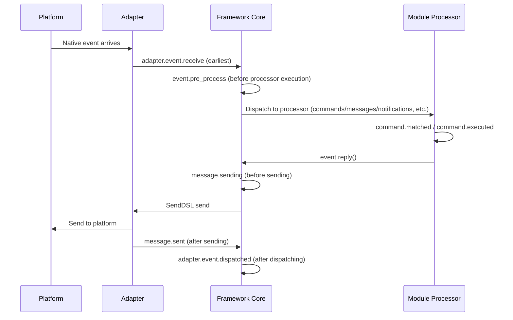

The framework provides the following built-in hook breakpoints, and users can listen to any breakpoint to implement custom logic via `@sdk.lifecycle.on()`.

### Core Initialization

| Hook Name | Trigger Timing | Data |
|---------|---------|------|
| `core.init.start` | SDK initialization starts | `{}` |
| `core.init.stage` | Each initialization stage begins (emitted in background) | `{"stage": str}`; values: `discovery` / `adapter_register` / `adapter_start` / `module_register` / `module_init` / `adapter_start_deferred` / `router_start` |
| `core.init.complete` | SDK initialization completes | `{"duration": float, "success": bool, "stages": {stage: float}, "adapters": {"enabled": [str], "disabled": [str]}, "modules": {"enabled": [str], "disabled": [str]}, "error": str (only on failure)}` |
| `core.uninit.complete` | SDK de-initialization completes | `{"duration": float, "success": bool, "adapters_closed": int, "modules_unloaded": int, "module_properties_cleared": int, "module_properties_to_clear": [str], "error": str (only on failure)}` |

**Example: Displaying Startup Progress**

```python
@sdk.lifecycle.on("core.init.stage")
def show_stage(data):
    print(f"[Startup] Entering stage: {data['stage']}")
```

### Configuration Changes

| Hook Name | Trigger Timing | Data |
|---------|---------|------|
| `config.set` | A configuration item is modified | `{"key": str, "old_value": Any, "new_value": Any}` |
| `config.updated` | Entire configuration tree is detected changed after editing config.toml externally | `{"old_config": dict, "new_config": dict, "config_file": str}` |

**Example: Configuration Audit**

```python
@sdk.lifecycle.on("config.set")
def audit_config(data):
    print(f"[Audit] {data['key']}: {data['old_value']} -> {data['new_value']}")
```

### Module Lifecycle

| Hook Name | Trigger Timing | Data |
|---------|---------|------|
| `module.register` | A module class is registered to the manager | `{"module_name": str, "success": bool}` |
| `module.load` | Module loading completes (instance successfully created); on failure, payload additionally carries `"error": str, "traceback": str` (failure context can also be queried via `module.last_error(name)`) | `{"module_name": str, "success": bool}` |
| `module.init` | Module initialization completes (including lazy loading) | `{"module_name": str, "success": bool}` |
| `module.before_unload` | First step in the unload pipeline (before `on_unload` and resource release; module instance hook `on_before_unload` is triggered synchronously) | `{"module_name": str, "reason": str}`; `reason` values: `unload` / `reload` / `disable` / `cascade` / `dormant` |
| `module.sleep` | Module hibernation completes (lazy loading sleep: resources are released, automatically awakened on access) | `{"module_name": str, "success": bool}` |
| `module.unload` | Module is unloaded or disabled (`disable` and `unload` provide equivalent notifications to dependents; `on_dependency_lost` contract includes "disabled") | `{"module_name": str, "success": bool}` |
| `module.reload` | Module hot reload completes (including cascading reload of dependencies) | `{"module_name": str, "success": bool, "full": bool, "duration_ms": int}`; single module additionally carries `"identity_changed": bool` (False = old code may still be running in the process, e.g., C extension cache) and `"version_old": str, "version_new": str`; during full reload (`reload_all`), `module_name` is `"All"`, payload additionally carries `"results": dict[str, bool]` |

> **Module instance hook `on_before_unload`**: The optional lifecycle method corresponding to the `module.before_unload` event—`event["reason"]` indicates the reason, suitable for saving state to `sdk.storage` before resource release, and restoring it in `on_load` after awakening/reload (lazy loading hibernation state continuation is based on this). Hook failure only alerts, does not block the unload process.

### Adapter Lifecycle

| Hook Name | Trigger Timing | Data |
|---------|---------|------|
| `adapter.load` | Adapter registration completes | `{"platform": str, "success": bool}` |
| `adapter.reload` | Adapter code-level hot reload completes | `{"adapter_name": str, "success": bool, "full": bool, "duration_ms": int, "identity_changed": bool, "version_old": str, "version_new": str, "was_started": bool, "source": str}`; `identity_changed=False` = old code may still be running in the process |
| `adapter.start` | Adapter starts | `{"platforms": [str]}` |
| `adapter.status.change` | Adapter status changes | `{"platform": str, "status": str, "retry_count": int, "error": str (only on failure)}`; complete status values: `starting` / `started` / `start_failed` / `stopping` / `stopped` / `stop_failed` / `skipped-dependency` / `disabled` |
| `adapter.stop` | Adapter stops | `{"platforms": [str]}` |
| `adapter.stopped` | Adapter stop completes | `{"platforms": [str]}` |
| `adapter.bot.online` | Bot goes online | `{"platform": str, "bot_id": str, "info": dict, "status": str}` |
| `adapter.bot.offline` | Bot goes offline | `{"platform": str, "bot_id": str, "status": str}` |

### Event Reception and Processing

| Hook Name | Trigger Timing | Data |
|---------|---------|------|
| `adapter.event.receive` | External platform event is received (earliest) | `{"platform": str, "event_type": str, "raw_event_type": str}` |
| `adapter.event.blocked` | Middleware blocks the event (returns `False`, event is discarded and does not enter any processor) | `{"middleware": str, "platform": str, "event_type": str, "detail_type": str, "event": dict, "_trace_id": str}` |
| `adapter.event.dispatched` | Event dispatch completes | `{"platform": str, "event_type": str, "raw_event_type": str, "onebot_handlers_count": int}` |
| `event.pre_process` | Event processor begins execution | `{"event_type": str, "platform": str, "detail_type": str}` |

**Example: Event Counting**

```python
event_counter = {}

@sdk.lifecycle.on("adapter.event.receive")
def count_events(data):
    platform = data["platform"]
    event_counter[platform] = event_counter.get(platform, 0) + 1

@sdk.lifecycle.on("adapter.event.dispatched")
def log_unhandled(data):
    if data["onebot_handlers_count"] == 0:
        print(f"[Unhandled] {data['platform']}/{data['event_type']}")
```

### Message Sending

| Hook Name | Trigger Timing | Data |
|---------|---------|------|
| `message.sending` | Message is about to be sent | `{"platform": str, "method": str, "detail_type": str, "target_id": str, "bot_id": str}` |
| `message.sent` | Message sending completes | `{"platform": str, "method": str, "detail_type": str, "target_id": str, "bot_id": str}` |

**Example: Message Sending Audit**

```python
@sdk.lifecycle.on("message.sending")
def log_sending(data):
    print(f"[Sending] -> {data['platform']}/{data['detail_type']}/{data['target_id']} via {data['method']}")
```

### Command System

| Hook Name | Trigger Timing | Data |
|---------|---------|------|
| `command.matched` | Command is matched and about to execute | `{"command": str, "args": list[str], "platform": str, "user_id": str}` |
| `command.executed` | Command execution completes | `{"command": str, "args": list[str], "platform": str, "user_id": str, "success": bool, "error": str (only on failure)}` |

**Example: Command Counting**

```python
@sdk.lifecycle.on("command.matched")
def count_commands(data):
    print(f"[Command] /{data['command']} from {data['user_id']}@{data['platform']}")
```

### HTTP Routing

| Hook Name | Trigger Timing | Data |
|---------|---------|------|
| `server.request` | HTTP request is received | `{"method": str, "path": str, "client_ip": str, "request_id": str}` |
| `server.response` | HTTP response is sent | `{"method": str, "path": str, "status_code": int, "client_ip": str, "request_id": str}` |

> `request_id` is the [X-Request-ID request correlation ID](router.md#request-correlation-idx-request-id): it is prioritized from the client request header, otherwise a UUID is generated automatically. It can be used to link the request and response events.

**Example: Request Logging**

```python
@sdk.lifecycle.on("server.response")
def log_http(data):
    print(f"[HTTP] {data['method']} {data['path']} -> {data['status_code']}")
```

### WebSocket

| Hook Name | Trigger Timing | Data |
|---------|---------|------|
| `server.start` | Router server starts | `{"base_url": str, "host": str, "port": int, "success": bool, "error": str (only on failure)}` |
| `server.stop` | Router server stops | `{}` |
| `server.websocket.connect` | WebSocket connection is established | `{"path": str, "module_name": str, "client_ip": str}` |
| `server.websocket.disconnect` | WebSocket connection is disconnected | `{"path": str, "module_name": str, "reason": str, "error": str (only on abnormal disconnection)}` |

**Example: WebSocket Connection Monitoring**

```python
@sdk.lifecycle.on("server.websocket.connect")
def on_ws_connect(data):
    print(f"[WS] Connection: {data['path']} from {data['client_ip']}")

@sdk.lifecycle.on("server.websocket.disconnect")
def on_ws_disconnect(data):
    print(f"[WS] Disconnection: {data['path']} ({data['reason']})")
```

### Storage Connection Status

Establishment, failure, and recovery of the storage backend connection pool (all emitted in background, do not block storage operations):

| Hook Name | Trigger Timing | Data |
|---------|---------|------|
| `storage.ready` | Storage backend connection pool is ready (first successful pool creation per event loop) | `{"backend": str}` |
| `storage.unreachable` | Connection retry exhaustion enters cooldown period (during which operations fail quickly) | `{"backend": str, "error": str, "cooldown": float}` |
| `storage.recovered` | Cooldown ends, reconnection succeeds, storage is restored | `{"backend": str}` |

**Example: Storage Failure Alert**

```python
@sdk.lifecycle.on("storage.unreachable")
def alert_storage_down(data):
    print(f"[Alert] Storage backend {data['backend']} is unreachable: {data['error']}, automatic reconnection in {data['cooldown']}s")

@sdk.lifecycle.on("storage.recovered")
def notify_storage_back(data):
    print(f"[Recovery] Storage backend {data['backend']} is restored and available")
```

### HTTP Client

Request and connection events of `sdk.client` (all emitted in background):

| Hook Name | Trigger Timing | Data |
|---------|---------|------|
| `client.request.success` | HTTP request succeeds | `{"method": str, "url": str, "status": int, "elapsed": float}` |
| `client.request.failed` | HTTP request finally fails after exhausting retries | `{"method": str, "url": str, "error": str, "attempts": int, "elapsed": float}` |
| `client.ws.connect` | WebSocket connection is established | `{"url": str}` |

### Internationalization

| Hook Name | Trigger Timing | Data |
|---------|---------|------|
| `i18n.language.changed` | Framework language switch (`i18n.set_language`) | `{"language": str, "previous": str}` |

## Standard Event Definitions

```python
STANDARD_EVENTS = {
    "core": ["init.start", "init.stage", "init.complete", "uninit.complete"],
    "module": ["load", "before_unload", "init", "sleep", "unload", "register", "reload"],
    "adapter": [
        "load", "start", "status.change", "reload", "stop", "stopped",
        "event.receive", "event.blocked", "event.dispatched",
        "bot.online", "bot.offline",
    ],
    "server": [
        "start", "stop",
        "request", "response",
        "websocket.connect", "websocket.disconnect",
    ],
    "event": ["pre_process"],
    "message": ["sending", "sent"],
    "command": ["matched", "executed"],
    "config": ["set", "updated"],
    "storage": ["ready", "unreachable", "recovered"],
    "client": ["request.success", "request.failed", "ws.connect"],
    "i18n": ["language.changed"],
}
```

## Complete API Reference

### Registration and Unregistration

| Method | Description |
|--------|-------------|
| `@lifecycle.on(event, *, priority=0)` | Decorator to register a handler |
| `lifecycle.register(event, handler, *, priority=0)` | Programmatic registration |
| `lifecycle.unregister(event, handler=None)` | Unregister (removes all handlers for the event if handler=None) |

### Triggering

| Method | Description |
|--------|-------------|
| `await lifecycle.emit(event, data=None, *, to=None)` | Asynchronously trigger; handlers execute **in parallel** (non-blocking, returns when all complete), and non-None return values are replayed in priority order to chain and replace data; `to` specifies owner for directed delivery |
| `lifecycle.fire(event, data=None, *, to=None)` | **Fire and forget (fire-and-forget)**: Handlers execute in background tasks in parallel, no waiting, no return value; zero overhead if no listeners; suitable for high-frequency hot paths and pure observation events; use `emit` for shutdown sequences and order-sensitive consumption (e.g. `config.set`) |
| `lifecycle.emit_sync(event, data=None, *, to=None)` | Synchronously trigger; asynchronous handlers are scheduled with create_task |
| `await lifecycle.submit_event(event_type, *, source, msg, data, to=None, background=False)` | Backward compatibility, automatically builds standard event format; `background=True` uses `fire` for background firing |

**Comparison of the four trigger APIs**:

| Method | Invocation Style | Wait for Handlers to Complete | Typical Scenarios |
|--------|------------------|-------------------------------|-------------------|
| `emit` | `await` (asynchronous) | **Wait**—handlers execute in parallel, return when all complete, return values replayed in priority order | Regular triggering; order-sensitive consumption (`config.set`) and shutdown sequences must use it |
| `fire` | Direct call (synchronous return) | **Do not wait**—handlers execute in background tasks in parallel, no return value; zero overhead if no listeners | High-frequency hot paths and pure observation events (`server.request` / `storage.ready`) |
| `emit_sync` | Direct call (synchronous) | Synchronous handlers complete immediately; asynchronous handlers are scheduled with `create_task` (return values cannot be returned) | Triggering events in non-async contexts (synchronous code) |
| `submit_event` | `await` (asynchronous) | Wait (same as `fire` if `background=True`) | Backward compatibility: automatically builds standard event format (`source` / `msg` / `timestamp`) |

### Utilities

| Method | Description |
|--------|-------------|
| `lifecycle.start_timer(timer_id)` | Start timing |
| `lifecycle.get_duration(timer_id)` | Get elapsed time (in seconds) |
| `lifecycle.stop_timer(timer_id)` | Stop timing and return elapsed time |
| `lifecycle.list_hooks()` | List all registered hooks and the number of handlers |
| `lifecycle.clear()` | Clear all handlers and timers |

## Example Usage in Module

```python
from ErisPulse.Core.Bases import BaseModule
from ErisPulse import sdk

class Main(BaseModule):
    async def on_load(self, event):
        # Implement simple message counting
        self.msg_count = 0
        
        @sdk.lifecycle.on("adapter.event.receive")
        async def count(data):
            if data["event_type"] == "message":
                self.msg_count += 1
        
        # Monitor all commands
        @sdk.lifecycle.on("command.matched")
        async def log_cmd(data):
            sdk.logger.info(f"Command executed: /{data['command']} by {data['user_id']}")
        
        # Configuration change audit
        @sdk.lifecycle.on("config.set")
        def audit(data):
            sdk.logger.info(f"Configuration change: {data['key']} = {data['new_value']}")
```

## Background Task Ownership and Automatic Cancellation

> [!NOTE]
> This feature requires ErisPulse **2.8.0+**.

Background asyncio tasks created by a module that are not canceled in `on_unload` will hold a reference to `self`, preventing the module instance from being collected (old instances remain after hot reload). The framework provides the following fallback mechanism:

- **`self.spawn(coro)`** (recommended within module): Task automatically belongs to module name; framework automatically cancels unfinished tasks and logs warnings after `on_unload` when the module is unloaded
- **`spawn_background(coro)`** (from `ErisPulse.runtime`): Automatically captures current `owner_scope` context; `cancel_owner_tasks(owner)` cancels by ownership, `cancel_all_background_tasks()` is provided for `sdk.uninit()` fallback
- **Adapters**: Background tasks under platform name are also automatically canceled when adapter stops

```python
async def on_load(self, event):
    # Recommended: Use self.spawn() for background tasks, framework automatically cancels them after unload
    self.spawn(self._poll())

async def on_unload(self, event):
    # For fine control, still recommend manually canceling and waiting for cleanup
    if self._poll_task:
        self._poll_task.cancel()
        await asyncio.gather(self._poll_task, return_exceptions=True)

async def _poll(self):
    while True:
        await asyncio.sleep(60)
        ...
```

> [!IMPORTANT]
> Framework fallback is **forced cancellation** (`cancel_owner_tasks`), which occurs after `on_unload` returns. Therefore, tasks requiring graceful cleanup (flush buffers, persist state, close connections) **must** manually `cancel()` and `await` completion in `on_unload` — do not rely on fallback to preserve cleanup logic. Framework only guarantees "no lingering tasks holding `self`", not "graceful". For tasks requiring `await` results, directly `await`, do not throw them into background tasks.

## Notes

1. **Handlers can be synchronous or asynchronous**: The system automatically identifies and correctly calls them
2. **Data passing**: In `emit()` mode, non-None values returned by handlers modify the data passed to subsequent handlers
3. **Event naming convention**: Use dot-structure naming for events, making parent listening easier
4. **Error isolation**: Exception in a single handler does not affect execution of other handlers
5. **Synchronous trigger limitation**: In `emit_sync()`, asynchronous handlers are scheduled fire-and-forget, return values cannot be returned
6. **Lifecycle cleanup**: When `sdk.uninit()` is called, all registered handlers and timers are cleared
7. **Loading priority**: If you need to listen to events during the framework initialization phase, it is recommended to set a high priority and disable lazy loading


### 懶加载系统

# Lazy-Loading Module System

> [!TIP]
> **When to read this**: When using lazy-loaded modules or `activate_on` event-driven activation. Skip it if not needed; it does not affect the use of any other features.


The lazy-loading module system of the ErisPulse SDK allows modules to defer initialization until they are **actually accessed** — during startup, only placeholder proxies are registered, and modules that are never used consume no startup time or memory.

## Overview

The lazy-loading module system is one of ErisPulse's core features. It works in the following ways:

- **Deferred initialization**: A module is only actually loaded and initialized the first time it is accessed
- **Transparent usage**: For developers, lazy-loaded modules are almost indistinguishable from regular modules in usage
- **Automatic dependency management**: Module dependencies are automatically initialized when used
- **Lifecycle support**: For modules inheriting from `BaseModule`, lifecycle methods are called automatically

## How It Works

### The LazyModule Class

The core of the lazy-loading system is the `LazyModule` class, a wrapper that only actually initializes the module on first access.

### Initialization Process

When a module is first accessed, `LazyModule` performs the following operations:

1. Retrieves the `__init__` parameter information of the module class
2. Decides whether to pass in the `sdk` reference based on the parameters
3. Sets the module's `moduleInfo` attribute
4. For modules inheriting from `BaseModule`, calls the `on_load` method
5. Triggers the `module.init` lifecycle event

## Event-Driven Lazy Activation (activate_on)

> [!NOTE]
> This feature requires ErisPulse **2.8.0+**.

Modules with `lazy_load=True` are by default only loaded on **first attribute access**. If a module registers command/event handlers,
the traditional approach is to set `lazy_load=False` for immediate loading. `activate_on` provides a third option: **declare triggers,
and the module is automatically activated when the first matching event/command arrives** — it neither stays resident in memory nor loses its trigger entry points.

```python
from ErisPulse.loaders import ModuleLoadStrategy

class MyModule(BaseModule):
    @staticmethod
    def get_load_strategy():
        return ModuleLoadStrategy(
            lazy_load=True,
            activate_on=[
                # ---- Event triggers (passively arriving; no user awareness required) ----
                "message",                                    # Type-level: any message event
                {"notice": "group_member_increase"},          # Type + a single detail_type
                {"message": ["private", "group"]},            # Type + multiple detail_types

                # ---- Command triggers (active input; placeholder commands visible to Help) ----
                {"command": "roll"},                          # Shorthand: command name
                {"command": ["roll", "dice"]},                # List of command names
                {"command": {                                 # dict declaration (name is required)
                    "name": "dice",
                    "help": "Roll a dice",
                    "usage": "/dice",
                    "group": "Entertainment",
                    "aliases": ["d"],
                    "hidden": False,
                }},
            ],
        )
```

### Command dict Declaration Parameters

The dict form mirrors the user-level parameters of the `@command()` decorator, used to register placeholder commands before the module is loaded:

| Parameter | Type | Default | Description |
|------|------|------|------|
| `name` | `str` | **Required** | Command name; must match `@command(name)` in `on_load`, otherwise after activation the placeholder is unregistered and the command no longer exists |
| `help` | `str` | Fallback chain | Description shown in Help; if not declared, values are taken via the fallback chain (see below) |
| `usage` | `str` | Auto-generated | Usage line, default `{prefix}{name}` |
| `group` | `str` | `None` | Command group |
| `aliases` | `list[str]` | `[]` | Aliases registered at the same time; **typing an alias also triggers activation** |
| `hidden` | `bool` | `False` | When `True`, the placeholder command is likewise hidden (aligned with the hidden semantics of the real command after activation); users who know the command name can still trigger it by typing it |

`priority` / `permission` / `master` are **not supported**: the placeholder command's sole mission is to trigger activation;
permission checks are performed by the real command after activation (intercepting permissions at the placeholder stage would instead break "activation by typing the command").

### Placeholder Command help Fallback Chain

The command description shown by Help before the module is loaded is taken in the following order (stopping at the first hit):

1. Command-level `help` in the dict declaration (most precise)
2. `description` from the module's `get_meta()`
3. The module's `__description__` attribute
4. The package metadata's `Summary` (PyPI package brief)
5. Generic hint: "This command comes from lazy-loaded module X; first use will automatically load that module"

### Trigger Semantics

- **Event stubs**: Registered with the corresponding event manager at an extremely low priority (`ACTIVATION_STUB_PRIORITY`),
  firing as a fallback after all regular handlers; after activation, the current event is forwarded to the module's real handlers
- **Command stubs**: Placeholder commands are registered; after activation, the placeholder is unregistered and the real command takes over the current trigger
- **Re-entrancy prevention**: `asyncio.Lock` guarantees that the module is activated only once under concurrent triggers
- **Scope filtering**: Stubs carry the module's owner identity and do not trigger when the module is not enabled for that Bot / session / platform
- **Failure semantics**: Failed activation enters a cooldown period (`ACTIVATE_RETRY_COOLDOWN_SECS`, 30 seconds);
  events are short-circuited during the cooldown to avoid repeated attempts; after the cooldown ends, the next trigger retries automatically, with the stub retained throughout
- **Deduplication**: When commands with the same name are declared as a mix of shorthand + dict, they are deduplicated (dict takes precedence); a dict missing `name`,
  or an event `detail_type` mistakenly written as a dict, produces a warning and is ignored

> For the architecture diagram and complete semantics, see [Architecture Overview](../architecture.md#event-driven-lazy-activation-activate_on-trigger-architecture).

## Lazy-Load Dormancy (dormant_after)

> [!NOTE]
> This feature requires ErisPulse **2.11.0+**.

After a lazily-activated module has been idle for a long time, the framework can put it into **dormancy**: runtime resources are released (owned tasks / connections / event registrations),
while the lazy-load proxy and registration stubs are kept — the module returns to the "registered but not loaded" state, and the next attribute access /
`module.call` / `activate_on` event **transparently wakes it up** (re-instantiating it and running `on_load`),
with no wake-up API needed. The system state after dormancy is exactly the same as "never activated".

### Declaration

```python
@staticmethod
def get_load_strategy():
    return ModuleLoadStrategy(
        lazy_load=True,
        dormant_after="30m",   # Auto-dormant after 30 minutes idle; not declared = never dormant (default)
    )
```

The duration syntax is exactly the same as the `cooldown` of command governance (`90s` / `1h30m` / `1d`). The sweeper scans at fixed intervals
(60 seconds), so the actual dormancy time = threshold + at most one scan interval; you can also put a module to sleep manually at any time:
`await sdk.module.sleep("module_name")`. Explicit `unload` still performs a full unload (the lazy proxy is removed as well).

### State Continuation

Before dormancy, the framework triggers `on_before_unload(reason="dormant")` (the first step of the unload pipeline, with resources still intact);
the module saves its state to `sdk.storage` and restores it in `on_load` after wake-up:

```python
async def on_before_unload(self, event):
    if event["reason"] in ("dormant", "reload", "disable"):
        await self.sdk.storage.aset(f"{self._module_name}:counter", self._count)

async def on_load(self, event):
    self._count = await self.sdk.storage.aget(f"{self._module_name}:counter") or 0
```

### Semantics and Boundaries

- **Dependency safety**: Dependents of a lazy module access it via the persistent proxy (`sdk.<Name>`) or `module.call`,
  and behavior is consistent before and after dormancy; directly holding references to real instances is an anti-pattern (visible to the leak auditor)
- **Events not delivered**: A dormant module no longer receives events — modules that need event-based wake-up should also declare `activate_on`
  (the event wakes the module first, then is forwarded); when troubleshooting "commands not responding", check whether the module is in a dormant state
- **Wake-up failures are self-healing**: A failed wake-up (re-initialization) enters a 30-second cooldown; after the cooldown, the next access retries automatically,
  without permanent failure

## Configuring Lazy Loading

### Global Configuration

Enable/disable global lazy loading in the configuration file:

```toml
[ErisPulse.framework]
enable_lazy_loading = true  # true = enable lazy loading (default), false = disable lazy loading
```

### Module-Level Control

Modules can control the loading strategy by implementing the `get_load_strategy()` static method:

```python
from ErisPulse.Core.Bases import BaseModule
from ErisPulse.loaders import ModuleLoadStrategy

class MyModule(BaseModule):
    @staticmethod
    def get_load_strategy():
        """Returns the module loading strategy"""
        return ModuleLoadStrategy(
            lazy_load=False,  # Returning False means immediate loading
            priority=100      # Loading priority; higher values mean higher priority
        )
```

## Using Lazy-Loaded Modules

### Basic Usage

For developers, lazy-loaded modules are almost indistinguishable from regular modules in usage:

```python
# Access a lazy-loaded module via the SDK
from ErisPulse import sdk

# The following access triggers the module's lazy loading
result = await sdk.my_module.my_method()
```

### Unified Module Access Entry Point

Whether accessed via SDK attributes, module manager attributes, or queried via `module.get()`,
for lazy-loaded modules that are "registered but not yet loaded", the same lazy-loading proxy is returned; accessing its attributes is what actually triggers initialization:

```python
# All three approaches return the lazy-loading proxy (when the module is not loaded), with consistent, transparent behavior
sdk.my_module          # Entry point that triggers loading
sdk.module.my_module   # Also returns the lazy-loading proxy
sdk.module.get("my_module")  # Also returns the lazy-loading proxy; it does not itself trigger loading

# Only accessing any attribute of the proxy actually initializes the module
result = await sdk.my_module.my_method()
```

`module.get()` is a **query** interface and does not itself trigger loading:
- Module loaded → returns the real instance
- Module registered but not loaded → returns the lazy-loading proxy (initialization occurs on attribute access)
- Module not registered → returns `None`

To explicitly trigger loading, use `await sdk.load_module("my_module")`.

### Asynchronous Initialization

For modules that require asynchronous initialization, explicit loading is recommended first:

```python
# Explicitly load the module first
await sdk.load_module("my_module")

# Then use the module
result = await sdk.my_module.my_method()
```

### Synchronous Initialization

For modules that do not require asynchronous initialization, direct access works:

```python
# Direct access automatically initializes synchronously
result = sdk.my_module.some_sync_method()
```

## Best Practices

When choosing a loading strategy, refer to the following decision flow:

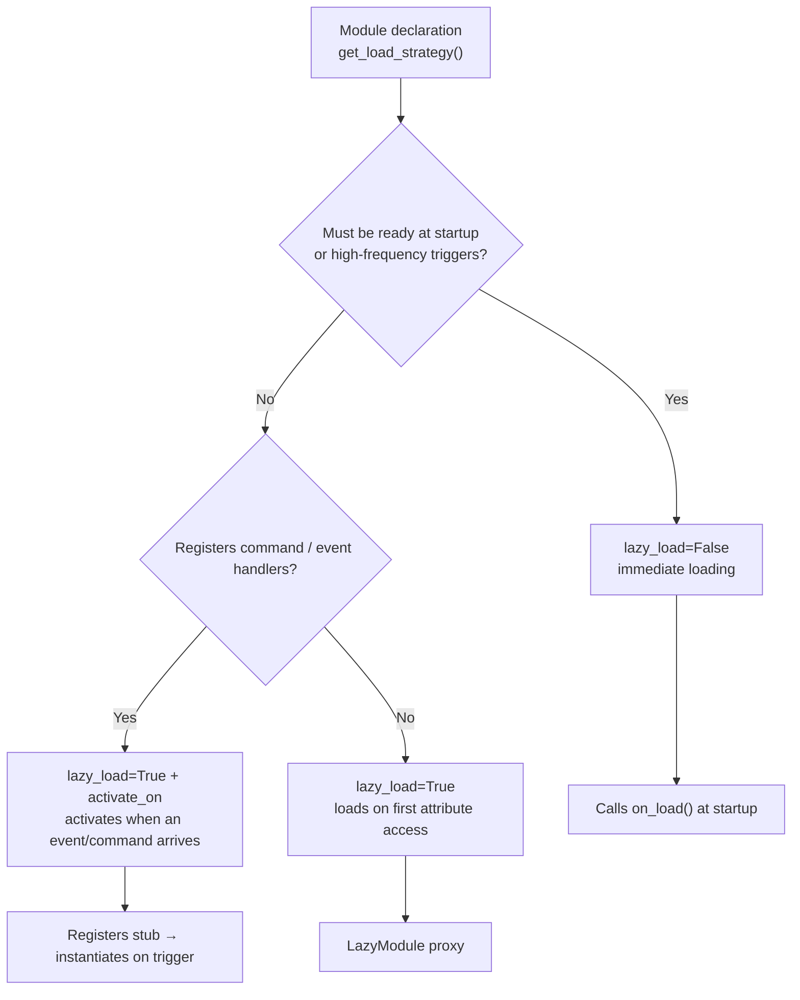

### Scenarios Where Lazy Loading Is Recommended (lazy_load=True)

- Passively invoked utility modules (e.g., data query modules, format converters, etc. — only needed when called by other modules)
- Modules that register command/event handlers but are not used frequently — declare triggers with `activate_on`; the module is automatically activated when the first matching event/command arrives, without giving up lazy loading

### Scenarios Where Disabling Lazy Loading Is Recommended (lazy_load=False)

- Modules that need to be ready immediately at startup (e.g., core modules that provide foundational services for other modules)
- Frequently triggered listeners (need to process every message) — `activate_on` forwarding incurs a one-time activation overhead; immediate loading is more direct in high-frequency scenarios
- Scheduled task modules
- Modules that must be initialized at application startup

> The `priority` parameter controls the initialization order among immediately-loaded modules; higher values are initialized first. Modules with the same priority are loaded in registration order.

## Notes

1. If your module uses lazy loading and no other module ever calls it within ErisPulse, your module will never be initialized.
2. If your module contains components such as Event listeners or other actively listening components, you have two options: declare `activate_on` triggers (keeping lazy loading, automatically activating when events arrive), or declare that it needs to be loaded immediately (`lazy_load=False`); otherwise your module's normal operation will be affected.
3. We do not recommend disabling lazy loading unless you have special needs; otherwise it may cause problems such as dependency management and lifecycle event issues.
4. In the `activate_on` command dict declaration, `name` must match the real command name registered by `@command()` in the module's `on_load` — otherwise, after the module is activated, the placeholder command is unregistered and a command whose declaration does not match its implementation will not exist.


### 国际化（i18n）系统

# Internationalization (i18n) System

> [!TIP]
> **When to read this**: When you need multi-language content, translation registration, or language detection. Skip if not needed, as it does not affect the use of other features.

ErisPulse v2.5.0 includes full internationalization support. The framework core and CLI interface can automatically switch display text based on your system language, and external modules can register their own translations.

## Supported Languages

| Language | Code | Description |
|----------|------|-------------|
| Simplified Chinese | `zh-CN` | Default language (native framework language) |
| Traditional Chinese | `zh-TW` | Traditional Chinese (Hong Kong / Macau / Taiwan) |
| English | `en` | English (fallback language) |
| 日本語 | `ja` | Japanese |
| Русский | `ru` | Russian |

## Quick Experience

### Switch via Environment Variable

```bash
# Windows PowerShell
$env:ERISPULSE_LANG = "en"
epsdk run

# macOS / Linux
ERISPULSE_LANG=ja epsdk run
```

### Switch via Configuration File

Add the following to `config/config.toml`:

```toml
[ErisPulse.i18n]
language = "zh-TW"
```

Set to `"auto"` (default) to automatically detect the system language.

### Switch Manually in Code

```python
from ErisPulse import i18n

# Manually set language
i18n.set_language("en")
print(i18n.get_language())  # "en"

# Reset to automatic detection
i18n.reset_language()
```

---

## Language Detection Mechanism

The framework detects user language in the following priority order:

1. **Environment Variable `ERISPULSE_LANG`** — Highest priority, used for testing and temporary switching
2. **Windows API** — `GetUserDefaultLocaleName` (Windows only, unaffected by tools like Git Bash that override `LANG`)
3. **Environment Variables** — `LANGUAGE` > `LC_ALL` > `LC_MESSAGES` > `LANG` (Unix/macOS standard)
4. **System Locale** — `locale.getlocale()` / `locale.getdefaultlocale()`
5. **Fallback** — en (English)

### Nearest Mapping Principle

When the detected language is not an exact match, it is mapped to the closest supported language:

- `zh-TW`, `zh-HK`, `zh-MO`, `zh-Hant` → **Traditional Chinese**
- All other `zh-*` (e.g., `zh-CN`, `zh-SG`) → **Simplified Chinese**
- `en-US`, `en-GB`, `en-AU`, etc. → **English**
- `ja-JP` → **Japanese**
- `ru-RU` → **Russian**
- Other unrecognized languages → **Simplified Chinese (fallback)**

---

## Using i18n in Modules

You can register translation text for your own modules, allowing your modules to support multiple languages.

### Recommended Approach: Declare Translation Keys via I18nClass (v2.7.0+)

Starting from v2.7.0, modules/adapters can declare translation keys by embedding a nested class `I18nClass`, similar to declaring `ConfigClass`. The framework will automatically register all declared translation keys during loading, eliminating the need to manually call `i18n.register()`.

```python
from dataclasses import dataclass, field

from ErisPulse.Core.Bases import BaseConfig, BaseI18n, BaseModule, I18nKey


class MyModule(BaseModule):
    # Configuration class (optional)
    @dataclass
    class ConfigClass(BaseConfig):
        welcome_msg: str = field(
            default="欢迎",
            metadata={
                # This references the i18n key mymodule.welcome_msg
                "description": {"i18n": "mymodule.welcome_msg", "default": "Welcome message"},
            },
        )

    # Translation key collection class (optional)
    # Declared keys will be automatically registered by the framework, taking precedence over ConfigClass-generated defaults
    class I18nClass(BaseI18n):
        # Property names are automatically concatenated to form the full key path: <module name>.<property name>
        welcome_msg: I18nKey = I18nKey(
            default="Welcome Message",   # Language-agnostic fallback, not registered to any language
            zh_CN="欢迎消息",
            en="Welcome Message",
            ja="ウェルカムメッセージ",
            ru="Приветственное сообщение",
            zh_TW="歡迎訊息",
        )
        # Other translation keys used in business logic
        hello: I18nKey = I18nKey(
            default="Hello, {name}!",
            zh_CN="你好，{name}！",
            zh_TW="你好，{name}！",
            en="Hello, {name}!",
            ja="こんにちは、{name}！",
            ru="Привет, {name}!",
        )

        # You can also explicitly specify the full key path (not using property name concatenation)
        custom: I18nKey = I18nKey(
            key="mymodule.deep.nested.key",
            default="Default text",
            zh_CN="默认文本",
            zh_TW="預設文本",
            en="Default text",
            ja="デフォルトテキスト",
            ru="Текст по умолчанию",
        )
```

#### Why is I18nClass Recommended?

| Scenario | Manual i18n.register() | I18nClass Declarative |
|----------|------------------------|-----------------------|
| i18n keys referenced in configuration descriptions | Must be manually registered, and must be done before configuration generation | Framework automatically registers before configuration generation |
| Multi-language translation declarations | Scattered across various on_load() methods |集中 in a class, clearly visible |
| Key naming consistency | Prone to typos | Property names as key suffixes, IDE can auto-complete |
| Cleanup on unload | Must manually unregister_domain() | Framework uses unified domain registration |

#### I18nClass Key Path Rules

- **Default**: Use ``<module registration name>.<property name>`` as the full key path
  - Example: Module name is ``MyModule``, property ``welcome`` → key path ``MyModule.welcome``
- **Explicit**: Specify any dot-separated path via the ``I18nKey(key="...")`` parameter
  - Suitable for deeply nested key names (e.g., ``mymodule.config.basic.token``)

#### Using in Adapters

Adapters also support `I18nClass`, with the same usage:

```python
from ErisPulse.Core import BaseAdapter
from ErisPulse.Core.Bases import BaseConfig, BaseI18n, I18nKey


class MyAdapter(BaseAdapter):
    @dataclass
    class ConfigClass(BaseConfig):
        endpoint: str = field(
            default="",
            metadata={
                # Configuration description references the adapter.MyAdapter.endpoint key
                "description": {"i18n": "MyAdapter.endpoint", "default": "API address"},
            },
        )

    class I18nClass(BaseI18n):
        # Central declaration of configuration description references and other business keys' multi-language translations
        endpoint: I18nKey = I18nKey(
            default="API Endpoint",
            zh_CN="API 地址",
            zh_TW="API 位址",
            en="API Endpoint",
            ja="APIアドレス",
            ru="API адрес",
        )
```

The `I18nClass` of an adapter is automatically registered during the `__init__` phase (before configuration template generation), ensuring that i18n keys referenced in configuration descriptions are available.

### Manual Registration of Custom Translations (Old Approach)

If you do not use `I18nClass`, you can directly call `i18n.register()` to register translation text.

```python
from ErisPulse import i18n

# Register Chinese translation
i18n.register("zh-CN", {
    "my_module.welcome": "欢迎使用我的模块！",
    "my_module.goodbye": "再见！",
    "my_module.hello": "你好，{name}！",
}, domain="my_module")

# Register English translation
i18n.register("en", {
    "my_module.welcome": "Welcome to my module!",
    "my_module.goodbye": "Goodbye!",
    "my_module.hello": "Hello, {name}!",
}, domain="my_module")
```

### Using Translations

```python
from ErisPulse import i18n

# Simple translation
i18n.t("my_module.welcome")  # Automatically uses current language

# With formatted parameters
i18n.t("my_module.hello", name="Alice")

# Specify default value (returned if translation key does not exist)
i18n.t("my_module.unknown_key", default="Default text")
```

### Using in Module Class

```python
from dataclasses import dataclass, field
from ErisPulse import i18n
from ErisPulse.Core.Bases import BaseConfig, BaseModule

@dataclass
class MyModuleConfig(BaseConfig):
    welcome_msg: str = field(
        default="欢迎",
        metadata={
            "description": {"i18n": "my_module.welcome_msg", "default": "Welcome message"},
            "ui": {"widget": "text", "group": "basic", "order": 1},
        },
    )

class MyModule(BaseModule):
    ConfigClass = MyModuleConfig

    async def on_load(self, event):
        # Dynamically read configuration (reflects latest value on each access)
        self.logger.info(self.cfg.welcome_msg)
        self.logger.info(i18n.t("my_module.welcome"))

    @command("hello")
    async def hello_handler(self, event):
        name = event.get_user_nickname() or "friend"
        await event.reply(i18n.t("my_module.hello", name=name))

    async def on_unload(self, event):
        pass
```

### Unregistering Translations

```python
# Unregister all translations in a domain
i18n.unregister_domain("my_module")
```

---

## Multi-language Configuration Fields

Starting from v2.5.2, configuration Schema fully supports i18n. All user-visible text fields can reference i18n keys, and WebUI and other consumers will automatically resolve them to corresponding text based on the current language.

### Supported i18n Fields

| Field | Location | Description |
|-------|----------|-------------|
| `description` | field metadata | Field description |
| `options[].label` | `ui.options` | Select control option labels |
| `placeholder` | `ui.placeholder` | Input field placeholder |
| `group_labels` | `_schema_meta` | Group display name (Dashboard section title) |

All use the `{"i18n": "key", "default": "text"}` format. Pure strings are passed through as-is (for backward compatibility).

### Declaring i18n Fields

All user-visible text fields support i18n:

```python
from dataclasses import dataclass, field
from ErisPulse.Core.Bases import BaseConfig

@dataclass
class MyAdapterConfig(BaseConfig):
    # i18n for description
    token: str = field(
        default="",
        metadata={
            "description": {"i18n": "my_adapter.token", "default": "Platform Token"},
            "required": True,
            "secret": True,
            "ui": {
                "widget": "password",
                "group": "basic",
                "order": 1,
                # i18n for placeholder
                "placeholder": {"i18n": "my_adapter.token.ph", "default": "Enter Token"},
            },
        },
    )
    # i18n for options label
    mode: str = field(
        default="a",
        metadata={
            "description": {"i18n": "my_adapter.mode", "default": "Operation mode"},
            "ui": {
                "widget": "select",
                "group": "basic",
                "order": 2,
                "options": [
                    {"label": {"i18n": "my_adapter.mode.a", "default": "Mode A"}, "value": "a"},
                    {"label": {"i18n": "my_adapter.mode.b", "default": "Mode B"}, "value": "b"},
                ],
            },
        },
    )

    # i18n for group_labels (group display name)
    _schema_meta = {
        "group_labels": {
            "basic": {"i18n": "my_adapter.group.basic", "default": "Basic Settings"},
        }
    }
```

`default` is the fallback text — displayed when translation is not registered or lookup fails.

### Secret Masking and Configuration Validation

Fields marked as `"secret": True` will automatically receive **masking protection** (from v2.7.0 onwards):

- **Template generation masking**: When `dataclass_to_toml_with_comments()` generates configuration templates, secret field values are not written to the file (empty placeholders are used), preventing sensitive information from being written to disk
- **General masking utility**: `redact_secret(value)` replaces non-empty values with `***`, returns empty values as-is, and can be used in scenarios such as logging output

```python
from ErisPulse.Core.Bases.config_schema import redact_secret

redact_secret("sk-xxxxxx")  # '***'
redact_secret("")           # ''
```

**Configuration validation** (`validate_config()`) includes non-empty checks for `required` fields, and from v2.7.0 onwards supports:

| Validation | Metadata | Example |
|------------|----------|---------|
| Type match | Field declaration type | `int` field with string input raises an error |
| Enum constraint | `ui.options` or top-level `options` | Value must be one of the allowed options |
| Numeric range | Top-level `min` / `max` | `metadata={"min": 1, "max": 65535}` |

```python
from ErisPulse.Core.Bases.config_schema import validate_config

@dataclass
class C(BaseConfig):
    mode: str = field(default="a", metadata={"ui": {"widget": "select", "options": ["a", "b"]}})
    port: int = field(default=80, metadata={"min": 1, "max": 65535})

errors = validate_config(C(mode="x", port=70000))  # Two errors: enum + range
```

### Registering Configuration Translations

Configuration field i18n keys are registered the same way as regular translation keys using `i18n.register()`:

```python
from ErisPulse import i18n

# Register Chinese (same as default, can be different)
i18n.register("zh-CN", {
    "my_adapter.token": "平台 Token",
}, domain="my_adapter")

# Register English
i18n.register("en", {
    "my_adapter.token": "Platform Token",
}, domain="my_adapter")
```
> **Recommended approach**: Use `I18nClass` to declare translation keys, as the framework will automatically register them (see the "Recommended Approach" section above),
> eliminating the need to manually call `i18n.register()` or `register_config_i18n()`.

A convenient function `register_config_i18n()` is also provided, which automatically extracts keys from the configuration class and registers them:

```python
from ErisPulse.Core.Bases.config_schema import register_config_i18n

# Automatically extract description.default as zh-CN translation
register_config_i18n(MyAdapterConfig, "zh-CN")

# Manually provide English translation
register_config_i18n(MyAdapterConfig, "en", {
    "my_adapter.token": "Platform Token",
})
```

### How WebUI Consumes

The schema returned by `get_config_schema()` passes through the i18n dictionary as-is. The WebUI frontend can resolve it using `i18n.t()` based on the current language.

If the server needs to directly resolve to a string (e.g., for a frontend that does not support i18n), use `resolve_config_schema()`, which resolves `description`, `options[].label`, `placeholder`, and `group_labels` to the current language's text:

```python
from ErisPulse.Core.Bases.config_schema import resolve_config_schema

# All i18n fields are resolved to the current language's string
schema = resolve_config_schema(MyAdapterConfig)
print(schema["fields"]["token"]["description"])    # "平台 Token" or "Platform Token"
print(schema["fields"]["token"]["placeholder"])   # "请输入 Token" or "Enter Token"
print(schema["fields"]["mode"]["options"][0]["label"])  # "模式A" or "Mode A"
print(schema["group_labels"]["basic"])             # "基本设置" or "Basic"
```

> `BaseConfig`, `BotAccountConfig`, `register_config_i18n()`, `resolve_config_schema()`
> and other types and utility functions are actually defined in `ErisPulse.Core.Bases.config_schema`.
> `ErisPulse.runtime.config_schema` is retained as a compatibility shim,
> **recommended to import uniformly from `ErisPulse.Core.Bases`** (except i18n translation key-related types,
> which are located in `ErisPulse.Core.Bases.i18n_schema`).

## API Reference

### I18nManager

#### Core Methods

| Method | Description |
|--------|-------------|
| `t(key, default=None, **kwargs)` | Get translated text (`gettext()` is an alias) |
| `set_language(lang)` | Manually set language |
| `get_language()` | Get current language |
| `reset_language()` | Reset to automatic detection (and re-detect environment) |
| `get_supported_languages()` | Get list of all supported languages |
| `has_translation(key, lang=None)` | Check if translation key exists |
| `register(lang, translations, domain)` | Register custom translation |
| `unregister_domain(domain)` | Unload all translations in specified domain |
| `reload()` | Reload built-in translations and re-detect language |

#### `t()` Method Details

```python
def t(self, key, /, default=None, **kwargs):
```

- `key` — Translation key (positional argument only, does not conflict with `key=` in `**kwargs`)
- `default` — Default value returned if translation does not exist, defaults to `None` (returns key name itself)
- `**kwargs` — Formatting arguments to fill placeholders in translation values

Example:

```python
# Translation definition: "greeting": "你好，{name}！欢迎来到{place}。"
i18n.t("greeting", name="Alice", place="ErisPulse")
# Returns: "你好，Alice！欢迎来到ErisPulse。"
```

### BaseI18n / I18nKey (Declarative Translation Keys)

Starting from v2.7.0, `ErisPulse.Core.Bases` provides a class attribute-based translation key declaration tool (recommended to import uniformly from `ErisPulse.Core.Bases`):

> ``I18nKey.default`` is a **language-agnostic fallback text**, not registered to any language.
> To make translations effective, at least one language parameter must be explicitly provided (``zh_CN=`` / ``en=`` / ``ja=`` etc.).
> This allows developers from different countries to freely use their native language to fill in ``default``, and the framework does not make any assumptions.

| Name | Description |
|------|-------------|
| `I18nKey(default, *, key=None, zh_CN, zh_TW, en, ja, ru)` | Single translation key declaration, `default` is language-agnostic fallback |
| `BaseI18n` | Translation key collection base class (naming aligned with `BaseConfig`), sub-classes declare multiple `I18nKey` as class attributes |
| `BaseI18n.register(prefix="", domain="app")` | Class method: register all declared keys to the i18n system |
| `key` | Alias for `I18nKey` (more concise writing) |

Example usage:

```python
from ErisPulse.Core.Bases import BaseI18n, key

class MyKeys(BaseI18n):
    # Concise alias writing
    hello = key(
        default="Hello",
        zh_CN="你好",
        zh_TW="你好",
        en="Hello",
        ja="こんにちは",
        ru="Привет",
    )
    bye = key(
        default="Bye",
        zh_CN="再见",
        zh_TW="再見",
        en="Bye",
        ja="さようなら",
        ru="До свидания",
    )

# Standalone usage (manual registration)
MyKeys.register(prefix="myapp.", domain="myapp")
```

### Accessing via SDK Instance

```python
from ErisPulse import sdk

# sdk.i18n and directly imported i18n are the same object
sdk.i18n.set_language("en")
print(sdk.i18n.t("core.sdk.init.starting"))
```

---

## Runtime Configuration

### Reading i18n Configuration via Configuration API

```python
from ErisPulse.Core.Bases import I18nConfig
from ErisPulse.runtime import get_i18n_config

config = get_i18n_config()
print(config["language"])  # "auto" or specific language code

# I18nConfig is a dataclass, can be used to generate configuration templates
schema = I18nConfig.__dataclass_fields__
```

### Configuration Item Explanation

In the `[ErisPulse.i18n]` section of `config/config.toml`:

```toml
[ErisPulse.i18n]
# Display language, possible values:
# - "auto"      — Automatically detect system language (default)
# - "zh-CN"     — Simplified Chinese
# - "zh-TW"     — Traditional Chinese
# - "en"        — English
# - "ja"        — Japanese
# - "ru"        — Russian
language = "auto"
```

---

## Best Practices

### Translation Key Naming

It is recommended to use a dot-separated namespace format:

```
<module name>.<category>.<description>
```

For example: `my_module.command.hello_desc`, `core.adapter.start_failed`

### Multi-language Coverage

You do not need to provide translations for all languages at once. Missing languages will automatically fall back to English, and if English is also missing, the key name itself will be displayed.

### Dynamic Content

For dynamically generated content (such as usernames, quantities, etc.), use `{placeholder}` formatting:

```python
# Translation definition
"user_count": "Current online users: {count} people"

# Usage
i18n.t("user_count", count=len(users))
```

### Log Messages

If your module uses the framework's Logger, these messages will also automatically use the current language:

```python
self.logger.info(i18n.t("my_module.startup"))
```

---

## Relationship with CLI i18n

The CLI has an **independent** internationalization module (`ErisPulse.CLI.i18n`), which is completely decoupled from the framework core's internationalization module.

- **Core i18n** — Used by framework core modules, external modules can register translations
- **CLI i18n** — Used internally by the command-line interface, does not share translation data with Core

This design ensures that changes to CLI translations do not affect the stability of the framework core.


### 统一控制面（scope）

# Scope

> [!TIP]
> **When to read this**: When you need to control module availability, event admission, or outbound action restrictions. Skip if not needed, it does not affect the use of other features.

> **After reading you will know**: The configuration paths, priority and rejection behaviors for the three scope dimensions (module availability / event admission / outbound actions), the usage of runtime API, and how interception is observable (via the `scope.blocked` event).
>
> **This section does not cover**: Resource ownership and unloading (see [Ownership (owner) system](ownership.md)); command ACL and event overrides (see [Event Handling Introduction](../getting-started/event-handling.md)).

> [!NOTE]
> This feature requires ErisPulse **2.8.0+**.

Scope answers four questions: **Which modules are available, which events are received, what text a module processes, and what actions a module can perform outwardly**. Control is entirely user-driven: at the top level during module / adapter / processor / outbound call registration (via `ErisPulse.scope` or runtime `sdk.scope`), the event pipeline automatically reads and executes the configuration at entry, processor filtering, and outbound gate.

| Dimension | Controls what | Rejection behavior | Configuration path |
|------|---------|---------|---------|
| **① Module** | Which modules are available (platform / Bot / session three levels) | Filtered modules do not trigger or reply (broadcast `scope.blocked` event; matched commands are still claimed and blocked) | `scope.platforms / bots / sessions` |
| **② Identity** | Whether to receive events (adapter / Bot / session / user four levels) | Completely discard at entry (broadcast `scope.blocked` event) | `scope.identity.*` |
| **③ Outbound** | What outbound calls a module can initiate (messages / API / requests, method-level white/blacklists) | Fail response (`retcode=34601`) | `scope.actions` |

> **Related systems**: Commands are special message event handlers, their user white/blacklists (ACL) and implementation parameter overrides are managed by the command system (`ErisPulse.event.command`), see [Event Handling Introduction](../getting-started/event-handling.md) and [Configuration Guide](../user-guide/configuration.md).

{!--< tips >!--}
1. Import the singleton via `from ErisPulse.Core import scope` (`sdk.scope` is the same object)
2. Check: `scope.is_allowed(...)` / `scope.is_identity_allowed(...)` /
   `scope.is_action_allowed(...)` correspond to the three gates ①②③
3. Read/write: Dimensional parameter methods (IDE can auto-complete) —
   `scope.set_module(...)` / `scope.set_identity(...)` / `scope.set_action(...)`;
   There are also dictionary-style fallback methods `scope.get(path)` / `scope.set(path, v)` / `scope.delete(path)`
4. Event handler text condition overrides are covered in
   [Event Handling Introduction · Event Override](../getting-started/event-handling.md#event-override-overwrite-any-event-type-behavior-without-modifying-module-code);
   Command ACL / parameter overrides are covered in [Event Handling Introduction](../getting-started/event-handling.md)
{!--< /tips >!--}

## Matching Entry Syntax (Unified Across the System)

All "name lists" in scope (module names, identity keys, outbound entries) use the same matching syntax (`ErisPulse.Core.text_match`):

| Syntax | Example | Description |
|------|------|------|
| Exact name | `"Chat"` | Full value comparison, **case-insensitive** |
| Glob | `"Tool*"`、`"spam_*"` | `*` for any string / `?` for single character / `[seq]` for character set, case-insensitive |
| Regular Expression | `"re:^Danger.*"` | Declared with `re:` prefix, regular expression `search` match, default case-insensitive |

- Invalid regular expressions **silently degrade** to "no match" (no error, no crash)
- Decorator parameters (`pattern=` / `regex=`) have fixed semantics: `pattern` is glob, `regex` is the regular expression source (without `re:` prefix); regular expression entries in scope configuration **must** have the `re:` prefix

## Global Fallback: `default_allow`

`default_allow` is the **single global fallback switch** (default `true`),
affecting two decision dimensions:

- **Module dimension**: If no binding is matched → `default_allow` decides allow / deny
- **Identity dimension**: If no strategy is matched → `default_allow` decides allow / deny

Setting it to `false` enables "implicit deny" strict mode: whitelist-style management,
**all unexplicitly allowed are denied**.

> **Exception**: The ③ outbound dimension is **not** affected by `default_allow` — it is an independent tightening switch,
> defaulting to full allow, only explicit rules restrict (framework-layer owner-empty calls are always allowed).
> This strict global mode won't accidentally cut off all module message replies.
> Command ACL has its own `ErisPulse.event.command.default_allow` fallback, independent of this.

## Configuration File

```toml
[ErisPulse.scope]
default_allow = true        # Global fallback (false = implicit deny strict mode)
cache_size = 1024           # LRU cache size

# ── ① Module Dimension (Priority: session > Bot > platform) ──
[ErisPulse.scope.platforms.onebot11]
modules = ["Chat", "Tool*"]   # Whitelist: exact name / glob / re: regex
blocked = ["re:^Danger"]
[ErisPulse.scope.bots.onebot11."123456"]
modules = ["Chat"]
merge = true                  # Append on top of platform-level binding (default is full override)
[ErisPulse.scope.sessions.onebot11."789012345"]
modules = ["Chat"]

# ── ② Identity Dimension (Priority: user > session > Bot > adapter) ──
[ErisPulse.scope.identity.adapters.onebot11]
deny = true                   # Discard all events from this adapter
[ErisPulse.scope.identity.bots.onebot11."123456"]
deny = true
[ErisPulse.scope.identity.sessions.onebot11."g_blocked"]
deny = true
[ErisPulse.scope.identity.users.onebot11]
allow = ["u_admin"]           # User keys support glob / re: regex
deny = ["u_bad", "spam_*"]

# ── ③ Outbound Dimension (Default: full allow, only explicit rules restrict) ──
[ErisPulse.scope.actions.MyModule]
send = { deny = true }                                    # Disable all sending
api = { allow = ["get_*"] }                               # Only allow standard query APIs
request = { deny = true }                                 # Disable request handling
```

## ① Module Dimension

**In one sentence**: Control "which modules are available in this context" via platform / Bot / session three-level binding; filtered modules do not trigger or reply (matched commands are still claimed and blocked).

Answer "which modules are available in a certain context". Default is fully open; filtering starts only after configuration binding,
**modules and adapters require no changes**.

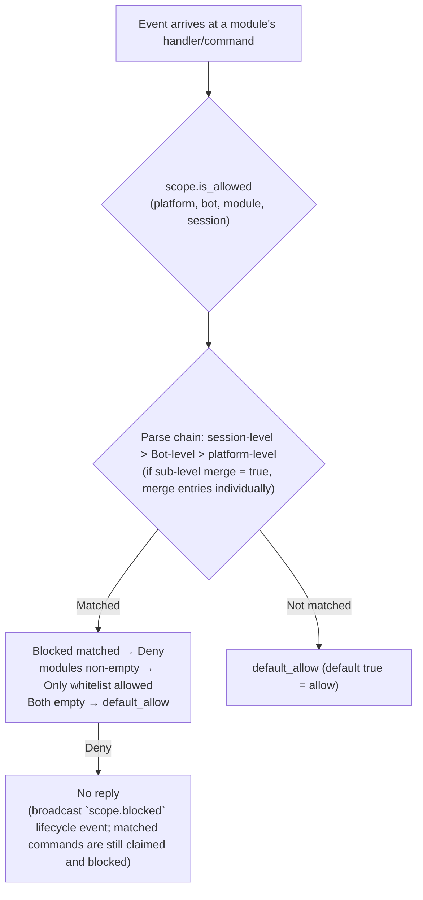

- **Parse priority**: session-level > Bot-level > platform-level, higher priority bindings **fully override** lower priority; if sub-level binding sets `merge = true`, it changes to **entry-by-entry union** with lower priority (each of modules / blocked is merged individually, `merge` itself is a control key, not an entry)
- **Default semantics**: Filtered modules' commands and handlers do not trigger or reply, visible in TRACE-level logs (core.scope.denied); interception also broadcasts the `scope.blocked` lifecycle event (subscribe to observe who was blocked and why); matched **commands** are still claimed and blocked — command text is no longer passed to lower-level message handlers, eliminating the ambiguity of "command rejected then message handler responds again"
- **Framework-level handlers** (scope_exempt=True or owner is empty) are unaffected; module names that are empty (framework-layer resources) are always allowed
- **Session-aware help and command queries**: Command query APIs (command.help /
  get_command / get_commands / get_group_commands / get_visible_commands,
  and module.get_commands_overview) all support optional event= or explicit
  platform= / bot_id= / session_id= keywords — commands from modules unavailable in the current session
  no longer appear in the results (get_command returns None, single-command help is treated as "unregistered",
  consistent with default semantics); if no context is provided, behavior remains full

### Binding Inheritance (merge)

The default semantics of full override are clear and predictable; when you need to **append** to the upper level, write `merge = true` in the sub-level:

```toml
[ErisPulse.scope.platforms.onebot11]
modules = ["Chat", "Tool"]      # Platform-level: allow Chat, Tool

[ErisPulse.scope.bots.onebot11."123456"]
modules = ["Music"]
merge = true                    # The actual effective modules for this Bot = ["Chat", "Tool", "Music"]
```

- **Merge rules**: `modules` and `blocked` each take the **union**; `blocked` inside the binding still takes precedence over `modules`
- **Chain merge**: Platform → Bot → Session, each level independently decides `merge` or override

## ② Identity Dimension (Event Admission)

**In one sentence**: Use user / session / Bot / adapter four-level strategies to completely discard "events that should not be received" at the distribution entry, with deny taking precedence over allow.

Answer "whose events are received or not". Events that are rejected are **completely discarded at the distribution entry** —
they do not enter middleware or any handler (including framework-level), visible only in TRACE-level logs (core.scope.identity_denied).

- **Parse priority**: user > session > Bot > adapter, take the most specific configured strategy; deny takes precedence over allow
- Each level binding is a binary strategy: `{ allow = true }` or `{ deny = true }`
- User keys support glob / regex (e.g. `"spam_*"` to block a batch of spam users)
- Typical use case — upper-level deny, individual allow for "exceptional allow":

```toml
[ErisPulse.scope.identity.adapters.onebot11]
deny = true
[ErisPulse.scope.identity.users.onebot11]
allow = ["u_admin"]   # Even if adapter-level denied, u_admin's events are still allowed
```

## ③ Outbound Dimension (Restricting Module Outbound Calls)

**In one sentence**: Restrict module-initiated outbound calls (messages / API / requests) with method-level white/blacklists, and rejected calls do not initiate any network request, directly returning `retcode=34601`.

Restrict module-initiated **outbound actions**: message sending / standard API actions / request operations.
The three actions correspond to the underlying DSL: `Event.reply` and `Send` (send), `Api` / `call_api` (api), and `Request`'s accept/reject (request). Outbound calls initiated by the module during event handler execution carry the module owner, which is uniformly judged by this dimension.

### Rule Form (Inline Table)

Each action's rule is an inline table: `{ allow = [...], deny = true|[...] }`.
Only one rule per action is allowed (TOML keys are not repeatable, choose between full deny or fine-grained):

```toml
[ErisPulse.scope.actions.MyModule]
send = { deny = true }                                  # Disable all message sending (Event.reply / Send DSL)
# Or fine-grained method-level: send = { allow = ["Text", "Image*"], deny = ["File"] }
api = { allow = ["get_*"] }                             # Only allow query-type standard APIs
# Or action-level blacklist: api = { deny = ["set_*", "leave_*"] }
request = { deny = true }                               # Disable request handling accept/reject
```

- `send` entries match **send method names** (`Text` / `Image` / `File` ...),
  `api` entries match **standard action names** (`get_group_info` / `set_group_name` ...)
- Entries support exact names / glob / `re:` regex (consistent with the unified system syntax, case-insensitive)
- Writing `allow` as a single string is equivalent to a single-entry list: `send = { allow = "Text" }`

### Decision Semantics

**Default: fully allow** — Unconfigured, or owner is empty (internal framework calls) are allowed.
After configuration, the following order is used for judgment:

1. `deny = true` → Reject
2. `deny` list matches the call name → Reject
3. `allow` list is non-empty and the call name is not matched (or the call has no name) → Reject
4. Otherwise, allow

Rejected calls do not initiate any network request, directly returning the standard failure response
(`retcode = 34601`, see [api-response §5.3](../standards/api-response.md#53-framework-extended-return-code-34xxx-customized-low-three-digits-in-the-platform-error-segment)).

The three actions are independent, and only one can be limited.

```python
# Runtime API
sdk.scope.set_action("MyModule", "send", deny=True)              # Disable all message sending
sdk.scope.set_action("MyModule", "send", allow=["Text"])         # Allow only text messages
sdk.scope.is_action_allowed("MyModule", "send", name="Image")    # False
sdk.scope.is_action_allowed("MyModule", "api", name="get_user_info")  # Judged by rules
sdk.scope.delete_action("MyModule", "send")                      # Restore allow
sdk.scope.get_action("MyModule", "send")                         # Current rule for this action
```

## Runtime API

The scope runtime API is layered into three parts: **decision** (three questions), **dimensional read/write** (each dimension has `set` / `get` / `delete` parameterized methods, fully typed signatures, IDE auto-complete), and **dictionary-style fallback** (dot-separated paths directly access any section).

```python
from ErisPulse import sdk

scope = sdk.scope
```

### Decision (Three Questions)

```python
scope.is_allowed("onebot11", "123456", "Chat")                 # ① Module dimension
scope.is_allowed("onebot11", "123456", "Chat", "789012345")    # With session level
scope.is_allowed("onebot11", "123456", None)                   # Framework-layer resource -> True

scope.is_identity_allowed("onebot11", "123456", "group_9", "u1")   # ② Identity dimension

scope.is_action_allowed("MyModule", "send")                    # ④ Outbound dimension
scope.is_action_allowed("MyModule", "send", name="Image")      # Fine-grained method-level
```

### ① Module Dimension

```python
# Binding (level determined by parameters: session_id > bot_id > platform-level)
scope.set_module("onebot11", bot_id="123456", modules=["Chat", "Tool*"])
scope.set_module("onebot11", blocked=["re:^Danger"])                       # Platform-level
scope.set_module("onebot11", bot_id="123456", session_id="g9", modules=["Chat"])  # Session-level
scope.set_module("onebot11", bot_id="123456", modules=["Music"], merge=True)      # Union with existing entries
scope.set_module("onebot11", bot_id="123456", modules=["Chat"], persist=False)    # Runtime only

# Read / Delete
scope.get_module("onebot11", bot_id="123456")   # {"modules": ["Chat"], "blocked": []}
scope.delete_module("onebot11", bot_id="123456")
```

> `merge=True` is **write-time union** (merge entries with existing bindings at this level); the `merge = true` configuration key at parse time across levels is covered in the above [Binding Inheritance](#binding inheritance merge) — these are independent mechanisms.

> **Runtime Binding (persist=False) Semantics**: Runtime bindings are saved in a separate overlay layer,
> **any subsequent configuration writes / hot reloads will not overwrite them** (the configuration tree is rebuilt and automatically reapplied in write order, including runtime deletions). They are not persisted to disk, and are lost after process restart; runtime bindings written by a module are cleaned up when the module is unloaded. Subsequent `persist=True` writes (user-persistent semantics) to the same path will replace the runtime rules.

### ② Identity Dimension

```python
# Binding strategies (level determined by parameters: user > session > bot > adapter; allow / deny chosen)
scope.set_identity("onebot11", user_id="u_bad", deny=True)
scope.set_identity("onebot11", user_id="spam_*", deny=True)    # Key supports glob / re: regex
scope.set_identity("onebot11", bot_id="123456", session_id="g9", allow=True)

# Read / Delete
scope.get_identity("onebot11", user_id="u_bad")   # {"deny": True}
scope.delete_identity("onebot11", user_id="u_bad")
```

### ③ Outbound Dimension

```python
# Set restriction rules (allow: str|list; deny: bool|str|list; whole rule replacement semantics)
scope.set_action("MyModule", "send", deny=True)                    # Disable all sending
scope.set_action("MyModule", "send", allow=["Text"])               # Allow only text messages
scope.set_action("MyModule", "api", deny=["set_*", "leave_*"])     # Disable management APIs

# Read / Delete
scope.get_action("MyModule", "send")       # {"allow": ["Text"]} original rule
scope.delete_action("MyModule", "send")    # Remove single action
scope.delete_action("MyModule")            # Remove all action restrictions for this module
```

### General

```python
scope.get("platforms")   # Dictionary-style fallback: dot-separated path to read any section
scope.topology()         # Full configuration tree (for Dashboard)
scope.stats()
# {"module_calls": .., "module_filtered": .., "identity_checks": .., "identity_denied": ..,
#  "action_checks": .., "action_denied": .., "cache_hits": .., "cache_misses": ..}
scope.reset_stats()
scope.clear()           # Clear all configuration (only in-memory effect)
```

### Advanced: Dictionary-style Dot-separated Path Fallback

Dimensional methods cover daily scenarios; when you need to directly access any node (or future added dimensions), use the dictionary-style API — `get` / `set` / `delete` accept dot-separated paths (deep dict merge, immediate read after write),
and provide `scope[path]` / `scope[path] = v` / `del scope[path]` / `path in scope` protocols:

```python
scope.set("bots.onebot11.123456", {"modules": ["Chat"], "blocked": []})
scope.set("identity.users.onebot11.u_bad", {"deny": True})
scope.get("actions.MyModule.send")

scope["platforms.onebot11"]        # Read (throws KeyError if not exists)
scope["platforms.onebot11"] = {...}  # Write
del scope["platforms.onebot11"]      # Delete
"actions.MyModule" in scope          # Existence check
```

## Interception Observability: `scope.blocked` Event

When scope interception (module filtering / identity rejection) occurs, it broadcasts the lifecycle event **`scope.blocked`**,
making "who was blocked, at which level" subscribable, countable, and presentable in the Dashboard — interception does not reply by default, but is no longer an opaque black box.

| Field | Description |
|------|------|
| `dimension` | `"module"` (module dimension filtering) / `"identity"` (identity admission rejection) |
| `module` | The filtered module name (only module dimension) |
| `platform` / `bot_id` / `session_id` / `user_id` | The context where the interception occurred |

```python
from ErisPulse.Core.lifecycle import lifecycle

@lifecycle.on("scope.blocked")
def on_blocked(data):
    print(f"Blocked: {data['dimension']} {data.get('module') or data.get('user_id')}")
```

- The event is broadcast via `fire` background (zero overhead if no listeners, does not slow hot paths)
- Repeated interception with cache hits **does not** broadcast repeatedly — each combination is broadcast only once when the cache expires
- Distinct from `adapter.event.blocked` (event-level discard): that is event-level discard, this
  event is scope admission gate module / identity filtering

## Cache and Hot Reload

- `is_allowed` / `is_identity_allowed` / `is_action_allowed` results are cached with **LRU** (configurable via `scope.cache_size`), invalidated automatically by `set` / `delete` /
  configuration hot reload (`config.updated` / `config.set`)
- All dimension configurations take effect **immediately**, no restart required
- Scope is "event-by-event" judgment, does not remember across events: configuration changes, next event follows new rules

## Configuration Format Validation

Configuration format is validated section by section during loading / hot reload: invalid sections (e.g., `platforms` written as a string), invalid outbound rules (e.g., `allow` written as a number), unknown action names, unknown top-level keys (e.g., `alow` with a typo) will output **WARNING** and ignore the corresponding section / entry, while other valid configurations remain effective — errors no longer silently fail.

## Common Issues and Considerations

### 1. Configuration Hierarchy and Overriding

- Module dimension: session-level > Bot-level > platform-level, **full override** (if sub-level `merge = true`, entries are unioned individually). To "platform allows Chat, Bot adds Music", you can write `merge = true` in the Bot-level, or list both
- Identity dimension: user > session > Bot > adapter, take the **most specific** configured strategy (can do exception allow)
- Command user white/blacklists: exact command names take precedence over glob keys (see `event.command.acl`)

### 2. Module/Command Not Responding

First suspect scope rather than the module itself:

```python
from ErisPulse import sdk

print(sdk.scope.is_allowed(event.get_platform(), bot_id, "MyModule", session_id))
print(sdk.scope.is_identity_allowed(event.get_platform(), bot_id, session_id, user_id))
print(sdk.scope.stats())   # module_filtered / identity_denied > 0 indicates interception records
```

Filtered modules default to no reply (module dimension and identity dimension, avoiding rule exposure), but broadcast the `scope.blocked` lifecycle event and statistics continue to accumulate;
commands rejected by ACL will reply "insufficient permissions" explicitly.

### 3. Outbound Action Rejected When Troubleshooting

```python
from ErisPulse import sdk

print(sdk.scope.get("actions.MyModule"))
print(sdk.scope.stats())   # action_denied > 0 indicates intercepted calls
```

Interception is **explicit**: rejected calls return the standard failure response (`retcode = 34601`) without initiating a network request.

### 4. Session Identifier Isolation Across Platforms

The `(platform, session_id)` combination is the unique identifier. `scope.sessions.onebot11."789"` only applies to onebot11, not affecting a session with the same `789` on telegram. The same applies to identity dimension user keys.

## Topology Tree API

`ModuleManager.get_topology()` and `AdapterManager.get_topology()` provide module/adapter ownership relationship data,
`sdk.get_topology()` aggregates them (including scope):

```python
from ErisPulse import sdk

topology = sdk.get_topology()
# {
#   "modules": {                                   # Module → owned resources
#     "Chat": {
#       "loaded": True, "enabled": True,
#       "commands": ["chat", "translate"],
#       "handlers": {"message": 2, "notice": 1},
#       "routes": {"http": ["/Chat/api"], "ws": [], "sse": []},
#       "lifecycle_hooks": 3,
#     }
#   },
#   "adapters": {                                  # Adapter → Bot → Scope
#     "onebot11": {
#       "status": "started", "enabled": True,
#       "bots": {"123456": {"status": "online", "scope": {...}}},
#       "scope": {"modules": [...], "blocked": [...]},
#     }
#   },
#   "scope": {                                     # Scope (module / identity / outbound actions)
#     "platforms": {...}, "bots": {...}, "sessions": {...},
#     "identity": {"adapters": {...}, "bots": {...}, "sessions": {...}, "users": {...}},
#     "actions": {...},
#   },
# }
```

- Module topology aggregates commands registered by the module, event handlers, HTTP/WS/SSE routes, and lifecycle hooks, facilitating the drawing of module resource trees.
- Adapter topology aggregates status of each adapter, status of subordinate Bots, and platform-level/Bot-level scope bindings (module dimension).
- **JSON-safe output**: `get_topology(json_safe=...)` defaults to `True`, returning structures directly serializable via `json.dumps` — module `info` retains only pure data's `meta` sub-table (discarding `module_class` / `strategy` runtime objects), and other nodes (including arbitrary objects inserted by adapter authors into Bot `info`) are sanitized (class objects take `__name__`, unserializable objects fall back to `str()`). Dashboards / WebUI can directly serialize the return; for original objects, pass `json_safe=False`.


### 归属权（owner）系统

# Ownership (owner) System

> [!TIP]
> **When to read this**: When troubleshooting resource leaks, understanding the cleanup chain during unload/disable, or declaring owned resources. Skip if not needed, as it does not affect the use of other features.

> **After reading, you will know**: How the owner context automatically assigns resources, the complete overview of owned resources, the full sequence of cleanup chains during unload/disable, and which resources are not cleaned up during unload (design boundaries).
>
> **This section does not cover**: Permission checks for "when resources become effective" (see [Scope (scope)](scope.md)); recommended practices and forced cancellation boundaries for background tasks (see [Lifecycle Management · Background Task Ownership and Automatic Cancellation](lifecycle.md#background-task-ownership-and-automatic-cancellation)).

Ownership is the foundation for modules' "plug-and-play" functionality: all framework resources registered during module loading are automatically named, and are recycled with a single click during unload/disable—module authors only need to declare resources, without manually writing cleanup logic.

> **Related systems**: Scope determines "whether resources are effective" during event dispatching, while ownership determines "who owns the resources and who is recycled during unload" during the lifecycle. Scope is detailed in [Unified Control Plane (scope)](scope.md), and background tasks are covered in [Lifecycle Management](lifecycle.md#background-task-ownership-and-automatic-cancellation).

{!--< tips >!--}
1. Ownership is automatically recorded at the **moment of registration** based on `current_owner`, requiring zero changes to module code.
2. Unload and disable share the same cleanup chain (`_cleanup_module_registrations`), where failures at each step only trigger warnings and do not interrupt the process.
3. Resources with user configuration semantics (persistent overrides / scope rules / command ACL) are **not** cleaned up during module unload.
4. External handles hosted by utility modules can be attached to the cleanup chain using `on_cleanup(cb)`, which are automatically called back when the corresponding module is unloaded (see [Guide to Utility Modules: Hosting Handles of Other Modules](#guide-to-utility-modules-hosting-handles-of-other-modules)).
{!--< /tips >!--}

## Owner Context Mechanism

The `owner` is passed through the context variable `current_owner` (`ErisPulse.runtime.context`):

```python
from ErisPulse.runtime import owner_scope, get_current_owner

with owner_scope("MyModule"):
    # All resources registered within this context are automatically attributed to MyModule
    assert get_current_owner() == "MyModule"
```

The framework automatically injects the `owner` at the following points (module/adapter code does not need to manually wrap these):

| Timing | Owner Value | Location |
|--------|-------------|----------|
| Module `load()` | Module name | Throughout instantiation + `on_load` |
| Adapter `start()` / `restart()` | Platform name | Throughout adapter startup |
| `activate_on` lazy-load stub registration | Module name | During placeholder command/handler registration |
| Event handler execution | Module name of handler's owner | Re-injected at handler/command entry |

Re-injection during execution means that command handlers declared in `on_load` will still be automatically attributed to the module if they call registration APIs (such as `sdk.adapter.on()` or `overrides.*.set(persist=False)`) during runtime.

## Resource Ownership Overview

All resources registered by a module within its loading context are recorded for ownership and automatically reclaimed upon unloading/disabling:

| Resource | Registration Method | Cleanup Call |
|----------|---------------------|--------------|
| Command | `@command()` / Command dict declaration | `command.unregister_by_owner()` |
| Event Handler | `@message` / `@notice` / `@request` / `@meta` | `handler.unregister_by_owner()` |
| Adapter Event Listener | `sdk.adapter.on()` / `raw=True` | `adapter.unregister_handlers_by_owner()` |
| Adapter Middleware | `@sdk.adapter.middleware` | Same as above |
| Routes (HTTP/WS/SSE) | `router.http()` / `websocket()` / `sse()` | Double fallback by namespace + by owner |
| Route Middleware | `@router.middleware()` / `add_middleware()` | `router.unregister_all_by_owner()` |
| Dashboard Home Entry | `router.register_home_entry()` | `unregister_home_entries_by_owner()` |
| Custom Session Type | `register_custom_type()` | `unregister_custom_types_by_owner()` |
| Platform Event Method Injection | `register_event_method()` / `register_event_mixin()` | `unregister_event_methods_by_owner()` (module unloading automatically reclaims, old closures no longer leak) |
| Background Tasks | `self.spawn()` | `cancel_owner_tasks()` |
| External Cleanup Hook (Tool Module Managed) | `runtime.on_cleanup(cb)` | `run_owner_cleanups()` (triggered during unload/disable/adapter shutdown chain) |
| Lifecycle Hook | `lifecycle.register()` | `lifecycle.unregister_by_owner()` |
| Master Source Provider | `master.provider` | `master.unregister_by_owner()` |
| i18n Translation Keys | `I18nClass` declaration (domain=module name) | `i18n.unregister_domain()` |
| Event Override (Runtime) | `overrides.*.set(persist=False)` | `overrides.unregister_by_owner()` |
| Interactive Sessions (wait_reply waiting / lease) | `event.wait_reply()` / `sdk.interaction.acquire()` | `interaction.cancel_by_owner()` (waiter immediately receives cancellation) |
| Context Data | `runtime/context` recorded by owner | Precise cleanup by module |

On the adapter side, corresponding resources (with platform name as owner) are reclaimed by `_cleanup_adapter_resources` during the adapter's `shutdown()` / `restart()`, including:

| Resource | Cleanup Call |
|----------|--------------|
| Adapter's own `on()` handlers and middleware | `adapter.unregister_handlers_by_owner(platform)` |
| Platform Event Method Extension (`EventMixin`) | `unregister_platform_event_methods(platform)` |
| Custom Session Type | `unregister_custom_types_by_owner(platform)` |
| Interactive Sessions (wait_reply / lease pending on this platform) | `interaction.cancel_by_platform(platform)` |
| i18n Translation Domain (domain=configuration key) | `i18n.unregister_domain(configuration key)` |
| Fine-grained Namespaced Routes | `router.unregister_all_by_owner(platform)` |

## Unload/Disable Cleanup Sequence

`unload()` and `disable()` share the same cleanup chain (each step is independently wrapped in try/except, failures are only logged, **not interrupting subsequent cleanup**):

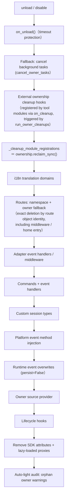

`sdk.uninit()` performs additional global fallback on exit: all adapters shutdown → all modules unload → `router.stop()` (clear routes/middleware/home entry) → `cancel_all_background_tasks()` → clear event handlers and hooks.

## Ownership Facade (ownership)

The sixteen steps of chain cleanup converge under the ownership facade `ErisPulse.Core.ownership`, with four verbs covering "reclaim, count, scan, audit"—the subsystem-specific `*_by_owner` reclaim functions remain unchanged, serving as internal implementations of the facade:

| Verb | Purpose |
|------|---------|
| `ownership.reclaim(owner)` | Unified reclaim of all resources owned by owner (task cancellation → cleanup hooks → registered resource types; asynchronous full version) |
| `ownership.reclaim_sync(owner)` | Registered resource type reclaim (synchronous version, for synchronous unload paths) |
| `ownership.counts(owner=None)` | Read-only count of resources registered under owner (None for all owners) |
| `ownership.orphans()` | Orphan scan: resources registered but owner has been unregistered (concrete leak report) |
| `ownership.audit(owner, deep=)` | Leak audit report (counts + orphans + optional gc instance survey) |

```python
from ErisPulse.Core import ownership

ownership.reclaim_sync("MyModule")       # {'commands': 1, 'routes_http': 2, ...}
ownership.counts("MyModule")             # Count of registered resources
ownership.orphans()                      # [{"owner": "ghost", "total": 2, ...}]
```

**Audit entry points**:

- **Automatic light audit** after unload/reload: issues WARNING alert when orphaned owner resources are found (zero-cost counting scan)
- `sdk.module.audit(name, deep=True)`: Module instance gc survey—when an instance is unreclaimable, it reports the referencing type (identifying "who is holding the old instance"); involves global pause overhead, used only for explicit troubleshooting
- Deep survey is an explicit operation, not configurable, and does not perform automatic repair

## Hot Reload Failure Rollback

Hot reload has been changed to "**Snapshot before Unload → Automatic Rollback on Failure**": When a new version encounters syntax errors, missing dependencies, or fails to load, the old instance and its registration status (registry entries, sdk attributes, sys.modules entries) are automatically restored, ensuring uninterrupted service. The log will indicate "Rolled back to old instance to continue service."

Best-effort semantics (documented boundaries):

- Side effects already executed in `on_unload` (such as disconnected connections, canceled tasks) are irreversible—after rollback, the old instance is in a "cleaned-up" state and must be reloaded to become fully available again.
- Manual references to the old instance cached by third-party libraries during runtime are not restored.
- If the target package has been unloaded (entry-point disappeared), it is considered a successful unload and no rollback will occur.

## Design Boundaries: Resources Not Cleaned on Unload

Ownership only recovers **runtime resources registered by module code**. The following resources are **user-configured semantics** (controlled by the user, possibly intentionally configured), and persist after module unload:

| Resource | Semantics | Description |
|----------|-----------|-------------|
| `overrides.*.set(persist=True)` | Persistent overrides | Written to configuration file, effective across restarts; not deleted on module unload (user explicitly configured) |
| `scope.set_action()` and other scope rules | Permission control plane | Managed by user/Dashboard; rules are not reclaimed when the module is unloaded |
| `overrides.acl.set(persist=True)` | Command ACLs | Same as above |
| `Conversation.save()` persistence | Multi-turn conversation archives | Data assets are not cleaned up |

Runtime temporary writes (`persist=False`) are reclaimed by owner—**persistence is the boundary between "user assets" and "module runtime state."**

## Internal Implementation: How Ownership Works

**In one sentence**: The attribution chain (contextvar propagation) determines "whose responsibility it is," while the cancellation chain (task registry) determines "whether it can be canceled upon unloading." — These two chains operate independently, and proper resource cleanup requires both.

The ownership system consists of **two independent chains**. Understanding their division of labor is essential for troubleshooting ownership issues.

### Attribution Chain (Contextvar Propagation)

The `ContextVar`s such as `current_owner` in `runtime/context.py` are responsible for **attribution** — "Whose responsibility is this resource registration or call initiated by the code at this moment?" The propagation follows the semantics of Python's `contextvars`:

| Execution Path | Context Propagated | Attribution Result |
|----------------|--------------------|--------------------|
| Synchronous call chain / `await` chain | ✅ Propagated | Correct attribution |
| `asyncio.create_task` within `owner_scope` | ✅ Propagated (task copies the context at creation) | Correct attribution for framework calls within the task |
| `run_in_executor` / bare thread | ❌ Not propagated | Attribution lost |
| Custom event loop | ❌ Not propagated | Attribution lost |

> Attribution ≠ Registration: Context propagation only affects "whose responsibility it is." Whether a resource can be cleaned up depends on whether it enters the subsequent cancellation chain.

### Cancellation Chain (Task Registry)

The `_owner_tasks` registry in `runtime/tasks.py` manages **lifecycle** — "Which unfinished tasks belong to the owner, and should be canceled together during unloading." Tasks enter the registry through:

1. **Explicit Scheduling**: `spawn_background()` / `self.spawn()` → captures `current_owner` at creation (or explicitly via `owner=` parameter) → registers into the table;
2. **Task Factory Automatic Registration** (2.8.3): `install_owner_task_factory()` is installed at the main event loop during framework startup — **any** task creation (including `create_task` inside third-party libraries) passing through the factory reads `current_owner`, and registers if it is not None.

The registry self-cleans: Each task has a `done_callback`, and is removed from the table upon completion, with no leaks.

### Cancellation Timing (Module Unload)

```
module.unload()
  → on_unload(event)                    # Module-specific cleanup (fallback timeout protection)
  → Framework unregisters commands/events/hooks/routes for this owner
  → cancel_owner_tasks(owner)           # Registry fallback cancellation
      → cancel each task individually   # Excludes the task itself executing the cancellation logic
      → await gather(pending, timeout)  # Wait for cleanup (no blocking after timeout)
```

### Troubleshooting Approach

- **Resources not cleaned up** → Check the registry: Does `get_owner_tasks("MyModule")` contain the task? If not, the registration path did not pass through the attribution chain (import phase / thread / independent loop), refer to the table above to locate the issue.
- **Incorrect attribution** → Check the value of `get_current_owner()` at the time of error; for asynchronously delayed execution (callbacks/tasks), attribution is taken from the context at creation, not at execution time.

## Module Author Guide

### Recommended Practices

```python
from ErisPulse import sdk
from ErisPulse.Core.Event import command
from ErisPulse.runtime import owner_scope, spawn_background

class MyModule(BaseModule):
    async def on_load(self, event):
        # Framework resources: automatically owned, no manual cleanup required
        self.task = self.spawn(self.polling())      # Background task
        sdk.router.register_home_entry("My Module", "/my")  # Home entry

        # Module-specific resources: include in owner_scope to integrate into ownership system
        with owner_scope("MyModule"):
            self.client.on_event(self._handle)      # Hypothetical custom registration

    async def on_unload(self, event):
        # Framework resources have been automatically cleaned up, only clean up non-owner_scope covered resources
        await self.client.close()
```

### Notes

- **Registration during import has no ownership**: Hooks/handlers registered at the module's top level (during import) occur before `owner_scope`, and are considered framework-level resources (owner=None) and **will not be cleaned up**. Always register inside `on_load()`.
- **Custom domain i18n registration**: When `i18n.register(domain=...)` uses a domain different from the module name, it won't be automatically cleaned up. Please ensure domain=module name.
- **Background tasks recommended via `self.spawn()`**: As of 2.8.3, raw `asyncio.create_task` will also **automatically register ownership** (Task Factory automatically registers, cancels on unload as a fallback). However, `self.spawn()` remains the recommended approach—supporting non-main loop thread scheduling back to the main loop, explicit `owner=` assignment, and fire-and-forget to prevent GC. **For versions before 2.8.3**, raw tasks are not owned, and `self.spawn()` must be used.
- **Cleanup chain "failure only logs warning"**: Single-step cleanup exceptions will not block other resource releases, visible in DEBUG/WARNING log levels; enable TRACE for troubleshooting.

### Registration Timing → Ownership Result Comparison Table

| Registration Scenario | Ownership Result | Explanation |
|-----------------------|------------------|-------------|
| Registered inside `on_load()` via framework APIs (commands/events/lifecycle/routing decorators) | Owned by module | Automatically unregistered on unload |
| Registered at module top level (during import) | **No ownership** (owner=None) | Not cleaned up, do not use |
| Background tasks created via `self.spawn()` | Owned by module | Automatically cancelled on unload |
| Registered inside `owner_scope("Name")` via third-party APIs | Owned by module | Depends on third-party callbacks executing synchronously within scope |
| Raw `asyncio.create_task` (including `loop.create_task` / `ensure_future`) | **Automatic ownership** (Task Factory, 2.8.3+) | Instantly reads `current_owner` on creation, automatically registers within owner context, cancels on unload as a fallback; see [Internal Implementation](#internal-implementation-how-ownership-works) below |
| Tasks created internally within third-party library asynchronous callbacks (e.g., aiohttp / APScheduler) | **Automatic ownership** (Task Factory, 2.8.3+) | If `current_owner` is injected (e.g., during framework handler execution), the task automatically registers |
| `run_in_executor` (thread pool) | **No ownership** (not asyncio.Task) | Threads are not managed by Task Factory, lifecycle must be managed manually |
| Registration within an independent event loop (self-created loop) | **No ownership** | Task Factory is only installed in the main loop; contextvars do not propagate across event loops |

> Principle: **Ownership follows the `current_owner` context at the moment of registration**; any asynchronous delay, thread pools, or independent loops will detach from this context—explicitly enter `owner_scope` when ownership is required.

## Tool Module Guide: Handling References to Other Modules

**Scenario**: Tool modules such as scheduled tasks, registries, and connection pools hold references to other modules—when a module calls `sdk.Cron.on_trigger(handler)` in its `on_load`, your container stores a callback pointing to the instance of the calling module. The framework automatically cleans up all framework-level resources registered by the module, but it cannot clean up references stored in your **private container**: after the module is unloaded, your container still holds its instance, preventing it from being garbage collected (memory leak, `purge` leak diagnostics report "un回收able").

**Solution**: In the same function where you register the other module's resources, call `on_cleanup()`. The framework will automatically invoke your cleanup function when the module is unloaded or disabled:

```python
from ErisPulse.Core.Bases import BaseModule
from ErisPulse.runtime import off_cleanup, on_cleanup

class CronModule(BaseModule):
    def __init__(self):
        self._entries = {}  # {module_name: list of callbacks registered by the module}

    def on_trigger(self, handler):
        # Automatically identifies the caller module name (whether called directly in on_load or via module.call),
        # returns the resolved owner, which can be used directly as a named key
        owner = on_cleanup(self._drop)
        self._entries.setdefault(owner, []).append(handler)

    def _drop(self, owner: str):
        """Called automatically by the framework when the module is unloaded/disabled: simply discard its handle"""
        self._entries.pop(owner, None)

    async def on_unload(self, event):
        off_cleanup(self._drop)  # ③ Unregister the hook before self-unloading to avoid the hook table holding a reference to self
```

Guaranteed framework behavior:

| Concern | Behavior |
|---------|----------|
| Trigger Timing | Triggered when the module is unloaded / disabled, or when the adapter shuts down—always within the framework's cleanup chain, before `purge` leak diagnostics |
| Caller Identification | Direct call uses `current_owner`; called via `module.call()` uses `current_caller`; can also explicitly specify via `on_cleanup(cb, owner="module_name")`. **Mandatory validation**: if `owner` cannot be resolved (missing from all three sources), a `ValueError` is raised—private tool modules should register hooks within their own loading context |
| Callback Signature | `cb(owner: str)`, synchronous or asynchronous; asynchronous callbacks have timeout protection (`CLEANUP_CALLBACK_TIMEOUT_SECS`, default 10 seconds) |
| Fault Tolerance | If a single callback fails or times out, only logs are recorded, without affecting other hooks or the cleanup chain |
| Duplicate Registration | Identical `(owner, callback)` pairs are idempotently deduplicated |

**When Not Needed**: If the module registers framework-level resources (commands, event handlers, routes, background tasks, etc.), the framework automatically cleans them up (see [Resource Ownership Overview](#resource-ownership-overview) above). Only references held in your private container require `on_cleanup`. A quick-reference version from a module developer's perspective is available at [Best Practices · Tool Modules](../developer-guide/modules/best-practices.md#tool-modules-handling-references-to-other-modules-should-catch-unload-notifications).


### 影子模块与灰度转正

# Shadow Modules and Gradual Promotion

> [!TIP]
> **When to read this**: When you need gradual release—running a new version in parallel, comparing behaviors, and promoting or rolling back. Skip if not needed; it won't affect other features.

> **After reading, you will know**: The five isolation gates of shadow modules, alignment methods for behavior diff, the `promote` promotion and rollback flow when promotion fails, and the honest boundaries that the framework cannot block.
>
> **This section does not cover**: The general hot reload and ownership cleanup mechanism for ordinary modules (see [Ownership (owner) System](ownership.md)).

A shadow module is a **new version** of the same module, running in parallel with the live version under an independent owner (e.g., `roll_shadow`). It receives **copies** of real events, and its outbound messages are **intercepted and recorded** rather than actually sent. By comparing behaviors in `shadow_diff`, you can confirm the new version is harmless before promoting it with one click via `promote`, or discarding it at any time with `dismiss`. **No code changes are required**; the entire process is driven by runtime APIs: similar to `load / unload / reload`, these operations can be directly invoked by the Dashboard or custom management modules, with no configuration needed.

{!--< tips >!--}
1. Start: ``await sdk.module.shadow_start("roll", source="path/to/v2")``
   ——The new version runs in parallel with the old version under an independent owner (default is the path name).
2. The shadow does not participate in real distribution or dependency graphs: commands with the same name go into the shadow directory, routes are registered but not mounted, lifecycle broadcasts are silent, and `module.call` and dependency resolution still point to v1.
3. Promotion is always confirmed by a human: ``await sdk.module.promote_shadow("roll")``; if it fails, the old instance automatically rolls back and continues serving; ``dismiss_shadow`` discards the shadow at any time.
{!--< /tips >!--}

## Quick Start

```python
# v2 code: Standard module format, shadow-agnostic (any directory, e.g. downloads/roll_v2/)
```

```python
# In production bot (Dashboard / Management module call), start shadow with one line:
await sdk.module.shadow_start("roll", source="downloads/roll_v2")
# → Shadow runs independently as owner "roll_v2", coexisting with v1, with outbound traffic intercepted and tracked

# During trial period, compare behaviors:
report = sdk.module.shadow_diff("roll")
# {"shadow_owner": "roll_v2", "count": 3, "aligned": [...]}
```

- **v1 actual send**: Bot timeline from inbox (transcript)
- **v2 intended send**: Shadow ledger ("what was intended to be sent" recorded in outbound gate)
- Both aligned by `trace_id` — for the same message, both versions' triggers/missed triggers and intended vs. actual sends are clearly visible

After confirming correctness, promote:

```python
await sdk.module.promote_shadow("roll")   # Promote, rollback to v1 on failure
await sdk.module.dismiss_shadow("roll")   # Or: discard shadow
```

## Five Isolation Gates

| Gate | Mechanism |
|------|-----------|
| Event Copy | The shadow handler receives an **independent copy** of the event (marked with `shadow`) — modifications, claims, or stopping propagation by the shadow only affect the copy, not the original event chain |
| Outbound Gate | All `Send` DSL and `Api` calls from the shadow are intercepted and recorded (with a fake success response), without actually being sent — the shadow will not send duplicate replies |
| Storage Overlay | KV writes from the shadow go into an in-memory overlay and are discarded from the persistent store; reads first check the overlay, and if not found, transparently read from the real store (gray-scale runs against real data); deletes are recorded as tombstones |
| Routing Shield | HTTP/WS/SSE routes from the shadow are only registered but not mounted; commands with the same name are registered in the shadow command directory, and platform event method injection is prohibited |
| Lifecycle Silence | The shadow does not broadcast its own lifecycle events, nor does it participate in the ecosystem dependency graph (`module.call` and dependency resolution still point to v1, preventing half-finished components from being depended upon) |

Configuration Inheritance: The shadow **inherits the configuration section from the original module by default** (otherwise gray-scale would be distorted), and the configuration takes effect in place after promotion.

## Honest Boundaries (Can't Be Blocked)

- The framework can intercept all sending / API / KV storage / unified HTTP client operations;
  However, modules bypassing the framework by directly starting `aiohttp`, spawning threads, or writing to external systems cannot be intercepted by the framework.
- **ORM read/write operations are not within the coverage semantics** (clean implementation at the SQL layer is not possible with line-by-line overlay) — during shadow periods, it is recommended to avoid relying on ORM for isolation.
- **Shadow source is a local path**: New code is imported via path and loaded by an independent owner; the same PyPI package cannot exist in both old and new versions within the same interpreter due to the `sys.modules` single-key limitation.
- The leak auditor (`sdk.module.audit`) can see the ownership of shadow resources; side effects bypassing the framework will at least not go unnoticed.

## Promote and Rollback

The `promote` process: take a snapshot of the current version (including cascading dependents) → completely uninstall → register the shadow instance with the real name and load it. If any step fails, automatic rollback occurs and the old instance continues to serve (best-effort semantics: side effects executed by `on_unload` cannot be undone, and the old instance is in a cleaned-up state after rollback). Promoted shadow resources are reclaimed and bindings are released; the original module configuration section takes effect in place.

**Persistence Reminder**: `promote` is a runtime switch—after a restart, v2 will still be used. You need to **persistently install** the new version (`pip install -U` the new version / replace the plugin file). The runtime switch will not automatically handle package management for you.


### 启动流程与手动控制

# Startup Process and Manual Control

> [!TIP]
> **When to read this**: When you need to manually drive the startup chain, customize the startup sequence, or troubleshoot startup failures. Skip if not needed, as it does not affect the use of other features.

ErisPulse's `await sdk.run()` / `await sdk.init()` encapsulates the entire startup chain into a single line of code. However, when you need to fully customize the startup process (e.g., partial loading, dynamic registration, hot-plugging, injecting custom loading strategies), you need to understand what happens inside this chain and how to manually drive each step.

This document breaks down the startup chain into independent components, explains their respective responsibilities, invocation order, and provides an example of manually initiating the complete startup process.

> This document assumes you have already run [the first bot](../getting-started/first-bot.md) and understand the two modes of `sdk.run(keep_running=True/False)`. This document focuses on the internal breakdown of the `init()` chain and lower-level entry points such as `init()`/`init_task()`/`init_sync()`.

## Overview of SDK Top-Level Entry Points

In addition to the two `keep_running` modes of `run()`, the SDK provides several lower-level initialization entry points, differing in **asynchronous behavior, return values, and exception handling**:

| Entry Point | Asynchronous | Return Value | Exception Handling | Use Cases |
|-------------|--------------|--------------|--------------------|-----------|
| `await sdk.run(True)` | async, blocks to maintain | `None` (uninit automatically on shutdown) | Module/adapter errors are intercepted, not dragging down the process | Pure bot application |
| `await sdk.run(False)` | async, non-blocking | `None` (no automatic uninit) | Same as above | Perform custom logic after initialization |
| `await sdk.init()` | async, requires await | `bool` | Internal capture of component exceptions, returns `False` on failure | Manual lifecycle control (paired with `uninit()`) |
| `sdk.init_task()` | async, returns Task without blocking | `asyncio.Task` | Same as `init()` | Concurrently execute other initializations or when event loop is not running |
| `sdk.init_sync()` | **Synchronous**, blocks current thread | `bool` | Same as `init()` | Command-line scripts, synchronous entry without event loop |

> **Common misconception**: `await sdk.init()` **is not equivalent to** `await sdk.run(keep_running=False)`. Two differences: ① `init()` returns `bool` (returns `False` on failure), `run()` returns `None`; ② `init()` only performs initialization, **does not automatically uninit**, while `run()` automatically calls `uninit()` when the event loop ends. Therefore, when needing to manually pair uninit or customize lifecycle, use `init()` + `uninit()`.

## Overview of Startup Chain

`sdk.init()` (specifically its internal `Initializer.init()`) initiates the entire framework in the following order:

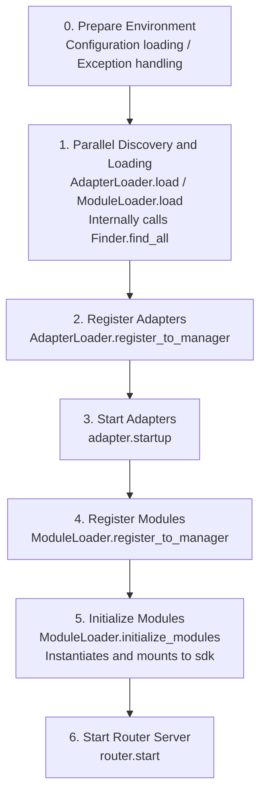

Corresponding core components:

| Layer | Component | Responsibility |
|-------|-----------|----------------|
| Discovery | `AdapterFinder` / `ModuleFinder` | **Discover** adapters/modules from entry-points of installed packages |
| Loading | `AdapterLoader` / `ModuleLoader` | Discovery + Import + Read metadata + Determine enable/disable, return object list |
| Registration | `*Loader.register_to_manager` | Register objects to corresponding managers |
| Management | `sdk.adapter` / `sdk.module` | Maintain adapter/module instances, provide start/stop interfaces |
| Initialization | `ModuleLoader.initialize_modules` | Create module instances and mount to `sdk` (handle dependency topological sort) |
| Routing | `sdk.router` | HTTP / WebSocket server |

> **Important**: `Finder` and `Loader` are two layers. `Loader` internally **already holds** a `Finder` (`AdapterLoader` has `AdapterFinder`, `ModuleLoader` has `ModuleFinder`). In most scenarios, you only need to use `Loader`, and only use `Finder` directly when you need "list only, no import".

## Detailed Explanation of Each Component

### 1. Discovery Layer: Finder

Finder only finds "which packages provide adapters/modules", without importing or instantiating.

```python
from ErisPulse.finders import AdapterFinder, ModuleFinder

adapter_finder = AdapterFinder()
module_finder = ModuleFinder()

# Find all installed adapters/modules entry-points
adapter_entries = adapter_finder.find_all()    # list[EntryPoint]
module_entries = module_finder.find_all()      # list[EntryPoint]

# Find single by name
entry = module_finder.find_by_name("MyModule")  # EntryPoint | None
```

Each `EntryPoint` can be loaded via `.load()` to get the corresponding class, but usually you don't need to call it manually—Loader will do it.

### 2. Loading Layer: Loader

Loader does "import + read metadata + determine enable/disable" on top of Finder.

```python
from ErisPulse.loaders import AdapterLoader, ModuleLoader
from ErisPulse import sdk

adapter_loader = AdapterLoader()
module_loader = ModuleLoader()

# load() internally: calls finder.find_all() → processes each entry-point → returns triple
adapter_objs, enabled_adapters, disabled_adapters = await adapter_loader.load(sdk.adapter)
module_objs, enabled_modules, disabled_modules = await module_loader.load(sdk.module)
```

The three-tuple returned by `load()`:

| Return Value | Meaning |
|--------------|---------|
| `objs` (`dict`) | Name → Object (adapter class / module wrapper object) |
| `enabled` (`list[str]`) | Enabled names (not disabled in configuration) |
| `disabled` (`list[str]`) | Disabled names |

#### Diagnostic Information on Loading Failure

When a module/adapter throws an exception during loading or initialization, the framework skips that component and continues loading others, while outputting a **summary of user code frames** so you can locate the error position at the default INFO level without manually turning on DEBUG:

```
[ERROR] [ModuleLoader] Failed to load module MyModule from entry-point, skipped: 'NoneType' object has no attribute 'platform'
  → MyModule/Core.py:42 in on_load
      adapter = sdk.platform
  → AttributeError: 'NoneType' object has no attribute 'platform'
  → Note: Raise log level to DEBUG to view full stack trace; check implementation code of module MyModule
```

The diagnostic information is generated by the `ErisPulse.runtime.diagnostics` module, which automatically filters out internal framework frames and retains only your code frames. If you need to reuse this in custom loading logic:

```python
from ErisPulse.runtime import log_diagnostic

try:
    risky_init()
except Exception as e:
    log_diagnostic(e)  # Automatically extract user code frames and write to ERROR log
```

This module also provides two low-level functions: `extract_user_frame()` (returns structured frame information) and `format_diagnostic_block()` (returns multi-line text).

### 3. Registration Layer: register_to_manager

Registers the objects produced by Loader to the manager, allowing `sdk.adapter` / `sdk.module` to recognize them.

```python
# Register adapters (returns bool, indicating if all succeeded)
await adapter_loader.register_to_manager(enabled_adapters, adapter_objs, sdk.adapter)

# Register modules
await module_loader.register_to_manager(enabled_modules, module_objs, sdk.module)
```

After registration, adapters are registered to the adapter manager and modules are registered to the module manager, but **they are not started/initialized yet**.

### 4. Start Adapters

```python
# Start all registered adapters
await sdk.adapter.startup()
# Or specify a platform
await sdk.adapter.startup("yunhu")
await sdk.adapter.startup(["yunhu", "telegram"])
```

> Registration ≠ Startup. `register_to_manager` only registers; `startup` calls the adapter's `start()`, establishing a connection with the platform.

### 5. Initialize Modules

Modules have an extra step compared to adapters—they need to be **instantiated** and mounted to `sdk` (so you can call `sdk.MyModule.xxx`). This step also handles module dependencies and topological sorting.

```python
success = await module_loader.initialize_modules(
    enabled_modules, module_objs, sdk.module, sdk
)
```

After successful instantiation, modules appear on `sdk.<ModuleName>`.

### 6. Start Router Server

```python
await sdk.router.start(
    host="0.0.0.0",
    port=8000,
    ssl_certfile=None,
    ssl_keyfile=None,
)
```

The router server is responsible for receiving callbacks from adapters (Webhook / WebSocket). Without starting it, server-mode adapters cannot receive messages.

## Complete Manual Startup Example

The following code is **equivalent to** the core process of `await sdk.init()`, but each step is exposed to you, allowing you to insert custom logic at any step:

```python
import asyncio
from ErisPulse import sdk
from ErisPulse.loaders import AdapterLoader, ModuleLoader

async def manual_startup():
    # 0. Prepare Environment (load configuration, register global exception handling)
    #    _prepare_environment is a pre-step in init(); the manual process also needs to call it first,
    #    otherwise Loader cannot read the configuration and will misjudge all adapters/modules as disabled.
    if not await sdk._prepare_environment():
        print("Environment preparation failed")
        return False

    # 1. Create loaders (each internally holds a Finder)
    adapter_loader = AdapterLoader()
    module_loader = ModuleLoader()

    # 2. Parallel Discovery and Loading (consistent with internal use of gather in init())
    (adapter_objs, enabled_adapters, disabled_adapters), \
    (module_objs, enabled_modules, disabled_modules) = await asyncio.gather(
        adapter_loader.load(sdk.adapter),
        module_loader.load(sdk.module),
    )

    # 3. Register adapters
    await adapter_loader.register_to_manager(
        enabled_adapters, adapter_objs, sdk.adapter
    )

    # 4. Start adapters
    if enabled_adapters:
        await sdk.adapter.startup()

    # 5. Register modules
    await module_loader.register_to_manager(
        enabled_modules, module_objs, sdk.module
    )

    # 6. Initialize modules (instantiation + mount to sdk)
    if enabled_modules:
        await module_loader.initialize_modules(
            enabled_modules, module_objs, sdk.module, sdk
        )

    # 7. Start router server
    await sdk.router.start(host="0.0.0.0", port=8000)

    print("Manual startup completed")
    return True

async def main():
    ok = await manual_startup()
    if ok:
        # Block to maintain running (manual process does not automatically block)
        await asyncio.Event().wait()

if __name__ == "__main__":
    asyncio.run(main())
```

### When to Use Manual Startup?

In most cases, **manual startup is not necessary**, as `await sdk.run()` already handles all the above steps. Manual startup is only valuable in these scenarios:

- **Partial Loading**: Only load specific adapters/modules, skipping others
- **Dynamic Registration**: Register new adapters/modules at runtime based on conditions
- **Custom Order**: Need to disrupt the default loading order (e.g., start a module before an adapter)
- **Inject Strategies**: Inject custom strict mode managers or loading strategies into Loader
- **Debugging/Diagnosis**: Manually drive at a certain step when a failure occurs to locate the issue

## Fine-Grained Runtime Control

Even when using `sdk.run()` to complete the startup, you can still individually control subsystems at runtime without having to restart the entire SDK:

### Hot Restart/Stop of Adapters

```python
# Hot restart an adapter (fix connection, does not affect other platforms)
await sdk.adapter.shutdown("yunhu")
await sdk.adapter.startup("yunhu")

# Bring up a new platform at runtime
await sdk.adapter.startup("telegram")

# Temporarily take down a platform
await sdk.adapter.shutdown("telegram")
```

> `adapter.startup()` requires the adapter to have been **registered** to the manager. Registration occurs within `init()`/`run()`, so this is fine-grained control **after** startup.

### Router Server

```python
# Temporarily take down webhook server
await sdk.router.stop()

# Restart (e.g., after changing port)
await sdk.router.start(host="0.0.0.0", port=9000)
```

### Lazy Module Loading

```python
# Manually load a module (possibly lazy-loaded)
await sdk.load_module("MyModule")
```

## Graceful Shutdown

As of version 2.7.0, `sdk.shutdown()` provides **programmatic graceful shutdown**: set the shutdown event to allow the main loop, which is suspended by `await sdk.run(keep_running=True)`, to return, thus triggering `uninit()` to complete resource cleanup.

```python
# Call from any coroutine to trigger graceful exit (run() suspended returns and automatically uninit)
sdk.shutdown()
```

Typical use cases:

```python
async def shutdown_after_idle():
    await asyncio.sleep(3600)
    sdk.shutdown()  # Gracefully exit after 1 hour of idle
```

**Signal Handling**: `run()` internally registers `SIGTERM` / `SIGHUP` handlers, converting system signals into graceful shutdown—when container orchestration (Docker `docker stop`) or `systemd` stops the service, the process completes `uninit()` cleanup instead of being forcibly killed.

- Windows does not support `loop.add_signal_handler`, so the signal handler is automatically skipped (still use `sdk.shutdown()` or Ctrl+C to trigger shutdown)
- Repeatedly calling `sdk.shutdown()` is safe (no operation after the event is set)

## Uninit Process

The reverse operation of startup is `await sdk.uninit()`, which cleans up in the opposite order:

1. Close all adapters (`adapter.shutdown()`)
2. Unload all modules
3. Clean up all event handlers
4. Clean up managers and module attributes on SDK

In manual startup scenarios, remember to call `uninit()` before exiting to ensure graceful shutdown:

```python
try:
    await asyncio.Event().wait()   # Maintain running
finally:
    await sdk.uninit()
```

## Restart

The SDK provides two restart methods, both of which do not require you to manually uninstall first—the framework handles it automatically:

| Method | Call | Behavior | Use Case |
|------|------|------|----------|
| Hot Restart | `await sdk.restart()` | **Hot reload at the component layer code level** within the same process: All modules follow a unified reload pipeline (global syntax pre-check / snapshot rollback / identity verification), adapters first **re-discover entry-point** (newly installed/uninstalled adapters during runtime take effect immediately) before individually reloading code | Making code changes effective after pip upgrade or installing components, hot-updating module code |
| Hard Restart | `await sdk.hard_restart()` | `uninit()` followed by **exit code 42** to exit the process, which is then restarted by an external supervisor | Framework itself upgrades (upgraded framework code only takes effect in new processes), C extension side effects, suspected resource leaks |

```python
# Hot restart: component layer code-level hot reload (most commonly used; newly installed adapters during runtime are also pulled in)
await sdk.restart()

# Hard restart: exit the process, let external supervisor restart (see "Supervisor Guide" below)
await sdk.hard_restart("sdk self-update")  # Optional reason for supervisor display
```

> **Two points to note**:
> 1. Both methods execute restart as a background task and **immediately return `True` to indicate "restart task has been scheduled"**, not "restart has completed". Actual restart proceeds in the background, avoiding interruption of the current event chain.
> 2. The principle of `hard_restart()` is: after uninstalling and flushing the configuration, exit the process with **exit code 42** (`HARD_RESTART_EXIT_CODE`) — **it does not start a new process itself**. It must be restarted by an external supervisor detecting exit code 42. If you run `python main.py` directly without any supervisor, the process ends after exiting with code 42, **without automatic restart** (the framework will issue a warning).

> **Hot Restart Mutual Exclusion and Merging** (since 2.11.1): All hot reload operations (single module reload / full reload / adapter reload / hibernation) are mutually exclusive throughout the process — continuous triggers during save storms will not run concurrently, and new requests received during an ongoing restart are automatically merged, completing at most one additional run. When files with syntax errors are saved, the entire reload round will be **rejected by a summary-style syntax pre-check** before uninstallation (listing all error files and line numbers at once), and all old instances continue serving.

### When to Use Hard Restart?

Hot restart covers most scenarios (pip upgrade/installing components, hot-updating module code, **including newly installed adapters during runtime**). Hard restart is only needed for the following scenarios:

- **Framework itself upgrades**: After upgrading ErisPulse itself, new framework code only takes effect in a brand-new process (Python does not re-import already loaded framework code).
- **Binary library (C extension) side effects**: Hot restart occurs within the same process and cannot release C extensions, open file descriptors, threads, and other process-level resources; hard restart switches to a brand-new process, thoroughly clearing these side effects.
- **Resource leak troubleshooting**: When suspected memory or handle leaks exist, hard restart provides a clean environment.

> The "Framework Restart" function in the Dashboard management panel internally calls `hard_restart()`.

### Exit Code 42 Contract

Hard restart is cross-process collaboration: **SDK is responsible for exiting (code 42), supervisor is responsible for restarting**.

| Role | Behavior |
|------|------|
| SDK (when hard restarted) | `uninit()` → flush configuration → write hard restart marker (reason / PID, for supervisor display) → `os._exit(42)` |
| Supervisor | Detect child process exit code 42 → display hard restart reason → restart the same command |

> `sdk.is_supervised()` can query whether the current process is started by a supervisor (detects environment variable `ERISPULSE_SUPERVISED`). The CLI `run` command injects this marker when starting a subprocess; external supervisors like systemd / Docker do not inject it, so `is_supervised()` returns `False`, and the framework will issue a "supervisor not detected" warning after hard restart.

### Supervisor Guide

Choose a supervisor suitable for you to make hard restart truly effective:

#### 1. CLI run command (development/simple deployment, recommended)

`epsdk run main.py` includes a built-in supervision loop: it detects the child process exit code, immediately restarts (and displays the hard restart reason) if code 42; for other abnormal exit codes, it automatically retries with exponential backoff; `Ctrl+C` will first gracefully terminate the child process (code 0 is considered normal exit, no restart).

```bash
epsdk run main.py
```

`epsdk run --reload` (development hot-reload mode, since 2.11.1) also follows the "supervisor process + reload worker subprocess" structure: saving `.py` files within the worker triggers **component-level hot reload** (not full framework restart); hard restart is handled by the supervisor process restarting a brand-new worker, making new code effective after framework upgrade.

#### 2. systemd (Linux server)

`RestartForceExitStatus=42` makes exit code 42 trigger restart (by default `on-failure` only applies to non-zero codes):

```ini
[Service]
ExecStart=/usr/bin/python3 /opt/mybot/main.py
Restart=on-failure
RestartForceExitStatus=42
RestartSec=2
User=mybot
```

#### 3. Docker / docker-compose

The PID 1 process inside the container is the application process; after exit code 42, the container exits — use `restart` policy to make it automatically restart:

```yaml
services:
  bot:
    build: .
    restart: unless-stopped   # restart on any exit (including 42)
```

#### 4. PM2 (Node ecosystem operations)

```bash
pm2 start main.py --name mybot --interpreter python3
# 42 is treated as an exit code, PM2 restarts by default; set restart_delay to debounce
pm2 set mybot.restart_delay 2000
```

#### 5. supervisord

```ini
[program:mybot]
command=python3 /opt/mybot/main.py
autorestart=true
exitcodes=0,2,42    # 42 is also considered "normal exit requiring restart"
```

#### 6. Pure Python custom supervisor

```python
import subprocess, sys, time

while True:
    p = subprocess.Popen([sys.executable, "main.py"])
    code = p.wait()
    if code == 42:          # Hard restart request
        time.sleep(0.5)
        continue
    if code == 0:           # Normal exit
        break
    time.sleep(3)           # Abnormal exit, backoff and retry
```

> **Behavior without supervisor**: Running directly with `python main.py`, calling `hard_restart()` exits the process with code 42 and does not restart. In this case, you should integrate with any of the above supervisors.


====
技术标准
====


### 会话类型标准

# ErisPulse Session Type Standard

> [!TIP]
> **When to read this**: When mapping platform-native session types to standard types (private/group/channel/guild/thread) in an adapter, or when unsure what target type to pass to `Send.To()` in a module, or to understand the automatic conversion of `event.reply()` — refer to this document. Skip it otherwise.

This document defines the session type standard supported by ErisPulse, covering receive event types and send target types.

## 1. Core Concepts

### 1.1 Receive Types && Send Types

ErisPulse distinguishes between two session types:

- **Receive Type**: The `detail_type` field of received events
- **Send Type**: The target type of the `Send.To()` method when sending messages

### 1.2 Type Mapping Relationships

```
Receive Type (detail_type)     Send Type (Send.To)
─────────────────        ────────────────
private                 →        user
group                   →        group
channel                 →        channel
guild                   →        guild
thread                  →        thread
user                    →        user
```

**Key Points**:
- `private` is the receive-time type; the standard send type is `user`
- `group`, `channel`, `guild`, and `thread` use the same type for both receiving and sending
- **Recommended path**: Use `event.reply()` directly — it automatically completes type conversion and target inference, with no manual handling needed (the `private` → `user` automatic conversion happens here)
- **For manual sending**: Pass the send type directly (e.g., `Send.To("user", ...)`); manually passing a receive type such as `Send.To("private", ...)` can still be auto-converted, but is not recommended (see §6.1)

## 2. Standard Session Types

### 2.1 OneBot12 Standard Types

#### private
- **Receive Type**: `private`
- **Send Type**: `user`
- **Description**: One-to-one private chat messages
- **ID Field**: `user_id`
- **Applicable Platforms**: All platforms supporting private chats

#### group
- **Receive Type**: `group`
- **Send Type**: `group`
- **Description**: Group chat messages, including various forms of groups (e.g., Telegram supergroup)
- **ID Field**: `group_id`
- **Applicable Platforms**: All platforms supporting group chats

#### user
- **Receive Type**: `user`
- **Send Type**: `user`
- **Description**: User type; some platforms (e.g., Telegram) represent private chats as user instead of private
- **ID Field**: `user_id`
- **Applicable Platforms**: Telegram and similar platforms

### 2.2 ErisPulse Extension Types

#### channel
- **Receive Type**: `channel`
- **Send Type**: `channel`
- **Description**: Channel messages, supporting broadcast-style messages to multiple users
- **ID Field**: `channel_id`
- **Applicable Platforms**: Discord, Telegram, Line, etc.

#### guild
- **Receive Type**: `guild`
- **Send Type**: `guild`
- **Description**: Server/community messages, typically used for Discord Guild-level events
- **ID Field**: `guild_id`
- **Applicable Platforms**: Discord, etc.

#### thread
- **Receive Type**: `thread`
- **Send Type**: `thread`
- **Description**: Thread/sub-channel messages, used for sub-discussion areas within a community
- **ID Field**: `thread_id`
- **Applicable Platforms**: Discord Threads, Telegram Topics, etc.

## 3. Platform Type Mapping

### 3.1 Mapping Principles

Adapters are responsible for mapping platform-native types to ErisPulse standard types:

```
Platform Native Type → ErisPulse Standard Type → Send Type
```

### 3.2 Common Platform Mapping Examples

#### Telegram
```
Telegram Type          ErisPulse Receive Type    Send Type
─────────────────      ────────────────       ───────────
private                private                 user
group                  group                   group
supergroup             group                   group  # Mapped to group
channel                channel                 channel
```

#### Discord
```
Discord Type          ErisPulse Receive Type    Send Type
─────────────────      ────────────────       ───────────
Direct Message         private                user
Text Channel           channel                channel
Guild                  guild                  guild
Thread                 thread                 thread
```

#### OneBot11
```
OneBot11 Type        ErisPulse Receive Type    Send Type
─────────────────      ────────────────       ───────────
private                private                user
group                  group                  group
discuss                group                  group  # Mapped to group
```

## 4. Custom Type Extension

### 4.1 Registering Custom Types

Adapters can register custom session types:

```python
from ErisPulse.Core.Event import register_custom_type

# Register a custom type
register_custom_type(
    receive_type="my_custom_type",
    send_type="custom",
    id_field="custom_id",
    platform="MyPlatform"
)
```

### 4.2 Using Custom Types

After registration, the system automatically handles conversion and inference for that type:

```python
# Automatic inference
receive_type = infer_receive_type(event, platform="MyPlatform")
# Returns: "my_custom_type"

# Convert to send type
send_type = convert_to_send_type(receive_type, platform="MyPlatform")
# Returns: "custom"

# Get the corresponding ID
target_id = get_target_id(event, platform="MyPlatform")
# Returns: event["custom_id"]
```

### 4.3 Unregistering Custom Types

```python
from ErisPulse.Core.Event import unregister_custom_type

unregister_custom_type("my_custom_type", platform="MyPlatform")
```

## 5. Automatic Type Inference

When an event has no explicit `detail_type` field, the system automatically infers the type based on existing ID fields:

> [!NOTE]
> **2.7.0+ Behavior Change**: `detail_type` is adopted directly only when it is a **known session type** (standard or custom). The `detail_type` of notice/request events (such as `group_member_increase` and `friend_increase`) are **semantic subtypes** rather than session types, so the correct session type is instead inferred from ID fields.

### 5.1 Inference Priority

```
Priority (high to low):
1. group_id     → group
2. channel_id   → channel
3. guild_id     → guild
4. thread_id    → thread
5. user_id      → private
```

### 5.2 Usage Examples

```python
# Event has only group_id
event = {"group_id": "123", "user_id": "456"}
receive_type = infer_receive_type(event)
# Returns: "group" (group_id takes priority)

# Event has only user_id
event = {"user_id": "123"}
receive_type = infer_receive_type(event)
# Returns: "private"

# A notice event's detail_type is a semantic subtype; 2.7.0+ infers from ID fields
event = {"type": "notice", "detail_type": "group_member_increase", "group_id": "123"}
receive_type = infer_receive_type(event)
# Returns: "group" (not "group_member_increase")
```

## 6. API Usage Examples

### 6.1 Sending Messages

```python
from ErisPulse import adapter

# Send to a user
await adapter.myplatform.Send.To("user", "123").Text("Hello")

# Send to a group
await adapter.myplatform.Send.To("group", "456").Text("Hello")

# Automatic private → user conversion: manually passing a receive type is not recommended (may cause compatibility issues)
await adapter.myplatform.Send.To("private", "789").Text("Hello")
# Internally auto-converted to: Send.To("user", "789")
# Recommended practice: use the send type user directly for manual sending, or use event.reply() to complete the conversion automatically (see 6.2)
```

### 6.2 Event Reply

```python
from ErisPulse.Core.Event import Event

# Event.reply() automatically handles type conversion (recommended path)
await event.reply("Reply content")
# Internally uses the correct send type automatically (conversions like private → user happen here)
```

### 6.3 Command Handling

```python
from ErisPulse.Core.Event import command

@command(name="test")
async def handle_test(event):
    # The system automatically handles session types
    # No need to manually check whether it is group_id or user_id
    await event.reply("Command executed successfully")
```

## 7. Core API Reference

### 7.1 Type Conversion

```python
from ErisPulse.Core.Event import convert_to_send_type, convert_to_receive_type

# Receive type → Send type
convert_to_send_type("private")  # → "user"
convert_to_send_type("group")    # → "group"

# Send type → Receive type
convert_to_receive_type("user")   # → "private"
convert_to_receive_type("group")  # → "group"
```

### 7.2 ID Field Query

```python
from ErisPulse.Core.Event import get_id_field, get_receive_type

get_id_field("group")    # → "group_id"
get_id_field("private")  # → "user_id"

get_receive_type("group_id")  # → "group"
get_receive_type("user_id")   # → "private"
```

### 7.3 One-Step Send Information Retrieval

```python
from ErisPulse.Core.Event import get_send_type_and_target_id

event = {"detail_type": "private", "user_id": "123"}
send_type, target_id = get_send_type_and_target_id(event)
# send_type = "user", target_id = "123"

# Use directly with Send.To()
await adapter.Send.To(send_type, target_id).Text("Hello")
```

### 7.4 Getting the Target ID

```python
from ErisPulse.Core.Event import get_target_id

event = {"detail_type": "group", "group_id": "456"}
get_target_id(event)  # → "456"
```

## 8. Utility Methods

```python
from ErisPulse.Core.Event import (
    is_standard_type,
    is_valid_send_type,
    get_standard_types,
    get_send_types,
    clear_custom_types,
)

is_standard_type("private")     # True
is_standard_type("custom_type") # False

is_valid_send_type("user")      # True
is_valid_send_type("invalid")   # False

get_standard_types()  # {"private", "group", "channel", "guild", "thread", "user"}
get_send_types()      # {"user", "group", "channel", "guild", "thread"}

clear_custom_types()                # Clear all
clear_custom_types(platform="discord")  # Clear only those for the specified platform
```

## 9. Best Practices

### 7.1 Adapter Developers

1. **Use standard mappings**: Map to standard types whenever possible, rather than creating new types
2. **Convert correctly**: Ensure the mapping relationship between receive and send types is correct
3. **Preserve original data**: Keep original event types in `{platform}_raw`
4. **Document it**: Describe the type mapping relationships in the adapter documentation

### 7.2 Module Developers

1. **Use utility methods**: Use utility methods such as `get_send_type_and_target_id()`
2. **Avoid hardcoding**: Do not write code like `if group_id else "private"`
3. **Consider all types**: Code should support all standard types, not just private/group
4. **Design flexibly**: Use event wrapper methods instead of accessing fields directly

### 7.3 Type Inference

- **Prefer detail_type**: If an explicit field exists, do not perform inference
- **Use inference sensibly**: Only use it when there is no explicit type
- **Mind the priority**: Understand the inference priority to avoid unexpected results

## 10. FAQ

### Q1: Why is private converted to user when sending?

A: This is required by the OneBot12 standard. `private` is a receive-time concept; `user` is more semantically appropriate when sending.

### Q2: How do I support new session types?

A: Register custom types via `register_custom_type()`, or directly use standard types such as `channel` and `guild`.

### Q3: What if an event has no detail_type?

A: The system automatically infers it based on existing ID fields. Priority: group > channel > guild > thread > user.

### Q4: How should adapters map Telegram supergroup?

A: In the adapter's conversion logic, map `supergroup` to the standard `group` type.

### Q5: How are special platforms like email handled?

A: For non-universal or platform-specific types, use `{platform}_raw` and `{platform}_raw_type` to preserve the original data, and let the adapter handle them itself.

## 11. Related Documentation

**Adapter side (mapping and conversion)**:
- [Event Conversion Standard](event-conversion.md) - Complete event conversion specification
- [Send Method Specification](send-method-spec.md) - Send class method naming and parameter specifications
- [Adapter Development Guide](../developer-guide/adapters/) - Complete guide to adapter development

**Module side (avoiding manual type conversion)**:
- Use `event.reply()` to automatically complete type conversion and target inference; see [Event Wrapper Class Explained](../developer-guide/modules/event-wrapper.md) for details


====
生态模块
====


### ErisPulse-App 安装与使用

# ErisPulse-App

> [!TIP]
> **When to read this**: Read this when you want to create, run, and manage bot instances with a graphical interface on your phone or computer—without touching a terminal or installing a separate Python environment. Skip it if you don't need that.

[ErisPulse-App](https://github.com/ErisPulse/ErisPulse-App) is the **official multi-platform client** maintained directly by ErisDev (already released for Android / Windows / Linux / macOS).
It provides a fully native graphical management interface: create, run, and manage multiple bot instances on your phone or computer,
with no terminal required and no separate Python environment installation needed.

> [!IMPORTANT]
> ErisPulse-App is an **independently installed client application**, not a module installed via `epsdk install`.
> It comes with a built-in Python runtime and the ErisPulse SDK, ready to use right after installation—**it even runs directly on mobile phones**.

## Feature Overview

- **Multiple Instance Management**: Create / Start / Stop / Delete multiple instances, with ports and access tokens automatically assigned. Supports new environments or cloning existing environments.
- **Overview Dashboard**: Adapter / Module / Online Robot / Total Event Count statistics, CPU / Memory usage alerts with color changes.
- **Module Store**: Search and tag filtering, one-click install / upgrade / uninstall, install specific versions, support for pip mirror sources and Git packages.
- **Event Stream + Event Builder**: Real-time event viewing, visual construction of test events and submission to adapters.
- **Monitoring**: Unified view of logs / lifecycle / audit.
- **Command Management**: Global settings such as prefixes and aliases, enable/disable and platform whitelists/blacklists.
- **Robot Overview / Configuration / File Management**: Direct native interface operations on instances.
- **Background Persistence**: Android foreground service for survival; Windows minimize to system tray, closing the window does not interrupt instances.
- **Dynamic Module Windows**: Automatically appear in the sidebar navigation (same group as Dashboard) for pages registered by modules, click to navigate directly.

## Supported Platforms

All platform installers can be downloaded from [GitHub Releases](https://github.com/ErisPulse/ErisPulse-App/releases); simply choose the one that suits your needs:

| Platform | Installer | Description |
|----------|-----------|-------------|
| Android | `online-*.apk` / `offline-*.apk` | **Run directly on your phone**, no computer required |
| Windows | `windows-x64-setup.exe` / `windows-x64.zip` | Installer version / portable version |
| Linux | `linux-x64.tar.gz` | Extract and use |
| macOS | `macos-arm64.zip` | Apple Silicon (arm64) |

A single Flutter codebase covers all platforms.

## Installation Method (Android / Direct Phone Execution)

Download the APK from [GitHub Releases](https://github.com/ErisPulse/ErisPulse-App/releases) and install it. There are two builds available:

| Build | Runtime Image | Use Case |
|-------|---------------|----------|
| `erispulse-app-online-*.apk` | Downloaded on first launch | Smaller installation package, suitable for good network conditions |
| `erispulse-app-offline-*.apk` | Embedded in the APK | Offline self-contained, no internet required after installation |

Both builds follow the same installation steps:

1. Download and install the APK, and allow notification permissions when prompted (to keep the background service alive).
2. After the initialization banner appears on the home screen, click to run the first initialization (including progress and log views).
3. Create an instance and start it.
4. Configure adapters and model API keys in the App's built-in management interface.

> The offline package is self-contained—no internet connection is required after installation. If the download is slow or unstable on first launch, you can switch the download source to a mirror (ghfast / gh-proxy) in the settings page.

### Installation Method (Desktop: Windows / Linux / macOS)

1. Download the installation package for your platform from [GitHub Releases](https://github.com/ErisPulse/ErisPulse-App/releases)  
   (Windows: `setup.exe` or portable `zip`, Linux: `tar.gz`, macOS: `zip`)
2. Install and launch the application.
3. On the welcome page, select the ErisPulse SDK version to install (default is the latest).
4. Create an instance and start it.

---

## How It Works

```
┌────────────────────────────────────────────────────┐
│  ErisPulse-App (Flutter)                            │
│                                                    │
│  Native UI ── Dashboard REST / WS API              │
│       │                                            │
│       ├── Android: Foreground Service + proot + Ubuntu rootfs │
│       │        + Python + ErisPulse Instance       │
│       └── Desktop: Built-in Python + Direct Process Management │
└────────────────────────────────────────────────────┘
```

- **Android**: The instance runs within a proot (userspace chroot) hosted by a foreground service (background isolate). Even after the UI is closed, the bot continues to run and automatically restarts on crash.
- **Desktop**: The instance runs as a direct child process of the App. On Windows, it supports minimizing to the system tray to stay in the background (closing the window does not interrupt the instance). When the App restarts, it automatically resumes management of any still-running instances, and all instances are stopped together when exiting.
- On all platforms, the native UI communicates with the instance through the REST / WebSocket API at `127.0.0.1:<port>/Dashboard/*`, sharing the same API as [ErisPulse-Dashboard](dashboard.md).

## Relationship with SDK

- ErisPulse SDK is embedded in the App: Android is bundled in the Ubuntu image, desktop is installed from PyPI (optional version on welcome page, default latest)
- Instances in the App are equivalent to those created by the command line `epsdk`, and can use the same modules/adapters
- Module developers can register custom pages via the [Dashboard window registration API](dashboard.md): the window will automatically appear in the App's side navigation (grouped the same as Dashboard), and clicking will navigate to the corresponding page for rendering

---


### Dashboard 使用与视窗注册

# ErisPulse-Dashboard

> [!TIP]
> **When to read this**: Read this when you want to manage your bot through a web-based visual interface (start/stop modules, edit configurations, view logs, monitor event streams), or when you want to register a Dashboard management page for your own module. Skip it if you don't need these.

[ErisPulse-Dashboard](https://pypi.org/project/ErisPulse-Dashboard/) is a **Web management panel module** maintained directly by ErisDev, providing ErisPulse with a visual runtime management interface: module start/stop, configuration editing, log viewing, event stream monitoring, and more.

> [!IMPORTANT]
> Dashboard is **not** a built-in feature of the ErisPulse framework and requires separate installation:
>
> ```bash
> epsdk install Dashboard
> ```

Dashboard also supports other ErisPulse modules registering custom management pages to the sidebar. Once registered, users can switch directly to the module's dedicated view page within the Dashboard, without needing to develop a standalone frontend interface.

> [!NOTE]
> View registration is an **optional feature**.
>
> - If the Dashboard module is **not installed** or **not loaded**, calling `sdk.Dashboard.register_view()` will raise an exception
> - Be sure to wrap the registration code in `try/except` to ensure that other functionality of the module itself is not affected
> - It is recommended to check whether Dashboard is available before registering: `hasattr(sdk, 'Dashboard') and sdk.Dashboard`

---

## How It Works

```
Module on_load()
  → Calls sdk.Dashboard.register_view(...)
  → Dashboard backend stores view information
  → WebSocket notifies the frontend
  → Frontend dynamically creates sidebar navigation item + page container
  → User clicks to view the module view
```

---

## Registration API

```python
sdk.Dashboard.register_view(
    id="MyModule",                    # Required, unique identifier
    title="My Module",                # Chinese name
    title_en="My Module",             # English name
    icon_svg='<svg>...</svg>',        # Sidebar icon SVG
    html_content='<div>...</div>',     # Page HTML content
    js_content='function xxx() {}',    # Page JavaScript logic
    css_content='.my-style {}',        # Optional custom CSS
    iframe_url='',                     # iframe mode URL (choose either this or html_content)
    loader="loadMyModuleView",         # JS function name called when switching to this page
    group="group_extensions",          # Sidebar group
    group_title="",                    # Custom group name in Chinese
    group_title_en="",                 # Custom group name in English
)
```

### Parameter Descriptions

| Parameter | Type | Required | Description |
|------|------|------|------|
| `id` | `str` | Yes | Unique identifier of the view; module name recommended |
| `title` | `str` | No | Chinese display name, defaults to `id` |
| `title_en` | `str` | No | English display name, defaults to `title` |
| `icon_svg` | `str` | No | Complete SVG string for the sidebar icon |
| `html_content` | `str` | No* | Page HTML content in injection mode |
| `js_content` | `str` | No | Page JavaScript code |
| `css_content` | `str` | No | Page custom CSS styles |
| `iframe_url` | `str` | No* | URL in iframe mode; `html_content` is ignored when set |
| `loader` | `str` | No | JS function name automatically called when the page is activated |
| `group` | `str` | No | Sidebar group identifier, defaults to `group_extensions` |
| `group_title` | `str` | No | Chinese title of the custom group |
| `group_title_en` | `str` | No | English title of the custom group |

> *At least one of `html_content` and `iframe_url` must be provided; otherwise the page will be blank.

---

## Two Injection Modes

### Mode 1: HTML/JS Injection (Recommended)

Provide HTML, JS, and CSS strings directly, and Dashboard will inject the content into the page. This mode is fully consistent with the Dashboard's styling; it is recommended to use the CSS class names provided by Dashboard.

```python
sdk.Dashboard.register_view(
    id="HelloPage",
    title="Hello Page", title_en="Hello",
    icon_svg='<svg viewBox="0 0 24 24" fill="none" stroke="currentColor" stroke-width="2"><circle cx="12" cy="12" r="10"/></svg>',
    html_content='<h1 class="page-title">Hello World</h1><div class="card"><div class="card-body">This is a sample page</div></div>',
    group="group_tools",
)
```

> For a complete weather module example (including API routes, JS interactions, etc.), see [Complete Module Example](#complete-module-example) below.

### Mode 2: iframe Embedding

The module provides its own HTML page URL (routes must be registered by the module itself), and Dashboard embeds it via an iframe. Suitable for scenarios that require a completely independent UI or complex interactions.

```python
sdk.Dashboard.register_view(
    id="MyVisualizer",
    title="Data Visualization", title_en="Data Visualizer",
    iframe_url="/MyVisualizer/view",
    group="group_tools",
)
```

> In iframe mode, a `token` parameter is automatically appended to the URL for authentication.

---

## Sidebar Groups

Modules can specify the sidebar group in which the view is placed. Dashboard includes the following built-in groups:

| Group Identifier | Chinese Name | Position |
|---------|--------|------|
| `group_overview` | Overview | Group 1 |
| `group_events` | Events | Group 2 |
| `group_extensions` | Extensions | Group 3 (Default) |
| `group_system` | System | Group 4 |
| `group_tools` | Tools | Group 5 |

Specifying a built-in group name will append the module view to the end of that group:

```python
group="group_tools"  # Appended to the "Tools" group
```

You can also use a custom group name (not starting with `group_`), and Dashboard will automatically create a new group:

```python
group="my_group",
group_title="My Group",
group_title_en="My Group",
```

---

## Common CSS Class Names

When the module view uses HTML injection mode, you can directly use Dashboard's existing CSS class names to maintain visual consistency:

| Class Name | Purpose |
|------|------|
| `page-title` | Page title, e.g., `<h1 class="page-title">Title</h1>` |
| `card` | Card container |
| `card-header` | Card header bar |
| `card-body` | Card content area |
| `grid-2` | Two-column grid layout |
| `grid-3` | Three-column grid layout |
| `btn` | Basic button |
| `btn-primary` | Primary button (blue) |
| `btn-secondary` | Secondary button |
| `btn-icon` | Icon button |
| `btn-danger` | Danger action button |

Dashboard uses CSS variables to control theme colors, which you can reference directly in your module view:

| CSS Variable | Purpose |
|----------|------|
| `var(--bg-p)` | Primary background color |
| `var(--bg-s)` | Secondary background color |
| `var(--bg-t)` | Tertiary background color (cards, etc.) |
| `var(--tx-p)` | Primary text color |
| `var(--tx-s)` | Secondary text color |
| `var(--tx-t)` | Auxiliary text color |
| `var(--bd)` | Border color |
| `var(--accent)` | Accent color |
| `var(--ok-c)` | Success color |
| `var(--er-c)` | Error color |

These variables switch automatically according to Dashboard's light/dark theme, so modules do not require additional handling.

---

## Authentication and API Calls

When calling your module's own API from the JS in a module view, you need to carry the Dashboard Token for authentication:

```javascript
var token = localStorage.getItem('__ep_tk__');
var resp = await fetch('/YourModule/api/data', {
    headers: { 'Authorization': 'Bearer ' + token }
});
var data = await resp.json();
```

The module's API endpoint can decide on its own whether to verify the Token. If verification is needed, it can be extracted from the request headers:

```python
async def _api_data(self, request):
    token = request.headers.get("Authorization", "").replace("Bearer ", "")
    if not token:
        return {"error": "Unauthorized"}, 401
    return {"data": "hello"}
```

---

## Complete Module Example

Below is a complete weather module example demonstrating how to register a view, provide API data, and clean up resources on unload:

```python
from ErisPulse import sdk
from ErisPulse.Core.Bases import BaseModule
from ErisPulse.Core.Event import command


class Main(BaseModule):
    def __init__(self):
        self.sdk = sdk
        self.logger = sdk.logger.get_child("Weather")
        self.config = self._load_config()

    @staticmethod
    def get_load_strategy():
        from ErisPulse.loaders import ModuleLoadStrategy
        return ModuleLoadStrategy(lazy_load=False, priority=50)

    async def on_load(self, event):
        self._register_routes()
        self._register_dashboard_view()
        self.logger.info("Weather module loaded")

    async def on_unload(self, event):
        self._unregister_routes()
        if hasattr(self.sdk, 'Dashboard') and self.sdk.Dashboard:
            self.sdk.Dashboard.unregister_view("Weather")
        self.logger.info("Weather module unloaded")

    def _load_config(self):
        config = self.sdk.config.getConfig("Weather")
        if not config:
            default = {"city": "Beijing", "api_key": ""}
            self.sdk.config.setConfig("Weather", default)
            return default
        return config

    def _register_routes(self):
        r = self.sdk.router
        r.register_http_route("Weather", "/api/current",
                              handler=self._api_current, methods=["GET"])

    def _unregister_routes(self):
        r = self.sdk.router
        try:
            r.unregister_http_route("Weather", "/api/current")
        except Exception:
            pass

    async def _api_current(self, request):
        return {
            "city": self.config.get("city", "Beijing"),
            "temp": 25,
            "humidity": 60,
        }

    def _register_dashboard_view(self):
        try:
            dashboard = self.sdk.Dashboard
            dashboard.register_view(
                id="Weather",
                title="Weather", title_en="Weather",
                icon_svg='<svg viewBox="0 0 24 24" fill="none" stroke="currentColor" stroke-width="2"><circle cx="12" cy="12" r="5"/><line x1="12" y1="1" x2="12" y2="3"/><line x1="12" y1="21" x2="12" y2="23"/><line x1="4.22" y1="4.22" x2="5.64" y2="5.64"/><line x1="18.36" y1="18.36" x2="19.78" y2="19.78"/><line x1="1" y1="12" x2="3" y2="12"/><line x1="21" y1="12" x2="23" y2="12"/><line x1="4.22" y1="19.78" x2="5.64" y2="18.36"/><line x1="18.36" y1="5.64" x2="19.78" y2="4.22"/></svg>',
                html_content='''
                    <h1 class="page-title">Weather Query</h1>
                    <p style="color:var(--tx-s);margin-bottom:16px">View current weather information</p>
                    <div class="grid-2">
                        <div class="card">
                            <div class="card-header">Current Weather</div>
                            <div class="card-body">
                                <div id="weather-info" style="font-size:14px;color:var(--tx-s)">Click refresh to load</div>
                            </div>
                        </div>
                        <div class="card">
                            <div class="card-header">Actions</div>
                            <div class="card-body">
                                <button class="btn btn-primary" onclick="refreshWeather()">Refresh</button>
                            </div>
                        </div>
                    </div>
                ''',
                js_content='''
                    async function loadWeatherView() { await refreshWeather(); }
                    async function refreshWeather() {
                        var el = document.getElementById('weather-info');
                        if (!el) return;
                        el.textContent = 'Loading...';
                        try {
                            var resp = await fetch('/Weather/api/current', {
                                headers: { 'Authorization': 'Bearer ' + localStorage.getItem('__ep_tk__') }
                            });
                            var data = await resp.json();
                            el.innerHTML = '<p>City: ' + (data.city || '--') + '</p>' +
                                           '<p>Temperature: ' + (data.temp || '--') + '°C</p>' +
                                           '<p>Humidity: ' + (data.humidity || '--') + '%</p>';
                        } catch (e) {
                            el.textContent = 'Load failed: ' + e.message;
                        }
                    }
                ''',
                loader="loadWeatherView",
                group="group_tools",
            )
        except Exception as e:
            self.logger.warning(f"Failed to register Dashboard view: {e}")
```

---

## Unregistering a View

When a module is unloaded, it should call `unregister_view()` to clean up registered views:

```python
async def on_unload(self, event):
    if hasattr(self.sdk, 'Dashboard') and self.sdk.Dashboard:
        self.sdk.Dashboard.unregister_view("Weather")
```

After unregistration, the Dashboard frontend will remove the sidebar navigation item and page content in real time via WebSocket, with no user refresh required.

---

## Notes

1. **Loading Order** — Dashboard's load priority is `99999` (high priority); your module's priority should be lower than this value (e.g., `50`) to ensure Dashboard is fully loaded first
2. **Defensive Programming** — Wrap view registration in `try/except`, since the Dashboard module may not be installed or loaded
3. **Resource Cleanup** — Call `unregister_view()` in `on_unload` to remove registered views
4. **ID Uniqueness** — The `id` parameter must be unique across the entire Dashboard; using the module name directly is recommended
5. **SVG Icons** — `icon_svg` should be a complete `<svg>` tag, with a recommended size of `viewBox="0 0 24 24"`; use `stroke="currentColor"` to inherit the Dashboard theme color
6. **JS Function Naming** — Function names in `js_content` should be unique (e.g., `loadWeatherView`) to avoid conflicts with other modules
7. **Dynamic Updates** — After a module registers/unregisters a view, the Dashboard frontend updates the sidebar in real time via WebSocket, with no page refresh needed

---


### Cron 定时任务

# ErisPulse-Cron

> [!TIP]
> **When to read this**: Read this when your module needs to trigger logic at a scheduled or delayed time (such as reminders, periodic monitoring, or scheduling with Cron expressions), and you want the tasks to persist after a framework restart. Skip this if you don't need it.

[ErisPulse-Cron](https://github.com/wsu2059q/ErisPulse-Cron) is the **scheduling module** in the ErisPulse ecosystem, providing a unified API for other modules to schedule timed tasks: it supports one-time timers, interval loops, and Cron expressions, with callback parameters and SQLite persistence (tasks are not lost after a restart).

> [!IMPORTANT]
> Cron is **not** a built-in feature of the ErisPulse framework and must be installed separately:
>
> ```bash
> epsdk install Cron
> ```

After installation, access all interfaces through `sdk.Cron`.

---

## Feature Overview

- **Three Scheduling Types**: One-time (`once`), interval loop (`interval`), and Cron expression (`cron`)
- **Callback Data**: Pass `callback_data` when creating a task, and it will be returned unchanged during execution, making it easy to identify the task source
- **Persistence**: Tasks are stored in SQLite (via `sdk.storage`), and are automatically restored after framework restart
- **Missed Trigger Strategy**: Immediate execution, skip, or rescheduling, selectable per task
- **Task Management**: Pause, resume, cancel, manually trigger, and clean up expired tasks
- **Dashboard Integration**: Automatically registers management windows when [ErisPulse-Dashboard](dashboard.md) is installed

## Quick Start

```python
from ErisPulse import sdk

# 1. Register a callback handler
@sdk.Cron.on_trigger
async def handle_trigger(info):
    data = info["callback_data"]
    print(f"Task triggered: {info['task_id']}, Data: {data}")

# 2. Create a scheduled task
task_id = sdk.Cron.once(
    delay=60,
    callback_data={"type": "reminder", "msg": "It's time to drink water"},
)
```

---

## API Overview

### Create Tasks

```python
# One-time: trigger after a delay of 600 seconds
sdk.Cron.once(delay=600, callback_data={"order_id": "123"}, label="Order timeout reminder")

# Interval loop: trigger every 300 seconds, up to 100 times
sdk.Cron.interval(interval_seconds=300, callback_data={"monitor": "server-1"}, max_runs=100)

# Cron expression: trigger daily at 9:30 AM on weekdays
sdk.Cron.cron(expression="30 9 * * 1-5", callback_data={"type": "daily_report"})

# General optional parameters: trigger_at (absolute timestamp), delay (first delay), timezone,
# max_runs (0 = unlimited), label, source (module name of creator), missed_policy (missed trigger policy)
```

Common Cron expressions: `*/5 * * * *` (every 5 minutes), `0 8 * * *` (every day at 8 AM), `30 9 * * 1-5` (every weekday at 9:30 AM), `0 0 1 * *` (every 1st day of the month).

### Callback

```python
@sdk.Cron.on_trigger
async def my_handler(info):
    # info contains task_id / task_type / callback_data / label / source /
    # run_count / max_runs / created_at / last_run / trigger_time
    ...
```

Multiple handlers can be registered and will be called in sequence. An exception in one handler does not affect others.

### Manage Tasks

```python
sdk.Cron.cancel(task_id)                  # Cancel
sdk.Cron.pause(task_id)                   # Pause
sdk.Cron.resume(task_id)                  # Resume (reschedule=True recalculates next trigger time)
await sdk.Cron.trigger_now(task_id)       # Manually trigger immediately (does not affect original schedule)
sdk.Cron.get_task(task_id)                # View a single task
sdk.Cron.list_tasks(source="MyModule")    # List tasks (supports filtering by source/status/task_type)
sdk.Cron.delete_task(task_id)             # Delete task record
sdk.Cron.cleanup()                        # Clean up completed/canceled tasks older than 7 days
```

### Missed Policy (`missed_policy`)

When the framework restarts, for tasks that missed their trigger time:

| Policy | Behavior |
|--------|----------|
| `fire_immediately` | Trigger immediately (default) |
| `skip` | Skip this trigger, wait for the next one |
| `reschedule` | Recalculate the next trigger time from the current time |

## Behavior on Module Unload

Cron's task data is a **persistent asset**: unloading or disabling the module that created the task does not delete the created task. However, the callback handles registered by the module will be cleaned up. Based on the ownership system's [external cleanup hooks](../advanced/ownership.md#Tool_Module_Guide_Handling_Handles_of_Other_Modules), Cron automatically names callbacks it manages on behalf of other modules. When the corresponding module is unloaded or disabled, its callback handles are automatically discarded, ensuring that the module instance can be properly reclaimed.

- After the task creator module is **reloaded**, re-registering `on_trigger` resumes receiving triggers.
- Tasks that are no longer needed can be cleaned up using `sdk.Cron.cancel(task_id)` / `delete_task(task_id)`.


### Takumi 图片渲染

# ErisPulse-Takumi

> [!TIP]
> **When to read this**: Read this when you need to render HTML / node trees / Jinja templates into images for sending to chat platforms (e.g., statistics cards, leaderboards,图文长文). Skip if not needed.

[ErisPulse-Takumi](https://pypi.org/project/ErisPulse-Takumi/) is a **third-party image rendering module** maintained by ccd2s, based on [takumi-py](https://github.com/BalconyJH/takumi-py), allowing Bots to render HTML, node trees, Jinja templates, SVG, and animations into images. The module **includes built-in Chinese and English fonts** (Noto Sans SC / Roboto / Source Code Pro), requiring no additional configuration.

> [!IMPORTANT]
> Takumi is **not** a built-in feature of the ErisPulse framework and must be installed separately:
>
> ```bash
> epsdk install Takumi
> ```

Applicable scenarios:

- Rendering data/statistics into card images
- Rendering Markdown / long text into well-formatted images to avoid platform style differences
- Generating SVG / animations for dynamic visual effects
- Mixed Chinese and English text images (built-in fonts work out-of-the-box)

## Installation and Activation

```bash
epsdk install Takumi
```

After installation, the module is automatically loaded. Confirm activation in the configuration:

```toml
[Takumi]
enabled = true
```

## Quick Start

After the module is automatically loaded, it can be obtained through the module manager or using the `sdk` shortcut:

```python
from ErisPulse import sdk

takumi = sdk.module.get("Takumi")
# Equivalent syntax: takumi = sdk.Takumi
```

### Render HTML

```python
png = takumi.render_html(
    """
    <div class="card">
      <h1>Hello, ErisPulse</h1>
      <p>Rendered by Takumi</p>
    </div>
    """,
    stylesheets=["""
    .card {
      width: 800px;
      padding: 48px;
      color: white;
      background: #111827;
      font-family: "Noto Sans SC";
    }
    """],
    width=800,
    height=None,   # Auto height based on content
    lang="en",
)
```

### Render Node Tree

```python
png = takumi.render_node(
    {
        "type": "text",
        "text": "Both Chinese and English can be rendered directly",
        "style": {"fontSize": 48, "color": "#111827"},
    },
    width=800,
    height=None,
    lang="en",
)
```

`png` is a `bytes` object, which can be sent using `event.reply(png, method="Image")` (see [Sending Rendered Results](#sending-rendered-results)).

---

## Rendering API

`sdk.Takumi` proxies all capabilities of the underlying `takumi_py.Renderer`: all rendering, measurement, SVG, animation, and template methods are directly callable on `sdk.Takumi`. For these methods, the module automatically injects the built-in font fallback stack (`takumi.families`) at the time of invocation, eliminating the need to manually pass `font_families`; however, explicit input is respected if provided.

### Method Overview

| Category | Method | Return | Description |
|------|------|------|------|
| Static Rendering | `render_html(html, ...)` | `bytes` | Render HTML string |
| | `render_node(node, ...)` | `bytes` | Render node tree (dict) |
| | `render_template(name, ctx, ...)` | `bytes` | Render Jinja template |
| | `render_compiled(node, ...)` | `bytes` | Render pre-compiled node |
| SVG Output | `render_svg_html(html, ...)` | `str` | Output SVG (HTML input) |
| | `render_svg_node(node, ...)` | `str` | Output SVG (node tree input) |
| | `render_svg_template(name, ctx, ...)` | `str` | Output SVG (template input) |
| | `render_svg_compiled(node, ...)` | `str` | Output SVG (pre-compiled input) |
| Animation | `render_animation(scenes, ...)` | `bytes` | Encode multi-frame animation |
| | `render_sequence_at_time(scenes, time_ms, ...)` | `bytes` | Extract frame at a specific time from sequence |
| Measurement | `measure_node(node, ...)` | `dict` | Measure node tree layout |
| | `measure_html(html, ...)` | `dict` | Measure HTML layout |
| | `measure_compiled(node, ...)` | `dict` | Measure pre-compiled node |
| Compilation | `compile_node(node)` | `CompiledNode` | Compile node tree |
| | `compile_html(html, ...)` | `CompiledNode` | Compile HTML |
| Font | `register_font(font)` | `list[str]` | Register custom font, return family list |
| | `register_fonts(fonts)` | `list[str]` | Batch register fonts |

> `CompiledNode` exposes a `resource_urls()` method, allowing pre-discovery of HTTP(S) image references, facilitating resource preparation in advance.

### Common Parameters

The following parameters apply to static rendering and SVG methods (animation methods have additional parameters such as `fps`, see corresponding examples):

| Parameter | Type | Default | Description |
|------|------|--------|------|
| `stylesheets` | `list[str]` | `None` | List of document-level CSS strings; inline `style` is still parsed with HTML |
| `width` | `int \| None` | `1200` | Viewport width (in pixels); `None` infers width from layout |
| `height` | `int \| None` | `630` | Canvas height (in pixels); `None` auto-sizes content (see [Viewport and Output Format](#viewport-and-output-format)) |
| `lang` | `str \| None` | `None` | BCP-47 language tag (e.g., `zh-CN`), affects text shaping and line breaking |
| `font_families` | `list[str]` | Auto-injected | Font fallback stack; convenience methods auto-inject built-in fonts |
| `format` | `str` | `"png"` | Output format (see [Viewport and Output Format](#viewport-and-output-format)) |
| `device_pixel_ratio` | `float` | `1.0` | Device pixel ratio, controls output resolution |
| `time_ms` | `int` | `0` | Animation sampling time (in milliseconds) |
| `dithering` | `str` | `"none"` | Dithering algorithm: `none` / `ordered-bayer` / `floyd-steinberg` |
| `quality` | `int \| None` | `None` | Lossy encoding quality |
| `lossless` | `bool \| None` | `None` | Whether to use lossless encoding |
| `images` | `list` | `None` | Image resources for this render (`ImageResource` or `(src, bytes)` tuple) |
| `keyframes` | `Mapping` | `None` | Structured keyframes, no need to write `@keyframes` |
| `options` | `RenderOptions` | — | Aggregate parameters via `RenderOptions(...)`, fields match the above table |

Full field definitions are available in `takumi_py.RenderOptions`.

### Node Tree Example

```python
png = takumi.render_node(
    {
        "type": "container",
        "style": {"padding": "32px", "backgroundColor": "#111827"},
        "children": [
            {"type": "text", "text": "Title", "style": {"fontSize": 32, "color": "white"}},
            {"type": "text", "text": "Body", "style": {"fontSize": 18, "color": "#9ca3af"}},
        ],
    },
    width=800,
    height=None,
    lang="zh-CN",
)
```

### Jinja Template Example

```python
png = takumi.render_template(
    "card.html.jinja",
    {"title": "Takumi", "subtitle": "Jinja to image"},
    stylesheets=["""
    .card {
      width: 800px;
      padding: 48px;
      color: white;
      background: #111827;
    }
    """],
    width=800,
    height=None,
    lang="zh-CN",
)
```

> Custom Jinja filters can be injected via `filters={...}`, or a full `jinja2.Environment` can be passed via `environment=...`. Template directory and environment configuration are detailed in [takumi-py template documentation](https://github.com/BalconyJH/takumi-py/blob/main/docs/guides/templates.md).

### SVG Output Example

```python
svg = takumi.render_svg_html(
    '<div class="card">Hello</div>',
    stylesheets=[".card { width: 800px; color: black; }"],
    width=800,
    height=None,
)
```

### Animation Example

```python
from takumi_py import AnimationScene

webp = takumi.render_animation(
    [
        AnimationScene(
            {"type": "container", "style": {"width": "100%", "height": "100%", "backgroundColor": "black"}},
            duration_ms=100,
        ),
        AnimationScene(
            {"type": "container", "style": {"width": "100%", "height": "100%", "backgroundColor": "white"}},
            duration_ms=100,
        ),
    ],
    width=64,
    height=64,
    fps=20,
    format="webp",
)
```

> Each frame is constructed using `AnimationScene(node, duration_ms=...)`, where `duration_ms` must be a positive number.

## Viewport and Output Format

### Output Format

| Scenario | `format` value |
|----------|----------------|
| Static image | `png` (default) / `jpeg` / `jpg` / `webp` / `ico` / `raw` |
| Animation | `webp` (default) / `apng` / `gif` |

`format="raw"` returns a row-major RGBA byte stream, for custom pixel-level processing.

### About width and height

The roles of `width` and `height` are asymmetrical:

- `width` is the **viewport width**, text and layout wrap and reflow according to it. **Should be fixed** to a specific value (e.g. `800`), otherwise the canvas will stretch to the natural width of the content, text will not wrap, and the size will be out of control.
- `height` is the **canvas height**, which grows with the content. The default value of `height` is `630`; when `height=None` is passed, Takumi will **automatically expand the canvas height** based on the content (auto viewport).

> [!TIP]
> **Recommended combination: fixed `width` + `height=None`.** Only when a fixed canvas size or clipping effect is needed, should a specific `height` be passed.

> [!NOTE]
> Either `width` or `height` can technically be passed as `None` to let it be inferred by the layout (e.g. when node itself has already declared its size); when both are provided, the output size is determined.

## Fonts

### Built-in Fonts

| Font | Family | Category |
|------|--------|----------|
| Noto Sans SC | `Noto Sans SC` | sans-serif |
| Roboto | `Roboto` | sans-serif |
| Roboto Italic | `Roboto` | sans-serif (italic) |
| Source Code Pro | `Source Code Pro` | monospace |
| Source Code Pro Italic | `Source Code Pro` | monospace (italic) |

Module attributes:

| Attribute | Description |
|-----------|-------------|
| `takumi.fonts` | List of built-in font file names |
| `takumi.families` | List of registered font families |

### Automatic Injection

All rendering, measurement, SVG, animation, and template methods on `sdk.Takumi` automatically inject `takumi.families` as the font fallback stack. If you directly call `takumi.renderer` (native instance) or create an independent instance via `create_renderer()`, you must manually pass `font_families=takumi.families`.

### Custom Fonts

```python
from takumi_py import FontResource

families = takumi.renderer.register_font(
    FontResource(
        font_bytes,
        name="MyFont",
        weight=400,
        style="normal",
        generic_family="sans-serif",
    )
)
```

`register_font` returns a list of registered family names, which can be passed as `font_families` in subsequent rendering.

## Renderer Instances

### Native Renderer

`takumi.renderer` is the raw `takumi_py.Renderer` instance. When called directly, `font_families` must be passed manually:

```python
png = takumi.renderer.render_html(
    "<div>Hello</div>",
    font_families=takumi.families,
    lang="zh-CN",
)
```

### Standalone Renderer

For scenarios requiring isolated font/image/resource caching (long-lifecycle processes, multi-tenant scenarios), you can create a standalone `Renderer`, which automatically registers built-in fonts:

```python
renderer = takumi.create_renderer(cache_max_bytes=64 * 1024 * 1024)

png = renderer.render_html(
    "<div>Standalone Renderer</div>",
    font_families=takumi.families,
    width=800,
    height=None,
    lang="zh-CN",
)
```

`create_renderer()` accepts constructor parameters from `takumi_py.Renderer`:

| Parameter | Type | Default | Description |
|-----------|------|---------|-------------|
| `load_default_fonts` | `bool` | `False` | Whether to load fonts bundled with takumi-py (built-in fonts are always loaded) |
| `fonts` | `list[FontResource]` | `None` | Additional custom fonts to register |
| `cache_max_bytes` | `int \| None` | `None` | Maximum resource cache size (in bytes); `0` disables caching |
| `persistent_images` | `list` | `None` | Persistent image resources |

> Standalone instances bypass the module proxy, so if you want to retain a unified built-in font fallback stack, you must explicitly pass `font_families=takumi.families`. If `font_families` is explicitly passed, the module respects the caller's setting and does not inject the default fallback stack; `RenderOptions(font_families=...)` is also valid.

## Sending Rendered Results

The rendered image is in `bytes` format and can be sent directly via event reply:

```python
from ErisPulse import sdk

takumi = sdk.Takumi
png = takumi.render_html("<div>hello</div>", lang="en")

# Method 1: Reply using Image method
await event.reply(png, method="Image")

# Method 2: Reply using OneBot12 message segment
from ErisPulse.Core.Event import MessageBuilder
await event.reply_ob12(
    MessageBuilder().image(png).build()
)
```

> The adapter handles the image encapsulation for different platforms. See [MessageBuilder Detailed Explanation](../advanced/message-builder.md) and [Send Method Specification](../standards/send-method-spec.md) for more information.

---

## Configuration

```toml
[Takumi]
enabled = true
```

---


====
平台概览
====


### 平台特性与 SendDSL 通用语法

# ErisPulse PlatformFeatures Documentation

> Base Protocol: [OneBot12](https://12.onebot.dev/)  
> This document is a **platform-specific feature guide**, including:
> - Examples of chainable Send method calls supported by each adapter
> - Explanations of platform-specific event/message formats
> 
> For general usage, please refer to:
> - [Basic Concepts](../getting-started/basic-concepts.md)
> - [Event Conversion Standard](../standards/event-conversion.md)
> - [API Response Specification](../standards/api-response.md)

---

## Platform-Specific Features

This section is maintained by each adapter developer and describes the differences and extended features of the adapter compared to the OneBot12 standard. Please refer to the detailed documentation for each platform below:

- [Maintain Notes](maintain-notes.md)
- [Yunhu Platform Features](yunhu.md)
- [Yunhu User Platform Features](yunhu_user.md)
- [Telegram Platform Features](telegram.md)
- [OneBot11 Platform Features](onebot11.md)
- [OneBot12 Platform Features](onebot12.md)
- [SnowLuma Platform Features](snowluma.md)
- [Email Platform Features](email.md)
- [Kook (Open Black) Platform Features](kook.md)
- [Matrix Platform Features](matrix.md)
- [Official QQ Bot Platform Features](qqbot.md)
- [Ideaura Coffee Shop](ideaura.md)
- [Discord](discord.md)
- [Webhook Protocol Bridge](webhook.md)
- [WeChat Official Account](wechatmp.md)

> Additionally, there is a `sandbox` adapter, but this adapter does not require a platform-specific feature documentation.

---

## General Interfaces

### Chainable Send Calls
All adapters support the following standard calling methods:

> **Note:** `{AdapterName}` in the documentation must be replaced with the actual adapter name (such as `yunhu`, `telegram`, `onebot11`, `email`, etc.).

1. Specify type and ID: `To(type,id).Func()`
   ```python
   # Get adapter instance
   my_adapter = adapter.get("{AdapterName}")
   
   # Send message
   await my_adapter.Send.To("user", "U1001").Text("Hello")
   
   # Example:
   yunhu = adapter.get("yunhu")
   await yunhu.Send.To("user", "U1001").Text("Hello")
   ```
2. Specify only ID: `To(id).Func()`
   ```python
   my_adapter = adapter.get("{AdapterName}")
   await my_adapter.Send.To("U1001").Text("Hello")
   
   # Example:
   telegram = adapter.get("telegram")
   await telegram.Send.To("U1001").Text("Hello")
   ```
3. Specify sending account: `Using(account_id)`
   ```python
   my_adapter = adapter.get("{AdapterName}")
   await my_adapter.Send.Using("bot1").To("U1001").Text("Hello")
   
   # Example:
   onebot11 = adapter.get("onebot11")
   await onebot11.Send.Using("bot1").To("U1001").Text("Hello")
   ```
4. Direct call: `Func()`
   ```python
   my_adapter = adapter.get("{AdapterName}")
   await my_adapter.Send.Text("Broadcast message")
   
   # Example:
   email = adapter.get("email")
   await email.Send.Text("Broadcast message")
   ```

#### Asynchronous Sending and Result Handling

The methods of the Send DSL return an `asyncio.Task` object, which means you can choose whether to wait for the result immediately:

```python
# Get adapter instance
my_adapter = adapter.get("{AdapterName}")

# Do not wait for the result, the message is sent in the background
task = my_adapter.Send.To("user", "123").Text("Hello")

# If you need to get the sending result, you can wait later
result = await task
```

#### Sending Rule Decorators

In actual development, it is often necessary to: execute subsequent logic only after successful sending, automatically retry on failure, cancel on timeout, and monitor sending progress. The Send DSL includes a set of built-in sending rule decorators, which can be added via chained methods:

| Method | Description |
|--------|-------------|
| `.Hook(callback)` | Callback executed after successful sending (can be called multiple times) |
| `.Retry(times=1)` | Automatic retry on failure N times (total of N+1 attempts, including the first) |
| `.Timeout(seconds)` | Single sending timeout, cancellation on timeout (can be stacked with Retry) |
| `.Defer(seconds)` | Delay sending (in-process timing, not persisted) |
| `.OnProgress(callback)` | Progress callback at each stage, passing SendContext |
| `.OnError(callback)` | Error callback on final failure (triggers only once) |

```python
yunhu = adapter.get("yunhu")

# Deduct points only after successful sending
await (yunhu.Send.To("user", "123")
       .Hook(lambda r: deduct_points("123"))
       .Text("Consumption successful"))

# Retry on failure + timeout cancellation + progress monitoring
def on_progress(ctx):
    print(f"Stage: {ctx.stage}, Attempt: {ctx.attempt + 1}/{ctx.max_attempts}")

task = (yunhu.Send.To("user", "123")
        .Retry(3)              # Retry up to 3 times
        .Timeout(10)           # Timeout of 10 seconds per attempt
        .OnProgress(on_progress)
        .OnError(lambda ctx: notify_admin(ctx.error))
        .Text("Important notice"))
```

Rule methods return `self`, so they must be called before the sending methods (such as Text/Image). `SendContext` contains fields such as `stage` (pending/sending/retrying/success/failed/timeout), `attempt`, `elapsed`, `error`, `result`, which are useful for monitoring.

#### Batch Build Mode (Build)

Multiple sending methods can be built within a single chain, and executed together at the end. This is suitable for scenarios where multiple messages are sent at once:

```python
yunhu = adapter.get("yunhu")

# Build multiple messages and send them together
results = await (yunhu.Send.To("user", "123")
                .Build()                     # Enter build mode
                .Text("Notification 1")
                .Image("pic.jpg")
                .Text("Notification 2")
                .send_all())                 # Execute all at once
# results = [Text result, Image result, Text result]
```

`.send_all()` executes by default **in parallel** (concurrent sending, high efficiency). If the order of message arrival needs to be guaranteed, call `.Sequential()` to execute serially:

```python
# Sequential execution (guarantee order) + retry on failure
await (yunhu.Send.To("group", "456")
       .Build()
       .Sequential()                # Send in order
       .Retry(2)                     # Retry failed entries individually
       .Text("First message").Text("Second message")
       .send_all())
```

Batch execution adopts a **fail-continue** strategy: failure of one message does not interrupt others, and failed entries are automatically retried. Batch also supports `Hook` for the entire batch (triggered after all succeed), `OnError` (triggered when there are failures), and `OnProgress` (progress callback).

> For more detailed information on rules and batch building, please refer to [SendDSL Detailed Explanation](../developer-guide/adapters/send-dsl.md).

### Event Listening
There are three ways to listen to events:

1. Platform-native event listening:
   ```python
   from ErisPulse.Core import adapter, logger
   
   @adapter.on("event_type", raw=True, platform="{AdapterName}")
   async def handler(data):
       logger.info(f"Received raw {AdapterName} event: {data}")
   ```

2. OneBot12 standard event listening:
   ```python
   from ErisPulse.Core import adapter, logger

   # Listen to OneBot12 standard events
   @adapter.on("event_type")
   async def handler(data):
       logger.info(f"Received standard event: {data}")

   # Listen to specific platform's standard events
   @adapter.on("event_type", platform="{AdapterName}")
   async def handler(data):
       logger.info(f"Received {AdapterName} standard event: {data}")
   ```

3. Event module listening:
    Events in the `Event` module are based on the `adapter.on()` function, so the event format provided by `Event` is a OneBot12 standard event.

    ```python
    from ErisPulse.Core.Event import message, notice, request, command

    message.on_message()(message_handler)
    notice.on_notice()(notice_handler)
    request.on_request()(request_handler)
    command("hello", help="Send a greeting message", usage="hello")(command_handler)

    async def message_handler(event):
        logger.info(f"Received message: {event}")
    async def notice_handler(event):
        logger.info(f"Received notice: {event}")
    async def request_handler(event):
        logger.info(f"Received request: {event}")
    async def command_handler(event):
        logger.info(f"Received command: {event}")
    ```

Among these, it is most recommended to use the `Event` module for event handling, because the `Event` module provides rich event types and event handling methods.

---

## Standard Formats
For easy reference, the following are basic event formats. For detailed information, please refer to the links above.

> **Note:** The following formats are basic OneBot12 standard formats. Each adapter may have extended fields based on this. Please refer to the specific feature descriptions of each adapter for details.

### Standard Event Format
All adapters must implement the event conversion format:
```json
{
  "id": "event_123",
  "time": 1752241220,
  "type": "message",
  "detail_type": "group",
  "platform": "example_platform",
  "self": {"platform": "example_platform", "user_id": "bot_123"},
  "message_id": "msg_abc",
  "message": [
    {"type": "text", "data": {"text": "Hello"}}
  ],
  "alt_message": "Hello",
  "user_id": "user_456",
  "user_nickname": "ExampleUser",
  "group_id": "group_789"
}
```

### Standard Response Format
#### Message Sending Success
```json
{
  "status": "ok",
  "retcode": 0,
  "data": {
    "message_id": "1234",
    "time": 1632847927.599013
  },
  "message_id": "1234",
  "message": "",
  "echo": "1234",
  "{platform}_raw": {...}
}
```

#### Message Sending Failure
```json
{
  "status": "failed",
  "retcode": 10003,
  "data": null,
  "message_id": "",
  "message": "Missing required parameters",
  "echo": "1234",
  "{platform}_raw": {...}
}
```

---

## References
ErisPulse Project:
- [Main Repository](https://github.com/ErisPulse/ErisPulse/)
- [Yunhu Adapter Repository](https://github.com/ErisPulse/ErisPulse-YunhuAdapter)
- [Telegram Adapter Repository](https://github.com/ErisPulse/ErisPulse-TelegramAdapter)
- [OneBot Adapter Repository](https://github.com/ErisPulse/ErisPulse-OneBotAdapter)

Related Official Documentation:
- [OneBot V11 Protocol Documentation](https://github.com/botuniverse/onebot-11)
- [Telegram Bot API Official Documentation](https://core.telegram.org/bots/api)
- [Yunhu Official Documentation](https://www.yhchat.com/document/1-3)

## Contributing

We welcome more developers to contribute and maintain adapter documentation! Please follow these steps to submit your contribution:
1. Fork the [ErisPulse](https://github.com/ErisPulse/ErisPulse) repository.
2. Create a Markdown file in the `docs/platform-features/` directory, naming it in the format `<Platform Name>.md`.
3. Add a link to your contributed adapter and related official documentation in this `README.md` file.
4. Submit a Pull Request.

Thank you for your support!

