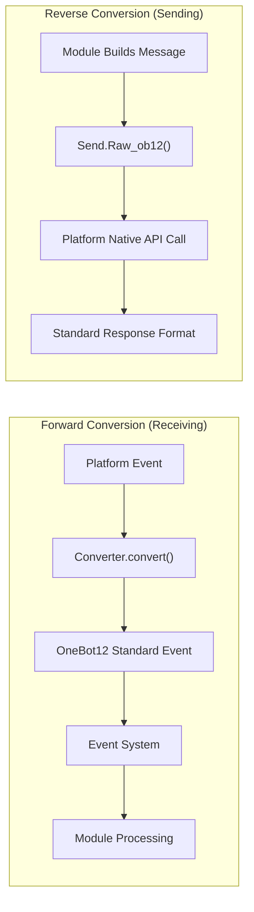
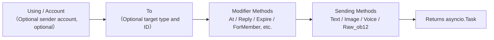
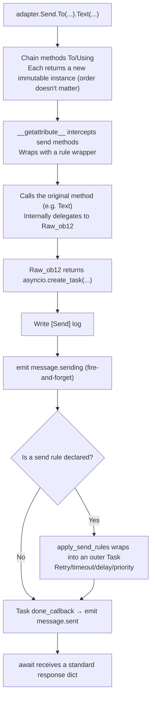

# ErisPulse 适配器开发

This skill is auto-built from the ErisPulse documentation.
Repository: https://github.com/ErisPulse/ErisPulse
Source paths are annotated per section; see docs/ in the repository for the latest content.

## 适配器开发入门

> 来源: `docs/en/developer-guide/adapters/getting-started.md`（https://github.com/ErisPulse/ErisPulse/blob/main/docs/en/developer-guide/adapters/getting-started.md）

# Getting Started with Adapter Development

> [!TIP]
> **When to read this**: The entry point of the adapter development path (required reading). Learn how to write an adapter from scratch, understand its responsibilities and project structure here; after reading, proceed to [Event Converters](converter.md) and [SendDSL Detailed Guide](send-dsl.md) as needed.

By following this guide, you will build a minimal, functional adapter (main class + converter + Send) that can receive events and send messages, with clear responsibilities for each component—the starting point for integrating with any new platform.

## Adapter Introduction

### What is an Adapter

An adapter is the bridge between ErisPulse and various messaging platforms, responsible for:

1. **Forward Conversion**: Receiving platform events and converting them into OneBot12 standard format (Converter)
2. **Reverse Conversion**: Converting OneBot12 message segments into platform API calls (`Raw_ob12`)
3. Managing connections to the platform (WebSocket/WebHook)
4. Providing a unified SendDSL message sending interface

### Adapter Architecture



## Directory Structure

Standard adapter package structure:

```
MyAdapter/
├── pyproject.toml          # Project configuration
├── README.md               # Project description
├── LICENSE                 # License
└── MyAdapter/
    ├── __init__.py          # Package entry point
    ├── Core.py               # Adapter main class
    └── Converter.py          # Event converter
```

## Quick Start

### 1. Create Project

It is recommended to use the scaffolding tool to generate a complete skeleton (including pyproject, main class, and converter):

```bash
# Standard project (for packaging and publishing)
epsdk create adapter -n MyAdapter

# Local adapter plugin (no packaging required, just place in the plugins/ directory to be automatically loaded, see below "Local Development")
epsdk create adapter -n MyAdapter --local
```

The scaffolding tool generates a default WebSocket server skeleton; for different platform connection methods, you can select a communication mode template via `--template` (generating a ready-to-use semi-finished base class, `start`/`shutdown` do not need to be written manually):

```bash
epsdk create adapter -n MyAdapter --template polling   # HTTP polling type (getUpdates pull)
epsdk create adapter -n MyAdapter --template webhook   # HTTP callback type (platform push)
```

> The differences between the three connection modes and the minimal implementation of semi-finished base classes can be found at
> [Adapter Core Concepts - Semi-Finished Base Classes for Connection Modes](core-concepts.md#Semi-Finished Base Classes for Connection Modes).
> Complete runnable examples can be found in the repository `examples/example-adapter-polling/` and `examples/example-adapter-webhook/`.

You can also create manually:

```bash
mkdir MyAdapter && cd MyAdapter
```

### 2. Create pyproject.toml

```toml
[project]
name = "ErisPulse-MyAdapter"
version = "1.0.0"
description = "MyAdapter Platform Adapter"
readme = "README.md"
requires-python = ">=3.10"
license = { file = "LICENSE" }
authors = [ { name = "yourname", email = "your@mail.com" } ]

dependencies = [
    "ErisPulse>=2.4.0"  # ErisPulse already includes aiohttp, usually no separate dependency needed
]

[project.urls]
"homepage" = "https://github.com/yourname/MyAdapter"

[project.entry-points."erispulse.adapter"]
"MyAdapter" = "MyAdapter:MyAdapter"
```

### 3. Create Adapter Main Class

The framework provides `ConfigClass` / `AccountConfigClass` for declarative configuration management; the adapter only needs to declare the configuration class to automatically load, validate, and generate the configuration template.

```python
# MyAdapter/Core.py
from dataclasses import dataclass, field
# Recommended root import (for Python 3.10+): commonly used symbols directly imported from the root package, deep paths remain compatible
from ErisPulse import BaseAdapter, BaseConfig

@dataclass
class MyAdapterConfig(BaseConfig):
    """MyAdapter Configuration"""
    api_endpoint: str = field(
        default="https://api.example.com",
        metadata={
            "description": {"i18n": "my_adapter.api_endpoint", "default": "API Address"},
            "required": False,
            "ui": {"widget": "text", "group": "connection", "order": 1},
        },
    )
    token: str = field(
        default="",
        metadata={
            "description": {"i18n": "my_adapter.token", "default": "Platform Token"},
            "required": True,
            "secret": True,
            "ui": {"widget": "password", "group": "basic", "order": 2},
        },
    )

class MyAdapter(BaseAdapter):
    ConfigClass = MyAdapterConfig  # Declare the configuration class, the framework automatically manages it
    
    # No need to override __init__! The framework automatically handles:
    # - self.sdk / self.logger are automatically set
    # - self.cfg reads configuration in real time
    # - self.Send / self.Request are automatically initialized
    
    def _setup_converter(self):
        from .Converter import MyPlatformConverter
        return MyPlatformConverter()
```

> ⚠️ **About `__init__`**: In the new version, `BaseAdapter.__init__(self, sdk=None)` automatically handles SDK references, log initialization, and configuration loading. Most adapters **do not need to override `__init__`**. See [__init__ Notes](#init-注意事项).

> ⚠️ **About `super().__init__()`**: `BaseAdapter.__init__()` is responsible for creating `Send` and `Request` factory instances. If you forget to call it, all message sending and request operations will report `AttributeError`. See [__init__ Notes](#init-注意事项).

### 4. Implement Required Methods

```python
class MyAdapter(BaseAdapter):
    # ... __init__ code ...
    
    async def start(self):
        """Start the adapter (must implement)"""
        # Register WebSocket or WebHook route
        router.register_websocket(
            module_name="myplatform",
            path="/ws",
            handler=self._ws_handler
        )
        self.logger.info("Adapter has started")
    
    async def shutdown(self):
        """Shutdown the adapter (must implement)"""
        router.unregister_websocket(
            module_name="myplatform",
            path="/ws"
        )
        # Clean up connections and resources
        self.logger.info("Adapter has shut down")
    
    async def call_api(self, endpoint: str, **params):
        """Call platform API (must implement)"""
        raise NotImplementedError("call_api needs to be implemented")
```

#### Actively Send Meta Events

The adapter should actively send meta events to let the framework track the Bot's online status. Use `emit_meta()` to complete it in one line:

```python
class MyAdapter(BaseAdapter):
    async def _ws_handler(self, websocket):
        bot_id = self._get_bot_id()

        # Bot is online
        await self.emit_meta("connect", bot_id, user_name="MyBot")

        try:
            while True:
                data = await websocket.receive_text()
                event = self.convert(data)
                if event:
                    await self.adapter.emit(event)
        except WebSocketDisconnect:
            pass
        finally:
            # Bot is offline
            await self.emit_meta("disconnect", bot_id)
```

> For detailed Bot status management and meta event explanations, see [Adapter Best Practices - Bot Status Management and Meta Events](best-practices.md#Bot-Status-Management-and-Meta-Events).

### 5. Implement Send Class

The `At`/`AtAll`/`Reply` decorators are already implemented by the framework's SendDSL base class; the adapter only needs to implement `Raw_ob12` and specific send methods.

The framework provides two key helper methods:
- `self._apply_modifiers(message)` — Automatically combines At/AtAll/Reply decorators into message segments
- `self.send_context` — Gets the send context dictionary (`target_type`, `target_id`, `account_id`)

```python
import asyncio

class MyAdapter(BaseAdapter):
    # ... other code ...

    class Send(BaseAdapter.Send):

        def Raw_ob12(self, message, **kwargs):
            """
            Send OneBot12 formatted message (must implement)

            Use _apply_modifiers to automatically combine modifier states,
            use send_context to get send context.
            """
            async def _do_send():
                segments = self._apply_modifiers(message)
                return await self._adapter.call_api(
                    endpoint="/send_message",
                    message=segments,
                    **self.send_context,
                    **kwargs
                )
            return asyncio.create_task(_do_send())

        # Text/Image/Voice/Video/File are inherited from the SendDSL base class,
        # default delegation to Raw_ob12, no need to reimplement.
        # If platform-specific logic is required, override individual methods:
        # def Text(self, text: str):
        #     return self.Raw_ob12([{"type": "text", "data": {"text": text}}])
```

**Media send method implementation points (Image/Video/File):**

- The default implementation of the base class will encapsulate the `file` parameter as a OneBot12 message segment and pass it to `Raw_ob12`; the adapter needs to handle downloads/uploads in `Raw_ob12`
- The `file` parameter should support both `bytes` binary data and `str` URL types
- When a URL is passed, the file must be downloaded first and then uploaded to the platform
- The platform usually requires calling the upload interface first to get the file identifier, then calling the send interface

**`__getattr__` magic method:**

- Implements case-insensitive method names (`Text`, `text`, `TEXT` can all be called)
- Undefined methods should return a prompt message instead of throwing an error

**`Raw_ob12` method:**

- Converts OneBot12 standard message format into platform format for sending
- Uses `self._apply_modifiers(message)` to automatically handle At/AtAll/Reply modifiers
- Uses `**self.send_context` to pass send target information and account information

### 6. Implement Converter

```python
# MyAdapter/Converter.py
import time
import uuid

class MyPlatformConverter:
    def convert(self, raw_event):
        """Convert platform native events to OneBot12 standard format"""
        if not isinstance(raw_event, dict):
            return None
        
        onebot_event = {
            "id": str(raw_event.get("event_id", uuid.uuid4())),
            "time": int(time.time()),
            "type": self._convert_event_type(raw_event.get("type")),
            "detail_type": self._convert_detail_type(raw_event),
            "platform": "myplatform",
            "self": {
                "platform": "myplatform",
                "user_id": str(raw_event.get("bot_id", ""))
            },
            "myplatform_raw": raw_event,
            "myplatform_raw_type": raw_event.get("type", "")
        }
        
        return onebot_event
    
    def _convert_event_type(self, event_type):
        """Convert event type"""
        type_map = {
            "message": "message",
            "notice": "notice"
        }
        return type_map.get(event_type, "unknown")
    
    def _convert_detail_type(self, raw_event):
        """Convert detail type"""
        return "private"  # Simplified example
```

### 7. Implement Request Class (Request Operations)

If your platform supports friend requests, group invitations, and other requests that require the Bot to make decisions, you can implement the `Request` inner class:

```python
from ErisPulse import BaseAdapter, RequestDSL

class MyAdapter(BaseAdapter):
    # ... Send and other code ...

    class Request(RequestDSL):
        """Request operation implementation (friend requests, group invitations, etc.)"""

        def accept(self, **kwargs):
            """Accept request"""
            async def _do():
                result = await self._adapter.call_api(
                    endpoint="/set_request",
                    request_id=self._request_id,
                    approve=True,
                    **kwargs,
                )
                return {
                    "status": "ok" if result.get("code") == 0 else "failed",
                    "retcode": result.get("code", 0),
                    "data": None,
                    "message_id": "",
                    "message": result.get("message", ""),
                }
            return self._create_task(_do())

        def reject(self, **kwargs):
            """Reject request"""
            async def _do():
                result = await self._adapter.call_api(
                    endpoint="/set_request",
                    request_id=self._request_id,
                    approve=False,
                    **kwargs,
                )
                return {
                    "status": "ok" if result.get("code") == 0 else "failed",
                    "retcode": result.get("code", 0),
                    "data": None,
                    "message_id": "",
                    "message": result.get("message", ""),
                }
            return self._create_task(_do())
```

Module developers use it as follows:

```python
from ErisPulse import request

@request.on_friend_request()
async def handle_friend_request(event):
    # Approve via Event method
    await event.approve()
    # Or directly via adapter
    await adapter.myplatform.Request("req_id").accept()
```

> If the platform does not support request operations, you can omit the `Request` inner class. The base class defaults to returning `retcode=10002` (unsupported operation). See [Request Action Specification](../../standards/request-action-spec.md).

### 8. Create Package Entry

```python
# MyAdapter/__init__.py
from .Core import MyAdapter
```

## Local Development (No Packaging)

Like modules, adapters can also be placed in the project's local plugin directory (default `plugins/`, configurable via `ErisPulse.framework.plugins_dir`) for direct development, **without `pip install -e .`**:

```bash
# Generate local adapter plugin
epsdk create adapter -n MyAdapter --local
# Generate structure:
# plugins/
# └── MyAdapter/
#     ├── __init__.py
#     ├── Core.py
#     └── Converter.py
```

When the framework starts, it automatically scans the plugin directory and loads modules and adapters within it (treated equally as entry-point installed packages: enabling status, configuration declaration, hot reloading, and unloading cleanup are all consistent):

- **Identification rules**: Package directories (with `__init__.py`) or single `.py` files are both recognized; the `Main` named class is prioritized, otherwise the first `BaseAdapter` / `BaseModule` subclass in the plugin is used
- **Name overwriting**: When local plugins and PyPI-installed adapters have the same name, local plugins take precedence (useful for overriding and debugging)
- **Hot reload**: `sdk.enable_plugin_hot_reload()` enables plugin directory monitoring, which also covers adapters; adapter code-level hot reload is available since 2.11—`await sdk.adapter.reload("Platform Name")` or `await sdk.reload_adapter("Platform Name")` (syntax check → unload cleanup → clear cache and re-import → re-register and start, rollback on failure; see [Architecture Overview](../../architecture.md))

### From Local Plugin to Release

After local validation, use the `pack` subcommand to convert the plugin into a release-ready standard project (interactive plugin selection, metadata completion, generating a pyproject with entry-point):

```bash
epsdk create pack
# Select plugin directory → Enter project name/description/author → Generate MyAdapter/ project directory
cd MyAdapter
pip install -e .   # Convert to standard installation; then follow the release process to upload to PyPI
```

> **Note**: After conversion, it is recommended to remove the original from `plugins/` to avoid duplicate loading of local plugins and installed packages (both with the same name, local plugins take precedence, making you mistakenly think the installed package is active).

## Dependency Declaration (Optional, 2.8.0+)

Adapters can declare dependencies on other adapters or modules to enable adapter interconnection and optional features:

```python
from typing import ClassVar

class MyAdapter(BaseAdapter):
    # Hard dependency: Skipped on startup if missing (warning + status=skipped-dependency event)
    depends: ClassVar[dict] = {
        "adapters": ["onebot11"],   # Dependencies (by platform name)
        "modules": ["TranslateEngine"],  # Dependencies (by registration name)
    }
    # Soft dependency: Not affecting startup if missing; callbacks on module load/unload (optional feature mode)
    optional_modules: ClassVar[list] = ["TranslateEngine"]
```

- **Startup order**: Adapters declaring module hard dependencies will **postpone startup until the module initialization is complete**
- **Soft dependency notification**: `on_dependency_ready(module_name)` is called when `optional_modules` (or module hard dependencies) are loaded; `on_dependency_lost(module_name)` is called when unloaded (default empty implementation, can be overridden)—covering late loading and hot reload scenarios:

```python
async def on_dependency_ready(self, module_name):
    """Soft dependency module ready: Enable corresponding optional features"""
    if module_name == "TranslateEngine":
        self._translate = self.sdk.TranslateEngine

async def on_dependency_lost(self, module_name):
    """Soft dependency module lost: Downgrade features"""
    if module_name == "TranslateEngine":
        self._translate = None
```

> [!NOTE]
> This feature requires ErisPulse **2.8.0+**.

## `__init__` Notes

Adapter development involves three layers where `__init__` may be overridden. Here are the correct practices for each layer.

### 1. BaseAdapter Layer (Most cases do not need to override)

`BaseAdapter.__init__(self, sdk=None)` is responsible for creating `Send` / `Request` factory instances and automatically handles the following:

- Accepts `sdk` parameter and sets `self.sdk`, `self.logger`
- If `ConfigClass` is declared, `self.cfg` can read global configuration in real time
- If `AccountConfigClass` is declared, `self.accounts` can read multi-account configuration in real time

**Most cases do not need to override `__init__`**, just declare `ConfigClass`:

```python
class MyAdapter(BaseAdapter):
    ConfigClass = MyAdapterConfig  # Declare and the framework automatically manages configuration
    
    async def start(self):
        cfg = self.cfg  # Type-safe, real-time reading
        ...
```

If you do need custom initialization, call `super().__init__(sdk)`:

```python
class MyAdapter(BaseAdapter):
    ConfigClass = MyAdapterConfig
    
    def __init__(self, sdk=None):
        super().__init__(sdk)  # Pass in sdk
        self.converter = self._setup_converter()
        self.convert = self.converter.convert
```

### 2. Send Inner Class (Most cases do not need to override)

`SendDSL.__init__` is responsible for passing state through chained calls (target type, target ID, account, etc.). **Most cases, you only need to override methods** (`Raw_ob12`, `Text`, etc.), not `__init__`.

If you do need to (for example, initializing platform-specific state), **you must pass through all parameters**:

```python
class MyAdapter(BaseAdapter):
    class Send(BaseAdapter.Send):
        # Parameters: adapter, target_type, target_id, account_id
        def __init__(self, adapter, target_type=None, target_id=None, account_id=None):
            super().__init__(adapter, target_type, target_id, account_id)  # ← Must pass through
            self._my_state = None  # Platform-specific initialization
```

**Why must you pass through?** Each step of the chained call creates a new instance via `self.__class__(...)`:

```python
adapter.Send.To("user", "123")               # → Send(adapter, "user", "123", None)
adapter.Send.To("user", "123").Using("bot1")  # → Send(adapter, "user", "123", "bot1")
```

If the `__init__` signature does not match or `super()` is not called, the chained call will break.

### 3. Request Inner Class (Most cases do not need to override)

Same as Send. Parameters are `adapter`, `request_id`, `account_id`:

```python
class MyAdapter(BaseAdapter):
    class Request(RequestDSL):
        # Parameters: adapter, request_id, account_id
        def __init__(self, adapter, request_id=None, account_id=None):
            super().__init__(adapter, request_id, account_id)  # ← Must pass through
            self._my_state = None  # Platform-specific initialization
```

### Summary

| Layer | When to Override | What You Must Do |
|------|------------|-----------|
| **BaseAdapter** | When custom initialization logic is needed | `super().__init__(sdk)` (pass in the sdk parameter) |
| **Send Inner Class** | When initializing send-related state is needed | `super().__init__(adapter, target_type, target_id, account_id)` |
| **Request Inner Class** | When initializing request-related state is needed | `super().__init__(adapter, request_id, account_id)` |
| All three layers | Most cases | **Declare ConfigClass and do not touch `__init__`** |

### 9. Connection Info and Route Discovery

After registering routes, the framework records all route information. Users can use the following API to view the adapter's connection address:

```python
from ErisPulse import sdk

# Get complete adapter connection info
info = sdk.adapter.get_connection_info("myplatform")
# {
#   "platform": "myplatform",
#   "status": "started",
#   "connection": {
#     "base_url": "http://localhost:8080",
#     "http_routes": [
#       {"path": "/myplatform/webhook", "method": "POST",
#        "url": "http://localhost:8080/myplatform/webhook"}
#     ],
#     "websocket_routes": [
#       {"path": "/myplatform/ws",
#        "url": "ws://localhost:8080/myplatform/ws"}
#     ]
#   }
# }

# List routes of all namespaces (adapters/modules)
namespaces = sdk.router.list_namespaces()
# {"myplatform": {"http": ["/myplatform/webhook"], "websocket": ["/myplatform/ws"]}}

# Get complete connection URL of namespace
urls = sdk.router.get_module_urls("myplatform")
# {"base_url": "http://localhost:8080", "http": [...], "websocket": [...]}

# Get detailed route info of namespace
routes = sdk.router.get_module_routes("myplatform")
# {"http": [{"path": "/myplatform/webhook", "methods": ["POST"]}],
#  "websocket": [{"path": "/myplatform/ws", "auth": false}]}
```

> **Tip**: The information returned by `get_connection_info()` is suitable for displaying to users (such as in a WebUI), helping users configure the callback address or WebSocket connection address on the platform side. The `module_name` registered during route registration must exactly match the `platform` name registered by the adapter in ErisPulse, otherwise route discovery will not be correctly associated.

### 10. SSE (Server-Sent Events) Support

ErisPulse has built-in server-agnostic SSE support, and modules and adapters can register SSE endpoints using `@sdk.router.sse()`.

#### Basic Usage

```python
import asyncio
from ErisPulse import sdk

@sdk.router.sse("MyModule", "/events")
async def event_stream(sse):
    """Send SSE events"""
    count = 0
    while not sse.closed:
        await sse.send({"count": count}, event="update")
        count += 1
        await asyncio.sleep(1)
```

#### Using Request Parameters

The handler can declare a `request` parameter to access client request information:

```python
@sdk.router.sse("MyModule", "/events")
async def event_stream(request, sse):
    token = request.query_params.get("token")
    if not validate_token(token):
        await sse.close()
        return

    while not sse.closed:
        data = await fetch_data(token)
        await sse.send(data)
        await asyncio.sleep(5)
```

#### SseEmitter API

| Method | Description |
|------|------|
| `sse.send(data, event=None, id=None, retry=None)` | Send SSE event. Non-str data is automatically JSON serialized |
| `sse.close()` | Gracefully close SSE connection (safe to call multiple times) |
| `sse.closed` | Whether the connection is closed |
| `sse.request` | The underlying request object (can be used to read query params, headers) |

#### Using in RouteGroup

```python
api = sdk.router.group("MyModule", "/api", version="1")

@api.sse("/events")
async def events(sse):
    await sse.send({"msg": "hello"})
```

#### Route Discovery

SSE routes are automatically included in the route discovery API:

```python
# list_namespaces will include "sse" key
sdk.router.list_namespaces()
# {"MyModule": {"http": [...], "websocket": [...], "sse": ["/MyModule/events"]}}

# get_module_routes will mark streaming: true
sdk.router.get_module_routes("MyModule")
# {"http": [...], "websocket": [...], "sse": [{"path": "/MyModule/events", "streaming": true}]}

# get_module_urls will generate full URL
sdk.router.get_module_urls("MyModule")
# {"sse": [{"path": "/MyModule/events", "url": "http://localhost:8080/MyModule/events"}]}
```

> **Server-Agnostic Design**: `SseEmitter` decouples through callbacks from the underlying HTTP framework. The framework provides `register_sse()` and `@sse` decorator as unified registration entry points, allowing adapters to implement SSE endpoints without directly depending on any underlying HTTP framework.

### Complete the Three Core Components of the Adapter

- [Event Converters](converter.md) - Implementation details and common pitfalls for converting platform events to OneBot12
- [SendDSL Detailed Guide](send-dsl.md) - Message sending chain, modifier methods, and sending rules
- [Adapter Core Concepts](core-concepts.md) - Explanation of BaseAdapter / Lifecycle / Multi-account mechanisms

### After Getting the Skeleton Running

- [Adapter Best Practices](best-practices.md) - Engineering finishing touches for connection retries, heartbeats, and error handling
- [Publishing and Module Store Guide](../publishing.md) - Publishing to PyPI and the module store

## 适配器核心概念

> 来源: `docs/en/developer-guide/adapters/core-concepts.md`（https://github.com/ErisPulse/ErisPulse/blob/main/docs/en/developer-guide/adapters/core-concepts.md）

# Core Concepts of Adapters

> [!TIP]
> **When to read this**: Mandatory for adapter development path (complete explanation of core mechanisms such as BaseAdapter, SendDSL, and lifecycle). For a quick start, read [Getting Started with Adapter Development](getting-started.md) first, and return here only if you have questions about "why" certain aspects are implemented this way.

This document explains the runtime mechanism of adapters: how `AdapterManager` registers and distributes events, what `BaseAdapter` does during initialization, how to declare configurations and multiple accounts—when you encounter questions like "why should I write this way," refer to this document.

## Adapter Architecture

### Component Relationships

```
Forward Conversion (Receiving Direction)                           Reverse Conversion (Sending Direction)
─────────────────                           ─────────────────
                                             
┌──────────────────┐                        ┌──────────────────┐
│ Platform Native Event     │                        │ Module Constructs Message     │
└────────┬─────────┘                        └────────┬─────────┘
         │                                           │
         ↓                                           ↓
┌──────────────────┐   ┌──────────────────┐   ┌──────────────────┐
│                  │   │  Adapter (MyAdapter) │   │                  │
│  Converter       │   │ ┌──────────────┐ │   │ Send.Raw_ob12()  │
│  (Event Converter)    │──→│ │              │ │   │ (Reverse Conversion Entry)   │
│                  │   │ │              │ │   │                  │
└──────────────────┘   │ └──────────────┘ │   └────────┬─────────┘
                       └──────────────────┘            │
                                │                      ↓
                                ↓              ┌──────────────────┐
                       ┌──────────────────┐    │ Platform API Call    │
                       │ OneBot12 Standard Event │    └────────┬─────────┘
                       └────────┬─────────┘             │
                                │                      ↓
                                ↓              ┌──────────────────┐
                       ┌──────────────────┐    │ Standard Response Format     │
                       │ Event System         │    └──────────────────┘
                       └────────┬─────────┘
                                │
                                ↓
                       ┌──────────────────┐
                       │ Module (Process Event)  │
                       └──────────────────┘
```

**Core Symmetry**:
- **Forward Conversion** (Converter): Platform native event → OneBot12 standard event, original data preserved in `{platform}_raw`
- **Reverse Conversion** (Raw_ob12): OneBot12 message segment → Platform API call, returns standard response format

## AdapterManager Adapter Manager

`AdapterManager` is the core component of ErisPulse's adapter system, responsible for managing all platform adapters' registration, startup, shutdown, and event distribution.

### Core Functions

- **Adapter Registration**: Register and manage multiple platform adapters
- **Lifecycle Management**: Control adapter startup and shutdown
- **Event Distribution**: Distribute OneBot12 standard events and platform native events
- **Configuration Management**: Manage adapter enable/disable status
- **Middleware Support**: Support OneBot12 event middleware

### Basic Usage

```python
from ErisPulse import sdk

# Register adapter (usually done automatically by Loader)
sdk.adapter.register("myplatform", MyPlatformAdapter)

# Start all adapters
await sdk.adapter.startup()

# Start specified adapter
await sdk.adapter.startup(["myplatform"])
# Start all adapters
await sdk.adapter.startup()

# Get adapter instance
my_adapter = sdk.adapter.get("myplatform")
# Or access via attribute
my_adapter = sdk.adapter.myplatform

# Shutdown all adapters
await sdk.adapter.shutdown()
```

### Startup and Shutdown

#### Start Adapter

```python
# Start all registered adapters
await sdk.adapter.startup()

# Start specified platform
await sdk.adapter.startup(["platform1", "platform2"])
```

**Startup Process**:

1. Submit `adapter.start` lifecycle event
2. Submit `adapter.status.change` event (starting)
3. Parallel startup of each adapter
4. If startup fails, automatically retry (exponential backoff strategy)
5. After successful startup, submit `adapter.status.change` event (started)

**Retry Mechanism**:

- First 4 retries: 60 seconds, 10 minutes, 30 minutes, 60 minutes
- Fifth and subsequent: Fixed interval of 3 hours

#### Shutdown Adapter

```python
# Shutdown all adapters
await sdk.adapter.shutdown()
```

**Shutdown Process**:

1. Submit `adapter.stop` lifecycle event
2. Call all adapters' `shutdown()` method
3. Close router server
4. Clear event handlers
5. Submit `adapter.stopped` lifecycle event

### Configuration Management

#### Check Platform Status

```python
# Check if platform is registered
exists = sdk.adapter.exists("myplatform")

# Check if platform is enabled
enabled = sdk.adapter.is_enabled("myplatform")

# Use in operator
if "myplatform" in sdk.adapter:
    print("Platform exists and is enabled")
```

#### List Platforms

```python
# List all registered platforms
platforms = sdk.adapter.list_registered()

# List all platforms and their status
status_dict = sdk.adapter.list_items()
# Returns: {"platform1": true, "platform2": false, ...}

# Get list of enabled platforms
enabled_platforms = [p for p, enabled in status_dict.items() if enabled]
```

### Event Listening

#### OneBot12 Standard Events

```python
from ErisPulse import sdk

# Listen to standard message events across all platforms
@sdk.adapter.on("message")
async def handle_message(data):
    print(f"Received OneBot12 message: {data}")

# Listen to standard message events for a specific platform
@sdk.adapter.on("message", platform="myplatform")
async def handle_platform_message(data):
    print(f"Received myplatform message: {data}")

# Listen to all events
@sdk.adapter.on("*")
async def handle_any_event(data):
    print(f"Received event: {data.get('type')}")
```

#### Platform Native Events

```python
# Listen to native events for a specific platform
@sdk.adapter.on("raw_event_type", raw=True, platform="myplatform")
async def handle_raw_event(data):
    print(f"Received native event: {data}")

# Listen to native events for all platforms (wildcard)
@sdk.adapter.on("*", raw=True)
async def handle_all_raw_events(data):
    print(f"Received native event: {data}")
```

#### Event Distribution Mechanism

When calling `adapter.emit(event_data)`:

1. **Middleware Handling**: Execute all OneBot12 middlewares first
2. **Standard Event Distribution**: Distribute to matching OneBot12 event handlers
3. **Native Event Distribution**: If original data exists, distribute to native event handlers

**Matching Rules**:

- Exact match: `@sdk.adapter.on("message")` only matches `message` events
- Wildcard: `@sdk.adapter.on("*")` matches all events
- Platform filtering: `platform="myplatform"` only distributes events from the specified platform

### Middleware

#### Add Middleware

```python
@sdk.adapter.middleware
async def logging_middleware(data):
    """Logging middleware"""
    print(f"Processing event: {data.get('type')}")
    return data  # Must return data

@sdk.adapter.middleware
async def filter_middleware(data):
    """Event filtering middleware"""
    # Filter out unwanted events
    if data.get("type") == "notice":
        return None  # Returning None means the middleware chain ignores this return value, retaining original data for further propagation
    return data  # Must return data to continue propagation
```

#### Middleware Return Contract

| Return Value | Behavior |
|--------|------|
| `dict` | Rewrite event payload (subsequent handlers receive the modified event) |
| `None` | Allow passage, payload unchanged (outputs WARNING prompt—suggest explicit `return data`) |
| `False` | **Reject**: Event is discarded, no handlers are invoked, no outbound side effects |

Rejection is suitable for scenarios like firewalls, rate limiting, and blacklists that discard events at the event level (previously only possible using high-priority event handlers). When rejection occurs, the framework outputs a TRACE log and triggers the `adapter.event.blocked` lifecycle hook (carrying the `middleware` middleware name, complete `event`, `platform` / `event_type` / `detail_type`), facilitating troubleshooting of "why an event was not responded to":

```python
@sdk.adapter.middleware
async def rate_limit_middleware(data):
    """Rate limiting middleware"""
    if _is_rate_limited(data):
        return False  # Reject: Event is discarded
    data["rate_marked"] = True
    return data

@sdk.lifecycle.on("adapter.event.blocked")
async def on_event_blocked(data):
    print(f"Event rejected by {data['middleware']}: {data['event_type']}")
```

#### Middleware Execution Order

Middlewares execute in the order they are registered, with later registered middlewares executing first.

> **Note**: If a middleware returns `None` (e.g., forgetting to `return data`), the framework will ignore this return value and retain the original data for further propagation, while outputting a warning-level log. This ensures that a single middleware mistake does not cause the entire event chain to be interrupted.

```python
# Registration order
sdk.adapter.middleware(middleware1)  # Executes last
sdk.adapter.middleware(middleware2)  # Executes in the middle
sdk.adapter.middleware(middleware3)  # Executes first

# Execution order: middleware3 -> middleware2 -> middleware1
```

### Get Adapter Instance

#### get() Method

```python
adapter = sdk.adapter.get("myplatform")
if adapter:
    await adapter.Send.To("user", "123").Text("Hello")
```

#### Attribute Access

```python
# Access via attribute name (case-insensitive)
adapter = sdk.adapter.myplatform
await adapter.Send.To("user", "123").Text("Hello")
```

## BaseAdapter Base Class

### Basic Structure

```python
from dataclasses import dataclass, field
from ErisPulse.Core import BaseAdapter
from ErisPulse.Core.Bases import BaseConfig, BotAccountConfig

@dataclass
class MyConfig(BaseConfig):
    """Adapter configuration (automatically managed by the framework after declaration)"""
    token: str = field(
        default="",
        metadata={
            "description": {"i18n": "my_adapter.token", "default": "Bot Token"},
            "required": True,
            "secret": True,
            "ui": {"widget": "password", "group": "basic", "order": 1},
        },
    )

class MyAdapter(BaseAdapter):
    ConfigClass = MyConfig  # Declare configuration class
    
    # No need to override __init__, the framework automatically handles:
    # - self.sdk, self.logger
    # - self.cfg (type-safe configuration instance, read in real-time)
    # - self.Send, self.Request
    
    async def start(self):
        """Start adapter (must implement)"""
        cfg = self.cfg  # Automatically loaded type-safe configuration
        pass
    
    async def shutdown(self):
        """Shutdown adapter (must implement)"""
        pass
    
    async def call_api(self, endpoint: str, **params):
        """Call platform API (must implement)"""
        pass
```

### Configuration Management

The framework provides declarative configuration management, defining configuration structures via dataclass, with the framework automatically handling loading, validation, and template generation.

#### Single Account Configuration

```python
from dataclasses import dataclass, field
from ErisPulse.Core.Bases import BaseConfig

@dataclass
class TelegramConfig(BaseConfig):
    token: str = field(default="", metadata={
        "description": {"i18n": "telegram.token", "default": "Bot Token"},
        "required": True,
        "secret": True,
        "ui": {"widget": "password", "group": "basic", "order": 1},
    })
    proxy: str = field(default="", metadata={
        "description": {"i18n": "telegram.proxy", "default": "Proxy address"},
        "ui": {"widget": "text", "group": "advanced", "order": 10},
    })

class TelegramAdapter(BaseAdapter):
    ConfigClass = TelegramConfig
    
    async def start(self):
        cfg = self.cfg  # Type-safe, real-time reading
        if not cfg.token:
            raise ValueError("Token not configured")
        await self._connect(cfg.token, proxy=cfg.proxy)
```

#### Multi-Account Configuration

The `BotAccountConfig` base class provides `enabled` and `name` fields. Most adapters can automatically obtain `bot_id` from the platform protocol or login response, injecting it into the account configuration during event conversion.:

```python
from dataclasses import dataclass, field
from ErisPulse.Core.Bases import BotAccountConfig

# Most adapters: bot_id is automatically obtained at runtime, no need to configure
@dataclass
class MyBotConfig(BotAccountConfig):
    token: str = field(default="", metadata={
        "description": {"i18n": "my_adapter.bot_token", "default": "Token"},
        "required": True,
    })

# If bot_id cannot be obtained during login, allow the user to fill it in the configuration
@dataclass
class YunhuBotConfig(BotAccountConfig):
    bot_id: str = field(default="", metadata={
        "description": {"i18n": "yunhu.bot_id", "default": "Bot ID"},
        "required": True,
    })
    token: str = field(default="", metadata={
        "description": {"i18n": "yunhu.token", "default": "Token"},
        "required": True,
    })

class MyAdapter(BaseAdapter):
    AccountConfigClass = MyBotConfig
    
    async def start(self):
        for name, account in self.enabled_accounts.items():
            user_id = await self._login(name, account)
            await self.emit_meta("connect", user_id)
```

#### metadata Convention

Field metadata serves both TOML comment generation and WebUI form rendering:

```python
metadata = {
    "description": str | dict,  # Field description (supports i18n)
    "required": bool,         # Whether required (validation + WebUI required mark)
    "secret": bool,           # Whether sensitive (WebUI displays as ***, masked in logs)
    "example": bool,          # Not persisted flag: not written to config.toml (default value/template excluded),
                              # only rendered into config.full.example; schema with "example": true marked,
                              # CLI configuration wizard defaults skip; user manually sets then persists normally
    "min": number, "max": number,  # Numerical range validation
    "ui": {                   # WebUI control configuration (old name "webui" still compatible)
        "widget": str,        # Control type: "text" | "switch" | "select" | "number" | "password"
        "group": str,         # Group: "basic" | "advanced" | "connection" etc.
        "order": int,         # Sorting weight (smaller is earlier)
        "options": list,      # Select control options [{label, value}], label supports i18n
        "placeholder": str | dict,  # Input box placeholder (supports i18n)
    },
    "extra": dict,            # Additional extended field (passed through to schema)
}
```

All user-visible text fields support i18n, uniformly using the `{"i18n": "key", "default": "text"}` format,
pure strings are passed through as-is (backward compatibility). Supported i18n fields:

| Field | Location | Description |
|------|------|------|
| `description` | field metadata | Field description |
| `options[].label` | `ui.options` | Select control option label |
| `placeholder` | `ui.placeholder` | Input box placeholder |
| `group_labels` | `_schema_meta` | Group display name (Dashboard partition title) |

When using i18n, you must register the translation key to the i18n system in advance (see [i18n documentation](../../advanced/i18n.md#configuration-field-multilingual) for details).

**description / placeholder / options label** example:

```python
token: str = field(
    default="",
    metadata={
        "description": {"i18n": "my_adapter.token", "default": "Bot Token"},
        "ui": {
            "widget": "text",
            "placeholder": {"i18n": "my_adapter.token.ph", "default": "Enter Token"},
        },
    },
)
mode: str = field(
    default="a",
    metadata={
        "description": {"i18n": "my_adapter.mode", "default": "Mode"},
        "ui": {
            "widget": "select",
            "options": [
                {"label": {"i18n": "my_adapter.mode.a", "default": "Option A"}, "value": "a"},
                {"label": "Plain string label", "value": "b"},  # Plain string passed through as-is
            ],
        },
    },
)
```

**group_labels** example (declared after configuration class definition):

```python
MyConfig._schema_meta = {
    "group_labels": {
        "basic": {"i18n": "my_adapter.group.basic", "default": "Basic Settings"},
        "advanced": {"i18n": "my_adapter.group.advanced", "default": "Advanced Settings"},
    }
}
```

The framework's `resolve_config_schema()` automatically resolves the above fields' i18n keys based on the current language;
`get_config_schema()` passes through the i18n dictionary as-is, letting the frontend parse it.

#### docstring automatically generates field descriptions (v2.8.0+)

Fields without `description` declared in metadata, the framework automatically extracts field descriptions from the configuration class docstring as a fallback, supporting two common styles (can be mixed):

```python
@dataclass
class MyConfig(BaseConfig):
    """
    MyAdapter Configuration

    :ivar endpoint: Platform API address        # reST style
    :ivar timeout: Request timeout in seconds
    """

    endpoint: str = "https://api.example.com"   # No metadata description → comment/description from docstring
    timeout: int = 30

    # Google style also supported (Attributes: section):
    # Attributes:
    #     endpoint: Platform API address
```

Priority: **metadata description > docstring field description > empty**.
i18n dictionary form of description is unaffected (always prioritized).

#### Nested Configuration (v2.8.0+)

When the field type is a nested dataclass, the framework recursively processes: schema uses `"type": "table"` +
`"fields"` subtree carries (WebUI renders as collapsible nested group), TOML template renders as `[subtable]` section,
default value / filling / validation / i18n resolution all recursively take effect.

```python
@dataclass
class RetryConfig(BaseConfig):
    """Retry Strategy

    :ivar max_retries: Maximum retry count
    """
    max_retries: int = 3
    backoff: float = 0.5

@dataclass
class MyConfig(BaseConfig):
    """MyAdapter Configuration"""
    endpoint: str = "https://api.example.com"
    retry: RetryConfig = field(default_factory=RetryConfig)   # Nested configuration section
```

Generated TOML template:

```toml
endpoint = "https://api.example.com"

[retry]
# Maximum retry count
max_retries = 3
backoff = 0.5
```

> For nested types, it is recommended to use direct type annotations; string annotations (e.g., for delayed evaluation scenarios) must ensure
> the type can be globally resolved from the configuration class module, `__qualname__` outer class namespace, or class attributes by name.

#### Non-persisted example field (v2.8.0+)

```python
gc_interval: int = field(default=300, metadata={"example": True})
```

Fields with `example: True`:

- Not written to config.toml (adapter/module configuration template and default values excluded, runtime uses code default value)
- Only rendered into project's `config.full.example` (for user reference, copy to config.toml as needed)
- Schema with `"example": true` marked (panel can decide display strategy), CLI configuration wizard defaults skip
- After user manually sets this key, it persists normally, updates normally (user's explicit intent takes precedence)

Suitable for "complex but rarely touched" advanced configuration items, keeping the user's config.toml minimal.

> ⚠️ `_schema_meta` is class-level metadata (not a configuration field). If declared inside the dataclass class body,
> it must be annotated with `ClassVar` (`_schema_meta: ClassVar[dict] = {...}`), otherwise it will be treated
> as a regular field by dataclass. The framework defensively excludes fields with leading underscores from any
> schema / template / default value / validation output, but it is still recommended to declare them properly.

### Declarative Translation Keys (v2.7.0+)

Adapters can declare translation keys in a nested class `I18nClass`, similar to declaring `ConfigClass`. The framework automatically registers all declared translation keys during `__init__` (before configuration template generation), ensuring that i18n keys referenced in configuration descriptions are available when generating templates.

```python
from ErisPulse.Core.Bases import BaseAdapter, BaseI18n, I18nKey

class MyAdapter(BaseAdapter):
    class I18nClass(BaseI18n):
        endpoint: I18nKey = I18nKey(
            default="API Endpoint",
            zh_CN="API 地址",
            zh_TW="API 位址",
            en="API Endpoint",
            ja="APIアドレス",
            ru="API адрес",
        )
        token: I18nKey = I18nKey(
            default="Platform Token",
            zh_CN="平台 Token",
            zh_TW="平台權杖",
            en="Platform Token",
            ja="プラットフォームトークン",
            ru="Токен платформы",
        )
```

> ``I18nKey.default`` is a language-agnostic fallback text, not registered to any language.
> To make the translation effective, at least one language parameter must be explicitly passed.
> See [i18n documentation](../../advanced/i18n.md#recommended-usage-declaring-translation-keys-via-i18nclass-v270) for detailed usage (key path rules, explicit key parameter, etc.).

### Declarative Event Extension Methods (v2.7.0+)

Adapters can declare platform-specific event extension methods via `EventMixin`, and the framework automatically registers them to the current platform.

```python
from ErisPulse.Core import BaseAdapter

class MyAdapter(BaseAdapter):
    class EventMixin:
        def get_chat_name(self):
            """Get chat name"""
            return self.get("myplatform_raw", {}).get("chat", {}).get("name", "")

        def is_official_message(self):
            """Check if it is an official message"""
            raw = self.get("myplatform_raw", {})
            return raw.get("sender", {}).get("is_official", False)
```

After registration, event objects can directly call these methods:

```python
@message.on_group_message()
async def handler(event):
    if event.is_official_message():
        chat_name = event.get_chat_name()
        await event.reply(f"[{chat_name}] Official message received")
```

> Event extension methods of the adapter are registered to its own platform (``self._platform``).
> Modules need to use the original ``register_event_mixin()`` API for cross-platform event extensions.

#### Account Resolution

Multi-account adapters can use `_resolve_account()` to automatically resolve the target account:

```python
async def call_api(self, endpoint: str, **params):
    account_id = params.pop("account_id", None)
    name, account = self._resolve_account(account_id)
    # name: account name, account: configuration instance
```

Resolution strategy: account name match → `bot_id` field match → other str field match → first enabled account.

#### Configuration Hot Update

Subclasses can override `on_config_update()` to respond to configuration changes:

```python
class MyAdapter(BaseAdapter):
    ConfigClass = MyConfig
    
    def on_config_update(self, old_config, new_config):
        if old_config.token != new_config.token:
            self.logger.info("Token has been updated, reconnecting")
```

### Initialization Process

The framework automatically completes the following tasks in `BaseAdapter.__init__(self, sdk=None)`:

1. **SDK Reference**: Set `self.sdk`, `self.logger`
2. **Send/Request Factory**: Create `self.Send` and `self.Request`
3. **Configuration Template**: If `ConfigClass` is declared, automatically generate the default configuration template (first time)
4. **Account Template**: If `AccountConfigClass` is declared, automatically generate the default account template (first time)
5. **EventMixin Registration**: If `EventMixin` is declared, automatically register it to `AdapterManager` after injecting the platform name

Configuration is read in real-time via `self.cfg` / `self.accounts` (each access reads the latest value from the configuration store). `self.config` as a compatibility alias for `self.cfg` is still available.

Most adapters do not need to override `__init__`. If custom initialization is required:

```python
class MyAdapter(BaseAdapter):
    ConfigClass = MyConfig
    
    def __init__(self, sdk=None):
        super().__init__(sdk)  # Pass sdk
        self.converter = self._setup_converter()
        self.convert = self.converter.convert
```

## Send Message Sending DSL

### Inheritance Relationship

```python
class MyAdapter(BaseAdapter):
    class Send(BaseAdapter.Send):
        """Send nested class, inherits from BaseAdapter.Send"""
        pass
```

### Available Properties

The `Send` class automatically sets the following properties when called:

| Property | Description | Setting Method |
|-----|------|---------|
| `_target_id` | Target ID | `To(id)` or `To(type, id)` |
| `_target_type` | Target Type | `To(type, id)` |
| `_target_to` | Simplified Target ID | `To(id)` |
| `_account_id` | Sending Account ID | `Using(account_id)` |
| `_adapter` | Adapter Instance | Automatically set |
| `_at_user_ids` | @ User List | `At(user_id)` |
| `_reply_message_id` | ID of the replied message | `Reply(message_id)` |
| `_at_all` | Whether to @ all | `AtAll()` |

> **Recommendation**: Use the `self.send_context` property to get `target_type`, `target_id`, `account_id` in one go, which is clearer than directly accessing instance variables.

### Framework Helper Methods

| Method/Property | Description |
|-----------|------|
| `self._apply_modifiers(message)` | Merge At/AtAll/Reply modifier states into the message segment list |
| `self.send_context` | Return `{target_type, target_id, account_id}` dictionary |

### Basic Methods

Adapters only need to implement `Raw_ob12`, standard methods (Text/Image/Voice/Video/File) are inherited from `SendDSL` base class and default delegate to it:

```python
class Send(BaseAdapter.Send):
    def Raw_ob12(self, message, **kwargs):
        """Must implement: OneBot12 message segment → Platform API"""
        async def _do_send():
            segments = self._apply_modifiers(message)
            return await self._adapter.call_api(
                endpoint="/send_message",
                message=segments,
                **self.send_context,
                **kwargs
            )
        return asyncio.create_task(_do_send())

    # Text/Image/Voice/Video/File are inherited from base class, automatically delegate Raw_ob12, no need to repeat implementation
    # If platform-specific logic is needed, override individual methods:
    # def Text(self, text: str):
    #     return self.Raw_ob12([{"type": "text", "data": {"text": text}}])
```

### Chainable Modifier Methods

```python
class Send(BaseAdapter.Send):

    def __init__(self, adapter, target_type=None, target_id=None, account_id=None):
        super().__init__(adapter, target_type, target_id, account_id)
        self.buttons = []

    def Button(self, content: list) -> 'Send':
        self.buttons.append(content)
        return self
```

## Event Converter

### Conversion Process

```
Platform Native Event
    ↓
Converter.convert()
    ↓
OneBot12 Standard Event
```

### Required Fields

All converted events must include:

```python
{
    "id": "Unique event identifier",
    "time": 1234567890,           # 10-digit Unix timestamp
    "type": "message/notice/request/meta",
    "detail_type": "Event detail type",
    "platform": "Platform name",
    "self": {
        "platform": "Platform name",
        "user_id": "Bot ID"     # Must match bot_id
    },
    "{platform}_raw": {...},       # Original data (must)
    "{platform}_raw_type": "..."    # Original type (must)
}
```

### Converter Example

```python
class MyPlatformConverter:
    def convert(self, raw_event):
        """Convert platform native event to OneBot12 standard format"""
        if not isinstance(raw_event, dict):
            return None
        
        # Generate event ID
        event_id = raw_event.get("event_id") or str(uuid.uuid4())
        
        # Convert timestamp
        timestamp = raw_event.get("timestamp")
        if timestamp and timestamp > 10**12:
            timestamp = int(timestamp / 1000)
        else:
            timestamp = int(timestamp) if timestamp else int(time.time())
        
        # Convert event type
        event_type = self._convert_type(raw_event.get("type"))
        detail_type = self._convert_detail_type(raw_event)
        
        # Construct standard event
        onebot_event = {
            "id": str(event_id),
            "time": timestamp,
            "type": event_type,
            "detail_type": detail_type,
            "platform": "myplatform",
            "self": {
                "platform": "myplatform",
                "user_id": str(raw_event.get("bot_id", ""))
            },
            "myplatform_raw": raw_event,
            "myplatform_raw_type": raw_event.get("type", "")
        }
        
        return onebot_event
```

## Connection Management

### Two Correct Ways to Write start()

Adapters in client mode (WebSocket client, HTTP polling, etc.) need to start a persistent connection loop in `start()`. The framework supports two ways, **both correct, but only one can be chosen**:

**Way 1: spawn-return style (Recommended)**—Use `spawn_client_loop()` to schedule the loop as a background task belonging to this platform, `start()` returns immediately:

```python
class MyAdapter(BaseAdapter):
    async def start(self):
        # The loop task belongs to self._platform: framework automatically cancels when shutdown
        self.spawn_client_loop(self._connect_loop())
        # start ends here—“startup is successful”, connection failure handled within loop

    async def _connect_loop(self):
        while True:
            try:
                await self._connect_and_receive()   # Disconnect throws exception → below backoff
            except asyncio.CancelledError:
                raise
            except Exception:
                await asyncio.sleep(5)              # Loop handles backoff and reconnects
```

**Way 2: Persistent style**—`start()` directly `await` the connection loop, never returns:

```python
class MyAdapter(BaseAdapter):
    async def start(self):
        await self._connect_loop()   # Persistent, never returns; loop throws exception = start fails
```

Differences and common points between the two writing styles:

| | spawn-return style | Persistent style |
|---|---|---|
| `start()` return timing | Immediately returns after launching the loop | Returns when the connection loop exits/fails (framework retries according to backoff strategy) |
| Connection failure handling | Exception caught within loop, handled internally | Exception thrown, handed over to the framework's retry chain |
| Suitable scenarios | Need to return startup confirmation quickly (multiple connections, register routes and then launch other tasks) | "Connection is startup" semantics simple implementation |

`spawn_client_loop(coro, *, name="client_loop")` is the scheduling entry for way one: the task is registered by `self._platform`, the framework automatically cancels it when the adapter `shutdown()` without needing to manage task handles yourself; uncaught exceptions within the loop are automatically logged (for expected disconnection and reconnection, please catch them within the loop).

> **The only incorrect way is mixing**: spawning and then `await`ing the same loop—this makes `start()` lose the immediate return semantics, and the task cancellation path becomes unpredictable.

### Connection Mode Semi-Complete Base Classes

In addition to the two writing styles above, the most common connection modes have direct "semi-complete" base classes provided by the framework (`ErisPulse.Core.Bases.adapter_patterns`, importable directly from the root package): `start`/`shutdown` lifecycle orchestration is fully handled by the base class, and the subclass only implements business hooks.

#### PollingAdapter (HTTP Polling Type)

Suitable for platforms that "periodically pull events from the client" (Telegram getUpdates type). The base class starts a persistent polling loop using the spawn-return style, automatically logs failed pulls and applies exponential backoff (base 1 second, upper limit 60 seconds, success resets to zero; constants `POLLING_ADAPTER_BACKOFF_BASE_SECS`/`POLLING_ADAPTER_BACKOFF_MAX_SECS` can be adjusted in `Core/constants.py`):

```python
from ErisPulse import PollingAdapter

class MyAdapter(PollingAdapter):
    # Polling interval defaults to 5 seconds; ConfigClass declares poll_interval field, uses configuration value (hot update takes effect)
    poll_interval = 5.0

    async def fetch_events(self):
        """Pull a batch of platform native events (exceptions handled by base class backoff, no try/except needed)"""
        resp = await self.sdk.client.get(f"{self.cfg.endpoint}/getUpdates")
        data = await resp.json()
        return data.get("result", [])

    def convert_one(self, raw):
        """Convert a single native event to OneBot12; return None to skip"""
        return self.converter.convert(raw)

    async def call_api(self, endpoint: str, **params):
        ...  # Same as regular adapter
```

Minimum implementation surface: `fetch_events`/`convert_one`/`call_api`. `start()` starts the loop and returns immediately; `shutdown()` does not need subclass handling (polling loop is automatically canceled by owner).

#### WebhookAdapter (HTTP Callback Type)

Suitable for platforms that "push callbacks from the platform." The base class's `start()` registers the receiving route on the framework router (final path `/{platform name}/webhook`, POST method), registered in `owner_scope`—the adapter unloads automatically clean up by owner, no need to manually deregister:

```python
from ErisPulse import WebhookAdapter

class MyAdapter(WebhookAdapter):
    def verify_request(self, request) -> bool:
        """Optional hook: callback verification (default allows, return False to deny by base class with 403)"""
        cfg = self.cfg
        if not cfg.token:
            return True
        auth = request.headers.get("authorization", "")
        return auth == f"Bearer {cfg.token}"

    def convert(self, payload):
        """Convert callback payload to OneBot12; return None to skip"""
        return self.converter.convert(payload)

    async def call_api(self, endpoint: str, **params):
        ...  # Same as regular adapter
```

Minimum implementation surface: `convert`/`call_api` (`verify_request` optional). The callback address is queried via `sdk.adapter.get_connection_info(platform)` and filled into the platform backend; requests with failed verification return 403, payload parsing failures return 400, normal returns `{"status": "ok"}`.

#### How to Choose the Three Modes

| Platform Protocol | Inherit | Scaffold |
|---|---|---|
| Platform connects (WebSocket server) | `BaseAdapter` | `epsdk create adapter` (default ws-server) |
| We pull (HTTP polling) | `PollingAdapter` | `epsdk create adapter --template polling` |
| Platform pushes (HTTP callback) | `WebhookAdapter` | `epsdk create adapter --template webhook` |

Complete runnable examples are available in the repository `examples/example-adapter/` (ws-server), `examples/example-adapter-polling/`, `examples/example-adapter-webhook/`.

### WebSocket Connection

```python
class MyAdapter(BaseAdapter):
    async def start(self):
        """Register WebSocket route"""
        router.register_websocket(
            module_name="myplatform",
            path="/ws",
            handler=self._ws_handler,
            auth_handler=self._auth_handler
        )
    
    async def _ws_handler(self, websocket):
        """WebSocket connection handler"""
        self.connection = websocket
        
        try:
            while True:
                data = await websocket.receive_text()
                onebot_event = self.convert(data)
                if onebot_event:
                    await self.adapter.emit(onebot_event)
        except WebSocketDisconnect:
            self.logger.info("Connection disconnected")
        finally:
            self.connection = None
    
    async def _auth_handler(self, websocket) -> bool:
        """WebSocket authentication"""
        token = websocket.query_params.get("token")
        return token == "valid_token"
```

### WebHook Connection

```python
class MyAdapter(BaseAdapter):
    async def start(self):
        """Register WebHook route"""
        router.register_http_route(
            module_name="myplatform",
            path="/webhook",
            handler=self._webhook_handler,
            methods=["POST"]
        )
    
    async def _webhook_handler(self, request):
        """WebHook request handler"""
        data = await request.json()
        onebot_event = self.convert(data)
        if onebot_event:
            await self.adapter.emit(onebot_event)
        return {"status": "ok"}
```

> Pure callback-type platforms do not need to manually write the above registration/verification/cleanup orchestration—simply inherit the [`WebhookAdapter` semi-complete base class](#connection-mode-semi-complete-base-classes) and implement `convert` (optionally override `verify_request`).

> **Route information query**: The routes registered by the adapter (HTTP, WebSocket, SSE) can be queried via `sdk.adapter.get_connection_info(platform)` and `sdk.router.get_module_urls(module_name)` to get the complete connection address (including `base_url` + path). See [Getting Started with Adapter Development - Connection Information and Route Discovery](getting-started.md#9-connection-information-and-route-discovery) and [SSE Support](getting-started.md#10-sse-server-sent-events-support).

## API Response Standard

The framework provides `make_response()` and `make_error()` methods to construct standardized responses, eliminating the need to manually build response dictionaries.

### Success Response

```python
async def call_api(self, endpoint: str, **params):
    try:
        raw_response = await self._platform_api_call(endpoint, **params)
        
        return self.make_response(
            data=raw_response.get("data"),
            message_id=raw_response.get("data", {}).get("message_id", ""),
            raw=raw_response,
        )
    except Exception as e:
        return self.make_error(message=str(e), raw=None)
```

### Manually Constructed Response (Old Method Still Compatible)

```python
async def call_api(self, endpoint: str, **params):
    return {
        "status": "ok",
        "retcode": 0,
        "data": {...},
        "message_id": "msg_id",
        "message": "",
        "myplatform_raw": raw_response
    }
```

## Multi-Account Support

### Declarative Configuration (Recommended)

After declaring `AccountConfigClass`, the framework automatically manages multi-account loading, validation, and template generation:

```python
from dataclasses import dataclass, field
from ErisPulse.Core.Bases import BotAccountConfig

@dataclass
class MyBotConfig(BotAccountConfig):
    bot_id: str = field(default="", metadata={"description": "Bot ID", "required": True})
    token: str = field(default="", metadata={"description": "Token", "required": True, "secret": True})

class MyAdapter(BaseAdapter):
    AccountConfigClass = MyBotConfig
    
    async def start(self):
        for name, account in self.enabled_accounts.items():
            self.logger.info(f"Starting account {name}: {account.bot_id}")
            await self._connect(name, account)
    
    async def call_api(self, endpoint: str, **params):
        account_id = params.pop("account_id", None)
        name, account = self._resolve_account(account_id)
        # Use account.token, account.bot_id, etc.
```

### Account Configuration File

```toml
[MyAdapter.accounts.account1]
bot_id = "bot_001"
token = "token1"
enabled = true

[MyAdapter.accounts.account2]
bot_id = "bot_002"
token = "token2"
enabled = true
```

### Specify Account for Sending

```python
# Use Using method to specify account
my_adapter = adapter.get("myplatform")

# Through event's self.user_id (recommended, most universal)
await my_adapter.Send.Using(event["self"]["user_id"]).To("user", "123").Text("Hello")

# Through account name
await my_adapter.Send.Using("account1").To("user", "123").Text("Hello")
```

### Relationship Between self.user_id and Using

The framework's event reply mechanism automatically extracts `account_id` (prioritized) or `user_id` from the event's `self` field as the `Using` parameter. Adapter developers need to ensure that the Converter correctly sets `self.user_id` to match `_resolve_account`.

**Framework Internal Behavior**:

```python
# Framework extraction of bot_id logic
bot_id = self.get("self", {}).get("account_id", "") or self.get("self", {}).get("user_id", "")

# Only call Using if bot_id is non-empty
if bot_id:
    send_chain = send_chain.Using(bot_id)
```

> **Key Point**: Even if the adapter uses only one Bot configuration, as long as the Converter correctly sets `self.user_id`, the framework will use it as the `Using` parameter. The adapter needs to ensure that `self.user_id` matches the identifier field (such as `bot_id`) in `AccountConfigClass` so that `_resolve_account()` can match the correct account. If `self.user_id` is empty, the framework will not call `Using`, and `call_api` will receive `account_id` as `None`, and `_resolve_account(None)` returns the first enabled account.

## Error Handling

### Connection Retry

```python
import asyncio

class MyAdapter(BaseAdapter):
    async def start(self):
        retry_count = 0
        max_retries = 5
        
        while retry_count < max_retries:
            try:
                await self._connect_to_platform()
                break
            except Exception as e:
                retry_count += 1
                if retry_count < max_retries:
                    wait_time = min(60 * (2 ** retry_count), 600)
                    self.logger.warning(f"Connection failed, retrying in {wait_time} seconds")
                    await asyncio.sleep(wait_time)
                else:
                    raise
```

### API Error Handling

```python
async def call_api(self, endpoint: str, **params):
    try:
        # Recommended to use SDK built-in client
        from ErisPulse.Core import client
        from ErisPulse.Core.Bases.errors import ClientError, ClientTimeoutError
        resp = await client.post(
            f"https://api.platform.com/{endpoint}",
            json=params,
            max_retries=2,
        )
        response = await resp.json()
        return self._standardize_response(response)
    except ClientTimeoutError:
        self.logger.error(f"Request timeout: {endpoint}")
        return self._error_response("Request timeout", 32000)
    except ClientError as e:
        self.logger.error(f"Network error: {e}")
        return self._error_response("Network request failed", 33000)
    except Exception as e:
        self.logger.error(f"Unknown error: {e}")
        return self._error_response(str(e), 34000)
```

> **Backward Compatibility**: Code for old adapters using `aiohttp.ClientSession` is unaffected and can still capture `aiohttp.ClientError`. Both methods can coexist. New code is recommended to use `sdk.client` + ErisPulse exception system.

## Bot Status Management

The `AdapterManager` has a built-in bot status tracking system that automatically maintains the online status, active time, and metadata of all registered bots.

### Automatic Discovery Mechanism

When the adapter emits an event via `adapter.emit()`, the framework automatically checks the `self` field in the event:

- **meta events**: Perform corresponding operations based on `detail_type` (register on connect, mark offline on disconnect, update active time on heartbeat)
- **ordinary events** (message/notice/request): Automatically discover bot and update active time

```python
# All events containing self field trigger automatic discovery
await self.adapter.emit({
    "type": "message",
    "platform": "myplatform",
    "self": {"platform": "myplatform", "user_id": "bot123"},
    # ...
})
# Bot "bot123" is automatically registered (if first appearance) and active time is updated
```

### Meta Event Types

| `detail_type` | Description | Framework Behavior |
|---|---|---|
| `connect` | Bot connects | Register bot and trigger `adapter.bot.online` lifecycle event |
| `disconnect` | Bot disconnects | Mark bot as offline and trigger `adapter.bot.offline` lifecycle event |
| `heartbeat` | Bot heartbeat | Update bot active time and metadata |

### Adapter Sending Meta Events

Sending methods (one-line `emit_meta`, heartbeat events and manual construction format) are detailed in [Adapter Best Practices - Bot Status Management and Meta Events](best-practices.md#bot-status-management-and-meta-events).

### `self` Field Extended Information

Besides the required `platform` and `user_id`, the `self` field supports the following optional fields:

| Field | Description |
|---|---|
| `user_name` | Bot username |
| `nickname` | Bot nickname |
| `avatar` | Bot avatar URL |
| `account_id` | Multi-account identifier |

### Bot Status Query

Query APIs (`get_bot_info()` / `list_bots()` / `is_bot_online()` / `get_status_summary()`) are detailed in [Adapter System API - Bot Status Management](../../api-reference/adapter-system.md#bot-status-management).

### Listening to Bot Lifecycle

Event tables and listening examples for `adapter.bot.online` / `adapter.bot.offline` lifecycle events are detailed in [Adapter System API - Bot Status Management](../../api-reference/adapter-system.md#bot-status-management).

### Implementation-Level Deep Dive

- [SendDSL Detailed Explanation](send-dsl.md) - Learn message sending
- [Adapter Best Practices](best-practices.md) - Develop high-quality adapters

### Reviewing the Starting Steps

- [Getting Started with Adapter Development](getting-started.md) - Create your first adapter

## 发送 DSL

> 来源: `docs/en/developer-guide/adapters/send-dsl.md`（https://github.com/ErisPulse/ErisPulse/blob/main/docs/en/developer-guide/adapters/send-dsl.md）

# SendDSL Detailed Explanation

> [!TIP]
> **When to read this**: This is a must-read for adapter development paths (Send DSL). If not needed, you can skip it without affecting the use of other features.

SendDSL allows message sending to be completed as a chain: specify the target, @ / reply, retry / timeout / delay, batch sending, all accomplished with a single chained call. This article covers the sending methods, modifier methods, sending rules, and the internal mechanism of the sending chain.

## Basic Calling Methods

### 1. Specify Type and ID

```python
await adapter.Send.To("group", "123").Text("Hello")
```

### 2. Specify ID Only

```python
await adapter.Send.To("123").Text("Hello")
```

### 3. Specify Sender Account

```python
await adapter.Send.Using("bot1").Text("Hello")
```

### 4. Combine Usage

```python
await adapter.Send.Using("bot1").To("group", "123").Text("Hello")
```

## Method Chaining



## Sending Methods

All sending methods return an `asyncio.Task` object.

### Basic Methods (Built-in in Base Class)

The following standard methods are implemented by the `SendDSL` base class. By default, they are delegated to `Raw_ob12`, so adapter subclasses do not need to re-implement them and can use them directly, with IDE auto-completion available:

| Method Name | Description | Return Value |
|-------------|-------------|--------------|
| `Text(text: str)` | Send text message | `asyncio.Task` |
| `Image(file: bytes \| str)` | Send image | `asyncio.Task` |
| `Voice(file: bytes \| str)` | Send voice (OneBot12 `audio` segment) | `asyncio.Task` |
| `Video(file: bytes \| str)` | Send video | `asyncio.Task` |
| `File(file: bytes \| str, filename: str = None)` | Send file | `asyncio.Task` |

Adapters can override individual standard methods to provide platform-specific logic:

```python
class Send(SendDSL):
    def Raw_ob12(self, message, **kwargs):
        # Must be implemented
        ...

    # Optional: Override Text to provide platform-specific logic
    # def Text(self, text: str):
    #     return self.Raw_ob12([{"type": "text", "data": {"text": text}}])
```

### Protocol Methods

| Method Name | Description | Return Value | Required |
|-------------|-------------|--------------|----------|
| `Raw_ob12(message)` | Send OneBot12 formatted message | `asyncio.Task` | **Must be implemented** |

> **Important**: `Raw_ob12` is the core method of the adapter and **must be implemented**. It serves as the unified entry point for reverse transformation (OneBot12 → platform). If not implemented, the base class will log an error and return a standard error response (`status: "failed"`, `retcode: 10002`). Standard methods (`Text`, `Image`, etc.) are delegated to `Raw_ob12` by default.

### Platform-Specific Methods

Adapters can add platform-specific sending methods in the `Send` subclass (these will be recognized by `event.supports()` / `event.available_methods()`):

```python
class Send(SendDSL):
    def Raw_ob12(self, message, **kwargs): ...

    # Platform-specific method
    def Sticker(self, sticker_id: str):
        return self.Raw_ob12([{"type": "sticker", "data": {"id": sticker_id}}])
```

## Modifiers

Modifiers return `self` to support method chaining.

### At Method

```python
# @single user
await adapter.Send.To("group", "123").At("456").Text("Hello")

# @multiple users
await adapter.Send.To("group", "123").At("456").At("789").Text("Hello everyone")
```

### AtAll Method

```python
# @all group members
await adapter.Send.To("group", "123").AtAll().Text("Hello everyone")
```

### Reply Method

```python
# Reply to a message
await adapter.Send.To("group", "123").Reply("msg_id").Text("Reply content")
```

### Combined Modifiers

```python
await adapter.Send.To("group", "123").At("456").Reply("msg_id").Text("Reply to the @ message")
```

### Platform-Specific Modifier Methods

In addition to the built-in `At`/`AtAll`/`Reply`, adapters can define **platform-specific modifier methods**. These methods **only need to return `self`** and do not require any decorators — the framework automatically recognizes them:

- Return `self` (an instance of `SendDSL`) → Modifier method, does not trigger send wrapping/lifecycle events, continues method chaining
- Return `Task`/`Awaitable` → Send method

```python
class Send(SendDSL):
    def Raw_ob12(self, message, **kwargs): ...

    # Modifier method: returns self, does not send
    def Expire(self, seconds: int):
        self._expire = seconds
        return self

    def ForMember(self, user_id: str):
        self._member = user_id
        return self

    # Send method: returns Task, depends on states set by modifier methods
    def Board(self, content: str, **kwargs):
        return self.Raw_ob12([{"type": "board", "data": {"text": content}}])
```

Usage:

```python
# Modifier methods can be chained continuously
await adapter.Send.To("group", "big").Expire(3600).ForMember("114").Board("Board content")
```

## Using Modifier Methods in Event Wrapper Classes

> [!NOTE]  
> The `reply(via=)` and `event.send_chain()` features require ErisPulse **2.7.0+**.

By default, `event.reply()` exposes only built-in modifier parameters such as `at_sender`/`at_users`/`at_all`/`quote`. To use platform-specific modifier methods, there are two approaches:

### Method 1: The `via` Parameter in `reply()`

Suitable for a small number of known modifier methods:

```python
await event.reply("Board content", method="Board",
                  via=[("Expire", 3600), ("ForMember", "114514")])
```

The `via` parameter is a list, where each element can take one of the following forms:

| Format | Equivalent Chain Call |
|--------|------------------------|
| `"Name"` | `.Name()` |
| `("Name", arg1, arg2)` | `.Name(arg1, arg2)` |
| `("Name", (arg1,), {kw: val})` | `.Name(arg1, kw=val)` |

### Method 2: `event.send_chain()`

Suitable for **multiple consecutive modifier methods** or **action-type methods without content parameters** (such as recall or delete). The `send_chain()` method returns a send chain already configured with `To`/`Using`, allowing you to freely append arbitrary modifier methods and send methods:

```python
# Platform-specific modifier methods + board message
await event.send_chain().Expire(3600).Board("Expires in one hour")

# Multiple consecutive modifier methods
await (event.send_chain()
       .Expire(3600)
       .ForMember("114514")
       .Board("Board content", content_type="markdown"))

# Built-in modifier methods are also available
await event.send_chain().At("123").Reply("msg_id").Text("hi")

# Action-type methods without content parameters
await event.send_chain().DismissBoard()
```

> The `send_chain()` method returns a complete SendDSL instance, so **all chainable features are available**—not just modifier methods, but also send rules and batch building:

```python
# Send rules: retry + timeout + success callback
await (event.send_chain()
       .Retry(3).Timeout(10)
       .Hook(lambda r: print("Message sent successfully"))
       .Text("Reliable message"))

# Delayed message + platform modifier + board
await event.send_chain().Defer(5).Expire(3600).Board("Delayed board")

# Batch building mode
results = await (event.send_chain()
                 .Build()
                 .Text("First sentence").Image("pic.jpg").Text("Second sentence")
                 .send_all())
```

## Account Management

### Using Method

The `Using()` method is used to specify the account for sending messages. The identifier passed in will be matched through `_resolve_account()` in the following priority order:

1. **Account Name** — The key name in the configuration (e.g., `"default"`, `"bot1"`)
2. **Runtime Injected bot_id** — The identifier automatically injected during event conversion
3. **Any str Field** — Any other string field in the configuration
4. **Fallback** — The first enabled account

```python
# Using account name
await adapter.Send.Using("account1").To("user", "123").Text("Hello")

# Using bot_id (i.e., self.user_id from the event)
await adapter.Send.Using("bot_123").To("user", "123").Text("Hello")
```

### Account Method

The `Account` method is equivalent to `Using`:

```python
await adapter.Send.Account("account1").To("user", "123").Text("Hello")
```

## Asynchronous Processing

### Not Waiting for Results

```python
# Message is sent in the background
task = adapter.Send.To("user", "123").Text("Hello")

# Continue executing other operations
# ...
```

### Waiting for Results

```python
# Await directly to get the result
result = await adapter.Send.To("user", "123").Text("Hello")
print(f"Send result: {result}")

# Save the Task first, then wait later
task = adapter.Send.To("user", "123").Text("Hello")
# ... other operations ...
result = await task
```

## Send Rule System

SendDSL includes a built-in set of send rule decorators. Rules are attached via chainable methods and applied collectively when the final send operation is executed. These rules cover common production scenarios: timeout control, retry on failure, success callbacks, delayed sending, priority-based dropping, and progress monitoring.

Rule methods **return self** (like `At`/`AtAll`/`Reply`), and must be called before the send method (`Text`/`Image`, etc.). Rules propagate along with new instances created by `To`/`Using`/`Account`.

### List of Rule Methods

| Method | Description |
|--------|-------------|
| `.Hook(callback)` | Callback executed on successful send (can be called multiple times, executed in order) |
| `.Retry(times=1)` | Automatically retry N times on failure (total N+1 attempts, including the first) |
| `.Timeout(seconds)` | Single send timeout; cancels current attempt if exceeded (can be combined with Retry) |
| `.Defer(seconds=1.0)` | Delayed send (in-process timer, not persisted) |
| `.Priority(level, drop_if_busy=False)` | Set priority; messages may be dropped during congestion |
| `.OnProgress(callback)` | Progress callback at each stage (receives `SendContext`) |
| `.OnError(callback)` | Error callback triggered only once on final failure |

### Executing Logic After Successful Send (Hook)

```python
# Synchronous callback
await (adapter.Send.To("user", "123")
       .Hook(lambda r: print(f"Send successful, message ID: {r['message_id']}"))
       .Text("Hello"))

# Asynchronous callback
async def deduct_points(result):
    await db.update(user_id="123", points=-1)

await adapter.Send.To("user", "123").Hook(deduct_points).Text("Deduct points")
```

The `Hook` is only executed when the send operation is ultimately successful (including after retries); it is not triggered on failure, timeout, or cancellation.

### Automatic Retry on Failure (Retry)

```python
# Retry 2 times after the first failure, for a total of 3 attempts
result = await adapter.Send.To("user", "123").Retry(2).Text("With retry")
```

Retry is triggered when an exception is thrown during send, when the send times out, or when the send returns a response with `status == "failed"`.

### Automatic Cancellation on Timeout (Timeout)

```python
# Cancel if a single send exceeds 10 seconds
await adapter.Send.To("user", "123").Timeout(10).Text("With timeout")

# Timeout + Retry: Each attempt lasts up to 10 seconds, with a maximum of 3 attempts
await adapter.Send.To("user", "123").Timeout(10).Retry(2).Text("Timeout retry")
```

### Progress Monitoring (OnProgress / OnError)

```python
def on_progress(ctx):
    print(f"Stage: {ctx.stage}, Attempt: {ctx.attempt + 1}/{ctx.max_attempts}, Elapsed: {ctx.elapsed:.2f}s")
    if ctx.stage == "failed":
        print(f"  Error: {ctx.error!r}")

async def on_error(ctx):
    await notify_admin(f"Failed to send to {ctx.target_id}: {ctx.error!r}")

await (adapter.Send.To("user", "123")
       .Retry(3).Timeout(10)
       .OnProgress(on_progress)
       .OnError(on_error)
       .Text("Monitored"))
```

`SendContext` includes the following fields: `task_id`, `platform`, `method`, `target_type`, `target_id`, `bot_id`, `stage`, `attempt`, `max_attempts`, `started_at`, `finished_at`, `elapsed`, `error`, `result`, `extra`.

Possible values for `stage`: `pending`, `sending`, `retrying`, `success`, `failed`, `timeout`, `cancelled`, `dropped`.

### Delayed Sending (Defer)

```python
# Send after a 5-second delay
await adapter.Send.To("user", "123").Defer(5).Text("Delayed message")
```

> Note: The delay is an in-process timer; it is not persisted and will be lost if the process restarts.

### Priority and Congestion Dropping (Priority)

```python
# Low-priority message, automatically dropped during queue congestion
result = await (adapter.Send.To("user", "123")
               .Priority(-1, drop_if_busy=True)
               .Text("Droppable notification"))
# If dropped, result["status"] == "failed"
```

When `drop_if_busy` is enabled, if the number of in-flight send tasks exceeds the threshold (default 64), the current send is immediately abandoned. The global threshold can be adjusted using `.PriorityThreshold(n)`.

### Rule Composition and Background Execution

```python
# Execute without blocking the main flow; rules still apply
task = (adapter.Send.To("user", "123")
        .Hook(lambda r: print("Send successful!"))
        .Retry(3)
        .Timeout(10)
        .OnProgress(on_progress)
        .Text("Hello"))

# Continue executing other operations
await handle_next_action()
```

### Rule Propagation

Rules propagate with new instances created by `To`/`Using`/`Account`, preventing loss of rules during chained calls:

```python
# Rules set before To are also propagated to the instance created by To
builder = adapter.Send.Retry(3).Timeout(10)
send = builder.To("user", "123")  # send still carries Retry(3) and Timeout(10)
await send.Text("hi")
```

Rule sets for multiple instances are independent (the hooks list is deeply copied).

## Batch Build Mode (Build)

In addition to the single-send mode, SendDSL also supports batch build mode: multiple send methods are written in a single chain, and executed at once. This is suitable for scenarios where you want to send multiple messages in one go.

### Entering Build Mode

Before calling a send method, call `.Build()`, which returns a `SendBuilder`. After this, send methods (such as Text/Image) will not be executed immediately, but will accumulate as send intents:

```python
results = await (adapter.Send.To("user", "123")
                 .Build()                    # Enter build mode
                 .Text("First sentence")
                 .Image("pic.jpg")
                 .Text("Second sentence")
                 .send_all())                 # Execute all at once
# results = [Text result, Image result, Text result]
```

`.send_all()` returns an `asyncio.Task`, and awaiting it yields a list of results (in the order of the intents).

### Parallel vs Sequential

By default, execution is **parallel** (concurrent sending, total time is approximately equal to the slowest message). To ensure the order of message arrival, call `.Sequential()`:

```python
# Sequential: Send in order
await (adapter.Send.To("group", "456")
       .Build()
       .Sequential()
       .Text("Send this first").Text("Then send this")
       .send_all())

# Parallel (default, can be explicitly called)
await (adapter.Send.To("group", "456")
       .Build()
       .Parallel()
       .Text("Parallel 1").Text("Parallel 2")
       .send_all())
```

### Continue on Failure and Retry

Batch execution uses a **continue on failure** strategy: if one message fails, it does not interrupt the sending of other messages. When combined with `.Retry()`, failed messages will automatically retry (retry applies to individual messages, not the entire batch):

```python
await (adapter.Send.To("user", "123")
       .Build()
       .Retry(2)                       # Each message retries 2 times
       .Text("May fail").Image("May also fail")
       .send_all())
```

### Batch-wide Rules and Callbacks

Rules apply uniformly to the entire batch:

| Method | Description |
|--------|-------------|
| `.Timeout(seconds)` | Timeout for each individual send |
| `.Retry(times)` | Each send retries individually (continue on failure) |
| `.Defer(seconds)` | Delay the entire batch |
| `.Hook(callback)` | Triggered after the entire batch succeeds, receives `results` list |
| `.OnError(callback)` | Triggered when the batch has failures, receives `BatchContext` |
| `.OnProgress(callback)` | Triggered when each message completes, receives `BatchContext` |

```python
def on_progress(ctx):
    print(f"Progress: {ctx.completed}/{ctx.total}, succeeded {ctx.succeeded}, failed {ctx.failed}")

async def on_error(ctx):
    print(f"There are {ctx.failed} failed messages in the batch")

results = await (adapter.Send.To("user", "123")
               .Build()
               .Retry(2).Timeout(10)
               .OnProgress(on_progress)
               .OnError(on_error)
               .Hook(lambda rs: print("Batch completed"))
               .Text("a").Text("b").Text("c")
               .send_all())
```

`BatchContext` contains: `task_id`, `total`, `completed`, `succeeded`, `failed`, `stage`, `results`, `errors`, `elapsed`, `extra`.

`stage` possible values: `pending`, `sending`, `success` (all succeeded), `partial` (partially succeeded), `failed` (all failed).

### Decorators and Rule Inheritance

Decorators and rules before `.Build()` are inherited by the entire batch and apply to each message:

```python
await (adapter.Send.To("group", "456")
       .At("789")                        # Inherited: each message @789
       .Build()
       .Retry(2)                         # Inherited + appended: each message retries individually
       .Text("@Your notification")
       .Image("Announcement image")
       .send_all())
```

After entering Build mode, you can still append decorators (applying to the entire batch):

```python
await (adapter.Send.To("group", "456")
       .Build()
       .At("111").At("222")             # Appended @, applies to entire batch
       .Text("@Multiple people")
       .send_all())
```

### Background Execution

As with single-send, `.send_all()` returns a Task, which can be executed in the background without awaiting:

```python
task = (adapter.Send.To("user", "123")
        .Build()
        .Hook(lambda rs: print("Batch send completed"))
        .Text("a").Text("b")
        .send_all())

# Non-blocking main flow
await do_something_else()
```

## Naming Convention

### PascalCase Naming

All send methods should use the PascalCase naming convention:

```python
# ✅ Correct
def Text(self, text: str):
    pass

def Image(self, file: bytes):
    pass

# ❌ Incorrect
def text(self, text: str):
    pass

def send_image(self, file: bytes):
    pass
```

### Platform-specific Methods

Avoid adding platform prefixes to methods:

```python
# ✅ Recommended
def Sticker(self, sticker_id: str):
    pass

# ❌ Not recommended
def TelegramSticker(self, sticker_id: str):
    pass
```

Use `Raw` methods instead:

```python
# ✅ Recommended
await adapter.Send.Raw_ob12([{"type": "sticker", ...}])

# ❌ Not recommended
def TelegramSticker(self, ...):
    pass
```

## Internal Decomposition of the Send Chain

Behind a single `await adapter.Send.To("group", "123").Text("x")`, the framework performs the following sequence of operations for you:



**What the framework does at each step:**

| Phase | What the framework does |
|------|-------------|
| Chain merging | `To`/`Using`/`Account` each call **creates a new immutable instance** and inherits previously set fields, so `To(...).Using(...)` and `Using(...).To(...)` are **equivalent** and order doesn't matter |
| Method wrapping | Send methods (`Text`, etc.) are intercepted and wrapped by `__getattribute__`; modifier methods (`To`/`Using`/`At`/`Retry`, etc.) are **not wrapped**. Nested `Raw_ob12` calls are prevented from repeated wrapping using the `_in_rule_wrap` marker |
| Task creation | `Raw_ob12` internally uses `asyncio.create_task()` to create the Task; `Text()` only synchronously returns this Task, **without blocking** |
| Send logging | Writes `[Send] platform/method -> target` event log (can be suppressed with `exclude_levels=["EVENT"]`) |
| `message.sending` | Triggered immediately in a fire-and-forget manner when the send method is called (only if listeners exist, short-circuited by `has_handlers`) |
| `message.sent` | Bound to the Task's `done_callback` — **when rules are present, it covers the final result of the entire retry process**; without rules, it is simply the completion of the original Task |

### Account Resolution Fallback Chain

When the adapter internally calls `_resolve_account(account_id)`, it resolves to a specific account in the following order:

1. Single-account adapter (no `AccountConfigClass`) → directly returns
2. Exact match of account name `account_id`
3. Match of each account's `bot_id` field
4. Match of any `str` field value in each account (excluding `enabled`/`name`)
5. Fallback to the first enabled account
6. If all fail → raises `ValueError`

> The `account_id` you provide comes from: `Using()` explicitly specified > event `self` field (where `account_id` takes precedence over `user_id`, automatically injected by `event.reply()`) > unspecified (adapter falls back to the first enabled account).

### Send Rule Engine (Retry/Timeout/Delay)

Rules are wrapped into a new outer Task **after** `Raw_ob12` returns the Task, without affecting the main flow. Key facts:

| Rule | Description |
|------|------|
| `Retry(n)` | Total attempts: `n+1`; **immediate re-send after failure, no exponential backoff** |
| `Timeout(s)` | Single send times out and is cancelled (`asyncio.wait_for`), retries if not exhausted |
| `Defer(s)` | Delays sleep before sending |
| `Priority(level, drop_if_busy)` | If backlog exceeds threshold, directly returns `{status:"failed", retcode:10002, message:"dropped_low_priority"}` |
| `Hook(fn)` | Only executed in order when the final send is successful |
| `on_progress` / `on_error` | Callbacks at each stage / final failure |

> **Note**: Retries are "immediate re-sends" without any backoff interval; if platform rate limiting requires backoff, please manually sleep and re-send in the `on_error` callback. Rule success is determined by `status == "ok"` in the returned dict (where `retcode == 0`).

> For the complete semantics of the standard response format and `retcode`, see [API Response Specification](../../standards/api-response.md).

## Return Values

### Task Object

All send methods return an `asyncio.Task`. The adapter only needs to implement `Raw_ob12`, and the standard methods (Text/Image, etc.) are delegated by default:

```python
import asyncio

def Raw_ob12(self, message, **kwargs):
    async def _do_send():
        segments = self._apply_modifiers(message)
        return await self._adapter.call_api(
            endpoint="/send_message",
            message=segments,
            **self.send_context,
            **kwargs,
        )
    return asyncio.create_task(_do_send())

# Text/Image/Voice/Video/File are inherited from the base class and automatically delegated to Raw_ob12
# If you need to override standard methods, just return an asyncio.Task:
# def Text(self, text: str):
#     return self.Raw_ob12([{"type": "text", "data": {"text": text}}])
```

### Standardized Response

`call_api` should return a standardized response. It is recommended to use the `make_response()` / `make_error()` methods:

```python
async def call_api(self, endpoint: str, **params):
    try:
        result = await self._do_api_call(endpoint, **params)
        return self.make_response(
            data=result.get("data"),
            message_id=result.get("message_id", ""),
            raw=result,
        )
    except Exception as e:
        return self.make_error(message=str(e))
```

Manual construction is also supported (the old way is still compatible):

```python
async def call_api(self, endpoint: str, **params):
    return {
        "status": "ok" or "failed",
        "retcode": 0 or error_code,
        "data": {...},
        "message_id": "msg_id" or "",
        "message": "",
        "{platform}_raw": raw_response
    }
```

## Complete Examples

### Basic Usage

```python
from ErisPulse.Core import adapter

my_adapter = adapter.get("myplatform")

# Send text message
await my_adapter.Send.To("user", "123").Text("Hello World!")

# Send image
await my_adapter.Send.To("group", "456").Image("https://example.com/image.jpg")

# Send file
with open("document.pdf", "rb") as f:
    await my_adapter.Send.To("user", "123").File(f.read())
```

### Chained Calls

```python
# @user + reply
await my_adapter.Send.To("group", "456").At("789").Reply("msg123").Text("Reply to @ message")

# @all + multiple modifiers
await my_adapter.Send.Using("bot1").To("group", "456").AtAll().Text("Announcement message")
```

### Raw Messages and Message Building

`Raw_ob12` is the core entry point for reverse conversion (OneBot 12 message segments → platform API calls), and `MessageBuilder` is a chainable message segment builder designed to work with it.

> For the complete `Raw_ob12` implementation specification, `MessageBuilder` usage, and code examples, please refer to:
> - [Send Method Specification §6 Reverse Conversion Specification (OneBot 12 → Platform)](../../standards/send-method-spec.md#6-反向转换规范onebot12--平台)
> - [Send Method Specification §11 MessageBuilder](../../standards/send-method-spec.md#11-消息构建器-messagebuilder)

### Continue the Adapter Development Path

- [Getting Started with Adapter Development](getting-started.md) - Create an adapter
- [Core Concepts of Adapters](core-concepts.md) - Understand the adapter architecture
- [Adapter Best Practices](best-practices.md) - Develop high-quality adapters

### Follow Formal Specifications

- [Send Method Specification](../../standards/send-method-spec.md) - Complete specification for send methods (`Raw_ob12` implementation and `MessageBuilder`)

## 转换器

> 来源: `docs/en/developer-guide/adapters/converter.md`（https://github.com/ErisPulse/ErisPulse/blob/main/docs/en/developer-guide/adapters/converter.md）

# Event Converter Implementation Guide

> [!TIP]
> **When to read this**: Required reading within the adapter development path (Event Converter). Skip it if not needed; this won't affect the use of other features.

After the adapter receives a platform-native event, the Event Converter transforms it into ErisPulse's unified OneBot12 standard format—how platform events enter the framework is determined by this single class.

## Converter Responsibilities

```
Platform-native event ──→ Converter.convert() ──→ OneBot12 standard event
```

The Converter is only responsible for **forward conversion** (receiving direction), i.e., converting the platform's native event data into the OneBot12 standard format. Reverse conversion (sending direction) is handled by the `Send.Raw_ob12()` method.

### Core Principles

1. **Lossless conversion**: The raw data must be fully preserved in the `{platform}_raw` field
2. **Standard compatibility**: Converted events must conform to the OneBot12 standard format
3. **Platform extensions**: Platform-specific data is stored in fields with the `{platform}_` prefix

## BaseConverter Base Class (Recommended)

Since 2.7.0, the framework provides a `BaseConverter` base class (`ErisPulse.Core.Bases`) that encapsulates **common field construction** for OneBot12 events along with **common message segment helpers**, so converters only need to focus on type mapping:

```python
from ErisPulse.Core.Bases import BaseConverter


class MyConverter(BaseConverter):
    def __init__(self):
        super().__init__(platform="myplatform")

    def convert(self, raw_event: dict) -> dict | None:
        if not isinstance(raw_event, dict):
            return None
        event_type = raw_event.get("type", "")
        base = self.build_base_event(raw_event, event_type)  # id/time/platform/self/raw
        if event_type == "message":
            base["type"] = "message"
            base["detail_type"] = "group" if raw_event.get("group_id") else "private"
            base["user_id"] = str(raw_event.get("sender_id", ""))
            base["message"] = [self.text(raw_event.get("content", ""))]
            base["alt_message"] = raw_event.get("content", "")
            return base
        return None
```

Common fields populated by `build_base_event()`:

| Field | Source |
|------|--------|
| `id` | `raw_event["event_id"]`, auto-generated UUID by default |
| `time` | `raw_event["timestamp"]`, current time by default |
| `platform` | The `platform` passed in at construction |
| `self` | `{"platform": ..., "user_id": raw_event["bot_id"]}` |
| `{platform}_raw` | Raw event (satisfying the "lossless conversion" principle) |
| `{platform}_raw_type` | Raw event type |

Common message segment helper methods (all static methods, ready to reuse):

```python
converter.text("hi")          # {"type": "text", "data": {"text": "hi"}}
converter.at("123456")        # {"type": "at", "data": {"user_id": "123456"}}
converter.image("file.png")   # {"type": "image", "data": {"file": "file.png"}}
```

> When implementing manually, the common field construction in `build_base_event` is boilerplate code that must be written repeatedly. Using `BaseConverter` eliminates this part and naturally satisfies "lossless conversion" (the raw event always goes into `{platform}_raw`).

## The convert() Method

### Method Signature

```python
def convert(self, raw_event: dict) -> dict:
    """
    Convert a platform-native event to the OneBot12 standard format

    :param raw_event: Platform-native event data
    :return: OneBot12 standard format event dictionary
    """
    pass
```

### Return Value Structure

The converted event dictionary should contain the following standard fields:

```python
{
    "id": "Unique event ID",
    "time": 1234567890,           # Unix timestamp (seconds)
    "type": "message",             # Event type
    "detail_type": "private",      # Detail type
    "platform": "myplatform",      # Platform name
    "self": {
        "platform": "myplatform",
        "user_id": "bot_user_id"
    },

    # Message event fields
    "user_id": "sender_id",
    "message": [...],              # OneBot12 message segment list
    "alt_message": "Plain text content",

    # Raw data must be preserved
    "myplatform_raw": { ... },     # Complete platform-native event data
    "myplatform_raw_type": "Native event type name",
}
```

## Required Field Mapping

### Common Fields (All Event Types)

| OB12 Field | Type | Description |
|-----------|------|-------------|
| `id` | str | Unique event identifier |
| `time` | int | Unix timestamp (seconds) |
| `type` | str | Event type: `message` / `notice` / `request` / `meta` |
| `detail_type` | str | Detail type: `private` / `group` / `friend`, etc. |
| `platform` | str | Platform name, matching the adapter registration name |
| `self` | dict | Bot info: `{"platform": "...", "user_id": "..."}` |

### Additional Fields for Message Events

| OB12 Field | Type | Description |
|-----------|------|-------------|
| `user_id` | str | Sender ID |
| `message` | list[dict] | OneBot12 message segment list |
| `alt_message` | str | Plain text fallback content |

### Additional Fields for Notice Events

| OB12 Field | Type | Description |
|-----------|------|-------------|
| `user_id` | str | Related user ID |
| `operator_id` | str | Operator ID (e.g., group member changes) |

## Message Segment Conversion

The OneBot12 standard defines the following message segment types:

```python
# Text
{"type": "text", "data": {"text": "Hello"}}

# Image
{"type": "image", "data": {"file": "https://example.com/img.jpg"}}

# Audio
{"type": "audio", "data": {"file": "https://example.com/audio.mp3"}}

# Video
{"type": "video", "data": {"file": "https://example.com/video.mp4"}}

# File
{"type": "file", "data": {"file": "https://example.com/doc.pdf"}}

# Mention
{"type": "mention", "data": {"user_id": "123"}}

# Mention all
{"type": "mention_all", "data": {}}

# Reply
{"type": "reply", "data": {"message_id": "msg_123"}}
```

If the platform has message segment types that are not supported, you can omit that segment or convert it to the closest standard type.

## Platform Extension Fields

Platform-specific data should be stored with the `{platform}_` prefix to avoid conflicts with standard fields:

```python
{
    # Standard fields
    "type": "message",
    "detail_type": "group",
    # ...

    # Platform extension fields
    "myplatform_raw": { ... },          # Raw event data (required)
    "myplatform_raw_type": "chat",      # Raw event type (required)

    # Other platform-specific fields
    "myplatform_group_name": "Group name",
    "myplatform_sender_role": "admin",
}
```

> **Important**: The `{platform}_raw` field is required. ErisPulse's event system and modules may rely on it to access the platform's raw data.

## Complete Example

The following is a complete Converter implementation:

```python
class MyConverter:
    def __init__(self, platform: str):
        self.platform = platform

    def convert(self, raw_event: dict) -> dict:
        event_type = raw_event.get("type", "")

        base_event = {
            "id": raw_event.get("id", ""),
            "time": raw_event.get("timestamp", 0),
            "platform": self.platform,
            "self": {
                "platform": self.platform,
                "user_id": raw_event.get("self_id", ""),
            },
            "myplatform_raw": raw_event,
            "myplatform_raw_type": event_type,
        }

        if event_type == "chat":
            return self._convert_message(raw_event, base_event)
        elif event_type == "notification":
            return self._convert_notice(raw_event, base_event)
        elif event_type == "request":
            return self._convert_request(raw_event, base_event)

        return base_event

    def _convert_message(self, raw: dict, base: dict) -> dict:
        base["type"] = "message"
        base["detail_type"] = "group" if raw.get("group_id") else "private"
        base["user_id"] = raw.get("sender_id", "")
        base["message"] = self._convert_message_segments(raw.get("content", ""))
        base["alt_message"] = raw.get("content", "")

        if raw.get("group_id"):
            base["group_id"] = raw["group_id"]

        return base

    def _convert_message_segments(self, content: str) -> list:
        segments = []
        if content:
            segments.append({"type": "text", "data": {"text": content}})
        return segments

    def _convert_notice(self, raw: dict, base: dict) -> dict:
        base["type"] = "notice"
        notification_type = raw.get("notification_type", "")

        if notification_type == "member_join":
            base["detail_type"] = "group_member_increase"
            base["user_id"] = raw.get("user_id", "")
            base["group_id"] = raw.get("group_id", "")
            base["operator_id"] = raw.get("operator_id", "")
        elif notification_type == "friend_add":
            base["detail_type"] = "friend_increase"
            base["user_id"] = raw.get("user_id", "")

        return base

    def _convert_request(self, raw: dict, base: dict) -> dict:
        base["type"] = "request"
        request_type = raw.get("request_type", "")

        if request_type == "friend":
            base["detail_type"] = "friend"
            base["user_id"] = raw.get("user_id", "")
            base["comment"] = raw.get("message", "")
        elif request_type == "group_invite":
            base["detail_type"] = "group"
            base["group_id"] = raw.get("group_id", "")
            base["user_id"] = raw.get("inviter_id", "")

        return base
```

## Rich Media Message Conversion Example

Messages on real platforms usually contain rich media content such as images, mentions, and replies. The following is an example of `_convert_message_segments` handling multiple message types:

```python
def _convert_message_segments(self, raw_content: list) -> list:
    """Convert a list of platform-native message segments to OneBot12 standard message segments"""
    segments = []

    for item in raw_content:
        item_type = item.get("type", "")

        if item_type == "text":
            segments.append({
                "type": "text",
                "data": {"text": item.get("content", "")}
            })

        elif item_type == "image":
            file_url = item.get("url") or item.get("file_id", "")
            segments.append({
                "type": "image",
                "data": {"file": file_url}
            })

        elif item_type == "at":
            segments.append({
                "type": "mention",
                "data": {"user_id": item.get("target_id", "")}
            })

        elif item_type == "reply":
            segments.append({
                "type": "reply",
                "data": {"message_id": item.get("reply_to_id", "")}
            })

        elif item_type == "at_all":
            segments.append({"type": "mention_all", "data": {}})

        else:
            segments.append({
                "type": "text",
                "data": {"text": f"[Unsupported message type: {item_type}]"}
            })

    return segments
```

## Common Pitfalls

### 1. Missing the `{platform}_raw` Field

This is the most common mistake. A missing raw data field prevents modules from accessing platform-specific information.

```python
base_event["myplatform_raw"] = raw_event        # Required!
base_event["myplatform_raw_type"] = event_type   # Required!
```

### 2. Incorrect Timestamp Format

The OneBot12 standard requires the `time` field to be a Unix timestamp in seconds (integer). If your platform returns millisecond timestamps or ISO format strings, you need to convert them:

```python
import time

# Milliseconds → seconds
"time": raw_event.get("timestamp", 0) // 1000

# ISO string → seconds
"time": int(time.mktime(time.strptime(raw_event["created_at"], "%Y-%m-%dT%H:%M:%S")))
```

### 3. Missing the `self` Field

The `self` field contains the bot's own information, where `user_id` is the bot's account ID. This field is crucial in multi-bot scenarios:

```python
"self": {
    "platform": self.platform,
    "user_id": raw_event.get("bot_id", ""),   # The bot's own ID
}
```

### 4. Using Non-Standard Values for detail_type

`detail_type` must use values defined by the OneBot12 standard, such as `private`, `group`, `friend_increase`, `group_member_increase`, etc. Do not use platform-specific naming.

### 5. Round-Trip Consistency

Ensure that the message segment types generated by the Converter correspond to the methods supported by the Send side. For example, if the Converter converts the platform's image messages to `{"type": "image", ...}`, then the `Image()` method on the Send side must be able to handle image sending.

## Best Practices

1. **Always preserve raw data**: The `{platform}_raw` field must not be omitted
2. **Use standard message segments**: Convert platform messages to OneBot12 standard message segments as much as possible
3. **Set detail_type properly**: Use standard types (`private`/`group`/`channel`, etc.), do not invent custom ones
4. **Handle edge cases**: Raw events may be missing certain fields; use `.get()` and provide sensible defaults
5. **Performance considerations**: `convert()` is called for every event; avoid performing time-consuming operations inside it

### Continue the Adapter Development Path

- [Adapter Core Concepts](core-concepts.md) - Overall adapter architecture
- [SendDSL in Detail](send-dsl.md) - Reverse conversion (sending direction)

### Follow the Formal Specifications

- [Event Conversion Standard](../../standards/event-conversion.md) - Formal event conversion specification
- [Session Type System](../../standards/session-types.md) - Session type mapping rules

## 适配器最佳实践

> 来源: `docs/en/developer-guide/adapters/best-practices.md`（https://github.com/ErisPulse/ErisPulse/blob/main/docs/en/developer-guide/adapters/best-practices.md）

# Adapter Development Best Practices

> [!TIP]
> **When to read this**: After the adapter skeleton is working, it is recommended to read this section (engineering best practices). Skip if not needed, as it does not affect the use of other features.

This document summarizes engineering conventions for adapter development: Bot status reporting, connection retry and heartbeat, multi-account parsing, and standardized error responses. Following these practices can help avoid common platform integration issues such as undetected disconnections, sending messages to the wrong account, and difficult-to-locate errors.

## Bot Status Management and Meta Events

The adapter should actively send meta events using `adapter.emit()` to allow the framework to automatically track the Bot's connection status, online/offline events, and heartbeat information.

### 1. When to Send Meta Events

| Event | `detail_type` | Trigger Timing | Framework Behavior |
|-------|---------------|----------------|--------------------|
| Connect | `"connect"` | When the Bot establishes a connection with the platform | Register the Bot, trigger the `adapter.bot.online` lifecycle event |
| Disconnect | `"disconnect"` | When the Bot disconnects from the platform | Mark the Bot as offline, trigger the `adapter.bot.offline` lifecycle event |
| Heartbeat | `"heartbeat"` | Regularly (recommended 30-60 seconds) | Update the Bot's active time and metadata |

### 2. Sending Meta Events

The framework provides the `emit_meta()` method to send meta events in a single line:

```python
class MyAdapter(BaseAdapter):
    async def _ws_handler(self, websocket):
        bot_id = self._get_bot_id()

        # Bot online: send connect event in one line
        await self.emit_meta("connect", bot_id, user_name="MyBot", nickname="我的机器人")

        try:
            while True:
                data = await websocket.receive_text()
                event = self.convert(data)
                if event:
                    await self.adapter.emit(event)
        except WebSocketDisconnect:
            pass
        finally:
            # Bot offline
            await self.emit_meta("disconnect", bot_id)
```

You can also manually construct a standard meta event (the old method is still compatible):

```python
await self.adapter.emit({
    "id": str(uuid4()),
    "time": int(time.time()),
    "type": "meta",
    "detail_type": "connect",
    "platform": "myplatform",
    "self": {
        "platform": "myplatform",
        "user_id": bot_id,
        "user_name": "MyBot",
        "avatar": "https://example.com/avatar.jpg",
    },
    "myplatform_raw": raw_data,
    "myplatform_raw_type": "connected",
})
```

### 3. Heartbeat Events

The adapter should regularly send heartbeat events during the connection's active period to update the Bot's active time:

```python
class MyAdapter(BaseAdapter):
    async def _heartbeat_loop(self, bot_id: str):
        while self._connected:
            # Send meta heartbeat to the framework (one line)
            await self.emit_meta("heartbeat", bot_id)
            await asyncio.sleep(30)
```

### 4. Automatic Discovery of `self` Field

The framework's `adapter.emit()` automatically processes the `self` field in all events (not just meta events):

- **Normal events** (`message/notice/request`) with a `self` field will be automatically discovered and registered as a Bot
- **Extended `self` field information**: Supports optional fields such as `user_name`, `nickname`, `avatar`, and `account_id`

```python
# Including the `self` field in the converter will automatically register the Bot
onebot_event = {
    "type": "message",
    "detail_type": "private",
    "platform": "myplatform",
    "self": {
        "platform": "myplatform",
        "user_id": "bot123",
        "user_name": "MyBot",
        "nickname": "我的机器人",
    },
    # ... other fields
}
await self.adapter.emit(onebot_event)
# Bot "bot123" is automatically registered and its active time is updated
```

### 5. Bot Status Query

The query APIs (`get_bot_info()` / `list_bots()` / `is_bot_online()` / `get_status_summary()`) and the Bot lifecycle event table are available at [Adapter System API - Bot Status Management](../../api-reference/adapter-system.md#bot-状态管理).

## Connection Management

### 1. Implement Connection Retry

```python
import asyncio

class MyAdapter(BaseAdapter):
    async def start(self):
        retry_count = 0
        max_retries = 5
        
        while retry_count < max_retries:
            try:
                await self._connect_to_platform()
                self.logger.info("Connection successful")
                break
            except Exception as e:
                retry_count += 1
                if retry_count < max_retries:
                    # Exponential backoff strategy
                    wait_time = min(60 * (2 ** retry_count), 600)
                    self.logger.warning(
                        f"Connection failed, retrying in {wait_time} seconds ({retry_count}/{max_retries}): {e}"
                    )
                    await asyncio.sleep(wait_time)
                else:
                    self.logger.error("Connection failed, maximum retry attempts reached")
                    raise
```

### 2. Connection State Management

```python
class MyAdapter(BaseAdapter):
    async def start(self):
        self.connection = None
        self._connected = False
    
    async def _ws_handler(self, websocket: WebSocket):
        self.connection = websocket
        self._connected = True
        self.logger.info("Connection established")
        
        try:
            while True:
                data = await websocket.receive_text()
                await self._process_event(data)
        except WebSocketDisconnect:
            self.logger.info("Connection disconnected")
        finally:
            self.connection = None
            self._connected = False
```

### 3. Heartbeat Keepalive and Meta Heartbeat

The adapter's heartbeat should perform two tasks simultaneously: sending a heartbeat keepalive to the platform and sending a meta heartbeat event to the framework.

```python
class MyAdapter(BaseAdapter):
    async def start(self):
        self.connection = await self._connect_to_platform()
        self._heartbeat_task = asyncio.create_task(self._heartbeat_loop())

    async def _heartbeat_loop(self):
        while self.connection:
            try:
                # 1. Send heartbeat keepalive to the platform
                await self.connection.send_json({"type": "ping"})

                # 2. Send meta heartbeat to the framework (one line)
                await self.emit_meta("heartbeat", self._bot_id)

                await asyncio.sleep(30)
            except Exception as e:
                self.logger.error(f"Failed to heartbeat: {e}")
                break
```

### 4. Connection Information Exposure

The routes registered by the adapter should be visible to users, facilitating the configuration of callback addresses on the platform side. It is recommended to actively output connection information in `start()`:

```python
class MyAdapter(BaseAdapter):
    async def start(self):
        router.register_websocket(
            module_name=self.platform,
            path="/ws",
            handler=self._ws_handler
        )

        if self.sdk:
            info = self.sdk.adapter.get_connection_info(self.platform)
            if info:
                self.logger.info(f"WebSocket address: "
                    f"{info.get('connection', {}).get('base_url', '')}"
                    f"{info.get('connection', {}).get('websocket_routes', [])}")
```

Users can query all routes and connection addresses of the adapter using the following APIs:

```python
from ErisPulse import sdk

# Adapter-level connection information (recommended)
info = sdk.adapter.get_connection_info("myplatform")

# Query at the router manager level
sdk.router.list_namespaces()              # List all namespaces
sdk.router.get_module_routes("myplatform")  # Detailed route information
sdk.router.get_module_urls("myplatform")    # Full connection URL
```

> **Note**: The `module_name` used during route registration must exactly match the `platform` name registered by the adapter in ErisPulse, otherwise `get_connection_info()` will not be able to associate the route. For multi-account adapters, sub-paths (e.g., `/account1/webhook`, `/account2/webhook`) should be registered for each account instead of using different `module_name`.

## Event Conversion

### 1. Strictly Follow OneBot12 Standard

```python
class MyPlatformConverter:
    def convert(self, raw_event):
        """Convert event"""
        onebot_event = {
            "id": str(raw_event.get("event_id", uuid.uuid4())),
            "time": int(time.time()),
            "type": self._convert_type(raw_event.get("type")),
            "detail_type": self._convert_detail_type(raw_event),
            "platform": "myplatform",
            "self": {
                "platform": "myplatform",
                "user_id": str(raw_event.get("bot_id", ""))
            },
            "myplatform_raw": raw_event,  # Preserve raw data (required)
            "myplatform_raw_type": raw_event.get("type", "")  # Raw type (required)
        }
        return onebot_event
```

### 2. Standardize Timestamps

```python
def _convert_timestamp(self, timestamp):
    """Convert to 10-digit second-level timestamp"""
    if not timestamp:
        return int(time.time())
    
    # If it's a millisecond-level timestamp
    if timestamp > 10**12:
        return int(timestamp / 1000)
    
    # If it's a second-level timestamp
    return int(timestamp)
```

### 3. Event ID Generation

```python
import uuid

def _generate_event_id(self, raw_event):
    """Generate event ID"""
    event_id = raw_event.get("event_id")
    if event_id:
        return str(event_id)
    # If the platform does not provide an ID, generate a UUID
    return str(uuid.uuid4())
```

## SendDSL Implementation

The `At`/`AtAll`/`Reply` decorators are already built into the framework's SendDSL base class; the adapter only needs to implement `Raw_ob12` and specific send methods. Use `self._apply_modifiers(message)` and `self.send_context` to simplify development.

### 1. Must Return a Task Object

```python
class Send(BaseAdapter.Send):
    def Raw_ob12(self, message, **kwargs):
        """Recommended implementation: Use framework helper methods"""
        async def _do_send():
            segments = self._apply_modifiers(message)
            return await self._adapter.call_api(
                endpoint="/send_message",
                message=segments,
                **self.send_context,
                **kwargs
            )
        return asyncio.create_task(_do_send())

    def Text(self, text: str):
        return self.Raw_ob12([{"type": "text", "data": {"text": text}}])
```

### 2. Chainable Modifier Methods Return `self`

```python
class Send(BaseAdapter.Send):

    def __init__(self, adapter, target_type=None, target_id=None, account_id=None):
        super().__init__(adapter, target_type, target_id, account_id)
        self.buttons = []

    def Button(self, content: list) -> 'Send':
        self.buttons.append(content)
        return self # Return self
```

### 3. Support Platform-Specific Methods

```python
class Send(BaseAdapter.Send):
    def Sticker(self, sticker_id: str):
        """Send sticker"""
        return asyncio.create_task(
            self._adapter.call_api(
                endpoint="/send_sticker",
                message=[{"type": "sticker", "data": {"id": sticker_id}}],
                **self.send_context
            )
        )
    
    def Card(self, card_data: dict):
        """Send card message"""
        return asyncio.create_task(
            self._adapter.call_api(
                endpoint="/send_card",
                message=[{"type": "card", "data": card_data}],
                **self.send_context
            )
        )
```

## API Response

### 1. Standardized Response Format

The framework provides `make_response()` and `make_error()` methods to construct standardized responses:

```python
async def call_api(self, endpoint: str, **params):
    try:
        raw_response = await self._platform_api_call(endpoint, **params)
        
        if raw_response.get("success"):
            return self.make_response(
                data=raw_response.get("data"),
                message_id=raw_response.get("data", {}).get("message_id", ""),
                raw=raw_response,
            )
        else:
            return self.make_error(
                retcode=raw_response.get("code", 10001),
                message=raw_response.get("message", ""),
                raw=raw_response,
            )
    except Exception as e:
        return self.make_error(message=str(e))
```

`make_response()` automatically generates a response dictionary containing the `{platform}_raw` key. `make_error()` defaults to using `retcode=34000` (Platform Error).

### 2. Error Code Specification

Follow the OneBot12 standard error codes:

```python
# 1xxxx - Action request errors
10001: Bad Request
10002: Unsupported Action
10003: Bad Param

# 2xxxx - Action handler errors
20001: Bad Handler
20002: Internal Handler Error

# 3xxxx - Action execution errors
31000: Database Error
32000: Filesystem Error
33000: Network Error
34000: Platform Error
35000: Logic Error
```

## Multi-Account Support

### 1. Declarative Configuration (Recommended)

After declaring a configuration class using `AccountConfigClass`, the framework automatically manages multi-account loading, validation, and template generation. The `BotAccountConfig` base class provides the `enabled` and `name` fields, which the adapter does not need to declare:

```python
from dataclasses import dataclass, field
from ErisPulse.Core.Bases import BotAccountConfig

@dataclass
class MyBotConfig(BotAccountConfig):
    token: str = field(default="", metadata={
        "description": {"i18n": "my_adapter.bot_token", "default": "Bot Token"},
        "required": True,
        "secret": True,
    })

class MyAdapter(BaseAdapter):
    AccountConfigClass = MyBotConfig
    
    async def start(self):
        for name, account in self.enabled_accounts.items():
            self.logger.info(f"Starting account {name}")
            await self._connect(name, account.token)
            # bot_id is automatically obtained from the platform protocol/login response and backfilled by the framework
    
    async def call_api(self, endpoint: str, **params):
        account_id = params.pop("account_id", None)
        name, account = self._resolve_account(account_id)
        # name: account name, account: MyBotConfig instance
```

The configuration file is automatically generated as:

```toml
[MyAdapter.accounts.default]
token = ""
enabled = true
name = ""
```

### 2. Account Selection Mechanism

The framework provides the built-in `_resolve_account()` method, which matches accounts in the following priority:

1. **Account name** — exact match with the configuration key
2. **`bot_id` field** — automatically obtained bot_id (i.e., `event["self"]["user_id"]`)
3. **Any str field** — other string fields in the configuration
4. **Fallback** — the first enabled account

```python
# Match by account name
name, account = self._resolve_account("account1")

# Match by bot_id (most commonly used method, from event)
name, account = self._resolve_account("bot_123")

# Get the first enabled account (pass None)
name, account = self._resolve_account(None)
```

## Error Handling

### 1. Categorized Exception Handling

Use `make_error()` to construct standardized error responses. When using `sdk.client` to request, catch ErisPulse exceptions:

```python
from ErisPulse.Core.Bases.errors import ClientError, ClientTimeoutError

async def call_api(self, endpoint: str, **params):
    try:
        from ErisPulse.Core import client
        resp = await client.post(
            f"https://api.platform.com/{endpoint}",
            json=params,
            max_retries=2,
        )
        response = await resp.json()
        return self.make_response(data=response, raw=response)
    except ClientTimeoutError:
        self.logger.error(f"Request timed out: {endpoint}")
        return self.make_error(retcode=32000, message="Request timed out")
    except ClientError as e:
        self.logger.error(f"Network error: {e}")
        return self.make_error(retcode=33000, message="Network request failed")
    except json.JSONDecodeError:
        self.logger.error("JSON parsing failed")
        return self.make_error(retcode=10006, message="Response format error")
    except Exception as e:
        self.logger.error(f"Unknown error: {e}", exc_info=True)
        return self.make_error(message=str(e))
```

> **Backward Compatibility**: Old adapter code using `aiohttp` is unaffected and can still catch `aiohttp.ClientError`. Exception conversion only takes effect when requests are made via `sdk.client`.

### 2. Logging

The framework automatically creates a sub-logger for the adapter (`sdk.logger.get_child("MyAdapter")`), so manual initialization is not required:

```python
class MyAdapter(BaseAdapter):
    # ConfigClass = ...  # After declaring the configuration class, self.logger is automatically available
    
    async def start(self):
        self.logger.info("Adapter starting...")
        # ...
        self.logger.info("Adapter started")
    
    async def shutdown(self):
        self.logger.info("Adapter shutting down...")
        # ...
        self.logger.info("Adapter shutdown complete")
```

## Testing

### 1. Unit Tests

```python
import pytest
from ErisPulse.Core.Bases import BaseAdapter

class TestMyAdapter:
    def test_converter(self):
        """Test converter"""
        converter = MyPlatformConverter()
        raw_event = {"type": "message", "content": "Hello"}
        result = converter.convert(raw_event)
        assert result is not None
        assert result["platform"] == "myplatform"
        assert "myplatform_raw" in result
    
    def test_api_response(self):
        """Test API response format"""
        adapter = MyAdapter()
        response = adapter.call_api("/test", param="value")
        assert "status" in response
        assert "retcode" in response
```

### 2. Integration Tests

```python
@pytest.mark.asyncio
async def test_adapter_start():
    """Test adapter start"""
    adapter = MyAdapter()
    await adapter.start()
    assert adapter._connected is True

@pytest.mark.asyncio
async def test_send_message():
    """Test send message"""
    adapter = MyAdapter()
    await adapter.start()
    
    result = await adapter.Send.To("user", "123").Text("Hello")
    assert result is not None
```

## Reverse Conversion and Message Building

`Raw_ob12` is the method that adapters **must implement**, serving as the unified entry point for reverse conversion (OneBot12 → platform). Standard methods (`Text`, `Image`, etc.) should delegate to `Raw_ob12`, and modifier states (`At`/`Reply`/`AtAll`) must be merged into message segments within `Raw_ob12`.

`MessageBuilder` is a message segment builder tool that works in conjunction with `Raw_ob12`, supporting chainable calls and rapid message construction.

> For complete implementation specifications, code examples, and usage methods, please refer to:
> - [Send Method Specification §6 Reverse Conversion Specification](../../standards/send-method-spec.md#6-反向转换规范onebot12--平台)
> - [Send Method Specification §11 MessageBuilder](../../standards/send-method-spec.md#11-消息构建器-messagebuilder)

## Platform Event Method Extension

Adapters can register platform-specific methods for Event wrapper classes, allowing module developers to more easily access platform-specific data.

### 1. Use Mixin Class to Register Multiple Methods (Recommended)

When the platform has multiple specific methods, it is recommended to use a Mixin class:

```python
# Register at the start() or module level
from ErisPulse.Core.Event import register_event_mixin

class MyPlatformEventMixin:
    def get_chat_name(self):
        """Get chat name"""
        return self.get("myplatform_raw", {}).get("chat", {}).get("name", "")

    def is_official_message(self):
        """Check if it is an official message"""
        raw = self.get("myplatform_raw", {})
        return raw.get("sender", {}).get("is_official", False)

    def get_message_type(self):
        """Get platform message type"""
        return self.get("myplatform_raw", {}).get("msg_type", "text")

# Register in bulk
register_event_mixin("myplatform", MyPlatformEventMixin)
```

### 2. Use Decorator to Register a Single Method

```python
from ErisPulse.Core.Event import register_event_method

@register_event_method("myplatform")
def get_chat_name(self):
    return self.get("myplatform_raw", {}).get("chat", {}).get("name", "")
```

### 3. Clean Up on Adapter Shutdown

```python
from ErisPulse.Core.Event import unregister_platform_event_methods

class MyAdapter(BaseAdapter):
    async def shutdown(self):
        # Clean up platform event method registration
        unregister_platform_event_methods("myplatform")
        # ... other cleanup
```

> For more detailed registration and deregistration instructions, please refer to [Event System API - Register Platform Extension Methods](../../api-reference/event-system.md#适配器注册平台扩展方法).

## Documentation Maintenance

### 1. Maintain Platform Feature Documentation

Create a `{platform}.md` documentation file under `docs/en/platform-guide/` (other language versions will be automatically generated):

```markdown
# Platform Name Adapter Documentation

## Basic Information
- Corresponding Module Version: 1.0.0
- Maintainer: Your Name

## Supported Message Sending Types
...

## Specific Event Types
...

## Configuration Options
...
```

### 2. Update Version Information

When releasing a new version, update the version information in the documentation:

```toml
[project]
version = "2.0.0"  # Update version number
```

### Review Prerequisites

- [Adapter Development Introduction](getting-started.md) - Create your first adapter
- [Adapter Core Concepts](core-concepts.md) - Understand adapter architecture
- [SendDSL Detailed Explanation](send-dsl.md) - Learn about message sending

### After Completing the Adapter

- [Publishing and Module Store Guide](../publishing.md) - Publish to PyPI and the module store

## 平台接入指南索引

> 来源: `docs/en/platform-guide/README.md`（https://github.com/ErisPulse/ErisPulse/blob/main/docs/en/platform-guide/README.md）

# ErisPulse PlatformFeatures Documentation

> Base Protocol: [OneBot12](https://12.onebot.dev/)  
> This document is a **platform-specific feature guide**, including:
> - Examples of chainable Send method calls supported by each adapter
> - Explanations of platform-specific event/message formats
> 
> For general usage, please refer to:
> - [Basic Concepts](../getting-started/basic-concepts.md)
> - [Event Conversion Standard](../standards/event-conversion.md)
> - [API Response Specification](../standards/api-response.md)

---

## Platform-Specific Features

This section is maintained by each adapter developer and describes the differences and extended features of the adapter compared to the OneBot12 standard. Please refer to the detailed documentation for each platform below:

- [Maintain Notes](maintain-notes.md)
- [Yunhu Platform Features](yunhu.md)
- [Yunhu User Platform Features](yunhu_user.md)
- [Telegram Platform Features](telegram.md)
- [OneBot11 Platform Features](onebot11.md)
- [OneBot12 Platform Features](onebot12.md)
- [SnowLuma Platform Features](snowluma.md)
- [Email Platform Features](email.md)
- [Kook (Open Black) Platform Features](kook.md)
- [Matrix Platform Features](matrix.md)
- [Official QQ Bot Platform Features](qqbot.md)
- [Ideaura Coffee Shop](ideaura.md)
- [Discord](discord.md)
- [Webhook Protocol Bridge](webhook.md)
- [WeChat Official Account](wechatmp.md)

> Additionally, there is a `sandbox` adapter, but this adapter does not require a platform-specific feature documentation.

---

## General Interfaces

### Chainable Send Calls
All adapters support the following standard calling methods:

> **Note:** `{AdapterName}` in the documentation must be replaced with the actual adapter name (such as `yunhu`, `telegram`, `onebot11`, `email`, etc.).

1. Specify type and ID: `To(type,id).Func()`
   ```python
   # Get adapter instance
   my_adapter = adapter.get("{AdapterName}")
   
   # Send message
   await my_adapter.Send.To("user", "U1001").Text("Hello")
   
   # Example:
   yunhu = adapter.get("yunhu")
   await yunhu.Send.To("user", "U1001").Text("Hello")
   ```
2. Specify only ID: `To(id).Func()`
   ```python
   my_adapter = adapter.get("{AdapterName}")
   await my_adapter.Send.To("U1001").Text("Hello")
   
   # Example:
   telegram = adapter.get("telegram")
   await telegram.Send.To("U1001").Text("Hello")
   ```
3. Specify sending account: `Using(account_id)`
   ```python
   my_adapter = adapter.get("{AdapterName}")
   await my_adapter.Send.Using("bot1").To("U1001").Text("Hello")
   
   # Example:
   onebot11 = adapter.get("onebot11")
   await onebot11.Send.Using("bot1").To("U1001").Text("Hello")
   ```
4. Direct call: `Func()`
   ```python
   my_adapter = adapter.get("{AdapterName}")
   await my_adapter.Send.Text("Broadcast message")
   
   # Example:
   email = adapter.get("email")
   await email.Send.Text("Broadcast message")
   ```

#### Asynchronous Sending and Result Handling

The methods of the Send DSL return an `asyncio.Task` object, which means you can choose whether to wait for the result immediately:

```python
# Get adapter instance
my_adapter = adapter.get("{AdapterName}")

# Do not wait for the result, the message is sent in the background
task = my_adapter.Send.To("user", "123").Text("Hello")

# If you need to get the sending result, you can wait later
result = await task
```

#### Sending Rule Decorators

In actual development, it is often necessary to: execute subsequent logic only after successful sending, automatically retry on failure, cancel on timeout, and monitor sending progress. The Send DSL includes a set of built-in sending rule decorators, which can be added via chained methods:

| Method | Description |
|--------|-------------|
| `.Hook(callback)` | Callback executed after successful sending (can be called multiple times) |
| `.Retry(times=1)` | Automatic retry on failure N times (total of N+1 attempts, including the first) |
| `.Timeout(seconds)` | Single sending timeout, cancellation on timeout (can be stacked with Retry) |
| `.Defer(seconds)` | Delay sending (in-process timing, not persisted) |
| `.OnProgress(callback)` | Progress callback at each stage, passing SendContext |
| `.OnError(callback)` | Error callback on final failure (triggers only once) |

```python
yunhu = adapter.get("yunhu")

# Deduct points only after successful sending
await (yunhu.Send.To("user", "123")
       .Hook(lambda r: deduct_points("123"))
       .Text("Consumption successful"))

# Retry on failure + timeout cancellation + progress monitoring
def on_progress(ctx):
    print(f"Stage: {ctx.stage}, Attempt: {ctx.attempt + 1}/{ctx.max_attempts}")

task = (yunhu.Send.To("user", "123")
        .Retry(3)              # Retry up to 3 times
        .Timeout(10)           # Timeout of 10 seconds per attempt
        .OnProgress(on_progress)
        .OnError(lambda ctx: notify_admin(ctx.error))
        .Text("Important notice"))
```

Rule methods return `self`, so they must be called before the sending methods (such as Text/Image). `SendContext` contains fields such as `stage` (pending/sending/retrying/success/failed/timeout), `attempt`, `elapsed`, `error`, `result`, which are useful for monitoring.

#### Batch Build Mode (Build)

Multiple sending methods can be built within a single chain, and executed together at the end. This is suitable for scenarios where multiple messages are sent at once:

```python
yunhu = adapter.get("yunhu")

# Build multiple messages and send them together
results = await (yunhu.Send.To("user", "123")
                .Build()                     # Enter build mode
                .Text("Notification 1")
                .Image("pic.jpg")
                .Text("Notification 2")
                .send_all())                 # Execute all at once
# results = [Text result, Image result, Text result]
```

`.send_all()` executes by default **in parallel** (concurrent sending, high efficiency). If the order of message arrival needs to be guaranteed, call `.Sequential()` to execute serially:

```python
# Sequential execution (guarantee order) + retry on failure
await (yunhu.Send.To("group", "456")
       .Build()
       .Sequential()                # Send in order
       .Retry(2)                     # Retry failed entries individually
       .Text("First message").Text("Second message")
       .send_all())
```

Batch execution adopts a **fail-continue** strategy: failure of one message does not interrupt others, and failed entries are automatically retried. Batch also supports `Hook` for the entire batch (triggered after all succeed), `OnError` (triggered when there are failures), and `OnProgress` (progress callback).

> For more detailed information on rules and batch building, please refer to [SendDSL Detailed Explanation](../developer-guide/adapters/send-dsl.md).

### Event Listening
There are three ways to listen to events:

1. Platform-native event listening:
   ```python
   from ErisPulse.Core import adapter, logger
   
   @adapter.on("event_type", raw=True, platform="{AdapterName}")
   async def handler(data):
       logger.info(f"Received raw {AdapterName} event: {data}")
   ```

2. OneBot12 standard event listening:
   ```python
   from ErisPulse.Core import adapter, logger

   # Listen to OneBot12 standard events
   @adapter.on("event_type")
   async def handler(data):
       logger.info(f"Received standard event: {data}")

   # Listen to specific platform's standard events
   @adapter.on("event_type", platform="{AdapterName}")
   async def handler(data):
       logger.info(f"Received {AdapterName} standard event: {data}")
   ```

3. Event module listening:
    Events in the `Event` module are based on the `adapter.on()` function, so the event format provided by `Event` is a OneBot12 standard event.

    ```python
    from ErisPulse.Core.Event import message, notice, request, command

    message.on_message()(message_handler)
    notice.on_notice()(notice_handler)
    request.on_request()(request_handler)
    command("hello", help="Send a greeting message", usage="hello")(command_handler)

    async def message_handler(event):
        logger.info(f"Received message: {event}")
    async def notice_handler(event):
        logger.info(f"Received notice: {event}")
    async def request_handler(event):
        logger.info(f"Received request: {event}")
    async def command_handler(event):
        logger.info(f"Received command: {event}")
    ```

Among these, it is most recommended to use the `Event` module for event handling, because the `Event` module provides rich event types and event handling methods.

---

## Standard Formats
For easy reference, the following are basic event formats. For detailed information, please refer to the links above.

> **Note:** The following formats are basic OneBot12 standard formats. Each adapter may have extended fields based on this. Please refer to the specific feature descriptions of each adapter for details.

### Standard Event Format
All adapters must implement the event conversion format:
```json
{
  "id": "event_123",
  "time": 1752241220,
  "type": "message",
  "detail_type": "group",
  "platform": "example_platform",
  "self": {"platform": "example_platform", "user_id": "bot_123"},
  "message_id": "msg_abc",
  "message": [
    {"type": "text", "data": {"text": "Hello"}}
  ],
  "alt_message": "Hello",
  "user_id": "user_456",
  "user_nickname": "ExampleUser",
  "group_id": "group_789"
}
```

### Standard Response Format
#### Message Sending Success
```json
{
  "status": "ok",
  "retcode": 0,
  "data": {
    "message_id": "1234",
    "time": 1632847927.599013
  },
  "message_id": "1234",
  "message": "",
  "echo": "1234",
  "{platform}_raw": {...}
}
```

#### Message Sending Failure
```json
{
  "status": "failed",
  "retcode": 10003,
  "data": null,
  "message_id": "",
  "message": "Missing required parameters",
  "echo": "1234",
  "{platform}_raw": {...}
}
```

---

## References
ErisPulse Project:
- [Main Repository](https://github.com/ErisPulse/ErisPulse/)
- [Yunhu Adapter Repository](https://github.com/ErisPulse/ErisPulse-YunhuAdapter)
- [Telegram Adapter Repository](https://github.com/ErisPulse/ErisPulse-TelegramAdapter)
- [OneBot Adapter Repository](https://github.com/ErisPulse/ErisPulse-OneBotAdapter)

Related Official Documentation:
- [OneBot V11 Protocol Documentation](https://github.com/botuniverse/onebot-11)
- [Telegram Bot API Official Documentation](https://core.telegram.org/bots/api)
- [Yunhu Official Documentation](https://www.yhchat.com/document/1-3)

## Contributing

We welcome more developers to contribute and maintain adapter documentation! Please follow these steps to submit your contribution:
1. Fork the [ErisPulse](https://github.com/ErisPulse/ErisPulse) repository.
2. Create a Markdown file in the `docs/platform-features/` directory, naming it in the format `<Platform Name>.md`.
3. Add a link to your contributed adapter and related official documentation in this `README.md` file.
4. Submit a Pull Request.

Thank you for your support!
