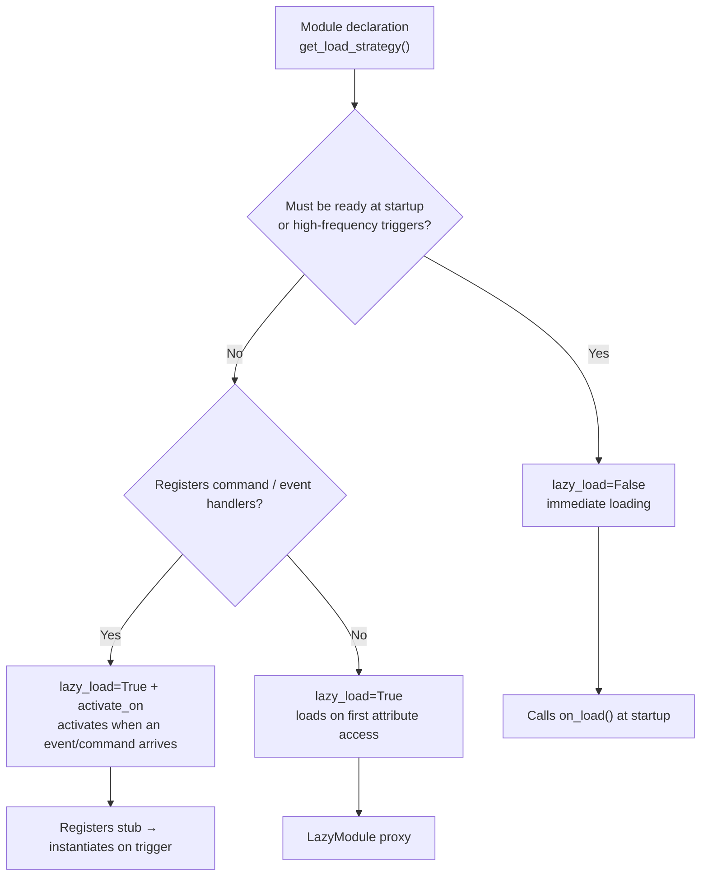
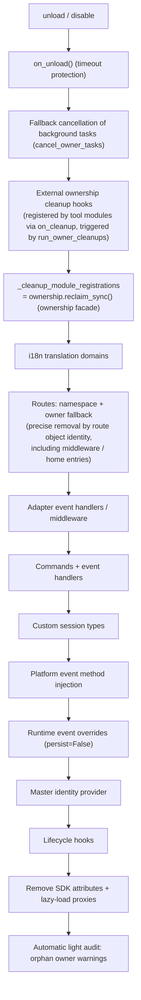

# ErisPulse 热重载与懒加载休眠

This skill is auto-built from the ErisPulse documentation.
Repository: https://github.com/ErisPulse/ErisPulse
Source paths are annotated per section; see docs/ in the repository for the latest content.

## 内容大纲

AI 按需读取：只读需要的章节即可，不必全文加载。

- 懒加载与休眠: 44-54 行
- Overview: 56-63 行
- How It Works: 65-79 行
- Event-Driven Lazy Activation (activate_on): 81-157 行
- Lazy-Load Dormancy (dormant_after): 159-205 行
- Configuring Lazy Loading: 207-234 行
- Using Lazy-Loaded Modules: 236-291 行
- Best Practices: 293-321 行
- Notes: 323-328 行
- 归属权与热重载边界: 330-361 行
- owner Context Mechanism: 363-386 行
- Inventory of Owned Resources: 388-421 行
- Unload/Disable Cleanup Sequence: 423-449 行
- Unified Ownership Facade (ownership): 451-479 行
- Hot-Reload Failure Rollback: 481-499 行
- Hot-Reload Boundaries: 501-571 行
- Design Boundaries: Which Resources Are Not Cleaned Up on Unload: 573-587 行
- Internal Implementation: How Ownership Works: 589-640 行
- Module Author Guide: 642-695 行
- Tool Module Guide: Hosting Handles of Other Modules: 697-746 行
- 模块开发入门（加载策略）: 748-757 行
- Project Structure: 759-771 行
- pyproject.toml Configuration: 773-791 行
- __init__.py: 793-797 行
- Core.py - Core Module: 799-838 行
- Testing Module: 840-858 行
- Core Concepts: 860-963 行

## 懒加载与休眠

> 来源: `docs/en/advanced/lazy-loading.md`（https://github.com/ErisPulse/ErisPulse/blob/main/docs/en/advanced/lazy-loading.md）

# Lazy-Loading Module System

> [!TIP]
> **When to read this**: When using lazy-loaded modules or `activate_on` event-driven activation. Skip it if not needed; it does not affect the use of any other features.


The lazy-loading module system of the ErisPulse SDK allows modules to defer initialization until they are **actually accessed** — during startup, only placeholder proxies are registered, and modules that are never used consume no startup time or memory.

## Overview

The lazy-loading module system is one of ErisPulse's core features. It works in the following ways:

- **Deferred initialization**: A module is only actually loaded and initialized the first time it is accessed
- **Transparent usage**: For developers, lazy-loaded modules are almost indistinguishable from regular modules in usage
- **Automatic dependency management**: Module dependencies are automatically initialized when used
- **Lifecycle support**: For modules inheriting from `BaseModule`, lifecycle methods are called automatically

## How It Works

### The LazyModule Class

The core of the lazy-loading system is the `LazyModule` class, a wrapper that only actually initializes the module on first access.

### Initialization Process

When a module is first accessed, `LazyModule` performs the following operations:

1. Retrieves the `__init__` parameter information of the module class
2. Decides whether to pass in the `sdk` reference based on the parameters
3. Sets the module's `moduleInfo` attribute
4. For modules inheriting from `BaseModule`, calls the `on_load` method
5. Triggers the `module.init` lifecycle event

## Event-Driven Lazy Activation (activate_on)

> [!NOTE]
> This feature requires ErisPulse **2.8.0+**.

Modules with `lazy_load=True` are by default only loaded on **first attribute access**. If a module registers command/event handlers,
the traditional approach is to set `lazy_load=False` for immediate loading. `activate_on` provides a third option: **declare triggers,
and the module is automatically activated when the first matching event/command arrives** — it neither stays resident in memory nor loses its trigger entry points.

```python
from ErisPulse.loaders import ModuleLoadStrategy

class MyModule(BaseModule):
    @staticmethod
    def get_load_strategy():
        return ModuleLoadStrategy(
            lazy_load=True,
            activate_on=[
                # ---- Event triggers (passively arriving; no user awareness required) ----
                "message",                                    # Type-level: any message event
                {"notice": "group_member_increase"},          # Type + a single detail_type
                {"message": ["private", "group"]},            # Type + multiple detail_types

                # ---- Command triggers (active input; placeholder commands visible to Help) ----
                {"command": "roll"},                          # Shorthand: command name
                {"command": ["roll", "dice"]},                # List of command names
                {"command": {                                 # dict declaration (name is required)
                    "name": "dice",
                    "help": "Roll a dice",
                    "usage": "/dice",
                    "group": "Entertainment",
                    "aliases": ["d"],
                    "hidden": False,
                }},
            ],
        )
```

### Command dict Declaration Parameters

The dict form mirrors the user-level parameters of the `@command()` decorator, used to register placeholder commands before the module is loaded:

| Parameter | Type | Default | Description |
|------|------|------|------|
| `name` | `str` | **Required** | Command name; must match `@command(name)` in `on_load`, otherwise after activation the placeholder is unregistered and the command no longer exists |
| `help` | `str` | Fallback chain | Description shown in Help; if not declared, values are taken via the fallback chain (see below) |
| `usage` | `str` | Auto-generated | Usage line, default `{prefix}{name}` |
| `group` | `str` | `None` | Command group |
| `aliases` | `list[str]` | `[]` | Aliases registered at the same time; **typing an alias also triggers activation** |
| `hidden` | `bool` | `False` | When `True`, the placeholder command is likewise hidden (aligned with the hidden semantics of the real command after activation); users who know the command name can still trigger it by typing it |

`priority` / `permission` / `master` are **not supported**: the placeholder command's sole mission is to trigger activation;
permission checks are performed by the real command after activation (intercepting permissions at the placeholder stage would instead break "activation by typing the command").

### Placeholder Command help Fallback Chain

The command description shown by Help before the module is loaded is taken in the following order (stopping at the first hit):

1. Command-level `help` in the dict declaration (most precise)
2. `description` from the module's `get_meta()`
3. The module's `__description__` attribute
4. The package metadata's `Summary` (PyPI package brief)
5. Generic hint: "This command comes from lazy-loaded module X; first use will automatically load that module"

### Trigger Semantics

- **Event stubs**: Registered with the corresponding event manager at an extremely low priority (`ACTIVATION_STUB_PRIORITY`),
  firing as a fallback after all regular handlers; after activation, the current event is forwarded to the module's real handlers
- **Command stubs**: Placeholder commands are registered; after activation, the placeholder is unregistered and the real command takes over the current trigger
- **Re-entrancy prevention**: `asyncio.Lock` guarantees that the module is activated only once under concurrent triggers
- **Scope filtering**: Stubs carry the module's owner identity and do not trigger when the module is not enabled for that Bot / session / platform
- **Failure semantics**: Failed activation enters a cooldown period (`ACTIVATE_RETRY_COOLDOWN_SECS`, 30 seconds);
  events are short-circuited during the cooldown to avoid repeated attempts; after the cooldown ends, the next trigger retries automatically, with the stub retained throughout
- **Deduplication**: When commands with the same name are declared as a mix of shorthand + dict, they are deduplicated (dict takes precedence); a dict missing `name`,
  or an event `detail_type` mistakenly written as a dict, produces a warning and is ignored

> For the architecture diagram and complete semantics, see [Architecture Overview](../architecture.md#event-driven-lazy-activation-activate_on-trigger-architecture).

## Lazy-Load Dormancy (dormant_after)

> [!NOTE]
> This feature requires ErisPulse **2.11.0+**.

After a lazily-activated module has been idle for a long time, the framework can put it into **dormancy**: runtime resources are released (owned tasks / connections / event registrations),
while the lazy-load proxy and registration stubs are kept — the module returns to the "registered but not loaded" state, and the next attribute access /
`module.call` / `activate_on` event **transparently wakes it up** (re-instantiating it and running `on_load`),
with no wake-up API needed. The system state after dormancy is exactly the same as "never activated".

### Declaration

```python
@staticmethod
def get_load_strategy():
    return ModuleLoadStrategy(
        lazy_load=True,
        dormant_after="30m",   # Auto-dormant after 30 minutes idle; not declared = never dormant (default)
    )
```

The duration syntax is exactly the same as the `cooldown` of command governance (`90s` / `1h30m` / `1d`). The sweeper scans at fixed intervals
(60 seconds), so the actual dormancy time = threshold + at most one scan interval; you can also put a module to sleep manually at any time:
`await sdk.module.sleep("module_name")`. Explicit `unload` still performs a full unload (the lazy proxy is removed as well).

### State Continuation

Before dormancy, the framework triggers `on_before_unload(reason="dormant")` (the first step of the unload pipeline, with resources still intact);
the module saves its state to `sdk.storage` and restores it in `on_load` after wake-up:

```python
async def on_before_unload(self, event):
    if event["reason"] in ("dormant", "reload", "disable"):
        await self.sdk.storage.aset(f"{self._module_name}:counter", self._count)

async def on_load(self, event):
    self._count = await self.sdk.storage.aget(f"{self._module_name}:counter") or 0
```

### Semantics and Boundaries

- **Dependency safety**: Dependents of a lazy module access it via the persistent proxy (`sdk.<Name>`) or `module.call`,
  and behavior is consistent before and after dormancy; directly holding references to real instances is an anti-pattern (visible to the leak auditor)
- **Events not delivered**: A dormant module no longer receives events — modules that need event-based wake-up should also declare `activate_on`
  (the event wakes the module first, then is forwarded); when troubleshooting "commands not responding", check whether the module is in a dormant state
- **Wake-up failures are self-healing**: A failed wake-up (re-initialization) enters a 30-second cooldown; after the cooldown, the next access retries automatically,
  without permanent failure

## Configuring Lazy Loading

### Global Configuration

Enable/disable global lazy loading in the configuration file:

```toml
[ErisPulse.framework]
enable_lazy_loading = true  # true = enable lazy loading (default), false = disable lazy loading
```

### Module-Level Control

Modules can control the loading strategy by implementing the `get_load_strategy()` static method:

```python
from ErisPulse.Core.Bases import BaseModule
from ErisPulse.loaders import ModuleLoadStrategy

class MyModule(BaseModule):
    @staticmethod
    def get_load_strategy():
        """Returns the module loading strategy"""
        return ModuleLoadStrategy(
            lazy_load=False,  # Returning False means immediate loading
            priority=100      # Loading priority; higher values mean higher priority
        )
```

## Using Lazy-Loaded Modules

### Basic Usage

For developers, lazy-loaded modules are almost indistinguishable from regular modules in usage:

```python
# Access a lazy-loaded module via the SDK
from ErisPulse import sdk

# The following access triggers the module's lazy loading
result = await sdk.my_module.my_method()
```

### Unified Module Access Entry Point

Whether accessed via SDK attributes, module manager attributes, or queried via `module.get()`,
for lazy-loaded modules that are "registered but not yet loaded", the same lazy-loading proxy is returned; accessing its attributes is what actually triggers initialization:

```python
# All three approaches return the lazy-loading proxy (when the module is not loaded), with consistent, transparent behavior
sdk.my_module          # Entry point that triggers loading
sdk.module.my_module   # Also returns the lazy-loading proxy
sdk.module.get("my_module")  # Also returns the lazy-loading proxy; it does not itself trigger loading

# Only accessing any attribute of the proxy actually initializes the module
result = await sdk.my_module.my_method()
```

`module.get()` is a **query** interface and does not itself trigger loading:
- Module loaded → returns the real instance
- Module registered but not loaded → returns the lazy-loading proxy (initialization occurs on attribute access)
- Module not registered → returns `None`

To explicitly trigger loading, use `await sdk.load_module("my_module")`.

### Asynchronous Initialization

For modules that require asynchronous initialization, explicit loading is recommended first:

```python
# Explicitly load the module first
await sdk.load_module("my_module")

# Then use the module
result = await sdk.my_module.my_method()
```

### Synchronous Initialization

For modules that do not require asynchronous initialization, direct access works:

```python
# Direct access automatically initializes synchronously
result = sdk.my_module.some_sync_method()
```

## Best Practices

When choosing a loading strategy, refer to the following decision flow:



### Scenarios Where Lazy Loading Is Recommended (lazy_load=True)

- Passively invoked utility modules (e.g., data query modules, format converters, etc. — only needed when called by other modules)
- Modules that register command/event handlers but are not used frequently — declare triggers with `activate_on`; the module is automatically activated when the first matching event/command arrives, without giving up lazy loading

### Scenarios Where Disabling Lazy Loading Is Recommended (lazy_load=False)

- Modules that need to be ready immediately at startup (e.g., core modules that provide foundational services for other modules)
- Frequently triggered listeners (need to process every message) — `activate_on` forwarding incurs a one-time activation overhead; immediate loading is more direct in high-frequency scenarios
- Scheduled task modules
- Modules that must be initialized at application startup

> The `priority` parameter controls the initialization order among immediately-loaded modules; higher values are initialized first. Modules with the same priority are loaded in registration order.

## Notes

1. If your module uses lazy loading and no other module ever calls it within ErisPulse, your module will never be initialized.
2. If your module contains components such as Event listeners or other actively listening components, you have two options: declare `activate_on` triggers (keeping lazy loading, automatically activating when events arrive), or declare that it needs to be loaded immediately (`lazy_load=False`); otherwise your module's normal operation will be affected.
3. We do not recommend disabling lazy loading unless you have special needs; otherwise it may cause problems such as dependency management and lifecycle event issues.
4. In the `activate_on` command dict declaration, `name` must match the real command name registered by `@command()` in the module's `on_load` — otherwise, after the module is activated, the placeholder command is unregistered and a command whose declaration does not match its implementation will not exist.

## 归属权与热重载边界

> 来源: `docs/en/advanced/ownership.md`（https://github.com/ErisPulse/ErisPulse/blob/main/docs/en/advanced/ownership.md）

# Ownership (owner) System

> [!TIP]
> **When to read this**: When debugging resource leaks, understanding the unload cleanup chain, or declaring owned resources. Skip it if not needed — doing so does not affect the use of other features.

> **What you will learn**: how the owner context automatically attributes resources, the full inventory of owned
> resources, the complete sequence of the cleanup chain during unload/disable, and which resources
> are not cleaned up on unload (design boundaries).
>
> **Not covered here**: permission decisions on "when a resource takes effect" (see [Scope (scope)](scope.md));
> recommended patterns for background tasks and the boundaries of forced cancellation (see [Lifecycle Management · Background Task Ownership and Auto-Cancellation](lifecycle.md#background-task-ownership-and-auto-cancellation)).


Ownership is the cornerstone of "plug-and-play" modules: every framework resource a module registers during loading
is automatically attributed by name, and on unload/disable all attributed resources are reclaimed in one go —
module authors only need to declare resources, without hand-writing cleanup logic.

> **Related systems**: scope decides "whether a resource takes effect" at event dispatch time,
> while ownership decides, over the lifecycle, "who a resource belongs to and whose unload reclaims it".
> For scopes see [Unified Control Plane (scope)](scope.md); for background tasks see
> [Lifecycle Management](lifecycle.md#background-task-ownership-and-auto-cancellation).

{!--< tips >!--}
1. Attribution is automatically recorded by `current_owner` **at the moment of registration**, with zero changes to module code
2. Unload/disable share the same cleanup chain (`_cleanup_module_registrations`); a failure at any step only logs a warning and does not interrupt
3. Resources with user-configuration semantics (persistent overrides / scope rules / command ACLs) are **not** cleaned up on module unload
4. External handles hosted by tool modules can be hooked into the cleanup chain via `on_cleanup(cb)` and are called back automatically when the other module unloads (see [Tool Module Guide](#tool-module-guide-hosting-handles-of-other-modules))
{!--< /tips >!--}

## owner Context Mechanism

The owner is passed via the context variable `current_owner` (`ErisPulse.runtime.context`):

```python
from ErisPulse.runtime import owner_scope, get_current_owner

with owner_scope("MyModule"):
    # All resources registered within this block are automatically attributed to MyModule
    assert get_current_owner() == "MyModule"
```

The framework automatically injects the owner at the following moments (no manual wrapping needed in module/adapter code):

| Moment | owner value | Location |
|------|----------|------|
| Module `load()` | Module name | Instantiation + the entire `on_load` |
| Adapter `start()` / `restart()` | Platform name | The entire adapter startup |
| `activate_on` lazy-load stub registration | Module name | Placeholder command/handler registration |
| During event handler execution | The module owning the handler | Re-injection at handler / command entry points |

Execution-time re-injection means: when a command handler declared in `on_load` calls
registration APIs **while running** (e.g. `sdk.adapter.on()`, `overrides.*.set(persist=False)`),
those registrations are also automatically attributed to this module.

## Inventory of Owned Resources

All of the following resources registered by a module within its loading context are attributed and automatically reclaimed on unload/disable:

| Resource | Registration | Cleanup call |
|------|----------|----------|
| Commands | `@command()` / command dict declaration | `command.unregister_by_owner()` |
| Event handlers | `@message` / `@notice` / `@request` / `@meta` | `handler.unregister_by_owner()` |
| Adapter event listeners | `sdk.adapter.on()` / `raw=True` | `adapter.unregister_handlers_by_owner()` |
| Adapter middleware | `@sdk.adapter.middleware` | Same as above |
| Routes (HTTP/WS/SSE) | `router.http()` / `websocket()` / `sse()` | Double fallback by namespace + by owner |
| Route middleware | `@router.middleware()` / `add_middleware()` | `router.unregister_all_by_owner()` |
| Dashboard home entries | `router.register_home_entry()` | `unregister_home_entries_by_owner()` |
| Custom session types | `register_custom_type()` | `unregister_custom_types_by_owner()` |
| Platform event method injection | `register_event_method()` / `register_event_mixin()` | `unregister_event_methods_by_owner()` (automatically reclaimed on module unload; old closures no longer leak) |
| Background tasks | `self.spawn()` | `cancel_owner_tasks()` |
| External ownership cleanup hooks (hosted by tool modules) | `runtime.on_cleanup(cb)` | `run_owner_cleanups()` (triggered within the unload/disable/adapter-shutdown chain) |
| Lifecycle hooks | `lifecycle.register()` | `lifecycle.unregister_by_owner()` |
| Master identity provider | `master.provider` | `master.unregister_by_owner()` |
| i18n translation keys | `I18nClass` declaration (domain=module name) | `i18n.unregister_domain()` |
| Event overrides (runtime) | `overrides.*.set(persist=False)` | `overrides.unregister_by_owner()` |
| Interaction sessions (wait_reply waits / leases) | `event.wait_reply()` / `sdk.interaction.acquire()` | `interaction.cancel_by_owner()` (waiting parties receive cancellation immediately) |
| Context data | `runtime/context` recorded per owner | Precisely cleaned per module |

The corresponding adapter-side resources (with the platform name as owner) are reclaimed by `_cleanup_adapter_resources` on adapter `shutdown()` / `restart()`, plus:

| Resource | Cleanup call |
|------|----------|
| The adapter's own `on()` handlers and middleware | `adapter.unregister_handlers_by_owner(platform)` |
| Platform event method extensions (`EventMixin`) | `unregister_platform_event_methods(platform)` |
| Custom session types | `unregister_custom_types_by_owner(platform)` |
| Interaction sessions (pending wait_reply / leases on that platform) | `interaction.cancel_by_platform(platform)` |
| i18n translation domain (domain=config key) | `i18n.unregister_domain(config_key)` |
| Fine-grained namespace routes | `router.unregister_all_by_owner(platform)` |

## Unload/Disable Cleanup Sequence

`unload()` and `disable()` share the same cleanup chain (each step wrapped in its own try/except;
failures are only logged and **do not interrupt subsequent cleanup**):



On exit, `sdk.uninit()` additionally performs a global fallback: all adapters shutdown → all modules unload →
`router.stop()` (clearing routes/middleware/home entries) → `cancel_all_background_tasks()` →
clearing event handlers and hooks.

## Unified Ownership Facade (ownership)

The sixteen steps of the cleanup chain converge under the unified ownership facade `ErisPulse.Core.ownership`,
whose four verbs cover "unregistration, counting, scanning, and auditing" — each subsystem's own `*_by_owner`
unregister functions remain unchanged and serve as the facade's internal implementation:

| Verb | Purpose |
|------|------|
| `ownership.reclaim(owner)` | Unified unregistration of all resources under an owner (task cancellation → cleanup hooks → registration-type resources; full async version) |
| `ownership.reclaim_sync(owner)` | Unregistration of registration-type resources (sync version, for the synchronous unload path) |
| `ownership.counts(owner=None)` | Read-only counting of resources registered under an owner (None for all owners) |
| `ownership.orphans()` | Orphan scan: resources still registered while their owner is gone (hard evidence list of leaks) |
| `ownership.audit(owner, deep=)` | Leak audit report (counts + orphans + optional gc instance census) |

```python
from ErisPulse.Core import ownership

ownership.reclaim_sync("MyModule")       # {'commands': 1, 'routes_http': 2, ...}
ownership.counts("MyModule")             # Count of registered resources
ownership.orphans()                      # [{"owner": "ghost", "total": 2, ...}]
```

**Audit entry points**:

- **Automatic light audit** after unload/reload: a WARNING is raised as soon as orphan owner resources are found (zero-cost counting scan)
- `sdk.module.audit(name, deep=True)`: gc census of module instances — when instances cannot be reclaimed,
  it reports the types of the referencing parties (pinpointing "who is holding the old instance"); it carries
  global pause overhead and is meant only for explicit troubleshooting
- The deep census is an explicit operation: no config keys, no automatic repairs

## Hot-Reload Failure Rollback

Hot reload follows "**snapshot before unload → automatic restore on failure → replay on_load**": on syntax errors in
the new version, missing dependencies, or load failures, the old instance and registration state (registry entries,
sdk attributes, sys.modules entries) are automatically restored, after which the old instance's `on_load` is
**replayed within the ownership context** (`reason` is `"rollback"`), so external resources disconnected during
unload are re-established; afterwards a `module.rollback` event is emitted (payload `{module_name, success}`).

Boundary notes:

- Replay failure or timeout **only warns** — no rollback of the rollback; the old instance stays in a
  "finalized" state (consistent with 2.11.2 and earlier behavior), and the logs make this explicit
- References to the old instance manually cached by third parties at runtime are not covered by restoration
- If the target package has already been uninstalled (entry-point gone), it is treated as a successful unload and no rollback is performed
- The `on_unload` payload carries `reason` (`unload` / `reload` / `disable` /
  `cascade` / `dormant` / `load-failed`), so modules can defer closing
  resources that need to survive across reloads when the reason is `reload`

For the full capability boundaries of hot reload, cross-loop semantics, and module-side guidelines, see the next section.

## Hot-Reload Boundaries

Hot reload can replace code, rebuild registrations, and roll back failed reloads — but it is **not a process restart**.
What gets reclaimed are **runtime resources registered in the ownership system**; resources belonging to no owner,
data with user-configuration semantics, and references cached inside third-party libraries do not disappear with a reload.

### Capability Boundaries

| Object | Behavior after reload | Notes |
|------|-----------|------|
| Module code / class definitions | Supported, re-imported | Old `sys.modules` entries are cleaned up |
| `on_unload` / `on_load` | Supported, triggered in order | `on_load` is replayed on failure rollback (see previous section) |
| Commands / handlers / routes / lifecycle hooks | Supported, automatically unregistered then re-registered | Cleaned via the ownership reclaim chain |
| `spawn_background` / `spawn_later` / `spawn_thread` | Supported, cancelled per owner | Threads are only registered for observation and cannot be force-killed |
| Any `asyncio.create_task` on the main loop | Supported, automatically attributed and cancelled | Intercepted by the task factory (including tasks created inside third-party libraries) |
| Tasks spawned on the storage bridge loop | Supported, automatically attributed and cancelled | The bridge loop also has a task factory installed |
| Resources registered via `ownership.track()` | Supported, call `release()` | Loop-bound resources beyond the task factory's reach |
| `on_cleanup` hooks | Supported, triggered | Tool modules use them to discard hosted handles |
| Persistent overrides (`persist=True`) / config files | Untouched, preserved | User assets |
| Object references cached inside third-party libraries | Untouched | Invisible to the framework; modules must release them themselves |
| Event loops `new`-ed by the module itself / bare threads | Not reclaimed | See the guidelines below |
| Resources of an adapter after rollback | Not aligned | The adapter side does not yet replay `start()` |

### Three-Tier Resource Governance

1. **Transparent interception tier** — event-loop-level task factory. Any task creation inside an owner context
   is automatically attributed, covering the main loop and the storage bridge loop.
2. **Ownership-aware scheduling tier** — `spawn_background` / `spawn_later` / `spawn_thread`.
3. **Cooperative registration tier** — `ownership.track()` / `on_cleanup()`, for resources structurally
   out of reach (Loop-bound connection pools, third-party clients).

### Event Loop Boundaries

| Loop | Created by | Task factory | Purpose |
|------|--------|-----------|------|
| Main loop | `sdk.run()` / `sdk.init()` | Installed | All business code |
| Storage bridge loop | `AsyncBridge` (first synchronous storage call) | Installed | Background execution of the synchronous storage API |
| Temporary loop | `spawn_background` fallback | Not installed, closed after use | Last resort when the main loop is not ready |

**The temporary loop is a last resort**: it synchronously blocks the calling thread, and after the loop closes,
child tasks spawned inside the coroutine are lost (the log shows a `temp_loop_fallback` warning). Seeing this
warning means a module scheduled a background task at the wrong time.

**Cross-loop cancellation is best-effort**: when `cancel_owner_tasks` finds tasks on other still-running loops,
it posts cancellation via `call_soon_threadsafe` and logs a `cross_loop_task_residual` warning, but **does not
wait** for them to finish (waiting across loops is unsafe). Seeing this warning means you should check whether
an event loop was created manually.

### Module-Side Guidelines

```python
# Recommended
spawn_background(self._poll())            # Ownership-aware background task
spawn_later(30, lambda: self._cleanup())  # Ownership-aware delayed task
spawn_thread("poller", self._loop_body)   # Ownership-aware thread (entry automatically carries the owner)
ownership.track(pool)                     # Explicitly register Loop-bound resources
await sdk.storage.aget(key)               # Use the async API directly in async contexts

# Avoid
asyncio.create_task(self._poll())         # Bare call: no reference, easily GC'd
asyncio.new_event_loop()                  # Self-built loop: completely out of the ownership system's reach
threading.Thread(target=self._loop_body)  # Bare thread: entry has no owner context
self._storage.get(key)                    # Synchronous storage call in an async context: blocks the main loop
```

### Troubleshooting Checklist

1. `cross_loop_task_residual` in the logs? → Some resources live on a self-built loop
2. `temp_loop_fallback` in the logs? → A background task was scheduled before the main loop was ready
3. `attached to a different loop` error? → Check whether a loop was self-built or connection objects are reused across loops
4. `ownership.orphans()` returns output? → Some resources under an owner are still alive after unload

## Design Boundaries: Which Resources Are Not Cleaned Up on Unload

Ownership reclaims only **runtime resources registered by module code**. The following resources carry
**user-configuration semantics** (the user is in control and may have configured them deliberately) and
persist with the configuration after the module is unloaded:

| Resource | Semantics | Notes |
|------|------|------|
| `overrides.*.set(persist=True)` | Persistent override | Written to the config file, effective across restarts; not deleted on module unload (explicit user configuration) |
| Scope rules such as `scope.set_action()` | Permission control plane | Managed by the user/Dashboard; unloading a module does not reclaim the rules |
| `overrides.acl.set(persist=True)` | Command ACL | Same as above |
| Conversation `save()` persistence | Multi-turn conversation archive | Data assets are not cleaned up |

Runtime temporary writes (`persist=False`) are reclaimed with the owner — **whether or not something is persisted is
the dividing line between "user assets" and "module runtime state"**.

## Internal Implementation: How Ownership Works

**In one sentence**: the attribution chain (contextvar propagation) decides "who gets credited", while the cancellation chain (the task registry) decides "whether something can be cancelled on unload" — the two chains operate independently, and correct cleanup requires both.

The ownership system consists of **two independent chains**; understanding their division of labor is the prerequisite for debugging ownership issues:

### Attribution Chain (contextvar Propagation)

ContextVars such as `current_owner` in `runtime/context.py` handle **attribution** —
"which owner the resources registered / calls initiated by this code at this moment are credited to".
Propagation follows Python contextvars semantics:

| Execution path | Does the context propagate | Attribution result |
|---------|----------------|---------|
| Synchronous call chains / `await` chains | ✅ Propagates | Correct attribution |
| `asyncio.create_task` inside `owner_scope` | ✅ Propagates (the task copies the context at creation time) | Framework calls **inside** the task are correctly attributed |
| `run_in_executor` / bare threads | ❌ Does not propagate | Attribution lost |
| Self-built event loops | ❌ Does not propagate | Attribution lost |

> Attribution ≠ registration: context propagation only affects "who gets credited"; whether a resource can be
> cleaned up depends on whether it entered the cancellation chain described below.

### Cancellation Chain (Task Registry)

The `_owner_tasks` registry in `runtime/tasks.py` handles the **lifecycle** —
"which unfinished tasks belong to an owner, to be cancelled together on unload". Tasks enter the registry via:

1. **Explicit scheduling**: `spawn_background()` / `self.spawn()` → captures `current_owner`
   (or an explicit `owner=` argument) at creation → registered in the table;
2. **Automatic Task Factory registration** (2.8.3): `install_owner_task_factory()`
   is installed on the main event loop at framework startup — **any** task creation (including `create_task`
   inside third-party libraries) reads `current_owner` when passing through the factory, and is registered if it is not None.

The registry self-cleans: every task carries a `done_callback` and is removed from the table upon completion — no leaks.

### Cancellation Sequence (Module Unload)

```
module.unload()
  → on_unload(event)                    # Module cleans up on its own (fallback timeout protection)
  → Framework unregisters the owner's commands/events/hooks/routes
  → cancel_owner_tasks(owner)           # Fallback cancellation via the task registry
      → task.cancel() one by one        # Excluding the task currently executing the cancellation logic itself
      → await gather(pending, timeout)  # Wait for reclamation (timeout no longer blocks)
```

### Troubleshooting Approach

- **Resource not cleaned up** → Check the registry: does `get_owner_tasks("MyModule")` contain the task?
  If not, the registration path bypassed the ownership chain (import time / threads / standalone loops); locate it against the table above.
- **Attribution error** → Check the value of `get_current_owner()` at the moment of the error; for asynchronous deferred execution
  (callbacks/tasks), attribution comes from the context at creation time, not at execution time.

## Module Author Guide

### Recommended Patterns

```python
from ErisPulse import sdk
from ErisPulse.Core.Event import command
from ErisPulse.runtime import owner_scope, spawn_background

class MyModule(BaseModule):
    async def on_load(self, event):
        # Framework resources: automatically attributed, no manual cleanup needed
        self.task = self.spawn(self.polling())      # Background task
        sdk.router.register_home_entry("My Module", "/my")  # Home entry

        # Module-owned resources: wrap them in owner_scope to bring them into the ownership system
        with owner_scope("MyModule"):
            self.client.on_event(self._handle)      # Hypothetical custom registration

    async def on_unload(self, event):
        # Framework resources have been reclaimed automatically; only clean up module-owned resources not covered by owner_scope
        await self.client.close()
```

### Caveats

- **Registrations at import time have no owner**: hooks/handlers registered at module top level (at import time)
  happen before `owner_scope` and are treated as framework-level resources (owner=None), thus **not cleaned up**.
  Always register inside `on_load()`.
- **i18n registration with a custom domain**: if the domain of `i18n.register(domain=...)` is not equal to the
  module name, it will not be reclaimed automatically; keep domain=module name.
- **Use `self.spawn()` for background tasks**: since 2.8.3, bare `asyncio.create_task` is also **automatically and
  implicitly attributed** (Task Factory automatic registration, fallback cancellation on unload); but `self.spawn()`
  remains the recommended pattern — it supports scheduling from non-main-loop threads back to the main loop,
  explicit `owner=` specification, and GC protection for fire-and-forget tasks.
  In versions **before 2.8.3**, bare tasks are not attributed; `self.spawn()` is mandatory.
- The cleanup chain "warns only on failure": an exception in one cleanup step does not block reclamation of the
  remaining resources; it is visible at DEBUG/WARNING log level, and TRACE can be enabled for troubleshooting.

### Registration Timing → Attribution Results Table

| Registration scenario | Attribution result | Notes |
|---------|---------|------|
| Registration inside `on_load()` via framework APIs (command/event/lifecycle/route decorators) | Attributed to the module | Automatically unregistered on unload |
| Registration at module top level (import time) | **No owner** (owner=None) | Not cleaned up; do not use |
| Background tasks created via `self.spawn()` | Attributed to the module | Automatically cancelled on unload |
| Registration via third-party APIs inside `owner_scope("Name")` | Attributed to the module | Requires the third-party callback to run synchronously within the scope |
| Bare `asyncio.create_task` (including `loop.create_task` / `ensure_future`) | **Automatic attribution** (Task Factory, 2.8.3+) | Reads `current_owner` at the instant of creation; automatically registered within an owner context and cancelled as a fallback on unload; see [Internal Implementation](#internal-implementation-how-ownership-works) below |
| Tasks created inside third-party library async callbacks (aiohttp / APScheduler etc.) | **Automatic attribution** (Task Factory, 2.8.3+) | If `current_owner` is already injected when the callback runs (e.g. during framework handler execution), the task is automatically registered |
| `run_in_executor` (thread pool) | **No owner** (not an asyncio.Task) | Threads are outside the task factory's jurisdiction; manage their lifecycle yourself |
| Registration in a standalone event loop (self-built loop) | **No owner** | The Task Factory is installed only on the main loop; contextvars also do not propagate across event loops |

> Principle: **ownership follows the `current_owner` context at the moment of registration**; any async deferral,
> thread pool, or standalone loop leaves that context — when attribution is needed, explicitly enter `owner_scope`.

## Tool Module Guide: Hosting Handles of Other Modules

**Scenario**: "tool modules" such as cron schedulers, registries, and connection pools hold things on behalf of
other modules — when they call `sdk.Cron.on_trigger(handler)` in their `on_load`, a callback pointing to their
instance is stored in your container. The framework automatically cleans up all framework resources the other
module registered, but it cannot clean up **references inside your private container**: after the other module
unloads, your container still holds its instance, so that instance can no longer be reclaimed by the GC
(a memory leak — the `purge` leak diagnostics report it as "unreclaimable").

**Solution**: call `on_cleanup()` in the same function where you register the other module's items,
and the framework will automatically call your cleanup function when the other module is unloaded / disabled:

```python
from ErisPulse.Core.Bases import BaseModule
from ErisPulse.runtime import off_cleanup, on_cleanup

class CronModule(BaseModule):
    def __init__(self):
        self._entries = {}  # {module name: list of callbacks hosted for that module}

    def on_trigger(self, handler):
        # Automatically identifies the calling module's name (correct for both direct calls in on_load and module.call);
        # the return value is the resolved owner, which can be used directly as the attribution key
        owner = on_cleanup(self._drop)
        self._entries.setdefault(owner, []).append(handler)

    def _drop(self, owner: str):
        """Called automatically by the framework when the other module is unloaded/disabled: just discard its handles"""
        self._entries.pop(owner, None)

    async def on_unload(self, event):
        off_cleanup(self._drop)  # ③ Unregister the hook before unloading yourself, to avoid the hook table holding self
```

Guaranteed framework behavior:

| Concern | Behavior |
|--------|------|
| Trigger timing | The other module's unload / disable, or adapter shutdown — all triggered within the framework cleanup chain, earlier than the purge leak diagnostics |
| Caller identification | Direct calls use `current_owner`; calls made via `module.call()` use the caller (`current_caller`); you can also specify it explicitly via `on_cleanup(cb, owner="module name")`. **Strict validation**: raises `ValueError` when the owner cannot be resolved (all three sources missing) — private tool modules should register hooks within their own loading context |
| Callback signature | `cb(owner: str)`, sync / async both supported; async callbacks come with timeout protection (`CLEANUP_CALLBACK_TIMEOUT_SECS`, default 10 seconds) |
| Fault tolerance | An exception / timeout in a single callback is only logged and does not affect the remaining hooks or the cleanup chain |
| Duplicate registration | Identical `(owner, callback)` pairs are idempotently deduplicated |

**When it is not needed**: if what the other module registered are framework resources (commands, event handlers,
routes, background tasks...), the framework already cleans them up fully automatically (see
[Inventory of Owned Resources](#inventory-of-owned-resources) above). Only handles of the other module held in
your private container need `on_cleanup`.
For the quick-reference version from the module development perspective, see
[Best Practices · Tool Modules](../developer-guide/modules/best-practices.md#tool-modules-catch-unload-notifications-when-holding-others-stuff).

## 模块开发入门（加载策略）

> 来源: `docs/en/developer-guide/modules/getting-started.md`（https://github.com/ErisPulse/ErisPulse/blob/main/docs/en/developer-guide/modules/getting-started.md）

# Getting Started with Module Development

> [!NOTE]  
> **L1 Core Reading** — One of the five core documents in the "Reading Path" on the homepage, essential for module development.

By following this guide, you will create a runnable module that responds to the `/hello` command, and gain an understanding of the module's project structure, registration method, and load/unload hooks — all subsequent module documentation is built upon this foundation.

## Project Structure

A standard module structure:

```
MyModule/
├── pyproject.toml
├── README.md
├── LICENSE
└── MyModule/
    ├── __init__.py
    └── Core.py
```

## pyproject.toml Configuration

```toml
[project]
name = "ErisPulse-MyModule"
version = "1.0.0"
description = "Module function description"
readme = "README.md"
requires-python = ">=3.10"
license = { file = "LICENSE" }
authors = [ { name = "yourname", email = "your@mail.com" } ]
dependencies = []

[project.urls]
"homepage" = "https://github.com/yourname/MyModule"

[project.entry-points."erispulse.module"]
"MyModule" = "MyModule:Main"
```

## __init__.py

```python
from .Core import Main
```

## Core.py - Core Module

```python
from ErisPulse import sdk
# Recommended root import (2.10+): Common symbols are directly imported from the root package, deep paths are still compatible
from ErisPulse import BaseModule, command

class Main(BaseModule):
    def __init__(self, sdk):
        self.sdk = sdk
        self.logger = sdk.logger.get_child("MyModule")
        self.storage = sdk.storage
    
    @staticmethod
    def get_load_strategy():
        """Return the module loading strategy"""
        from ErisPulse.loaders import ModuleLoadStrategy
        return ModuleLoadStrategy(
            lazy_load=True,
            priority=0,
            depends=[],  # Optional: list of other modules this module depends on
            # Optional: event-driven lazy activation - declare triggers, module automatically loads when first matching event/command arrives
            # activate_on=[{"command": {"name": "hello", "help": "Send a greeting"}}],
        )
    
    async def on_load(self, event):
        """Called when the module is loaded"""
        @command("hello", help="Send a greeting")
        async def hello_command(event):
            name = event.get_user_nickname() or "friend"
            await event.reply(f"Hello, {name}!")
        
        self.logger.info("Module loaded")
    
    async def on_unload(self, event):
        """Called when the module is unloaded"""
        self.logger.info("Module unloaded")
```

> **Configuration Reading**: The basic example above does not use configuration. To read configuration, it is recommended to declare a nested `ConfigClass` and access it via `self.cfg` for real-time reading (see [Module Core Concepts](core-concepts.md#recommended-declarative-configuration)). The old method of manually calling `_load_config()` is deprecated.

## Testing Module

### Local Testing

```bash
# Install the module in the project directory
epsdk install ./MyModule

# Run the project
epsdk run main.py --reload
```

### Test Commands

Send a command to test:

```
/hello
```

## Core Concepts

### BaseModule Base Class

All modules must inherit from `BaseModule`, providing the following methods:

| Method | Description | Required |
|--------|-------------|----------|
| `__init__(self, sdk)` | Constructor (framework passes `sdk` instance) | No |
| `get_load_strategy()` | Returns the load strategy | No |
| `get_meta()` | Returns module metadata (optional) | No |
| `on_load(self, event)` | Called when the module is loaded | Yes |
| `on_unload(self, event)` | Called when the module is unloaded | Yes |

### Module Meta Information

> [!NOTE]
> This feature requires ErisPulse **2.8.0+**.

Declare module metadata (what the module does, its category, etc.) via `get_meta()`.  
Metadata is the **general introduction data** of a module, consumed by help modules, dashboard module lists, module stores, and other interfaces/ecosystem modules.

Similar to `get_load_strategy()` returning `ModuleLoadStrategy`, **it is recommended to return an instance of the `ModuleMeta` configuration class** (with type hints and IDE completion), but direct return of a dict is also supported:

```python
class MyModule(BaseModule):
    @staticmethod
    def get_meta() -> ModuleMeta:
        return ModuleMeta(
            name="Weather",               # Display name (default registration name)
            description="Query city weather",  # Module description
            version="1.0.0",
            author="ErisDev",
            group="Tools",               # Function group
            tags=["Weather", "Query"],
        )
```

Alternative dict-based approach:

```python
class MyModule(BaseModule):
    @staticmethod
    def get_meta() -> dict:
        return {
            "name": "Weather",
            "description": "Query city weather",
            "version": "1.0.0",
            "author": "ErisDev",
            "group": "Tools",
            "tags": ["Weather", "Query"],
        }
```

- `module.get_meta("MyModule")` retrieves the parsed metadata (class declaration > registered info, automatically completing the module's command name).
- `module.get_commands_overview()` aggregates "module meta + its registered commands (aliases/groups/help)" into a module-organized command overview.
- The module owner of a command can be obtained via `cmd_info["owner"]` (automatically injected by the context system during registration).

#### i18n Support for Meta Fields

The values of meta information fields can be plain strings or i18n dictionaries `{"i18n": "key.path", "default": "fallback text"}` (consistent with the `description` configuration convention).  
Translation keys are declared and registered via `I18nClass`. When reading with `module.get_meta()`, the values are automatically resolved into the current language text:

```python
class MyModule(BaseModule):
    class I18nClass(BaseI18n):
        meta_description: I18nKey = I18nKey(
            default="Weather lookup",
            zh_CN="查询城市天气",
            en="Weather lookup",
        )

    @staticmethod
    def get_meta() -> ModuleMeta:
        return ModuleMeta(
            name="Weather",
            description={"i18n": "MyModule.meta_description", "default": "Weather lookup"},
        )
```

### SDK Object

Access core features through the `sdk` object:

```python
from ErisPulse import sdk

sdk.storage    # Storage system
sdk.config     # Configuration system
sdk.logger     # Logging system
sdk.adapter    # Adapter system
sdk.router     # Routing system
sdk.lifecycle  # Lifecycle system
```

### Continue Your Learning Path

- [Module Core Concepts](core-concepts.md) - Deep dive into module architecture
- [Event Wrapper Class Explained](event-wrapper.md) - Learn about the Event object

### After Writing

- [Module Best Practices](best-practices.md) - Develop high-quality modules
