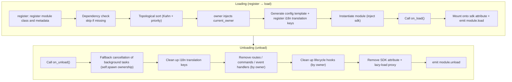
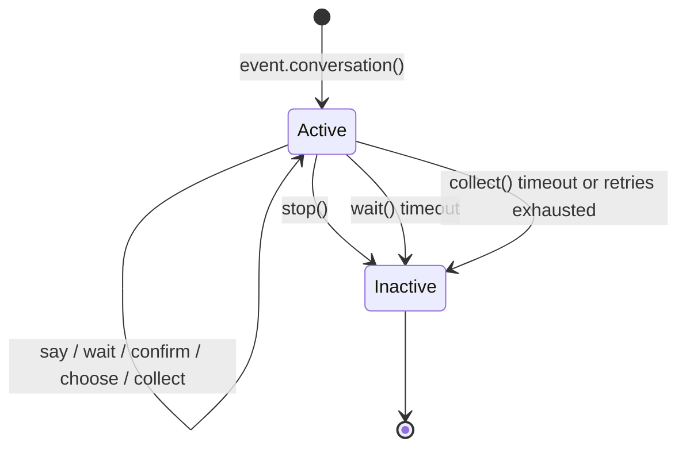

# ErisPulse 模块开发

This skill is auto-built from the ErisPulse documentation.
Repository: https://github.com/ErisPulse/ErisPulse
Source paths are annotated per section; see docs/ in the repository for the latest content.

## 内容大纲

AI 按需读取：只读需要的章节即可，不必全文加载。

- 模块开发入门: 84-93 行
- Project Structure: 95-107 行
- pyproject.toml Configuration: 109-127 行
- __init__.py: 129-133 行
- Core.py - Core Module: 135-174 行
- Testing Module: 176-194 行
- Core Concepts: 196-298 行
- 模块核心概念: 300-309 行
- Module Lifecycle: 311-450 行
- The SDK Object: 452-471 行
- Adapter Send Method Query: 473-499 行
- Configuration Management: 501-617 行
- Storage System: 619-642 行
- Event Handling: 644-664 行
- Lazy Loading Mechanism: 666-687 行
- Error Handling: 689-724 行
- Event 包装类: 726-735 行
- Adding Type Annotations to the event Parameter: 737-752 行
- Core Features: 754-759 行
- Core Field Methods: 761-772 行
- Message Event Methods: 774-785 行
- Message Type Detection: 787-798 行
- Reply Functionality: 800-820 行
- Advanced Interactive Sessions: 822-855 行
- Getting Command Information: 857-867 行
- Notice Event Methods: 869-877 行
- Method Quick Reference: 879-1222 行
- 模块最佳实践: 1224-1234 行
- Module Design: 1236-1324 行
- Asynchronous Programming: 1326-1400 行
- Event Handling: 1402-1469 行
- Utility Module: When Hosting Other Things, You Must Catch "Unload Notification": 1471-1505 行
- Error Handling: 1507-1546 行
- Storage System: 1548-1579 行
- Logging: 1581-1613 行
- Performance Optimization: 1615-1650 行
- Security: 1652-1696 行
- Testing: 1698-1725 行
- Deployment: 1727-1792 行
- ORM 数据模型: 1794-1803 行
- Declaring Models: 1805-1820 行
- Field Parameters: 1822-1836 行
- Table Creation and CRUD: 1838-1862 行
- Transactions: 1864-1872 行
- Relationship with Declarative Configuration Class: 1874-1888 行
- Boundaries and Notes: 1890-1896 行
- Automatic Migration (Phase Two): 1898-1916 行
- Foreign Keys (Foundation for Relationship Mapping): 1918-1930 行
- Relationship Mapping (relationship): 1932-1991 行
- 多轮对话: 1993-2002 行
- Creating a Conversation: 2004-2033 行
- Core API: 2035-2175 行
- Active State Management: 2177-2197 行
- Branching and Jumping: 2199-2249 行
- Context and Persistence: 2251-2288 行
- Automatic Checkpoint and Restart Recovery: 2290-2356 行
- Typical Workflow Patterns: 2358-2416 行
- 交互会话: 2418-2438 行
- Waiting for Reply: wait_reply: 2440-2507 行
- Declarative Multi-turn: `.got()` Chain (2.11+): 2509-2544 行
- Session Timers: remind / escalate: 2546-2580 行
- Multi-Way Waiting: expect + select: 2582-2614 行
- Session Mutual Exclusion: acquire / hold / get_owner_of: 2616-2645 行
- Session Inbox: event.history: 2647-2663 行
- Message Transaction: message_tx: 2665-2676 行
- Trace ID: 2678-2687 行
- Relationship with Other Systems: 2689-2694 行

## 模块开发入门

> 来源: `docs/en/developer-guide/modules/getting-started.md`（https://github.com/ErisPulse/ErisPulse/blob/main/docs/en/developer-guide/modules/getting-started.md）

# Getting Started with Module Development

> [!NOTE]  
> **L1 Core Reading** — One of the five core documents in the "Reading Path" on the homepage, essential for module development.

By following this guide, you will create a runnable module that responds to the `/hello` command, and gain an understanding of the module's project structure, registration method, and load/unload hooks — all subsequent module documentation is built upon this foundation.

## Project Structure

A standard module structure:

```
MyModule/
├── pyproject.toml
├── README.md
├── LICENSE
└── MyModule/
    ├── __init__.py
    └── Core.py
```

## pyproject.toml Configuration

```toml
[project]
name = "ErisPulse-MyModule"
version = "1.0.0"
description = "Module function description"
readme = "README.md"
requires-python = ">=3.10"
license = { file = "LICENSE" }
authors = [ { name = "yourname", email = "your@mail.com" } ]
dependencies = []

[project.urls]
"homepage" = "https://github.com/yourname/MyModule"

[project.entry-points."erispulse.module"]
"MyModule" = "MyModule:Main"
```

## __init__.py

```python
from .Core import Main
```

## Core.py - Core Module

```python
from ErisPulse import sdk
# Recommended root import (2.10+): Common symbols are directly imported from the root package, deep paths are still compatible
from ErisPulse import BaseModule, command

class Main(BaseModule):
    def __init__(self, sdk):
        self.sdk = sdk
        self.logger = sdk.logger.get_child("MyModule")
        self.storage = sdk.storage
    
    @staticmethod
    def get_load_strategy():
        """Return the module loading strategy"""
        from ErisPulse.loaders import ModuleLoadStrategy
        return ModuleLoadStrategy(
            lazy_load=True,
            priority=0,
            depends=[],  # Optional: list of other modules this module depends on
            # Optional: event-driven lazy activation - declare triggers, module automatically loads when first matching event/command arrives
            # activate_on=[{"command": {"name": "hello", "help": "Send a greeting"}}],
        )
    
    async def on_load(self, event):
        """Called when the module is loaded"""
        @command("hello", help="Send a greeting")
        async def hello_command(event):
            name = event.get_user_nickname() or "friend"
            await event.reply(f"Hello, {name}!")
        
        self.logger.info("Module loaded")
    
    async def on_unload(self, event):
        """Called when the module is unloaded"""
        self.logger.info("Module unloaded")
```

> **Configuration Reading**: The basic example above does not use configuration. To read configuration, it is recommended to declare a nested `ConfigClass` and access it via `self.cfg` for real-time reading (see [Module Core Concepts](core-concepts.md#recommended-declarative-configuration)). The old method of manually calling `_load_config()` is deprecated.

## Testing Module

### Local Testing

```bash
# Install the module in the project directory
epsdk install ./MyModule

# Run the project
epsdk run main.py --reload
```

### Test Commands

Send a command to test:

```
/hello
```

## Core Concepts

### BaseModule Base Class

All modules must inherit from `BaseModule`, providing the following methods:

| Method | Description | Required |
|--------|-------------|----------|
| `__init__(self, sdk)` | Constructor (framework passes `sdk` instance) | No |
| `get_load_strategy()` | Returns the load strategy | No |
| `get_meta()` | Returns module metadata (optional) | No |
| `on_load(self, event)` | Called when the module is loaded | Yes |
| `on_unload(self, event)` | Called when the module is unloaded | Yes |

### Module Meta Information

> [!NOTE]
> This feature requires ErisPulse **2.8.0+**.

Declare module metadata (what the module does, its category, etc.) via `get_meta()`.  
Metadata is the **general introduction data** of a module, consumed by help modules, dashboard module lists, module stores, and other interfaces/ecosystem modules.

Similar to `get_load_strategy()` returning `ModuleLoadStrategy`, **it is recommended to return an instance of the `ModuleMeta` configuration class** (with type hints and IDE completion), but direct return of a dict is also supported:

```python
class MyModule(BaseModule):
    @staticmethod
    def get_meta() -> ModuleMeta:
        return ModuleMeta(
            name="Weather",               # Display name (default registration name)
            description="Query city weather",  # Module description
            version="1.0.0",
            author="ErisDev",
            group="Tools",               # Function group
            tags=["Weather", "Query"],
        )
```

Alternative dict-based approach:

```python
class MyModule(BaseModule):
    @staticmethod
    def get_meta() -> dict:
        return {
            "name": "Weather",
            "description": "Query city weather",
            "version": "1.0.0",
            "author": "ErisDev",
            "group": "Tools",
            "tags": ["Weather", "Query"],
        }
```

- `module.get_meta("MyModule")` retrieves the parsed metadata (class declaration > registered info, automatically completing the module's command name).
- `module.get_commands_overview()` aggregates "module meta + its registered commands (aliases/groups/help)" into a module-organized command overview.
- The module owner of a command can be obtained via `cmd_info["owner"]` (automatically injected by the context system during registration).

#### i18n Support for Meta Fields

The values of meta information fields can be plain strings or i18n dictionaries `{"i18n": "key.path", "default": "fallback text"}` (consistent with the `description` configuration convention).  
Translation keys are declared and registered via `I18nClass`. When reading with `module.get_meta()`, the values are automatically resolved into the current language text:

```python
class MyModule(BaseModule):
    class I18nClass(BaseI18n):
        meta_description: I18nKey = I18nKey(
            default="Weather lookup",
            zh_CN="查询城市天气",
            en="Weather lookup",
        )

    @staticmethod
    def get_meta() -> ModuleMeta:
        return ModuleMeta(
            name="Weather",
            description={"i18n": "MyModule.meta_description", "default": "Weather lookup"},
        )
```

### SDK Object

Access core features through the `sdk` object:

```python
from ErisPulse import sdk

sdk.storage    # Storage system
sdk.config     # Configuration system
sdk.logger     # Logging system
sdk.adapter    # Adapter system
sdk.router     # Routing system
sdk.lifecycle  # Lifecycle system
```

### Continue Your Learning Path

- [Module Core Concepts](core-concepts.md) - Deep dive into module architecture
- [Event Wrapper Class Explained](event-wrapper.md) - Learn about the Event object

### After Writing

- [Module Best Practices](best-practices.md) - Develop high-quality modules

## 模块核心概念

> 来源: `docs/en/developer-guide/modules/core-concepts.md`（https://github.com/ErisPulse/ErisPulse/blob/main/docs/en/developer-guide/modules/core-concepts.md）

# Module Core Concepts

> [!NOTE]
> **L1 Core Must-Read** — one of the five core documents in the homepage's "Reading Path"; essential for module development.

This document explains the complete lifecycle of a module from loading to unloading, along with how to use declarative configuration and storage — what the framework automatically does for you and what you only need to write, so you'll know exactly where you stand after reading.

## Module Lifecycle

### Load Strategy

```python
from ErisPulse.Core.Bases import BaseModule
from ErisPulse.loaders import ModuleLoadStrategy

class MyModule(BaseModule):
    @staticmethod
    def get_load_strategy():
        """Returns the module load strategy"""
        return ModuleLoadStrategy(
            lazy_load=True,   # Lazy load or load immediately
            priority=0,       # Load priority (higher values load first)
            depends=["OtherModule"]  # Optional: declare other modules this one depends on
        )
```

> If modules declared in `depends` are not registered, the current module will be skipped and a warning logged. The loading order is determined by topological sorting; modules at the same level are sorted in descending order of `priority`.

> [!NOTE]
> **Cascading Unload / Cascading Reload** (ErisPulse **2.8.0+**): when unloading a module that other modules depend on, the modules depending on it are **cascadingly unloaded first** (logs explain the cascade chain); when hot-reloading any module (local plugin / runtime registration / PyPI package), the modules depending on it are likewise **cascadingly reloaded**, preventing dependents from continuing to run with stale instance references. Declared circular dependencies are rejected with a `RuntimeError` at load time.
>
> **`reload` means a full reload** (ErisPulse **2.11.0+**): `reload()` by default clears the import cache by top-level package name and re-imports dependent code, automatically performs a syntax pre-check before unloading (on failure the unload is rejected and the old instance keeps serving), and verifies code identity after success (fake-reload warning / `stale` flag); failure details of a failed load can be queried directly via `sdk.module.last_error(name)` (including the traceback).

### The on_load Method

Called when the module is loaded; used to initialize resources and register event handlers:

```python
async def on_load(self, event):
    # Register event handlers
    @command("hello", help="Greeting command")
    async def hello_handler(event):
        await event.reply("Hello!")
    
    # Use the SDK's built-in HTTP client (automatically manages the connection pool, no need to manually create a session)
    # Send requests via sdk.client
```

### The on_unload Method

Called when the module is unloaded; used to clean up resources:

```python
async def on_unload(self, event):
    # Clean up custom resources
    # sdk.client is managed by the framework, no need to close it manually
    
    # Cancel event handlers (the framework handles this automatically)
    self.logger.info("Module unloaded")
```

> For creating and cleaning up background tasks (`self.spawn()` / framework fallback cancellation), see [Lifecycle Management](../../advanced/lifecycle.md#background-task-ownership-and-automatic-cancellation).

### The on_before_unload Method

> [!NOTE]
> This hook requires ErisPulse **2.11.0+**.

An optional hook triggered as the **first step** of the unload pipeline (before `on_unload` and resource reclamation) — at this point all of the module's resources are still intact, making it the right place to save state to `sdk.storage` before unload / dormancy / reload and restore it in the next `on_load` (state continuation for lazy-load dormancy is based on this):

```python
async def on_before_unload(self, event):
    # event["reason"] indicates why the hook is running: unload / reload / disable / cascade / dormant
    if event["reason"] in ("reload", "dormant"):
        await self.sdk.storage.aset(f"{self._module_name}:state", self.collect_state())
```

Hook failures only produce a warning and do not block the unload process; modules that do not declare this hook behave unchanged. For dormancy / wake-up semantics, see [Lazy-Load Dormancy](../../advanced/lazy-loading.md#lazy-load-dormancydormant_after).

### Unload and Complete Unload (purge)

> [!NOTE]
> This feature requires ErisPulse **2.8.0+**.

By default, `unload()` only **cancels the load** (unloads the instance and resources) while keeping the registration stub (module class and metadata) — the module can still be rediscovered by discover and re-instantiated with `load()`, without needing to `register()` again.

When you need to **completely unload** (release the module class reference, clean up `sys.modules`, so that the plugin and its exclusive dependencies can be garbage collected), pass `purge=True`:

```python
# Unload only: keeps the registration stub, can be load()ed again at any time
await sdk.module.unload("MyModule")

# Complete unload: deletes the registration stub + cleans up sys.modules (plugin sources)
await sdk.module.unload("MyModule", purge=True)
```

| Semantics | `unload()` default | `unload(purge=True)` |
|------|-----------------|----------------------|
| Unload instance and resources (events/tasks/routes/lifecycle/i18n) | ✅ | ✅ |
| Keep registration stub (module class and metadata) | ✅ | ❌ Deleted |
| Clean up `sys.modules` (plugin folder sources only) | ❌ | ✅ |
| Module class can be garbage collected | ❌ | ✅ |
| Reload | `load()` directly available | Requires `register()` + `load()` first |

> When `purge=True`, dependents unloaded via the cascade are purged as well; after unloading, the framework runs `gc.collect()` and checks whether the module class/instance is reclaimable, warning in the logs about leftover references (including referrers, DEBUG level).

### Lifecycle Overview

Tying the methods above together, here is **everything the framework does behind the scenes** when loading and unloading a module:



**What the framework does for you at load time** (you only write `on_load`; everything else is done automatically):

| Step | What the framework does automatically |
|------|-------------|
| owner injection | During instantiation, the module name is wrapped in `owner_scope` — commands/events/hooks/background tasks registered in your `on_load` are **automatically attributed to this module**, and cleaned up in one go by owner at unload |
| Config template | For modules declaring `ConfigClass`, the framework automatically generates/fills the `ErisPulse.<ModuleName>` config section |
| i18n translation keys | For modules declaring `I18nClass`, translation keys are registered automatically (and unregistered automatically at unload) |
| Dependency topology | Sorted by the `depends` declarations to ensure depended-on modules load first; circular dependencies are rejected with a `RuntimeError` |
| SDK mounting | After instantiation the module is mounted at `sdk.<ModuleName>`, which is what enables access via `sdk.MyModule.xxx` |

**What the framework cleans up for you at unload** (corresponding to U1→U7 above): after `on_unload` finishes, fallback cleanup runs — forced cancellation of background tasks (those created by `self.spawn`; do graceful shutdown yourself in `on_unload`), i18n keys, routes, command/event handlers, lifecycle hooks, and finally the SDK attribute is removed. `purge=True` additionally deletes the registration stub + cleans up `sys.modules`.

> These automatic cleanups are exactly what makes "you only write `on_load`/`on_unload` and never manually unregister" possible — the framework uses owner attribution to turn "whoever registers it cleans it up" into a one-click affair.

## The SDK Object

### Accessing Core Modules

```python
from ErisPulse import sdk

# Access all core modules via the sdk object
sdk.logger.info("Log")
sdk.storage.set("key", "value")
config = sdk.config.getConfig("MyModule")
```

### Inter-Module Communication

```python
# Access other modules
other_module = sdk.OtherModule
result = await other_module.some_method()
```

## Adapter Send Method Query

Because the new standard specification requires overriding the `__getattr__` method to implement the fallback send mechanism, the `hasattr` method can no longer be used to check whether a method exists. Starting from `2.3.5`, the ability to query send methods has been added.

### Listing Supported Send Methods

```python
# List all send methods supported by the platform
methods = sdk.adapter.list_sends("onebot11")
# Returns: ["Text", "Image", "Voice", "Markdown", ...]
```

### Getting Method Details

```python
# Get the details of a method
info = sdk.adapter.send_info("onebot11", "Text")
# Returns:
# {
#     "name": "Text",
#     "parameters": [
#         {"name": "text", "type": "str", "default": null, "annotation": "str"}
#     ],
#     "return_type": "Awaitable[Any]",
#     "docstring": "Send a text message..."
# }
```

## Configuration Management

### Declarative Configuration (Recommended)

Since v2.5.2, modules can declare a configuration class via `ConfigClass`, sharing the same configuration Schema system as adapters. Configuration is read in real time through `self.cfg`, so changes take effect immediately:

```python
from dataclasses import dataclass, field
from ErisPulse.Core.Bases import BaseModule
from ErisPulse.Core.Bases import BaseConfig

@dataclass
class MyModuleConfig(BaseConfig):
    api_key: str = field(
        default="",
        metadata={
            "description": {"i18n": "my_module.api_key", "default": "API Key"},
            "required": True,
            "secret": True,
            "ui": {"widget": "password", "group": "basic", "order": 1},
        },
    )
    timeout: int = field(
        default=30,
        metadata={
            "description": {"i18n": "my_module.timeout", "default": "Timeout (seconds)"},
            "ui": {"widget": "number", "group": "advanced", "order": 2},
        },
    )

class MyModule(BaseModule):
    ConfigClass = MyModuleConfig

    def __init__(self, sdk):
        self.sdk = sdk
        self.logger = sdk.logger.get_child("MyModule")

    async def on_load(self, event):
        self.logger.info("Module loaded")

    async def on_unload(self, event):
        pass

    async def do_something(self):
        cfg = self.cfg  # Read in real time, type-safe
        api_key = cfg.api_key
        timeout = cfg.timeout
```

`BaseConfig` is a general-purpose configuration base class suitable for adapters, modules, external projects, and any other scenario. Configuration fields support i18n multilingual descriptions (see the [i18n documentation](../../advanced/i18n.md#multilingual-configuration-fields) for details).

> [!NOTE]
> The lifecycle of modules (including adapters) — loading, unloading, enabling/disabling, and so on — is managed uniformly by the framework (the `module manager` / `scope` provide query and control APIs). `ConfigClass` should only carry business parameters; modules do not need to nest logic inside themselves that decides "whether they should start".

The configuration Schema system also supports the following (v2.8.0+, see [adapter core-concepts](../adapters/core-concepts.md#metadata-conventions) for details):

- **Automatic field descriptions from docstrings**: when metadata `description` is not declared, a fallback is automatically extracted from the docstring's `:ivar field: description` or `Attributes:` section
- **Nested dataclass configuration**: when a field's type is a nested dataclass, schema/template/validation are handled recursively, and the WebUI renders it as nested groups
- **`example` non-persisted fields**: fields with `metadata={"example": True}` are not written to config.toml and are only recorded in `config.full.example` (suitable for verbose, rarely touched advanced configuration items); once users set them manually, they persist normally

### Declarative Translation Keys (v2.7.0+)

Since v2.7.0, modules can also declare translation keys centrally through a nested class `I18nClass`, just like declaring `ConfigClass`. The framework **automatically registers** all declared translation keys at load time — no need to call `i18n.register()` manually — and registration happens before config template generation, ensuring that i18n keys referenced in configuration descriptions are already available.

```python
from ErisPulse.Core.Bases import BaseConfig, BaseI18n, I18nKey

class MyModule(BaseModule):
    # Configuration class (optional)
    @dataclass
    class ConfigClass(BaseConfig):
        welcome_msg: str = field(
            default="Welcome",
            metadata={
                "description": {"i18n": "mymodule.welcome_msg", "default": "Welcome message"},
            },
        )

    # Translation key collection class (optional)
    class I18nClass(BaseI18n):
        # Attribute names are automatically joined into the full key path: <module name>.<attribute name>
        welcome_msg: I18nKey = I18nKey(
            default="Welcome Message",   # Language-independent fallback
            zh_CN="Welcome message",
            zh_TW="歡迎訊息",
            en="Welcome Message",
            ja="ウェルカムメッセージ",
            ru="Приветственное сообщение",
        )
        hello: I18nKey = I18nKey(
            default="Hello, {name}!",
            zh_CN="Hello, {name}!",
            zh_TW="你好，{name}！",
            en="Hello, {name}!",
            ja="こんにちは、{name}！",
            ru="Привет, {name}!",
        )
```

For details, see [i18n Recommended Approach](../../advanced/i18n.md#recommended-approach-declaring-translation-keys-via-i18nclass-v270).

### Reading Configuration Manually (Deprecated)

> **Deprecated**: Please use [Declarative Configuration](#declarative-configuration-recommended) + real-time reading via `self.cfg` instead.

```python
class MyModule(BaseModule):
    def __init__(self, sdk):
        self.sdk = sdk

    def _load_config(self):
        config = self.sdk.config.getConfig("MyModule")
        if not config:
            self.sdk.config.setConfig("MyModule", {"api_key": "", "timeout": 30})
            return {"api_key": "", "timeout": 30}
        return config
```

## Storage System

### Basic Usage

```python
# Store data
sdk.storage.set("user:123", {"name": "Zhang San"})

# Get data
user = sdk.storage.get("user:123", {})

# Delete data
sdk.storage.delete("user:123")
```

### Using Transactions

```python
# Use a transaction to ensure data consistency
with sdk.storage.transaction():
    sdk.storage.set("key1", "value1")
    sdk.storage.set("key2", "value2")
    # If any operation fails, all changes are rolled back
```

## Event Handling

### Registering Event Handlers

```python
from ErisPulse.Core.Event import command, message

# Register a command
@command("info", help="Get information")
async def info_handler(event):
    await event.reply("Here is the information")

# Register a message handler
@message.on_group_message()
async def group_handler(event):
    sdk.logger.info(f"Received group message: {event.get_text()}")
```

### Event Handler Lifecycle

The framework automatically manages the registration and unregistration of event handlers; you only need to register them in `on_load`.

## Lazy Loading Mechanism

### How It Works

```python
# The module is only initialized on first access
result = await sdk.my_module.some_method()
# ↑ This triggers module initialization
```

### Immediate Loading

For modules that need to be initialized immediately (such as listeners, timers):

```python
@staticmethod
def get_load_strategy():
    return ModuleLoadStrategy(
        lazy_load=False,  # Load immediately
        priority=100
    )
```

## Error Handling

### Catching Exceptions

```python
async def handle_event(self, event):
    try:
        # Business logic
        await self.process_event(event)
    except ValueError as e:
        self.logger.warning(f"Invalid parameter: {e}")
        await event.reply(f"Invalid parameter: {e}")
    except Exception as e:
        self.logger.error(f"Processing failed: {e}")
        raise
```

### Logging

```python
# Use different log levels
self.logger.debug("Debug info")    # Detailed debug information
self.logger.info("Running status")      # Normal operation information
self.logger.warning("Warning message")  # Warning message
self.logger.error("Error message")    # Error message
self.logger.critical("Fatal error") # Fatal error
```

### Continuing the Learning Path

- [Event Wrapper Class](event-wrapper.md) - Event handling in depth

### Going Deeper and Troubleshooting

- [Module Best Practices](best-practices.md) - Developing high-quality modules
- [Module Development Getting Started](getting-started.md) - Review the steps for building your first module

## Event 包装类

> 来源: `docs/en/developer-guide/modules/event-wrapper.md`（https://github.com/ErisPulse/ErisPulse/blob/main/docs/en/developer-guide/modules/event-wrapper.md）

# Event Wrapper Class in Detail

> [!NOTE]
> **L1 Core Must-Read** — One of the five core documents in the "Reading Path" on the homepage, essential for module development.

The reason the `event` parameter in handlers can directly call `.get_text()` / `.reply()` / `.wait_reply()` is the Event wrapper class. This document is its complete method reference — consult it as needed when writing event handlers; the method signatures and behaviors here are authoritative.

## Adding Type Annotations to the event Parameter

The `event` parameter of an event handler is the **Event wrapper class** (a dict subclass). It is strongly recommended to add a type annotation to it:

```python
from ErisPulse.Core.Event import Event

@message.on_private_message()
async def handler(event: Event):
    text = event.get_text()   # IDE auto-completes all convenience methods
    await event.reply(text)   # Typos can be caught during static checks
```

Without the annotation, the IDE cannot recognize methods on Event (`get_text()` / `reply()` / `wait_reply()` / platform extension methods get no completion hints), and you would have to spell them from memory.

> **Note the distinction**: the `event` in event handler callbacks is the **Event wrapper class** (annotated as `Event`); the `event` in module lifecycle methods `on_load` / `on_unload` is a plain **dict** (annotated as `dict`). Do not confuse the two.

## Core Features

- **Fully dict-compatible**: Event inherits from dict
- **Convenience methods**: Provides a large number of convenience methods
- **Dot-style access**: Supports accessing event fields with dot notation
- **Backward compatible**: All methods are optional

## Core Field Methods

```python
from ErisPulse.Core.Event import command

@command("info")
async def info_command(event: Event):
    event_id = event.get_id()
    platform = event.get_platform()
    time = event.get_time()
    print(f"ID: {event_id}, Platform: {platform}, Time: {time}")
```

## Message Event Methods

```python
from ErisPulse.Core.Event import message

@message.on_private_message()
async def private_handler(event: Event):
    text = event.get_text()
    user_id = event.get_user_id()
    nickname = event.get_user_nickname()
    await event.reply(f"Hello, {nickname}!")
```

## Message Type Detection

```python
from ErisPulse.Core.Event import message

@message.on_group_message()
async def group_handler(event: Event):
    is_private = event.is_private_message()
    is_group = event.is_group_message()
    is_at = event.is_at_message()
    await event.reply(f"Type: {'Private' if is_private else 'Group'}")
```

## Reply Functionality

```python
from ErisPulse.Core.Event import command

@command("ask")
async def ask_command(event: Event):
    await event.reply("Please enter your name:")
    reply = await event.wait_reply(timeout=30)
    if reply:
        name = reply.get_text()
        await event.reply(f"Hello, {name}!")

@command("price")
async def price_command(event: Event):
    await event.reply("Please enter the amount (e.g., 5 yuan):")
    # The reply must match the regex, otherwise keep waiting until timeout
    reply = await event.wait_reply(timeout=30, regex=r"\d+\s*yuan")
    if reply:
        await event.reply(f"Amount received: {reply.get_text()}")
```

## Advanced Interactive Sessions

> [!NOTE]
> The capabilities in this section require ErisPulse **2.8.0+**.

```python
# Session timed reminder: remind after 5 minutes without a reply; auto-cancelled once the user replies
reminder = event.remind(300, "Are you still there? Reply 'exit' if you don't want to chat anymore")
reminder.cancel()  # Can also be cancelled manually

# Timeout escalation: guaranteed to fire at the deadline (not cancelled by a reply), e.g., notify the owner when an issue has been unhandled for a long time
event.escalate(1800, lambda e: notify_master("Ticket timed out"))

# Multi-way wait: wait for "approve" and "reject" at the same time; first reply wins
which, reply = await event.select(
    event.expect(pattern="approve*", user="10001"),
    event.expect(pattern="reject*", user="10002"),
    timeout=60,
)
if which is None:
    await event.reply("Approval not received before timeout")

# Session-level wait: replies from anyone in the same group can match (group collaboration)
reply = await event.wait_reply(session=True, prompt="Could any expert help answer this?")

# Session inbox: the last 20 messages of the current session (includes the bot; the foundation for AI context / anti-repetition)
messages = await event.history(20)

# Message transaction: automatically recalls messages sent within the transaction when an exception occurs
async with event.message_tx():
    await event.reply("Processing, please wait...")
    result = await do_something()
    await event.reply(f"Done: {result}")
```

## Getting Command Information

```python
from ErisPulse.Core.Event import command

@command("cmdinfo")
async def cmdinfo_command(event: Event):
    cmd_name = event.get_command_name()
    cmd_args = event.get_command_args()
    await event.reply(f"Command: {cmd_name}, Args: {cmd_args}")
```

## Notice Event Methods

```python
from ErisPulse.Core.Event import notice

@notice.on_friend_add()
async def friend_add_handler(event: Event):
    await event.reply("Thanks for adding me as a friend!")
```

## Method Quick Reference

### Core Methods

#### Basic Event Information
- `get_id()` - Get the event ID
- `get_time()` - Get the event timestamp (Unix seconds)
- `get_type()` - Get the event type (message/notice/request/meta)
- `get_detail_type()` - Get the event detail type (private/group/friend, etc.)
- `get_platform()` - Get the platform name

#### Bot Information
- `get_self_platform()` - Get the bot platform name
- `get_self_user_id()` - Get the bot user ID
- `get_self_account_id()` - Get the bot account ID (multi-bot mode)
- `get_self_info()` - Get the full bot info dictionary

#### Session Identifiers
- `get_target_id()` - Get the unified target ID (returns `group_id` for group chats, `channel_id` for channels, `user_id` for private chats; takes the first non-empty value in the order group → channel → guild → thread → user)
- `get_session_id()` - Get the unique session identifier, in the format `{platform}:{detail_type}:{target_id}`

### Message Event Methods

#### Message Content
- `get_message()` - Get the message segment array (OneBot12 format)
- `get_alt_message()` - Get the alternative message text
- `get_text()` - Get the plain text content (alias of `get_alt_message()`)
- `get_message_text()` - Get the plain text content (alias of `get_alt_message()`)

#### Sender Information
- `get_user_id()` - Get the sender's user ID
- `get_user_nickname()` - Get the sender's nickname
- `get_sender()` - Get the full sender info dictionary

#### Group/Channel Information
- `get_group_id()` - Get the group ID (group chat messages)
- `get_channel_id()` - Get the channel ID (channel messages)
- `get_guild_id()` - Get the guild ID (guild messages)
- `get_thread_id()` - Get the thread/sub-channel ID (thread messages)

#### @Message Related
- `has_mention()` - Whether the message mentions the bot
- `get_mentions()` - Get the list of all mentioned user IDs

### Message Type Detection

#### Basic Checks
- `is_message()` - Whether it is a message event
- `is_private_message()` - Whether it is a private message
- `is_group_message()` - Whether it is a group message
- `is_at_message()` - Whether it is an @ message (alias of `has_mention()`)

### Notice Event Methods

#### Notice Operator
- `get_operator_id()` - Get the operator ID
- `get_operator_nickname()` - Get the operator's nickname

#### Notice Type Checks
- `is_notice()` - Whether it is a notice event
- `is_group_member_increase()` - Group member increase event
- `is_group_member_decrease()` - Group member decrease event
- `is_friend_add()` - Friend add event (matches `detail_type == "friend_increase"`)
- `is_friend_delete()` - Friend delete event (matches `detail_type == "friend_decrease"`)

### Request Event Methods

#### Request Information
- `get_comment()` - Get the request comment

#### Request Type Checks
- `is_request()` - Whether it is a request event
- `is_friend_request()` - Whether it is a friend request
- `is_group_request()` - Whether it is a group request

### Reply Functionality

#### Basic Reply
- `reply(content, method="Text", at_sender=False, quote=False, at_users=None, reply_to=None, at_all=False, via=None, **kwargs)` - General-purpose reply method
  - `content`: Content to send (text, URL, etc.)
  - `method`: Send method, defaults to "Text"; options include "Image"/"Voice"/"Video"/"File", etc.
  - `at_sender`: Whether to @ the sender (user_id extracted automatically)
  - `quote`: Whether to quote-reply to the current message (message_id extracted automatically)
  - `at_users`: List of users to @, e.g. `["user1", "user2"]`
  - `reply_to`: Manually specify the message ID to reply to
  - `at_all`: Whether to @ all members
  - `**kwargs`: Extra parameters (e.g., user_id for the Mention method)

- `reply_ob12(message)` - Reply using OneBot12 message segments
  - `message`: OneBot12 message segment list or dict; can be built together with MessageBuilder

#### Platform Capability Queries
- `supports(method)` - Check whether the current platform supports a given send method (e.g., `"Image"`, `"Voice"`); returns `bool`
- `available_methods()` - List all send methods available on the current platform; returns a list of method names

#### Forwarding

> **Note**: Forwarding must be implemented via the adapter's Send DSL; the Event wrapper class itself does not provide a direct forwarding method.

```python
# Forward a message to a group
adapter = sdk.adapter.get(event.get_platform())
target_id = event.get_group_id()  # Or specify another group ID
await adapter.Send.To("group", target_id).Text(event.get_text())
```

### Waiting for Replies

- `wait_reply(prompt=None, timeout=60.0, callback=None, validator=None, method="Text", pattern=None, regex=None)` - Wait for a user reply
  - `prompt`: Prompt message; sent to the user if provided
  - `timeout`: Wait timeout in seconds, defaults to 60 seconds
  - `callback`: Callback function executed when a reply is received
  - `validator`: Validation function used to check whether the reply is valid
  - `method`: Method used to send the prompt message, defaults to "Text"
  - `pattern`: Glob wildcard (`*` / `?` / `[seq]`); the reply text must match, otherwise keep waiting
  - `regex`: Regular expression; the reply text must match (choose either `pattern` or `regex`), otherwise keep waiting
  - Returns the Event object of the user's reply; returns None on timeout

#### Interaction Methods

- `confirm(prompt=None, timeout=60.0, yes_words=None, no_words=None, method="Text", hint=False)` - Confirmation dialog
  - Returns `True` (confirmed) / `False` (denied) / `None` (timeout)
  - Built-in auto-recognition of Chinese and English confirmation words; custom word sets are supported
  - `method`: Send method, defaults to "Text"; non-text methods such as "Image"/"Markdown" are supported for sending the prompt
  - `hint`: Whether to automatically append a confirmation-word hint at the end of the prompt (e.g., "(yes/no)"); defaults to False

- `choose(prompt, options, timeout=60.0, method="Text", options_format="auto", merge_prompt=False, placeholder="{options}")` - Choice menu
  - `options`: List of option texts
  - Returns the option index (0-based); returns `None` on timeout
  - `method`: Send method, defaults to "Text"; text-based methods (Text/Markdown/md/Html/h5) merge the options at the end by default
  - `options_format`: Option format (default: "auto", automatically selects a built-in style based on method)
    - `"auto"`: Markdown → unordered list (`- 1. Option`), Html → ordered list (`<ol>`), others → plain text list
    - `"list"`: One per line, e.g. ``1. Option A\n2. Option B``
    - `"inline"`: Single-line display, e.g. ``1.A | 2.B``
    - `"md"`: Markdown unordered list
    - `"html"`: Html ordered list
    - `callable`: Custom function that receives ``list[str]`` and returns ``str``
  - `merge_prompt`: Whether to force merging into a single message; defaults to False
    - `False` (default): text-based methods merge automatically; non-text methods send the prompt first and then the options as Text
    - `True`: merged into a single message regardless of method, sent with the user-specified method
  - `placeholder`: Placeholder for inserting the options, defaults to `{options}`; positions in the prompt containing this marker are replaced with the option text; if set to an empty string, the options are always appended to the end

- `collect(fields, timeout_per_field=60.0)` - Form collection
  - `fields`: List of fields; each item contains `key`, `prompt`, an optional `validator`, and an optional `method`
  - Returns a `{key: value}` dict; returns `None` if any field times out
  - Each field supports a `method` key to specify the send method, e.g. use `{"key": "avatar", "prompt": "Please send an avatar", "method": "Image"}` when collecting an image
  - Each field can have an optional `options` key (a list); when provided, the field becomes a multiple-choice question (the choose logic is invoked automatically)
  - Each field can have optional `options_format`, `merge_prompt`, and `placeholder` keys to control the option format, message merging behavior, and placeholder

- `wait_for(event_type="message", condition=None, timeout=60.0)` - Wait for any event
  - `condition`: Filter function; it matches when the function returns `True`
  - Returns the matching Event object; returns `None` on timeout

- `conversation(timeout=60.0)` - Create a multi-turn conversation context
  - Returns a `Conversation` object supporting `say()`/`wait()`/`confirm()`/`choose()`/`collect()`/`stop()`
  - The `is_active` property indicates whether the conversation is active

#### Interaction Method Examples

**confirm() - Confirmation dialog:**

```python
@command("delete", help="Delete data")
async def delete_handler(event: Event):
    if await event.confirm("Are you sure you want to delete all data?"):
        sdk.storage.delete("all_data")
        await event.reply("Data deleted")
    else:
        await event.reply("Cancelled")
```

**confirm() - With hint:**

```python
# hint=True appends "(yes/no)" at the end of the prompt
if await event.confirm("Continue?", hint=True):
    await event.reply("Continued")
# What the user sees: Continue? (yes/no)
```

**choose() - Choice menu:**

```python
@command("color", help="Choose a color")
async def color_handler(event: Event):
    choice = await event.choose("Please choose a color:", ["Red", "Green", "Blue"])
    if choice is not None:
        colors = ["Red", "Green", "Blue"]
        await event.reply(f"You chose: {colors[choice]}")
```

**choose() - Option formatting and message merging:**

```python
# inline format: options displayed on the same line
choice = await event.choose("Please choose:", ["A", "B", "C"], options_format="inline")
# Output: 1.A | 2.B | 3.C

# Custom format
choice = await event.choose("Please choose:", ["Cat", "Dog"],
    options_format=lambda opts: " / ".join(opts))
# Output: Cat / Dog

# options_format="auto" (default): automatically selects a built-in style based on method
# Markdown → unordered list
choice = await event.choose(
    "## Please choose", ["Cat", "Dog"],
    method="Markdown",  # auto recognizes it as an md list
)
# Output:
# ## Please choose
# - 1. Cat
# - 2. Dog

# Html → ordered list
choice = await event.choose(
    "<h2>Please choose</h2>", ["Cat", "Dog"],
    method="Html", merge_prompt=True,  # auto recognizes it as an html list
)
# Output:
# <h2>Please choose</h2>
# <ol><li>1. Cat</li><li>2. Dog</li></ol>

# Merge mode + placeholder
choice = await event.choose(
    "## Please choose\n{options}\nPlease reply with a number",
    ["Cat", "Dog"],
    method="Markdown", merge_prompt=True,
)

# Custom placeholder
choice = await event.choose(
    "Please choose: [choices]",
    ["Cat", "Dog"],
    placeholder="[choices]",
)
```

**collect() - Form collection:**

```python
@command("register", help="Register")
async def register_handler(event: Event):
    data = await event.collect([
        {"key": "name", "prompt": "Please enter your name:"},
        {"key": "age", "prompt": "Please enter your age:",
         "validator": lambda e: e.get_text().isdigit()},
    ])
    if data:
        await event.reply(f"Registration successful! {data['name']}, {data['age']} years old")
```

**reply with non-Text methods:**

```python
await event.reply("http://example.com/img.jpg", method="Image")
await event.reply("http://example.com/audio.mp3", method="Voice")

from ErisPulse.Core.Event import MessageBuilder
segments = MessageBuilder.text("Take a look at this image:").image("http://example.com/img.jpg").build()
await event.reply_ob12(segments)
```

> For complete multi-turn conversation usage, see [Conversation Multi-Turn Dialog](../../advanced/conversation.md).

### Command Information

#### Command Basics
- `get_command_name()` - Get the command name
- `get_command_args()` - Get the command argument list
- `get_command_raw()` - Get the raw command text
- `get_command_info()` - Get the full command info dictionary
- `is_command()` - Whether it is a command

### Raw Data

- `get_raw()` - Get the platform's raw event data
- `get_raw_type()` - Get the platform's raw event type

### Platform Extension Methods

Adapters can register platform-specific methods on the Event wrapper class. These methods are only available on Event instances of the corresponding platform; accessing them from other platforms raises an `AttributeError`.

Platform methods take effect through `Event.__getattribute__` with higher priority than built-in methods, so they can override built-in interaction methods such as `confirm`, `choose`, `collect`, and `wait_reply` to provide platform-specific implementations (e.g., buttons, cards). The built-in implementations are exported as `_builtin_*` functions for overriders to call.

```python
# Email event - email methods only
event = Event({"platform": "email", "email_raw": {"subject": "Hello"}})
event.get_subject()      # ✅ returns "Hello"
event.get_chat_type()    # ❌ AttributeError

# Telegram event - Telegram methods only
event = Event({"platform": "telegram", "telegram_raw": {"chat": {"type": "private"}}})
event.get_chat_type()    # ✅ returns "private"
event.get_subject()      # ❌ AttributeError

# Built-in methods are always available
event.get_text()         # ✅ any platform
event.reply("hi")        # ✅ any platform
```

### Querying Registered Methods

```python
from ErisPulse.Core.Event import get_platform_event_methods

methods = get_platform_event_methods("email")
# ["get_subject", "get_from", ...]
```

### `hasattr` and `dir` Support

```python
hasattr(event, "get_subject")   # Returns True only when platform="email"
"get_subject" in dir(event)     # Same as above
```

### Cross-Platform Extensions (Wildcard)

`register_event_method` and `register_event_mixin` accept `"*"` as the platform name, making the registered methods available on Event instances of **all platforms**. This suits features that need cross-platform reuse, such as AI chat and context management.

```python
from ErisPulse.Core.Event.wrapper import register_event_method

@register_event_method("*")
async def ai_chat(self, prompt: str):
    # self is an Event instance; event data and built-in methods are accessible
    await self.reply(f"AI: {prompt}")
```

After registration, event handlers on any platform can call `event.ai_chat(...)`.

Method resolution priority (from high to low): platform-specific methods → wildcard methods → built-in methods → dict key access.

> For how adapter developers register extension methods, see [Event System API - Cross-Platform Extensions](../../api-reference/event-system.md#cross-platform-extensions-wildcard).

### Continue Module Development Path

- [Getting Started with Module Development](getting-started.md) - Create your first module
- [Module Best Practices](best-practices.md) - Develop high-quality modules

### Deepen Interaction Capabilities

- [Conversation: Multi-turn Dialogue](../../advanced/conversation.md) - Complete conversation engine built on top of `wait_reply` (collection, validation, branching, and jump)

## 模块最佳实践

> 来源: `docs/en/developer-guide/modules/best-practices.md`（https://github.com/ErisPulse/ErisPulse/blob/main/docs/en/developer-guide/modules/best-practices.md）

# Module Development Best Practices

> [!TIP]
> **When to read this**: Recommended after you finish writing your first module (engineering best practices). Skip it if not needed—doing so will not affect the use of any other features.


This section summarizes the engineering conventions for module development: asynchronous operations must not block the event loop, configuration should be declarative, and resources hosted on behalf of others must be released upon unloading—following these guidelines helps you avoid the most common pitfalls in module development, such as memory leaks, residual background tasks, and hot-reload failures.

## Module Design

### 1. Single Responsibility Principle

Each module should only be responsible for one core function:

```python
# Good design: each module handles only one function
class WeatherModule(BaseModule):
    """Weather query module"""
    pass

class NewsModule(BaseModule):
    """News query module"""
    pass

# Bad design: one module handles multiple unrelated functions
class UtilityModule(BaseModule):
    """Contains weather, news, jokes, and other functions"""
    pass
```

### 2. Module Naming Convention

```toml
[project]
name = "ErisPulse-ModuleName"  # Use ErisPulse- prefix
```

### 3. Clear Configuration Management

It is recommended to use declarative configuration (`ConfigClass` + `BaseConfig`) to gain type safety, automatic template generation, and WebUI form support:

```python
from dataclasses import dataclass, field
from ErisPulse.Core.Bases import BaseConfig

@dataclass
class MyModuleConfig(BaseConfig):
    api_url: str = field(default="https://api.example.com", metadata={
        "description": {"i18n": "my_module.api_url", "default": "API URL"},
    })
    timeout: int = field(default=30, metadata={
        "description": {"i18n": "my_module.timeout", "default": "Timeout (seconds)"},
    })
    cache_ttl: int = field(default=3600, metadata={
        "description": {"i18n": "my_module.cache_ttl", "default": "Cache TTL (seconds)"},
    })

class MyModule(BaseModule):
    ConfigClass = MyModuleConfig

    async def do_something(self):
        cfg = self.cfg  # Type-safe, real-time reading
        await self._fetch(cfg.api_url, timeout=cfg.timeout)
```

You can also continue using manual configuration storage reading and writing (see [Module Core Concepts](core-concepts.md#configuration-management)).

### Declarative Translation Keys (v2.7.0+)

Modules can centrally declare translation keys via `I18nClass`, and the framework automatically registers them to the i18n system, eliminating the need to manually call `i18n.register()`.

```python
from ErisPulse.Core.Bases import BaseI18n, I18nKey

class MyModule(BaseModule):
    class I18nClass(BaseI18n):
        # Business translation keys with placeholders
        welcome: I18nKey = I18nKey(
            default="Welcome, {name}!",
            zh_CN="欢迎你，{name}！",
            zh_TW="歡迎你，{name}！",
            en="Welcome, {name}!",
            ja="ようこそ、{name}！",
            ru="Добро пожаловать, {name}!",
        )
        # Configuration field description translations
        api_url: I18nKey = I18nKey(
            default="API URL",
            zh_CN="API 地址",
            zh_TW="API 位址",
            en="API URL",
            ja="API URL",
            ru="API URL",
        )
```

See [i18n documentation](../../advanced/i18n.md#recommended-usage-declaring-translation-keys-via-i18nclass-v270) for detailed usage.

## Asynchronous Programming

### 1. Using Asynchronous Libraries

```python
# Recommended: use the SDK's built-in HTTP client (async, with automatic logging and statistics)
from ErisPulse.Core import client

class MyModule(BaseModule):
    async def fetch_data(self, url):
        resp = await client.get(url)
        return await resp.json()

# Can also be used via sdk.client (equivalent behavior)
from ErisPulse import sdk

class MyModule(BaseModule):
    async def fetch_data(self, url):
        resp = await sdk.client.get(url)
        return await resp.json()

# Do not import aiohttp directly (makes it harder for the framework to manage uniformly)
import aiohttp

class MyModule(BaseModule):
    async def fetch_data(self, url):
        async with aiohttp.ClientSession() as session:
            async with session.get(url) as response:
                return await response.json()

# Do not use requests (synchronous, blocks the event loop)
import requests

class MyModule(BaseModule):
    def fetch_data(self, url):
        return requests.get(url).json()  # blocks the event loop
```

### 2. Proper Async Operations

```python
from ErisPulse.Core.Event import Event  # the event: Event annotation enables IDE autocompletion

async def handle_command(self, event: Event):
    # Time-consuming operations whose results are needed: await directly (clear lifecycle)
    result = await self._long_operation()

async def on_load(self, event: dict):
    # Background tasks (polling/scheduled/fire-and-forget): use self.spawn();
    # when the module is unloaded, the framework cancels them as a fallback after on_unload,
    # avoiding leaks caused by holding self
    self.spawn(self._poll())
```

> [!NOTE]
> For background tasks, prefer `self.spawn()` (ErisPulse **2.8.0+**). From **2.8.3 onward**, bare
> `asyncio.create_task` calls are also implicitly attributed to the module automatically
> (auto-registered by the Task Factory, cancelled as a fallback on unload, no longer leaking `self` references);
> `self.spawn()` remains the recommended approach—it supports dispatching back to the main loop
> from non-main-loop threads and explicit `owner=` designation.
> In versions **before 2.8.3**, bare tasks are not attributed and hold `self` references,
> preventing module instances from being garbage-collected (hot-reload leaks); you must use `self.spawn()`.
> For details, see [Lifecycle Management](../../advanced/lifecycle.md#background-task-attribution-and-automatic-cancellation).

### 3. Resource Management

```python
async def on_load(self, event):
    # The SDK client already manages the connection pool automatically; no need to create sessions manually
    pass
    
async def on_unload(self, event):
    # If you use a custom client, remember to clean up resources
    pass
```

## Event Handling

### 1. Use Event Wrapper Class

```python
# Use convenient methods of Event wrapper class
@command("info")
async def info_command(event: Event):
    user_id = event.get_user_id()
    nickname = event.get_user_nickname()
    await event.reply(f"Hello, {nickname}!")

# Rather than directly accessing dictionary
@command("info")
async def info_command(event: Event):
    user_id = event["user_id"]  # Less clear, prone to errors
```

### 2. Reasonable Use of Lazy Loading

```python
# Low-frequency command module: declare activate_on trigger, automatically activates on first matching command arrival (maintain lazy loading)
class CommandModule(BaseModule):
    @staticmethod
    def get_load_strategy():
        return ModuleLoadStrategy(lazy_load=True, activate_on=[
            {"command": {"name": "dice", "help": "Roll a dice", "aliases": ["d"]}},
        ])

# Low-frequency listener module: declare event trigger, automatically activates on event arrival
class ListenerModule(BaseModule):
    @staticmethod
    def get_load_strategy():
        return ModuleLoadStrategy(lazy_load=True, activate_on=[
            {"notice": "group_member_increase"},
        ])

# High-frequency triggers (every message needs processing) or modules that must be ready at startup: load immediately
class HotListenerModule(BaseModule):
    @staticmethod
    def get_load_strategy():
        return ModuleLoadStrategy(lazy_load=False)

# Utility modules are suitable for lazy loading
class UtilityModule(BaseModule):
    @staticmethod
    def get_load_strategy():
        return ModuleLoadStrategy(lazy_load=True)
```

> The complete syntax of `activate_on` (event three forms / command shorthand and dict declaration / help fallback chain) is detailed in
> [Lazy Loading Module System](../../advanced/lazy-loading.md#event-driven-lazy-activation-activate_on).

### 3. Event Handler Registration

```python
async def on_load(self, event):
    # Register event handlers in on_load
    @command("hello")
    async def hello_handler(event: Event):
        await event.reply("Hello!")
    
    @message.on_group_message()
    async def group_handler(event: Event):
        self.logger.info("Received group message")
    
    # No need to manually unregister, framework handles automatically
```

## Utility Module: When Hosting Other Things, You Must Catch "Unload Notification"

**When is it needed**: Your module holds things for other modules (timers, subscribers, connections, cache entries...). If these references are not discarded after the other module unloads, the other instance can never be recycled—this is the most common source of memory leaks in utility modules.

```python
from ErisPulse.Core.Bases import BaseModule
from ErisPulse.runtime import off_cleanup, on_cleanup

class MyToolModule(BaseModule):
    def __init__(self):
        self._entries = {}  # {module name: hosted things}

    def register(self, entry):
        owner = on_cleanup(self._drop)   # ① Register cleanup chain on registration, automatically recognize caller
        self._entries.setdefault(owner, []).append(entry)

    def _drop(self, owner: str):
        self._entries.pop(owner, None)   # ② When the other module unloads, framework automatically calls: discard its things

    async def on_unload(self, event):
        off_cleanup(self._drop)          # ③ Unregister hook before unloading self
```

That's it. The framework ensures:

- When the other module is **unloaded / disabled** (or adapter closed), `_drop("other module name")` will definitely be called
- **Caller identification is automatic**: The caller directly calls `sdk.MyToolModule.register(...)` in `on_load`, or calls via `sdk.module.call("MyToolModule", "register", ...)`; both can correctly identify who it is
- No need to worry about timing—the hook triggers in the framework cleanup chain, earlier than leak detection, no false positives

Consequences of not hooking in: The instance cannot be recycled when the other `purge` unloads completely (leak diagnosis reports "un回收able"); if the other module does not unregister you in `on_unload`, the leak is permanent.

**Ordinary modules (not hosting other things) do not need to care about this**—framework resources (commands / handlers / routing / background tasks...) are automatically cleaned up on unload.

> Trigger timing, caller identification rules, timeout and fault tolerance details are detailed in
> [Ownership System · Utility Module Guide](../../advanced/ownership.md#utility-module-guide-hosting-handles-from-other-modules).

## Error Handling

### 1. Categorized Exception Handling

```python
from ErisPulse.Core.Bases.errors import ClientError

async def handle_event(self, event: Event):
    try:
        result = await self._process(event)
    except ValueError as e:
        # Expected business error
        self.logger.warning(f"Business warning: {e}")
        await event.reply(f"Parameter error: {e}")
    except ClientError as e:
        # Network error (sdk.client's underlying aiohttp exception is automatically converted)
        self.logger.error(f"Network error {e.method} {e.url}: {e}")
        await event.reply("Network request failed, please try again later")
    except Exception as e:
        # Unexpected error
        self.logger.error(f"Unknown error: {e}", exc_info=True)
        await event.reply("Processing failed, please contact the administrator")
        raise
```

### 2. Timeout Handling

```python
# Recommended to use SDK built-in client (with timeout and retry)
from ErisPulse.Core import client
from ErisPulse.Core.Bases.errors import ClientTimeoutError

async def fetch_with_timeout(self, url, timeout=30):
    try:
        resp = await client.get(url, timeout=timeout)
        return await resp.json()
    except ClientTimeoutError:
        self.logger.warning(f"Request timeout: {url}")
        raise
```

## Storage System

### 1. Use Transactions

```python
# Use transaction to ensure data consistency
async def update_user(self, user_id, data):
    with self.sdk.storage.transaction():
        self.sdk.storage.set(f"user:{user_id}:profile", data["profile"])
        self.sdk.storage.set(f"user:{user_id}:settings", data["settings"])

# ❌ Not using transaction may cause data inconsistency
async def update_user(self, user_id, data):
    self.sdk.storage.set(f"user:{user_id}:profile", data["profile"])
    # If this fails, the above setting cannot be rolled back
    self.sdk.storage.set(f"user:{user_id}:settings", data["settings"])
```

### 2. Batch Operations

```python
# Use batch operations to improve performance
def cache_multiple_items(self, items):
    self.sdk.storage.set_multi({
        f"item:{k}": v for k, v in items.items()
    })

# ❌ Multiple calls are inefficient
def cache_multiple_items(self, items):
    for k, v in items.items():
        self.sdk.storage.set(f"item:{k}", v)
```

## Logging

### 1. Reasonable Use of Log Levels

```python
# DEBUG: Detailed debug information (only during development)
self.logger.debug(f"Input parameters: {params}")

# INFO: Normal operation information
self.logger.info("Module loaded")
self.logger.info(f"Processing request: {request_id}")

# WARNING: Warning information, does not affect main functionality
self.logger.warning(f"Configuration item {key} not set, using default value")
self.logger.warning("API response slow, may need optimization")

# ERROR: Error information
self.logger.error(f"API request failed: {e}")
self.logger.error(f"Event processing failed: {e}", exc_info=True)

# CRITICAL: Fatal error, needs immediate handling
self.logger.critical("Database connection failed, bot cannot run normally")
```

### 2. Structured Logging

```python
# Use structured logging for easier parsing
self.logger.info(f"Processing request: request_id={request_id}, user_id={user_id}, duration={duration}ms")

# ❌ Use unstructured logging
self.logger.info(f"Processing request, from user {user_id}, took {duration} milliseconds")
```

## Performance Optimization

### 1. Use Caching

```python
class MyModule(BaseModule):
    def __init__(self):
        self._cache = {}
        self._cache_lock = asyncio.Lock()
    
    async def get_data(self, key):
        async with self._cache_lock:
            if key in self._cache:
                return self._cache[key]
            
            # Get from database
            data = await self._fetch_from_db(key)
            
            # Cache data
            self._cache[key] = data
            return data
```

### 2. Avoid Blocking Operations

```python
# Use asynchronous operations
async def process_message(self, event: Event):
    # Asynchronous processing
    await self._async_process(event)

# ❌ Blocking operation
async def process_message(self, event: Event):
    # Synchronous operation, blocks the event loop
    result = self._sync_process(event)
```

## Security

### 1. Sensitive Data Protection

```python
# Sensitive data stored in configuration (declarative ConfigClass, secret fields not in logs/export)
from dataclasses import dataclass, field
from ErisPulse.Core.Bases import BaseModule, BaseConfig

@dataclass
class MyModuleConfig(BaseConfig):
    api_key: str = field(
        default="",
        metadata={"description": "API key", "secret": True},
    )

class MyModule(BaseModule):
    ConfigClass = MyModuleConfig

    def check_api_key(self):
        if not self.cfg.api_key or self.cfg.api_key == "YOUR_API_KEY_HERE":
            raise ValueError("Please configure a valid API key in config.toml")

# ❌ Hardcoded sensitive data
class MyModule(BaseModule):
    API_KEY = "sk-1234567890"  # Don't do this!
```

### 2. Input Validation

```python
# Validate user input
async def process_command(self, event: Event):
    user_input = event.get_text()
    
    # Validate input length
    if len(user_input) > 1000:
        await event.reply("Input too long, please re-enter")
        return
    
    # Validate input format
    if not re.match(r'^[a-zA-Z0-9]+$', user_input):
        await event.reply("Invalid input format")
        return
```

## Testing

### 1. Unit Tests

```python
import pytest
from ErisPulse.Core.Bases import BaseModule

class TestMyModule:
    def test_config_defaults(self):
        """Test configuration default values"""
        config = MyModule.ConfigClass()
        assert config.timeout == 30
```

### 2. Integration Tests

```python
@pytest.mark.asyncio
async def test_command_handling():
    """Test command handling"""
    module = MyModule()
    await module.on_load({})
    
    # Simulate command event
    event = create_test_command_event("hello")
    await module.handle_command(event)
```

## Deployment

### 1. Version Management

```toml
[project]
name = "ErisPulse-MyModule"
version = "1.0.0"
```

Follow semantic versioning:
- MAJOR.MINOR.PATCH
- Major version: incompatible API changes
- Minor version: backward-compatible feature additions
- Patch version: backward-compatible bug fixes

### 2. README Header

The README generated by `epsdk create` already includes the ErisPulse header (Logo + badge row). Two recommended modes:

**Mode A — Only ErisPulse Logo (Default):**

```markdown
<div align="center">


# MyModule

**One-sentence description**

<p>
  <a href="https://pypi.org/project/ErisPulse-MyModule/"></a>
  <a href="https://pypi.org/project/ErisPulse-MyModule/"></a>
  <a href="./LICENSE"></a>
  <a href="https://github.com/ErisPulse/ErisPulse"></a>
</p>

</div>
```

**Mode B — Module Icon × ErisPulse Logo (with custom icon):**

```markdown
<div align="center">


<span style="font-size:44px;color:#c8c8c8;margin:0 18px;vertical-align:middle;">×</span>


# MyModule
(Badge row same as above)
</div>
```

You can add GitHub Stars, Downloads, and other badges as needed. The logo can also be downloaded to the project locally (`.github/assets/ErisPulseLogo.png`) and referenced with a relative path.

### Back to the Learning Path

- [Module Development Getting Started](getting-started.md) - Create your first module
- [Module Core Concepts](core-concepts.md) - Understand the module architecture

### Deep Dive by Scenario

- [Event Wrapper Class](event-wrapper.md) - A detailed guide to event handling
- [Publishing and Module Store Guide](../publishing.md) - Publish your module to PyPI and the Module Store once it's ready

## ORM 数据模型

> 来源: `docs/en/developer-guide/orm.md`（https://github.com/ErisPulse/ErisPulse/blob/main/docs/en/developer-guide/orm.md）

# Data Model Layer (ORM)

> [!TIP]
> **When to read this**: When you need data models, automatic table creation, or relationship mapping. If not needed, skip this section; it does not affect the use of other features.

Starting from version 2.9.0, the framework includes a built-in declarative data model layer: by inheriting from `Model` and declaring fields using `Field`, you gain automatic table creation and CRUD capabilities. The models are directly built on top of the built-in storage layer—SQLite / MySQL / PostgreSQL is determined by the `ErisPulse.storage.backend` configuration. **Switching backends requires no changes to your model code.**

## Declaring Models

```python
from ErisPulse.Core.Bases import Model, Field

class User(Model):
    id: int = Field(primary_key=True, autoincrement=True)
    name: str = Field(max_length=64)
    age: int = Field(default=0, ge=0, le=150)
    role: str = Field(default="user", choices=["user", "admin"])
    tags: list = Field(default_factory=list)          # JSON column, automatically serialized on read/write
    bio: str = Field(default="", description={"i18n": "user.bio", "default": "Biography"})
```

- The table name defaults to the class name in snake_case (`UserProfile → user_profile`), and can be overwritten using `__tablename__ = "xxx"`
- The constraint list for `Field` is consistent with the declarative configuration class (`choices` / `ge` / `le` / `max_length`, `description` also supports i18n dictionaries); the validator engine is the same as that used for configuration validation

## Field Parameters

| Parameter | Description |
|-----------|-------------|
| `default` | Default value (required if not provided and not auto-incremented → NOT NULL) |
| `default_factory` | Factory for mutable default values (e.g., `list`) |
| `primary_key` | Primary key |
| `autoincrement` | Auto-incrementing primary key (implicitly a primary key, auto-filled after `create`) |
| `max_length` | Maximum string length (generates `VARCHAR(n)`, validates on write) |
| `nullable` | Whether NULL is allowed (default False) |
| `index` | Generates a regular index |
| `unique` | Unique constraint |
| `choices` / `ge` / `le` | Enum / numeric range (validates on write) |
| `description` | Description (i18n dictionary, same format as configuration class) |
| `column_type` | Override the SQL column type definition |

## Table Creation and CRUD

```python
await User.create_table()                      # Idempotent (IF NOT EXISTS)

user = await User.create(name="Alice", age=20) # Insert (auto-incremented primary key automatically filled back)
got = await User.get(id=user.id)               # Equality query for the first record

users = await User.where(User.age > 18).order_by("-age").limit(10).all()
first = await User.where(User.name == "Alice").first()
total = await User.count(User.age > 18)

user.age = 21
await user.save()                              # Update by primary key (first validates constraints); if primary key is missing, falls back to insert (auto-incremented primary key is also filled back into the instance)
await user.delete()                            # Delete by primary key

await User.update_all(User.age > 18, role="adult")  # Bulk update
await User.delete_all(User.age > 100)               # Bulk delete
```

Query expressions support `> >= < <= == !=` and `in_([...])`, as well as `&` (AND) / `|` (OR) combinations:

```python
await User.where((User.age > 18) & User.name.in_(["Alice", "Bob"])).all()
```

## Transactions

ORM reads and writes share the same transaction routing as the framework's storage layer: when inside a `storage.atransaction()` environment, `create` / `save` / `delete` and queries automatically reuse the transaction connection, committing or rolling back together with the transaction, without independent commits.

```python
async with storage.atransaction():
    await User.create(name="Alice")
    ...  # If an exception is thrown within the block, the above INSERT is rolled back
```

## Relationship with Declarative Configuration Class

Model declarations and `ConfigClass` (`@dataclass + field(metadata=...)`) **share the same underlying system**—constraint lists, validator engine (`validate_field_constraints`), and type category registry (`python_type_category`); however, the class bases are intentionally separated: configuration fields are ordinary values (TOML round-trip, hot reload on load), while model fields are column descriptors (class access = query expression, instance access = row value). One declaration syntax, two distinct bases.

### When to Use Which Declaration

| Dimension | Configuration Class `field(metadata=...)` | Model Field `Field()` |
|-----------|-------------------------------------------|------------------------|
| Use Case | Module behavior parameters (few, human-readable, requiring hot reload) | Business data records (multiple rows, programmatic read/write, requiring queries) |
| Storage Form | `config.toml` (comments preserved, TOML round-trip) | Database table (automatic table creation, SQL dialect) |
| Value Form | Ordinary value (`dataclass` attribute direct read) | Descriptor (class access = column expression, instance access = row value) |
| Constraint Declaration | `metadata={"choices": ..., "min": ..., "max": ...}` | `Field(choices=..., ge=..., le=..., max_length=...)` |
| Shared Underlying | Validator engine + constraint list + type category registry (same set) | Same as above |

Rule of thumb: **Use configuration classes for "how the module runs," and models for "what data the user generates."**

## Boundaries and Notes

- The backend is determined by the global storage configuration; models can overwrite the `__storage__` class attribute to use a custom `BaseStorage` instance (for testing injection)
- `list` / `dict` fields (including parameterized generics like `list[int]`, `dict[str, int]`) are stored as JSON text columns, automatically serialized on read/write
- Constraints are automatically validated before writing (`create` / `save`), failing to throw `ValueError` (localized message)
- Automatic migration is delivered for **new column** scenarios (see below); column type changes and column removal require manual handling
- When storage connection fails, the behavior is consistent with the storage layer: the framework does not crash, and automatic reconnection occurs after cooling

## Automatic Migration (Phase Two)

`create_table()` automatically compares existing columns with model fields when the table already exists: **new fields** automatically execute `ALTER TABLE ADD COLUMN` (migrating column to remove `NOT NULL` constraint, filling NULL for existing rows), and new fields with `index=True` are synchronized with index creation. No manual migration scripts are required.

```python
# After v1 launch, model evolution: adding email / bio fields
class User(Model):
    __tablename__ = "orm_users"

    id: int = Field(primary_key=True, autoincrement=True)
    name: str = Field(max_length=64)
    age: int = Field(default=0)
    email: str = Field(default="")     # New: next `create_table()` automatically ADD COLUMN
    bio: str = Field(default="")

await User.create_table()              # Idempotent: only migrates new columns
```

**Boundary**: Only supports adding columns; primary key changes, column type changes, and column removal require manual handling (to avoid destructive ALTER misoperations).

## Foreign Keys (Foundation for Relationship Mapping)

`foreign_key="table.column"` declares column-level foreign key constraints, generating `REFERENCES` clause in DDL:

```python
class Post(Model):
    __tablename__ = "posts"

    id: int = Field(primary_key=True, autoincrement=True)
    author: int = Field(foreign_key="orm_users.id")

    content: str = Field(max_length=255)
```

## Relationship Mapping (relationship)

In the model class body, declare `relationship()` as a class attribute; **the direction is automatically determined by where the foreign key column is declared**:

```python
from ErisPulse.Core.Bases import Model, Field, relationship

class User(Model):
    __tablename__ = "orm_users"

    id: int = Field(primary_key=True, autoincrement=True)
    name: str = Field(max_length=64)

    posts = relationship("Post", foreign_key="author")   # Foreign key in the other table → has-many

class Post(Model):
    __tablename__ = "posts"

    id: int = Field(primary_key=True, autoincrement=True)
    author: int = Field(foreign_key="orm_users.id")
    content: str = Field(max_length=255)

    writer = relationship("User", foreign_key="author")  # Foreign key in this table → belongs-to
```

**Has-Many**: The instance attribute returns a query set, and all `QuerySet` chainable capabilities are available; `create` automatically fills the primary key of this table into the foreign key column of the other table:

```python
alice = await User.get(name="Alice")

posts = await alice.posts.all()                          # All posts of this user
latest = await alice.posts.order_by("-id").first()
total = await alice.posts.count()
hot = await alice.posts.where(Post.content != "").all()  # Add conditions from the other table's fields
await alice.posts.delete()                               # Delete only this user's posts

new_post = await alice.posts.create(content="hi")        # author automatically = alice.id
```

**Belongs-To**: Direct `await` returns the other instance (returns `None` if no match or foreign key is NULL):

```python
post = await Post.get(id=1)
writer = await post.writer          # User instance or None
await writer.posts.count()          # Bidirectional access
```

**Key Points**:

- `related` accepts a class name string (lazily resolved by the model class name registry, order of definition on both sides is irrelevant) or directly passes the model class
- Relationship queries and the other model use their respective storage backends (cross-backend JOINs are not supported—relationship queries are independent SQL statements)
- Relationship queries are not cached; each access is an immediate query; use `User.where(...)` for any custom queries

### Need to switch databases or deploy to a cloud database

- [Storage Backends](../advanced/storage-backends.md) — Configuration and switching between SQLite / MySQL / PostgreSQL, with zero model code changes

### Don't need table structures, just store a few key-value pairs

- [Module Core Concepts - Storage System](modules/core-concepts.md#storage-system) — Lightweight usage of key-value storage without declaring models

## 多轮对话

> 来源: `docs/en/advanced/conversation.md`（https://github.com/ErisPulse/ErisPulse/blob/main/docs/en/advanced/conversation.md）

# Conversation Multi-turn Dialogue

> [!TIP]
> **When to read this**: When you need a multi-turn dialogue state machine and checkpoint recovery. If not needed, you can skip this section, which won't affect the use of other features.

When a command requires continuously asking the user multiple steps of information (such as registration, collecting data, questionnaires, or setup wizards), use `Conversation` to string together "ask → wait for reply → validate → next step" within the same session. The conversation can be resumed from a checkpoint after timeout or restart.

## Creating a Conversation

Create a conversation using the `conversation()` method of the `Event` object:

```python
from ErisPulse.Core.Event import command

@command("quiz")
async def quiz_handler(event):
    conv = event.conversation(timeout=30)

    await conv.say("🎮 Welcome to the quiz!")

    answer = await conv.choose("Question 1: Who is the creator of Python?", [
        "Guido van Rossum",
        "James Gosling",
        "Dennis Ritchie",
    ])

    if answer is None:
        await conv.say("Timeout, try again next time!")
        return

    if answer == 0:
        await conv.say("Correct!")
    else:
        await conv.say("Incorrect, the correct answer is Guido van Rossum")

    conv.stop()
```

## Core API

### say(content, **kwargs)

Send a message, returning `self` to support method chaining:

```python
await conv.say("Line 1").say("Line 2").say("Line 3")
```

You can also specify the sending method:

```python
await conv.say("https://example.com/image.jpg", method="Image")
```

### wait(prompt=None, timeout=None)

Wait for a user reply, returning an `Event` object or `None` (if timeout):

```python
# Simple wait
resp = await conv.wait()
if resp:
    text = resp.get_text()

# Wait after sending a prompt
resp = await conv.wait(prompt="Please enter your name:")

# Use custom timeout (overrides the conversation default timeout)
resp = await conv.wait(prompt="Please reply within 10 seconds:", timeout=10)
```

### confirm(prompt=None, **kwargs)

Wait for the user to confirm (yes/no), returning `True` / `False` / `None` (if timeout):

```python
result = await conv.confirm("Are you sure you want to delete all data?")
if result is True:
    await conv.say("Deleted")
elif result is False:
    await conv.say("Cancelled")
else:
    await conv.say("Timeout, no reply")
```

Built-in recognized confirmation words: `yes/是/确认/确定/好/ok/true/对/嗯/行/同意/没问题/可以/当然...`

Built-in recognized denial words: `no/否/取消/不/不要/不行/cancel/false/错/不对/别/拒绝...`

### choose(prompt, options, **kwargs)

Wait for the user to select from options, returning the option index (0-based) or `None`:

```python
choice = await conv.choose("Please select a color:", ["Red", "Green", "Blue"])
if choice is not None:
    colors = ["Red", "Green", "Blue"]
    await conv.say(f"You selected {colors[choice]}")
```

Users can select by entering a number (`1`/`2`/`3`) or the option text (`Red`).

`options_format="auto"` (default) automatically chooses the built-in style based on the method: Markdown → unordered list, Html → ordered list, others → plain text list.
It also supports `"list"`, `"inline"`, `"md"`, `"html"`, or a custom function.

Supports `merge_prompt=True` to merge into a single message, and placeholder control for option insertion position (default `{options}`, customizable via `placeholder`):

```python
choice = await conv.choose(
    "## Please select\n{options}",
    ["Option A", "Option B"],
    method="Markdown",
    merge_prompt=True,
)

# Custom placeholder
choice = await conv.choose(
    "Please select: [choices]",
    ["Option A", "Option B"],
    placeholder="[choices]",
)
```

### collect(fields, **kwargs)

Collect information in multiple steps, returning a data dictionary or `None`:

```python
data = await conv.collect([
    {"key": "name", "prompt": "Please enter your name"},
    {"key": "age", "prompt": "Please enter your age",
     "validator": lambda e: e.get("alt_message", "").strip().isdigit(),
     "retry_prompt": "Age must be a number, please re-enter"},
    {"key": "city", "prompt": "Please enter your city"},
])

if data:
    await conv.say(f"Registration successful!\nName: {data['name']}\nAge: {data['age']}\nCity: {data['city']}")
else:
    await conv.say("Registration interrupted")
```

Field configuration:

| Parameter | Description | Default |
|-----------|-------------|---------|
| `key` | Field key name (required) | - |
| `prompt` | Prompt message | `"Please enter {key}"` |
| `validator` | Validation function, receives Event, returns bool | None |
| `retry_prompt` | Retry prompt on validation failure | `"Invalid input, please re-enter"` |
| `max_retries` | Maximum retry attempts | 3 |
| `condition` | Condition function, receives collected data dict, returns bool | None |

**Conditional fields**: Use `condition` to implement dynamic forms, where the field is only collected if the condition is met:

```python
data = await conv.collect([
    {"key": "has_car", "prompt": "Do you have a car? (Yes/No)"},
    {"key": "car_brand", "prompt": "Please enter the car model",
     "condition": lambda d: d.get("has_car", "").lower() in ("yes", "y")},
])
```

### stop()

Manually end the conversation, setting `is_active` to `False`:

```python
conv.stop()
```

### is_active

Whether the conversation is active:

```python
if conv.is_active:
    await conv.say("The conversation is still ongoing")
```

## Active State Management



The conversation automatically becomes inactive under the following conditions:

1. The `stop()` method is called.
2. `wait()` returns `None` due to timeout.
3. `collect()` returns `None` due to timeout or exhausted retries.

After becoming inactive, all interactive methods (`wait`/`confirm`/`choose`/`collect`) immediately return `None` and do not continue to wait for user input.

## Branching and Jumping

### @conv.branch(name) Decorator

Use `branch()` to register conversation branches and `goto()` to jump between branches:

```python
@command("menu")
async def menu_handler(event):
    conv = event.conversation(timeout=60)

    @conv.branch("main")
    async def main_menu():
        await conv.say("=== Main Menu ===\n1. Personal Info\n2. Settings\n3. Exit")
        resp = await conv.wait()
        if resp is None:
            return
        text = resp.get_text().strip()
        if text == "1":
            await conv.goto("profile")
        elif text == "2":
            await conv.goto("settings")
        elif text == "3":
            await conv.say("Goodbye!")
            conv.stop()

    @conv.branch("profile")
    async def profile():
        await conv.say("=== Personal Info ===\nName: Alice\n0. Back")
        resp = await conv.wait()
        if resp and resp.get_text().strip() == "0":
            await conv.goto("main")

    @conv.branch("settings")
    async def settings():
        await conv.say("=== Settings ===\n1. Notification Switch\n0. Back")
        resp = await conv.wait()
        if resp and resp.get_text().strip() == "0":
            await conv.goto("main")

    await conv.start()  # Start from the first registered branch
```

### conv.start(name=None)

Start the conversation, defaulting to the first registered branch:

```python
await conv.start()          # Start from the first branch
await conv.start("settings") # Start from a specified branch
```

## Context and Persistence

### conv.context

Each conversation instance has a built-in `context` dictionary for sharing state between branches:

```python
@conv.branch("step1")
async def step1():
    conv.context["username"] = resp.get_text().strip()
    await conv.goto("step2")

@conv.branch("step2")
async def step2():
    name = conv.context.get("username", "Unknown")
    await conv.say(f"Hello, {name}!")
```

### save() / resume() / clear_saved()

Conversations support persistence, allowing recovery after timeout or interruption:

```python
# Save conversation state (usually not called manually, see "Automatic Checkpoint" below)
await conv.save()

# ... Later in the same session, resume ...
conv2 = event.conversation()
if await conv2.resume():
    await conv2.say("Welcome back! Continue the previous conversation")
else:
    await conv2.say("No previous conversation found")

# Clear saved conversation
await conv.clear_saved()
```

The storage key includes the target dimension (`conversation:{platform}:{user_id}:{target_id}`), ensuring conversations for the same user in different sessions do not overlap; old format (without target) archives are automatically migrated during `resume()`.

## Automatic Checkpoint and Restart Recovery

### Automatic Archiving

The framework automatically maintains checkpoints at the following times, usually without manually calling `save()`:

| Timing | Behavior |
|--------|----------|
| `goto()` / `start()` branch jump | Automatically save (current branch + context) |
| `stop()` / `wait()` timeout / `collect()` failure | Automatically clear (conversation final state) |

### Checkpoint TTL

Archives include timestamps, and those exceeding `ErisPulse.interaction.checkpoint_ttl` (default 24 hours) are cleaned up:

- **Lazy discard**: If an archive is found expired during resume, it is automatically discarded.
- **Background proactive cleanup**: The framework has a periodic GC task (lazy-started after first use of checkpoints) that actively enumerates and deletes expired archives, preventing indefinite accumulation of expired checkpoints in storage during long-running operations. Archives cleaned up by this process are treated as "no checkpoint" if a session message is received afterward.

```toml
[ErisPulse.interaction]
checkpoint_ttl = 86400  # seconds
```

### Automatic Recovery on Restart

After a framework restart, in-progress conversations (waiting coroutines in memory) are lost, but checkpoints remain. Register a **resume factory** via `register_resume_handler` so the framework can automatically resume conversations when the first message of that session is received after restart:

```python
from ErisPulse.Core.Event.wrapper import Conversation

@Conversation.register_resume_handler()  # Optional: platform="onebot11" to limit platform
def make_conversation(event) -> Conversation:
    # Factory responsibility: Rebuild conversation and re-register all branches
    conv = event.conversation(timeout=60)

    @conv.branch("menu")
    async def menu(conv, event):
        ...

    return conv
```

After registration, when a user in the `menu` branch sends their first message after a restart, the framework automatically: restores context → claims the message → continues the conversation from the archived branch. If no factory is registered, this mechanism incurs zero overhead.

### Resume Equals Takeover

Upon successful `resume()`, the framework automatically completes two tasks:

1. **Session takeover**: Automatically acquire the session's mutual exclusion lease — other modules can sense "this user is currently occupied by a conversation" via `sdk.interaction.get_owner_of(event)`; if the session is already occupied by another module, the resume is abandoned (returns False), avoiding conflicts between two conversations.
2. **History retrieval**: Retrieve the last 10 messages from the session inbox into `conv.recent_history` (so AI modules can maintain uninterrupted LLM context after recovery); `resume(with_history=0)` can disable this.

```python
if await conv.resume(with_history=20):
    for m in conv.recent_history:
        print(m["role"], ":", m["text"])
```

### Manual Resume (Without Automatic Mechanism)

```python
@command("continue")
async def continue_handler(event):
    conv = event.conversation()
    # ... register branches ...
    if await conv.resume():
        conv.goto(conv.get_current_branch())
```

## Typical Workflow Patterns

### Guided Registration

```python
@command("register")
async def register_handler(event):
    conv = event.conversation(timeout=60)

    await conv.say("Welcome to registration!")

    data = await conv.collect([
        {"key": "username", "prompt": "Please enter a username (3-20 characters)",
         "validator": lambda e: 3 <= len(e.get_text().strip()) <= 20},
        {"key": "email", "prompt": "Please enter an email address",
         "validator": lambda e: "@" in e.get_text() and "." in e.get_text(),
         "retry_prompt": "Invalid email format, please re-enter"},
    ])

    if not data:
        await event.reply("Registration cancelled")
        return

    confirmed = await conv.confirm(
        f"Confirm registration details?\nUsername: {data['username']}\nEmail: {data['email']}"
    )

    if confirmed:
        await conv.say("✅ Registration successful!")
    else:
        await conv.say("❌ Registration cancelled")
```

### Looping Conversation

```python
@command("chat")
async def chat_handler(event):
    conv = event.conversation(timeout=120)
    await conv.say("Entering conversation mode, type 'exit' to end")

    while conv.is_active:
        resp = await conv.wait()
        if resp is None:
            await conv.say("Timeout, conversation ended")
            break

        text = resp.get_text().strip()

        if text == "exit":
            await conv.say("Goodbye!")
            conv.stop()
        elif text == "help":
            await conv.say("Available commands: exit, help, status")
        elif text == "status":
            await conv.say("Conversation is active")
        else:
            await conv.say(f"You said: {text}")
```

## 交互会话

> 来源: `docs/en/advanced/interaction.md`（https://github.com/ErisPulse/ErisPulse/blob/main/docs/en/advanced/interaction.md）

# Interactive Conversation System

> [!TIP]
> **When you need to read this**: When you need `wait_reply`, multi-turn conversations, timed reminders, conversation mutual exclusion, or session tracing. If not needed, you can skip it without affecting the use of other features.

> **What you will learn after reading**: The full parameter usage and cancellation reasons for `wait_reply`, the declarative multi-turn chain with `.got()`, session timers (remind / escalate), multi-path waiting (expect / select), and session mutual exclusion leases.

> **What this chapter does not cover**: Multi-turn conversation branch state machines and restart recovery (see [Conversation Multi-turn Conversations](conversation.md)); mailbox retention policy knobs and runtime overrides (see [Conversation Mailbox](transcript.md)).

> [!NOTE]
> This chapter requires ErisPulse **2.8.0+**.

ErisPulse has made "continuous interaction with users" into a framework-level infrastructure: from a single `wait_reply`, to timed reminders, multi-path waiting, session mutual exclusion, and restart recovery, all are scheduled by a unified **Interactive Conversation Manager** (`Core/Event/interaction.py`, `sdk.interaction`).

{!--< tips >!--}
Each capability covered in this article comes with its own **ownership (owner)**: interaction waiting, leases, and timers all record the module name at registration time. When a module is unloaded or an adapter is closed, the framework automatically cleans up and immediately notifies the waiting party instead of waiting for a timeout—this is an extension of the ownership system in the interaction dimension (see [Ownership System](ownership.md)).
{!--< /tips >!--}

## Waiting for Reply: wait_reply

**In one sentence**: Suspends the current coroutine to wait for the next message from the target user, returns the reply event on match, returns `None` on timeout or cancellation, `pattern` / `regex` / `validator` can filter out invalid replies.

`wait_reply` is the foundation of interactive sessions — it suspends the current coroutine and waits for the target user's next message as a "reply".

```python
from ErisPulse.Core.Event import command

@command("ask")
async def ask_command(event):
    reply = await event.wait_reply(prompt="Please enter your name:", timeout=30)
    if reply is None:
        await event.reply("Timed out.")
        return
    await event.reply(f"Hello, {reply.get_text()}!")
```

### All Parameters Overview

| Parameter | Description | Default |
|-----------|-------------|---------|
| `prompt` | The prompt message sent before suspension | None |
| `timeout` | Timeout for waiting (seconds) | 60 |
| `pattern` | Glob filter (`*` / `?` / `[seq]`), continues waiting if not matched | None |
| `regex` | Regular expression filter (must match both `pattern` and `regex` if both provided), continues waiting if not matched | None |
| `validator` | Validation function (receives Event, returns bool), continues waiting if failed | None |
| `callback` | Callback when reply is received (alternative to returning values) | None |
| `method` | Method for sending the prompt | "Text" |
| `session` | **Session-level waiting**: Any reply from anyone in the same session (group/channel) can match | False |

```python
# Only accepts numeric amounts, otherwise continues waiting
reply = await event.wait_reply("Please enter the amount:", regex=r"\d+\s*元", timeout=30)

# Session-level waiting: In group collaboration scenarios, any group member's reply can match
reply = await event.wait_reply(session=True, prompt="Which expert can help answer this?")
```

### The Boundary Between Waiting and Commands (Command Bypass)

During waiting, if a message containing a **registered command** (e.g., `/cancel`) is received, it is by default passed to the command dispatcher and not consumed as a reply (configuration item `ErisPulse.event.wait_reply.cmdpass`, if `True` it reverses — all messages are treated as replies). The text matching criterion is consistent with the command dispatcher: `alt_message` is prioritized, and if missing, falls back to message segment concatenation (effective for pure message segment adapters since 2.10.1).

### When Does Waiting Get Cancelled

Waiting is no longer "only waiting until timeout" — the following situations will **immediately terminate** the waiting (causing `wait_reply` to return `None`), rather than letting the caller wait until timeout:

| Trigger | Cancellation Reason (`InteractionCancelled.reason`) | Description |
|---------|----------------------------------------------------|-------------|
| Module owner is unloaded / disabled | `owner_unload` | Ownership cleanup: whoever registered the wait is cancelled when the owner disappears |
| Adapter shutdown / restart | `platform_stop` | All waits suspended by this platform are cancelled |
| New wait / lease replaces in the same session | `conflict` | See "Session Arbitration" below |
| Replier is blacklisted / owner module is unbound | `revoked` | Reply match **permission recheck**: scope identity dimension + module dimension |
| User reply matches | — | Normal path, returns reply event |

The underlying exception is `InteractionCancelled` (part of the `InteractionError` exception hierarchy), and `wait_reply` has converted it to return `None`. Callers needing the reason can directly use the low-level API `sdk.interaction.register()`.

### Complete Matching Chain for Reply Events

When a reply message arrives, the interaction manager performs the following sequential checks (executed **before** command matching, prioritizing conversation continuity — even if the message has been claimed by a higher-priority processor, the suspended conversation can still complete):

```
Session key match (exact user dimension → session-level fallback)
  → pattern / regex text filtering (continues waiting if not matched)
  → validator check (continues waiting if failed)
  → permission recheck (scope identity dimension + owner module dimension, fails to terminate waiting)
  → wake up waiting party + claim event (mark_processed)
```

## Declarative Multi-turn: `.got()` Chain (2.11+)

`@command` returns a **multi-turn control proxy**, declaring collection steps sequentially using `.got()`—steps receive collected values by parameter name (including command entry parameters), and types are automatically parsed according to `type=` or annotations. Underneath, it compiles into a Conversation: each step is a branch, automatic checkpoint saving, and **user replies resume from the saved step after restart** (the recovery factory is automatically registered during decoration and unregistered with module unload).

```python
@command("weather")
async def weather(event):
    pass  # Entry: the prompt of the first .got is automatically sent, no manual question needed

@weather.got("city", prompt="Please directly reply with the city name")
async def weather_city(event, city: str):
    await event.reply(f"{city}: Sunny, 25℃")

@weather.got("days", prompt="How many days to forecast?", type=int, retry_prompt="Please enter a number")
async def weather_days(event, city: str, days: int):
    await event.reply(f"{city} future {days} days...")
```

### Parameter Description

| Parameter | Description |
|-----------|-------------|
| `name` | Collected value name (injected into subsequent step functions by parameter name; unique within the flow, duplicate declarations cause registration-time errors) |
| `prompt` | Question automatically sent when entering this step |
| `timeout` | Single-step waiting timeout (seconds or "90s" / "1h30m" duration string, default 60s) |
| `type` | Value type (`int` / `float` / `str`…; if parsing fails, `retry_prompt` is automatically resent, up to `max_retries` times) |
| `validator` / `pattern` / `regex` | Reply filtering and validation (semantically consistent with [`wait_reply`](#waiting-for-replywait_reply)) |
| `session` | Session-level waiting (anyone in the same session can match) |
| `cmdpass` | Command pass three-state (default `/cancel` and other commands execute normally during waiting) |

### Semantics and Boundaries

- **Any step timeout / interruption → entire flow ends** and checkpoints are cleared (consistent with `wait_reply` semantics); intermediate results can be output at any time within step functions using `event.reply(...)`
- **Only one suspended interaction per user at a time**—the second flow's waiting will replace the previous one (`InteractionCancelled("conflict")`); for mutual exclusion prompts, please use [Session Lease](#session-mutual-exclusionacquire--hold--get_owner_of)
- Collected values exist only within the flow; for complex state that needs to be carried across restarts, use [Conversation](conversation.md) directly (`context` + `branch/goto` + manual checkpoint)
- `@command` returns a proxy object: calling behavior, `__name__`, docstring, and custom attributes are identical to the original function; `command.unregister(代理)` automatically unpacks

## Session Timers: remind / escalate

Turn "timeout" from a return value into a compositional primitive. Timers are attached to interactive sessions and automatically canceled with module unload or adapter shutdown, with a single session active remind limit of 5.

### remind: Gentle Reminder if No Reply

```python
@command("ticket")
async def ticket_command(event):
    await event.reply("The ticket has been submitted, the result will be notified here")
    # Remind gently after 5 minutes of no reply; any user reply automatically cancels it
    event.remind(300, "Are you still there? We will notify you as soon as there is a result")
    reply = await event.wait_reply(timeout=3600)
    ...
```

- `event.remind(delay, text=None, *, callback=None)`: Sends `text` (or executes `callback(event)`, supporting synchronous/asynchronous) to the current session upon expiration. **Mandatory check**: `text` and `callback` must be chosen exclusively (neither raises `ValueError`)
- Returns a `Reminder` handle: `reminder.cancel()` manually cancels, `reminder.expired` queries status
- Automatically cancels upon user reply in the session—this is the "reminder" semantics: reminders only appear when the user is silent
- Also available within `Conversation`: `conv.remind(120, "Are you still considering?")`

### escalate: Guaranteed Escalation at Deadline

```python
event.escalate(1800, lambda e: notify_master(f"Ticket not processed for 30 minutes: {event.get_command_args()}"))
```

The only difference from `remind` is that it is **not canceled by user reply**—escalation actions (notifying the master, transferring to human) are a "guaranteed timeout" promise, canceled only by manual `cancel()` / module unload / adapter shutdown.

| | `remind` | `escalate` |
|---|---|---|
| Expiration Behavior | Send text / execute callback | Execute callback |
| User Reply | **Automatically canceled** | Unaffected |
| Ownership Cleanup (Unload / Close Platform) | Canceled | Canceled |
| Single Session Limit | 5 | Unlimited (canceled by ownership cleanup as fallback) |

## Multi-Way Waiting: expect + select

**In one sentence**: `expect` only describes the expectation without registering any waiting, while `select` suspends multiple expectations at once, returning `(index, reply event)` as soon as any one matches, and automatically cleans up unmatched ones.

Suspend multiple expectations at once, **first come, first served**—typical scenarios: waiting for an admin approval while also waiting for a user to withdraw, or multi-person collaborative voting.

```python
which, reply = await event.select(
    event.expect(pattern="同意*", user="10001"),
    event.expect(pattern="拒绝*", user="10002"),
    event.expect(validator=lambda e: e.get_text() == "搁置", session=True),
    timeout=60,
)
if which is None:
    await event.reply("60 秒内未收到任何审批结果")
elif which == 0:
    await event.reply("已同意")
elif which == 1:
    await event.reply("已拒绝")
```

- `event.expect(...)` constructs an **expectation description** (without registering any waiting): supports `pattern` / `regex` / `validator` / `user` (limit reply sender) / `session` (anyone can reply)
- `event.select(*expectations, timeout=60)`: registers all expectations uniformly → returns `(index, reply event)` as soon as any one matches → unmet expectations are automatically canceled; returns `(None, None)` if all timeout. **Mandatory validation**: at least one expectation must be provided, otherwise a `ValueError` is thrown
- The matched event is marked as processed by the framework (`mark_processed`), so it won't be consumed again by other handlers

{!--< tips >!--}
Compared to manually orchestrating `asyncio.wait` in multi-threading: automatically cleans up unmet expectations, automatically acknowledges matched events, and all permission checks and cleanup are automatically handled—no need to manage any Future yourself.
{!--< /tips >!--}

> [!NOTE]
> Starting from 2.10.1, `select` is a **collective waiting**: all expectations are merged into a single entry + custom matching logic, and multiple paths with the same key (e.g., two different patterns for the same user) no longer cancel each other out; the first matched path returns. The matching criterion for reply text is `alt_message` priority + message segment fallback (consistent with command dispatching).
>
> Boundary clarification: `event.wait_for(...)` is directly attached to the adapter event bus, **not passing** through middleware and `detail_type` condition filtering (identity access is handled at the dispatch entry). For complete pipeline waiting, use `wait_reply` / `select`.

## Session Mutual Exclusion: acquire / hold / get_owner_of

Ownership moves from "resources" to "session"—"who is currently occupying this user" becomes a first-class query.

```python
# Query: who is currently interacting in this session? (Returns None if idle)
owner = sdk.interaction.get_owner_of(event)
if owner and owner != "MyModule":
    return  # Another module is already in conversation, avoid interruption

# Mutual exclusion lease: exclusively occupy the session (deny policy, returns None if occupied)
lease = sdk.interaction.acquire(event)          # Default TTL 1 hour, can pass ttl=
if lease is None:
    return  # Already occupied
try:
    ...  # Exclusive interaction
finally:
    lease.release()
```

Context manager form (throws `SessionOccupiedError` on failure):

```python
with sdk.interaction.hold(event) as lease:
    ...  # Lease automatically released on exit
```

Leases support `renew(ttl)` renewal; TTL is lazily expired—the expired lease is automatically cleaned up on next access.

`Conversation.resume()` automatically acquires the lease when resuming a conversation (see [Conversation Multi-turn Dialogue](conversation.md)'s "resume takes over")—the resumed conversation naturally holds the session, and other modules cannot intervene.

## Session Inbox: event.history

> Retention policy (7 days / maximum number of entries) and runtime override API, risks, and audit are covered in the [Session Inbox](transcript.md) special topic.

Unified record of recent message streams per session (both user and bot), serving as a **shared fact base** for AI context, anti-repetition, and behavioral analysis modules—modules no longer store history individually.

```python
messages = await event.history(20)   # Last 20 messages in the current session, ascending order
for m in messages:
    print(m["role"], ":", m["text"])  # role: "user" / "bot"
```

- Automatic recording: inbound messages (role=user) + bot outbound text (role=bot)
- Storage: separate SQLite table, retention policy = per session limit (default 50) + global TTL (default 7 days)
- Writing method: memory buffer + background batch persistence (delay up to 1 second), query interface automatically merges un-persisted buffer rows—reading your own writes in the same process is unaffected; normal exit (`sdk.uninit` / process exit) automatically flushes. **Hard crash / forced kill may lose recent about 1 second of records**: this base is positioned as a recent context cache, not suitable for audit-level persistence
- Configuration: `ErisPulse.transcript = {enabled = true, max_per_session = 50, ttl_hours = 168}`
- Manager API: `sdk.transcript.append() / get() / clear()`, `aflush()` / `flush()` manually flush

## Message Transaction: message_tx

All outbound sends within the transaction are automatically logged; **on abnormal exit, previously sent messages are automatically withdrawn in reverse order** (skipped if adapter does not implement `delete_message`, but the ledger is still recorded normally).

```python
async with event.message_tx():
    await event.reply("Processing, please wait")
    result = await do_something()          # Exception thrown here →
    await event.reply(f"Completed: {result}")   # The previous "processing" message is automatically withdrawn
```

Sends outside the transaction are not logged (zero overhead); `get_send_receipts()` can view receipts of messages already sent in the current transaction.

## Trace ID

Each inbound event automatically receives a trace ID (reusing `event["id"], generating one if missing), which is carried through:

- Handler context (`get_current_trace_id()` to read)
- Outbound sends (`[Send]` log line appends `[trace:...]`, `message.sending/sent` hooks have `trace_id` field)
- Lifecycle hook data (dict automatically adds `_trace_id`)
- Directed events (`lifecycle.emit(..., to=...)`) and message transaction receipts

When a message is processed by multiple modules, the same ID can be used to link the entire chain (logging / slow query / audit).

## Relationship with Other Systems

- **Ownership**: Waiting / leases / timers all record owner, and are reclaimed on unload (see [Ownership System](ownership.md))
- **Scope**: Reply match checks identity + module dimension; cross-module audit goes through outbound dimension (see [Scope](scope.md))
- **Conversation**: Multi-turn dialogue is a branch state machine above interactive sessions (see [Conversation](conversation.md)), and its waiting also enjoys all cancellation / recheck / ownership semantics in this page
