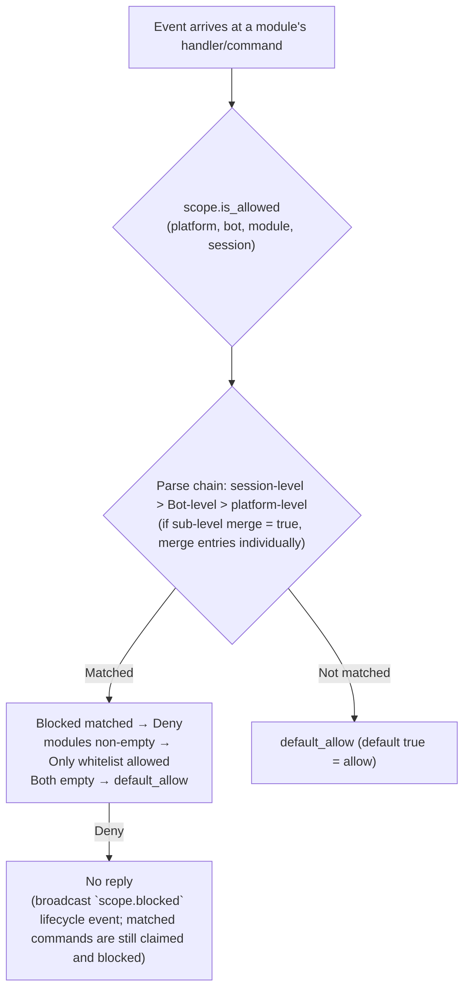
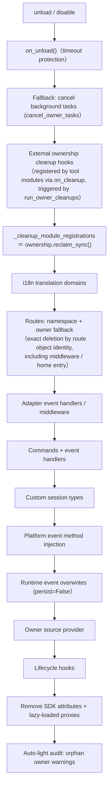
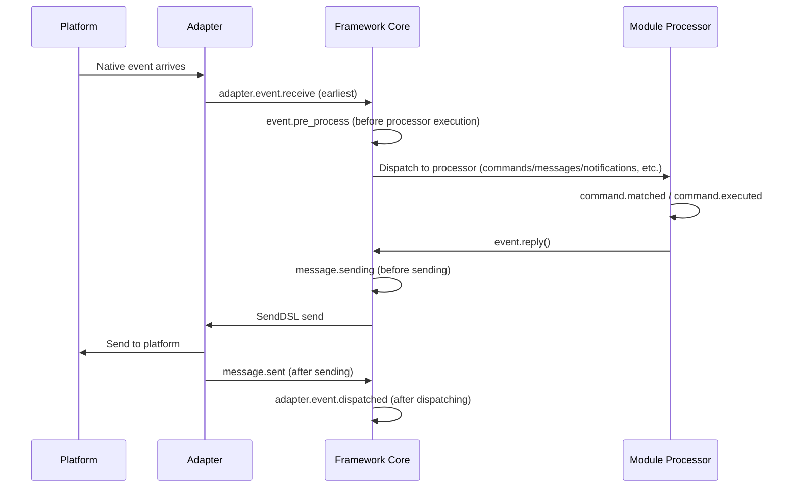

# ErisPulse 权限作用域与归属权

This skill is auto-built from the ErisPulse documentation.
Repository: https://github.com/ErisPulse/ErisPulse
Source paths are annotated per section; see docs/ in the repository for the latest content.

## 作用域

> 来源: `docs/en/advanced/scope.md`（https://github.com/ErisPulse/ErisPulse/blob/main/docs/en/advanced/scope.md）

# Scope

> [!TIP]
> **When to read this**: When you need to control module availability, event admission, or outbound action restrictions. Skip if not needed, it does not affect the use of other features.

> **After reading you will know**: The configuration paths, priority and rejection behaviors for the three scope dimensions (module availability / event admission / outbound actions), the usage of runtime API, and how interception is observable (via the `scope.blocked` event).
>
> **This section does not cover**: Resource ownership and unloading (see [Ownership (owner) system](ownership.md)); command ACL and event overrides (see [Event Handling Introduction](../getting-started/event-handling.md)).

> [!NOTE]
> This feature requires ErisPulse **2.8.0+**.

Scope answers four questions: **Which modules are available, which events are received, what text a module processes, and what actions a module can perform outwardly**. Control is entirely user-driven: at the top level during module / adapter / processor / outbound call registration (via `ErisPulse.scope` or runtime `sdk.scope`), the event pipeline automatically reads and executes the configuration at entry, processor filtering, and outbound gate.

| Dimension | Controls what | Rejection behavior | Configuration path |
|------|---------|---------|---------|
| **① Module** | Which modules are available (platform / Bot / session three levels) | Filtered modules do not trigger or reply (broadcast `scope.blocked` event; matched commands are still claimed and blocked) | `scope.platforms / bots / sessions` |
| **② Identity** | Whether to receive events (adapter / Bot / session / user four levels) | Completely discard at entry (broadcast `scope.blocked` event) | `scope.identity.*` |
| **③ Outbound** | What outbound calls a module can initiate (messages / API / requests, method-level white/blacklists) | Fail response (`retcode=34601`) | `scope.actions` |

> **Related systems**: Commands are special message event handlers, their user white/blacklists (ACL) and implementation parameter overrides are managed by the command system (`ErisPulse.event.command`), see [Event Handling Introduction](../getting-started/event-handling.md) and [Configuration Guide](../user-guide/configuration.md).

{!--< tips >!--}
1. Import the singleton via `from ErisPulse.Core import scope` (`sdk.scope` is the same object)
2. Check: `scope.is_allowed(...)` / `scope.is_identity_allowed(...)` /
   `scope.is_action_allowed(...)` correspond to the three gates ①②③
3. Read/write: Dimensional parameter methods (IDE can auto-complete) —
   `scope.set_module(...)` / `scope.set_identity(...)` / `scope.set_action(...)`;
   There are also dictionary-style fallback methods `scope.get(path)` / `scope.set(path, v)` / `scope.delete(path)`
4. Event handler text condition overrides are covered in
   [Event Handling Introduction · Event Override](../getting-started/event-handling.md#event-override-overwrite-any-event-type-behavior-without-modifying-module-code);
   Command ACL / parameter overrides are covered in [Event Handling Introduction](../getting-started/event-handling.md)
{!--< /tips >!--}

## Matching Entry Syntax (Unified Across the System)

All "name lists" in scope (module names, identity keys, outbound entries) use the same matching syntax (`ErisPulse.Core.text_match`):

| Syntax | Example | Description |
|------|------|------|
| Exact name | `"Chat"` | Full value comparison, **case-insensitive** |
| Glob | `"Tool*"`、`"spam_*"` | `*` for any string / `?` for single character / `[seq]` for character set, case-insensitive |
| Regular Expression | `"re:^Danger.*"` | Declared with `re:` prefix, regular expression `search` match, default case-insensitive |

- Invalid regular expressions **silently degrade** to "no match" (no error, no crash)
- Decorator parameters (`pattern=` / `regex=`) have fixed semantics: `pattern` is glob, `regex` is the regular expression source (without `re:` prefix); regular expression entries in scope configuration **must** have the `re:` prefix

## Global Fallback: `default_allow`

`default_allow` is the **single global fallback switch** (default `true`),
affecting two decision dimensions:

- **Module dimension**: If no binding is matched → `default_allow` decides allow / deny
- **Identity dimension**: If no strategy is matched → `default_allow` decides allow / deny

Setting it to `false` enables "implicit deny" strict mode: whitelist-style management,
**all unexplicitly allowed are denied**.

> **Exception**: The ③ outbound dimension is **not** affected by `default_allow` — it is an independent tightening switch,
> defaulting to full allow, only explicit rules restrict (framework-layer owner-empty calls are always allowed).
> This strict global mode won't accidentally cut off all module message replies.
> Command ACL has its own `ErisPulse.event.command.default_allow` fallback, independent of this.

## Configuration File

```toml
[ErisPulse.scope]
default_allow = true        # Global fallback (false = implicit deny strict mode)
cache_size = 1024           # LRU cache size

# ── ① Module Dimension (Priority: session > Bot > platform) ──
[ErisPulse.scope.platforms.onebot11]
modules = ["Chat", "Tool*"]   # Whitelist: exact name / glob / re: regex
blocked = ["re:^Danger"]
[ErisPulse.scope.bots.onebot11."123456"]
modules = ["Chat"]
merge = true                  # Append on top of platform-level binding (default is full override)
[ErisPulse.scope.sessions.onebot11."789012345"]
modules = ["Chat"]

# ── ② Identity Dimension (Priority: user > session > Bot > adapter) ──
[ErisPulse.scope.identity.adapters.onebot11]
deny = true                   # Discard all events from this adapter
[ErisPulse.scope.identity.bots.onebot11."123456"]
deny = true
[ErisPulse.scope.identity.sessions.onebot11."g_blocked"]
deny = true
[ErisPulse.scope.identity.users.onebot11]
allow = ["u_admin"]           # User keys support glob / re: regex
deny = ["u_bad", "spam_*"]

# ── ③ Outbound Dimension (Default: full allow, only explicit rules restrict) ──
[ErisPulse.scope.actions.MyModule]
send = { deny = true }                                    # Disable all sending
api = { allow = ["get_*"] }                               # Only allow standard query APIs
request = { deny = true }                                 # Disable request handling
```

## ① Module Dimension

**In one sentence**: Control "which modules are available in this context" via platform / Bot / session three-level binding; filtered modules do not trigger or reply (matched commands are still claimed and blocked).

Answer "which modules are available in a certain context". Default is fully open; filtering starts only after configuration binding,
**modules and adapters require no changes**.



- **Parse priority**: session-level > Bot-level > platform-level, higher priority bindings **fully override** lower priority; if sub-level binding sets `merge = true`, it changes to **entry-by-entry union** with lower priority (each of modules / blocked is merged individually, `merge` itself is a control key, not an entry)
- **Default semantics**: Filtered modules' commands and handlers do not trigger or reply, visible in TRACE-level logs (core.scope.denied); interception also broadcasts the `scope.blocked` lifecycle event (subscribe to observe who was blocked and why); matched **commands** are still claimed and blocked — command text is no longer passed to lower-level message handlers, eliminating the ambiguity of "command rejected then message handler responds again"
- **Framework-level handlers** (scope_exempt=True or owner is empty) are unaffected; module names that are empty (framework-layer resources) are always allowed
- **Session-aware help and command queries**: Command query APIs (command.help /
  get_command / get_commands / get_group_commands / get_visible_commands,
  and module.get_commands_overview) all support optional event= or explicit
  platform= / bot_id= / session_id= keywords — commands from modules unavailable in the current session
  no longer appear in the results (get_command returns None, single-command help is treated as "unregistered",
  consistent with default semantics); if no context is provided, behavior remains full

### Binding Inheritance (merge)

The default semantics of full override are clear and predictable; when you need to **append** to the upper level, write `merge = true` in the sub-level:

```toml
[ErisPulse.scope.platforms.onebot11]
modules = ["Chat", "Tool"]      # Platform-level: allow Chat, Tool

[ErisPulse.scope.bots.onebot11."123456"]
modules = ["Music"]
merge = true                    # The actual effective modules for this Bot = ["Chat", "Tool", "Music"]
```

- **Merge rules**: `modules` and `blocked` each take the **union**; `blocked` inside the binding still takes precedence over `modules`
- **Chain merge**: Platform → Bot → Session, each level independently decides `merge` or override

## ② Identity Dimension (Event Admission)

**In one sentence**: Use user / session / Bot / adapter four-level strategies to completely discard "events that should not be received" at the distribution entry, with deny taking precedence over allow.

Answer "whose events are received or not". Events that are rejected are **completely discarded at the distribution entry** —
they do not enter middleware or any handler (including framework-level), visible only in TRACE-level logs (core.scope.identity_denied).

- **Parse priority**: user > session > Bot > adapter, take the most specific configured strategy; deny takes precedence over allow
- Each level binding is a binary strategy: `{ allow = true }` or `{ deny = true }`
- User keys support glob / regex (e.g. `"spam_*"` to block a batch of spam users)
- Typical use case — upper-level deny, individual allow for "exceptional allow":

```toml
[ErisPulse.scope.identity.adapters.onebot11]
deny = true
[ErisPulse.scope.identity.users.onebot11]
allow = ["u_admin"]   # Even if adapter-level denied, u_admin's events are still allowed
```

## ③ Outbound Dimension (Restricting Module Outbound Calls)

**In one sentence**: Restrict module-initiated outbound calls (messages / API / requests) with method-level white/blacklists, and rejected calls do not initiate any network request, directly returning `retcode=34601`.

Restrict module-initiated **outbound actions**: message sending / standard API actions / request operations.
The three actions correspond to the underlying DSL: `Event.reply` and `Send` (send), `Api` / `call_api` (api), and `Request`'s accept/reject (request). Outbound calls initiated by the module during event handler execution carry the module owner, which is uniformly judged by this dimension.

### Rule Form (Inline Table)

Each action's rule is an inline table: `{ allow = [...], deny = true|[...] }`.
Only one rule per action is allowed (TOML keys are not repeatable, choose between full deny or fine-grained):

```toml
[ErisPulse.scope.actions.MyModule]
send = { deny = true }                                  # Disable all message sending (Event.reply / Send DSL)
# Or fine-grained method-level: send = { allow = ["Text", "Image*"], deny = ["File"] }
api = { allow = ["get_*"] }                             # Only allow query-type standard APIs
# Or action-level blacklist: api = { deny = ["set_*", "leave_*"] }
request = { deny = true }                               # Disable request handling accept/reject
```

- `send` entries match **send method names** (`Text` / `Image` / `File` ...),
  `api` entries match **standard action names** (`get_group_info` / `set_group_name` ...)
- Entries support exact names / glob / `re:` regex (consistent with the unified system syntax, case-insensitive)
- Writing `allow` as a single string is equivalent to a single-entry list: `send = { allow = "Text" }`

### Decision Semantics

**Default: fully allow** — Unconfigured, or owner is empty (internal framework calls) are allowed.
After configuration, the following order is used for judgment:

1. `deny = true` → Reject
2. `deny` list matches the call name → Reject
3. `allow` list is non-empty and the call name is not matched (or the call has no name) → Reject
4. Otherwise, allow

Rejected calls do not initiate any network request, directly returning the standard failure response
(`retcode = 34601`, see [api-response §5.3](../standards/api-response.md#53-framework-extended-return-code-34xxx-customized-low-three-digits-in-the-platform-error-segment)).

The three actions are independent, and only one can be limited.

```python
# Runtime API
sdk.scope.set_action("MyModule", "send", deny=True)              # Disable all message sending
sdk.scope.set_action("MyModule", "send", allow=["Text"])         # Allow only text messages
sdk.scope.is_action_allowed("MyModule", "send", name="Image")    # False
sdk.scope.is_action_allowed("MyModule", "api", name="get_user_info")  # Judged by rules
sdk.scope.delete_action("MyModule", "send")                      # Restore allow
sdk.scope.get_action("MyModule", "send")                         # Current rule for this action
```

## Runtime API

The scope runtime API is layered into three parts: **decision** (three questions), **dimensional read/write** (each dimension has `set` / `get` / `delete` parameterized methods, fully typed signatures, IDE auto-complete), and **dictionary-style fallback** (dot-separated paths directly access any section).

```python
from ErisPulse import sdk

scope = sdk.scope
```

### Decision (Three Questions)

```python
scope.is_allowed("onebot11", "123456", "Chat")                 # ① Module dimension
scope.is_allowed("onebot11", "123456", "Chat", "789012345")    # With session level
scope.is_allowed("onebot11", "123456", None)                   # Framework-layer resource -> True

scope.is_identity_allowed("onebot11", "123456", "group_9", "u1")   # ② Identity dimension

scope.is_action_allowed("MyModule", "send")                    # ④ Outbound dimension
scope.is_action_allowed("MyModule", "send", name="Image")      # Fine-grained method-level
```

### ① Module Dimension

```python
# Binding (level determined by parameters: session_id > bot_id > platform-level)
scope.set_module("onebot11", bot_id="123456", modules=["Chat", "Tool*"])
scope.set_module("onebot11", blocked=["re:^Danger"])                       # Platform-level
scope.set_module("onebot11", bot_id="123456", session_id="g9", modules=["Chat"])  # Session-level
scope.set_module("onebot11", bot_id="123456", modules=["Music"], merge=True)      # Union with existing entries
scope.set_module("onebot11", bot_id="123456", modules=["Chat"], persist=False)    # Runtime only

# Read / Delete
scope.get_module("onebot11", bot_id="123456")   # {"modules": ["Chat"], "blocked": []}
scope.delete_module("onebot11", bot_id="123456")
```

> `merge=True` is **write-time union** (merge entries with existing bindings at this level); the `merge = true` configuration key at parse time across levels is covered in the above [Binding Inheritance](#binding inheritance merge) — these are independent mechanisms.

> **Runtime Binding (persist=False) Semantics**: Runtime bindings are saved in a separate overlay layer,
> **any subsequent configuration writes / hot reloads will not overwrite them** (the configuration tree is rebuilt and automatically reapplied in write order, including runtime deletions). They are not persisted to disk, and are lost after process restart; runtime bindings written by a module are cleaned up when the module is unloaded. Subsequent `persist=True` writes (user-persistent semantics) to the same path will replace the runtime rules.

### ② Identity Dimension

```python
# Binding strategies (level determined by parameters: user > session > bot > adapter; allow / deny chosen)
scope.set_identity("onebot11", user_id="u_bad", deny=True)
scope.set_identity("onebot11", user_id="spam_*", deny=True)    # Key supports glob / re: regex
scope.set_identity("onebot11", bot_id="123456", session_id="g9", allow=True)

# Read / Delete
scope.get_identity("onebot11", user_id="u_bad")   # {"deny": True}
scope.delete_identity("onebot11", user_id="u_bad")
```

### ③ Outbound Dimension

```python
# Set restriction rules (allow: str|list; deny: bool|str|list; whole rule replacement semantics)
scope.set_action("MyModule", "send", deny=True)                    # Disable all sending
scope.set_action("MyModule", "send", allow=["Text"])               # Allow only text messages
scope.set_action("MyModule", "api", deny=["set_*", "leave_*"])     # Disable management APIs

# Read / Delete
scope.get_action("MyModule", "send")       # {"allow": ["Text"]} original rule
scope.delete_action("MyModule", "send")    # Remove single action
scope.delete_action("MyModule")            # Remove all action restrictions for this module
```

### General

```python
scope.get("platforms")   # Dictionary-style fallback: dot-separated path to read any section
scope.topology()         # Full configuration tree (for Dashboard)
scope.stats()
# {"module_calls": .., "module_filtered": .., "identity_checks": .., "identity_denied": ..,
#  "action_checks": .., "action_denied": .., "cache_hits": .., "cache_misses": ..}
scope.reset_stats()
scope.clear()           # Clear all configuration (only in-memory effect)
```

### Advanced: Dictionary-style Dot-separated Path Fallback

Dimensional methods cover daily scenarios; when you need to directly access any node (or future added dimensions), use the dictionary-style API — `get` / `set` / `delete` accept dot-separated paths (deep dict merge, immediate read after write),
and provide `scope[path]` / `scope[path] = v` / `del scope[path]` / `path in scope` protocols:

```python
scope.set("bots.onebot11.123456", {"modules": ["Chat"], "blocked": []})
scope.set("identity.users.onebot11.u_bad", {"deny": True})
scope.get("actions.MyModule.send")

scope["platforms.onebot11"]        # Read (throws KeyError if not exists)
scope["platforms.onebot11"] = {...}  # Write
del scope["platforms.onebot11"]      # Delete
"actions.MyModule" in scope          # Existence check
```

## Interception Observability: `scope.blocked` Event

When scope interception (module filtering / identity rejection) occurs, it broadcasts the lifecycle event **`scope.blocked`**,
making "who was blocked, at which level" subscribable, countable, and presentable in the Dashboard — interception does not reply by default, but is no longer an opaque black box.

| Field | Description |
|------|------|
| `dimension` | `"module"` (module dimension filtering) / `"identity"` (identity admission rejection) |
| `module` | The filtered module name (only module dimension) |
| `platform` / `bot_id` / `session_id` / `user_id` | The context where the interception occurred |

```python
from ErisPulse.Core.lifecycle import lifecycle

@lifecycle.on("scope.blocked")
def on_blocked(data):
    print(f"Blocked: {data['dimension']} {data.get('module') or data.get('user_id')}")
```

- The event is broadcast via `fire` background (zero overhead if no listeners, does not slow hot paths)
- Repeated interception with cache hits **does not** broadcast repeatedly — each combination is broadcast only once when the cache expires
- Distinct from `adapter.event.blocked` (event-level discard): that is event-level discard, this
  event is scope admission gate module / identity filtering

## Cache and Hot Reload

- `is_allowed` / `is_identity_allowed` / `is_action_allowed` results are cached with **LRU** (configurable via `scope.cache_size`), invalidated automatically by `set` / `delete` /
  configuration hot reload (`config.updated` / `config.set`)
- All dimension configurations take effect **immediately**, no restart required
- Scope is "event-by-event" judgment, does not remember across events: configuration changes, next event follows new rules

## Configuration Format Validation

Configuration format is validated section by section during loading / hot reload: invalid sections (e.g., `platforms` written as a string), invalid outbound rules (e.g., `allow` written as a number), unknown action names, unknown top-level keys (e.g., `alow` with a typo) will output **WARNING** and ignore the corresponding section / entry, while other valid configurations remain effective — errors no longer silently fail.

## Common Issues and Considerations

### 1. Configuration Hierarchy and Overriding

- Module dimension: session-level > Bot-level > platform-level, **full override** (if sub-level `merge = true`, entries are unioned individually). To "platform allows Chat, Bot adds Music", you can write `merge = true` in the Bot-level, or list both
- Identity dimension: user > session > Bot > adapter, take the **most specific** configured strategy (can do exception allow)
- Command user white/blacklists: exact command names take precedence over glob keys (see `event.command.acl`)

### 2. Module/Command Not Responding

First suspect scope rather than the module itself:

```python
from ErisPulse import sdk

print(sdk.scope.is_allowed(event.get_platform(), bot_id, "MyModule", session_id))
print(sdk.scope.is_identity_allowed(event.get_platform(), bot_id, session_id, user_id))
print(sdk.scope.stats())   # module_filtered / identity_denied > 0 indicates interception records
```

Filtered modules default to no reply (module dimension and identity dimension, avoiding rule exposure), but broadcast the `scope.blocked` lifecycle event and statistics continue to accumulate;
commands rejected by ACL will reply "insufficient permissions" explicitly.

### 3. Outbound Action Rejected When Troubleshooting

```python
from ErisPulse import sdk

print(sdk.scope.get("actions.MyModule"))
print(sdk.scope.stats())   # action_denied > 0 indicates intercepted calls
```

Interception is **explicit**: rejected calls return the standard failure response (`retcode = 34601`) without initiating a network request.

### 4. Session Identifier Isolation Across Platforms

The `(platform, session_id)` combination is the unique identifier. `scope.sessions.onebot11."789"` only applies to onebot11, not affecting a session with the same `789` on telegram. The same applies to identity dimension user keys.

## Topology Tree API

`ModuleManager.get_topology()` and `AdapterManager.get_topology()` provide module/adapter ownership relationship data,
`sdk.get_topology()` aggregates them (including scope):

```python
from ErisPulse import sdk

topology = sdk.get_topology()
# {
#   "modules": {                                   # Module → owned resources
#     "Chat": {
#       "loaded": True, "enabled": True,
#       "commands": ["chat", "translate"],
#       "handlers": {"message": 2, "notice": 1},
#       "routes": {"http": ["/Chat/api"], "ws": [], "sse": []},
#       "lifecycle_hooks": 3,
#     }
#   },
#   "adapters": {                                  # Adapter → Bot → Scope
#     "onebot11": {
#       "status": "started", "enabled": True,
#       "bots": {"123456": {"status": "online", "scope": {...}}},
#       "scope": {"modules": [...], "blocked": [...]},
#     }
#   },
#   "scope": {                                     # Scope (module / identity / outbound actions)
#     "platforms": {...}, "bots": {...}, "sessions": {...},
#     "identity": {"adapters": {...}, "bots": {...}, "sessions": {...}, "users": {...}},
#     "actions": {...},
#   },
# }
```

- Module topology aggregates commands registered by the module, event handlers, HTTP/WS/SSE routes, and lifecycle hooks, facilitating the drawing of module resource trees.
- Adapter topology aggregates status of each adapter, status of subordinate Bots, and platform-level/Bot-level scope bindings (module dimension).
- **JSON-safe output**: `get_topology(json_safe=...)` defaults to `True`, returning structures directly serializable via `json.dumps` — module `info` retains only pure data's `meta` sub-table (discarding `module_class` / `strategy` runtime objects), and other nodes (including arbitrary objects inserted by adapter authors into Bot `info`) are sanitized (class objects take `__name__`, unserializable objects fall back to `str()`). Dashboards / WebUI can directly serialize the return; for original objects, pass `json_safe=False`.

## 归属权

> 来源: `docs/en/advanced/ownership.md`（https://github.com/ErisPulse/ErisPulse/blob/main/docs/en/advanced/ownership.md）

# Ownership (owner) System

> [!TIP]
> **When to read this**: When troubleshooting resource leaks, understanding the cleanup chain during unload/disable, or declaring owned resources. Skip if not needed, as it does not affect the use of other features.

> **After reading, you will know**: How the owner context automatically assigns resources, the complete overview of owned resources, the full sequence of cleanup chains during unload/disable, and which resources are not cleaned up during unload (design boundaries).
>
> **This section does not cover**: Permission checks for "when resources become effective" (see [Scope (scope)](scope.md)); recommended practices and forced cancellation boundaries for background tasks (see [Lifecycle Management · Background Task Ownership and Automatic Cancellation](lifecycle.md#background-task-ownership-and-automatic-cancellation)).

Ownership is the foundation for modules' "plug-and-play" functionality: all framework resources registered during module loading are automatically named, and are recycled with a single click during unload/disable—module authors only need to declare resources, without manually writing cleanup logic.

> **Related systems**: Scope determines "whether resources are effective" during event dispatching, while ownership determines "who owns the resources and who is recycled during unload" during the lifecycle. Scope is detailed in [Unified Control Plane (scope)](scope.md), and background tasks are covered in [Lifecycle Management](lifecycle.md#background-task-ownership-and-automatic-cancellation).

{!--< tips >!--}
1. Ownership is automatically recorded at the **moment of registration** based on `current_owner`, requiring zero changes to module code.
2. Unload and disable share the same cleanup chain (`_cleanup_module_registrations`), where failures at each step only trigger warnings and do not interrupt the process.
3. Resources with user configuration semantics (persistent overrides / scope rules / command ACL) are **not** cleaned up during module unload.
4. External handles hosted by utility modules can be attached to the cleanup chain using `on_cleanup(cb)`, which are automatically called back when the corresponding module is unloaded (see [Guide to Utility Modules: Hosting Handles of Other Modules](#guide-to-utility-modules-hosting-handles-of-other-modules)).
{!--< /tips >!--}

## Owner Context Mechanism

The `owner` is passed through the context variable `current_owner` (`ErisPulse.runtime.context`):

```python
from ErisPulse.runtime import owner_scope, get_current_owner

with owner_scope("MyModule"):
    # All resources registered within this context are automatically attributed to MyModule
    assert get_current_owner() == "MyModule"
```

The framework automatically injects the `owner` at the following points (module/adapter code does not need to manually wrap these):

| Timing | Owner Value | Location |
|--------|-------------|----------|
| Module `load()` | Module name | Throughout instantiation + `on_load` |
| Adapter `start()` / `restart()` | Platform name | Throughout adapter startup |
| `activate_on` lazy-load stub registration | Module name | During placeholder command/handler registration |
| Event handler execution | Module name of handler's owner | Re-injected at handler/command entry |

Re-injection during execution means that command handlers declared in `on_load` will still be automatically attributed to the module if they call registration APIs (such as `sdk.adapter.on()` or `overrides.*.set(persist=False)`) during runtime.

## Resource Ownership Overview

All resources registered by a module within its loading context are recorded for ownership and automatically reclaimed upon unloading/disabling:

| Resource | Registration Method | Cleanup Call |
|----------|---------------------|--------------|
| Command | `@command()` / Command dict declaration | `command.unregister_by_owner()` |
| Event Handler | `@message` / `@notice` / `@request` / `@meta` | `handler.unregister_by_owner()` |
| Adapter Event Listener | `sdk.adapter.on()` / `raw=True` | `adapter.unregister_handlers_by_owner()` |
| Adapter Middleware | `@sdk.adapter.middleware` | Same as above |
| Routes (HTTP/WS/SSE) | `router.http()` / `websocket()` / `sse()` | Double fallback by namespace + by owner |
| Route Middleware | `@router.middleware()` / `add_middleware()` | `router.unregister_all_by_owner()` |
| Dashboard Home Entry | `router.register_home_entry()` | `unregister_home_entries_by_owner()` |
| Custom Session Type | `register_custom_type()` | `unregister_custom_types_by_owner()` |
| Platform Event Method Injection | `register_event_method()` / `register_event_mixin()` | `unregister_event_methods_by_owner()` (module unloading automatically reclaims, old closures no longer leak) |
| Background Tasks | `self.spawn()` | `cancel_owner_tasks()` |
| External Cleanup Hook (Tool Module Managed) | `runtime.on_cleanup(cb)` | `run_owner_cleanups()` (triggered during unload/disable/adapter shutdown chain) |
| Lifecycle Hook | `lifecycle.register()` | `lifecycle.unregister_by_owner()` |
| Master Source Provider | `master.provider` | `master.unregister_by_owner()` |
| i18n Translation Keys | `I18nClass` declaration (domain=module name) | `i18n.unregister_domain()` |
| Event Override (Runtime) | `overrides.*.set(persist=False)` | `overrides.unregister_by_owner()` |
| Interactive Sessions (wait_reply waiting / lease) | `event.wait_reply()` / `sdk.interaction.acquire()` | `interaction.cancel_by_owner()` (waiter immediately receives cancellation) |
| Context Data | `runtime/context` recorded by owner | Precise cleanup by module |

On the adapter side, corresponding resources (with platform name as owner) are reclaimed by `_cleanup_adapter_resources` during the adapter's `shutdown()` / `restart()`, including:

| Resource | Cleanup Call |
|----------|--------------|
| Adapter's own `on()` handlers and middleware | `adapter.unregister_handlers_by_owner(platform)` |
| Platform Event Method Extension (`EventMixin`) | `unregister_platform_event_methods(platform)` |
| Custom Session Type | `unregister_custom_types_by_owner(platform)` |
| Interactive Sessions (wait_reply / lease pending on this platform) | `interaction.cancel_by_platform(platform)` |
| i18n Translation Domain (domain=configuration key) | `i18n.unregister_domain(configuration key)` |
| Fine-grained Namespaced Routes | `router.unregister_all_by_owner(platform)` |

## Unload/Disable Cleanup Sequence

`unload()` and `disable()` share the same cleanup chain (each step is independently wrapped in try/except, failures are only logged, **not interrupting subsequent cleanup**):



`sdk.uninit()` performs additional global fallback on exit: all adapters shutdown → all modules unload → `router.stop()` (clear routes/middleware/home entry) → `cancel_all_background_tasks()` → clear event handlers and hooks.

## Ownership Facade (ownership)

The sixteen steps of chain cleanup converge under the ownership facade `ErisPulse.Core.ownership`, with four verbs covering "reclaim, count, scan, audit"—the subsystem-specific `*_by_owner` reclaim functions remain unchanged, serving as internal implementations of the facade:

| Verb | Purpose |
|------|---------|
| `ownership.reclaim(owner)` | Unified reclaim of all resources owned by owner (task cancellation → cleanup hooks → registered resource types; asynchronous full version) |
| `ownership.reclaim_sync(owner)` | Registered resource type reclaim (synchronous version, for synchronous unload paths) |
| `ownership.counts(owner=None)` | Read-only count of resources registered under owner (None for all owners) |
| `ownership.orphans()` | Orphan scan: resources registered but owner has been unregistered (concrete leak report) |
| `ownership.audit(owner, deep=)` | Leak audit report (counts + orphans + optional gc instance survey) |

```python
from ErisPulse.Core import ownership

ownership.reclaim_sync("MyModule")       # {'commands': 1, 'routes_http': 2, ...}
ownership.counts("MyModule")             # Count of registered resources
ownership.orphans()                      # [{"owner": "ghost", "total": 2, ...}]
```

**Audit entry points**:

- **Automatic light audit** after unload/reload: issues WARNING alert when orphaned owner resources are found (zero-cost counting scan)
- `sdk.module.audit(name, deep=True)`: Module instance gc survey—when an instance is unreclaimable, it reports the referencing type (identifying "who is holding the old instance"); involves global pause overhead, used only for explicit troubleshooting
- Deep survey is an explicit operation, not configurable, and does not perform automatic repair

## Hot Reload Failure Rollback

Hot reload has been changed to "**Snapshot before Unload → Automatic Rollback on Failure**": When a new version encounters syntax errors, missing dependencies, or fails to load, the old instance and its registration status (registry entries, sdk attributes, sys.modules entries) are automatically restored, ensuring uninterrupted service. The log will indicate "Rolled back to old instance to continue service."

Best-effort semantics (documented boundaries):

- Side effects already executed in `on_unload` (such as disconnected connections, canceled tasks) are irreversible—after rollback, the old instance is in a "cleaned-up" state and must be reloaded to become fully available again.
- Manual references to the old instance cached by third-party libraries during runtime are not restored.
- If the target package has been unloaded (entry-point disappeared), it is considered a successful unload and no rollback will occur.

## Design Boundaries: Resources Not Cleaned on Unload

Ownership only recovers **runtime resources registered by module code**. The following resources are **user-configured semantics** (controlled by the user, possibly intentionally configured), and persist after module unload:

| Resource | Semantics | Description |
|----------|-----------|-------------|
| `overrides.*.set(persist=True)` | Persistent overrides | Written to configuration file, effective across restarts; not deleted on module unload (user explicitly configured) |
| `scope.set_action()` and other scope rules | Permission control plane | Managed by user/Dashboard; rules are not reclaimed when the module is unloaded |
| `overrides.acl.set(persist=True)` | Command ACLs | Same as above |
| `Conversation.save()` persistence | Multi-turn conversation archives | Data assets are not cleaned up |

Runtime temporary writes (`persist=False`) are reclaimed by owner—**persistence is the boundary between "user assets" and "module runtime state."**

## Internal Implementation: How Ownership Works

**In one sentence**: The attribution chain (contextvar propagation) determines "whose responsibility it is," while the cancellation chain (task registry) determines "whether it can be canceled upon unloading." — These two chains operate independently, and proper resource cleanup requires both.

The ownership system consists of **two independent chains**. Understanding their division of labor is essential for troubleshooting ownership issues.

### Attribution Chain (Contextvar Propagation)

The `ContextVar`s such as `current_owner` in `runtime/context.py` are responsible for **attribution** — "Whose responsibility is this resource registration or call initiated by the code at this moment?" The propagation follows the semantics of Python's `contextvars`:

| Execution Path | Context Propagated | Attribution Result |
|----------------|--------------------|--------------------|
| Synchronous call chain / `await` chain | ✅ Propagated | Correct attribution |
| `asyncio.create_task` within `owner_scope` | ✅ Propagated (task copies the context at creation) | Correct attribution for framework calls within the task |
| `run_in_executor` / bare thread | ❌ Not propagated | Attribution lost |
| Custom event loop | ❌ Not propagated | Attribution lost |

> Attribution ≠ Registration: Context propagation only affects "whose responsibility it is." Whether a resource can be cleaned up depends on whether it enters the subsequent cancellation chain.

### Cancellation Chain (Task Registry)

The `_owner_tasks` registry in `runtime/tasks.py` manages **lifecycle** — "Which unfinished tasks belong to the owner, and should be canceled together during unloading." Tasks enter the registry through:

1. **Explicit Scheduling**: `spawn_background()` / `self.spawn()` → captures `current_owner` at creation (or explicitly via `owner=` parameter) → registers into the table;
2. **Task Factory Automatic Registration** (2.8.3): `install_owner_task_factory()` is installed at the main event loop during framework startup — **any** task creation (including `create_task` inside third-party libraries) passing through the factory reads `current_owner`, and registers if it is not None.

The registry self-cleans: Each task has a `done_callback`, and is removed from the table upon completion, with no leaks.

### Cancellation Timing (Module Unload)

```
module.unload()
  → on_unload(event)                    # Module-specific cleanup (fallback timeout protection)
  → Framework unregisters commands/events/hooks/routes for this owner
  → cancel_owner_tasks(owner)           # Registry fallback cancellation
      → cancel each task individually   # Excludes the task itself executing the cancellation logic
      → await gather(pending, timeout)  # Wait for cleanup (no blocking after timeout)
```

### Troubleshooting Approach

- **Resources not cleaned up** → Check the registry: Does `get_owner_tasks("MyModule")` contain the task? If not, the registration path did not pass through the attribution chain (import phase / thread / independent loop), refer to the table above to locate the issue.
- **Incorrect attribution** → Check the value of `get_current_owner()` at the time of error; for asynchronously delayed execution (callbacks/tasks), attribution is taken from the context at creation, not at execution time.

## Module Author Guide

### Recommended Practices

```python
from ErisPulse import sdk
from ErisPulse.Core.Event import command
from ErisPulse.runtime import owner_scope, spawn_background

class MyModule(BaseModule):
    async def on_load(self, event):
        # Framework resources: automatically owned, no manual cleanup required
        self.task = self.spawn(self.polling())      # Background task
        sdk.router.register_home_entry("My Module", "/my")  # Home entry

        # Module-specific resources: include in owner_scope to integrate into ownership system
        with owner_scope("MyModule"):
            self.client.on_event(self._handle)      # Hypothetical custom registration

    async def on_unload(self, event):
        # Framework resources have been automatically cleaned up, only clean up non-owner_scope covered resources
        await self.client.close()
```

### Notes

- **Registration during import has no ownership**: Hooks/handlers registered at the module's top level (during import) occur before `owner_scope`, and are considered framework-level resources (owner=None) and **will not be cleaned up**. Always register inside `on_load()`.
- **Custom domain i18n registration**: When `i18n.register(domain=...)` uses a domain different from the module name, it won't be automatically cleaned up. Please ensure domain=module name.
- **Background tasks recommended via `self.spawn()`**: As of 2.8.3, raw `asyncio.create_task` will also **automatically register ownership** (Task Factory automatically registers, cancels on unload as a fallback). However, `self.spawn()` remains the recommended approach—supporting non-main loop thread scheduling back to the main loop, explicit `owner=` assignment, and fire-and-forget to prevent GC. **For versions before 2.8.3**, raw tasks are not owned, and `self.spawn()` must be used.
- **Cleanup chain "failure only logs warning"**: Single-step cleanup exceptions will not block other resource releases, visible in DEBUG/WARNING log levels; enable TRACE for troubleshooting.

### Registration Timing → Ownership Result Comparison Table

| Registration Scenario | Ownership Result | Explanation |
|-----------------------|------------------|-------------|
| Registered inside `on_load()` via framework APIs (commands/events/lifecycle/routing decorators) | Owned by module | Automatically unregistered on unload |
| Registered at module top level (during import) | **No ownership** (owner=None) | Not cleaned up, do not use |
| Background tasks created via `self.spawn()` | Owned by module | Automatically cancelled on unload |
| Registered inside `owner_scope("Name")` via third-party APIs | Owned by module | Depends on third-party callbacks executing synchronously within scope |
| Raw `asyncio.create_task` (including `loop.create_task` / `ensure_future`) | **Automatic ownership** (Task Factory, 2.8.3+) | Instantly reads `current_owner` on creation, automatically registers within owner context, cancels on unload as a fallback; see [Internal Implementation](#internal-implementation-how-ownership-works) below |
| Tasks created internally within third-party library asynchronous callbacks (e.g., aiohttp / APScheduler) | **Automatic ownership** (Task Factory, 2.8.3+) | If `current_owner` is injected (e.g., during framework handler execution), the task automatically registers |
| `run_in_executor` (thread pool) | **No ownership** (not asyncio.Task) | Threads are not managed by Task Factory, lifecycle must be managed manually |
| Registration within an independent event loop (self-created loop) | **No ownership** | Task Factory is only installed in the main loop; contextvars do not propagate across event loops |

> Principle: **Ownership follows the `current_owner` context at the moment of registration**; any asynchronous delay, thread pools, or independent loops will detach from this context—explicitly enter `owner_scope` when ownership is required.

## Tool Module Guide: Handling References to Other Modules

**Scenario**: Tool modules such as scheduled tasks, registries, and connection pools hold references to other modules—when a module calls `sdk.Cron.on_trigger(handler)` in its `on_load`, your container stores a callback pointing to the instance of the calling module. The framework automatically cleans up all framework-level resources registered by the module, but it cannot clean up references stored in your **private container**: after the module is unloaded, your container still holds its instance, preventing it from being garbage collected (memory leak, `purge` leak diagnostics report "un回收able").

**Solution**: In the same function where you register the other module's resources, call `on_cleanup()`. The framework will automatically invoke your cleanup function when the module is unloaded or disabled:

```python
from ErisPulse.Core.Bases import BaseModule
from ErisPulse.runtime import off_cleanup, on_cleanup

class CronModule(BaseModule):
    def __init__(self):
        self._entries = {}  # {module_name: list of callbacks registered by the module}

    def on_trigger(self, handler):
        # Automatically identifies the caller module name (whether called directly in on_load or via module.call),
        # returns the resolved owner, which can be used directly as a named key
        owner = on_cleanup(self._drop)
        self._entries.setdefault(owner, []).append(handler)

    def _drop(self, owner: str):
        """Called automatically by the framework when the module is unloaded/disabled: simply discard its handle"""
        self._entries.pop(owner, None)

    async def on_unload(self, event):
        off_cleanup(self._drop)  # ③ Unregister the hook before self-unloading to avoid the hook table holding a reference to self
```

Guaranteed framework behavior:

| Concern | Behavior |
|---------|----------|
| Trigger Timing | Triggered when the module is unloaded / disabled, or when the adapter shuts down—always within the framework's cleanup chain, before `purge` leak diagnostics |
| Caller Identification | Direct call uses `current_owner`; called via `module.call()` uses `current_caller`; can also explicitly specify via `on_cleanup(cb, owner="module_name")`. **Mandatory validation**: if `owner` cannot be resolved (missing from all three sources), a `ValueError` is raised—private tool modules should register hooks within their own loading context |
| Callback Signature | `cb(owner: str)`, synchronous or asynchronous; asynchronous callbacks have timeout protection (`CLEANUP_CALLBACK_TIMEOUT_SECS`, default 10 seconds) |
| Fault Tolerance | If a single callback fails or times out, only logs are recorded, without affecting other hooks or the cleanup chain |
| Duplicate Registration | Identical `(owner, callback)` pairs are idempotently deduplicated |

**When Not Needed**: If the module registers framework-level resources (commands, event handlers, routes, background tasks, etc.), the framework automatically cleans them up (see [Resource Ownership Overview](#resource-ownership-overview) above). Only references held in your private container require `on_cleanup`. A quick-reference version from a module developer's perspective is available at [Best Practices · Tool Modules](../developer-guide/modules/best-practices.md#tool-modules-handling-references-to-other-modules-should-catch-unload-notifications).

## 生命周期

> 来源: `docs/en/advanced/lifecycle.md`（https://github.com/ErisPulse/ErisPulse/blob/main/docs/en/advanced/lifecycle.md）

# Lifecycle Management

> [!TIP]
> **When to read this**: When you need to subscribe to framework lifecycle events (startup / loading / state change). Skip if not needed, as it won't affect the use of other features.

> **What you'll learn**: The registration / triggering / targeted propagation mechanism of lifecycle events, the differences and selection among the four sets of triggering APIs, and the complete list of pre-buried hook breakpoints in the framework (core / module / adapter / server / message) along with their respective data formats.
>
> **This section does not cover**: Lifecycle methods that modules themselves need to implement (`on_load` / `on_unload`, see [Module Development Guide](../developer-guide/modules/getting-started.md)); the detailed flow of startup stages (see [Startup Flow and Manual Control](startup.md)).

To receive notifications and execute your own logic at key points such as module loading failure, configuration modification, message sending, or command execution (for auditing, statistics, alerting, or interoperation), simply subscribe to the framework's lifecycle events. The framework pre-buried hook breakpoints at each critical node, and you can integrate with `@sdk.lifecycle.on("event name")` in a single line. The complete list of breakpoints is provided at the end of this document.

The system supports three triggering methods:
- `await lifecycle.emit("event", data)` — A concise version, passing arbitrary data (targeted delivery when `to="Owner"`)
- `lifecycle.emit_sync("event", data)` — The synchronous version (used in non-async contexts)
- `await lifecycle.submit_event("event", ...)` — Compatible with the old version, automatically constructs the standard event format

## Event Handling Mechanism

### Registering Handlers

```python
from ErisPulse import sdk

# Decorator pattern
@sdk.lifecycle.on("module.load")
async def on_module_load(data):
    print(f"Module loaded: {data}")

# Programmatic registration
sdk.lifecycle.register("module.load", on_module_load, priority=10)

# Unregister
sdk.lifecycle.unregister("module.load", on_module_load)

# Batch unregister by owner (automatically called by framework during module/adapter unload)
removed = sdk.lifecycle.unregister_by_owner("MyModule")
print(f"Cleaned up {removed} lifecycle hooks")
```

### Priority

Handlers support the `priority` parameter, where a higher value means earlier execution (consistent with the module loader):

```python
@sdk.lifecycle.on("adapter.event.receive", priority=10)  # Executes first
async def first_handler(data):
    pass

@sdk.lifecycle.on("adapter.event.receive", priority=0)  # Executes later
async def second_handler(data):
    pass
```

### Dot-Structure Events

When a specific event is triggered, its parent events are also triggered:
- Triggering `module.load` also triggers `module`
- Triggering `adapter.event.receive` also triggers `adapter.event` and `adapter`

### Wildcards

Register `*` to capture all events:

```python
@sdk.lifecycle.on("*")
async def on_anything(data):
    print(f"Received event: {data}")
```

### Directed Propagation (`emit to=`)

> [!NOTE]
> This feature requires ErisPulse **2.8.0+**.

When `emit()` specifies the `to` parameter, it enters directed propagation: the event is only distributed to handlers registered under the specified owner (hooks registered in a module's `on_load` automatically belong to the module), while other modules and wildcard `*` handlers are not notified.

```python
# Emitter: Event only delivered to hooks registered by the Chat module
await sdk.lifecycle.emit("message_received", {"text": "hi"}, to="Chat")

# Subscriber (within Chat module): Register a hook with the same name; owner is automatically recorded during registration
@sdk.lifecycle.on("message_received")
async def on_message_received(data): ...

@sdk.lifecycle.on("message")   # Dot-structure parent prefixes also apply (filtered by owner)
async def on_any(data): ...
```

- If the target owner has no registered hooks → the event is **not consumed** (use `has_handlers()` to detect beforehand)
- If `data` is a dict, `_trace_id` is automatically included (does not overwrite existing values)
- `emit_sync` / `submit_event` also support the `to=` parameter
- Three-layer module communication model (RPC / directed / broadcast) is described in [Module Communication](module-communication.md)

### One-time Registration (`once`)

Since 2.7.0, handlers registered via `lifecycle.once()` are automatically unregistered after one trigger, suitable for one-time hooks such as "first ready":

```python
@sdk.lifecycle.once("core.init.complete")
async def on_first_ready(data):
    print("First ready, will not trigger again")
```

- Same priority semantics as `on()` (`priority` value higher means earlier execution)
- Automatic unregistration, no need for manual `unregister`
- Supports both synchronous and asynchronous handlers

### Listener Query (`has_handlers`)

In hot-path short-circuit scenarios, use `has_handlers()` to check if there are listeners beforehand, avoiding unnecessary event traversal and task scheduling:

```python
if sdk.lifecycle.has_handlers("message.sending"):
    await sdk.lifecycle.emit("message.sending", send_ctx)
```

- Covers **exact event name**, **wildcard `*`**, and **parent event** matching
- Returns `False` if there are no listeners, allowing safe skipping of `emit`

## Overview of Hook Breakpoints

A typical lifecycle event sequence diagram of a message from platform entry to framework processing completion:



The framework provides the following built-in hook breakpoints, and users can listen to any breakpoint to implement custom logic via `@sdk.lifecycle.on()`.

### Core Initialization

| Hook Name | Trigger Timing | Data |
|---------|---------|------|
| `core.init.start` | SDK initialization starts | `{}` |
| `core.init.stage` | Each initialization stage begins (emitted in background) | `{"stage": str}`; values: `discovery` / `adapter_register` / `adapter_start` / `module_register` / `module_init` / `adapter_start_deferred` / `router_start` |
| `core.init.complete` | SDK initialization completes | `{"duration": float, "success": bool, "stages": {stage: float}, "adapters": {"enabled": [str], "disabled": [str]}, "modules": {"enabled": [str], "disabled": [str]}, "error": str (only on failure)}` |
| `core.uninit.complete` | SDK de-initialization completes | `{"duration": float, "success": bool, "adapters_closed": int, "modules_unloaded": int, "module_properties_cleared": int, "module_properties_to_clear": [str], "error": str (only on failure)}` |

**Example: Displaying Startup Progress**

```python
@sdk.lifecycle.on("core.init.stage")
def show_stage(data):
    print(f"[Startup] Entering stage: {data['stage']}")
```

### Configuration Changes

| Hook Name | Trigger Timing | Data |
|---------|---------|------|
| `config.set` | A configuration item is modified | `{"key": str, "old_value": Any, "new_value": Any}` |
| `config.updated` | Entire configuration tree is detected changed after editing config.toml externally | `{"old_config": dict, "new_config": dict, "config_file": str}` |

**Example: Configuration Audit**

```python
@sdk.lifecycle.on("config.set")
def audit_config(data):
    print(f"[Audit] {data['key']}: {data['old_value']} -> {data['new_value']}")
```

### Module Lifecycle

| Hook Name | Trigger Timing | Data |
|---------|---------|------|
| `module.register` | A module class is registered to the manager | `{"module_name": str, "success": bool}` |
| `module.load` | Module loading completes (instance successfully created); on failure, payload additionally carries `"error": str, "traceback": str` (failure context can also be queried via `module.last_error(name)`) | `{"module_name": str, "success": bool}` |
| `module.init` | Module initialization completes (including lazy loading) | `{"module_name": str, "success": bool}` |
| `module.before_unload` | First step in the unload pipeline (before `on_unload` and resource release; module instance hook `on_before_unload` is triggered synchronously) | `{"module_name": str, "reason": str}`; `reason` values: `unload` / `reload` / `disable` / `cascade` / `dormant` |
| `module.sleep` | Module hibernation completes (lazy loading sleep: resources are released, automatically awakened on access) | `{"module_name": str, "success": bool}` |
| `module.unload` | Module is unloaded or disabled (`disable` and `unload` provide equivalent notifications to dependents; `on_dependency_lost` contract includes "disabled") | `{"module_name": str, "success": bool}` |
| `module.reload` | Module hot reload completes (including cascading reload of dependencies) | `{"module_name": str, "success": bool, "full": bool, "duration_ms": int}`; single module additionally carries `"identity_changed": bool` (False = old code may still be running in the process, e.g., C extension cache) and `"version_old": str, "version_new": str`; during full reload (`reload_all`), `module_name` is `"All"`, payload additionally carries `"results": dict[str, bool]` |

> **Module instance hook `on_before_unload`**: The optional lifecycle method corresponding to the `module.before_unload` event—`event["reason"]` indicates the reason, suitable for saving state to `sdk.storage` before resource release, and restoring it in `on_load` after awakening/reload (lazy loading hibernation state continuation is based on this). Hook failure only alerts, does not block the unload process.

### Adapter Lifecycle

| Hook Name | Trigger Timing | Data |
|---------|---------|------|
| `adapter.load` | Adapter registration completes | `{"platform": str, "success": bool}` |
| `adapter.reload` | Adapter code-level hot reload completes | `{"adapter_name": str, "success": bool, "full": bool, "duration_ms": int, "identity_changed": bool, "version_old": str, "version_new": str, "was_started": bool, "source": str}`; `identity_changed=False` = old code may still be running in the process |
| `adapter.start` | Adapter starts | `{"platforms": [str]}` |
| `adapter.status.change` | Adapter status changes | `{"platform": str, "status": str, "retry_count": int, "error": str (only on failure)}`; complete status values: `starting` / `started` / `start_failed` / `stopping` / `stopped` / `stop_failed` / `skipped-dependency` / `disabled` |
| `adapter.stop` | Adapter stops | `{"platforms": [str]}` |
| `adapter.stopped` | Adapter stop completes | `{"platforms": [str]}` |
| `adapter.bot.online` | Bot goes online | `{"platform": str, "bot_id": str, "info": dict, "status": str}` |
| `adapter.bot.offline` | Bot goes offline | `{"platform": str, "bot_id": str, "status": str}` |

### Event Reception and Processing

| Hook Name | Trigger Timing | Data |
|---------|---------|------|
| `adapter.event.receive` | External platform event is received (earliest) | `{"platform": str, "event_type": str, "raw_event_type": str}` |
| `adapter.event.blocked` | Middleware blocks the event (returns `False`, event is discarded and does not enter any processor) | `{"middleware": str, "platform": str, "event_type": str, "detail_type": str, "event": dict, "_trace_id": str}` |
| `adapter.event.dispatched` | Event dispatch completes | `{"platform": str, "event_type": str, "raw_event_type": str, "onebot_handlers_count": int}` |
| `event.pre_process` | Event processor begins execution | `{"event_type": str, "platform": str, "detail_type": str}` |

**Example: Event Counting**

```python
event_counter = {}

@sdk.lifecycle.on("adapter.event.receive")
def count_events(data):
    platform = data["platform"]
    event_counter[platform] = event_counter.get(platform, 0) + 1

@sdk.lifecycle.on("adapter.event.dispatched")
def log_unhandled(data):
    if data["onebot_handlers_count"] == 0:
        print(f"[Unhandled] {data['platform']}/{data['event_type']}")
```

### Message Sending

| Hook Name | Trigger Timing | Data |
|---------|---------|------|
| `message.sending` | Message is about to be sent | `{"platform": str, "method": str, "detail_type": str, "target_id": str, "bot_id": str}` |
| `message.sent` | Message sending completes | `{"platform": str, "method": str, "detail_type": str, "target_id": str, "bot_id": str}` |

**Example: Message Sending Audit**

```python
@sdk.lifecycle.on("message.sending")
def log_sending(data):
    print(f"[Sending] -> {data['platform']}/{data['detail_type']}/{data['target_id']} via {data['method']}")
```

### Command System

| Hook Name | Trigger Timing | Data |
|---------|---------|------|
| `command.matched` | Command is matched and about to execute | `{"command": str, "args": list[str], "platform": str, "user_id": str}` |
| `command.executed` | Command execution completes | `{"command": str, "args": list[str], "platform": str, "user_id": str, "success": bool, "error": str (only on failure)}` |

**Example: Command Counting**

```python
@sdk.lifecycle.on("command.matched")
def count_commands(data):
    print(f"[Command] /{data['command']} from {data['user_id']}@{data['platform']}")
```

### HTTP Routing

| Hook Name | Trigger Timing | Data |
|---------|---------|------|
| `server.request` | HTTP request is received | `{"method": str, "path": str, "client_ip": str, "request_id": str}` |
| `server.response` | HTTP response is sent | `{"method": str, "path": str, "status_code": int, "client_ip": str, "request_id": str}` |

> `request_id` is the [X-Request-ID request correlation ID](router.md#request-correlation-idx-request-id): it is prioritized from the client request header, otherwise a UUID is generated automatically. It can be used to link the request and response events.

**Example: Request Logging**

```python
@sdk.lifecycle.on("server.response")
def log_http(data):
    print(f"[HTTP] {data['method']} {data['path']} -> {data['status_code']}")
```

### WebSocket

| Hook Name | Trigger Timing | Data |
|---------|---------|------|
| `server.start` | Router server starts | `{"base_url": str, "host": str, "port": int, "success": bool, "error": str (only on failure)}` |
| `server.stop` | Router server stops | `{}` |
| `server.websocket.connect` | WebSocket connection is established | `{"path": str, "module_name": str, "client_ip": str}` |
| `server.websocket.disconnect` | WebSocket connection is disconnected | `{"path": str, "module_name": str, "reason": str, "error": str (only on abnormal disconnection)}` |

**Example: WebSocket Connection Monitoring**

```python
@sdk.lifecycle.on("server.websocket.connect")
def on_ws_connect(data):
    print(f"[WS] Connection: {data['path']} from {data['client_ip']}")

@sdk.lifecycle.on("server.websocket.disconnect")
def on_ws_disconnect(data):
    print(f"[WS] Disconnection: {data['path']} ({data['reason']})")
```

### Storage Connection Status

Establishment, failure, and recovery of the storage backend connection pool (all emitted in background, do not block storage operations):

| Hook Name | Trigger Timing | Data |
|---------|---------|------|
| `storage.ready` | Storage backend connection pool is ready (first successful pool creation per event loop) | `{"backend": str}` |
| `storage.unreachable` | Connection retry exhaustion enters cooldown period (during which operations fail quickly) | `{"backend": str, "error": str, "cooldown": float}` |
| `storage.recovered` | Cooldown ends, reconnection succeeds, storage is restored | `{"backend": str}` |

**Example: Storage Failure Alert**

```python
@sdk.lifecycle.on("storage.unreachable")
def alert_storage_down(data):
    print(f"[Alert] Storage backend {data['backend']} is unreachable: {data['error']}, automatic reconnection in {data['cooldown']}s")

@sdk.lifecycle.on("storage.recovered")
def notify_storage_back(data):
    print(f"[Recovery] Storage backend {data['backend']} is restored and available")
```

### HTTP Client

Request and connection events of `sdk.client` (all emitted in background):

| Hook Name | Trigger Timing | Data |
|---------|---------|------|
| `client.request.success` | HTTP request succeeds | `{"method": str, "url": str, "status": int, "elapsed": float}` |
| `client.request.failed` | HTTP request finally fails after exhausting retries | `{"method": str, "url": str, "error": str, "attempts": int, "elapsed": float}` |
| `client.ws.connect` | WebSocket connection is established | `{"url": str}` |

### Internationalization

| Hook Name | Trigger Timing | Data |
|---------|---------|------|
| `i18n.language.changed` | Framework language switch (`i18n.set_language`) | `{"language": str, "previous": str}` |

## Standard Event Definitions

```python
STANDARD_EVENTS = {
    "core": ["init.start", "init.stage", "init.complete", "uninit.complete"],
    "module": ["load", "before_unload", "init", "sleep", "unload", "register", "reload"],
    "adapter": [
        "load", "start", "status.change", "reload", "stop", "stopped",
        "event.receive", "event.blocked", "event.dispatched",
        "bot.online", "bot.offline",
    ],
    "server": [
        "start", "stop",
        "request", "response",
        "websocket.connect", "websocket.disconnect",
    ],
    "event": ["pre_process"],
    "message": ["sending", "sent"],
    "command": ["matched", "executed"],
    "config": ["set", "updated"],
    "storage": ["ready", "unreachable", "recovered"],
    "client": ["request.success", "request.failed", "ws.connect"],
    "i18n": ["language.changed"],
}
```

## Complete API Reference

### Registration and Unregistration

| Method | Description |
|--------|-------------|
| `@lifecycle.on(event, *, priority=0)` | Decorator to register a handler |
| `lifecycle.register(event, handler, *, priority=0)` | Programmatic registration |
| `lifecycle.unregister(event, handler=None)` | Unregister (removes all handlers for the event if handler=None) |

### Triggering

| Method | Description |
|--------|-------------|
| `await lifecycle.emit(event, data=None, *, to=None)` | Asynchronously trigger; handlers execute **in parallel** (non-blocking, returns when all complete), and non-None return values are replayed in priority order to chain and replace data; `to` specifies owner for directed delivery |
| `lifecycle.fire(event, data=None, *, to=None)` | **Fire and forget (fire-and-forget)**: Handlers execute in background tasks in parallel, no waiting, no return value; zero overhead if no listeners; suitable for high-frequency hot paths and pure observation events; use `emit` for shutdown sequences and order-sensitive consumption (e.g. `config.set`) |
| `lifecycle.emit_sync(event, data=None, *, to=None)` | Synchronously trigger; asynchronous handlers are scheduled with create_task |
| `await lifecycle.submit_event(event_type, *, source, msg, data, to=None, background=False)` | Backward compatibility, automatically builds standard event format; `background=True` uses `fire` for background firing |

**Comparison of the four trigger APIs**:

| Method | Invocation Style | Wait for Handlers to Complete | Typical Scenarios |
|--------|------------------|-------------------------------|-------------------|
| `emit` | `await` (asynchronous) | **Wait**—handlers execute in parallel, return when all complete, return values replayed in priority order | Regular triggering; order-sensitive consumption (`config.set`) and shutdown sequences must use it |
| `fire` | Direct call (synchronous return) | **Do not wait**—handlers execute in background tasks in parallel, no return value; zero overhead if no listeners | High-frequency hot paths and pure observation events (`server.request` / `storage.ready`) |
| `emit_sync` | Direct call (synchronous) | Synchronous handlers complete immediately; asynchronous handlers are scheduled with `create_task` (return values cannot be returned) | Triggering events in non-async contexts (synchronous code) |
| `submit_event` | `await` (asynchronous) | Wait (same as `fire` if `background=True`) | Backward compatibility: automatically builds standard event format (`source` / `msg` / `timestamp`) |

### Utilities

| Method | Description |
|--------|-------------|
| `lifecycle.start_timer(timer_id)` | Start timing |
| `lifecycle.get_duration(timer_id)` | Get elapsed time (in seconds) |
| `lifecycle.stop_timer(timer_id)` | Stop timing and return elapsed time |
| `lifecycle.list_hooks()` | List all registered hooks and the number of handlers |
| `lifecycle.clear()` | Clear all handlers and timers |

## Example Usage in Module

```python
from ErisPulse.Core.Bases import BaseModule
from ErisPulse import sdk

class Main(BaseModule):
    async def on_load(self, event):
        # Implement simple message counting
        self.msg_count = 0
        
        @sdk.lifecycle.on("adapter.event.receive")
        async def count(data):
            if data["event_type"] == "message":
                self.msg_count += 1
        
        # Monitor all commands
        @sdk.lifecycle.on("command.matched")
        async def log_cmd(data):
            sdk.logger.info(f"Command executed: /{data['command']} by {data['user_id']}")
        
        # Configuration change audit
        @sdk.lifecycle.on("config.set")
        def audit(data):
            sdk.logger.info(f"Configuration change: {data['key']} = {data['new_value']}")
```

## Background Task Ownership and Automatic Cancellation

> [!NOTE]
> This feature requires ErisPulse **2.8.0+**.

Background asyncio tasks created by a module that are not canceled in `on_unload` will hold a reference to `self`, preventing the module instance from being collected (old instances remain after hot reload). The framework provides the following fallback mechanism:

- **`self.spawn(coro)`** (recommended within module): Task automatically belongs to module name; framework automatically cancels unfinished tasks and logs warnings after `on_unload` when the module is unloaded
- **`spawn_background(coro)`** (from `ErisPulse.runtime`): Automatically captures current `owner_scope` context; `cancel_owner_tasks(owner)` cancels by ownership, `cancel_all_background_tasks()` is provided for `sdk.uninit()` fallback
- **Adapters**: Background tasks under platform name are also automatically canceled when adapter stops

```python
async def on_load(self, event):
    # Recommended: Use self.spawn() for background tasks, framework automatically cancels them after unload
    self.spawn(self._poll())

async def on_unload(self, event):
    # For fine control, still recommend manually canceling and waiting for cleanup
    if self._poll_task:
        self._poll_task.cancel()
        await asyncio.gather(self._poll_task, return_exceptions=True)

async def _poll(self):
    while True:
        await asyncio.sleep(60)
        ...
```

> [!IMPORTANT]
> Framework fallback is **forced cancellation** (`cancel_owner_tasks`), which occurs after `on_unload` returns. Therefore, tasks requiring graceful cleanup (flush buffers, persist state, close connections) **must** manually `cancel()` and `await` completion in `on_unload` — do not rely on fallback to preserve cleanup logic. Framework only guarantees "no lingering tasks holding `self`", not "graceful". For tasks requiring `await` results, directly `await`, do not throw them into background tasks.

## Notes

1. **Handlers can be synchronous or asynchronous**: The system automatically identifies and correctly calls them
2. **Data passing**: In `emit()` mode, non-None values returned by handlers modify the data passed to subsequent handlers
3. **Event naming convention**: Use dot-structure naming for events, making parent listening easier
4. **Error isolation**: Exception in a single handler does not affect execution of other handlers
5. **Synchronous trigger limitation**: In `emit_sync()`, asynchronous handlers are scheduled fire-and-forget, return values cannot be returned
6. **Lifecycle cleanup**: When `sdk.uninit()` is called, all registered handlers and timers are cleared
7. **Loading priority**: If you need to listen to events during the framework initialization phase, it is recommended to set a high priority and disable lazy loading
