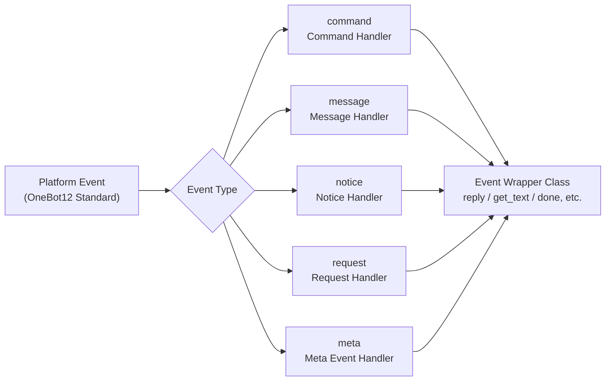

# Event System API

> [!TIP]
> **When to read this**: Refer to this document when you need to register commands, listen to message/notice/request events, or use event interaction methods such as `event.reply()` / `wait_reply()` / `confirm()`. Skip it otherwise.

This document provides a detailed introduction to the ErisPulse Event System API.

The Event System dispatches platform events by type to five categories of handlers:



## Command Module

### Registering Commands

```python
from ErisPulse.Core.Event import command

# Basic command
@command("hello", help="Send a greeting")
async def hello_handler(event):
    await event.reply("Hello!")

# Command with aliases
@command(["help", "h"], aliases=["assist"], help="Show help")
async def help_handler(event):
    pass

# Command with permission
def is_admin(event):
    return event.get("user_id") in admin_ids

@command("admin", permission=is_admin, help="Admin command")
async def admin_handler(event):
    pass

# Hidden command
@command("secret", hidden=True, help="Secret command")
async def secret_handler(event):
    pass

# Command group
@command("admin.reload", group="admin", help="Reload module")
async def reload_handler(event):
    pass

# Subcommands (multi-token command names separated by spaces)
# Matching uses longest prefix: /admin add x hits admin add first (args is ["x"]);
# when a subcommand does not declare a permission, it inherits from the nearest
# ancestor command on the parent chain that declared one
@command("admin add", help="Add an admin")
async def admin_add_handler(event):
    pass
```

**Naming conflict rules**: Command names take precedence over aliases. When registering an alias that duplicates an existing command name, the alias takes no effect and a warning is emitted; when registering a command whose name duplicates an existing alias, the command name takes precedence and the dead alias is automatically removed — both kinds of conflicts produce WARNING logs, so no silent hijacking occurs.

### Command Information

All command query APIs support an optional **session context**: pass `event=` (an Event or dict) or explicit `platform=` / `bot_id=` / `session_id=` (explicit parameters take precedence when combined with `event`), which filters out commands of modules unavailable in the current session based on the scoped-module dimension (see advanced/scope.md for details). All are optional keyword arguments; when omitted, the original full-list behavior is retained.

```python
# Get command help
help_text = command.help()

# Session-aware help: list only commands available in the current session
help_text = command.help(event=event)

# Get a specific command (returns the effective parameters after merged overrides; returns None if unavailable in the session)
cmd_info = command.get_command("admin")
cmd_info = command.get_command("admin", event=event)

# Get all commands (filters commands of unavailable modules when session-aware)
all_commands = command.get_commands()
all_commands = command.get_commands(event=event)

# Get all commands in a command group (supports session-aware filtering)
admin_commands = command.get_group_commands("admin")
admin_commands = command.get_group_commands("admin", event=event)

# Get all visible commands
visible_commands = command.get_visible_commands()

# Session-aware visible commands (either event or explicit keywords suffice)
visible_commands = command.get_visible_commands(event=event)
visible_commands = command.get_visible_commands(
    platform=event.get("platform"),
    bot_id=event.get_self_account_id(),
    session_id=event.get_session_id(),
)
```

### Waiting for Replies

```python
# Wait for a user reply
@command("ask", help="Ask the user for information")
async def ask_command(event):
    reply = await command.wait_reply(
        event,
        prompt="Please enter your name:",  # already sent above
        timeout=30.0
    )
    
    if reply:
        name = reply.get_text()
        await event.reply(f"Hello, {name}!")

# Wait for a reply with validation
def validate_age(event_data):
    try:
        age = int(event_data.get_text())
        return 0 <= age <= 150
    except ValueError:
        return False

@command("age", help="Ask the user for their age")
async def age_command(event):
    await event.reply("Please enter your age:")
    
    reply = await command.wait_reply(
        event,
        timeout=60,
        validator=validate_age
    )
    
    if reply:
        age = int(reply.get_text())
        await event.reply(f"Your age is {age}")

# Wait for a reply with a callback
async def handle_confirmation(reply_event):
    text = reply_event.get_text().lower()
    if text in ["yes", "y"]:
        await event.reply("Operation confirmed!")
    else:
        await event.reply("Operation cancelled.")

@command("confirm", help="Confirm an operation")
async def confirm_command(event):
    await command.wait_reply(
        event,
        prompt="Please enter 'yes' or 'no':",
        callback=handle_confirmation
    )
```

## Message Module

### Message Events

```python
from ErisPulse.Core.Event import message

# Listen to all messages
@message.on_message()
async def message_handler(event):
    sdk.logger.info(f"Message received: {event.get_text()}")

# Listen to private messages
@message.on_private_message()
async def private_handler(event):
    user_id = event.get_user_id()
    sdk.logger.info(f"Private message from: {user_id}")

# Listen to group messages
@message.on_group_message()
async def group_handler(event):
    group_id = event.get_group_id()
    sdk.logger.info(f"Group message from: {group_id}")

# Listen to mention (@) messages
@message.on_at_message()
async def at_handler(event):
    mentions = event.get_mentions()
    sdk.logger.info(f"Mentioned users: {mentions}")
```

### Conditional Listening

```python
# Use priority to control execution order
@message.on_message(priority=10)  # higher value means higher priority
async def high_priority_handler(event):
    pass

# Implement conditional filtering inside the handler
@message.on_message()
async def filtered_handler(event):
    if "keyword" not in event.get_text():
        return
    # Process messages containing the keyword
    pass
```

## Notice Module

### Notice Events

```python
from ErisPulse.Core.Event import notice

# Friend added
@notice.on_friend_add()
async def friend_add_handler(event):
    user_id = event.get_user_id()
    await event.reply("Thanks for adding me as a friend!")

# Friend removed
@notice.on_friend_remove()
async def friend_remove_handler(event):
    user_id = event.get_user_id()
    sdk.logger.info(f"Friend removed: {user_id}")

# Group member increase
@notice.on_group_increase()
async def member_increase_handler(event):
    user_id = event.get_user_id()
    await event.reply(f"Welcome, new member!")

# Group member decrease
@notice.on_group_decrease()
async def member_decrease_handler(event):
    user_id = event.get_user_id()
    sdk.logger.info(f"Group member left: {user_id}")
```

## Request Module

### Request Events

```python
from ErisPulse.Core.Event import request

# Friend request
@request.on_friend_request()
async def friend_request_handler(event):
    user_id = event.get_user_id()
    comment = event.get_comment()
    sdk.logger.info(f"Friend request: {user_id}, comment: {comment}")

# Group invitation request
@request.on_group_request()
async def group_request_handler(event):
    group_id = event.get_group_id()
    user_id = event.get_user_id()
    sdk.logger.info(f"Group invitation: {group_id}, from: {user_id}")
```

## Meta Module

### Meta Events

```python
from ErisPulse.Core.Event import meta

# Connect event
@meta.on_connect()
async def connect_handler(event):
    platform = event.get_platform()
    sdk.logger.info(f"Platform {platform} connected")

# Disconnect event
@meta.on_disconnect()
async def disconnect_handler(event):
    platform = event.get_platform()
    sdk.logger.info(f"Platform {platform} disconnected")

# Heartbeat event
@meta.on_heartbeat()
async def heartbeat_handler(event):
    sdk.logger.debug("Heartbeat received")
```

### Bot Status Query

Once the adapter sends meta events, the framework automatically tracks Bot status. For query APIs and lifecycle event listening, refer to [Adapter System API - Bot Status Management](adapter-system.md#bot-status-management).

## Event Wrapper Class

Event handlers in the Event module receive an Event wrapper class instance, which inherits from dict and provides convenient methods. For the complete method list, parameter signatures, and behaviors, refer to [Event Wrapper Class in Detail](../developer-guide/modules/event-wrapper.md); this section is only a quick overview.

### Capability Overview

- **Event basic information**: `get_id()` / `get_time()` / `get_type()` / `get_detail_type()` / `get_platform()`
- **Bot information**: `get_self_platform()` / `get_self_user_id()` / `get_self_account_id()` / `get_self_info()`
- **Session identifiers**: `get_target_id()` (unified target ID, taking the first non-empty value in the order `group_id` → `channel_id` → `guild_id` → `thread_id` → `user_id`); `get_session_id()` (format `{platform}:{detail_type}:{target_id}`, e.g. `"telegram:private:12345"`)
- **Message content and sender**: `get_message()` / `get_alt_message()` / `get_text()` / `get_user_id()` / `get_sender()` / `get_group_id()` etc.
- **Message type checks**: `is_message()` / `is_private_message()` / `is_group_message()` / `is_at_message()` / `has_mention()` / `get_mentions()`
- **Reply**: `reply(content, method=..., at_sender=..., quote=..., at_users=..., reply_to=..., at_all=..., via=...)` / `reply_ob12()`; platform capability queries `supports()` / `available_methods()`; free-form send chain `send_chain()` — see [SendDSL in Detail](../developer-guide/adapters/send-dsl.md#method-2-eventsend_chain)
- **Command information**: `get_command_name()` / `get_command_args()` / `is_command()` etc.
- **Interactive conversations**: `wait_reply()` / `confirm()` / `choose()` / `collect()` / `wait_for()` / `conversation()`
- **Utilities**: `to_dict()` (filters internal keys) / `get_raw()` / `get_raw_type()`

> For complete parameter descriptions and examples of each method, see [Event Wrapper Class in Detail](../developer-guide/modules/event-wrapper.md);
> for advanced multi-turn conversations, see [Conversation Multi-turn Dialogues](../advanced/conversation.md).

### Chain Control

`event.done(claim=, stop=)` unifies control over two orthogonal semantics — "claim" and "stop":

- **Claim**: marks the event as processed (`_processed`); the command dispatcher uses this to skip deduplication
- **Stop**: prevents propagation to lower-priority handlers (`_propagation_stopped`)

```python
# Claim + stop (default)
event.done()

# Claim only, no stop (lower-priority observers can still see it)
event.done(stop=False)

# Stop only, no claim (e.g. firewall / rate limiting)
event.done(claim=False)

# mark_processed is the primary method; done is its alias
event.mark_processed()             # equivalent to event.done()
event.mark_processed(stop=False)   # equivalent to event.done(stop=False)

# Query status
event.is_processed()  # whether already claimed
event.is_stopped()    # whether propagation is stopped
```

### Platform Extension Methods

Adapters can register platform-specific methods for Event, which are only available on instances of the corresponding platform.

#### For Users: Using Platform Extension Methods

Once an adapter has registered platform-specific methods, you can call them directly in event handlers. Methods vary by platform; refer to the corresponding [platform documentation](../platform-guide/).

```python
from ErisPulse.Core.Event import message

@message.on_message()
async def handle_message(event):
    platform = event.get_platform()

    # Call platform-specific methods based on the platform
    if platform == "email":
        subject = event.get_subject()           # email-specific
        attachments = event.get_attachments()   # email-specific
```

#### Querying Methods Registered for a Platform

```python
from ErisPulse.Core.Event import get_platform_event_methods

# Check which methods are registered for a platform
methods = get_platform_event_methods("email")
# ["get_subject", "get_from", "get_attachments", ...]

# Dynamically check and call
for method_name in get_platform_event_methods(event.get_platform()):
    method = getattr(event, method_name)
    print(f"{method_name}: {method()}")
```

#### Platform Method Isolation

Methods registered for different platforms do not interfere with each other:

```python
# Email event - only email methods
event = Event({"platform": "email", "email_raw": {"subject": "Hello"}})
event.get_subject()      # ✅ "Hello"
event.get_chat_type()    # ❌ AttributeError

# Telegram event - only Telegram methods
event = Event({"platform": "telegram", "telegram_raw": {"chat": {"type": "private"}}})
event.get_chat_type()    # ✅ "private"
event.get_subject()      # ❌ AttributeError
```

#### `hasattr` / `dir` Support

```python
hasattr(event, "get_subject")   # returns True only when platform="email"
"get_subject" in dir(event)     # same as above
```

### For Adapters: Registering Platform Extension Methods

Adapters can register platform-specific methods for Event via decorators. The first parameter of the method is `self` (the Event instance), with free access to event data.

#### Registering a Single Method

```python
from ErisPulse.Core.Event import register_event_method

@register_event_method("email")
def get_subject(self):
    """Get the email subject"""
    return self.get("email_raw", {}).get("subject", "")

@register_event_method("email")
def get_from(self):
    """Get the sender"""
    return self.get("email_raw", {}).get("from", {})
```

#### Batch Registration (Mixin Class)

When there are many methods, batch registration with a Mixin class is recommended:

```python
from ErisPulse.Core.Event import register_event_mixin

class EmailEventMixin:
    def get_subject(self):
        return self.get("email_raw", {}).get("subject", "")

    def get_from(self):
        return self.get("email_raw", {}).get("from", {})

    def get_attachments(self):
        return self.get("email_raw", {}).get("attachments", [])

# Register all methods at once
register_event_mixin("email", EmailEventMixin)
```

#### Return Value Conventions

| Scenario | Return Value | Usage |
|------|--------|------------|
| Returning data (text, dicts, etc.) | Return the value directly | `subject = event.get_subject()` |
| Performing actions (sending messages, etc.) | Return an `asyncio.Task` | `task = event.do_something()`, `await` optional |

> **Recommendation**: Methods that do not return data should return an `asyncio.Task`, so users can decide whether to `await`. Even without `await`, the operation still completes.

```python
@register_event_method("email")
def forward_email(self, to_address: str):
    """Forward an email — returns a Task; users decide whether to await"""
    import asyncio
    return asyncio.create_task(
        self._do_forward(to_address)
    )

# Users can await the result
await event.forward_email("user@example.com")

# Or skip await; the operation runs in the background
event.forward_email("user@example.com")
```

#### Unregistering Methods

```python
from ErisPulse.Core.Event import unregister_event_method, unregister_platform_event_methods

# Unregister a single method
unregister_event_method("email", "get_subject")

# Unregister all methods of a platform (called when the adapter shuts down)
unregister_platform_event_methods("email")
```

#### Overriding Built-in Methods

`register_event_mixin` / `register_event_method` support overriding Event built-in methods (such as `confirm`, `choose`, `collect`, `wait_reply`, `reply`, etc.). Registered platform methods take precedence over built-in methods via `Event.__getattribute__`, so adapters can provide platform-specific interaction implementations.

Built-in implementations are exported as `_builtin_*` functions; overriders can call them as a fallback:

```python
from ErisPulse.Core.Event import register_event_mixin, _builtin_choose

class YunhuEventMixin:
    async def choose(self, prompt, options, timeout=60, method="Text"):
        # The Yunhu platform uses button components
        buttons = [[{"text": opt} for opt in options]]
        await self.reply(prompt)
        # ...wait for a button callback or a text reply...
        # Fall back to the built-in logic
        return await _builtin_choose(self, None, options, timeout, "Text")

register_event_mixin("yunhu", YunhuEventMixin)
```

## Cross-Platform Extensions (Wildcard)

`register_event_method` and `register_event_mixin` support passing `"*"` as the platform name; registered methods are available on Event instances of **all platforms**. This is suitable for feature modules that need cross-platform reuse, such as AI chat and context management.

### Registering Cross-Platform Methods

```python
from ErisPulse.Core.Event.wrapper import register_event_method

@register_event_method("*")
async def ai_chat(self, prompt: str):
    """self is the Event instance, with free access to event data and built-in methods"""
    await self.reply(f"AI: {prompt}")
```

After registration, event handlers on all platforms can call it:

```python
from ErisPulse.Core.Event import message

@message.on_message()
async def handler(event):
    await event.ai_chat(event.get_text())
```

### Method Resolution Priority

When accessing Event methods via attributes, the resolution order is:

1. **Platform-specific methods** (overrides for the current platform)
2. **Wildcard methods** (cross-platform methods registered with `"*"`)
3. **Built-in methods** (`reply`, `confirm`, etc.)
4. **Dictionary key access**

> Therefore, wildcard methods can override built-in methods (such as `reply`), but will in turn be overridden by platform-specific methods of the same name.

## Priority System

Event handlers support priorities; a higher value means higher priority:

```python
# Higher-priority handlers execute first
@message.on_message(priority=10)
async def high_priority_handler(event):
    pass

# Lower-priority handlers execute later
@message.on_message(priority=0)
async def low_priority_handler(event):
    pass
```

## Related Documentation

**Continue with API reference**:
- [Core Modules API](core-modules.md) - Core modules API
- [Adapter System API](adapter-system.md) - Adapter management API

**Learn event handling from examples**:
- [Module Development Guide](../developer-guide/modules/) - Develop custom modules
- [Event Handling](../getting-started/event-handling.md) - Event handling tutorial for beginners