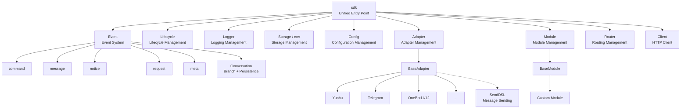
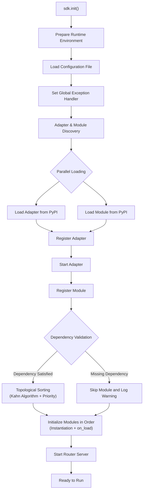
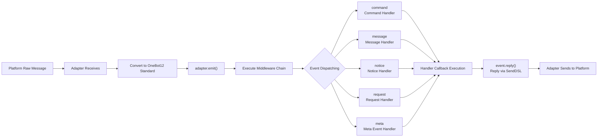
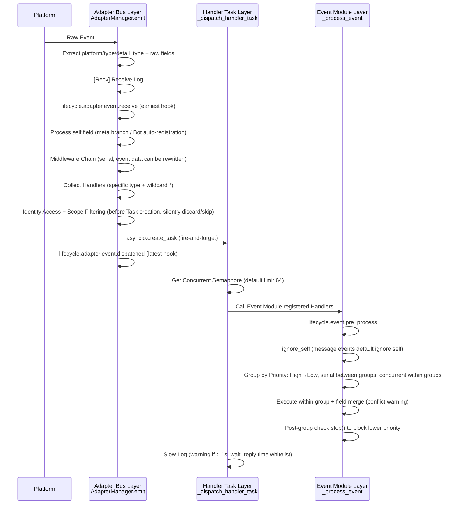
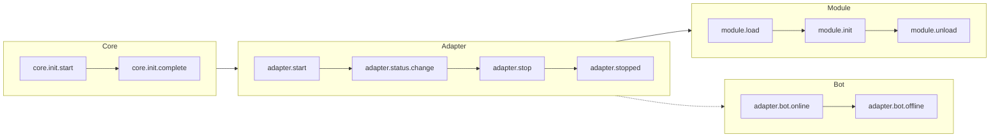
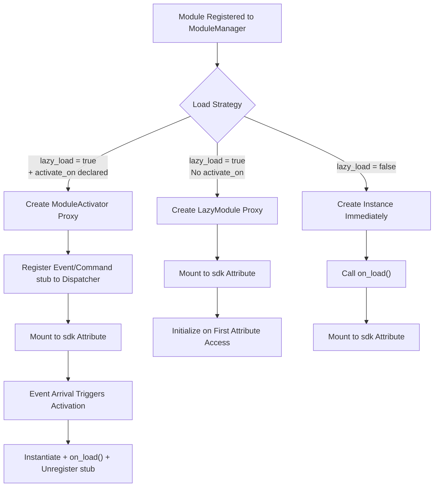
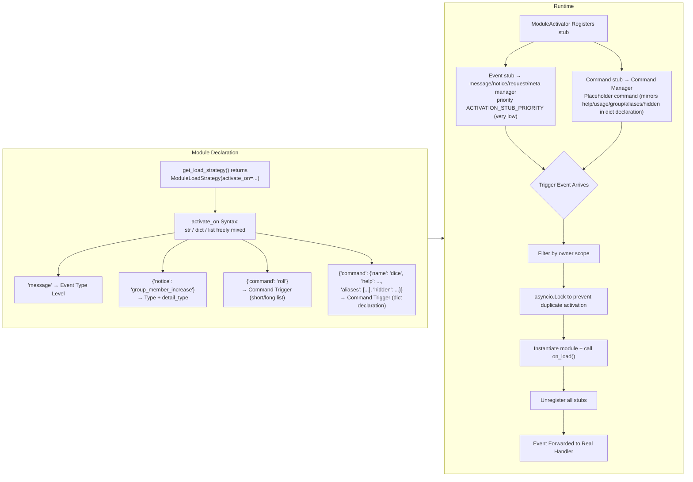
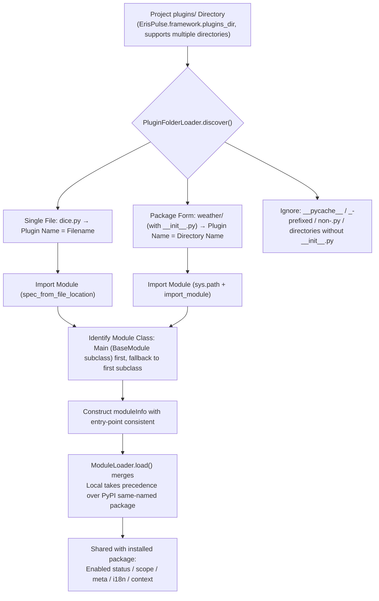
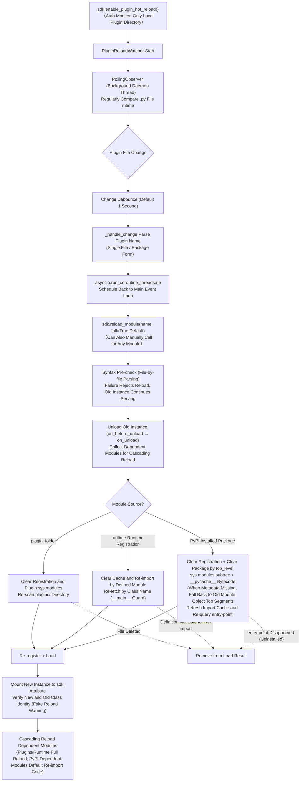
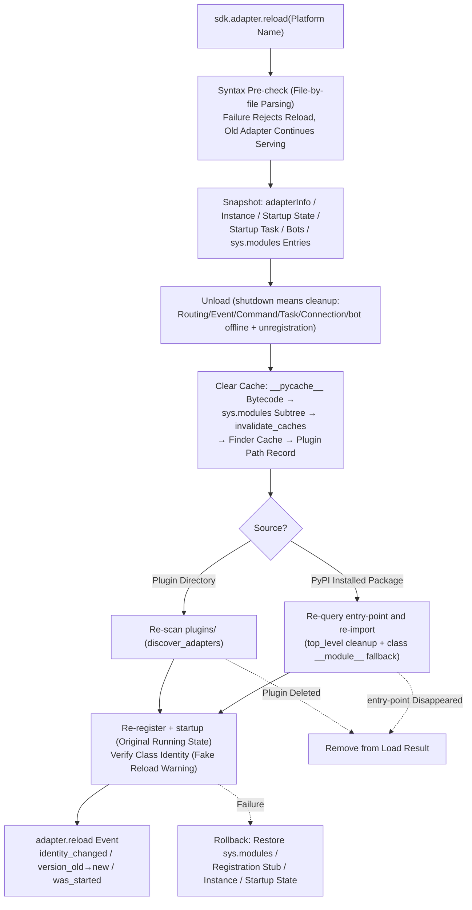

# Architecture Overview

> [!TIP]
> **When to read this**: When you want to understand what the framework is doing behind the scenes—how a message flows, the order in which modules are initialized, what happens during hot reload, or when troubleshooting "why the framework behaves this way." If you only want to write handlers, see [Getting Started with Event Handling](getting-started/event-handling.md); otherwise, skip this.

A message from a user to a bot reply goes through several stages: adapter transformation, middleware, scope filtering, and priority-based scheduling. Modules are not all loaded at startup. This article uses diagrams to clearly illustrate this chain and explain what you can intervene at each stage.

## SDK Core Architecture

The following diagram shows the core modules of the SDK and their relationships:

### Core Module Description

| Module | Description |
|--------|-------------|
| **Event** | Event system, providing five types of event handling: command / message / notice / request / meta, and Conversation for multi-turn dialogue |
| **Adapter** | Adapter manager, managing registration, startup, and shutdown of multi-platform adapters |
| **Module** | Module manager, managing plugin registration, loading, and unloading, supporting dependency declaration and topological sorting |
| **Lifecycle** | Lifecycle manager, providing event-driven lifecycle hooks |
| **Storage** | SQLite-based key-value storage system, supporting generic SQL chain query |
| **Config** | TOML-formatted configuration file management |
| **Logger** | Modular logging system, supporting sub-loggers |
| **Router** | HTTP/WebSocket routing management, encapsulating underlying backends (currently FastAPI + Uvicorn) through an abstraction layer, supporting decorator routing, middleware, grouping, rate limiting, CORS |
| **Client** | Unified HTTP/WS client (previously `HttpClient` before 2.8.0, retains compatibility alias), encapsulating underlying request libraries (currently aiohttp) through an abstraction layer, providing request statistics, retry, logging, WebSocket client, ErisPulse exception system, etc. The client and server-side WebSocket share the `WebSocketConnectionBase` base class |

## Initialization Process

The following diagram shows the complete initialization process of `sdk.init()`:

### Detailed Initialization Stages

> The complete initialization chain breakdown (Finder / Loader / Manager / Router), underlying entry points (`init()` / `init_task()` / `init_sync()`), and manual full startup are detailed in [Startup Process and Manual Control](advanced/startup.md).

## Event Handling Process

The following diagram shows the complete flow of messages from the platform to the handler:

### Detailed Event Handling Chain

The above diagram shows the result; below, we break down what the framework does behind `adapter.emit()`—this is a three-layer dispatch chain:

**What the framework does at each step and what you can intervene:**

| Stage | What the framework does | What you can intervene |
|-------|-------------------------|------------------------|
| Receive | Extract standard fields, preserve `{platform}_raw` raw data; write `[Recv]` log | Listen to `adapter.event.receive` to get earliest event |
| self field | Meta event goes through connect/disconnect/heartbeat branch; normal event auto-registers Bot and triggers `adapter.bot.online` | Listen to `adapter.bot.online` / `bot.offline` |
| Middleware | **Serial** execution, if returned value is not None, replace event data | Register middleware to rewrite/intercept event |
| Dispatch Collection | First get specific type handler, then get `*` wildcard handler | — |
| Identity Dimension | At dispatch entry, decide whether to receive event by User>Session>Bot>Adapter (`scope.is_identity_allowed`), **discard entire event if denied** | `ErisPulse.scope.identity` binding |
| Scope Filtering | Determine `scope.is_allowed` by module owner (session level > Bot level > platform level), **silently skip if not passed** | Configure scope whitelist/blacklist |
| Scheduling | Each matching handler gets independent `asyncio.Task`, `emit()` **returns immediately without waiting for handler completion** | — |
| Priority | High priority group executes first; **serial between groups, concurrent within groups** (each group holds event copy, changes merged back, conflicts warn) | `@command(..., priority=N)` / specify priority during registration |
| Blocking | After each group, check `event.is_stopped()`, if triggered, **do not execute lower priority** | `event.mark_processed(stop=True)` / `event.done()` |

> **Common Misunderstandings**:
> 1. **Scope filtering is silent**—filtered handlers do not report errors or respond, only visible in TRACE-level logs (`core.scope.denied`). If "my module didn't receive a message," first check scope binding.
> 2. **Handlers are inherently concurrent**—the framework already creates independent Tasks for each handler, you **do not need** to wrap them in `asyncio.create_task` again.
> 3. **No blocking within the same priority group**—`mark_processed(stop=True)` only blocks lower priority groups, not already concurrent handlers within the same group.
> 4. **Slow log threshold is fixed at 1 second**—handlers taking over 1s will be warned in logs (`wait_reply` time is excluded from duration), but execution is not interrupted.

> Details on scope's module-level three-tier binding, identity-level access and outbound action restrictions are in [Scope (scope)](advanced/scope.md); event scope text filtering and command user ACL are in [Event Handling Introduction](getting-started/event-handling.md); concurrency limit configuration is in [Configuration Guide](user-guide/configuration.md#Framework Configuration).

## Lifecycle Events

The following diagram shows the order in which lifecycle events are triggered by the framework components:

### Listening to Lifecycle Events

> The complete event listening methods (`lifecycle.on()` / `once()` / `has_handlers()`), all lifecycle event lists and data formats are detailed in [Lifecycle Management](advanced/lifecycle.md).

## Module Loading Strategy

ErisPulse supports three module loading strategies, declared by `get_load_strategy()` returning a `ModuleLoadStrategy`:

> For more details, see [Lazy Loading System](advanced/lazy-loading.md), [Lifecycle Management](advanced/lifecycle.md), and module documentation.

### Event-Driven Lazy Activation (`activate_on`) Trigger Architecture

> [!NOTE]
> This feature requires ErisPulse **2.8.0+**.

`activate_on` allows modules to load only when the **first matching event/command arrives**, avoiding constant memory usage while ensuring no events are lost:

**Trigger Semantics Key Points:**

> The complete `activate_on` syntax (str / dict / list), command dict declaration, placeholder command help fallback chain, scope filtering, and failure semantics are in [Lazy Loading System](advanced/lazy-loading.md#Event-Driven-Lazy-Activation-activate_on).

## Local Plugin Folder Architecture

> [!NOTE]
> This feature requires ErisPulse **2.8.0+**.

Local plugins (`plugins/` directory) do not require packaging for release; the framework automatically discovers and loads them at startup:

**Conventions and Features:**

- Plugin name source: filename for single file, directory name for package form
- Local plugin `moduleInfo.meta.source == "plugin_folder"`, seamlessly coexists with PyPI installed package modules
- Same name takes local precedence (for local override debugging), disabled entries are removed simultaneously

## Module Hot Reload Architecture

Hot reload is consistent for **all module sources**: local plugins (`plugins/` directory), runtime registration (`sdk.module.register()`), and PyPI installed package modules can all be hot reloaded via `sdk.reload_module()` / `sdk.module.reload()`—**default is full reload** (clear import cache by top-level package name and re-import dependent code, `full=False` is a lightweight escape route); `sdk.reload_all_modules()` / `sdk.module.reload_all()` can fully reload all registered modules at once (call after pip batch upgrade to make all effective):

**Differences Only in Discovery Phase for Three Sources**, Pre-check, Unload, and Cascading Reload are Fully Consistent:

- **Local Plugin** (`moduleInfo.meta.source == "plugin_folder"`): Clear sys.modules corresponding to plugin name and re-scan plugins/ directory; if file is deleted, remove from load result
- **Runtime Registration** (`source == "runtime"`): Re-import by defined module, re-fetch by class name and re-register; classes defined in `__main__` / without source file are rejected for re-import (guard warning, avoid re-executing entry script)
- **PyPI Installed Package**: Clear package's sys.modules subtree by `meta.top_level`, refresh import cache (break entry-point 60-second cache) and re-query and re-import; if entry-point disappears (pip uninstalled), remove from load result

**Default Semantics and Reliability Guarantees (2.11):**

- **Reload = Full Reload**: By default, clear sys.modules by top-level package name and re-import dependent code; `full=False` only clears metadata, PyPI dependent modules directly re-instantiate (performance escape for large dependency trees)
- **Syntax Pre-check Gate**: Before entering the unload process, parse each file for syntax, failure rejects reload—old instance is not unloaded, continues serving, syntax errors never put the module into a "half-dead state" (exceeds file count limit for large packages skips pre-check)
- **Cache Fallback**: When `top_level` metadata is missing, clear range by "old module object `__name__` prefix → module class `__module__` prefix" two-tier deduction; clear source file bytecode cache (pycache) during reload, small changes in the same second and length take effect
- **Identity Verification**: After successful reload, assert the change of new and old class identity, if unchanged (C extension cache not cleared), explicitly warn and carry `identity_changed: false` with `module.reload` event; `module.get_info()` exposes "registered version ≠ running version" via `running_identity` / `stale` fields
- **Failure Traceability**: Load failure scene (exception + traceback) can be directly queried via `module.last_error(name)` / `get_info()["last_error"]`, failure path also clears import cache of this module—"after modifying code, reload once again" will definitely read new code
- Reload will force activate modules that were previously lazy-loaded (explicit log); `reload_all_modules()` keeps lazy-loading strategy, only re-activates modules that were loaded before reload, dormant modules remain dormant
- `reload_all_modules()` reloads in dependency topological order, single module failure only records diagnostics and skips (no overall rollback—on_unload side effects are irreversible, consistent with the best-effort semantics of single module hot reload); scenarios where reload failure has been rolled back are similarly indicated in logs, old instances are in a terminated state

## Adapter Hot Reload Architecture

Adapter code-level hot reload (2.11) is structurally identical to the module pipeline: `sdk.adapter.reload(adapter_name)` / `sdk.reload_adapter(adapter_name)` executes for both **local plugin** and **PyPI installed package** sources—

**Differences from Module Pipeline:**

- Adapter has no lazy loading or dependency cascading: Reload **does not cascade** dependent other adapters (only warnings—dependent parties indirectly consume through the registry, no instance-level cascading semantics)
- Startup is an asynchronous chain (`startup` dispatched via `_run_adapter`, including dependency skipping and exponential backoff retry): Startup temporarily failing **does not judge reload failure** (code has been replaced), results are broadcast via `adapter.status.change`
- The instance reuse trap of `register()` (same class object reuses old instance) is covered by the "pyc cleanup + sys.modules clear + identity verification" three-piece set
- Lifecycle events: `adapter.reload` (payload carries `adapter_name` / `success` / `full` / `duration_ms` / `identity_changed` / `version_old→new` / `was_started` / `source`)

> [!NOTE]
> This feature requires ErisPulse **2.8.0+**.

## Next Steps

- **Want to manually control startup/shutdown**: See [Startup Process and Manual Control](advanced/startup.md), which breaks down the initialization process step by step, allowing individual adapters and routers to be started or stopped independently.
- **Want to understand lazy loading and sleeping**: See [Lazy Loading System](advanced/lazy-loading.md), which includes the complete syntax for lazy activation driven by `activate_on` events.
- **Want to use lifecycle events effectively when writing modules**: See [Lifecycle Management](advanced/lifecycle.md), which covers all lifecycle events and listener methods.