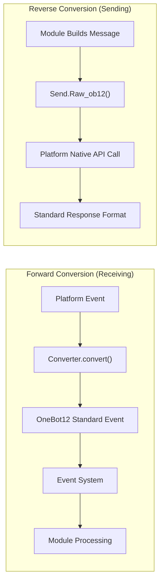

# Getting Started with Adapter Development

> [!TIP]
> **When to read this**: This is the entry-point article (required reading) of the adapter development path. Everything about writing an adapter from scratch and understanding the adapter's responsibility boundaries and project structure is covered here; after finishing, move on to the [Event Converter](converter.md) and [SendDSL in Detail](send-dsl.md) as needed.

By following this guide to the end, you will have a minimal working adapter capable of receiving events and sending messages (main class + converter + Send), with a clear understanding of each component's responsibilities — all the work of integrating a new platform starts from here.

## Adapter Overview

### What Is an Adapter

An adapter is the bridge between ErisPulse and various messaging platforms, responsible for:

1. **Forward conversion**: receiving platform events and converting them into the OneBot12 standard format (Converter)
2. **Reverse conversion**: converting OneBot12 message segments into platform API calls (`Raw_ob12`)
3. Managing the connection with the platform (WebSocket/WebHook)
4. Providing a unified SendDSL message-sending interface

### Adapter Architecture



## Directory Structure

Standard adapter package structure:

```
MyAdapter/
├── pyproject.toml          # Project configuration
├── README.md               # Project description
├── LICENSE                 # License
└── MyAdapter/
    ├── __init__.py          # Package entry point
    ├── Core.py               # Adapter main class
    └── Converter.py          # Event converter
```

## Quick Start

### 1. Create Project

It is recommended to use the scaffold to generate a complete skeleton (including pyproject, main class, and converter):

```bash
# Standard project (for packaging and release)
epsdk create adapter -n MyAdapter

# Local adapter plugin (no packaging required, placed in the plugins/ directory to be automatically loaded, see "Local Development" below)
epsdk create adapter -n MyAdapter --local
```

The scaffold generates a WebSocket server skeleton by default. If the platform connection method differs, you can select a communication mode template via `--template` (generating a semi-finished base class corresponding to the mode, `start`/`shutdown` do not need to be written manually):

```bash
epsdk create adapter -n MyAdapter --template polling   # HTTP polling type (pull updates via getUpdates)
epsdk create adapter -n MyAdapter --template webhook   # HTTP callback type (platform pushes)
```

> The differences among the three connection modes and the minimum implementation of semi-finished base classes can be found at
> [Adapter Core Concepts - Semi-finished Base Classes for Connection Modes](core-concepts.md#Semi-finished Base Classes for Connection Modes).
> Complete runnable examples can be referenced in the repository `examples/example-adapter-polling/` and `examples/example-adapter-webhook/`.

Alternatively, you can create manually:

```bash
mkdir MyAdapter && cd MyAdapter
```

### 2. Create pyproject.toml

```toml
[project]
name = "ErisPulse-MyAdapter"
version = "1.0.0"
description = "MyAdapter platform adapter"
readme = "README.md"
requires-python = ">=3.10"
license = { file = "LICENSE" }
authors = [ { name = "yourname", email = "your@mail.com" } ]

dependencies = [
    "ErisPulse>=2.4.0"  # ErisPulse already includes aiohttp, usually no separate dependency required
]

[project.urls]
"homepage" = "https://github.com/yourname/MyAdapter"

[project.entry-points."erispulse.adapter"]
"MyAdapter" = "MyAdapter:MyAdapter"
```

### 3. Create Adapter Main Class

The framework provides `ConfigClass` / `AccountConfigClass` for declarative configuration management. The adapter only needs to declare the configuration class to automatically load, validate, and generate the configuration template.

```python
# MyAdapter/Core.py
from dataclasses import dataclass, field
# Recommended root import (2.10+): commonly used symbols are directly imported from the root package, deep paths are still compatible
from ErisPulse import BaseAdapter, BaseConfig

@dataclass
class MyAdapterConfig(BaseConfig):
    """MyAdapter Configuration"""
    api_endpoint: str = field(
        default="https://api.example.com",
        metadata={
            "description": {"i18n": "my_adapter.api_endpoint", "default": "API address"},
            "required": False,
            "ui": {"widget": "text", "group": "connection", "order": 1},
        },
    )
    token: str = field(
        default="",
        metadata={
            "description": {"i18n": "my_adapter.token", "default": "Platform Token"},
            "required": True,
            "secret": True,
            "ui": {"widget": "password", "group": "basic", "order": 2},
        },
    )

class MyAdapter(BaseAdapter):
    ConfigClass = MyAdapterConfig  # Declare the configuration class, framework automatically manages it
    
    # No need to override __init__! Framework automatically handles:
    # - self.sdk / self.logger are automatically set
    # - self.cfg reads configuration in real-time
    # - self.Send / self.Request are automatically initialized
    
    def _setup_converter(self):
        from .Converter import MyPlatformConverter
        return MyPlatformConverter()
```

> ⚠️ **Regarding `__init__`**: In the new version, `BaseAdapter.__init__(self, sdk=None)` automatically handles SDK references, log initialization, and configuration loading. Most adapters **do not need to override `__init__`**. See [__init__ Notes](#init-注意事项).

> ⚠️ **Regarding `super().__init__()`**: `BaseAdapter.__init__()` is responsible for creating `Send` and `Request` factory instances. If you forget to call it, all message sending and request operations will report `AttributeError`. See [__init__ Notes](#init-注意事项).

### 4. Implement Required Methods

```python
class MyAdapter(BaseAdapter):
    # ... __init__ code ...
    
    async def start(self):
        """Start the adapter (must implement)"""
        # Register WebSocket or WebHook route
        router.register_websocket(
            module_name="myplatform",
            path="/ws",
            handler=self._ws_handler
        )
        self.logger.info("Adapter has started")
    
    async def shutdown(self):
        """Shutdown the adapter (must implement)"""
        router.unregister_websocket(
            module_name="myplatform",
            path="/ws"
        )
        # Clean up connections and resources
        self.logger.info("Adapter has shutdown")
    
    async def call_api(self, endpoint: str, **params):
        """Call platform API (must implement)"""
        raise NotImplementedError("call_api needs to be implemented")
```

#### Actively Send Meta Events

The adapter should actively send meta events to let the framework track the Bot's online status. Use `emit_meta()` to complete this in one line:

```python
class MyAdapter(BaseAdapter):
    async def _ws_handler(self, websocket):
        bot_id = self._get_bot_id()

        # Bot online
        await self.emit_meta("connect", bot_id, user_name="MyBot")

        try:
            while True:
                data = await websocket.receive_text()
                event = self.convert(data)
                if event:
                    await self.adapter.emit(event)
        except WebSocketDisconnect:
            pass
        finally:
            # Bot offline
            await self.emit_meta("disconnect", bot_id)
```

> For detailed Bot status management and meta event explanations, see [Adapter Best Practices - Bot Status Management and Meta Events](best-practices.md#Bot-Status-Management-and-Meta-Events).

### 5. Implement Send Class

The `At`/`AtAll`/`Reply` decorators are already implemented by the framework's SendDSL base class. The adapter only needs to implement `Raw_ob12` and specific send methods.

The framework provides two key helper methods:
- `self._apply_modifiers(message)` — Automatically merges At/AtAll/Reply decorators into message segments
- `self.send_context` — Gets the send context dictionary (`target_type`, `target_id`, `account_id`)

```python
import asyncio

class MyAdapter(BaseAdapter):
    # ... other code ...

    class Send(BaseAdapter.Send):

        def Raw_ob12(self, message, **kwargs):
            """
            Send OneBot12 formatted message (must implement)

            Use _apply_modifiers to automatically merge modifier states,
            Use send_context to get send context.
            """
            async def _do_send():
                segments = self._apply_modifiers(message)
                return await self._adapter.call_api(
                    endpoint="/send_message",
                    message=segments,
                    **self.send_context,
                    **kwargs
                )
            return asyncio.create_task(_do_send())

        # Text/Image/Voice/Video/File are inherited from SendDSL base class,
        # defaulting to delegate to Raw_ob12, no need to re-implement.
        # If platform-specific logic is needed, override individual methods:
        # def Text(self, text: str):
        #     return self.Raw_ob12([{"type": "text", "data": {"text": text}}])
```

**Media Send Method Implementation Points (Image/Video/File):**

- The default implementation of the base class will encapsulate the `file` parameter as a OneBot12 message segment and pass it to `Raw_ob12`. The adapter needs to handle downloading/uploading in `Raw_ob12`
- The `file` parameter should support both `bytes` binary data and `str` URL types
- When a URL is passed, the file should be downloaded first and then uploaded to the platform
- The platform usually requires first calling the upload interface to get the file identifier, then calling the send interface

**`__getattr__` Magic Method:**

- Implement case-insensitive method names (`Text`, `text`, `TEXT` all work)
- Undefined methods should return a prompt message instead of raising an error

**`Raw_ob12` Method:**

- Convert OneBot12 standard message format to platform format for sending
- Use `self._apply_modifiers(message)` to automatically handle At/AtAll/Reply modifiers
- Use `**self.send_context` to pass send target information and account information

### 6. Implement Converter

```python
# MyAdapter/Converter.py
import time
import uuid

class MyPlatformConverter:
    def convert(self, raw_event):
        """Convert platform native events to OneBot12 standard format"""
        if not isinstance(raw_event, dict):
            return None
        
        onebot_event = {
            "id": str(raw_event.get("event_id", uuid.uuid4())),
            "time": int(time.time()),
            "type": self._convert_event_type(raw_event.get("type")),
            "detail_type": self._convert_detail_type(raw_event),
            "platform": "myplatform",
            "self": {
                "platform": "myplatform",
                "user_id": str(raw_event.get("bot_id", ""))
            },
            "myplatform_raw": raw_event,
            "myplatform_raw_type": raw_event.get("type", "")
        }
        
        return onebot_event
    
    def _convert_event_type(self, event_type):
        """Convert event type"""
        type_map = {
            "message": "message",
            "notice": "notice"
        }
        return type_map.get(event_type, "unknown")
    
    def _convert_detail_type(self, raw_event):
        """Convert detail type"""
        return "private"  # Simplified example
```

### 7. Implement Request Class (Request Operations)

If your platform supports friend requests, group invitations, and other requests that require the Bot to make decisions, you can implement the `Request` inner class:

```python
from ErisPulse import BaseAdapter, RequestDSL

class MyAdapter(BaseAdapter):
    # ... Send and other code ...

    class Request(RequestDSL):
        """Request operation implementation (friend requests, group invitations, etc.)"""

        def accept(self, **kwargs):
            """Accept request"""
            async def _do():
                result = await self._adapter.call_api(
                    endpoint="/set_request",
                    request_id=self._request_id,
                    approve=True,
                    **kwargs,
                )
                return {
                    "status": "ok" if result.get("code") == 0 else "failed",
                    "retcode": result.get("code", 0),
                    "data": None,
                    "message_id": "",
                    "message": result.get("message", ""),
                }
            return self._create_task(_do())

        def reject(self, **kwargs):
            """Reject request"""
            async def _do():
                result = await self._adapter.call_api(
                    endpoint="/set_request",
                    request_id=self._request_id,
                    approve=False,
                    **kwargs,
                )
                return {
                    "status": "ok" if result.get("code") == 0 else "failed",
                    "retcode": result.get("code", 0),
                    "data": None,
                    "message_id": "",
                    "message": result.get("message", ""),
                }
            return self._create_task(_do())
```

Module developer usage:

```python
from ErisPulse import request

@request.on_friend_request()
async def handle_friend_request(event):
    # Through Event convenient method
    await event.approve()
    # Or through adapter directly
    await adapter.myplatform.Request("req_id").accept()
```

> If the platform does not support request operations, you can omit implementing the `Request` inner class. The base class defaults to returning `retcode=10002` (unsupported operation). See [Request Operation Specification](../../standards/request-action-spec.md).

### 8. Create Package Entry

```python
# MyAdapter/__init__.py
from .Core import MyAdapter
```

## Local Development (No Packaging Required)

Like modules, adapters can also be developed directly in the project's local plugin directory (default `plugins/`, configurable via `ErisPulse.framework.plugins_dir`) — **no `pip install -e .` required**:

```bash
# Generate a local adapter plugin
epsdk create adapter -n MyAdapter --local
# Generated structure:
# plugins/
# └── MyAdapter/
#     ├── __init__.py
#     ├── Core.py
#     └── Converter.py
```

At startup, the framework automatically scans the plugin directory and loads the modules and adapters within it (treated identically to entry-point installed packages: enablement state, config declarations, hot updates, and uninstall cleanup are all the same):

- **Recognition rules**: both package directories (containing `__init__.py`) and single `.py` files are accepted; a class named `Main` is recognized first, otherwise the first `BaseAdapter` / `BaseModule` subclass in the plugin is used
- **Name conflict override**: when a local plugin has the same name as an adapter installed from PyPI, the local plugin takes precedence (handy for overriding and debugging)
- **Hot reload**: plugin directory monitoring enabled via `sdk.enable_plugin_hot_reload()` also covers adapters; adapter code-level hot reload is available since 2.11 — `await sdk.adapter.reload("<platform-name>")` or `await sdk.reload_adapter("<platform-name>")` (syntax pre-check → unload and clean up → clear cache and re-import → re-register and start, with automatic rollback on failure; see the [Architecture Overview](../../architecture.md) for details)

### From Local Plugin to Release

After local verification, use the `pack` subcommand to convert the plugin into a publishable standard project in one step (interactively select the plugin, fill in the metadata, and generate a pyproject with an entry point):

```bash
epsdk create pack
# Select the plugin from the plugin directory → enter project name/description/author → the MyAdapter/ project directory is generated
cd MyAdapter
pip install -e .   # Switch to a standard installation; then follow the publishing process to upload to PyPI
```

> **Tip**: After conversion, it is recommended to remove the original from `plugins/` to avoid the local plugin and the installed package being loaded twice (when both share the same name, the local one takes precedence, which may mislead you into thinking the installed package is in effect).

## Dependency Declaration (Optional, 2.8.0+)


Adapters can declare dependencies on other adapters or modules, enabling inter-adapter coordination and optional features:

```python
from typing import ClassVar

class MyAdapter(BaseAdapter):
    # Hard dependencies: startup is skipped if missing (warning + status=skipped-dependency event)
    depends: ClassVar[dict] = {
        "adapters": ["onebot11"],   # Adapters depended on (by platform name)
        "modules": ["TranslateEngine"],  # Modules depended on (by registered name)
    }
    # Soft dependencies: missing ones do not affect startup; callbacks are received when modules load/unload (optional feature mode)
    optional_modules: ClassVar[list] = ["TranslateEngine"]
```

- **Startup order**: adapters that declare hard dependencies on modules will **defer startup until the modules finish initializing**
- **Soft dependency notifications**: when a module in `optional_modules` (or a hard module dependency) is loaded, `on_dependency_ready(module_name)` is called; when it is unloaded, `on_dependency_lost(module_name)` is called (default no-op implementations, overridable) — covering late loading and hot reload scenarios:

```python
async def on_dependency_ready(self, module_name):
    """Soft-dependency module ready: enable the corresponding optional feature"""
    if module_name == "TranslateEngine":
        self._translate = self.sdk.TranslateEngine

async def on_dependency_lost(self, module_name):
    """Soft-dependency module lost: degrade the feature"""
    if module_name == "TranslateEngine":
        self._translate = None
```

> [!NOTE]
> This feature requires ErisPulse **2.8.0+**.

## `__init__` Notes

There are three levels in adapter development where `__init__` overriding may be involved. Below is the correct approach for each level.

### 1. The BaseAdapter Level (No Override Needed in Most Cases)

`BaseAdapter.__init__(self, sdk=None)` is responsible for creating the `Send` / `Request` factory instances and automatically does the following:

- Accepts the `sdk` parameter and sets `self.sdk`, `self.logger`
- If `ConfigClass` is declared, the global configuration can be read in real time via `self.cfg`
- If `AccountConfigClass` is declared, the multi-account configuration can be read in real time via `self.accounts`

**In most cases there is no need to override `__init__`**; simply declaring `ConfigClass` is enough:

```python
class MyAdapter(BaseAdapter):
    ConfigClass = MyAdapterConfig  # Once declared, the framework manages the configuration automatically
    
    async def start(self):
        cfg = self.cfg  # Type-safe, read in real time
        ...
```

If custom initialization is truly needed, just call `super().__init__(sdk)`:

```python
class MyAdapter(BaseAdapter):
    ConfigClass = MyAdapterConfig
    
    def __init__(self, sdk=None):
        super().__init__(sdk)  # Pass in sdk
        self.converter = self._setup_converter()
        self.convert = self.converter.convert
```

### 2. The Send Inner Class (No Override Needed in Most Cases)

`SendDSL.__init__` is responsible for passing state through chained calls (target type, target ID, account, etc.). **In most cases you only need to override methods** (`Raw_ob12`, `Text`, etc.), not `__init__`.

If it is truly needed (e.g., to initialize platform-specific state), **you must pass through all parameters**:

```python
class MyAdapter(BaseAdapter):
    class Send(BaseAdapter.Send):
        # Parameters: adapter, target_type, target_id, account_id
        def __init__(self, adapter, target_type=None, target_id=None, account_id=None):
            super().__init__(adapter, target_type, target_id, account_id)  # ← must pass through
            self._my_state = None  # platform-specific initialization
```

**Why must parameters be passed through?** Every step of the chained call creates a new instance via `self.__class__(...)`:

```python
adapter.Send.To("user", "123")               # → Send(adapter, "user", "123", None)
adapter.Send.To("user", "123").Using("bot1")  # → Send(adapter, "user", "123", "bot1")
```

If the `__init__` signature does not match or `super()` is not called, the chained call will break.

### 3. The Request Inner Class (No Override Needed in Most Cases)

Same idea as Send. The parameters are `adapter`, `request_id`, `account_id`:

```python
class MyAdapter(BaseAdapter):
    class Request(RequestDSL):
        # Parameters: adapter, request_id, account_id
        def __init__(self, adapter, request_id=None, account_id=None):
            super().__init__(adapter, request_id, account_id)  # ← must pass through
            self._my_state = None  # platform-specific initialization
```

### Summary

| Level | When to Override | What Must Be Done |
|-------|------------------|-------------------|
| **BaseAdapter** | When custom initialization logic is needed | `super().__init__(sdk)` (pass in the sdk parameter) |
| **Send inner class** | When send-related state needs initialization | `super().__init__(adapter, target_type, target_id, account_id)` |
| **Request inner class** | When request-related state needs initialization | `super().__init__(adapter, request_id, account_id)` |
| All three levels | Most cases | **Just declare ConfigClass; don't touch `__init__`** |

### 9. Connection Info and Route Discovery

After the adapter registers its routes, the framework records all route information. Users can view the adapter's connection addresses through the following APIs:

```python
from ErisPulse import sdk

# Get the adapter's full connection info
info = sdk.adapter.get_connection_info("myplatform")
# {
#   "platform": "myplatform",
#   "status": "started",
#   "connection": {
#     "base_url": "http://localhost:8080",
#     "http_routes": [
#       {"path": "/myplatform/webhook", "method": "POST",
#        "url": "http://localhost:8080/myplatform/webhook"}
#     ],
#     "websocket_routes": [
#       {"path": "/myplatform/ws",
#        "url": "ws://localhost:8080/myplatform/ws"}
#     ]
#   }
# }

# List routes for all namespaces (adapters/modules)
namespaces = sdk.router.list_namespaces()
# {"myplatform": {"http": ["/myplatform/webhook"], "websocket": ["/myplatform/ws"]}}

# Get the full connection URLs of a namespace
urls = sdk.router.get_module_urls("myplatform")
# {"base_url": "http://localhost:8080", "http": [...], "websocket": [...]}

# Get detailed route information of a namespace
routes = sdk.router.get_module_routes("myplatform")
# {"http": [{"path": "/myplatform/webhook", "methods": ["POST"]}],
#  "websocket": [{"path": "/myplatform/ws", "auth": false}]}
```

> **Tip**: The information returned by `get_connection_info()` is suitable for displaying to users (e.g., in a WebUI), helping them configure the platform-side callback address or WebSocket connection address. The `module_name` used at route registration must exactly match the `platform` name under which the adapter is registered in ErisPulse; otherwise route discovery will not be able to associate them correctly.

### 10. SSE (Server-Sent Events) Support

ErisPulse has built-in server-agnostic SSE support; modules and adapters can register SSE endpoints via `@sdk.router.sse()`.

#### Basic Usage

```python
import asyncio
from ErisPulse import sdk

@sdk.router.sse("MyModule", "/events")
async def event_stream(sse):
    """Push SSE events"""
    count = 0
    while not sse.closed:
        await sse.send({"count": count}, event="update")
        count += 1
        await asyncio.sleep(1)
```

#### Using Request Parameters

Handlers can declare a `request` parameter to access client request information:

```python
@sdk.router.sse("MyModule", "/events")
async def event_stream(request, sse):
    token = request.query_params.get("token")
    if not validate_token(token):
        await sse.close()
        return

    while not sse.closed:
        data = await fetch_data(token)
        await sse.send(data)
        await asyncio.sleep(5)
```

#### SseEmitter API

| Method | Description |
|--------|-------------|
| `sse.send(data, event=None, id=None, retry=None)` | Send an SSE event. Non-str data is automatically JSON-serialized |
| `sse.close()` | Gracefully close the SSE connection (safe to call, multiple times) |
| `sse.closed` | Whether the connection has been closed |
| `sse.request` | The underlying request object (can be used to read query params, headers) |

#### Using in RouteGroup

```python
api = sdk.router.group("MyModule", "/api", version="1")

@api.sse("/events")
async def events(sse):
    await sse.send({"msg": "hello"})
```

#### Route Discovery

SSE routes automatically appear in the route discovery APIs:

```python
# list_namespaces will include the "sse" key
sdk.router.list_namespaces()
# {"MyModule": {"http": [...], "websocket": [...], "sse": ["/MyModule/events"]}}

# get_module_routes will mark streaming: true
sdk.router.get_module_routes("MyModule")
# {"http": [...], "websocket": [...], "sse": [{"path": "/MyModule/events", "streaming": true}]}

# get_module_urls will generate full URLs
sdk.router.get_module_urls("MyModule")
# {"sse": [{"path": "/MyModule/events", "url": "http://localhost:8080/MyModule/events"}]}
```

> **Server-agnostic design**: `SseEmitter` is decoupled from the underlying HTTP framework through callbacks. The framework provides `register_sse()` and the `@sse` decorator as a unified registration entry point, so adapters can implement SSE endpoints without directly depending on any underlying HTTP framework.

## Next Steps

### Completing the Adapter's Three Core Components

- [Event Converter](converter.md) - Implementation details and common pitfalls of platform events → OneBot12 conversion
- [SendDSL in Detail](send-dsl.md) - Message send chain, modifier methods, and send rules
- [Adapter Core Concepts](core-concepts.md) - How BaseAdapter / lifecycle / multi-account mechanisms work

### Once the Skeleton Runs

- [Adapter Best Practices](best-practices.md) - Engineering finishing touches for connection retry, heartbeat, and error handling
- [Publishing and Module Store Guide](../publishing.md) - Publishing to PyPI and the module store