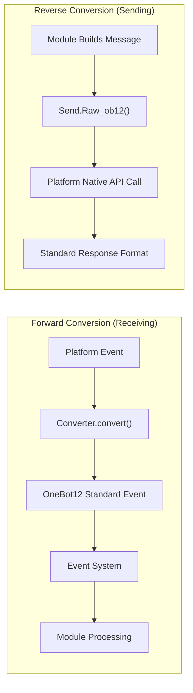

# Getting Started with Adapter Development

> [!TIP]
> **When to read this**: This is the entry point of the adapter development path (required reading). Writing an adapter from scratch and understanding the adapter's responsibility boundaries and project structure are all covered here; after reading, proceed to the [Event Converter](converter.md) and [SendDSL in Depth](send-dsl.md) as needed.

By following this guide, you will get a minimal working adapter capable of receiving events and sending messages (main class + converter + Send), and clearly understand each component's responsibility boundaries—all work for integrating a new platform starts here.

## Adapter Introduction

### What Is an Adapter

An adapter is the bridge between ErisPulse and various messaging platforms, responsible for:

1. **Forward conversion**: Receiving platform events and converting them to the OneBot12 standard format (Converter)
2. **Reverse conversion**: Converting OneBot12 message segments into platform API calls (`Raw_ob12`)
3. Managing connections with the platform (WebSocket/WebHook)
4. Providing a unified SendDSL message sending interface

### Adapter Architecture



## Directory Structure

The standard adapter package structure:

```
MyAdapter/
├── pyproject.toml          # Project configuration
├── README.md               # Project description
├── LICENSE                 # License
└── MyAdapter/
    ├── __init__.py          # Package entry
    ├── Core.py               # Adapter main class
    └── Converter.py          # Event converter
```

## Quick Start

### 1. Create a Project

It is recommended to use the scaffolding tool to generate a complete skeleton directly (including pyproject, main class, converter):

```bash
# Standard project (for packaging and publishing)
epsdk create adapter -n MyAdapter

# Local adapter plugin (no packaging needed; place it in the plugins/ directory to be auto-loaded, see "Local Development" below)
epsdk create adapter -n MyAdapter --local
```

The scaffolding tool generates a WebSocket server skeleton by default; if the platform uses a different connection method, you can select a communication mode template via `--template`
(the generated code uses the corresponding skeleton base class, so you don't need to write `start`/`shutdown` yourself):

```bash
epsdk create adapter -n MyAdapter --template polling   # HTTP polling type (pulling via getUpdates)
epsdk create adapter -n MyAdapter --template webhook   # HTTP callback type (platform push)
```

> For the differences between the three connection modes and the minimal implementation surface of the skeleton base classes, see
> [Adapter Core Concepts - Connection Mode Skeleton Base Classes](core-concepts.md#connection-mode-skeleton-base-classes).
> For complete runnable examples, refer to `examples/example-adapter-polling/` and `examples/example-adapter-webhook/` in the repository.

Alternatively, you can create it manually:

```bash
mkdir MyAdapter && cd MyAdapter
```

### 2. Create pyproject.toml

```toml
[project]
name = "ErisPulse-MyAdapter"
version = "1.0.0"
description = "MyAdapter platform adapter"
readme = "README.md"
requires-python = ">=3.10"
license = { file = "LICENSE" }
authors = [ { name = "yourname", email = "your@mail.com" } ]

dependencies = [
    "ErisPulse>=2.4.0"  # ErisPulse has aiohttp built in, so usually no separate dependency is needed
]

[project.urls]
"homepage" = "https://github.com/yourname/MyAdapter"

[project.entry-points."erispulse.adapter"]
"MyAdapter" = "MyAdapter:MyAdapter"
```

### 3. Create the Adapter Main Class

The framework provides declarative configuration management via `ConfigClass` / `AccountConfigClass`; the adapter only needs to declare a configuration class, and loading, validation, and configuration template generation are handled automatically.

```python
# MyAdapter/Core.py
from dataclasses import dataclass, field
# Root imports recommended (2.10+): import common symbols directly from the root package; deep paths remain compatible
from ErisPulse import BaseAdapter, BaseConfig

@dataclass
class MyAdapterConfig(BaseConfig):
    """MyAdapter configuration"""
    api_endpoint: str = field(
        default="https://api.example.com",
        metadata={
            "description": {"i18n": "my_adapter.api_endpoint", "default": "API address"},
            "required": False,
            "ui": {"widget": "text", "group": "connection", "order": 1},
        },
    )
    token: str = field(
        default="",
        metadata={
            "description": {"i18n": "my_adapter.token", "default": "Platform Token"},
            "required": True,
            "secret": True,
            "ui": {"widget": "password", "group": "basic", "order": 2},
        },
    )

class MyAdapter(BaseAdapter):
    ConfigClass = MyAdapterConfig  # Declare the config class; the framework manages it automatically
    
    # No need to override __init__! The framework automatically handles:
    # - self.sdk / self.logger are set automatically
    # - self.cfg reads the configuration in real time
    # - self.Send / self.Request are initialized automatically
    
    def _setup_converter(self):
        from .Converter import MyPlatformConverter
        return MyPlatformConverter()
```

> ⚠️ **About `__init__`**: In newer versions, `BaseAdapter.__init__(self, sdk=None)` automatically handles SDK references, logger initialization, and configuration loading. Most adapters **no longer need to override `__init__`**. See [__init__ Notes](#init-notes) for details.

> ⚠️ **About `super().__init__()`**: `BaseAdapter.__init__()` is responsible for creating the `Send` and `Request` factory instances. If you forget to call it, all message sending and request operations will raise `AttributeError`. See [__init__ Notes](#init-notes) for details.

### 4. Implement Required Methods

```python
class MyAdapter(BaseAdapter):
    # ... __init__ code ...
    
    async def start(self):
        """Start the adapter (must be implemented)"""
        # Register WebSocket or WebHook routes
        router.register_websocket(
            module_name="myplatform",
            path="/ws",
            handler=self._ws_handler
        )
        self.logger.info("Adapter started")
    
    async def shutdown(self):
        """Shut down the adapter (must be implemented)"""
        router.unregister_websocket(
            module_name="myplatform",
            path="/ws"
        )
        # Clean up connections and resources
        self.logger.info("Adapter shut down")
    
    async def call_api(self, endpoint: str, **params):
        """Call the platform API (must be implemented)"""
        raise NotImplementedError("call_api must be implemented")
```

#### Actively Sending Meta Events

The adapter should actively send meta events so that the framework can track the Bot's online status. A single line with `emit_meta()` is enough:

```python
class MyAdapter(BaseAdapter):
    async def _ws_handler(self, websocket):
        bot_id = self._get_bot_id()

        # Bot goes online
        await self.emit_meta("connect", bot_id, user_name="MyBot")

        try:
            while True:
                data = await websocket.receive_text()
                event = self.convert(data)
                if event:
                    await self.adapter.emit(event)
        except WebSocketDisconnect:
            pass
        finally:
            # Bot goes offline
            await self.emit_meta("disconnect", bot_id)
```

> For detailed Bot status management and Meta event explanations, see [Adapter Best Practices - Bot Status Management](best-practices.md#bot-status-management-and-meta-events).

### 5. Implement the Send Class

The `At`/`AtAll`/`Reply` modifiers are already implemented inside the framework's SendDSL base class, so the adapter only needs to implement `Raw_ob12` and the concrete sending methods.

The framework provides two key helper methods:
- `self._apply_modifiers(message)` — automatically merges At/AtAll/Reply modifiers into the message segments
- `self.send_context` — obtains the sending context dictionary (`target_type`, `target_id`, `account_id`)

```python
import asyncio

class MyAdapter(BaseAdapter):
    # ... other code ...

    class Send(BaseAdapter.Send):

        def Raw_ob12(self, message, **kwargs):
            """
            Send a message in OneBot12 format (must be implemented)

            Uses _apply_modifiers to automatically merge modifier state,
            and uses send_context to obtain the sending context.
            """
            async def _do_send():
                segments = self._apply_modifiers(message)
                return await self._adapter.call_api(
                    endpoint="/send_message",
                    message=segments,
                    **self.send_context,
                    **kwargs
                )
            return asyncio.create_task(_do_send())

        # Text/Image/Voice/Video/File/Location are inherited from the SendDSL base class;
        # they delegate to Raw_ob12 by default, so there is no need to reimplement them.
        # For platform-specific logic, you can override individual methods:
        # def Text(self, text: str):
        #     return self.Raw_ob12([{"type": "text", "data": {"text": text}}])
```

**Key points for implementing media sending methods (Image/Video/File):**

- The base class's default implementation wraps the `file` parameter into a OneBot12 message segment and passes it to `Raw_ob12`; the adapter must handle downloading/uploading within `Raw_ob12`
- The `file` parameter should support both `bytes` binary data and `str` URL types
- When a URL is passed in, the file must be downloaded first and then uploaded to the platform
- Platforms usually require calling an upload API first to obtain a file identifier, and then calling the send API

**The `__getattr__` magic method:**

- Implements case-insensitive method names (`Text`, `text`, and `TEXT` all work)
- Undefined methods should return a hint message instead of raising an error

**The `Raw_ob12` method:**

- Converts the OneBot12 standard message format to the platform format and sends it
- Uses `self._apply_modifiers(message)` to automatically handle At/AtAll/Reply modifiers
- Uses `**self.send_context` to pass the sending target information and account information

### 6. Implement the Converter

```python
# MyAdapter/Converter.py
import time
import uuid

class MyPlatformConverter:
    def convert(self, raw_event):
        """Convert a platform native event to the OneBot12 standard format"""
        if not isinstance(raw_event, dict):
            return None
        
        onebot_event = {
            "id": str(raw_event.get("event_id", uuid.uuid4())),
            "time": int(time.time()),
            "type": self._convert_event_type(raw_event.get("type")),
            "detail_type": self._convert_detail_type(raw_event),
            "platform": "myplatform",
            "self": {
                "platform": "myplatform",
                "user_id": str(raw_event.get("bot_id", ""))
            },
            "myplatform_raw": raw_event,
            "myplatform_raw_type": raw_event.get("type", "")
        }
        
        return onebot_event
    
    def _convert_event_type(self, event_type):
        """Convert the event type"""
        type_map = {
            "message": "message",
            "notice": "notice"
        }
        return type_map.get(event_type, "unknown")
    
    def _convert_detail_type(self, raw_event):
        """Convert the detail type"""
        return "private"  # simplified example
```

### 7. Implement the Request Class (Request Actions)

If your platform supports friend requests, group invitations, and other requests that require the Bot to make decisions, you can implement the `Request` inner class:

```python
from ErisPulse import BaseAdapter, RequestDSL

class MyAdapter(BaseAdapter):
    # ... Send and other code ...

    class Request(RequestDSL):
        """Request action implementation (friend requests, group invitations, etc.)"""

        # The public entry points accept()/reject() are provided by the base class
        # (scope authorization gate + task wrapping);
        # the adapter only overrides _do_accept / _do_reject and directly returns the standard response dict
        async def _do_accept(self, **kwargs) -> dict:
            """Approve the request"""
            result = await self._adapter.call_api(
                endpoint="/set_request",
                request_id=self._request_id,
                account_id=self.request_context.get("account_id"),
                approve=True,
                **kwargs,
            )
            return {
                "status": "ok" if result.get("code") == 0 else "failed",
                "retcode": result.get("code", 0),
                "data": None,
                "message_id": "",
                "message": result.get("message", ""),
            }

        async def _do_reject(self, **kwargs) -> dict:
            """Reject the request (same structure as _do_accept: approve=False)"""
            result = await self._adapter.call_api(
                endpoint="/set_request",
                request_id=self._request_id,
                account_id=self.request_context.get("account_id"),
                approve=False,
                **kwargs,
            )
            return {
                "status": "ok" if result.get("code") == 0 else "failed",
                "retcode": result.get("code", 0),
                "data": None,
                "message_id": "",
                "message": result.get("message", ""),
            }
```

How module developers use it:

```python
from ErisPulse import request

@request.on_friend_request()
async def handle_friend_request(event):
    # Via the Event convenience methods
    await event.approve()
    # Or operate directly through the adapter
    await adapter.myplatform.Request("req_id").accept()
```

> If the platform does not support request actions, you can omit the `Request` inner class. The base class returns `retcode=10002` (unsupported action) by default. See the [Request Action Specification](../../standards/request-action-spec.md) for details.

### 8. Create the Package Entry

```python
# MyAdapter/__init__.py
from .Core import MyAdapter
```

## Local Development (No Packaging)

Like modules, adapters can also be developed directly in the project's local plugin directory (default `plugins/`, configurable via `ErisPulse.framework.plugins_dir`), **without `pip install -e .`**:

```bash
# Generate a local adapter plugin
epsdk create adapter -n MyAdapter --local
# Generated structure:
# plugins/
# └── MyAdapter/
#     ├── __init__.py
#     ├── Core.py
#     └── Converter.py
```

At startup, the framework automatically scans the plugin directory and loads the modules and adapters within it (with the same treatment as entry-point installed packages: enable status, configuration declaration, hot updates, and uninstall cleanup are all identical):

- **Recognition rules**: Either a package directory (containing `__init__.py`) or a single `.py` file works; a class named `Main` is recognized first, otherwise the first `BaseAdapter` / `BaseModule` subclass in the plugin is used
- **Same-name override**: When a local plugin has the same name as an adapter installed from PyPI, the local plugin takes precedence (convenient for overriding and debugging)
- **Hot reload**: Plugin directory monitoring enabled via `sdk.enable_plugin_hot_reload()` also covers adapters; code-level adapter hot reload is available since 2.11—`await sdk.adapter.reload("platform_name")` or `await sdk.reload_adapter("platform_name")` (syntax pre-check → unload cleanup → clear cache and re-import → re-register and start, with automatic rollback on failure; see the [Architecture Overview](../../architecture.md) for details)

### From Local Plugin to Publishing

After local validation is complete, use the `pack` subcommand to convert the plugin into a publishable standard project in one step (interactively select the plugin, complete the metadata, and generate a pyproject with an entry point):

```bash
epsdk create pack
# Select a plugin from the plugin directory → enter the project name/description/author → the MyAdapter/ project directory is generated
cd MyAdapter
pip install -e .   # Convert to a standard installation; then upload to PyPI following the publishing process
```

> **Tip**: After conversion, it is recommended to remove the original from `plugins/` to avoid the local plugin and the installed package being loaded twice (when both have the same name, the local one takes precedence, which may make you mistakenly believe the installed package is taking effect).

## Dependency Declaration (Optional, 2.8.0+)


An adapter can declare dependencies on other adapters or modules, enabling inter-adapter coordination and optional features:

```python
from typing import ClassVar

class MyAdapter(BaseAdapter):
    # Hard dependencies: startup is skipped if missing (warning + status=skipped-dependency event)
    depends: ClassVar[dict] = {
        "adapters": ["onebot11"],   # Dependent adapters (by platform name)
        "modules": ["TranslateEngine"],  # Dependent modules (by registered name)
    }
    # Soft dependencies: missing ones do not affect startup; callbacks are received when modules load/unload (optional feature mode)
    optional_modules: ClassVar[list] = ["TranslateEngine"]
```

- **Startup order**: Adapters that declare hard module dependencies will **start only after the modules are initialized**
- **Soft dependency notification**: When a module in `optional_modules` (or a hard module dependency) is loaded, `on_dependency_ready(module_name)` is called; when it is unloaded, `on_dependency_lost(module_name)` is called (empty implementations by default, can be overridden)—covering late-loading and hot-reload scenarios:

```python
async def on_dependency_ready(self, module_name):
    """Soft dependency module ready: enable the corresponding optional feature"""
    if module_name == "TranslateEngine":
        self._translate = self.sdk.TranslateEngine

async def on_dependency_lost(self, module_name):
    """Soft dependency module lost: degrade the feature"""
    if module_name == "TranslateEngine":
        self._translate = None
```

> [!NOTE]
> This feature requires ErisPulse **2.8.0+**.

## `__init__` Notes

There are three levels in adapter development that may involve `__init__` overriding. Here are the correct practices for each level.

### 1. The BaseAdapter Level (No Override Needed in Most Cases)

`BaseAdapter.__init__(self, sdk=None)` is responsible for creating the `Send` / `Request` factory instances and automatically completes the following work:

- Accepts the `sdk` parameter and sets `self.sdk`, `self.logger`
- If `ConfigClass` is declared, the global configuration can be read in real time via `self.cfg`
- If `AccountConfigClass` is declared, the multi-account configuration can be read in real time via `self.accounts`

**In most cases you don't need to override `__init__`**; just declare `ConfigClass`:

```python
class MyAdapter(BaseAdapter):
    ConfigClass = MyAdapterConfig  # Once declared, the framework manages the configuration automatically
    
    async def start(self):
        cfg = self.cfg  # Type-safe, read in real time
        ...
```

If custom initialization is truly needed, just call `super().__init__(sdk)`:

```python
class MyAdapter(BaseAdapter):
    ConfigClass = MyAdapterConfig
    
    def __init__(self, sdk=None):
        super().__init__(sdk)  # Pass in sdk
        self.converter = self._setup_converter()
        self.convert = self.converter.convert
```

### 2. The Send Inner Class (No Override Needed in Most Cases)

`SendDSL.__init__` is responsible for passing state through chained calls (target type, target ID, account, etc.). **In most cases, you only need to override the methods** (`Raw_ob12`, `Text`, etc.) and do not need to override `__init__`.

If you really need to (for example, to initialize platform-specific state), **you must pass through all parameters**:

```python
class MyAdapter(BaseAdapter):
    class Send(BaseAdapter.Send):
        # Parameters: adapter, target_type, target_id, account_id
        def __init__(self, adapter, target_type=None, target_id=None, account_id=None):
            super().__init__(adapter, target_type, target_id, account_id)  # ← Must pass through
            self._my_state = None  # Platform-specific initialization
```

**Why must parameters be passed through?** Each step of a chained call creates a new instance via `self.__class__(...)`:

```python
adapter.Send.To("user", "123")               # → Send(adapter, "user", "123", None)
adapter.Send.To("user", "123").Using("bot1")  # → Send(adapter, "user", "123", "bot1")
```

If the `__init__` signature doesn't match or `super()` is not called, chained calls will break.

### 3. The Request Inner Class (No Override Needed in Most Cases)

Same as Send. The parameters are `adapter`, `request_id`, `account_id`:

```python
class MyAdapter(BaseAdapter):
    class Request(RequestDSL):
        # Parameters: adapter, request_id, account_id
        def __init__(self, adapter, request_id=None, account_id=None):
            super().__init__(adapter, request_id, account_id)  # ← Must pass through
            self._my_state = None  # Platform-specific initialization
```

### Summary

| Level | When to Override | What Must Be Done |
|------|------------|-----------|
| **BaseAdapter** | When custom initialization logic is needed | `super().__init__(sdk)` (pass in the sdk parameter) |
| **Send inner class** | When sending-related state needs initialization | `super().__init__(adapter, target_type, target_id, account_id)` |
| **Request inner class** | When request-related state needs initialization | `super().__init__(adapter, request_id, account_id)` |
| All three levels | Most cases | **Just declare ConfigClass; don't touch `__init__`** |

### 9. Connection Info and Route Discovery

After an adapter registers routes, the framework records all route information. Users can view the adapter's connection addresses through the following APIs:

```python
from ErisPulse import sdk

# Get the adapter's full connection info
info = sdk.adapter.get_connection_info("myplatform")
# {
#   "platform": "myplatform",
#   "status": "started",
#   "connection": {
#     "base_url": "http://localhost:8080",
#     "http_routes": [
#       {"path": "/myplatform/webhook", "method": "POST",
#        "url": "http://localhost:8080/myplatform/webhook"}
#     ],
#     "websocket_routes": [
#       {"path": "/myplatform/ws",
#        "url": "ws://localhost:8080/myplatform/ws"}
#     ]
#   }
# }

# List the routes of all namespaces (adapters/modules)
namespaces = sdk.router.list_namespaces()
# {"myplatform": {"http": ["/myplatform/webhook"], "websocket": ["/myplatform/ws"]}}

# Get the full connection URLs of a namespace
urls = sdk.router.get_module_urls("myplatform")
# {"base_url": "http://localhost:8080", "http": [...], "websocket": [...]}

# Get the detailed route information of a namespace
routes = sdk.router.get_module_routes("myplatform")
# {"http": [{"path": "/myplatform/webhook", "methods": ["POST"]}],
#  "websocket": [{"path": "/myplatform/ws", "auth": false}]}
```

> **Tip**: The information returned by `get_connection_info()` is suitable for display to users (e.g., in a WebUI), helping them configure the platform-side callback URL or WebSocket connection URL. The `module_name` used at route registration must exactly match the `platform` name under which the adapter is registered in ErisPulse, otherwise route discovery will fail to associate correctly.

### 10. SSE (Server-Sent Events) Support

ErisPulse has built-in server-agnostic SSE support; modules and adapters can register SSE endpoints via `@sdk.router.sse()`.

#### Basic Usage

```python
import asyncio
from ErisPulse import sdk

@sdk.router.sse("MyModule", "/events")
async def event_stream(sse):
    """Push SSE events"""
    count = 0
    while not sse.closed:
        await sse.send({"count": count}, event="update")
        count += 1
        await asyncio.sleep(1)
```

#### Using Request Parameters

Handlers can declare a `request` parameter to access client request information:

```python
@sdk.router.sse("MyModule", "/events")
async def event_stream(request, sse):
    token = request.query_params.get("token")
    if not validate_token(token):
        await sse.close()
        return

    while not sse.closed:
        data = await fetch_data(token)
        await sse.send(data)
        await asyncio.sleep(5)
```

#### SseEmitter API

| Method | Description |
|------|------|
| `sse.send(data, event=None, id=None, retry=None)` | Send an SSE event. Non-str data is automatically JSON serialized |
| `sse.close()` | Gracefully close the SSE connection (safe to call, can be called multiple times) |
| `sse.closed` | Whether the connection has been closed |
| `sse.request` | The underlying request object (can be used to read query params and headers) |

#### Usage in RouteGroup

```python
api = sdk.router.group("MyModule", "/api", version="1")

@api.sse("/events")
async def events(sse):
    await sse.send({"msg": "hello"})
```

#### Route Discovery

SSE routes automatically appear in the route discovery APIs:

```python
# list_namespaces includes the "sse" key
sdk.router.list_namespaces()
# {"MyModule": {"http": [...], "websocket": [...], "sse": ["/MyModule/events"]}}

# get_module_routes marks streaming: true
sdk.router.get_module_routes("MyModule")
# {"http": [...], "websocket": [...], "sse": [{"path": "/MyModule/events", "streaming": true}]}

# get_module_urls generates full URLs
sdk.router.get_module_urls("MyModule")
# {"sse": [{"path": "/MyModule/events", "url": "http://localhost:8080/MyModule/events"}]}
```

> **Server-agnostic design**: `SseEmitter` is decoupled from the underlying HTTP framework via callbacks. The framework provides `register_sse()` and the `@sse` decorator as unified registration entry points, so adapters can implement SSE endpoints without directly depending on any underlying HTTP framework.

## Next Steps

### Complete the Adapter's Three Core Components

- [Event Converter](converter.md) - Implementation details and common pitfalls of platform events → OneBot12
- [SendDSL in Depth](send-dsl.md) - Message sending chain, modifier methods, and sending rules
- [Adapter Core Concepts](core-concepts.md) - Mechanism explanations of BaseAdapter / lifecycle / multi-account

### After the Skeleton Works

- [Adapter Best Practices](best-practices.md) - Engineering finishing touches for connection retry, heartbeat, and error handling
- [Publishing and Module Store Guide](../publishing.md) - Publishing to PyPI and the module store