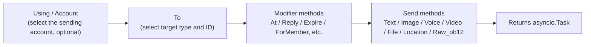
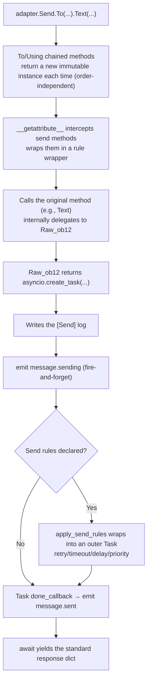

# SendDSL in Detail

> [!TIP]
> **When to read this**: Required reading on the adapter development path (Send DSL). Skip it if not needed; doing so will not affect the use of other features.

SendDSL chains message sending into a single chain: specifying targets, @ / reply, retry / timeout / defer, batch sending—all done with one line of chained calls. This article covers send methods, modifier methods, send rules, and the internal mechanisms of the sending pipeline.

## Basic Invocation

### 1. Specify Type and ID

```python
await adapter.Send.To("group", "123").Text("Hello")
```

### 2. Specify ID Only

```python
await adapter.Send.To("123").Text("Hello")
```

### 3. Specify the Sending Account

```python
await adapter.Send.Using("bot1").Text("Hello")
```

### 4. Combined Usage

```python
await adapter.Send.Using("bot1").To("group", "123").Text("Hello")
```

## Method Chain



## Send Methods

All send methods return an `asyncio.Task` object.

### Basic Methods (Built into the Base Class)

The following standard methods are already implemented in the `SendDSL` base class and **delegate to `Raw_ob12` by default**. Adapter subclasses can use them directly without re-implementing, and IDEs can autocomplete them:

| Method | Description | Return Value |
|--------|------|---------|
| `Text(text: str)` | Send a text message | `asyncio.Task` |
| `Image(file: bytes \| str)` | Send an image | `asyncio.Task` |
| `Voice(file: bytes \| str)` | Send a voice message (OneBot12 `audio` segment) | `asyncio.Task` |
| `Video(file: bytes \| str)` | Send a video | `asyncio.Task` |
| `File(file: bytes \| str, filename: str = None)` | Send a file | `asyncio.Task` |
| `Location(latitude: float, longitude: float, title: str = "", content: str = "")` | Send a location message (OneBot12 `location` segment) | `asyncio.Task` |

An adapter can override individual standard methods to provide platform-specific logic:

```python
class Send(SendDSL):
    def Raw_ob12(self, message, **kwargs):
        # Must be implemented
        ...

    # Optional: override Text to provide platform-specific logic
    # def Text(self, text: str):
    #     return self.Raw_ob12([{"type": "text", "data": {"text": text}}])
```

### Protocol Methods

| Method | Description | Return Value | Required |
|--------|------|---------|---------|
| `Raw_ob12(message)` | Send a OneBot12-format message | `asyncio.Task` | **Must be implemented** |

> **Important**: `Raw_ob12` is the core method of an adapter and **must be implemented**. It is the unified entry point for reverse conversion (OneBot12 → platform). If it is not implemented, the base class logs an error and returns a standard error response (`status: "failed"`, `retcode: 10002`). Standard methods (`Text`, `Image`, etc.) delegate to `Raw_ob12` by default.

### Platform-Specific Methods

An adapter can add platform-specific send methods in its `Send` subclass (they are recognized by `event.supports()` / `event.available_methods()`):

```python
class Send(SendDSL):
    def Raw_ob12(self, message, **kwargs): ...

    # Platform-specific method
    def Sticker(self, sticker_id: str):
        return self.Raw_ob12([{"type": "sticker", "data": {"id": sticker_id}}])
```

## Modifier Methods

Modifier methods return `self` to support chained calls.

### At Method

```python
# @ a single user
await adapter.Send.To("group", "123").At("456").Text("Hello")

# @ multiple users
await adapter.Send.To("group", "123").At("456").At("789").Text("Hello all")
```

### AtAll Method

```python
# @ all members
await adapter.Send.To("group", "123").AtAll().Text("Hi everyone")
```

### Reply Method

```python
# Reply to a message
await adapter.Send.To("group", "123").Reply("msg_id").Text("Reply content")
```

### Combined Modifiers

```python
await adapter.Send.To("group", "123").At("456").Reply("msg_id").Text("Replying to the @'ed message")
```

### Platform-Proprietary Modifier Methods

Besides the built-in `At`/`AtAll`/`Reply`, adapters can define **platform-proprietary modifier methods**. Such methods **only need to return `self`**, with no decorator required—the framework recognizes them automatically:

- Returns `self` (a SendDSL instance) → a modifier method; it does not trigger send wrapping / lifecycle events, and the chain continues
- Returns a `Task`/`Awaitable` → a send method

```python
class Send(SendDSL):
    def Raw_ob12(self, message, **kwargs): ...

    # Modifier method: returns self, does not send
    def Expire(self, seconds: int):
        self._expire = seconds
        return self

    def ForMember(self, user_id: str):
        self._member = user_id
        return self

    # Send method: returns a Task, relying on the state set by modifier methods
    def Board(self, content: str, **kwargs):
        return self.Raw_ob12([{"type": "board", "data": {"text": content}}])
```

Usage:

```python
# Modifier methods can be chained one after another
await adapter.Send.To("group", "big").Expire(3600).ForMember("114").Board("Board content")
```

## Using Modifier Methods in the Event Wrapper Class

> [!NOTE]
> The `reply(via=)` and `event.send_chain()` features require ErisPulse **2.7.0+**.

`event.reply()` by default only exposes built-in modifier parameters such as `at_sender`/`at_users`/`at_all`/`quote`. To use platform-proprietary modifier methods, there are two ways:

### Option 1: The `via` Parameter of reply()

Suitable for a small number of known modifier methods:

```python
await event.reply("Board content", method="Board",
                  via=[("Expire", 3600), ("ForMember", "114514")])
```

`via` is a list; each element can be:

| Form | Equivalent chained call |
|------|-------------|
| `"Name"` | `.Name()` |
| `("Name", arg1, arg2)` | `.Name(arg1, arg2)` |
| `("Name", (arg1,), {kw: val})` | `.Name(arg1, kw=val)` |

### Option 2: event.send_chain()

Suitable for **multiple consecutive modifier methods** or **action-type methods without content parameters** (such as recall or delete). `send_chain()` returns a send chain with `To`/`Using` already configured, and you can freely append any modifier methods and send methods:

```python
# Platform-proprietary modifier method + board send
await event.send_chain().Expire(3600).Board("Expires in one hour")

# Multiple consecutive modifier methods
await (event.send_chain()
       .Expire(3600)
       .ForMember("114514")
       .Board("Board content", content_type="markdown"))

# Built-in modifier methods work as well
await event.send_chain().At("123").Reply("msg_id").Text("hi")

# Action-type method without content parameters
await event.send_chain().DismissBoard()
```

> `send_chain()` returns a complete SendDSL instance, so **all chained features are available**—not only modifier methods, but also send rules and batch building:

```python
# Send rules: retry + timeout + success callback
await (event.send_chain()
       .Retry(3).Timeout(10)
       .Hook(lambda r: print("Sent successfully"))
       .Text("Reliable send"))

# Deferred send + platform modifier + board
await event.send_chain().Defer(5).Expire(3600).Board("Deferred board")

# Batch building mode
results = await (event.send_chain()
                 .Build()
                 .Text("First sentence").Image("pic.jpg").Text("Second sentence")
                 .send_all())
```

## Account Management

### Using Method

`Using()` is used to specify the account for sending messages. The passed identifier is matched to a specific account according to the following priority (resolution is done automatically by the framework):

1. **Account name** — the key name in the config (e.g., `"default"`, `"bot1"`)
2. **`bot_id` field** — the `bot_id` field in the account config (backfilled by the adapter at runtime, usually the bot's `self.user_id`)
3. **Any str field** — other string fields in the config
4. **Fallback** — the first enabled account

```python
# Use the account name
await adapter.Send.Using("account1").To("user", "123").Text("Hello")

# Use bot_id (usually the self.user_id from the event)
await adapter.Send.Using("bot_123").To("user", "123").Text("Hello")
```

> When `Using()` is not explicitly called within the event-handling pipeline, the framework automatically binds the account that triggered the event (see [Seamless Syntactic Sugar](#seamless-syntactic-sugar)); scenarios without event context, such as timers / startup tasks, use the default account.

### Account Method

The `Account` method is equivalent to `Using`:

```python
await adapter.Send.Account("account1").To("user", "123").Text("Hello")
```

## Async Processing

### Not Waiting for the Result

```python
# The message is sent in the background
task = adapter.Send.To("user", "123").Text("Hello")

# Continue with other operations
# ...
```

### Waiting for the Result

```python
# Get the result directly with await
result = await adapter.Send.To("user", "123").Text("Hello")
print(f"Send result: {result}")

# Save the Task first, await it later
task = adapter.Send.To("user", "123").Text("Hello")
# ... other operations ...
result = await task
```

## Send Rules System

SendDSL ships with a set of send rule decorators: rules are attached via chained methods and applied uniformly at the final send. The rules cover common production scenarios: timeout control, failure retry, success callbacks, deferred sending, priority-based dropping, and progress monitoring.

Rule methods **return self** (just like At/AtAll/Reply) and must be called before the send method (Text/Image, etc.). Rules propagate to new instances created by `To`/`Using`/`Account`.

### Rule Methods at a Glance

| Method | Description |
|--------|------|
| `.Hook(callback)` | Callback executed after the send succeeds (can be called multiple times; executed in order) |
| `.Retry(times=1)` | Automatically retries N times on failure (N+1 attempts in total including the first) |
| `.Timeout(seconds)` | Per-send timeout; cancels the current attempt on timeout (can be combined with Retry) |
| `.Defer(seconds=1.0)` | Deferred send (in-process timing, not persisted) |
| `.Priority(level, drop_if_busy=False)` | Sets the priority; may be dropped when backlogged |
| `.OnProgress(callback)` | Progress callback for each stage (receives a `SendContext`) |
| `.OnError(callback)` | Error callback on final failure (triggered only once) |

### Logic Executed After a Successful Send (Hook)

```python
# Synchronous callback
await (adapter.Send.To("user", "123")
       .Hook(lambda r: print(f"Sent successfully, message ID: {r['message_id']}"))
       .Text("Hello"))

# Asynchronous callback
async def deduct_points(result):
    await db.update(user_id="123", points=-1)

await adapter.Send.To("user", "123").Hook(deduct_points).Text("Deduct points")
```

The Hook executes only when the send finally succeeds (including success after retries); failure, timeout, and cancellation do not trigger it.

### Automatic Retry on Failure (Retry)

```python
# Retry 2 times after the first failure, 3 attempts in total
result = await adapter.Send.To("user", "123").Retry(2).Text("With retry")
```

Retry triggers when: the send throws an exception, the send times out, or the send returns a response with `status == "failed"`.

### Automatic Cancellation on Timeout (Timeout)

```python
# Cancel if a single send takes more than 10 seconds
await adapter.Send.To("user", "123").Timeout(10).Text("With timeout")

# Timeout + retry: 10 seconds per attempt, up to 3 attempts
await adapter.Send.To("user", "123").Timeout(10).Retry(2).Text("Timeout with retry")
```

### Progress Monitoring (OnProgress / OnError)

```python
def on_progress(ctx):
    print(f"Stage: {ctx.stage}, attempt: {ctx.attempt + 1}/{ctx.max_attempts}, elapsed: {ctx.elapsed:.2f}s")
    if ctx.stage == "failed":
        print(f"  Error: {ctx.error!r}")

async def on_error(ctx):
    await notify_admin(f"Send to {ctx.target_id} failed: {ctx.error!r}")

await (adapter.Send.To("user", "123")
       .Retry(3).Timeout(10)
       .OnProgress(on_progress)
       .OnError(on_error)
       .Text("Monitored"))
```

`SendContext` contains the fields: `task_id`, `platform`, `method`, `target_type`, `target_id`, `bot_id`, `stage`, `attempt`, `max_attempts`, `started_at`, `finished_at`, `elapsed`, `error`, `result`, `extra`.

Possible values of `stage`: `pending`, `sending`, `retrying`, `success`, `failed`, `timeout`, `cancelled`, `dropped`.

### Deferred Sending (Defer)

```python
# Send after 5 seconds
await adapter.Send.To("user", "123").Defer(5).Text("Late message")
```

> Note: the delay is in-process timing; it is lost when the process restarts, and no persistence is provided.

### Priority and Backlog Dropping (Priority)

```python
# Low-priority message, automatically dropped when the queue is backlogged
result = await (adapter.Send.To("user", "123")
               .Priority(-1, drop_if_busy=True)
               .Text("Droppable notification"))
# If dropped, result["status"] == "failed"
```

When `drop_if_busy` is enabled, the send is abandoned outright once the number of in-flight send tasks exceeds the threshold (default 64). The global threshold can be adjusted via `.PriorityThreshold(n)`.

### Combining Rules and Background Execution

```python
# Does not block the main flow; rules still take effect
task = (adapter.Send.To("user", "123")
        .Hook(lambda r: print("Sent successfully!"))
        .Retry(3)
        .Timeout(10)
        .OnProgress(on_progress)
        .Text("Hello"))

# Continue with other operations
await handle_next_action()
```

### Rule Propagation

Rules propagate to new instances created by `To`/`Using`/`Account`, preventing rules from being lost in chained calls:

```python
# Rules set before To are still propagated to the instance created by To
builder = adapter.Send.Retry(3).Timeout(10)
send = builder.To("user", "123")  # send still carries Retry(3) and Timeout(10)
await send.Text("hi")
```

Rules of multiple instances are independent of each other (the hooks list is deep-copied).

## Batch Building Mode (Build)

Besides single-send mode, SendDSL also supports batch building mode: write multiple send methods in one chain and execute them all at the end. It is suitable for scenarios where you want to "send multiple messages in one go".

### Entering Build Mode

Call `.Build()` before the send methods; it returns a `SendBuilder`. From then on, send methods (Text/Image, etc.) no longer execute immediately; instead, they accumulate as send intents:

```python
results = await (adapter.Send.To("user", "123")
                 .Build()                    # Enter build mode
                 .Text("First sentence")
                 .Image("pic.jpg")
                 .Text("Second sentence")
                 .send_all())                 # Execute all together
# results = [Text result, Image result, Text result]
```

`.send_all()` returns an `asyncio.Task`; after awaiting it you get a list of results (in the order of the intents).

### Parallel and Sequential

By default execution is **parallel** (messages are sent concurrently; total time is roughly that of the slowest one). Call `.Sequential()` when the message arrival order must be guaranteed:

```python
# Sequential: sends in order one by one
await (adapter.Send.To("group", "456")
       .Build()
       .Sequential()
       .Text("Send this first").Text("Send this next")
       .send_all())

# Parallel (default; can be called explicitly)
await (adapter.Send.To("group", "456")
       .Build()
       .Parallel()
       .Text("Concurrent 1").Text("Concurrent 2")
       .send_all())
```

### Continue on Failure and Retry

Batch execution adopts a **continue-on-failure** strategy: one item's failure does not interrupt the sending of the others. When combined with `.Retry()`, failed items are retried automatically (the retry applies to a single item, not the whole batch):

```python
await (adapter.Send.To("user", "123")
       .Build()
       .Retry(2)                       # Each item retries 2 times independently
       .Text("May fail").Image("May also fail")
       .send_all())
```

### Batch-Level Rules and Callbacks

Rules apply uniformly to the entire batch:

| Method | Description |
|--------|------|
| `.Timeout(seconds)` | Per-attempt timeout for each send |
| `.Retry(times)` | Each send retries independently (continue on failure) |
| `.Defer(seconds)` | Delays the entire batch |
| `.Hook(callback)` | Triggered after the entire batch succeeds; receives the `results` list |
| `.OnError(callback)` | Triggered when the batch contains failures; receives a `BatchContext` |
| `.OnProgress(callback)` | Triggered whenever an item completes; receives a `BatchContext` |

```python
def on_progress(ctx):
    print(f"Progress: {ctx.completed}/{ctx.total}, succeeded {ctx.succeeded}, failed {ctx.failed}")

async def on_error(ctx):
    print(f"The batch has {ctx.failed} failed items")

results = await (adapter.Send.To("user", "123")
               .Build()
               .Retry(2).Timeout(10)
               .OnProgress(on_progress)
               .OnError(on_error)
               .Hook(lambda rs: print("Whole batch completed"))
               .Text("a").Text("b").Text("c")
               .send_all())
```

`BatchContext` contains: `task_id`, `total`, `completed`, `succeeded`, `failed`, `stage`, `results`, `errors`, `elapsed`, `extra`.

Possible values of `stage`: `pending`, `sending`, `success` (all succeeded), `partial` (partially succeeded), `failed` (all failed).

### Inheritance of Modifiers and Rules

At/AtAll/Reply modifiers and rules set before `.Build()` are inherited by the entire batch and apply to each message:

```python
await (adapter.Send.To("group", "456")
       .At("789")                        # Inherited: every message @s 789
       .Build()
       .Retry(2)                         # Inherited + appended: each item retries independently
       .Text("Notification @ing you")
       .Image("announcement image")
       .send_all())
```

After entering Build, additional modifiers can still be appended (applying to the entire batch):

```python
await (adapter.Send.To("group", "456")
       .Build()
       .At("111").At("222")             # Append @s, applying to the entire batch
       .Text("@multiple people")
       .send_all())
```

### Background Execution

Like single sends, `.send_all()` returns a Task; you can skip the await and let it run in the background:

```python
task = (adapter.Send.To("user", "123")
        .Build()
        .Hook(lambda rs: print("Batch send completed"))
        .Text("a").Text("b")
        .send_all())

# Does not block the main flow
await do_something_else()
```

## Naming Conventions

### PascalCase Naming

All send methods use PascalCase naming:

```python
# ✅ Correct
def Text(self, text: str):
    pass

def Image(self, file: bytes):
    pass

# ❌ Wrong
def text(self, text: str):
    pass

def send_image(self, file: bytes):
    pass
```

### Platform-Specific Methods

Adding platform-prefixed methods is not recommended:

```python
# ✅ Recommended
def Sticker(self, sticker_id: str):
    pass

# ❌ Not recommended
def TelegramSticker(self, sticker_id: str):
    pass
```

Use the `Raw` method instead:

```python
# ✅ Recommended
await adapter.Send.Raw_ob12([{"type": "sticker", ...}])

# ❌ Not recommended
def TelegramSticker(self, ...):
    pass
```

## Internal Breakdown of the Send Chain

Behind a single `await adapter.Send.To("group", "123").Text("x")`, the framework completes the following chain of tasks for you:



**What the framework does at each step:**

| Stage | What the framework does |
|------|-------------|
| Chained merge | `To`/`Using`/`Account` **create a new immutable instance** on every call while inheriting already-set fields; therefore `To(...).Using(...)` and `Using(...).To(...)` are **equivalent** and order-independent |
| Method wrapping | Send methods (e.g., `Text`) are intercepted by `__getattribute__` and wrapped in one layer; modifier methods (`To`/`Using`/`At`/`Retry`, etc.) are **not wrapped**. Nested `Raw_ob12` calls rely on the `_in_rule_wrap` flag to prevent duplicate wrapping |
| Task creation | `asyncio.create_task()` inside `Raw_ob12` is where the Task is actually created; `Text()` merely synchronously returns that Task and is **non-blocking** |
| Send log | Writes the `[Send] platform/method -> target` event log (can be suppressed with `exclude_levels=["EVENT"]`) |
| `message.sending` | Fired **immediately** in fire-and-forget mode when the send method is called (only when listeners exist, short-circuited via `has_handlers` first) |
| `message.sent` | Bound to the Task's `done_callback` — **with rules, it carries the final result of the entire retry process**; without rules, it fires when the original Task completes |

### Account Resolution Fallback Chain

Account identifiers explicitly specified via `Using()` (including auto-injection by `reply()`) or automatically bound by the event chain are resolved to a concrete account in the following order:

1. Single-account adapter (no `AccountConfigClass`) → return directly
2. Exact match of the account name against `account_id`
3. Match against each account's `bot_id` field
4. Match against any `str` field value of each account (excluding `enabled`/`name`)
5. Fall back to the first enabled account: if no `account_id` is passed, adopt it directly (default-account semantics); if an explicitly passed `account_id` cannot be resolved, log a WARNING and then adopt it (the `platform` / `account_id` / `account` in the WARNING are used to locate event sources not attributed to an account)
6. No enabled account at all (including all accounts disabled) → raise `ValueError`: no account available to send

> The `account_id` you pass comes from: explicit specification via `Using()` (including the `self.user_id` / `self.account_id` substitution auto-injected by `event.reply()`) > **event dispatch chain fallback** (sends without explicit specification while handling an event are automatically bound to the account that triggered the event) > unspecified (default-account semantics, e.g., timers / startup tasks and other scenarios without event context).

### Seamless Syntactic Sugar

> "Omitting `Using()` inside the event chain" and "substitute account-name routing" require ErisPulse **2.12+**.

| Syntactic Sugar | Trigger Condition | Effect |
|--------|----------|------|
| Omitting `Using()` inside the event chain | Calling `Send` / `Api` / `Request` within the event handling chain | Automatically binds to the account that triggered the event (the dispatch entry injects the call context; `send_context` / `api_context` / `request_context` behave identically) |
| `reply()` automatic quoting | `quote=True` | Automatically takes the event's `message_id` to construct the `Reply` segment |
| `reply()` automatic account binding | reply chain | Automatically applies `Using(self.account_id or self.user_id)` — the substitute account name is directly routable |
| Substitute account-name routing | Dynamic account has not obtained user_id | Event `self.account_id` = account name → account-name matching resolves back to the correct account |
| Default-account fallback | No event context (timers / startup tasks) | First enabled account (existing semantics unchanged) |

### Send Rule Engine (Retry/Timeout/Delay)

Rules are wrapped into a new outer Task **after** `Raw_ob12` returns the Task, without affecting the main flow. Key facts:

| Rule | Description |
|------|------|
| `Retry(n)` | Attempts `n+1` times in total; **resends immediately after failure, no exponential backoff** |
| `Timeout(s)` | Cancels a single send on timeout (`asyncio.wait_for`); retries if attempts are not exhausted |
| `Defer(s)` | Sleeps for a delay before sending |
| `Priority(level, drop_if_busy)` | Returns `{status:"failed", retcode:10002, message:"dropped_low_priority"}` directly when the backlog exceeds the threshold |
| `Hook(fn)` | Executes in order only on final success |
| `on_progress` / `on_error` | Callbacks for each stage / final failure |

> **Note**: Retries are "immediate resends" with no backoff interval; if platform rate limiting requires backoff, sleep on your own in the `on_error` callback and then manually resend. Rule success is determined by `status == "ok"` in the returned dict (`retcode == 0`).

> For the standard response format and the full semantics of `retcode`, see [API Response Specification](../../standards/api-response.md).

## Return Values

### Task Object

All send methods return an `asyncio.Task`. The adapter only needs to implement `Raw_ob12`; standard methods (Text/Image, etc.) delegate to it by default:

```python
import asyncio

def Raw_ob12(self, message, **kwargs):
    async def _do_send():
        segments = self._apply_modifiers(message)
        return await self._adapter.call_api(
            endpoint="/send_message",
            message=segments,
            **self.send_context,
            **kwargs,
        )
    return asyncio.create_task(_do_send())

# Text/Image/Voice/Video/File/Location are inherited from the base class and delegate to Raw_ob12 automatically
# To override a standard method, simply return an asyncio.Task:
# def Text(self, text: str):
#     return self.Raw_ob12([{"type": "text", "data": {"text": text}}])
```

### Standardized Response

`call_api` should return a standardized response. Using the `make_response()` / `make_error()` methods is recommended:

```python
async def call_api(self, endpoint: str, **params):
    try:
        # _do_api_call is the platform request implemented by the adapter itself (placeholder example)
        result = await self._do_api_call(endpoint, **params)
        return self.make_response(
            data=result.get("data"),
            message_id=result.get("message_id", ""),
            raw=result,
        )
    except Exception as e:
        return self.make_error(message=str(e))
```

Manual construction is also supported (the legacy way remains compatible):

```python
async def call_api(self, endpoint: str, **params):
    return {
        "status": "ok" or "failed",
        "retcode": 0 or error_code,
        "data": {...},
        "message_id": "msg_id" or "",
        "message": "",
        "{platform}_raw": raw_response
    }
```

## Complete Examples

### Basic Usage

```python
from ErisPulse.Core import adapter

my_adapter = adapter.get("myplatform")

# Send text
await my_adapter.Send.To("user", "123").Text("Hello World!")

# Send an image
await my_adapter.Send.To("group", "456").Image("https://example.com/image.jpg")

# Send a file
with open("document.pdf", "rb") as f:
    await my_adapter.Send.To("user", "123").File(f.read())
```

### Chained Calls

```python
# @ user + reply
await my_adapter.Send.To("group", "456").At("789").Reply("msg123").Text("Replying to the @'ed message")

# @ all + multiple modifiers
await my_adapter.Send.Using("bot1").To("group", "456").AtAll().Text("Announcement message")
```

### Raw Messages and Message Building

`Raw_ob12` is the core entry point for reverse conversion (receives OB12 message segments → platform API calls), and `MessageBuilder` is the chained message segment building tool used alongside it.

> For the complete `Raw_ob12` implementation specification, `MessageBuilder` usage, and code examples, see:
> - [Send Method Specification §6 Reverse Conversion Specification](../../standards/send-method-spec.md#6-reverse-conversion-specification-onebot12--platform)
> - [Send Method Specification §11 Message Builder](../../standards/send-method-spec.md#11-message-builder-messagebuilder)

## Related Documentation

### Continuing the Adapter Development Path

- [Adapter Development Quick Start](getting-started.md) - Create an adapter
- [Adapter Core Concepts](core-concepts.md) - Understand the adapter architecture
- [Adapter Best Practices](best-practices.md) - Develop high-quality adapters

### Following the Formal Specifications

- [Send Method Specification](../../standards/send-method-spec.md) - Complete specification for send methods (`Raw_ob12` implementation and `MessageBuilder`)