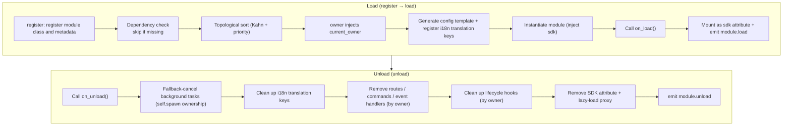

# Module Core Concepts

> [!NOTE]
> **L1 Core Must-Read** — one of the five core documents in the "Reading Path" on the homepage, essential for module development.


This document explains the complete lifecycle of a module from load to unload, along with declarative configuration and storage usage — what the framework does automatically for you and what you only need to write yourself, so you'll know exactly where you stand after reading.

## Module Lifecycle

### Loading Strategy

```python
from ErisPulse.Core.Bases import BaseModule
from ErisPulse.loaders import ModuleLoadStrategy

class MyModule(BaseModule):
    @staticmethod
    def get_load_strategy():
        """Returns the module loading strategy"""
        return ModuleLoadStrategy(
            lazy_load=True,   # Whether to lazy-load or load immediately
            priority=0,       # Loading priority (higher values load first)
            depends=["OtherModule"]  # Optional: declare other modules this one depends on
        )
```

> If a module declared in `depends` is not registered, the current module will be skipped and a warning logged. Load order is determined by topological sorting; within the same tier, modules are sorted by `priority` in descending order.

> [!NOTE]
> **Cascade unload / cascade reload** (ErisPulse **2.8.0+**): when unloading a module that other modules depend on, the modules depending on it are **cascade-unloaded first** (the logs explain the cascade chain); when hot-reloading any module (local plugin / runtime-registered / PyPI-installed package), the modules depending on it are likewise **cascade-reloaded**, preventing dependents from continuing to run while holding stale instance references. Declaring circular dependencies is rejected at load time with a `RuntimeError`.
>
> **reload means a full reload** (ErisPulse **2.11.0+**): `reload()` by default clears the import cache by top-level package name and re-imports dependent code, runs an automatic syntax pre-check before unloading (on failure the unload is rejected and the old instance keeps serving), and after success verifies code identity (fake-reload warnings / `stale` markers); a failed load can be inspected directly via `sdk.module.last_error(name)` (including the traceback).

### on_load Method

Called when the module loads, used to initialize resources and register event handlers:

```python
async def on_load(self, event):
    # Register event handlers
    @command("hello", help="Greeting command")
    async def hello_handler(event):
        await event.reply("Hello!")
    
    # Use the SDK built-in HTTP client (connection pool managed automatically, no need to manually create a session)
    # Send requests via sdk.client
```

### on_unload Method

Called when the module unloads, used to clean up resources:

```python
async def on_unload(self, event):
    # Clean up custom resources
    # sdk.client is managed by the framework, no need to close it manually
    
    # Cancel event handlers (handled automatically by the framework)
    self.logger.info("Module unloaded")
```

> For creation and cleanup of background tasks (`self.spawn()` / framework fallback cancellation), see [Lifecycle Management](../../advanced/lifecycle.md#background-task-ownership-and-auto-cancellation).

### on_before_unload Method

> [!NOTE]
> This hook requires ErisPulse **2.11.0+**.

An optional hook triggered as the **first step** of the unload pipeline (before `on_unload` and resource reclamation) — at this point all of the module's resources are still intact, making it ideal for saving state to `sdk.storage` before unload / dormancy / reload so the next `on_load` can restore it (lazy-load dormancy's state continuity is based on this):

```python
async def on_before_unload(self, event):
    # event["reason"] indicates the intent: unload / reload / disable / cascade / dormant
    if event["reason"] in ("reload", "dormant"):
        await self.state.aset("snapshot", self.collect_state())
```

A hook failure only logs a warning and does not block the unload process; modules that do not declare this hook behave unchanged. For dormancy / wake-up semantics, see [Lazy-Load Dormancy](../../advanced/lazy-loading.md#lazy-load-dormancy-dormant_after).

### Unload and Full Unload (purge)

> [!NOTE]
> This feature requires ErisPulse **2.8.0+**.

By default, `unload()` only **cancels loading** (unloads the instance and resources) but keeps the registration stub (module class and metadata) — the module can still be rediscovered by discover and re-instantiated via `load()`, without needing to `register()` again.

When you need a **full unload** (release the module class reference and clean up `sys.modules`, so the plugin and its exclusive dependencies can be reclaimed by GC), pass `purge=True`:

```python
# Cancel loading only: keep the registration stub, can be load()ed again at any time
await sdk.module.unload("MyModule")

# Full unload: delete the registration stub + clean up sys.modules (plugin-sourced)
await sdk.module.unload("MyModule", purge=True)
```

| Semantics | `unload()` default | `unload(purge=True)` |
|------|-----------------|----------------------|
| Unload instance and resources (events/tasks/routes/lifecycle/i18n) | ✅ | ✅ |
| Keep registration stub (module class and metadata) | ✅ | ❌ Deleted |
| Clean up `sys.modules` (only for plugin folder sources) | ❌ | ✅ |
| Module class eligible for GC reclamation | ❌ | ✅ |
| Reload | `load()` works directly | Requires `register()` + `load()` first |

> When `purge=True`, dependents cascade-unloaded are purged as well; after unloading, the framework runs `gc.collect()` and checks whether the module class/instance can be reclaimed; residual references trigger a log warning (including the referencing parties, at DEBUG level).

### Lifecycle Overview

Tying the above methods together, here is **everything the framework does behind the scenes** when loading and unloading a module:



**What the framework does for you at load time** (you only write `on_load`; everything else is done automatically):

| Stage | What the framework does automatically |
|------|-------------|
| Owner injection | During instantiation, the module name is wrapped in `owner_scope` — commands/events/hooks/background tasks registered in your `on_load` are **automatically attributed to this module**, and are cleaned up in one step by owner at unload time |
| Config template | For modules declaring `ConfigClass`, the framework automatically generates/fills the `ErisPulse.<ModuleName>` config section |
| i18n translation keys | For modules declaring `I18nClass`, translation keys are registered automatically (and deregistered at unload) |
| Dependency topology | Ordered by the `depends` declaration to ensure depended-on modules load first; circular dependencies are rejected with a `RuntimeError` |
| SDK mounting | After instantiation, mounted at `sdk.<ModuleName>` — only then can you access it via `sdk.MyModule.xxx` |

**What the framework cleans up for you at unload time** (corresponding to U1→U7 above): after `on_unload` finishes, a fallback cleanup runs — background tasks are forcibly cancelled (those created by `self.spawn`; do graceful wrap-up yourself in `on_unload`), i18n keys, routes, command/event handlers, and lifecycle hooks are cleaned up, and finally the SDK attribute is removed. `purge=True` additionally deletes the registration stub + cleans up `sys.modules`.

> This automatic cleanup is exactly what backs the promise of "you only write `on_load`/`on_unload`, no manual unregister needed" — the framework uses owner attribution to turn "whoever registers it cleans it up" into a one-step operation.

## SDK Object

### Accessing Core Modules

```python
from ErisPulse import sdk

# Access all core modules via the sdk object
sdk.logger.info("log")
sdk.storage.set("key", "value")

# For a module's own small state (counters/toggles/last run time), prefer self.state —
# keys are automatically prefixed with module.state.<module name>. and survive module unload/reload:
count = self.state.get("runs", 0) + 1
self.state.set("runs", count)            # Synchronous (any context)
await self.state.aset("runs", count)     # Async path
await self.state.aget("runs", 0)
config = sdk.config.getConfig("MyModule")
```

### Inter-Module Communication

```python
# Access other modules
other_module = sdk.OtherModule
result = await other_module.some_method()
```

## Adapter Send Method Query

Because the new standard specification requires overriding the `__getattr__` method to implement the fallback send mechanism, the `hasattr` method can no longer be used to check whether a method exists. Starting from `2.3.5`, a new feature for querying send methods has been added.

### Listing Supported Send Methods

```python
# List all send methods supported by the platform
methods = sdk.adapter.list_sends("onebot11")
# Returns: ["Text", "Image", "Voice", "Markdown", ...]
```

### Getting Detailed Method Information

```python
# Get detailed information about a method
info = sdk.adapter.send_info("onebot11", "Text")
# Returns:
# {
#     "name": "Text",
#     "parameters": [
#         {"name": "text", "type": "str", "default": null, "annotation": "str"}
#     ],
#     "return_type": "Awaitable[Any]",
#     "docstring": "Send a text message..."
# }
```

## Configuration Management

### Declarative Configuration (Recommended)

Since v2.5.2, modules can declare a configuration class via `ConfigClass`, using the same config Schema system as adapters. Configuration is read in real time via `self.cfg`, and changes take effect immediately:

```python
from dataclasses import dataclass, field
from ErisPulse.Core.Bases import BaseModule
from ErisPulse.Core.Bases import BaseConfig

@dataclass
class MyModuleConfig(BaseConfig):
    api_key: str = field(
        default="",
        metadata={
            "description": {"i18n": "my_module.api_key", "default": "API key"},
            "required": True,
            "secret": True,
            "ui": {"widget": "password", "group": "basic", "order": 1},
        },
    )
    timeout: int = field(
        default=30,
        metadata={
            "description": {"i18n": "my_module.timeout", "default": "Timeout (seconds)"},
            "ui": {"widget": "number", "group": "advanced", "order": 2},
        },
    )

class MyModule(BaseModule):
    ConfigClass = MyModuleConfig

    def __init__(self, sdk):
        self.sdk = sdk
        self.logger = sdk.logger.get_child("MyModule")

    async def on_load(self, event):
        self.logger.info("Module loaded")

    async def on_unload(self, event):
        pass

    async def do_something(self):
        cfg = self.cfg  # Real-time read, type-safe
        api_key = cfg.api_key
        timeout = cfg.timeout
```

`BaseConfig` is a general-purpose configuration base class, applicable to adapters, modules, external projects, and any other scenario. Config fields support i18n multilingual descriptions (see the [i18n documentation](../../advanced/i18n.md#config-field-i18n) for details).

> [!NOTE]
> The lifecycle of modules (including adapters) — loading, unloading, enabling/disabling, etc. — is managed uniformly by the framework (`module manager` / `scope` provide query and control APIs). `ConfigClass` should only carry business parameters; a module does not need to nest additional internal logic deciding "whether it should start itself".

The config Schema system also supports (v2.8.0+, see [Adapter core-concepts](../adapters/core-concepts.md#metadata-conventions) for details):

- **Docstring auto-generated field descriptions**: when metadata `description` is not declared, a fallback is automatically extracted from the docstring's `:ivar field: description` or `Attributes:` section
- **Nested dataclass configuration**: when a field's type is a nested dataclass, schema/template/validation are processed recursively and rendered as nested groups in the WebUI
- **`example` non-persisted fields**: fields with `metadata={"example": True}` are not written to config.toml and are only recorded in `config.full.example` (suitable for verbose, rarely touched advanced config items); once the user sets them manually, they persist as normal

### Config Hot Reload (on_config_update)

Once a module or adapter implements the `on_config_update(old, new)` method, the framework automatically routes calls to it when **config related to this module actually changes** (no need to subscribe to config events yourself), so changing tokens / switches / rate-limit parameters takes effect **without a restart**:

```python
class MyModule(BaseModule):
    ConfigClass = MyModuleConfig

    def on_config_update(self, old_config, new_config):
        # When ConfigClass is declared, these are type-safe config objects (dict if not declared);
        # when triggered by runtime setConfig(), old_config is None (only new has a value)
        if old_config is None or new_config.api_key != old_config.api_key:
            self.logger.info("API key updated, rebuilding client")
            self._client = build_client(new_config.api_key)
```

Trigger sources and routing rules:

- **Runtime writes** (code or Dashboard calling `setConfig()`): routed by config key prefix matching — only writes that fall within this module's config key (or its sub-keys) trigger the hook, in which case `old_config` is `None`
- **Config file edits** (file watching triggers a full-tree comparison): triggered only when the old and new config sections differ, in which case `old` / `new` are the config objects before and after the change, respectively
- Exceptions thrown inside the callback are caught and logged by the framework, without affecting the config write itself

Usage guidance:

- `self.cfg` reads in real time — simple parameters that don't require rebuilding state (such as timeout seconds) already hold the new value on the next line of code, no need to sync manually in this hook
- Only **stateful resources** that need rebuilding (client connections, connection pools, timers) should be handled in this hook

### Declarative Translation Keys (v2.7.0+)

Since v2.7.0, modules can also declare translation keys centrally via a nested `I18nClass` class, just like declaring `ConfigClass`. The framework **automatically registers** all declared translation keys at load time — no need to call `i18n.register()` manually — and registration happens before config template generation, ensuring that the i18n keys referenced in config descriptions are already available.

```python
from ErisPulse.Core.Bases import BaseConfig, BaseI18n, I18nKey

class MyModule(BaseModule):
    # Config class (optional)
    @dataclass
    class ConfigClass(BaseConfig):
        welcome_msg: str = field(
            default="Welcome",
            metadata={
                "description": {"i18n": "mymodule.welcome_msg", "default": "Welcome message"},
            },
        )

    # Translation key collection class (optional)
    class I18nClass(BaseI18n):
        # Attribute names are auto-concatenated into the full key path: <module name>.<attribute name>
        welcome_msg: I18nKey = I18nKey(
            default="Welcome Message",   # Language-independent fallback
            zh_CN="Welcome message",
            zh_TW="歡迎訊息",
            en="Welcome Message",
            ja="ウェルカムメッセージ",
            ru="Приветственное сообщение",
        )
        hello: I18nKey = I18nKey(
            default="Hello, {name}!",
            zh_CN="Hello, {name}!",
            zh_TW="你好，{name}！",
            en="Hello, {name}!",
            ja="こんにちは、{name}！",
            ru="Привет, {name}!",
        )
```

For details, see [i18n Recommended Approach](../../advanced/i18n.md#recommended-approach-declaring-translation-keys-via-i18nclass-v270).

### Manual Config Reading (Deprecated)

> **Deprecated**: Please use [Declarative Configuration](#declarative-configuration-recommended) + real-time reading via `self.cfg` instead.

```python
class MyModule(BaseModule):
    def __init__(self, sdk):
        self.sdk = sdk

    def _load_config(self):
        config = self.sdk.config.getConfig("MyModule")
        if not config:
            self.sdk.config.setConfig("MyModule", {"api_key": "", "timeout": 30})
            return {"api_key": "", "timeout": 30}
        return config
```

## Storage System

### Basic Usage

```python
# Store data
sdk.storage.set("user:123", {"name": "Zhang San"})

# Get data
user = sdk.storage.get("user:123", {})

# Delete data
sdk.storage.delete("user:123")
```

### Transaction Usage

```python
# Use a transaction to ensure data consistency
with sdk.storage.transaction():
    sdk.storage.set("key1", "value1")
    sdk.storage.set("key2", "value2")
    # If any operation fails, all changes are rolled back
```

## Event Handling

### Event Handler Registration

```python
from ErisPulse.Core.Event import command, message

# Register a command
@command("info", help="Get information")
async def info_handler(event):
    await event.reply("This is the information")

# Register a message handler
@message.on_group_message()
async def group_handler(event):
    sdk.logger.info(f"Group message received: {event.get_text()}")
```

### Event Handler Lifecycle

The framework automatically manages the registration and deregistration of event handlers; you only need to register them in `on_load`.

## Lazy Loading Mechanism

### How It Works

```python
# The module is only initialized when first accessed
result = await sdk.my_module.some_method()
# ↑ This triggers module initialization
```

### Immediate Loading

For modules that need immediate initialization (such as listeners, timers):

```python
@staticmethod
def get_load_strategy():
    return ModuleLoadStrategy(
        lazy_load=False,  # Load immediately
        priority=100
    )
```

## Error Handling

### Exception Catching

```python
async def handle_event(self, event):
    try:
        # Business logic
        await self.process_event(event)
    except ValueError as e:
        self.logger.warning(f"Invalid parameter: {e}")
        await event.reply(f"Invalid parameter: {e}")
    except Exception as e:
        self.logger.error(f"Processing failed: {e}")
        raise
```

### Logging

```python
# Use different log levels
self.logger.debug("Debug info")     # Detailed debugging information
self.logger.info("Running state")   # Normal runtime information
self.logger.warning("Warning")      # Warning information
self.logger.error("Error")          # Error information
self.logger.critical("Fatal error") # Fatal error
```

## Related Documentation

### Continue the Learning Path

- [Event Wrapper Class](event-wrapper.md) - Event handling in detail

### Deep Dive and Troubleshooting

- [Module Best Practices](best-practices.md) - Developing high-quality modules
- [Module Development Getting Started](getting-started.md) - Review the steps for building your first module