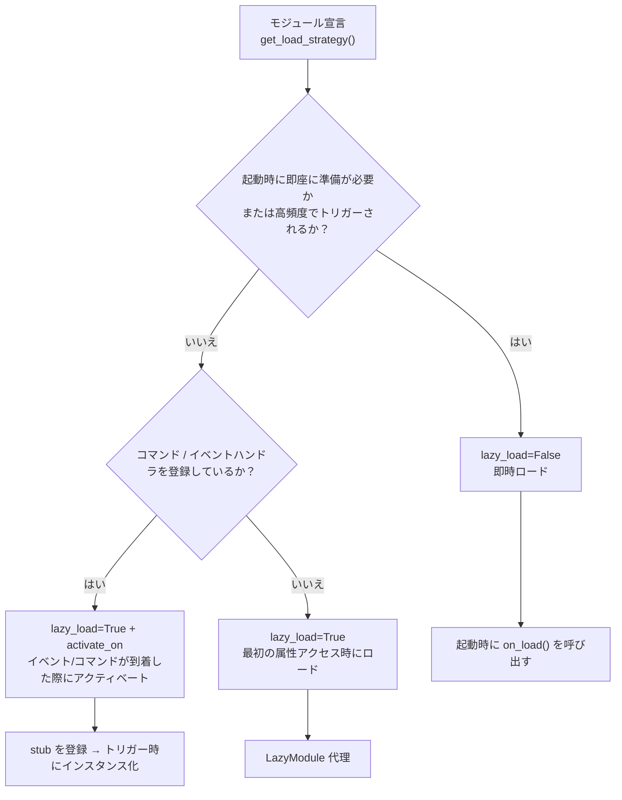

# ラグジュアリー・ロード・モジュール・システム

> [!TIP]  
> **この記事を読む必要があるタイミング**：ラグジュアリー・ロード・モジュールを使用する場合、または activate_on イベント駆動型のアクティベーションを使用する場合。それ以外の場合は読み飛ばしても、他の機能の使用に影響はありません。

ErisPulse SDK は、モジュールが実際に必要になるまで初期化されない強力なラグジュアリー・ロード・モジュール・システムを提供しており、これによりアプリケーションの起動速度とメモリ効率が大幅に向上します。

## 概要

ErisPulse のコア機能の 1 つである遅延ロードモジュールシステムは、以下の方法で動作します。

- **遅延初期化**：モジュールは、初めてアクセスされたときにのみ実際に読み込まれ、初期化されます。
- **透明な使用**：開発者にとって、遅延ロードモジュールは通常のモジュールと使用上ほとんど違いがありません。
- **自動依存管理**：モジュールの依存関係は、使用されるときに自動的に初期化されます。
- **ライフサイクルサポート**：`BaseModule` を継承したモジュールに対しては、ライフサイクルメソッドが自動的に呼び出されます。

## 動作原理

### LazyModule クラス

ラグジュアリー・ロード・システムの中心となるのが `LazyModule` クラスです。これは、最初にアクセスされたときにのみモジュールを実際に初期化するラッパーです。

### 初期化プロセス

モジュールが初めてアクセスされたとき、`LazyModule` は以下の操作を実行します：

1. モジュールクラスの `__init__` パラメータ情報を取得します
2. パラメータに基づいて `sdk` リファレンスを渡すかどうかを決定します
3. モジュールの `moduleInfo` 属性を設定します
4. `BaseModule` を継承したモジュールの場合、`on_load` メソッドを呼び出します
5. `module.init` ライフサイクルイベントをトリガーします

## イベント駆動型遅延起動（activate_on）

> [!NOTE]
> この機能は ErisPulse **2.8.0+** が必要です。

`lazy_load=True` のモジュールはデフォルトで**最初の属性アクセス時**にのみロードされます。モジュールがコマンド/イベントハンドラを登録している場合、従来の方法では `lazy_load=False` として即時ロードするしかありませんでした。`activate_on` は第三の選択肢を提供します：**トリガを宣言し、最初の一致するイベント/コマンドが到着した時点でモジュールを自動的にアクティブ化する**——メモリに常駐させることなく、トリガのエントリポイントを失うこともありません。

```python
from ErisPulse.loaders import ModuleLoadStrategy

class MyModule(BaseModule):
    @staticmethod
    def get_load_strategy():
        return ModuleLoadStrategy(
            lazy_load=True,
            activate_on=[
                # ---- イベントトリガ（受動的到着、ユーザーの意識を必要としない）----
                "message",                                    # タイプレベル：任意のメッセージイベント
                {"notice": "group_member_increase"},          # タイプ + 単一 detail_type
                {"message": ["private", "group"]},            # タイプ + 複数 detail_type

                # ---- コマンドトリガ（能動的入力、Help に表示されるプレースホルダーコマンド）----
                {"command": "roll"},                          # 簡易表記：コマンド名
                {"command": ["roll", "dice"]},                # コマンド名リスト
                {"command": {                                 # dict 形式で宣言（name は必須）
                    "name": "dice",
                    "help": "サイコロを振る",
                    "usage": "/dice",
                    "group": "娯楽",
                    "aliases": ["d"],
                    "hidden": False,
                }},
            ],
        )
```

### コマンド dict 形式の宣言パラメータ

dict 形式は `@command()` デコレータのユーザーレベルのパラメータを反映し、モジュールのロード前にプレースホルダーコマンドを登録するのに使用されます。

| パラメータ | 型 | デフォルト | 説明 |
|------|------|------|------|
| `name` | `str` | **必須** | コマンド名；`on_load` での `@command(name)` と一致する必要がある。一致しない場合、アクティブ化後にプレースホルダーが削除され、コマンドは存在しなくなる |
| `help` | `str` | フォールバックチェーン | Help に表示される説明；未宣言の場合、フォールバックチェーンから値を取得する（以下参照） |
| `usage` | `str` | 自動生成 | 使用法行；デフォルトは `{prefix}{name}` |
| `group` | `str` | `None` | コマンドグループ |
| `aliases` | `list[str]` | `[]` | 別名を同時に登録し、**別名の入力でもトリガとして機能する** |
| `hidden` | `bool` | `False` | `True` の場合、プレースホルダーコマンドも非表示（アクティブ化後の実際のコマンドの非表示の意味と一致）；コマンド名を知っているユーザーの入力でもトリガとして機能する |

**サポートされていない** `priority` / `permission` / `master`：プレースホルダーコマンドの役割はトリガの起動だけであり、権限チェックはアクティブ化後の実際のコマンドが実行する（プレースホルダー段階で権限チェックを行うと、「コマンド入力による起動」が無効になる）。

### 占位コマンドの Help フォールバックチェーン

モジュールがロードされていない場合、Help に表示されるコマンドの説明は以下の順序で取得されます（最初に見つかった値を使用）：

1. dict 形式で宣言されたコマンドレベルの `help`（最も正確）
2. モジュールの `get_meta()` の `description`
3. モジュールの `__description__` 属性
4. パッケージのメタデータの `Summary`（PyPI パッケージの概要）
5. 一般的なメッセージ：「このコマンドは遅延ロードモジュール X から来ています。初めて使用すると、モジュールが自動的にロードされます」

### トリガの意味

- **イベントスタブ**：対応するイベントマネージャーに非常に低い優先度（`ACTIVATION_STUB_PRIORITY`）で登録され、すべての通常のハンドラの後にバックアップとしてトリガされる。アクティブ化後、現在のイベントはモジュールの実際のハンドラに転送される
- **コマンドスタブ**：プレースホルダーコマンドを登録する。アクティブ化後、プレースホルダーは削除され、実際のコマンドがトリガを引き継ぐ
- **再入防止**：`asyncio.Lock` を使用して、並行トリガ時に一度だけアクティブ化されるように保証する
- **スコープフィルタリング**：スタブにはモジュールの所有者アイデンティティが含まれ、モジュールが Bot / セッション / プラットフォームに対して有効化されていない場合はトリガされない
- **失敗時の処理**：アクティブ化に失敗した場合はクールダウン期間（`ACTIVATE_RETRY_COOLDOWN_SECS`、30秒）に入る。クールダウン中はイベントが短絡的に処理され、繰り返し試行されない。クールダウン後に再トリガされると、自動的に再試行され、スタブは全期間保持される
- **重複排除**：同名のコマンドが簡易表記と dict 形式で混在して宣言された場合、重複は排除され（dict が優先される）。dict で `name` が欠落している、またはイベントの `detail_type` が dict として誤って記述された場合は警告が表示され、無視される

> アーキテクチャ図と完全な意味については、[アーキテクチャ概要](../architecture.md#イベント駆動型遅延起動activate_onトリガアーキテクチャ)を参照してください。

## 懒惰ロードの休眠（dormant_after）

> [!NOTE]
> この機能は ErisPulse **2.11.0+** が必要です。

長期間使用されていない遅延ロードモジュールに対して、フレームワークはその**休眠**を可能にします。これにより、実行時のリソース（タスク、接続、イベントの登録など）を解放しますが、遅延ロードプロキシと登録のスタブは保持されます。モジュールは「登録済みだがロードされていない」状態に戻り、次回の属性アクセス、`module.call`、`activate_on` イベントによって**透明に再起動**されます（再インスタンス化され、`on_load` が実行されます）。再起動のための API は一切不要です。休眠後のシステムの状態は、「一度も起動されていない」場合と完全に同一です。

### 宣言方法

```python
@staticmethod
def get_load_strategy():
    return ModuleLoadStrategy(
        lazy_load=True,
        dormant_after="30m",   # 30 分間の無使用で自動的に休眠；宣言しない場合は休眠しない（デフォルト）
    )
```

時間の指定は、コマンド管理の `cooldown` と同じ形式です（`90s` / `1h30m` / `1d`）。スクリーナーは固定間隔（60 秒）でスキャンを行い、実際の休眠時刻は閾値 + 最大でスキャン間隔分のずれがあります。また、手動で休眠させることも可能です：`await sdk.module.sleep("モジュール名")`。明示的な `unload` は完全なアンロード（遅延プロキシも削除）になります。

### 状態の継続

休眠前にフレームワークは `on_before_unload(reason="dormant")` をトリガーします（アンロードの最初のステップ、リソースはまだ有効）。モジュールは `sdk.storage` に状態を保存します。再起動後は `on_load` で状態を復元します：

```python
async def on_before_unload(self, event):
    if event["reason"] in ("dormant", "reload", "disable"):
        await self.sdk.storage.aset(f"{self._module_name}:counter", self._count)

async def on_load(self, event):
    self._count = await self.sdk.storage.aget(f"{self._module_name}:counter") or 0
```

### 意味と境界

- **依存先の安全性**：遅延モジュールの依存先は、永続的なプロキシ（`sdk.<Name>`）または `module.call` を通じてアクセスします。休眠前後で動作は一貫しています。直接に実際のインスタンスの参照を持つことは反パターンです（監査ツールで漏れが確認できます）。
- **イベントの到達**：休眠中のモジュールはイベントを受け取らなくなります。イベントによって再起動が必要なモジュールは、`activate_on` を同時に宣言してください（イベントが先に再起動し、その後転送されます）。「コマンドが反応しない」問題を調査する際は、モジュールが休眠状態にあるかどうかを確認してください。
- **再起動失敗時の自己修復**：再起動（再初期化）に失敗した場合、30 秒間のクールダウンに入り、クールダウン後に再びアクセスすると自動的に再試行されます。永久的に失敗することはありません。

## 懒惰ロードの設定

### グローバル設定

設定ファイルでグローバルな遅延ロードを有効または無効にします：

```toml
[ErisPulse.framework]
enable_lazy_loading = true  # true=遅延ロードを有効にする(デフォルト), false=遅延ロードを無効にする
```

### モジュールレベルの制御

モジュールは `get_load_strategy()` 静的メソッドを実装することで、ロード戦略を制御できます：

```python
from ErisPulse.Core.Bases import BaseModule
from ErisPulse.loaders import ModuleLoadStrategy

class MyModule(BaseModule):
    @staticmethod
    def get_load_strategy():
        """モジュールのロード戦略を返す"""
        return ModuleLoadStrategy(
            lazy_load=False,  # Falseを返すと即時ロード
            priority=100      # ロードの優先度、数値が大きいほど優先度が高い
        )
```

## ラグロードモジュールの使用

### 基本的な使い方

開発者にとって、ラグロードモジュールは通常のモジュールと使用方法にほとんど違いはありません：

```python
# SDKを介してラグロードモジュールにアクセス
from ErisPulse import sdk

# 以下のようにアクセスするとモジュールのラグロードがトリガーされます
result = await sdk.my_module.my_method()
```

### モジュールの取得の統一されたエントリーポイント

SDK属性、モジュールマネージャー属性を通じてアクセスする場合でも、`module.get()`で検索する場合でも、
「登録済みだがまだロードされていない」ラグロードモジュールに対しては、すべて同じラグロードプロキシが返り、
そのプロパティにアクセスすることで初めてモジュールの初期化がトリガーされます：

```python
# 3つの方法で取得できるのはすべてラグロードプロキシです（モジュールがロードされていない場合）、動作は一貫しており、ユーザーには透明です
sdk.my_module          # ロードをトリガーするエントリーポイント
sdk.module.my_module   # 同様にラグロードプロキシを返します
sdk.module.get("my_module")  # これもラグロードプロキシを返します。この操作自体はロードをトリガーしません

# プロキシの任意の属性にアクセスすることで、モジュールの初期化が実際に行われます
result = await sdk.my_module.my_method()
```

`module.get()`は**検索**用のインターフェースであり、ロードをトリガーしません：
- モジュールが既にロード済み → 実際のインスタンスを返します
- モジュールが登録済みだが未ロード → ラグロードプロキシを返します（プロパティにアクセスしたときに初期化されます）
- モジュールが未登録 → `None`を返します

明示的にロードをトリガーするには、`await sdk.load_module("my_module")`を使用してください。

### 非同期初期化

非同期初期化が必要なモジュールについては、まず明示的にロードすることを推奨します：

```python
# まずモジュールを明示的にロード
await sdk.load_module("my_module")

# その後モジュールを使用
result = await sdk.my_module.my_method()
```

### 同期初期化

非同期初期化を必要としないモジュールについては、直接アクセスできます：

```python
# 直接アクセスすると自動的に同期初期化されます
result = sdk.my_module.some_sync_method()
```

## 最佳実践

ロード戦略を選択する際は、以下の決定フローを参考にしてください。



### 懒惰ロード（lazy_load=True）を使用することを推奨する場面

- 他のモジュールによって呼び出されるだけの受動的なユーティリティモジュール（例：データクエリモジュール、フォーマット変換器など）
- コマンド/イベントハンドラを登録しているが高頻度で使用されないモジュール — `activate_on` を使ってトリガを宣言し、最初の一致するイベント/コマンドが到着した際に自動的にアクティベートする。これにより、lazy_loadを放棄せずに済む。

### 懒惰ロードを禁止することを推奨する場面（lazy_load=False）

- 起動時に即座に準備が必要なモジュール（他のモジュールに基礎サービスを提供するコアモジュールなど）
- 高頻度でトリガーされるリスナー（各メッセージごとに処理が必要） — `activate_on` による転送には1回のアクティベートオーバーヘッドがあるため、高頻度の場面では即時ロードした方が直接的
- タイマータスクモジュール
- アプリケーション起動時に初期化が必要なモジュール

> `priority` パラメータは、即時ロードされるモジュール間の初期化順序を制御します。数値が大きいほど先に初期化されます。同じ優先度のモジュールは登録順にロードされます。

## 注意事項

1. モジュールが遅延ロードを使用している場合、ErisPulse内で他のモジュールによって一度も呼び出されない場合、そのモジュールは決して初期化されません。
2. モジュール内にEventの監視など、他のモジュールを積極的に監視するモジュールが含まれている場合、2つの選択肢があります：`activate_on` トリガーを宣言して遅延ロードを維持し、イベントが到達したときに自動的にアクティブ化するか、または即時ロードを必要とすることを宣言する（`lazy_load=False`）か、さもなければモジュールの正常な業務に影響を及ぼす可能性があります。
3. 特殊な要望がない限り、遅延ロードを無効にすることは推奨しません。そうしないと、依存管理やライフサイクルイベントなどの問題が生じる可能性があります。
4. `activate_on` のコマンド dict 声明において、`name` はモジュールの `on_load` で `@command()` によって登録された実際のコマンド名と一致する必要があります。一致しない場合、モジュールがアクティブ化された後にプレースホルダーコマンドが解除され、宣言と実装が一致しないコマンドは存在しません。

## 関連ドキュメント

- [モジュール開発ガイド](../developer-guide/modules/getting-started.md) - モジュール開発の方法を学ぶ
- [ベストプラクティス](../developer-guide/modules/best-practices.md) - さらにベストプラクティスについて学ぶ