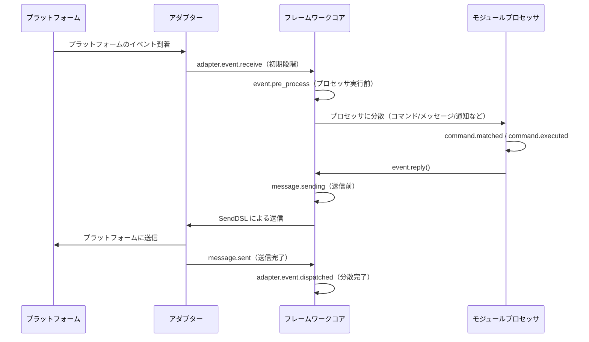

# ライフサイクル管理

> [!TIP]
> **この記事を読むタイミング**：フレームワークのライフサイクルイベント（起動 / 加載 / 状態変化）をサブスクライブする必要がある場合。必要ない場合はスキップしても、他の機能の使用に影響はありません。

> **この記事を読むことでわかる内容**：ライフサイクルイベントの登録 / 発動 / 特定の送信メカニズム、4つのトリガーAPIの違いと選択方法、フレームワークが事前に埋め込んだすべてのフックの断点（core / module / adapter / server / messageなど）のそれぞれのデータ形式。
>
> **この記事では扱わない内容**：モジュール自身が実装するライフサイクルメソッド（`on_load` / `on_unload`、[モジュール開発ガイド](../developer-guide/modules/getting-started.md)を参照）；起動プロセスの各段階の経緯（[起動フローと手動制御](startup.md)を参照）。

モジュールの加載失敗、設定の変更、メッセージの送信、コマンド実行などのノードで通知を受け取り、自身のロジックを実行したい場合（監査、統計、アラート、連携など）は、フレームワークのライフサイクルイベントをサブスクライブするだけでよい。フレームワークは各重要なノードにフックの断点を事前に埋め込んでおり、`@sdk.lifecycle.on("イベント名")` と一行で接続できる。本文末尾には、すべての断点の一覧が付属している。

システムは3種類のトリガー方式をサポートしています：
- `await lifecycle.emit("event", data)` — 精簡版、任意のデータを渡す（`to="Owner"`の場合は特定の送信）
- `lifecycle.emit_sync("event", data)` — 同期版（非非同期コンテキストで使用）
- `await lifecycle.submit_event("event", ...)` — 旧バージョンと互換性があり、標準のイベント形式を自動的に構築する

## イベント処理メカニズム

### ハンドラの登録

```python
from ErisPulse import sdk

# デコレーターモード
@sdk.lifecycle.on("module.load")
async def on_module_load(data):
    print(f"モジュールのロード: {data}")

# プログラミング登録
sdk.lifecycle.register("module.load", on_module_load, priority=10)

# 登録解除
sdk.lifecycle.unregister("module.load", on_module_load)

# 所有者ごとに一括登録解除（モジュール/アダプターのアンロード時にフレームワークが自動的に呼び出す）
removed = sdk.lifecycle.unregister_by_owner("MyModule")
print(f"クリーンアップしたライフサイクルフック数: {removed}")
```

### 優先度

ハンドラは `priority` パラメータをサポートし、数値が大きいほど先に実行されます（モジュールローダーと同じ）：

```python
@sdk.lifecycle.on("adapter.event.receive", priority=10)  # 最初に実行
async def first_handler(data):
    pass

@sdk.lifecycle.on("adapter.event.receive", priority=0)  # 後に実行
async def second_handler(data):
    pass
```

### ポイント構造イベント

具体的なイベントをトリガーする際、その親イベントもトリガーされます：
- `module.load` をトリガーすると、`module` もトリガーされます
- `adapter.event.receive` をトリガーすると、`adapter.event` と `adapter` もトリガーされます

### ワイルドカード

`*` を登録してすべてのイベントをキャッチできます：

```python
@sdk.lifecycle.on("*")
async def on_anything(data):
    print(f"イベントを受け取りました: {data}")
```

### 定向送信（emit to=）

> [!NOTE]
> この機能は ErisPulse **2.8.0+** が必要です。

`emit()` に `to` パラメータを指定すると、定向送信モードになります：イベントは、その所有者（owner）として登録されたハンドラにのみ配信されます（モジュールが `on_load` 内で登録したフックは自動的に本モジュールに所属します）、他のモジュールやワイルドカード `*` ハンドラは感知しません。

```python
# 送信元：イベントは Chat モジュールが登録したフックにのみ送信されます
await sdk.lifecycle.emit("message_received", {"text": "hi"}, to="Chat")

# 受信元（Chat モジュール内）：同名のフックを登録し、owner は登録時に自動的に記録されます
@sdk.lifecycle.on("message_received")
async def on_message_received(data): ...

@sdk.lifecycle.on("message")   # ポイント構造の親プレフィックスも同様に有効（owner でフィルタリング）
async def on_any(data): ...
```

- 目標の owner に登録されたフックがない場合 → イベントは**消費されません**（`has_handlers()` で事前に検出可能）
- `data` が dict の場合、自動的に `_trace_id` を追加します（既存の値を上書きしません）
- `emit_sync` / `submit_event` でも `to=` パラメータをサポート
- モジュール間通信の3層モデル（RPC / 定向 / ブロードキャスト）は
  [モジュール間通信](module-communication.md) を参照

### 一回限りの登録（once）

2.7.0 から、`lifecycle.once()` で登録されたハンドラは**一度実行後、自動的に登録解除**されます。これは「初回準備完了」のような一回限りのフックに適しています：

```python
@sdk.lifecycle.once("core.init.complete")
async def on_first_ready(data):
    print("初回準備完了、以降はトリガーされません")
```

- `on()` と同じ優先度パラメータの意味（`priority` 数値が大きいほど先に実行）
- 自動的に登録解除、手動での `unregister` は不要
- 同期/非同期ハンドラの両方をサポート

### 監視者確認（has_handlers）

ホットパスの短絡処理では、`has_handlers()` を使って監視者が存在するかを事前に確認し、不要なイベントのループやタスクのスケジューリングを避けることができます：

```python
if sdk.lifecycle.has_handlers("message.sending"):
    await sdk.lifecycle.emit("message.sending", send_ctx)
```

- 精確なイベント名、ワイルドカード `*`、親イベントの3種類のマッチをカバー
- 監視者がいない場合は `False` を返し、`emit` を安全にスキップできます

## フックのブレークポイント一覧

プラットフォームからフレームワークにメッセージが届き、処理が完了するまでの典型的なライフサイクルイベントの時系列は以下の通りです。



フレームワークは以下のフックのブレークポイントを内蔵しており、`@sdk.lifecycle.on()` で任意のブレークポイントを監視してカスタムロジックを実装できます。

### コア初期化

| フック名 | 発生タイミング | データ |
|---------|---------|------|
| `core.init.start` | SDKの初期化開始 | `{}` |
| `core.init.stage` | 初期化の各段階開始（バックグラウンドで発生） | `{"stage": str}`、値は `discovery` / `adapter_register` / `adapter_start` / `module_register` / `module_init` / `adapter_start_deferred` / `router_start` |
| `core.init.complete` | SDKの初期化完了 | `{"duration": float, "success": bool, "stages": {stage: float}, "adapters": {"enabled": [str], "disabled": [str]}, "modules": {"enabled": [str], "disabled": [str]}, "error": str(失敗時のみ)}` |
| `core.uninit.complete` | SDKの逆初期化完了 | `{"duration": float, "success": bool, "adapters_closed": int, "modules_unloaded": int, "module_properties_cleared": int, "module_properties_to_clear": [str], "error": str(失敗時のみ)}` |

**例：起動進捗表示**

```python
@sdk.lifecycle.on("core.init.stage")
def show_stage(data):
    print(f"[起動] 階段に到達: {data['stage']}")
```

### 設定変更

| フック名 | 発生タイミング | データ |
|---------|---------|------|
| `config.set` | 設定項目が変更された | `{"key": str, "old_value": Any, "new_value": Any}` |
| `config.updated` | 外部で config.toml を編集した後にツリー全体の変更が検出された | `{"old_config": dict, "new_config": dict, "config_file": str}` |

**例：設定監査**

```python
@sdk.lifecycle.on("config.set")
def audit_config(data):
    print(f"[監査] {data['key']}: {data['old_value']} -> {data['new_value']}")
```

### モジュールのライフサイクル

| フック名 | 発生タイミング | データ |
|---------|---------|------|
| `module.register` | モジュールクラスがマネージャーに登録された | `{"module_name": str, "success": bool}` |
| `module.load` | モジュールのロードが完了した（インスタンス化成功）；失敗時は `payload` に追加で `"error": str, "traceback": str`（失敗時の現場は `module.last_error(名前)` でも取得可能） | `{"module_name": str, "success": bool}` |
| `module.init` | モジュールの初期化が完了した（遅延ロード含む） | `{"module_name": str, "success": bool}` |
| `module.before_unload` | アンロードの最初のステップ（`on_unload` とリソース回収の前；モジュールインスタンスフック `on_before_unload` が同期的に発生） | `{"module_name": str, "reason": str}`；`reason` の値は `unload` / `reload` / `disable` / `cascade` / `dormant` |
| `module.sleep` | モジュールの休眠が完了した（遅延ロードの休眠：リソースは解放され、アクセス時に自動的に復活） | `{"module_name": str, "success": bool}` |
| `module.unload` | モジュールのアンロードまたは無効化（`disable` と `unload` は依存関係に通知するため同等；`on_dependency_lost` の契約には「無効化」が含まれる） | `{"module_name": str, "success": bool}` |
| `module.reload` | モジュールのホットリロードが完了した（依存モジュールも含む） | `{"module_name": str, "success": bool, "full": bool, "duration_ms": int}`；単一モジュールの場合、`"identity_changed": bool`（False = プロセス内で古いコードが実行されている可能性あり、C拡張のキャッシュなど）、`"version_old": str, "version_new": str` を追加で持つ；全量リロード（`reload_all`）の場合は `module_name` が `"All"` になり、`payload` に `"results": dict[str, bool]` を追加で持つ |

> **モジュールインスタンスフック `on_before_unload`**：`module.before_unload` イベントに対応するオプションのライフサイクルメソッド——`event["reason"]` に理由が記載され、リソース解放前に `sdk.storage` に状態を保存し、復活/リロード後に `on_load` で復元するのに適している（遅延ロードの休眠の状態継続はこれに基づく）。フックの失敗は警告のみで、アンロードプロセスをブロックしない。

### アダプターのライフサイクル

| フック名 | 発生タイミング | データ |
|---------|---------|------|
| `adapter.load` | アダプターの登録が完了した | `{"platform": str, "success": bool}` |
| `adapter.reload` | アダプターのコードレベルでのホットリロードが完了した | `{"adapter_name": str, "success": bool, "full": bool, "duration_ms": int, "identity_changed": bool, "version_old": str, "version_new": str, "was_started": bool, "source": str}`；`identity_changed=False` = プロセス内で古いコードが実行されている可能性あり |
| `adapter.start` | アダプターの起動 | `{"platforms": [str]}` |
| `adapter.status.change` | アダプターの状態が変化した | `{"platform": str, "status": str, "retry_count": int, "error": str(失敗時のみ)}`；status の完全な値は：`starting` / `started` / `start_failed` / `stopping` / `stopped` / `stop_failed` / `skipped-dependency` / `disabled` |
| `adapter.stop` | アダプターの停止 | `{"platforms": [str]}` |
| `adapter.stopped` | アダプターの停止が完了した | `{"platforms": [str]}` |
| `adapter.bot.online` | Botのオンライン | `{"platform": str, "bot_id": str, "info": dict, "status": str}` |
| `adapter.bot.offline` | Botのオフライン | `{"platform": str, "bot_id": str, "status": str}` |

### イベントの受信と処理

| フック名 | 発生タイミング | データ |
|---------|---------|------|
| `adapter.event.receive` | 外部プラットフォームイベントを受信した（初期段階） | `{"platform": str, "event_type": str, "raw_event_type": str}` |
| `adapter.event.blocked` | ミドルウェアがイベントを拒否した（`False` を返した、イベントは破棄されプロセッサに渡らない） | `{"middleware": str, "platform": str, "event_type": str, "detail_type": str, "event": dict, "_trace_id": str}` |
| `adapter.event.dispatched` | イベントの分散が完了した | `{"platform": str, "event_type": str, "raw_event_type": str, "onebot_handlers_count": int}` |
| `event.pre_process` | イベントプロセッサが実行される直前 | `{"event_type": str, "platform": str, "detail_type": str}` |

**例：イベント統計**

```python
event_counter = {}

@sdk.lifecycle.on("adapter.event.receive")
def count_events(data):
    platform = data["platform"]
    event_counter[platform] = event_counter.get(platform, 0) + 1

@sdk.lifecycle.on("adapter.event.dispatched")
def log_unhandled(data):
    if data["onebot_handlers_count"] == 0:
        print(f"[未処理] {data['platform']}/{data['event_type']}")
```

### メッセージの送信

| フック名 | 発生タイミング | データ |
|---------|---------|------|
| `message.sending` | メッセージが送信される直前 | `{"platform": str, "method": str, "detail_type": str, "target_id": str, "bot_id": str}` |
| `message.sent` | メッセージの送信が完了した | `{"platform": str, "method": str, "detail_type": str, "target_id": str, "bot_id": str}` |

**例：メッセージ送信監査**

```python
@sdk.lifecycle.on("message.sending")
def log_sending(data):
    print(f"[送信] -> {data['platform']}/{data['detail_type']}/{data['target_id']} via {data['method']}")
```

### コマンドシステム

| フック名 | 発生タイミング | データ |
|---------|---------|------|
| `command.matched` | コマンドがマッチし、実行される直前 | `{"command": str, "args": list[str], "platform": str, "user_id": str}` |
| `command.executed` | コマンドの実行が完了した | `{"command": str, "args": list[str], "platform": str, "user_id": str, "success": bool, "error": str(失敗時のみ)}` |

**例：コマンド統計**

```python
@sdk.lifecycle.on("command.matched")
def count_commands(data):
    print(f"[コマンド] /{data['command']} from {data['user_id']}@{data['platform']}")
```

### HTTPルーティング

| フック名 | 発生タイミング | データ |
|---------|---------|------|
| `server.request` | HTTPリクエストが受信された | `{"method": str, "path": str, "client_ip": str, "request_id": str}` |
| `server.response` | HTTPレスポンスが送信された | `{"method": str, "path": str, "status_code": int, "client_ip": str, "request_id": str}` |

> `request_id` は [X-Request-ID リクエスト連絡ID](router.md#リクエスト連絡-idx-request-id)：クライアントリクエストヘッダーを優先して使用し、なければUUIDを生成する。これによりリクエストとレスポンスを関連付けることができる。

**例：リクエストログ**

```python
@sdk.lifecycle.on("server.response")
def log_http(data):
    print(f"[HTTP] {data['method']} {data['path']} -> {data['status_code']}")
```

### WebSocket

| フック名 | 発生タイミング | データ |
|---------|---------|------|
| `server.start` | ルーティングサーバーが起動した | `{"base_url": str, "host": str, "port": int, "success": bool, "error": str(失敗時のみ)}` |
| `server.stop` | ルーティングサーバーが停止した | `{}` |
| `server.websocket.connect` | WebSocket接続が確立した | `{"path": str, "module_name": str, "client_ip": str}` |
| `server.websocket.disconnect` | WebSocket接続が切断された | `{"path": str, "module_name": str, "reason": str, "error": str(異常時のみ)}` |

**例：WebSocket接続監視**

```python
@sdk.lifecycle.on("server.websocket.connect")
def on_ws_connect(data):
    print(f"[WS] 接続: {data['path']} from {data['client_ip']}")

@sdk.lifecycle.on("server.websocket.disconnect")
def on_ws_disconnect(data):
    print(f"[WS] 切断: {data['path']} ({data['reason']})")
```

### ストレージ接続状態

ストレージバックエンドの接続プールの確立、障害、および復旧（すべてバックグラウンドで発生し、ストレージ操作をブロックしない）：

| フック名 | 発生タイミング | データ |
|---------|---------|------|
| `storage.ready` | ストレージバックエンドの接続プールが準備完了（各イベントループで最初のプール確立に成功した） | `{"backend": str}` |
| `storage.unreachable` | 重試回数が尽き、クールダウン期間に入る（この間は操作が即座に失敗する） | `{"backend": str, "error": str, "cooldown": float}` |
| `storage.recovered` | クールダウンが終了し、再接続に成功し、ストレージが再び利用可能になった | `{"backend": str}` |

**例：ストレージ障害アラート**

```python
@sdk.lifecycle.on("storage.unreachable")
def alert_storage_down(data):
    print(f"[アラート] ストレージバックエンド {data['backend']} に到達不可: {data['error']}、{data['cooldown']}秒後に自動的に再接続されます")

@sdk.lifecycle.on("storage.recovered")
def notify_storage_back(data):
    print(f"[復旧] ストレージバックエンド {data['backend']} が再び利用可能になりました")
```

### HTTPクライアント

`sdk.client` のリクエストと接続イベント（すべてバックグラウンドで発生）：

| フック名 | 発生タイミング | データ |
|---------|---------|------|
| `client.request.success` | HTTPリクエストが成功した | `{"method": str, "url": str, "status": int, "elapsed": float}` |
| `client.request.failed` | HTTPリクエストの再試行が尽き、最終的に失敗した | `{"method": str, "url": str, "error": str, "attempts": int, "elapsed": float}` |
| `client.ws.connect` | WebSocket接続が確立した | `{"url": str}` |

### 国際化

| フック名 | 発生タイミング | データ |
|---------|---------|------|
| `i18n.language.changed` | フレームワークの言語が切り替わった（`i18n.set_language`） | `{"language": str, "previous": str}` |

## 標準イベント定義

```python
STANDARD_EVENTS = {
    "core": ["init.start", "init.stage", "init.complete", "uninit.complete"],
    "module": ["load", "before_unload", "init", "sleep", "unload", "register", "reload"],
    "adapter": [
        "load", "start", "status.change", "reload", "stop", "stopped",
        "event.receive", "event.blocked", "event.dispatched",
        "bot.online", "bot.offline",
    ],
    "server": [
        "start", "stop",
        "request", "response",
        "websocket.connect", "websocket.disconnect",
    ],
    "event": ["pre_process"],
    "message": ["sending", "sent"],
    "command": ["matched", "executed"],
    "config": ["set", "updated"],
    "storage": ["ready", "unreachable", "recovered"],
    "client": ["request.success", "request.failed", "ws.connect"],
    "i18n": ["language.changed"],
}
```

## 完全な API リファレンス

### 登録と解除

| メソッド | 説明 |
|------|------|
| `@lifecycle.on(event, *, priority=0)` | デコレータによるハンドラの登録 |
| `lifecycle.register(event, handler, *, priority=0)` | プログラム的な登録 |
| `lifecycle.unregister(event, handler=None)` | 登録の解除（handler=None の場合はそのイベントの全ハンドラを解除） |

### 発火

| メソッド | 説明 |
|------|------|
| `await lifecycle.emit(event, data=None, *, to=None)` | 非同期で発火し、ハンドラは**並列実行**（互いにブロックせず、返却時に全て完了）、返り値が None でない場合、優先度順に data をチェーンで置き換え返す；`to` に owner を指定すると、特定のオブジェクトに投递 |
| `lifecycle.fire(event, data=None, *, to=None)` | **バックグラウンド発火（投げっぱなし）**：ハンドラはバックグラウンドタスクで並列実行され、待機せず、返り値なし；リスナーがいない場合はオーバーヘッドゼロ。高頻度のホットパスや純粋な観測イベントに適している（`server.request` / `storage.ready`）；順序に敏感な処理（`config.set`）やシャットダウンシーケンスは `emit` を使用すること |
| `lifecycle.emit_sync(event, data=None, *, to=None)` | 同期で発火、非同期ハンドラは create_task でスケジュール |
| `await lifecycle.submit_event(event_type, *, source, msg, data, to=None, background=False)` | 旧版との互換性、標準イベント形式を自動構築；`background=True` の場合、`fire` のバックグラウンド発火経路を使用 |

**4種類の発火 API の対照表**：

| メソッド | 呼び出し形態 | ハンドラの完了を待つか | 代表的な使用場面 |
|------|---------|------------------|---------|
| `emit` | `await`（非同期） | **待つ**——ハンドラは並列実行、返却時に全て完了、返り値は優先度順に data をチェーンで置き換え返す | 通常の発火；順序に敏感な消費（`config.set`）やシャットダウンシーケンスには必ずこれを使用 |
| `fire` | 直接呼び出し（同期で返却） | **待たない**——バックグラウンドタスクで並列実行、返り値なし；リスナーがいない場合はオーバーヘッドゼロ | 高頻度のホットパスや純粋な観測イベント（`server.request` / `storage.ready`） |
| `emit_sync` | 直接呼び出し（同期） | 同期ハンドラは即時完了；非同期ハンドラは `create_task` でスケジュール（返り値は返却できない） | 非同期コンテキスト外（同期コード）でイベントを発火する場合 |
| `submit_event` | `await`（非同期） | 待つ（`background=True` の場合は `fire` と同じ待たない） | 旧版との互換性：自動で標準イベント形式（`source` / `msg` / `timestamp`）を構築 |

### ユーティリティ

| メソッド | 説明 |
|------|------|
| `lifecycle.start_timer(timer_id)` | タイマーを開始 |
| `lifecycle.get_duration(timer_id)` | 経過時間を取得（秒） |
| `lifecycle.stop_timer(timer_id)` | タイマーを停止し、経過時間を返す |
| `lifecycle.list_hooks()` | 登録済みの全てのフックとハンドラ数をリストアップ |
| `lifecycle.clear()` | 全てのハンドラとタイマーをクリア |

## モジュールでの使用例

```python
from ErisPulse.Core.Bases import BaseModule
from ErisPulse import sdk

class Main(BaseModule):
    async def on_load(self, event):
        # 簡単なメッセージ数カウントの実装
        self.msg_count = 0
        
        @sdk.lifecycle.on("adapter.event.receive")
        async def count(data):
            if data["event_type"] == "message":
                self.msg_count += 1
        
        # すべてのコマンドを監視
        @sdk.lifecycle.on("command.matched")
        async def log_cmd(data):
            sdk.logger.info(f"コマンド実行: /{data['command']} by {data['user_id']}")
        
        # 設定変更の監査
        @sdk.lifecycle.on("config.set")
        def audit(data):
            sdk.logger.info(f"設定変更: {data['key']} = {data['new_value']}")
```

## バックグラウンドタスクの所有者と自動キャンセル

> [!NOTE]
> この機能は ErisPulse **2.8.0+** が必要です。

モジュールが作成した asyncio バックグラウンドタスクが `on_unload` でキャンセルされない場合、`self` の参照が保持され、モジュールインスタンスの回収ができなくなります（ホットリロード後に古いインスタンスが残存）。フレームワークは以下のバックアップメカニズムを提供します：

- **`self.spawn(coro)`**（モジュール内で推奨）：タスクはモジュール名に自動的に所属し、モジュールのアンロード時にフレームワークが `on_unload` **後に**未終了のタスクをキャンセルし、警告を記録します
- **`spawn_background(coro)`**（`ErisPulse.runtime`）：現在の `owner_scope` コンテキストを自動的にキャプチャします；`cancel_owner_tasks(owner)` で所属をキャンセル、`cancel_all_background_tasks()` は `sdk.uninit()` のバックアップ用
- **アダプター**：停止時にプラットフォーム名の下のバックグラウンドタスクもバックアップでキャンセル

```python
async def on_load(self, event):
    # 推奨：バックグラウンドタスクは self.spawn() を使用し、アンロード時にフレームワークがバックアップでキャンセル
    self.spawn(self._poll())

async def on_unload(self, event):
    # 精密制御の場合は、手動でキャンセルし、終了処理を待機する必要があります
    if self._poll_task:
        self._poll_task.cancel()
        await asyncio.gather(self._poll_task, return_exceptions=True)

async def _poll(self):
    while True:
        await asyncio.sleep(60)
        ...
```

> [!IMPORTANT]
> フレームワークのバックアップは**強制キャンセル**（`cancel_owner_tasks`）で、`on_unload` の返り値の後に行われます。したがって、優雅な終了処理が必要なタスク（バッファのフラッシュ、状態の永続化、接続の閉鎖）は**必ず**`on_unload` で `cancel()` + `await` で完了する必要があります — バックアップが終了処理を保持することを期待しないでください。フレームワークは「`self` を保持するタスクが残らないように」することを保証しますが、「優雅」を保証するわけではありません。`await` の結果が必要なタスクは直接 `await` してください、バックグラウンドタスクに投げないでください。

## 注意事項

1. **ハンドラは同期または非同期**：システムが自動的に識別し、正しく呼び出します
2. **データの渡し方**：`emit()` モードでは、ハンドラが `None` 以外の値を返すと、後続のハンドラに渡される `data` を変更します
3. **イベント名の命名規則**：点構造のイベント名を使用することを推奨します、親イベントの監視が容易になります
4. **エラーの隔離**：ハンドラの1つが例外を発生しても、他のハンドラの実行に影響しません
5. **同期トリガーの制限**：`emit_sync()` では、非同期ハンドラは fire-and-forget 方式でスケジュールされ、返り値は回伝できません
6. **ライフサイクルのクリーンアップ**：`sdk.uninit()` を呼び出すと、すべての登録されたハンドラとタイマーがクリーンアップされます
7. **ロード優先性**：フレームワークの初期化段階でイベントをサブスクライブしたい場合は、高優先度を設定し、遅延ロードを無効化することを推奨します

## 関連ドキュメント

次の意図に応じて選択してください：

- **アダプターからハンドラーへのイベントの全フローを確認したい** → [アーキテクチャ概要](../architecture.md)
- **モジュールを開発する際に実装すべきライフサイクルメソッド（on_load / on_unload）** → [モジュール開発ガイド](../developer-guide/modules/getting-started.md)
- **バックグラウンドタスクとリソースの回収をカバーしたい** → [所有権（owner）システム](ownership.md)
- **起動フローの各段階（`core.init.*` イベントの発生元）** → [起動フローと手動制御](startup.md)
- **ライフサイクルイベントの使用推奨事項** → [モジュールのベストプラクティス](../developer-guide/modules/best-practices.md)