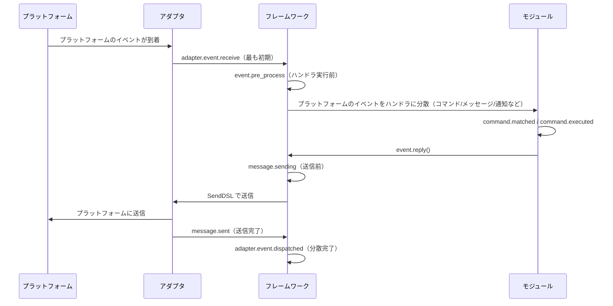

# ライフサイクル管理

> [!TIP]
> **この記事を読むべきタイミング**：フレームワークのライフサイクルイベント（起動 / 加載 / 状態変化）をサブスクライブする必要がある場合です。必要がない場合はスキップしても、他の機能の使用に影響はありません。

ErisPulse は、システムの各コンポーネントの実行状態を監視し、監査、統計、カスタムロジックなどの拡張機能を実現するための統一されたフック/ライフサイクルシステムを提供します。

システムは以下の3種類のトリガ方法をサポートしています：
- `await lifecycle.emit("event", data)` — 精簡版、任意のデータを渡す（`to="Owner"` の場合、指定された宛先に投递）
- `lifecycle.emit_sync("event", data)` — 同期版（非非同期コンテキストで使用）
- `await lifecycle.submit_event("event", ...)` — 旧版との互換性、自動的に標準的なイベント形式を構築

## イベント処理メカニズム

### ハンドラの登録

```python
from ErisPulse import sdk

# デコレータ形式
@sdk.lifecycle.on("module.load")
async def on_module_load(data):
    print(f"モジュールのロード: {data}")

# プログラミング形式での登録
sdk.lifecycle.register("module.load", on_module_load, priority=10)

# 登録解除
sdk.lifecycle.unregister("module.load", on_module_load)

# 所有者ごとに一括登録解除（モジュール/アダプタのアンロード時にフレームワークが自動的に呼び出す）
removed = sdk.lifecycle.unregister_by_owner("MyModule")
print(f"クリーンアップしたライフサイクルフック数: {removed}")
```

### 優先度

ハンドラは `priority` パラメータをサポートし、数値が大きいほど先に実行されます（モジュールローダーと同様）：

```python
@sdk.lifecycle.on("adapter.event.receive", priority=10)  # 最初に実行
async def first_handler(data):
    pass

@sdk.lifecycle.on("adapter.event.receive", priority=0)  # 後に実行
async def second_handler(data):
    pass
```

### ポイント構造イベント

具体的なイベントをトリガーすると、その親イベントもトリガーされます：
- `module.load` をトリガーすると、`module` もトリガーされます
- `adapter.event.receive` をトリガーすると、`adapter.event` と `adapter` もトリガーされます

### ワイルドカード

`*` を登録すると、すべてのイベントをキャッチできます：

```python
@sdk.lifecycle.on("*")
async def on_anything(data):
    print(f"イベントを受信: {data}")
```

### 定向伝播（emit to=）

> [!NOTE]
> この機能は ErisPulse **2.8.0+** が必要です。

`emit()` で `to` パラメータを指定すると、定向伝播モードになります。この場合、イベントは所有者（owner）として登録されたハンドラにのみ配信されます（モジュールが `on_load` 内で登録したフックは自動的に本モジュールに属します）。他のモジュールやワイルドカード `*` ハンドラは感知しません。

```python
# 投递元：イベントは Chat モジュールが登録したハンドラにのみ投递
await sdk.lifecycle.emit("message_received", {"text": "hi"}, to="Chat")

# 訂読元（Chat モジュール内）：同名のフックを登録し、owner は登録時に自動的に記録されます
@sdk.lifecycle.on("message_received")
async def on_message_received(data): ...

@sdk.lifecycle.on("message")   # ポイント構造の親プレフィックスも同様に有効（owner でフィルタリング）
async def on_any(data): ...
```

- 目標の owner に登録されたハンドラがない場合 → イベントは**消費されません**（`has_handlers()` で事前に検出可能です）
- `data` が dict の場合、自動的に `_trace_id` を付与します（既存値を上書きしません）
- `emit_sync` / `submit_event` でも `to=` パラメータがサポートされます
- モジュール間通信の3層モデル（RPC / 定向 / ブロードキャスト）は [モジュール間通信](module-communication.md) を参照してください

### 一回限りの登録（once）

2.7.0 から、`lifecycle.once()` で登録されたハンドラは**一度実行された後に自動的に登録解除**されます。これは「初回準備完了」のような一回限りのフックに適しています：

```python
@sdk.lifecycle.once("core.init.complete")
async def on_first_ready(data):
    print("初回準備完了、以降はトリガーされません")
```

- `on()` と同じ優先度パラメータの意味（`priority` の数値が大きいほど先に実行されます）
- 自動的に登録解除され、手動で `unregister` する必要はありません
- 同期/非同期のハンドラが両方サポートされています

### 監視者クエリ（has_handlers）

ホットパスの短絡処理では、`has_handlers()` を使って監視者が存在するか事前に判定し、不要なイベントのループやタスクのスケジューリングを避けることができます：

```python
if sdk.lifecycle.has_handlers("message.sending"):
    await sdk.lifecycle.emit("message.sending", send_ctx)
```

- 精確なイベント名、ワイルドカード `*`、親イベントの3種類のマッチングをカバー
- 監視者がいない場合、`False` を返し、`emit` を安全にスキップできます

## フックの断点一覧

プラットフォームからフレームワークにメッセージが入力されて処理完了までの典型的なライフサイクルイベントの時系列：



フレームワークは以下のフック断点を内蔵しており、`@sdk.lifecycle.on()` で任意の断点をサブスクライブしてカスタムロジックを実装できます。

### コア初期化

| フック名 | トリガータイミング | データ |
|---------|---------|------|
| `core.init.start` | SDK の初期化開始 | `{}` |
| `core.init.stage` | 初期化の各段階開始（バックグラウンドで発行） | `{"stage": str}`、値は `discovery` / `adapter_register` / `adapter_start` / `module_register` / `module_init` / `adapter_start_deferred` / `router_start` |
| `core.init.complete` | SDK の初期化完了 | `{"duration": float, "success": bool, "stages": {stage: float}, "adapters": {"enabled": [str], "disabled": [str]}, "modules": {"enabled": [str], "disabled": [str]}, "error": str(失敗時のみ)}` |
| `core.uninit.complete` | SDK の逆初期化完了 | `{"duration": float, "success": bool, "adapters_closed": int, "modules_unloaded": int, "module_properties_cleared": int, "module_properties_to_clear": [str], "error": str(失敗時のみ)}` |

**例：起動プロセスの表示**

```python
@sdk.lifecycle.on("core.init.stage")
def show_stage(data):
    print(f"[起動] 段階に進入: {data['stage']}")
```

### 設定変更

| フック名 | トリガータイミング | データ |
|---------|---------|------|
| `config.set` | 設定項目が変更された | `{"key": str, "old_value": Any, "new_value": Any}` |
| `config.updated` | 外部から `config.toml` を編集して木全体が変更されたことを検知した | `{"old_config": dict, "new_config": dict, "config_file": str}` |

**例：設定の監査**

```python
@sdk.lifecycle.on("config.set")
def audit_config(data):
    print(f"[監査] {data['key']}: {data['old_value']} -> {data['new_value']}")
```

### モジュールのライフサイクル

| フック名 | トリガータイミング | データ |
|---------|---------|------|
| `module.register` | モジュールクラスがマネージャーに登録された | `{"module_name": str, "success": bool}` |
| `module.load` | モジュールのロードが完了した（インスタンス化成功）；失敗時は `payload` に `"error": str, "traceback": str`（失敗現場は `module.last_error(名前)` でも確認可能）が追加 | `{"module_name": str, "success": bool}` |
| `module.init` | モジュールの初期化が完了した（遅延ロード含む） | `{"module_name": str, "success": bool}` |
| `module.before_unload` | アンロードのフローの最初のステップ（`on_unload` とリソース回収の前に；モジュールインスタンスのフック `on_before_unload` は同期的にトリガーされる） | `{"module_name": str, "reason": str}`；`reason` の値は `unload` / `reload` / `disable` / `cascade` / `dormant` |
| `module.sleep` | モジュールのスリープが完了した（遅延ロードの休眠：リソースは解放され、アクセス時に自動的に再起動） | `{"module_name": str, "success": bool}` |
| `module.unload` | モジュールのアンロード | `{"module_name": str, "success": bool}` |
| `module.reload` | モジュールのホットリロードが完了した（依存するモジュールも含む） | `{"module_name": str, "success": bool, "full": bool, "duration_ms": int}`；単一モジュールの場合は `"identity_changed": bool`（False = 進程内では古いコードが実行されている可能性がある、例：C拡張のキャッシュ）と `"version_old": str, "version_new": str` が追加される；全量リロード（`reload_all`）の場合は `module_name` は `"All"` で、`payload` に `"results": dict[str, bool]` が追加される |

> **モジュールインスタンスフック `on_before_unload`**：`module.before_unload` イベントに対応するオプションのライフサイクルメソッドです。`event["reason"]` に理由が記録され、`sdk.storage` に状態を保存して、再起動後に `on_load` で復元するのに適しています（遅延ロードの状態継続はこれに基づいています）。フックの失敗は警告として扱われ、アンロードのフローをブロックしません。

### アダプタのライフサイクル

| フック名 | トリガータイミング | データ |
|---------|---------|------|
| `adapter.load` | アダプタの登録が完了した | `{"platform": str, "success": bool}` |
| `adapter.reload` | アダプタのコードレベルのホットリロードが完了した | `{"adapter_name": str, "success": bool, "full": bool, "duration_ms": int, "identity_changed": bool, "version_old": str, "version_new": str, "was_started": bool, "source": str}`；`identity_changed=False` = 進程内では古いコードが実行されている可能性がある |
| `adapter.start` | アダプタの起動 | `{"platforms": [str]}` |
| `adapter.status.change` | アダプタのステータスが変化した | `{"platform": str, "status": str, "retry_count": int, "error": str(失敗時のみ)}`；status の完全な値は `starting` / `started` / `start_failed` / `stopping` / `stopped` / `stop_failed` / `skipped-dependency` / `disabled` |
| `adapter.stop` | アダプタの停止 | `{"platforms": [str]}` |
| `adapter.stopped` | アダプタの停止が完了した | `{"platforms": [str]}` |
| `adapter.bot.online` | Bot がオンラインになった | `{"platform": str, "bot_id": str, "info": dict, "status": str}` |
| `adapter.bot.offline` | Bot がオフラインになった | `{"platform": str, "bot_id": str, "status": str}` |

### イベントの受信と処理

| フック名 | トリガータイミング | データ |
|---------|---------|------|
| `adapter.event.receive` | 外部プラットフォームのイベントを受け取った（最も初期） | `{"platform": str, "event_type": str, "raw_event_type": str}` |
| `adapter.event.blocked` | 中間処理がイベントを拒否した（`False` を返した、イベントは処理されず他のハンドラにも渡されない） | `{"middleware": str, "platform": str, "event_type": str, "detail_type": str, "event": dict, "_trace_id": str}` |
| `adapter.event.dispatched` | イベントの分散が完了した | `{"platform": str, "event_type": str, "raw_event_type": str, "onebot_handlers_count": int}` |
| `event.pre_process` | イベントハンドラが実行される直前 | `{"event_type": str, "platform": str, "detail_type": str}` |

**例：イベントの統計**

```python
event_counter = {}

@sdk.lifecycle.on("adapter.event.receive")
def count_events(data):
    platform = data["platform"]
    event_counter[platform] = event_counter.get(platform, 0) + 1

@sdk.lifecycle.on("adapter.event.dispatched")
def log_unhandled(data):
    if data["onebot_handlers_count"] == 0:
        print(f"[未処理] {data['platform']}/{data['event_type']}")
```

### メッセージの送信

| フック名 | トリガータイミング | データ |
|---------|---------|------|
| `message.sending` | メッセージが送信される直前 | `{"platform": str, "method": str, "detail_type": str, "target_id": str, "bot_id": str}` |
| `message.sent` | メッセージの送信が完了した | `{"platform": str, "method": str, "detail_type": str, "target_id": str, "bot_id": str}` |

**例：メッセージ送信の監査**

```python
@sdk.lifecycle.on("message.sending")
def log_sending(data):
    print(f"[送信] -> {data['platform']}/{data['detail_type']}/{data['target_id']} via {data['method']}")
```

### コマンドシステム

| フック名 | トリガータイミング | データ |
|---------|---------|------|
| `command.matched` | コマンドがマッチし、実行される直前 | `{"command": str, "args": list[str], "platform": str, "user_id": str}` |
| `command.executed` | コマンドの実行が完了した | `{"command": str, "args": list[str], "platform": str, "user_id": str, "success": bool, "error": str(失敗時のみ)}` |

**例：コマンドの統計**

```python
@sdk.lifecycle.on("command.matched")
def count_commands(data):
    print(f"[コマンド] /{data['command']} from {data['user_id']}@{data['platform']}")
```

### HTTP ルーティング

| フック名 | トリガータイミング | データ |
|---------|---------|------|
| `server.request` | HTTP リクエストが受信された | `{"method": str, "path": str, "client_ip": str}` |
| `server.response` | HTTP レスポンスが送信された | `{"method": str, "path": str, "status_code": int, "client_ip": str}` |

**例：リクエストログ**

```python
@sdk.lifecycle.on("server.response")
def log_http(data):
    print(f"[HTTP] {data['method']} {data['path']} -> {data['status_code']}")
```

### WebSocket

| フック名 | トリガータイミング | データ |
|---------|---------|------|
| `server.start` | ルーティングサーバーが起動した | `{"base_url": str, "host": str, "port": int, "success": bool, "error": str(失敗時のみ)}` |
| `server.stop` | ルーティングサーバーが停止した | `{}` |
| `server.websocket.connect` | WebSocket 接続が確立した | `{"path": str, "module_name": str, "client_ip": str}` |
| `server.websocket.disconnect` | WebSocket 接続が切断した | `{"path": str, "module_name": str, "reason": str, "error": str(異常時のみ)}` |

**例：WebSocket 接続監視**

```python
@sdk.lifecycle.on("server.websocket.connect")
def on_ws_connect(data):
    print(f"[WS] 接続: {data['path']} from {data['client_ip']}")

@sdk.lifecycle.on("server.websocket.disconnect")
def on_ws_disconnect(data):
    print(f"[WS] 切断: {data['path']} ({data['reason']})")
```

### ストレージ接続状態

ストレージバックエンドの接続プールの確立、障害、および回復（すべてバックグラウンドで発行され、ストレージ操作をブロックしません）：

| フック名 | トリガータイミング | データ |
|---------|---------|------|
| `storage.ready` | ストレージバックエンドの接続プールが準備完了（各イベントループで最初のプール確立に成功した） | `{"backend": str}` |
| `storage.unreachable` | 接続リトライが尽き、冷却期間に入る（この間、操作は即座に失敗する） | `{"backend": str, "error": str, "cooldown": float}` |
| `storage.recovered` | 冷却が終了し、再接続に成功し、ストレージが再び利用可能になる | `{"backend": str}` |

**例：ストレージ障害のアラート**

```python
@sdk.lifecycle.on("storage.unreachable")
def alert_storage_down(data):
    print(f"[アラート] ストレージバックエンド {data['backend']} が利用不可: {data['error']}、{data['cooldown']}秒後に自動的に再接続されます")

@sdk.lifecycle.on("storage.recovered")
def notify_storage_back(data):
    print(f"[回復] ストレージバックエンド {data['backend']} が再び利用可能になりました")
```

### HTTP クライアント

`sdk.client` のリクエストと接続イベント（すべてバックグラウンドで発行されます）：

| フック名 | トリガータイミング | データ |
|---------|---------|------|
| `client.request.success` | HTTP リクエストが成功した | `{"method": str, "url": str, "status": int, "elapsed": float}` |
| `client.request.failed` | HTTP リクエストのリトライが尽き、最終的に失敗した | `{"method": str, "url": str, "error": str, "attempts": int, "elapsed": float}` |
| `client.ws.connect` | WebSocket 接続が確立した | `{"url": str}` |

### 国際化

| フック名 | トリガータイミング | データ |
|---------|---------|------|
| `i18n.language.changed` | フレームワークの言語が切り替わった（`i18n.set_language`） | `{"language": str, "previous": str}` |

## 標準イベントの定義

```python
STANDARD_EVENTS = {
    "core": ["init.start", "init.stage", "init.complete", "uninit.complete"],
    "module": ["load", "before_unload", "init", "sleep", "unload", "register", "reload"],
    "adapter": [
        "load", "start", "status.change", "reload", "stop", "stopped",
        "event.receive", "event.blocked", "event.dispatched",
        "bot.online", "bot.offline",
    ],
    "server": [
        "start", "stop",
        "request", "response",
        "websocket.connect", "websocket.disconnect",
    ],
    "event": ["pre_process"],
    "message": ["sending", "sent"],
    "command": ["matched", "executed"],
    "config": ["set", "updated"],
    "storage": ["ready", "unreachable", "recovered"],
    "client": ["request.success", "request.failed", "ws.connect"],
    "i18n": ["language.changed"],
}
```

## 完全な API リファレンス

### 登録と解除

| メソッド | 説明 |
|------|------|
| `@lifecycle.on(event, *, priority=0)` | デコレータでハンドラを登録 |
| `lifecycle.register(event, handler, *, priority=0)` | プログラミング形式で登録 |
| `lifecycle.unregister(event, handler=None)` | 登録解除（handler=None の場合、該当イベントのすべてのハンドラを解除） |

### トリガー

| メソッド | 説明 |
|------|------|
| `await lifecycle.emit(event, data=None, *, to=None)` | 非同期でトリガーし、ハンドラは**並列実行**（互いにブロックせず、返却時に全て完了）、返り値が None 以外の場合は優先度順に data を置き換え、`to` に owner を指定すると定向投递 | 
| `lifecycle.fire(event, data=None, *, to=None)` | **バックグラウンドで発行（投げて即終了）**：ハンドラはバックグラウンドタスクで並列実行、待機せず、返り値なし；ハンドラがいない場合、オーバーヘッドなし。高頻度なホットパスや純粋な観測イベントに適しています；停止シーケンスや順序が重要な消費（例：`config.set`）は `emit` を使用してください |
| `lifecycle.emit_sync(event, data=None, *, to=None)` | 同期でトリガーし、非同期ハンドラは create_task でスケジュール |
| `await lifecycle.submit_event(event_type, *, source, msg, data, to=None, background=False)` | 旧版との互換性、標準イベント形式を自動的に構築；`background=True` の場合、`fire` でバックグラウンドで発行 |

### ユーティリティ

| メソッド | 説明 |
|------|------|
| `lifecycle.start_timer(timer_id)` | タイマーを開始 |
| `lifecycle.get_duration(timer_id)` | 継続時間を取得（秒） |
| `lifecycle.stop_timer(timer_id)` | タイマーを停止し、継続時間を返す |
| `lifecycle.list_hooks()` | すべての登録されたフックとハンドラ数をリスト |
| `lifecycle.clear()` | すべてのハンドラとタイマーをクリア |

## モジュールでの使用例

```python
from ErisPulse.Core.Bases import BaseModule
from ErisPulse import sdk

class Main(BaseModule):
    async def on_load(self, event):
        # 簡単なメッセージ統計を実装
        self.msg_count = 0
        
        @sdk.lifecycle.on("adapter.event.receive")
        async def count(data):
            if data["event_type"] == "message":
                self.msg_count += 1
        
        # すべてのコマンドを監視
        @sdk.lifecycle.on("command.matched")
        async def log_cmd(data):
            sdk.logger.info(f"コマンド実行: /{data['command']} by {data['user_id']}")
        
        # 設定変更の監査
        @sdk.lifecycle.on("config.set")
        def audit(data):
            sdk.logger.info(f"設定変更: {data['key']} = {data['new_value']}")
```

## バックグラウンドタスクの所有者と自動キャンセル

> [!NOTE]
> この機能は ErisPulse **2.8.0+** が必要です。

モジュールが作成した asyncio バックグラウンドタスクは、`on_unload` でキャンセルしない場合、`self` を保持してモジュールインスタンスの回収ができない（ホットリロード後に古いインスタンスが残る）。フレームワークは以下のバックアップメカニズムを提供します：

- **`self.spawn(coro)`**（モジュール内で推奨）：タスクは自動的にモジュール名に属し、モジュールのアンロード時にフレームワークが `on_unload` **の後に**未完了のタスクをキャンセルし、警告を記録します
- **`spawn_background(coro)`**（`ErisPulse.runtime`）：現在の `owner_scope` コンテキストを自動的にキャプチャします；`cancel_owner_tasks(owner)` で所有者ごとにキャンセル、`cancel_all_background_tasks()` は `sdk.uninit()` のバックアップとして使用
- **アダプタ**：プラットフォーム名以下のバックグラウンドタスクも同様にアンロード時にキャンセルされます

```python
async def on_load(self, event):
    # 推奨：バックグラウンドタスクは self.spawn() を使用し、アンロード時にフレームワークが自動的にバックアップでキャンセル
    self.spawn(self._poll())

async def on_unload(self, event):
    # 精密制御が必要な場合は、キャンセルして終了を待つことを推奨
    if self._poll_task:
        self._poll_task.cancel()
        await asyncio.gather(self._poll_task, return_exceptions=True)

async def _poll(self):
    while True:
        await asyncio.sleep(60)
        ...
```

> [!IMPORTANT]
> フレームワークのバックアップは**強制キャンセル**（`cancel_owner_tasks`）です。これは `on_unload` の返り値の後に発生します。したがって、優雅な終了が必要なタスク（バッファのフラッシュ、状態の永続化、接続の閉鎖）は**必ず**`on_unload` で `cancel()` して `await` で完了させる必要があります。バックアップが終了処理を保証するとは考えないでください。`await` の結果が必要なタスクは、`await` してバックグラウンドタスクに投げないでください。

## 注意事項

1. **ハンドラは同期または非同期**：システムは自動的に正しく呼び出します
2. **データの渡し方**：`emit()` モードでは、ハンドラが None 以外の値を返すと、後続のハンドラに渡される data が変更されます
3. **イベント名の命名規則**：点構造の命名を使用することを推奨し、親イベントの監視がしやすくなります
4. **エラーの隔離**：1つのハンドラの例外は他のハンドラの実行に影響しません
5. **同期トリガーの制限**：`emit_sync()` では非同期ハンドラは fire-and-forget 方式でスケジュールされ、返り値は戻されません
6. **ライフサイクルのクリーンアップ**：`sdk.uninit()` を呼び出すと、すべての登録されたハンドラとタイマーがクリーンアップされます
7. **ロードの優先性**：フレームワークの初期化段階でイベントをサブスクライブする必要がある場合、高優先度を設定し、遅延ロードを無効にすることを推奨します

## 関連文書

- [モジュール開発ガイド](../developer-guide/modules/getting-started.md) - モジュールのライフサイクルメソッドの詳細
- [ベストプラクティス](../developer-guide/modules/best-practices.md) - ライフサイクルイベントの使用に関する推奨事項