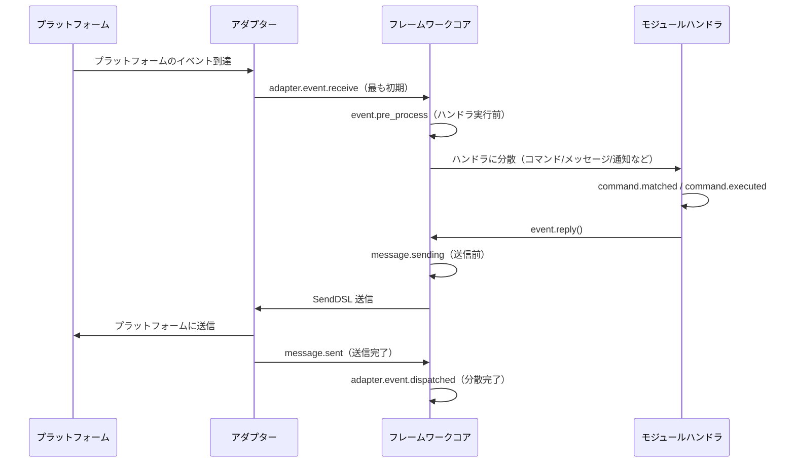

# ライフサイクル管理

> [!TIP]
> **この記事を読む必要があるのはいつか**：フレームワークのライフサイクルイベント（起動 / 加載 / 状態変化）をサブスクライブする必要がある場合。必要ない場合はスキップしても、他の機能の使用に影響はありません。

ErisPulse は、システムの各コンポーネントの実行状態を監視し、監査、統計、カスタムロジックなどの拡張機能を実現するための統一されたフック/ライフサイクルシステムを提供します。

システムは以下の3種類のトリガー方式をサポートしています：
- `await lifecycle.emit("event", data)` — 精簡版、任意のデータを渡す（`to="Owner"` で指定送信）
- `lifecycle.emit_sync("event", data)` — 同期版（非非同期コンテキストで使用）
- `await lifecycle.submit_event("event", ...)` — 旧バージョンとの互換性、標準イベント形式を自動構築

## イベント処理メカニズム

### ハンドラの登録

```python
from ErisPulse import sdk

# デコレータ形式
@sdk.lifecycle.on("module.load")
async def on_module_load(data):
    print(f"モジュール加載: {data}")

# プログラム形式での登録
sdk.lifecycle.register("module.load", on_module_load, priority=10)

# 登録解除
sdk.lifecycle.unregister("module.load", on_module_load)

# 所有者ごとの一括登録解除（モジュール/アダプターのアンロード時にフレームワークが自動的に呼び出す）
removed = sdk.lifecycle.unregister_by_owner("MyModule")
print(f"クリーンアップしたライフサイクルフック数: {removed}")
```

### 優先度

ハンドラは `priority` パラメータをサポートし、数値が大きいほど先に実行されます（モジュールローダーと同様）：

```python
@sdk.lifecycle.on("adapter.event.receive", priority=10)  # 最初に実行
async def first_handler(data):
    pass

@sdk.lifecycle.on("adapter.event.receive", priority=0)  # 後に実行
async def second_handler(data):
    pass
```

### 点式構造イベント

具体的なイベントをトリガーすると、その親イベントもトリガーされます：
- `module.load` をトリガーすると、`module` もトリガーされます
- `adapter.event.receive` をトリガーすると、`adapter.event` と `adapter` もトリガーされます

### ワイルドカード

`*` を登録することで、すべてのイベントをキャッチできます：

```python
@sdk.lifecycle.on("*")
async def on_anything(data):
    print(f"イベント受信: {data}")
```

### 指定送信（emit to=）

> [!NOTE]
> この機能は ErisPulse **2.8.0+** が必要です。

`emit()` で `to` パラメータを指定すると、指定された所有者（owner）に登録されたハンドラにのみイベントが送信されます（モジュールは `on_load` 内で登録したフックは自動的に所属モジュールになります）。他のモジュールやワイルドカード `*` ハンドラはイベントを感知しません。

```python
# 送信元：イベントは Chat モジュールに登録されたハンドラにのみ送信される
await sdk.lifecycle.emit("message_received", {"text": "hi"}, to="Chat")

# 受信元（Chat モジュール内）：同名のハンドラを登録し、owner は登録時に自動的に記録される
@sdk.lifecycle.on("message_received")
async def on_message_received(data): ...

@sdk.lifecycle.on("message")   # 点式の親プレフィックスも同様に有効（owner でフィルタリング）
async def on_any(data): ...
```

- 対象の所有者が登録されたハンドラがない場合 → イベントは**消費されない**（`has_handlers()` で事前に検出可能）
- `data` が dict の場合、自動で `_trace_id` を追加（既存値は上書きしない）
- `emit_sync` / `submit_event` も `to=` パラメータをサポート
- モジュール間通信の3層モデル（RPC / 指定送信 / ブロードキャスト）は [モジュール間通信](module-communication.md) を参照してください

### 一回限りの登録（once）

2.7.0 から、`lifecycle.once()` で登録されたハンドラは**一度実行後自動で登録解除**されます。これは「初期準備完了」のような一回限りのフックに適しています。

```python
@sdk.lifecycle.once("core.init.complete")
async def on_first_ready(data):
    print("初期準備完了、以降はトリガーされない")
```

- `on()` と同じ優先度パラメータの意味（`priority` 数値が大きいほど先に実行）
- 自動で登録解除、手動での `unregister` は不要
- 同期/非同期ハンドラの両方をサポート

### 監視者検索（has_handlers）

ホットパスの短絡処理では、`has_handlers()` を使って監視者がいるかどうかを事前に判断し、無駄なイベントのループやタスクのスケジューリングを避けることができます。

```python
if sdk.lifecycle.has_handlers("message.sending"):
    await sdk.lifecycle.emit("message.sending", send_ctx)
```

- 精確なイベント名、ワイルドカード `*`、親イベントの3種類のマッチングをカバー
- 監視者がいない場合、`False` を返し、`emit` を安全にスキップできる

## フックの断点一覧

プラットフォームからフレームワークにメッセージが到達して処理が完了するまでの典型的なライフサイクルイベントの順序：



フレームワークは以下のフック断点を内蔵しており、ユーザーは `@sdk.lifecycle.on()` を使って任意の断点を監視してカスタムロジックを実装できます。

### コア初期化

| フック名 | トリガータイミング | データ |
|---------|---------|------|
| `core.init.start` | SDK 初期化開始 | `{}` |
| `core.init.stage` | 初期化各段階開始（バックグラウンドで発射） | `{"stage": str}`、値は `discovery` / `adapter_register` / `adapter_start` / `module_register` / `module_init` / `adapter_start_deferred` / `router_start` |
| `core.init.complete` | SDK 初期化完了 | `{"duration": float, "success": bool, "stages": {stage: float}, "adapters": {"enabled": [str], "disabled": [str]}, "modules": {"enabled": [str], "disabled": [str]}, "error": str(失敗時のみ)}` |
| `core.uninit.complete` | SDK 反初期化完了 | `{"duration": float, "success": bool, "adapters_closed": int, "modules_unloaded": int, "module_properties_cleared": int, "module_properties_to_clear": [str], "error": str(失敗時のみ)}` |

**例：起動進捗表示**

```python
@sdk.lifecycle.on("core.init.stage")
def show_stage(data):
    print(f"[起動] 段階に移行: {data['stage']}")
```

### 設定変更

| フック名 | トリガータイミング | データ |
|---------|---------|------|
| `config.set` | 設定項目が変更された | `{"key": str, "old_value": Any, "new_value": Any}` |
| `config.updated` | 外部で config.toml を編集した後に検出されたツリー全体の変更 | `{"old_config": dict, "new_config": dict, "config_file": str}` |

**例：設定監査**

```python
@sdk.lifecycle.on("config.set")
def audit_config(data):
    print(f"[監査] {data['key']}: {data['old_value']} -> {data['new_value']}")
```

### モジュールライフサイクル

| フック名 | トリガータイミング | データ |
|---------|---------|------|
| `module.register` | モジュールクラスがマネージャーに登録された | `{"module_name": str, "success": bool}` |
| `module.load` | モジュールのロードが完了した（インスタンス化成功） | `{"module_name": str, "success": bool}` |
| `module.init` | モジュールの初期化が完了した（遅延ロード含む） | `{"module_name": str, "success": bool}` |
| `module.unload` | モジュールのアンロード | `{"module_name": str, "success": bool}` |
| `module.reload` | モジュールのホットリロードが完了した（依存者を含む連鎖リロード） | `{"module_name": str, "success": bool, "full": bool}`；全量リロード（`reload_all`）の場合は `module_name` が `"All"` になり、payload に `"results": dict[str, bool]` が追加される |

### アダプターライフサイクル

| フック名 | トリガータイミング | データ |
|---------|---------|------|
| `adapter.load` | アダプターの登録が完了した | `{"platform": str, "success": bool}` |
| `adapter.start` | アダプターの起動 | `{"platforms": [str]}` |
| `adapter.status.change` | アダプターのステータスが変化した | `{"platform": str, "status": str, "retry_count": int, "error": str(失敗時のみ)}`；status の完全な値は `starting` / `started` / `start_failed` / `stopping` / `stopped` / `stop_failed` / `skipped-dependency` / `disabled` |
| `adapter.stop` | アダプターの停止 | `{"platforms": [str]}` |
| `adapter.stopped` | アダプターの停止が完了した | `{"platforms": [str]}` |
| `adapter.bot.online` | Bot のオンライン | `{"platform": str, "bot_id": str, "info": dict, "status": str}` |
| `adapter.bot.offline` | Bot のオフライン | `{"platform": str, "bot_id": str, "status": str}` |

### イベント受信と処理

| フック名 | トリガータイミング | データ |
|---------|---------|------|
| `adapter.event.receive` | 外部プラットフォームのイベントを受信した（最も初期） | `{"platform": str, "event_type": str, "raw_event_type": str}` |
| `adapter.event.blocked` | ミドルウェアがイベントをブロックした（`False` を返した場合、イベントは他のハンドラに渡されず破棄される） | `{"middleware": str, "platform": str, "event_type": str, "detail_type": str, "event": dict, "_trace_id": str}` |
| `adapter.event.dispatched` | イベントの分散が完了した | `{"platform": str, "event_type": str, "raw_event_type": str, "onebot_handlers_count": int}` |
| `event.pre_process` | イベントハンドラの実行前に | `{"event_type": str, "platform": str, "detail_type": str}` |

**例：イベント統計**

```python
event_counter = {}

@sdk.lifecycle.on("adapter.event.receive")
def count_events(data):
    platform = data["platform"]
    event_counter[platform] = event_counter.get(platform, 0) + 1

@sdk.lifecycle.on("adapter.event.dispatched")
def log_unhandled(data):
    if data["onebot_handlers_count"] == 0:
        print(f"[未処理] {data['platform']}/{data['event_type']}")
```

### メッセージ送信

| フック名 | トリガータイミング | データ |
|---------|---------|------|
| `message.sending` | メッセージが送信される直前 | `{"platform": str, "method": str, "detail_type": str, "target_id": str, "bot_id": str}` |
| `message.sent` | メッセージの送信が完了した | `{"platform": str, "method": str, "detail_type": str, "target_id": str, "bot_id": str}` |

**例：メッセージ送信監査**

```python
@sdk.lifecycle.on("message.sending")
def log_sending(data):
    print(f"[送信] -> {data['platform']}/{data['detail_type']}/{data['target_id']} via {data['method']}")
```

### コマンドシステム

| フック名 | トリガータイミング | データ |
|---------|---------|------|
| `command.matched` | コマンドがマッチして実行される直前 | `{"command": str, "args": list[str], "platform": str, "user_id": str}` |
| `command.executed` | コマンドの実行が完了した | `{"command": str, "args": list[str], "platform": str, "user_id": str, "success": bool, "error": str(失敗時のみ)}` |

**例：コマンド統計**

```python
@sdk.lifecycle.on("command.matched")
def count_commands(data):
    print(f"[コマンド] /{data['command']} from {data['user_id']}@{data['platform']}")
```

### HTTPルーティング

| フック名 | トリガータイミング | データ |
|---------|---------|------|
| `server.request` | HTTPリクエストの受信 | `{"method": str, "path": str, "client_ip": str}` |
| `server.response` | HTTPレスポンスの送信 | `{"method": str, "path": str, "status_code": int, "client_ip": str}` |

**例：リクエストログ**

```python
@sdk.lifecycle.on("server.response")
def log_http(data):
    print(f"[HTTP] {data['method']} {data['path']} -> {data['status_code']}")
```

### WebSocket

| フック名 | トリガータイミング | データ |
|---------|---------|------|
| `server.start` | ルーティングサーバーの起動 | `{"base_url": str, "host": str, "port": int, "success": bool, "error": str(失敗時のみ)}` |
| `server.stop` | ルーティングサーバーの停止 | `{}` |
| `server.websocket.connect` | WebSocket接続の確立 | `{"path": str, "module_name": str, "client_ip": str}` |
| `server.websocket.disconnect` | WebSocket接続の切断 | `{"path": str, "module_name": str, "reason": str, "error": str(異常時のみ)}` |

**例：WebSocket接続監視**

```python
@sdk.lifecycle.on("server.websocket.connect")
def on_ws_connect(data):
    print(f"[WS] 接続: {data['path']} from {data['client_ip']}")

@sdk.lifecycle.on("server.websocket.disconnect")
def on_ws_disconnect(data):
    print(f"[WS] 切断: {data['path']} ({data['reason']})")
```

### ストレージ接続状態

ストレージバックエンドの接続プールの確立、障害、回復（すべてバックグラウンドで発射され、ストレージ操作をブロックしない）：

| フック名 | トリガータイミング | データ |
|---------|---------|------|
| `storage.ready` | ストレージバックエンドの接続プールが準備完了（各イベントループで最初にプールが確立された場合） | `{"backend": str}` |
| `storage.unreachable` | 接続リトライが尽き、クールダウン期間に入る（この間、操作は即座に失敗する） | `{"backend": str, "error": str, "cooldown": float}` |
| `storage.recovered` | クールダウン終了後、再接続に成功し、ストレージが再利用可能になる | `{"backend": str}` |

**例：ストレージ障害アラート**

```python
@sdk.lifecycle.on("storage.unreachable")
def alert_storage_down(data):
    print(f"[アラート] ストレージバックエンド {data['backend']} が利用不可: {data['error']}、{data['cooldown']}秒後に自動再接続")

@sdk.lifecycle.on("storage.recovered")
def notify_storage_back(data):
    print(f"[回復] ストレージバックエンド {data['backend']} が再利用可能になりました")
```

### HTTPクライアント

`sdk.client` のリクエストと接続イベント（すべてバックグラウンドで発射）：

| フック名 | トリガータイミング | データ |
|---------|---------|------|
| `client.request.success` | HTTPリクエストが成功 | `{"method": str, "url": str, "status": int, "elapsed": float}` |
| `client.request.failed` | HTTPリクエストがリトライを尽くし最終的に失敗 | `{"method": str, "url": str, "error": str, "attempts": int, "elapsed": float}` |
| `client.ws.connect` | WebSocket接続の確立 | `{"url": str}` |

### 国際化

| フック名 | トリガータイミング | データ |
|---------|---------|------|
| `i18n.language.changed` | フレームワークの言語が切り替わった（`i18n.set_language`） | `{"language": str, "previous": str}` |

## 標準イベント定義

```python
STANDARD_EVENTS = {
    "core": ["init.start", "init.stage", "init.complete", "uninit.complete"],
    "module": ["load", "init", "unload", "register", "reload"],
    "adapter": [
        "load", "start", "status.change", "stop", "stopped",
        "event.receive", "event.dispatched",
        "bot.online", "bot.offline",
    ],
    "server": [
        "start", "stop",
        "request", "response",
        "websocket.connect", "websocket.disconnect",
    ],
    "event": ["pre_process"],
    "message": ["sending", "sent"],
    "command": ["matched", "executed"],
    "config": ["set", "updated"],
    "storage": ["ready", "unreachable", "recovered"],
    "client": ["request.success", "request.failed", "ws.connect"],
    "i18n": ["language.changed"],
}
```

## 完全なAPIリファレンス

### 登録と解除

| メソッド | 説明 |
|------|------|
| `@lifecycle.on(event, *, priority=0)` | デコレータでハンドラを登録 |
| `lifecycle.register(event, handler, *, priority=0)` | プログラム形式で登録 |
| `lifecycle.unregister(event, handler=None)` | 登録解除（handler=None の場合、該当イベントのすべてのハンドラを解除） |

### トリガー

| メソッド | 説明 |
|------|------|
| `await lifecycle.emit(event, data=None, *, to=None)` | 非同期でトリガーし、ハンドラを**並列実行**（互いにブロックせず、返却時にすべて完了）、返り値がNoneでない場合、優先度順にdataを置換してチェーンバック；`to` で所有者を指定すると、指定所有者のハンドラにのみ送信 |
| `lifecycle.fire(event, data=None, *, to=None)` | **バックグラウンドで発射（投げた後は即離）**：ハンドラをバックグラウンドタスクで並列実行、待機せず、返り値なし；ハンドラがいない場合、オーバーヘッドなし。高頻度のホットパスや観測イベントに適している。停止シーケンスや順序依存消費（例：`config.set`）は `emit` を使用すること |
| `lifecycle.emit_sync(event, data=None, *, to=None)` | 同期でトリガーし、非同期ハンドラは create_task でスケジュール |
| `await lifecycle.submit_event(event_type, *, source, msg, data, to=None, background=False)` | 旧バージョンとの互換性、標準イベント形式を自動構築；`background=True` の場合は `fire` のバックグラウンド発射を使用 |

### ユーティリティ

| メソッド | 説明 |
|------|------|
| `lifecycle.start_timer(timer_id)` | タイマーの開始 |
| `lifecycle.get_duration(timer_id)` | 経過時間を取得（秒） |
| `lifecycle.stop_timer(timer_id)` | タイマーを停止し、経過時間を返す |
| `lifecycle.list_hooks()` | すべての登録されたフックとハンドラ数をリストする |
| `lifecycle.clear()` | すべてのハンドラとタイマーをクリアする |

## モジュールでの使用例

```python
from ErisPulse.Core.Bases import BaseModule
from ErisPulse import sdk

class Main(BaseModule):
    async def on_load(self, event):
        # 簡単なメッセージ統計を実装
        self.msg_count = 0
        
        @sdk.lifecycle.on("adapter.event.receive")
        async def count(data):
            if data["event_type"] == "message":
                self.msg_count += 1
        
        # すべてのコマンドを監視
        @sdk.lifecycle.on("command.matched")
        async def log_cmd(data):
            sdk.logger.info(f"コマンド実行: /{data['command']} by {data['user_id']}")
        
        # 設定変更の監査
        @sdk.lifecycle.on("config.set")
        def audit(data):
            sdk.logger.info(f"設定変更: {data['key']} = {data['new_value']}")
```

## バックグラウンドタスクの所有者と自動解除

> [!NOTE]
> この機能は ErisPulse **2.8.0+** が必要です。

モジュールが作成した asyncio バックグラウンドタスクが `on_unload` で解除されない場合、`self` の参照が保持され、モジュールインスタンスが回収されない（ホットリロード後に古いインスタンスが残る）可能性があります。フレームワークは以下のバックアップメカニズムを提供しています：

- **`self.spawn(coro)`**（モジュール内で推奨）：タスクは自動的にモジュール名に所属し、モジュールのアンロード時にフレームワークが `on_unload` **の後に**未完了のタスクをバックアップでキャンセルし、警告を記録します。
- **`spawn_background(coro)`**（`ErisPulse.runtime`）：現在の `owner_scope` コンテキストを自動的にキャプチャします。`cancel_owner_tasks(owner)` で所属をキャンセルし、`cancel_all_background_tasks()` は `sdk.uninit()` のバックアップ用です。
- **アダプター**：プラットフォーム名の下のバックグラウンドタスクも同様にバックアップでキャンセルされます。

```python
async def on_load(self, event):
    # 推奨：バックグラウンドタスクは self.spawn() を使用し、アンロード時にフレームワークがバックアップで自動的にキャンセルされます
    self.spawn(self._poll())

async def on_unload(self, event):
    # 精密制御の場合は、自分でキャンセルし、終了処理を待つ必要があります
    if self._poll_task:
        self._poll_task.cancel()
        await asyncio.gather(self._poll_task, return_exceptions=True)

async def _poll(self):
    while True:
        await asyncio.sleep(60)
        ...
```

> [!IMPORTANT]
> フレームワークのバックアップは**強制キャンセル**（`cancel_owner_tasks`）です。これは `on_unload` の返り値の後に発生します。そのため、優雅な終了処理が必要なタスク（バッファのフラッシュ、状態の永続化、接続の閉じる）は **`on_unload` で `cancel()` と `await` を行う必要があります**—バックアップが終了処理を保証するとは思わないでください。フレームワークは「`self` を保持するタスクが残らない」ことを保証するだけで、「優雅」を保証するものではありません。`await` の結果が必要なタスクは `await` してください、バックグラウンドタスクに投げないでください。

## 注意事項

1. **ハンドラは同期または非同期**：システムは自動的に正しく呼び出します
2. **データの渡し方**：`emit()` モードでは、ハンドラが `None` 以外の値を返すと、後続のハンドラに渡される `data` が変更されます
3. **イベント命名規則**：点式構造でイベント名を付けることを推奨し、親イベントの監視がしやすくなります
4. **エラーの分離**：1つのハンドラのエラーは他のハンドラの実行に影響しません
5. **同期トリガーの制限**：`emit_sync()` 中の非同期ハンドラは fire-and-forget 方式でスケジュールされ、返り値は戻されません
6. **ライフサイクルのクリーンアップ**：`sdk.uninit()` を呼び出すと、すべての登録されたハンドラとタイマーがクリーンアップされます
7. **ロードの優先性**：フレームワークの初期化段階でイベントを監視する必要がある場合、高優先度を設定し、遅延ロードを無効化することを推奨します

## 関連ドキュメント

- [モジュール開発ガイド](../developer-guide/modules/getting-started.md) - モジュールのライフサイクルメソッドを理解する
- [ベストプラクティス](../developer-guide/modules/best-practices.md) - ライフサイクルイベントの使用に関する推奨事項