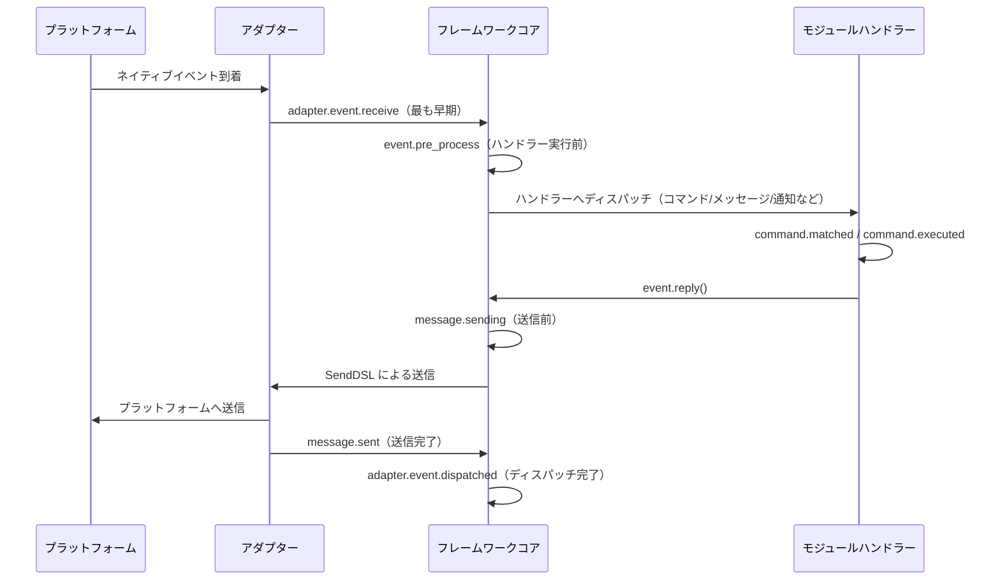

# ライフサイクル管理

> [!TIP]
> **この記事を読むべきタイミング**：フレームワークのライフサイクルイベント（起動 / 加載 / 状態変化）をサブスクライブする必要がある場合。不要な場合はスキップしても、他の機能の使用に影響はありません。

> **この記事でわかること**：ライフサイクルイベントの登録 / トリガー / 定向配信メカニズム、4種類のトリガーAPIの違いと選択方法、フレームワークが事前に埋め込んだすべてのフックポイント（core / module / adapter / server / messageなど）のデータ形式。
>
> **この記事では扱わないこと**：モジュール自身が実装するライフサイクルメソッド（`on_load` / `on_unload`、[モジュール開発ガイド](../developer-guide/modules/getting-started.md)参照）；起動プロセスの各段階の詳細（[起動フローと手動制御](startup.md)参照）。

モジュールのロード失敗、設定の変更、メッセージの送信、コマンドの実行などの節目に通知を受け取り、独自のロジック（監査、統計、アラート、連動）を実行したい場合は、フレームワークのライフサイクルイベントをサブスクライブしてください。フレームワークは各重要な節点にフックポイントを埋め込んでおり、`@sdk.lifecycle.on("イベント名")` で一行で接続できます。本文末尾には、すべてのフックポイントの一覧が付いています。

システムは3種類のトリガー方法をサポートしています：
- `await lifecycle.emit("event", data)` — 精簡版、任意のデータを渡す（`to="Owner"` の場合、指定したオーナーにだけ配信）
- `lifecycle.emit_sync("event", data)` — 同期版（非非同期コンテキストで使用）
- `await lifecycle.submit_event("event", ...)` — 旧版と互換、標準イベント形式を自動構築

## イベント処理メカニズム

### ハンドラの登録

```python
from ErisPulse import sdk

# デコレータ形式
@sdk.lifecycle.on("module.load")
async def on_module_load(data):
    print(f"モジュールのロード: {data}")

# プログラミング形式での登録
sdk.lifecycle.register("module.load", on_module_load, priority=10)

# 登録解除
sdk.lifecycle.unregister("module.load", on_module_load)

# オーナーごとの一括登録解除（モジュール/アダプターのアンロード時にフレームワークが自動的に呼び出す）
removed = sdk.lifecycle.unregister_by_owner("MyModule")
print(f"クリーンアップされたライフサイクルフック: {removed} 個")
```

### 优先度

ハンドラは `priority` パラメータをサポートし、数値が大きいほど先に実行されます（モジュールローダーと同様）：

```python
@sdk.lifecycle.on("adapter.event.receive", priority=10)  # 最初に実行
async def first_handler(data):
    pass

@sdk.lifecycle.on("adapter.event.receive", priority=0)  # 後に実行
async def second_handler(data):
    pass
```

### 点式構造イベント

イベントをトリガーすると、その親イベントもトリガーされます：
- `module.load` をトリガーすると、`module` もトリガーされます
- `adapter.event.receive` をトリガーすると、`adapter.event` と `adapter` もトリガーされます

### ワイルドカード

`*` を登録することで、すべてのイベントをキャッチできます：

```python
@sdk.lifecycle.on("*")
async def on_anything(data):
    print(f"イベントを受信: {data}")
```

### 定向配信（emit to=）

> [!NOTE]
> この機能は ErisPulse **2.8.0+** が必要です。

`emit()` で `to` パラメータを指定すると、定向配信モードになります。イベントは、その所有者（owner）として登録されたハンドラにだけ配信されます（モジュールの `on_load` 内で登録されたフックは、自動的にそのモジュールに所属します）。他のモジュールやワイルドカード `*` ハンドラは感知しません。

```python
# 投递方：イベントは Chat モジュールが登録したフックにだけ配信
await sdk.lifecycle.emit("message_received", {"text": "hi"}, to="Chat")

# 訂閱方（Chat モジュール内）：同名フックを登録し、owner は登録時に自動的に記録される
@sdk.lifecycle.on("message_received")
async def on_message_received(data): ...

@sdk.lifecycle.on("message")   # 点式の親プレフィックスも同様に有効（owner でフィルタリング）
async def on_any(data): ...
```

- 対象の owner に登録されたフックがない場合 → イベントは**消費されない**（`has_handlers()` で事前に検出可能）
- `data` が dict の場合、自動的に `_trace_id` を含める（既存値を上書きしない）
- `emit_sync` / `submit_event` でも `to=` パラメータをサポート
- モジュール間通信の3層モデル（RPC / 定向 / ブロードキャスト）は [モジュール間通信](module-communication.md) を参照

### 一回限りの登録（once）

2.7.0 から、`lifecycle.once()` で登録したハンドラは**一度トリガーされると自動的に登録解除**されます。これは「初回完了」のような一回限りのフックに適しています：

```python
@sdk.lifecycle.once("core.init.complete")
async def on_first_ready(data):
    print("初回完了、以降はトリガーされない")
```

- `on()` と同じ優先度パラメータの意味（`priority` 数値が大きいほど先に実行）
- 自動的に登録解除され、手動で `unregister` する必要はない
- 同期/非同期ハンドラの両方をサポート

### 監視者検索（has_handlers）

ホットパスの短絡処理では、`has_handlers()` を使って監視者がいるかどうかを事前に判断し、不要なイベントのループやタスクのスケジューリングを避けることができます：

```python
if sdk.lifecycle.has_handlers("message.sending"):
    await sdk.lifecycle.emit("message.sending", send_ctx)
```

- 精確なイベント名、ワイルドカード `*`、親イベントの3つのマッチングをカバー
- 監視者がいない場合は `False` を返し、`emit` を安全にスキップできる

## フックブレークポイント一覧

プラットフォームからフレームワークに入った 1 件のメッセージが処理完了までに辿る、典型的なライフサイクルイベントのシーケンス：



フレームワークには以下のフックブレークポイントが組み込まれており、ユーザーは `@sdk.lifecycle.on()` を使って任意のブレークポイントをリッスンし、カスタムロジックを実装できます。

### コア初期化

| フック名 | 発火タイミング | データ |
|---------|---------|------|
| `core.init.start` | SDK 初期化の開始 | `{}` |
| `core.init.stage` | 初期化の各段階の開始（バックグラウンドで発火） | `{"stage": str}`。値：`discovery` / `adapter_register` / `adapter_start` / `module_register` / `module_init` / `adapter_start_deferred` / `router_start` |
| `core.init.complete` | SDK 初期化の完了 | `{"duration": float, "success": bool, "stages": {stage: float}, "adapters": {"enabled": [str], "disabled": [str]}, "modules": {"enabled": [str], "disabled": [str]}, "error": str(失敗時のみ)}` |
| `core.uninit.complete` | SDK のアンイニシャライズ完了 | `{"duration": float, "success": bool, "adapters_closed": int, "modules_unloaded": int, "module_properties_cleared": int, "module_properties_to_clear": [str], "error": str(失敗時のみ)}` |

**例：起動進捗の表示**

```python
@sdk.lifecycle.on("core.init.stage")
def show_stage(data):
    print(f"[起動] フェーズに入りました: {data['stage']}")
```

### 設定変更

| フック名 | 発火タイミング | データ |
|---------|---------|------|
| `config.set` | 設定項目が変更された | `{"key": str, "old_value": Any, "new_value": Any}` |
| `config.updated` | config.toml の外部編集後にツリー全体の変更を検出 | `{"old_config": dict, "new_config": dict, "config_file": str}` |

**例：設定の監査**

```python
@sdk.lifecycle.on("config.set")
def audit_config(data):
    print(f"[監査] {data['key']}: {data['old_value']} -> {data['new_value']}")
```

### モジュールライフサイクル

| フック名 | 発火タイミング | データ |
|---------|---------|------|
| `module.register` | モジュールクラスがマネージャーに登録される | `{"module_name": str, "success": bool}` |
| `module.load` | モジュールのロード完了（インスタンス化成功）。失敗時は payload に `"error": str, "traceback": str` が追加で含まれる（失敗時の情報は `module.last_error(名前)` でも照会可能） | `{"module_name": str, "success": bool}` |
| `module.init` | モジュールの初期化完了（遅延ロードを含む） | `{"module_name": str, "success": bool}` |
| `module.before_unload` | アンロードパイプラインの最初のステップ（`on_unload` とリソース回収より前に実行。モジュールインスタンスフック `on_before_unload` も同時に発火） | `{"module_name": str, "reason": str}`。`reason` の値：`unload` / `reload` / `disable` / `cascade` / `dormant` |
| `module.sleep` | モジュールのスリープ完了（遅延ロード休眠：リソースは解放済み、アクセス時に自動的に復帰） | `{"module_name": str, "success": bool}` |
| `module.unload` | モジュールのアンロードまたは無効化（`disable` と `unload` は依存側に対等に通知され、`on_dependency_lost` の契約に「無効化」を含む） | `{"module_name": str, "success": bool, "reason": str}`。`reason` の値：`unload` / `reload` / `disable` / `cascade` / `dormant` |
| `module.rollback` | ホットリロード失敗時のロールバック完了（スナップショット復元 + 旧インスタンスの `on_load` 再実行後） | `{"module_name": str, "success": bool}`。`success` は `on_load` の再実行が成功したかを示す（False の場合、旧インスタンスはクリーンアップ済み状態のまま） |
| `module.reload` | モジュールのホットリロード完了（依存側のカスケードリロードを含む） | `{"module_name": str, "success": bool, "full": bool, "duration_ms": int}`。単一モジュールの場合は `"identity_changed": bool`（False = プロセス内で古いコードが実行されている可能性あり、C 拡張のキャッシュなど）と `"version_old": str, "version_new": str` も含まれる。全量リロード（`reload_all`）時は `module_name` が `"All"` となり、payload に `"results": dict[str, bool]` が追加で含まれる |

> **モジュールインスタンスフック `on_before_unload`**：`module.before_unload` イベントに対応するオプションのライフサイクルメソッドです。`event["reason"]` に呼び出しの目的が示されるため、リソース解放前に状態を `sdk.storage` に保存しておき、復帰 / リロード後に `on_load` で復元するのに適しています（遅延ロード休眠の状態継続はまさにこれに基づいています）。フックが失敗した場合は警告が出るだけで、アンロード処理はブロックされません。

### アダプターライフサイクル

| フック名 | 発火タイミング | データ |
|---------|---------|------|
| `adapter.load` | アダプターの登録完了 | `{"platform": str, "success": bool}` |
| `adapter.reload` | アダプターのコードレベル ホットリロード完了 | `{"adapter_name": str, "success": bool, "full": bool, "duration_ms": int, "identity_changed": bool, "version_old": str, "version_new": str, "was_started": bool, "source": str}`。`identity_changed=False` = プロセス内で古いコードが実行されている可能性あり |
| `adapter.rollback` | アダプターのホットリロード失敗時ロールバック完了（旧登録状態の復元後） | `{"adapter_name": str, "replayed": bool, "success": bool}`。`replayed=True` は旧インスタンスの `start()` を再実行済みであることを示し、`success` は再実行が成功したかを示す |
| `adapter.start` | アダプターの起動 | `{"platforms": [str]}` |
| `adapter.status.change` | アダプターの状態変化 | `{"platform": str, "status": str, "retry_count": int, "error": str(失敗時のみ)}`。status の全値：`starting` / `started` / `start_failed` / `stopping` / `stopped` / `stop_failed` / `skipped-dependency` / `disabled` |
| `adapter.stop` | アダプターの停止 | `{"platforms": [str]}` |
| `adapter.stopped` | アダプターの停止完了 | `{"platforms": [str]}` |
| `adapter.bot.online` | Bot オンライン | `{"platform": str, "bot_id": str, "info": dict, "status": str}` |
| `adapter.bot.offline` | Bot オフライン | `{"platform": str, "bot_id": str, "status": str}` |

### イベント受信と処理

| フック名 | 発火タイミング | データ |
|---------|---------|------|
| `adapter.event.receive` | 外部プラットフォームイベントの受信（最も早期） | `{"platform": str, "event_type": str, "raw_event_type": str}` |
| `adapter.event.blocked` | ミドルウェアによるイベント拒否（`False` を返す。イベントは破棄され、どのハンドラーにも渡されない） | `{"middleware": str, "platform": str, "event_type": str, "detail_type": str, "event": dict, "_trace_id": str}` |
| `adapter.event.dispatched` | イベントのディスパッチ完了 | `{"platform": str, "event_type": str, "raw_event_type": str, "onebot_handlers_count": int}` |
| `event.pre_process` | イベントハンドラー実行開始前 | `{"event_type": str, "platform": str, "detail_type": str}` |

**例：イベント統計**

```python
event_counter = {}

@sdk.lifecycle.on("adapter.event.receive")
def count_events(data):
    platform = data["platform"]
    event_counter[platform] = event_counter.get(platform, 0) + 1

@sdk.lifecycle.on("adapter.event.dispatched")
def log_unhandled(data):
    if data["onebot_handlers_count"] == 0:
        print(f"[未処理] {data['platform']}/{data['event_type']}")
```

### メッセージ送信

| フック名 | 発火タイミング | データ |
|---------|---------|------|
| `message.sending` | メッセージ送信直前 | `{"platform": str, "method": str, "detail_type": str, "target_id": str, "bot_id": str}` |
| `message.sent` | メッセージ送信完了 | `{"platform": str, "method": str, "detail_type": str, "target_id": str, "bot_id": str}` |

**例：メッセージ送信の監査**

```python
@sdk.lifecycle.on("message.sending")
def log_sending(data):
    print(f"[送信] -> {data['platform']}/{data['detail_type']}/{data['target_id']} via {data['method']}")
```

### コマンドシステム

| フック名 | 発火タイミング | データ |
|---------|---------|------|
| `command.matched` | コマンドがマッチし実行直前 | `{"command": str, "args": list[str], "platform": str, "user_id": str}` |
| `command.executed` | コマンド実行完了 | `{"command": str, "args": list[str], "platform": str, "user_id": str, "success": bool, "error": str(失敗時のみ)}` |

**例：コマンド統計**

```python
@sdk.lifecycle.on("command.matched")
def count_commands(data):
    print(f"[コマンド] /{data['command']} from {data['user_id']}@{data['platform']}")
```

### HTTP ルーティング

| フック名 | 発火タイミング | データ |
|---------|---------|------|
| `server.request` | HTTP リクエスト受信 | `{"method": str, "path": str, "client_ip": str, "request_id": str}` |
| `server.response` | HTTP レスポンス送信 | `{"method": str, "path": str, "status_code": int, "client_ip": str, "request_id": str}` |

> `request_id` は [X-Request-ID リクエスト相関 ID](router.md#请求关联-idx-request-id) です。クライアントのリクエストヘッダーを優先して使用し、なければ UUID を自動生成します。これを使ってリクエストとレスポンスの 2 つのイベントを関連付けることができます。

**例：リクエストログ**

```python
@sdk.lifecycle.on("server.response")
def log_http(data):
    print(f"[HTTP] {data['method']} {data['path']} -> {data['status_code']}")
```

### WebSocket

| フック名 | 発火タイミング | データ |
|---------|---------|------|
| `server.start` | ルーティングサーバーの起動 | `{"base_url": str, "host": str, "port": int, "success": bool, "error": str(失敗時のみ)}` |
| `server.stop` | ルーティングサーバーの停止 | `{}` |
| `server.websocket.connect` | WebSocket 接続の確立 | `{"path": str, "module_name": str, "client_ip": str}` |
| `server.websocket.disconnect` | WebSocket 接続の切断 | `{"path": str, "module_name": str, "reason": str, "error": str(例外時のみ)}` |

**例：WebSocket 接続モニタリング**

```python
@sdk.lifecycle.on("server.websocket.connect")
def on_ws_connect(data):
    print(f"[WS] 接続: {data['path']} from {data['client_ip']}")

@sdk.lifecycle.on("server.websocket.disconnect")
def on_ws_disconnect(data):
    print(f"[WS] 切断: {data['path']} ({data['reason']})")
```

### ストレージ接続状態

ストレージバックエンド接続プールの確立・障害・復旧（いずれもバックグラウンドで発火し、ストレージ操作をブロックしません）：

| フック名 | 発火タイミング | データ |
|---------|---------|------|
| `storage.ready` | ストレージバックエンドの接続プール準備完了（イベントループごとの最初のプール構築成功時） | `{"backend": str}` |
| `storage.unreachable` | 接続リトライを使い切りクールダウン期間に移行（期間中の操作は即座に失敗） | `{"backend": str, "error": str, "cooldown": float}` |
| `storage.recovered` | クールダウン終了後に再接続が成功し、ストレージが再び利用可能に | `{"backend": str}` |

**例：ストレージ障害アラート**

```python
@sdk.lifecycle.on("storage.unreachable")
def alert_storage_down(data):
    print(f"[アラート] ストレージバックエンド {data['backend']} に到達できません: {data['error']}、{data['cooldown']}秒後に自動再接続します")

@sdk.lifecycle.on("storage.recovered")
def notify_storage_back(data):
    print(f"[復旧] ストレージバックエンド {data['backend']} が利用可能に戻りました")
```

### HTTP クライアント

`sdk.client` のリクエストと接続イベント（いずれもバックグラウンドで発火）：

| フック名 | 発火タイミング | データ |
|---------|---------|------|
| `client.request.success` | HTTP リクエスト成功 | `{"method": str, "url": str, "status": int, "elapsed": float}` |
| `client.request.failed` | HTTP リクエストのリトライを使い切り最終的に失敗 | `{"method": str, "url": str, "error": str, "attempts": int, "elapsed": float}` |
| `client.ws.connect` | WebSocket 接続の確立 | `{"url": str}` |

### 国際化

| フック名 | 発火タイミング | データ |
|---------|---------|------|
| `i18n.language.changed` | フレームワーク言語の切替（`i18n.set_language`） | `{"language": str, "previous": str}` |

## 標準イベント定義

```python
STANDARD_EVENTS = {
    "core": ["init.start", "init.stage", "init.complete", "uninit.complete"],
    "module": ["load", "before_unload", "init", "sleep", "unload", "register", "reload"],
    "adapter": [
        "load", "start", "status.change", "reload", "stop", "stopped",
        "event.receive", "event.blocked", "event.dispatched",
        "bot.online", "bot.offline",
    ],
    "server": [
        "start", "stop",
        "request", "response",
        "websocket.connect", "websocket.disconnect",
    ],
    "event": ["pre_process"],
    "message": ["sending", "sent"],
    "command": ["matched", "executed"],
    "config": ["set", "updated"],
    "storage": ["ready", "unreachable", "recovered"],
    "client": ["request.success", "request.failed", "ws.connect"],
    "i18n": ["language.changed"],
}
```

## 完全なAPIリファレンス

### 登録と解除

| メソッド | 説明 |
|------|------|
| `@lifecycle.on(event, *, priority=0)` | デコレータでハンドラを登録 |
| `lifecycle.register(event, handler, *, priority=0)` | プログラミングで登録 |
| `lifecycle.unregister(event, handler=None)` | ハンドラの登録解除（handler=Noneの場合は、該当イベントのすべてのハンドラを解除） |

### トリガー

| メソッド | 説明 |
|------|------|
| `await lifecycle.emit(event, data=None, *, to=None)` | 非同期でトリガー、ハンドラは**並列実行**（相互にブロックせず、返却時はすべて完了）、返り値は優先度順に連鎖的にdataを置き換え；`to` にオーナーを指定した場合は、特定のオーナーにだけ配信 |
| `lifecycle.fire(event, data=None, *, to=None)` | **バックグラウンドで発行（投げて即離）**：ハンドラはバックグラウンドタスクで並列実行、待機せず、返り値なし；ハンドラがいない場合はオーバーヘッドなし。高頻度ホットパスや観測イベント（`server.request` / `storage.ready`）に適する。停止シーケンスや順序依存消費（`config.set`）は `emit` を使う |
| `lifecycle.emit_sync(event, data=None, *, to=None)` | 同期でトリガー、非同期ハンドラは `create_task` でスケジュール |
| `await lifecycle.submit_event(event_type, *, source, msg, data, to=None, background=False)` | 旧版と互換、標準イベント形式を自動構築；`background=True` の場合は `fire` でバックグラウンドで発行 |

**4種類のトリガーAPIの比較**：

| メソッド | 呼び出し形態 | ハンドラの完了を待つか | 代表的な使用場面 |
|------|---------|------------------|---------|
| `emit` | `await`（非同期） | **待つ**——ハンドラは並列実行、完了時に返却、返り値は優先度順に連鎖的にdataを置き換え | 通常のトリガー；順序依存消費（`config.set`）や停止シーケンスは必ずこれを使う |
| `fire` | 直接呼び出し（同期で返却） | **待たない**——バックグラウンドタスクで並列実行、返り値なし；ハンドラがいない場合はオーバーヘッドなし | 高頻度ホットパスや観測イベント（`server.request` / `storage.ready`） |
| `emit_sync` | 直接呼び出し（同期） | 同期ハンドラは即時完了；非同期ハンドラは `create_task` でスケジュール（返り値は返せない） | 非非同期コンテキスト（同期コード）でイベントをトリガー |
| `submit_event` | `await`（非同期） | 待つ（`background=True` の場合は `fire` と同じで待たない） | 旧版と互換：`source` / `msg` / `timestamp` を自動構築する |

### ユーティリティ

| メソッド | 説明 |
|------|------|
| `lifecycle.start_timer(timer_id)` | タイマーの開始 |
| `lifecycle.get_duration(timer_id)` | 経過時間を取得（秒） |
| `lifecycle.stop_timer(timer_id)` | タイマーを停止し、経過時間を返す |
| `lifecycle.list_hooks()` | すべての登録されたフックとハンドラ数をリストアップ |
| `lifecycle.clear()` | すべてのハンドラとタイマーをクリア |

## モジュールでの使用例

```python
from ErisPulse.Core.Bases import BaseModule
from ErisPulse import sdk

class Main(BaseModule):
    async def on_load(self, event):
        # 簡単なメッセージ統計を実装
        self.msg_count = 0
        
        @sdk.lifecycle.on("adapter.event.receive")
        async def count(data):
            if data["event_type"] == "message":
                self.msg_count += 1
        
        # すべてのコマンドを監視
        @sdk.lifecycle.on("command.matched")
        async def log_cmd(data):
            sdk.logger.info(f"コマンド実行: /{data['command']} by {data['user_id']}")
        
        # 設定変更の監査
        @sdk.lifecycle.on("config.set")
        def audit(data):
            sdk.logger.info(f"設定変更: {data['key']} = {data['new_value']}")
```

## バックグラウンドタスクの帰属と自動キャンセル

> [!NOTE]
> この機能には ErisPulse **2.8.0+** が必要です。

モジュールが作成した asyncio バックグラウンドタスクが `on_unload` 内でキャンセルされないままだと、`self` への参照を保持し続けるためモジュールインスタンスが回収されなくなります（ホットリロード後に古いインスタンスが残留します）。フレームワークは以下のフォールバック機構を提供しています：

- **`self.spawn(coro)`**（モジュール内での推奨）：タスクは自動的にモジュール名に帰属し、モジュールのアンロード時にフレームワークが `on_unload` の**後**で終了していないタスクをフォールバックでキャンセルし、警告を記録します
- **`spawn_background(coro)`**（`ErisPulse.runtime`）：現在の `owner_scope` コンテキストを自動的にキャプチャします。`cancel_owner_tasks(owner)` で帰属ごとにキャンセルでき、`cancel_all_background_tasks()` は `sdk.uninit()` 用のフォールバックです
- **アダプター**：シャットダウン時にプラットフォーム名義のバックグラウンドタスクも同様にフォールバックでキャンセルします

**メインループ登録前のタスク**（2.12+）：`spawn_background()` と `run_main_loop()` は、利用可能なメインループがない場合に一時的なイベントループを作成する代わりに、ペンディングキュー（上限 `PENDING_TASK_QUEUE_MAX`、デフォルト 1024）に入るようになりました。`sdk.run()` がメインループを登録する際に、キューを一括してフラッシュします。キューが満杯の場合は新しいタスクを破棄して警告を発します。owner 指定のキャンセルでは、その owner のペンディングタスクも同時に削除されます。終了時にも滞留タスクが残っている場合は警告を発して破棄します。`run_main_loop()` はエンキューパスでは `None` を返します。

```python
async def on_load(self, event):
    # 推奨：バックグラウンドタスクには self.spawn() を使用。アンロード時にフレームワークが自動的にフォールバックでキャンセルします
    self.spawn(self._poll())

async def on_unload(self, event):
    # 細かな制御が必要なシナリオでは、引き続き自身でキャンセルし、終了処理の完了を待つことを推奨します
    if self._poll_task:
        self._poll_task.cancel()
        await asyncio.gather(self._poll_task, return_exceptions=True)

async def _poll(self):
    while True:
        await asyncio.sleep(60)
        ...
```

> [!IMPORTANT]
> フレームワークのフォールバックは**強制キャンセル**（`cancel_owner_tasks`）であり、`on_unload` が返された後に実行されます。そのため、グレースフルな終了処理が必要なタスク（flush バッファ、状態の永続化、接続のクローズ）は、`on_unload` 内で自身で `cancel()` + `await` を行って完了させる**必要があります**——フォールバックが終了処理を保持してくれるとは期待しないでください。フレームワークが保証するのは「`self` を保持するタスクが残留しないこと」だけであり、「グレースフルさ」は保証しません。結果を `await` する必要があるタスクは直接 `await` し、バックグラウンドタスクに投げないでください。

## 注意事項

1. **ハンドラは同期または非同期**：システムは自動的に正しく呼び出します
2. **データの伝達**：`emit()` モードでは、ハンドラが `None` 以外の値を返すと、後続のハンドラに渡される `data` を変更します
3. **イベント名の命名規則**：点式構造のイベント名を使用することを推奨し、親イベントの監視が容易になります
4. **エラーの隔離**：1つのハンドラの例外は他のハンドラの実行に影響しません
5. **同期トリガーの制限**：`emit_sync()` では非同期ハンドラは fire-and-forget でスケジュールされ、返り値は返せません
6. **ライフサイクルのクリーンアップ**：`sdk.uninit()` を呼び出すと、すべての登録されたハンドラとタイマーがクリアされます
7. **ロード優先性**：フレームワーク初期化段階でイベントを監視したい場合は、高優先度を設定し、遅延ロードを無効化することを推奨します

## 関連ドキュメント

次の意図に応じて選択してください：

- **アダプターからプロセッサへのイベントの全フローの流れを見たい** → [アーキテクチャ概要](../architecture.md)
- **モジュール開発時に実装すべきライフサイクルメソッド（on_load / on_unload）** → [モジュール開発ガイド](../developer-guide/modules/getting-started.md)
- **バックグラウンドタスクとリソースの回収をバックアップしたい** → [所有権（owner）システム](ownership.md)
- **起動フローの各段階（`core.init.*` イベントの出所）** → [起動フローと手動制御](startup.md)
- **ライフサイクルイベントの使用推奨** → [モジュールのベストプラクティス](../developer-guide/modules/best-practices.md)