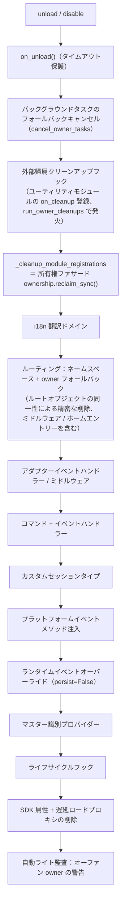

# 所有権（owner）システム

> [!TIP]
> **この文書を読むべき場面**：リソースリークの調査、アンロード時のクリーンアップフローの理解、または帰属リソースの宣言を行うとき。必要なければ読み飛ばしても、他の機能の利用には影響しません。

> **読み終えるとわかること**：owner コンテキストがどのようにリソースを自動帰属させるか、帰属リソースの一覧表、アンロード/無効化時の
> クリーンアップチェーンの完全な時系列、そしてどのリソースがアンロード時にクリーンアップされないか（設計上の境界）。
>
> **この文書の対象外**：リソースが「いつ有効になるか」の権限判定（[スコープ](scope.md)を参照）；
> バックグラウンドタスクの推奨される書き方と強制キャンセルの境界（[ライフサイクル管理 · バックグラウンドタスクの帰属と自動キャンセル](lifecycle.md#バックグラウンドタスクの帰属と自動キャンセル)を参照）。


所有権はモジュールの「プラグアンドプレイ」を支える礎です：モジュールがロード中に登録したすべてのフレームワークリソースは自動的に記名され、
アンロード/無効化時には記名に基づいて一括回収されます——モジュール作者はリソースを宣言するだけで、クリーンアップロジックを手書きする必要はありません。

> **関連システム**：スコープはイベント配信時に「リソースが有効かどうか」を決定し、
> 所有権はライフサイクルにおいて「リソースが誰に帰属し、誰のアンロード時に回収されるか」を決定します。
> スコープの詳細は[統一コントロールプレーン](scope.md)を、バックグラウンドタスクの詳細は
> [ライフサイクル管理](lifecycle.md#バックグラウンドタスクの帰属と自動キャンセル)を参照してください。

{!--< tips >!--}
1. 帰属は**登録の瞬間**に `current_owner` に基づいて自動記録され、モジュールコードの変更は一切不要
2. アンロード/無効化は同一のクリーンアップチェーン（`_cleanup_module_registrations`）を共用し、各ステップの失敗は警告のみで中断しない
3. ユーザー設定セマンティクスのリソース（永続化オーバーライド / scope ルール / コマンド ACL）はモジュールのアンロード時にクリーンアップ**されない**
4. ユーティリティモジュールが管理する外部ハンドルは `on_cleanup(cb)` でクリーンアップチェーンに組み込め、相手モジュールのアンロード時に自動コールバックされる（[ユーティリティモジュールガイド](#ユーティリティモジュールガイド他モジュールのハンドル管理)を参照）
{!--< /tips >!--}

## owner コンテキストの仕組み

owner はコンテキスト変数 `current_owner` で伝播します（`ErisPulse.runtime.context`）：

```python
from ErisPulse.runtime import owner_scope, get_current_owner

with owner_scope("MyModule"):
    # この区間内で登録されたすべてのリソースは自動的に MyModule に帰属する
    assert get_current_owner() == "MyModule"
```

フレームワークは以下のタイミングで owner を自動注入します（モジュール/アダプターコードで手動ラップは不要）：

| タイミング | owner の値 | 場所 |
|------|----------|------|
| モジュール `load()` | モジュール名 | インスタンス化 + `on_load` の全工程 |
| アダプター `start()` / `restart()` | プラットフォーム名 | アダプター起動の全工程 |
| `activate_on` 遅延ロード stub 登録 | モジュール名 | プレースホルダーコマンド/ハンドラーの登録 |
| イベントハンドラー実行中 | ハンドラーの帰属先モジュール名 | handler / コマンドエントリーでの再注入 |

実行期の再注入とは：モジュールが `on_load` 内で宣言したコマンドハンドラーが**実行中**に
登録型 API（`sdk.adapter.on()`、`overrides.*.set(persist=False)` など）を呼び出した場合も、
同様に自動的に当該モジュールに帰属することを意味します。

## 帰属リソース一覧

モジュールがロードコンテキスト内で登録した以下のリソースはすべて帰属が記録され、アンロード/無効化時に自動回収されます：

| リソース | 登録方法 | クリーンアップ呼び出し |
|------|----------|----------|
| コマンド | `@command()` / コマンド dict 宣言 | `command.unregister_by_owner()` |
| イベントハンドラー | `@message` / `@notice` / `@request` / `@meta` | `handler.unregister_by_owner()` |
| アダプターイベントリスナー | `sdk.adapter.on()` / `raw=True` | `adapter.unregister_handlers_by_owner()` |
| アダプターミドルウェア | `@sdk.adapter.middleware` | 同上 |
| ルーティング（HTTP/WS/SSE） | `router.http()` / `websocket()` / `sse()` | ネームスペース別 + owner 別の二重フォールバック |
| ルーティングミドルウェア | `@router.middleware()` / `add_middleware()` | `router.unregister_all_by_owner()` |
| Dashboard ホームエントリー | `router.register_home_entry()` | `unregister_home_entries_by_owner()` |
| カスタムセッションタイプ | `register_custom_type()` | `unregister_custom_types_by_owner()` |
| プラットフォームイベントメソッド注入 | `register_event_method()` / `register_event_mixin()` | `unregister_event_methods_by_owner()`（モジュールアンロード時に自動回収、旧クロージャーのリークなし） |
| バックグラウンドタスク | `self.spawn()` | `cancel_owner_tasks()` |
| 外部帰属クリーンアップフック（ユーティリティモジュール預かり） | `runtime.on_cleanup(cb)` | `run_owner_cleanups()`（アンロード/無効化/アダプター終了チェーン内で発火） |
| ライフサイクルフック | `lifecycle.register()` | `lifecycle.unregister_by_owner()` |
| マスター識別プロバイダー | `master.provider` | `master.unregister_by_owner()` |
| i18n 翻訳キー | `I18nClass` 宣言（domain=モジュール名） | `i18n.unregister_domain()` |
| イベントオーバーライド（ランタイム） | `overrides.*.set(persist=False)` | `overrides.unregister_by_owner()` |
| 対話セッション（wait_reply 待機 / リース） | `event.wait_reply()` / `sdk.interaction.acquire()` | `interaction.cancel_by_owner()`（待機側は即座にキャンセルを受け取る） |
| コンテキストデータ | `runtime/context` が owner ごとに記録 | モジュール単位で精密にクリーンアップ |

アダプター側の対応リソース（プラットフォーム名を owner とする）は、アダプターの `shutdown()` / `restart()` 時に
`_cleanup_adapter_resources` によって回収されます。さらに以下を含みます：

| リソース | クリーンアップ呼び出し |
|------|----------|
| アダプター自身の `on()` ハンドラーとミドルウェア | `adapter.unregister_handlers_by_owner(platform)` |
| プラットフォームイベントメソッド拡張（`EventMixin`） | `unregister_platform_event_methods(platform)` |
| カスタムセッションタイプ | `unregister_custom_types_by_owner(platform)` |
| 対話セッション（当該プラットフォームで保留中の wait_reply / リース） | `interaction.cancel_by_platform(platform)` |
| i18n 翻訳ドメイン（domain=設定キー） | `i18n.unregister_domain(設定キー)` |
| 細粒度ネームスペースルーティング | `router.unregister_all_by_owner(platform)` |

## アンロード/無効化クリーンアップシーケンス

`unload()` と `disable()` は同一のクリーンアップチェーンを共用します（各ステップは独立した try/except で、
失敗はログに記録されるだけで**後続のクリーンアップは中断しません**）：



`sdk.uninit()` の終了時には別途グローバルなフォールバックがあります：全アダプター shutdown → 全モジュール unload →
`router.stop()`（ルーティング/ミドルウェア/ホームエントリーのクリア）→ `cancel_all_background_tasks()` →
イベントハンドラーとフックのクリア。

## 所有権統一ファサード（ownership）

クリーンアップチェーンの 16 ステップは、所有権統一ファサード `ErisPulse.Core.ownership` に集約されています。
4 つの動詞が「登録解除、カウント、スキャン、監査」をカバーします——サブシステムごとの `*_by_owner` 登録解除関数は
そのまま維持され、ファサードの内部実装として機能します：

| 動詞 | 用途 |
|------|------|
| `ownership.reclaim(owner)` | owner 名義の下にある全リソースを一括登録解除（タスクキャンセル → クリーンアップフック → 登録系リソース；非同期の完全版） |
| `ownership.reclaim_sync(owner)` | 登録系リソースの登録解除（同期版、同期アンロードパス用） |
| `ownership.counts(owner=None)` | owner の在籍リソースを読み取り専用で集計（None は全 owner） |
| `ownership.orphans()` | オーファンスキャン：リソースは在籍しているが owner は登録解除済み（リーク確定リスト） |
| `ownership.audit(owner, deep=)` | リーク監査レポート（カウント + オーファン + 任意の gc インスタンス全数調査） |

```python
from ErisPulse.Core import ownership

ownership.reclaim_sync("MyModule")       # {'commands': 1, 'routes_http': 2, ...}
ownership.counts("MyModule")             # 在籍リソースのカウント
ownership.orphans()                      # [{"owner": "ghost", "total": 2, ...}]
```

**監査エントリー**：

- アンロード / リロード後の**自動ライト監査**：オーファン owner リソースを検出したら WARNING 警告（ゼロオーバーヘッドのカウントスキャン）
- `sdk.module.audit(name, deep=True)`：モジュールインスタンスの gc 全数調査——インスタンスが回収不能な場合、
  参照元の型を提示（「誰が旧インスタンスを掴んでいるか」を特定）；グローバルな一時停止のオーバーヘッドがあるため、明示的なトラブルシューティングのみに使用
- 深い全数調査は明示的な操作であり、設定キーを設けず、自動修復も行いません

## ホットリロード失敗時のロールバック

ホットリロードは「**アンロード前スナップショット → 失敗時自動リストア**」に変更されました：新バージョンの構文エラー、依存関係の欠落、
ロード失敗時には、旧インスタンスと登録状態（レジストリエントリー、sdk 属性、sys.modules エントリー）が
自動的に復元され、サービスは中断せず、ログに「旧インスタンスへロールバックしサービスを継続しています」と表示されます。

ベストエフォートのセマンティクス（ドキュメント化された境界）：

- `on_unload` が実行済みの副作用（切断済みの接続、キャンセル済みのタスク）は取り消せません——
  復元後の旧インスタンスは「後片付け済み」の状態にあり、再度ロードをトリガーしないと完全には利用できません
- サードパーティが実行時に手動でキャッシュした旧インスタンスへの参照は復元対象外です
- 対象パッケージが既にアンロードされている場合（entry-point が消失）はアンロード成功とみなし、ロールバックしません

## 設計上の境界：アンロード時にクリーンアップされないリソース

所有権が回収するのは**モジュールコードが登録したランタイムリソース**のみです。以下のリソースは**ユーザー設定のセマンティクス**
（制御権はユーザーにあり、意図的な設定である可能性がある）に属し、モジュールのアンロード後も設定と共に永続的に保持されます：

| リソース | セマンティクス | 説明 |
|------|------|------|
| `overrides.*.set(persist=True)` | 永続化オーバーライド | 設定ファイルに書き込まれ、再起動を跨いで有効；モジュールのアンロードでは削除されない（ユーザーの明示的な設定） |
| `scope.set_action()` などのスコープルール | 権限コントロールプレーン | ユーザー/Dashboard が管理し、モジュールをアンロードしてもルールは回収されない |
| `overrides.acl.set(persist=True)` | コマンド ACL | 同上 |
| Conversation `save()` 永続化 | 複数回対話のアーカイブ | データ資産はクリーンアップされない |

ランタイムの一時書き込み（`persist=False`）は owner と共に回収されます——**永続化するかどうかが
「ユーザー資産」と「モジュールのランタイム状態」の境界線です**。

## 内部実装：帰属の仕組み

**ひとことで言うと**：アトリビューションチェーン（contextvar の伝播）が「誰の頭に記録されるか」を決め、
キャンセルチェーン（タスク登録表）が「アンロード時にキャンセル可能か」を決めます——2 つのチェーンは独立して動作しており、
リソースを正しくクリーンアップするには両方が揃う必要があります。

帰属システムは**2 つの独立したチェーン**で構成されており、その分担を理解することが帰属問題のトラブルシューティングの前提となります：

### アトリビューションチェーン（contextvar の伝播）

`runtime/context.py` の `current_owner` などの ContextVar は**アトリビューション**を担います——
「今まさにこのコードが登録したリソース/発行した呼び出しが誰の頭に記録されるか」。伝播ルールは Python の
contextvars のセマンティクスに従います：

| 実行パス | context は伝播するか | アトリビューション結果 |
|---------|----------------|---------|
| 同期呼び出しチェーン / `await` チェーン | ✅ 伝播 | 正しく帰属 |
| `owner_scope` 内の `asyncio.create_task` | ✅ 伝播（task は作成時点の context をコピー） | タスク**内部**のフレームワーク呼び出しは正しく帰属 |
| `run_in_executor` / 素のスレッド | ❌ 非伝播 | アトリビューション喪失 |
| 独立イベントループ | ❌ 非伝播 | アトリビューション喪失 |

> アトリビューション ≠ 登録：context の伝播は「誰の頭に記録されるか」にのみ影響し、リソースがクリーンアップ可能かどうかは
> 後述のキャンセルチェーンに入っているかどうかで決まります。

### キャンセルチェーン（タスク登録表）

`runtime/tasks.py` の `_owner_tasks` 登録表は**ライフサイクル**を担います——
「owner 名義の下にどの未完了タスクがあり、アンロード時に一括キャンセルされるか」。タスクが登録表に入る経路：

1. **明示的なスケジューリング**：`spawn_background()` / `self.spawn()` → 作成時に
   `current_owner`（または明示的な `owner=` 引数）をキャプチャ → 登録表に記載；
2. **Task Factory 自動登録**（2.8.3）：`install_owner_task_factory()` がフレームワーク起動時に
   メインイベントループへインストール——**あらゆる**タスク作成（サードパーティライブラリ内部の
   `create_task` を含む）がファクトリーを通過する際に `current_owner` を読み取り、非 None であれば登録。

登録表は自己クリーンアップします：各タスクは `done_callback` を持ち、完了と同時に表から削除されるため、リークはありません。

### キャンセル時系列（モジュールアンロード）

```
module.unload()
  → on_unload(event)                    # モジュール自身のクリーンアップ（フォールバックのタイムアウト保護）
  → フレームワークが当該 owner のコマンド/イベント/フック/ルーティングを登録解除
  → cancel_owner_tasks(owner)           # タスク登録表によるフォールバックキャンセル
      → task.cancel() を一件ずつ実行    # キャンセル処理を実行中のタスク自身は除外
      → await gather(pending, timeout)  # 回収を待機（タイムアウト時はそれ以上ブロックしない）
```

### トラブルシューティングの考え方

- **リソースがクリーンアップされない** → 登録表を確認：`get_owner_tasks("MyModule")` に当該タスクが含まれているか；
  含まれていなければ登録パスが帰属チェーンを経由していない（import 時 / スレッド / 独立ループ）。上記の表と照らし合わせて特定してください。
- **アトリビューションが誤っている** → エラー発生時点の `get_current_owner()` の値を確認；非同期の遅延実行
  （コールバック/タスク）のアトリビューションは実行時ではなく作成時点の context から取得されます。

## モジュール作者ガイド

### 推奨される書き方

```python
from ErisPulse import sdk
from ErisPulse.Core.Event import command
from ErisPulse.runtime import owner_scope, spawn_background

class MyModule(BaseModule):
    async def on_load(self, event):
        # フレームワークリソース：自動帰属、手動クリーンアップ不要
        self.task = self.spawn(self.polling())      # バックグラウンドタスク
        sdk.router.register_home_entry("私のモジュール", "/my")  # ホームエントリー

        # モジュール固有リソース：owner_scope で包めば帰属体系に組み込まれる
        with owner_scope("MyModule"):
            self.client.on_event(self._handle)      # 仮想のカスタム登録

    async def on_unload(self, event):
        # フレームワークリソースは自動回収済み。owner_scope の及ばない固有リソースだけをクリーンアップ
        await self.client.close()
```

### 注意点

- **import 時の登録は帰属しない**：モジュールのトップレベル（import 時）で登録されたフック/ハンドラーは
  `owner_scope` の前に発生するため、フレームワークレベルのリソース（owner=None）とみなされ**クリーンアップされません**。
  すべて `on_load()` 内で登録してください。
- **カスタム domain の i18n 登録**：`i18n.register(domain=...)` の domain が
  モジュール名と異なる場合、自動回収されません。domain=モジュール名を維持してください。
- **バックグラウンドタスクには `self.spawn()` を推奨**：2.8.3 以降、素の `asyncio.create_task` も**自動的に暗黙帰属**します
  （Task Factory が自動登録し、アンロード時にフォールバックキャンセル）；ただし `self.spawn()` が依然として推奨の書き方です——
  非メインループのスレッドからメインループへのスケジューリング、明示的な `owner=` 指定、fire-and-forget の GC 防止をサポートします。
  **2.8.3 より前**のバージョンでは素のタスクは帰属しないため、必ず `self.spawn()` を使用してください。
- クリーンアップチェーンは「失敗時は警告のみ」：単一ステップのクリーンアップで例外が発生しても、他のリソースの回収は妨げられません。ログは
  DEBUG/WARNING レベルで確認でき、トラブルシューティング時には TRACE を有効にしてください。

### 登録タイミング → 帰属結果の対照表

| 登録シナリオ | 帰属結果 | 説明 |
|---------|---------|------|
| `on_load()` 内でフレームワーク API（コマンド/イベント/lifecycle/ルーティングのデコレーター）経由で登録 | モジュールに帰属 | アンロード時に自動登録解除 |
| モジュールのトップレベル（import 時）に登録 | **帰属なし**（owner=None） | クリーンアップされないため使用しないでください |
| `self.spawn()` で作成したバックグラウンドタスク | モジュールに帰属 | アンロード時に自動キャンセル |
| `owner_scope("Name")` 内でサードパーティ API 経由で登録 | モジュールに帰属 | サードパーティのコールバックが scope 内で同期的に実行されることに依存 |
| 素の `asyncio.create_task`（`loop.create_task` / `ensure_future` を含む） | **自動帰属**（Task Factory、2.8.3+） | 作成の瞬間に `current_owner` を読み取り、owner コンテキスト内では自動登録・アンロード時にフォールバックキャンセル；詳細は後述の[内部実装](#内部実装帰属の仕組み)を参照 |
| サードパーティライブラリの非同期コールバック（aiohttp / APScheduler など）内部で作成されたタスク | **自動帰属**（Task Factory、2.8.3+） | コールバック実行時に `current_owner` が注入済み（フレームワークハンドラー実行中など）であれば、タスクは自動登録 |
| `run_in_executor`（スレッドプール） | **帰属なし**（非 asyncio.Task） | スレッドはタスクファクトリーの管轄外のため、ライフサイクルは自己管理が必要 |
| 独立イベントループ（自前の loop）内の登録 | **帰属なし** | Task Factory はメインループにのみインストール；contextvars もイベントループを跨いで伝播しません |

> 原則：**帰属は登録の瞬間の `current_owner` コンテキストに従います**；あらゆる非同期の遅延実行、
> スレッドプール、独立ループはこのコンテキストから外れます——帰属させたい場合は明示的に `owner_scope` に入ってください。

## ユーティリティモジュールガイド：他モジュールのハンドル管理

**シナリオ**：定時タスク、レジストリ、コネクションプールといった「ユーティリティモジュール」は、他のモジュールに代わってものを預かります——
相手が `on_load` 内で `sdk.Cron.on_trigger(handler)` を呼び出すと、あなたのコンテナには相手のインスタンスを指す
コールバックが保存されます。フレームワークは相手が登録したすべてのフレームワークリソースを自動クリーンアップしますが、
**あなたのプライベートコンテナ内の参照**まではクリーンアップできません：相手がアンロードされた後もあなたのコンテナがそのインスタンスを
握り続けると、GC で回収できなくなります（メモリリーク。`purge` のリーク診断では「回収不可」と報告されます）。

**解決策**：相手のものを登録するのと同じ関数内で `on_cleanup()` を呼び出せば、
フレームワークが相手のアンロード / 無効化時にあなたのクリーンアップ関数を自動コールバックします：

```python
from ErisPulse.Core.Bases import BaseModule
from ErisPulse.runtime import off_cleanup, on_cleanup

class CronModule(BaseModule):
    def __init__(self):
        self._entries = {}  # {モジュール名: そのモジュールが預けたコールバックのリスト}

    def on_trigger(self, handler):
        # 呼び出し元モジュール名を自動識別（on_load からの直接呼び出し / module.call 経由のどちらも正しく）、
        # 戻り値は解決済みの owner で、記名キーとしてそのまま使用可能
        owner = on_cleanup(self._drop)
        self._entries.setdefault(owner, []).append(handler)

    def _drop(self, owner: str):
        """相手モジュールがアンロード/無効化された際にフレームワークから自動呼び出し：そのハンドルを破棄するだけ"""
        self._entries.pop(owner, None)

    async def on_unload(self, event):
        off_cleanup(self._drop)  # ③ 自身のアンロード前にフックを登録解除し、フック表が self を保持するのを防ぐ
```

フレームワークが保証する動作：

| 項目 | 動作 |
|--------|------|
| 発火タイミング | 相手モジュールの unload / disable、またはアダプターのシャットダウン——いずれもフレームワークのクリーンアップチェーン内で発火し、purge のリーク診断より前に実行 |
| 呼び出し元の識別 | 直接呼び出しでは `current_owner` を取得；`module.call()` 経由の呼び出しでは呼び出し元（`current_caller`）を取得；`on_cleanup(cb, owner="モジュール名")` での明示指定も可能。**強制検証**：owner を解決できない場合（3 つの取得元がすべて欠落）は `ValueError` をスロー——プライベートユーティリティモジュールは自身のロードコンテキスト内でフックを登録すべき |
| コールバックシグネチャ | `cb(owner: str)`、同期 / 非同期どちらも可；非同期にはタイムアウト保護付き（`CLEANUP_CALLBACK_TIMEOUT_SECS`、デフォルト 10 秒） |
| 耐障害性 | 単一のコールバックの例外 / タイムアウトはログへの記録のみで、他のフックとクリーンアップチェーンには影響しない |
| 重複登録 | 同一 `(owner, callback)` は冪等に重複排除 |

**必要ない場合**：相手が登録したのがフレームワークリソース（コマンド、イベントハンドラー、ルーティング、
バックグラウンドタスクなど）であれば、フレームワークがすでに完全自動でクリーンアップします（上記の[帰属リソース一覧](#帰属リソース一覧)を参照）。
`on_cleanup` が必要なのは、あなたのプライベートコンテナ内に保持している相手のハンドルだけです。
モジュール開発者視点のクイックリファレンス版は
[ベストプラクティス · ユーティリティモジュール](../developer-guide/modules/best-practices.md#ユーティリティモジュール他者のものを預かるときはアンロード通知を受け止める)を参照してください。

## 関連ドキュメント

次のステップの意図に応じて選択してください：

- **「リソースがいつ有効になるか」（権限面）を制御したい** → [スコープ](scope.md)——所有権は「リソースが誰に帰属し、誰のアンロード時に回収されるか」を管理し、スコープは「リソースがいつ有効になるか」を管理します
- **バックグラウンドタスク / タイマーのフォールバックキャンセル** → [ライフサイクル管理 · バックグラウンドタスクの帰属と自動キャンセル](lifecycle.md#バックグラウンドタスクの帰属と自動キャンセル)
- **独立した owner による分離でカナリアリリースを行いたい** → [シャドウモジュールとカナリア昇格](shadow.md)
- **モジュール開発者視点のクイックリファレンスと推奨書式** → [モジュールのベストプラクティス](../developer-guide/modules/best-practices.md)