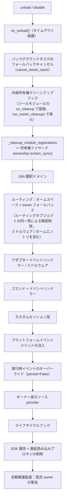

# 所有権（owner）システム

> [!TIP]
> **いつこのドキュメントを読むべきか**：リソースリークの調査、アンロード時のクリーンアップチェーンの理解、または帰属リソースの宣言を行うとき。必要がなければスキップしても、他の機能の利用には影響しません。

> **読み終えた後に分かること**：owner コンテキストがリソースをどのように自動帰属させるか、帰属リソースの一覧表、アンロード/無効化時の
> クリーンアップチェーンの完全な時系列、そしてどのリソースがアンロード時のクリーンアップ対象外となるか（設計上の境界）。
>
> **本ドキュメントでは扱わないこと**：リソースが「いつ有効になるか」の権限判定（[スコープ（scope）](scope.md)を参照）、
> バックグラウンドタスクの推奨される実装方法と強制キャンセルの境界（[ライフサイクル管理 · バックグラウンドタスクの帰属と自動キャンセル](lifecycle.md#バックグラウンドタスクの帰属と自動キャンセル)を参照）。


所有権はモジュールの「プラグアンドプレイ」の基盤です：モジュールがロード中に登録したすべてのフレームワークリソースは自動的に記名され、
アンロード/無効化時にはその記名に基づいて一括で回収されます——モジュール作者はリソースを宣言するだけで、クリーンアップロジックを手書きする必要はありません。

> **関連システム**：スコープ（scope）はイベントディスパッチ時に「リソースが有効かどうか」を決定し、
> 所有権はライフサイクルにおいて「リソースが誰に帰属し、誰のアンロード時に回収されるか」を決定します。
> スコープの詳細は[統一コントロールプレーン（scope）](scope.md)を、バックグラウンドタスクの詳細は
> [ライフサイクル管理](lifecycle.md#バックグラウンドタスクの帰属と自動キャンセル)を参照してください。

{!--< tips >!--}
1. 帰属は**登録の瞬間**に `current_owner` に基づいて自動的に記録され、モジュールコードの変更は一切不要
2. アンロード/無効化は同じクリーンアップチェーン（`_cleanup_module_registrations`）を共有し、各ステップで失敗しても警告を出すだけで処理は中断されません
3. ユーザー設定のセマンティクスを持つリソース（永続化オーバーライド / scope ルール / コマンド ACL）は、モジュールのアンロード時にクリーンアップ**されません**
4. ユーティリティモジュールがホスティングする外部ハンドルは `on_cleanup(cb)` でクリーンアップチェーンに登録でき、相手モジュールのアンロード時に自動的にコールバックされます（[ユーティリティモジュールガイド](#ユーティリティモジュールガイド他のモジュールのハンドルのホスティング)を参照）
{!--< /tips >!--}

## owner コンテキスト機構

owner はコンテキスト変数 `current_owner` を通じて引き渡されます（`ErisPulse.runtime.context`）：

```python
from ErisPulse.runtime import owner_scope, get_current_owner

with owner_scope("MyModule"):
    # この範囲内で登録されるすべてのリソースは自動的に MyModule に帰属します
    assert get_current_owner() == "MyModule"
```

フレームワークは以下のタイミングで自動的に owner を注入します（モジュール/アダプターのコードで手動ラップは不要です）：

| タイミング | owner の値 | 位置 |
|------|----------|------|
| モジュール `load()` | モジュール名 | インスタンス化 + `on_load` の全過程 |
| アダプター `start()` / `restart()` | プラットフォーム名 | アダプター起動の全過程 |
| `activate_on` 遅延ロード stub の登録 | モジュール名 | プレースホルダーコマンド/ハンドラー登録 |
| イベントハンドラー実行期間 | ハンドラーの帰属モジュール名 | handler / コマンドエントリへの再注入 |

実行期間の再注入とは、モジュールが `on_load` 内で宣言したコマンドハンドラーが**実行中**に
登録系 API（例：`sdk.adapter.on()`、`overrides.*.set(persist=False)`）を呼び出した場合も、
同様に自動的に当該モジュールに帰属することを意味します。

## 所有権リソースの全体像

モジュールがロードコンテキスト内で登録した以下のリソースは、すべて所有権が記録され、アンロード/無効化時に自動的に解放されます：

| リソース | 登録方法 | クリーンアップ呼び出し |
|------|----------|----------|
| コマンド | `@command()` / コマンド dict 宣言 | `command.unregister_by_owner()` |
| イベントハンドラー | `@message` / `@notice` / `@request` / `@meta` | `handler.unregister_by_owner()` |
| アダプターイベントリスナー | `sdk.adapter.on()` / `raw=True` | `adapter.unregister_handlers_by_owner()` |
| アダプターミドルウェア | `@sdk.adapter.middleware` | 同上 |
| ルーティング（HTTP/WS/SSE） | `router.http()` / `websocket()` / `sse()` | 名前空間別 + owner 別の二重フォールバック |
| ルーティングミドルウェア | `@router.middleware()` / `add_middleware()` | `router.unregister_all_by_owner()` |
| Dashboard ホームページエントリ | `router.register_home_entry()` | `unregister_home_entries_by_owner()` |
| カスタムセッションタイプ | `register_custom_type()` | `unregister_custom_types_by_owner()` |
| プラットフォームイベントメソッドの注入 | `register_event_method()` / `register_event_mixin()` | `unregister_event_methods_by_owner()`（モジュールのアンロード時に自動回収され、古いクロージャはリークしなくなります） |
| バックグラウンドタスク | `self.spawn()` | `cancel_owner_tasks()` |
| 外部所有権クリーンアップフック（ツールモジュールが管理） | `runtime.on_cleanup(cb)` | `run_owner_cleanups()`（アンロード/無効化/アダプターシャットダウンのチェーン内でトリガー） |
| ライフサイクルフック | `lifecycle.register()` | `lifecycle.unregister_by_owner()` |
| マスター身元プロバイダー | `master.provider` | `master.unregister_by_owner()` |
| i18n 翻訳キー | `I18nClass` 宣言（domain=モジュール名） | `i18n.unregister_domain()` |
| イベントオーバーライド（ランタイム） | `overrides.*.set(persist=False)` | `overrides.unregister_by_owner()` |
| インタラクションセッション（wait_reply 待機 / リース） | `event.wait_reply()` / `sdk.interaction.acquire()` | `interaction.cancel_by_owner()`（待機側は即座にキャンセルを受け取ります） |
| コンテキストデータ | `runtime/context`（owner 別に記録） | モジュール単位の精密なクリーンアップ |

アダプター側の対応するリソース（プラットフォーム名を owner とするもの）は、アダプターの `shutdown()` / `restart()`
実行時に `_cleanup_adapter_resources` によって解放されます。その他、以下も含まれます：

| リソース | クリーンアップ呼び出し |
|------|----------|
| アダプター独自の `on()` ハンドラーとミドルウェア | `adapter.unregister_handlers_by_owner(platform)` |
| プラットフォームイベントメソッド拡張（`EventMixin`） | `unregister_platform_event_methods(platform)` |
| カスタムセッションタイプ | `unregister_custom_types_by_owner(platform)` |
| インタラクションセッション（当該プラットフォームで保留中の wait_reply / リース） | `interaction.cancel_by_platform(platform)` |
| i18n 翻訳ドメイン（domain=設定キー） | `i18n.unregister_domain(設定キー)` |
| 細粒度の名前空間ルーティング | `router.unregister_all_by_owner(platform)` |

## アンロード/無効化クリーンアップシーケンス

`unload()` と `disable()` は同一のクリーンアップチェーンを共有します（各ステップは独立した try/except で、
失敗時はログ記録のみ行い、**後続のクリーンアップは中断しません**）：



`sdk.uninit()` の終了時には別途グローバルフォールバックがあります：全アダプターの shutdown → 全モジュールの unload →
`router.stop()`（ルーティング/ミドルウェア/ホームエントリのクリア）→ `cancel_all_background_tasks()` →
イベントハンドラーとフックのクリア。

## 所有権統一ファサード（ownership）

クリーンアップチェーンの16ステップは、所有権統一ファサード `ErisPulse.Core.ownership` に集約されています。
4つの動詞が「登録解除・カウント・スキャン・監査」をカバーし、サブシステムそれぞれの `*_by_owner` 登録解除
関数は変更されず、ファサードの内部実装として維持されます：

| 動詞 | 用途 |
|------|------|
| `ownership.reclaim(owner)` | owner 配下の全リソースを統一的に登録解除（タスクキャンセル → クリーンアップフック → 登録系リソース；非同期完全版） |
| `ownership.reclaim_sync(owner)` | 登録系リソースの登録解除（同期版、同期アンロードパス向け） |
| `ownership.counts(owner=None)` | owner の登録中リソースを読み取り専用で集計（None は全 owner 対象） |
| `ownership.orphans()` | 孤児スキャン：リソースは登録中なのに owner は登録解除済み（リーク確定リスト） |
| `ownership.audit(owner, deep=)` | リーク監査レポート（カウント + 孤児 + オプションの gc インスタンス全数調査） |

```python
from ErisPulse.Core import ownership

ownership.reclaim_sync("MyModule")       # {'commands': 1, 'routes_http': 2, ...}
ownership.counts("MyModule")             # 登録中リソースのカウント
ownership.orphans()                      # [{"owner": "ghost", "total": 2, ...}]
```

**監査エントリポイント**：

- アンロード / リロード後の**自動軽量監査**：孤児 owner リソースを検出した時点で WARNING アラート（オーバーヘッドゼロのカウントスキャン）
- `sdk.module.audit(name, deep=True)`：モジュールインスタンスの gc 全数調査——インスタンスが回収できない場合、
  参照元の型を提示（「誰が古いインスタンスを掴んでいるか」を特定）；グローバル一時停止のオーバーヘッドがあるため、明示的なトラブルシューティング限定
- 詳細全数調査は明示的な操作であり、設定キーは設けず、自動修復も行いません

## ネストされたライフサイクル（ownership.nest）

あるモジュール（親）が別の owner のグループ（子）をホスティングすることを可能にし、親が回収されると子はまとめて回収されます。典型的なシナリオ：スクリプトエンジンモジュール内で子プラグインを実行する、Dashboard がパネル拡張をホスティングする、ツールモジュールが外部レジストリエントリを代行管理する。

```python
from ErisPulse.Core import ownership

ownership.nest("ScriptEngine", "ScriptEngine.plugin_a")
ownership.nest("ScriptEngine", "ScriptEngine.plugin_b")

ownership.nested_children("ScriptEngine")
# frozenset({"ScriptEngine.plugin_a", "ScriptEngine.plugin_b"})

ownership.unnest("ScriptEngine", "ScriptEngine.plugin_a")
```

| 項目 | 規約 |
|----|------|
| 回収順序 | 子が親より先；同階層は登録の逆順（後から登録されたものが先に回収） |
| 回収範囲 | リソースレベル（タスク / 接続 / ルート / コマンド / tracked リソース / クリーンアップフック）。**子のモジュールレベルの `on_unload` はトリガーされません** |
| 循環検出 | `nest` は自己ループと既に存在する逆方向チェーンを拒否し、`False` を返して警告します |
| 子の先行消滅 | 子が独立して回収される（`reclaim` / `reclaim_sync`）際には自動的に `unnest` され、親側に dangling な関係は残りません |
| タイムアウト | 個々の子の回収は `CLEANUP_CALLBACK_TIMEOUT_SECS` に制約されます；タイムアウト時は警告を出し、親子関係を削除して続行します |
| オブザーバビリティ | `ownership.counts(parent)` に `nested` カウントが追加されます；`ownership.orphans()` はネスト関係に対して推移閉包を計算し、親が既に消滅している残留関係も引き続き露出されます |

**なぜ子の `on_unload` がトリガーされないのか**：モジュールの完全なアンロードにはマネージャーレベルのフロー（遅延プロキシ、sdk 属性、イベントブロードキャスト）を経由する必要がありますが、`ownership` ファサードはリソース回収のみを担当しており、レイヤーを跨ぐ呼び出しはアンロードロックの再入リスクをもたらします。子の `on_unload` が必要な場合は、親が自身の `on_unload` 内で明示的に呼び出します：

```python
await self.sdk.module.unload(child, reason="cascade")
```

同期エントリポイント（`sdk.module.disable` など）は先に非同期カスケードをマークし、バックグラウンドタスクが子リソースを回収します；`reclaim_sync` は非同期カスケードが進行していない場合にのみ、子の登録系リソースを自らカスケード回収します。

## ホットリロード失敗時のロールバック

ホットリロードは「**アンロード前スナップショット → 失敗時自動復旧 → on_load の再実行**」という仕組みです。新バージョンの構文エラー、依存関係の欠落、ロード失敗の際には、旧インスタンスと登録状態（レジストリエントリ、sdk 属性、sys.modules エントリ）が自動的に復元され、その後、所属コンテキスト内で**旧インスタンスの `on_load` を再実行**します（`reason` は `"rollback"`）。これにより、アンロード段階で切断された外部リソースが再確立されます。処理の終了後には、`module.rollback` イベント（ペイロード `{module_name, success}`）が発行されます。

アダプタのホットリロード失敗時も同様に旧登録状態を復元します。旧インスタンスが元々実行状態にあり、旧起動タスクが既に終了している場合は、ロールバック後に `start()` が再実行され、`adapter.rollback` イベント（ペイロード `{adapter_name, replayed, success}`）が発行されます。切断 / bot offline などの unload の副作用は、依然として取り消すことができません。

境界事項：

- 再実行の失敗やタイムアウトの場合は**警告のみ**を行い、ロールバックをさらに取り消すことはありません――旧インスタンスは「後始末済み」状態のまま残ります
  （2.11.2 以前の挙動と一致）。ログにその旨が明確に出力されます
- サードパーティが実行時に手動でキャッシュした旧インスタンスへの参照は、復元対象外です
- 対象パッケージが既にアンロードされている場合（entry-point の消失）はアンロード成功とみなされ、ロールバックは行われません
- `on_unload` のペイロードには `reason`（`unload` / `reload` / `disable` /
  `cascade` / `dormant` / `load-failed`）が含まれており、モジュールは `reload` 時に、リロードを跨いで存続する必要のあるリソースのクローズを延期できます

ホットリロードの完全な機能境界、ループを跨ぐセマンティクス、およびモジュール側のガイドラインについては、次のセクションを参照してください。

## ホットリロードの境界

ホットリロードはコードの置き換え、登録の再構築、失敗したリロードのロールバックを行えますが、**プロセスの再起動ではありません**。
回収されるのは**オーナーシップシステムに登録済みのランタイムリソース**です。どの owner にも属さないリソース、ユーザーが設定したセマンティクスを持つデータ、サードパーティライブラリの内部キャッシュへの参照は、リロードしても消失しません。

### 機能の境界

| 対象 | リロード後の挙動 | 説明 |
|------|-----------|------|
| モジュールコード / クラス定義 | 対応、再インポート | 古い `sys.modules` エントリはクリーンアップされる |
| `on_unload` / `on_load` | 対応、順次トリガー | 失敗時のロールバックで `on_load` を再生（前節参照） |
| コマンド / ハンドラー / ルーティング / ライフサイクルフック | 対応、自動的に登録解除して再登録 | オーナーシップ回収チェーン経由でクリーンアップ |
| `spawn_background` / `spawn_later` / `spawn_thread` | 対応、owner 単位でキャンセル | スレッドは観測登録のみで強制終了は不可 |
| メインループ上の任意の `asyncio.create_task` | 対応、オーナーシップに基づき自動キャンセル | タスクファクトリが傍受（サードパーティライブラリ内部での作成を含む） |
| ストレージブリッジループ上で生成されたタスク | 対応、オーナーシップに基づき自動キャンセル | ブリッジループにもタスクファクトリが導入済み |
| `ownership.track()` で登録されたリソース | 対応、`release()` を呼び出し | タスクファクトリが届かない Loop-bound リソース |
| `on_cleanup` フック | 対応、トリガー | ユーティリティモジュールはこれを利用して管理対象のハンドルを破棄 |
| 永続化オーバーライド（`persist=True`）/ 設定ファイル | 対象外、保持 | ユーザーアセット |
| サードパーティライブラリ内部キャッシュのオブジェクト参照 | 対象外 | フレームワークからは見えないため、モジュール側で参照を解除する必要あり |
| モジュール自身が `new` したイベントループ / 生スレッド | 回収しない | 下記のガイドラインを参照 |

### 3層のリソースガバナンス

1. **透過的な傍受層**——イベントループレベルのタスクファクトリ。owner コンテキスト内でのタスク作成はすべて自動的にオーナーシップに帰属し、メインループとストレージブリッジループの両方をカバーします。
2. **オーナーシップ化スケジューリング層**——`spawn_background` / `spawn_later` / `spawn_thread`。
3. **協調型登録層**——`ownership.track()` / `on_cleanup()`。構造的に届かないリソース（Loop-bound のコネクションプール、サードパーティ client）向け。

### イベントループの境界

| ループ | 作成者 | タスクファクトリ | 用途 |
|------|--------|-----------|------|
| メインループ | `sdk.run()` / `sdk.init()` | 導入済み | すべてのビジネスコード |
| ストレージブリッジループ | `AsyncBridge`（初回の同期ストレージ呼び出し時） | 導入済み | 同期ストレージ API のバックグラウンド実行 |
| 一時ループ | `spawn_background` のフォールバック | 未導入、使用後すぐに閉鎖 | メインループ未準備時の最終手段 |

**一時ループは最終手段です**：呼び出しスレッドを同期的にブロックし、さらにループが閉じられた後にコルーチン内部で生成されたサブタスクは失われます（ログに `temp_loop_fallback` 警告が出力されます）。この警告が表示された場合は、モジュールが誤ったタイミングでバックグラウンドタスクをスケジューリングしていることを意味します。

**ループを跨ぐキャンセルはベストエフォートです**：`cancel_owner_tasks` がタスクが他の実行中のループ上にあることを検出した場合、`call_soon_threadsafe` でキャンセルをポストし `cross_loop_task_residual` 警告を出力しますが、その終了は**待機しません**（ループを跨ぐ待機は安全ではないため）。この警告が表示された場合は、イベントループを自作していないか確認してください。

### モジュール側のガイドライン

```python
# 推奨
spawn_background(self._poll())            # オーナーシップ化されたバックグラウンドタスク
spawn_later(30, lambda: self._cleanup())  # オーナーシップ化された遅延タスク
spawn_thread("poller", self._loop_body)   # オーナーシップ化されたスレッド（エントリに自動的に owner が付与される）
ownership.track(pool)                     # Loop-bound リソースを明示的に登録
await sdk.storage.aget(key)               # 非同期コンテキストでは非同期 API を直接使用

# 非推奨
asyncio.create_task(self._poll())         # 生呼び出し：参照がなく GC されやすい
asyncio.new_event_loop()                  # 自作ループ：オーナーシップ体系では完全に届かない
threading.Thread(target=self._loop_body)  # 生スレッド：エントリに owner コンテキストがない
self._storage.get(key)                    # 非同期コンテキストでの同期ストレージ呼び出し：メインループをブロックする
```

### トラブルシューティングチェックリスト

1. ログに `cross_loop_task_residual` が出ている？→ リソースが自作ループ上に残っている
2. ログに `temp_loop_fallback` が出ている？→ バックグラウンドタスクがメインループの準備完了前にスケジューリングされている
3. `attached to a different loop` エラーが発生？→ 自作ループやループを跨ぐ接続オブジェクトの再利用がないか確認
4. `ownership.orphans()` に出力がある？→ アンロード後も owner 名義のリソースが存続している

## 設計境界：アンロード時にクリーンアップされないリソース

オーナーシップは**モジュールコードが登録したランタイムリソース**のみを回収します。以下のリソースは**ユーザー設定のセマンティクス**に属するため（制御権はユーザー側にあり、意図的に設定された可能性があります）、モジュールのアンロード後も設定と共に永続的に保持されます：

| リソース | セマンティクス | 説明 |
|------|------|------|
| `overrides.*.set(persist=True)` | 永続化オーバーライド | 設定ファイルに書き込まれ、再起動後も有効。モジュールのアンロードでは削除されない（ユーザーの明示的な設定） |
| `scope.set_action()` などのスコープルール | 権限コントロールプレーン | ユーザー/Dashboard が管理し、モジュールをアンロードしてもルールは回収されない |
| `overrides.acl.set(persist=True)` | コマンド ACL | 同上 |
| Conversation `save()` による永続化 | マルチターン対話のアーカイブ | データ資産はクリーンアップされない |

ランタイムでの一時書き込み（`persist=False`）は owner と共に回収されます――**永続化するかどうかこそが「ユーザー資産」と「モジュールのランタイム状態」を分ける境界線です**。

## 内部実装：オーナーシップの仕組み

**ひとこと**：帰属チェーン（contextvar の伝播）は「誰の名義で記録されるか」を決め、キャンセルチェーン（タスク登録テーブル）は「アンロード時にキャンセルされるか」を決める――2 つのチェーンは独立して動作し、リソースが正しくクリーンアップされるには両方が揃う必要がある。

オーナーシップシステムは**2 つの独立したチェーン**で構成されており、その役割分担を理解することがオーナーシップ問題を切り分ける前提となる：

### 帰属チェーン（contextvar の伝播）

`runtime/context.py` の `current_owner` などの ContextVar は**帰属付け**を担う――
「今まさにこのコードが登録したリソース／開始した呼び出しが誰の名義で記録されるか」。伝播ルールは Python
contextvars のセマンティクスに従う：

| 実行パス | context が伝播するか | 帰属結果 |
|---------|----------------|---------|
| 同期呼び出しチェーン / `await` チェーン | ✅ 伝播する | 正しく帰属 |
| `owner_scope` 内の `asyncio.create_task` | ✅ 伝播する（task は作成時点の context をコピー） | タスク**内部**のフレームワーク呼び出しは正しく帰属 |
| `run_in_executor` / 生スレッド | ❌ 伝播しない | 帰属が失われる |
| 自前のイベントループ | ❌ 伝播しない | 帰属が失われる |

> 帰属 ≠ 登録：context の伝播は「誰の名義で記録されるか」にのみ影響し、リソースが
> クリーンアップされるかどうかは、後述のキャンセルチェーンに入ったかどうかで決まる。

### キャンセルチェーン（タスク登録テーブル）

`runtime/tasks.py` の `_owner_tasks` 登録テーブルは**ライフサイクル**を担う――
「owner の名義下にどの未完了タスクがあるか、アンロード時に一括キャンセルする」。タスクが登録テーブルに入る経路：

1. **明示的なスケジューリング**：`spawn_background()` / `self.spawn()` → 作成時に
   `current_owner` をキャプチャ（または明示的な `owner=` 引数）→ テーブルに登録；
2. **Task Factory による自動登録**（2.8.3）：`install_owner_task_factory()`
   がフレームワーク起動時にメインイベントループへインストールされる――**あらゆる**タスク作成（サードパーティライライブラリ内部の
   `create_task` を含む）がファクトリを通る際に `current_owner` を読み取り、None でなければ登録する。

登録テーブルは自己クリーンアップ：各タスクには `done_callback` が付いており、完了した時点でテーブルから削除されるため、リークは発生しない。

### キャンセルのシーケンス（モジュールのアンロード）

```
module.unload()
  → on_unload(event)                    # モジュール自身のクリーンアップ（フォールバックのタイムアウト保護）
  → フレームワークが該当 owner のコマンド/イベント/フック/ルートを登録解除
  → cancel_owner_tasks(owner)           # タスク登録テーブルによるフォールバックキャンセル
      → task.cancel() を順次実行         # キャンセルロジックを実行中のタスク自体は除外
      → await gather(pending, timeout)  # 回収を待機（タイムアウト後はブロックしない）
```

### トラブルシューティングの考え方

- **リソースがクリーンアップされない** → 登録テーブルを確認：`get_owner_tasks("MyModule")` にそのタスクが含まれているか；
  含まれていなければ、登録経路がオーナーシップチェーンを通っていない（import 時 / スレッド / 独立ループ）。上の表と突き合わせて特定する。
- **帰属の誤り** → エラー発生時点の `get_current_owner()` の値を確認；非同期の遅延実行
  （コールバック/タスク）の帰属は、実行時ではなく作成時点の context から取得される。

## モジュール作者ガイド

### 推奨される書き方

```python
from ErisPulse import sdk
from ErisPulse.Core.Event import command
from ErisPulse.runtime import owner_scope, spawn_background

class MyModule(BaseModule):
    async def on_load(self, event):
        # フレームワークリソース：自動的に帰属するため、手動クリーンアップは不要
        self.task = self.spawn(self.polling())      # バックグラウンドタスク
        sdk.router.register_home_entry("マイモジュール", "/my")  # ホームエントリ

        # モジュール独自のリソース：owner_scope で包むことで帰属体系に組み込まれる
        with owner_scope("MyModule"):
            self.client.on_event(self._handle)      # 仮定上のカスタム登録

    async def on_unload(self, event):
        # フレームワークリソースは自動回収済み。owner_scope の対象外となる独自リソースのみクリーンアップすればよい
        await self.client.close()
```

### 注意事項

- **import 時の登録は帰属なし**：モジュールのトップレベル（import 時）で登録されるフック/ハンドラは
  `owner_scope` より前に発生するため、フレームワークレベルのリソース（owner=None）とみなされ、**クリーンアップされません**。
  必ず `on_load()` 内で登録してください。
- **カスタム domain の i18n 登録**：`i18n.register(domain=...)` の domain が
  モジュール名と一致しない場合、自動的には回収されません。domain=モジュール名 を維持してください。
- **バックグラウンドタスクには `self.spawn()` を推奨**：2.8.3 以降、生の `asyncio.create_task` も**自動的に暗黙帰属**します
  （Task Factory が自動登録し、アンロード時にフォールバックでキャンセル）。ただし `self.spawn()` が依然として推奨される書き方です——
  非メインループのスレッドからメインループへのスケジューリング、明示的な `owner=` 指定、fire-and-forget 時の GC 対策に対応しています。
  **2.8.3 より前**のバージョンでは生のタスクは帰属しないため、必ず `self.spawn()` を使ってください。
- クリーンアップチェーンの「失敗は警告のみ」：単一ステップのクリーンアップで例外が発生しても他のリソースの回収はブロックされず、
  DEBUG/WARNING レベルのログで確認できます。トラブルシューティング時には TRACE を有効にしてください。

### 登録タイミング → 帰属結果の対応表

| 登録シナリオ | 帰属結果 | 説明 |
|---------|---------|------|
| `on_load()` 内でフレームワーク API（コマンド/イベント/lifecycle/ルーティングデコレータ）経由で登録 | モジュールに帰属 | アンロード時に自動的に登録解除 |
| モジュールのトップレベル（import 時）で登録 | **帰属なし**（owner=None） | クリーンアップされないため、使用しないでください |
| `self.spawn()` で作成されたバックグラウンドタスク | モジュールに帰属 | アンロード時に自動キャンセル |
| `owner_scope("Name")` 内でサードパーティ API 経由で登録 | モジュールに帰属 | サードパーティのコールバックが scope 内で同期的に実行されることに依存 |
| 生の `asyncio.create_task`（`loop.create_task` / `ensure_future` を含む） | **自動帰属**（Task Factory、2.8.3+） | 作成の瞬間に `current_owner` を読み取り、owner コンテキスト内では自動登録、アンロード時にフォールバックでキャンセル。下記の[内部実装](#内部実装帰属の仕組み)を参照 |
| サードパーティライブラリの非同期コールバック（aiohttp / APScheduler など）内部で作成されたタスク | **自動帰属**（Task Factory、2.8.3+） | コールバック実行時に `current_owner` が注入済みであれば（フレームワークハンドラの実行中など）、タスクは自動登録される |
| `run_in_executor`（スレッドプール） | **帰属なし**（asyncio.Task 以外） | スレッドはタスクファクトリの管轄外のため、ライフサイクルは自身で管理する必要がある |
| 独立したイベントループ（自作 loop）内での登録 | **帰属なし** | Task Factory はメインループにのみインストールされる。contextvars もイベントループを跨いで伝播しない |

> 原則：**帰属は登録の瞬間の `current_owner` コンテキストに従います**。非同期の遅延、
> スレッドプール、独立したループのいずれもそのコンテキストから外れるため——帰属が必要な場合は明示的に `owner_scope` に入ってください。

## ツールモジュールガイド：他のモジュールのハンドルを預かる

**シナリオ**：定期タスク、レジストリ、コネクションプールといった「ツールモジュール」は、他のモジュールに代わってものを預かります——
相手モジュールが `on_load` 内で `sdk.Cron.on_trigger(handler)` を呼び出すと、あなたのコンテナには
相手のインスタンスを指すコールバックが格納されます。フレームワークは相手が登録したすべてのフレームワークリソースを自動的にクリーンアップしますが、あなたの**プライベートコンテナ内の参照**まではクリーンアップできません：相手がアンロードされた後もあなたのコンテナがそのインスタンスを掴んだままのため、GC で回収できなくなります（メモリリーク。`purge` のリーク診断では「回収不能」と報告されます）。

**解決策**：相手のものを登録するのと同じ関数内で `on_cleanup()` を呼び出すと、
フレームワークが相手のアンロード / 無効化時にあなたのクリーンアップ関数を自動的にコールバックします：

```python
from ErisPulse.Core.Bases import BaseModule
from ErisPulse.runtime import off_cleanup, on_cleanup

class CronModule(BaseModule):
    def __init__(self):
        self._entries = {}  # {モジュール名: そのモジュールが預かっているコールバックのリスト}

    def on_trigger(self, handler):
        # 呼び出し元モジュール名を自動識別（on_load からの直接呼び出し / module.call のどちらも正しく動作）、
        # 戻り値は解決された owner で、記名キーとしてそのまま使用可能
        owner = on_cleanup(self._drop)
        self._entries.setdefault(owner, []).append(handler)

    def _drop(self, owner: str):
        """相手モジュールがアンロード/無効化された際にフレームワークが自動呼び出し：そのハンドルを破棄するだけでよい"""
        self._entries.pop(owner, None)

    async def on_unload(self, event):
        off_cleanup(self._drop)  # ③ 自身のアンロード前にフックを解除し、フックテーブルが self を保持しないようにする
```

フレームワークが保証する動作：

| 着目点 | 動作 |
|--------|------|
| 発火タイミング | 相手モジュールの unload / disable、またはアダプタのシャットダウン——いずれもフレームワークのクリーンアップチェーン内で発火し、purge のリーク診断より前に実行される |
| 呼び出し元の識別 | 直接呼び出しでは `current_owner` を取得；`module.call()` 経由で呼び出された場合は呼び出し元（`current_caller`）を取得；`on_cleanup(cb, owner="モジュール名")` による明示的指定も可能。**強制検証**：owner を解決できない（3 つのソースがすべて欠落）場合は `ValueError` をスロー——プライベートツールモジュールは自身のロードコンテキスト内でフックを登録すべき |
| コールバックシグネチャ | `cb(owner: str)`、同期 / 非同期いずれも可；非同期にはタイムアウト保護付き（`CLEANUP_CALLBACK_TIMEOUT_SECS`、デフォルト 10 秒） |
| フォールトトレランス | 単一のコールバックの例外 / タイムアウトはログ記録のみで、他のフックとクリーンアップチェーンには影響しない |
| 重複登録 | 同一の `(owner, callback)` は冪等に重複排除 |

**不要なケース**：相手が登録しているのがフレームワークリソース（コマンド、イベントハンドラ、ルーティング、
バックグラウンドタスクなど）であれば、フレームワークがすでに全自動でクリーンアップします（上記の[帰属リソースの全体像](#帰属リソースの全体像)を参照）。
あなたのプライベートコンテナ内で保持している相手のハンドルにのみ `on_cleanup` が必要です。
モジュール開発の視点からのクイックリファレンス版は
[ベストプラクティス · ツールモジュール](../developer-guide/modules/best-practices.md#ツールモジュール他者のものを預かる場合はアンロード通知を受け止める)を参照してください。

## 関連ドキュメント

次のステップの目的に応じて選択してください：

- **「リソースを有効にするかどうか」を制御したい（権限の観点）** → [スコープ（scope）](scope.md) —— 所有権は「リソースが誰に帰属するか、アンロード時に誰が回収するか」を管理し、スコープは「リソースがいつ有効になるか」を管理します
- **バックグラウンドタスク／タイマーのフェイルセーフとしてのキャンセル** → [ライフサイクル管理 · バックグラウンドタスクの帰属と自動キャンセル](lifecycle.md#バックグラウンドタスクの帰属と自動キャンセル)
- **独立したオーナーによる分離でカナリアリリースを行いたい** → [シャドウモジュールとカナリア昇格](shadow.md)
- **モジュール開発の視点からのクイックリファレンスと推奨記法** → [モジュールのベストプラクティス](../developer-guide/modules/best-practices.md)