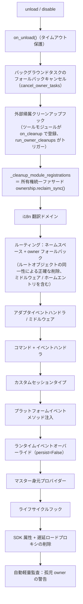

# 所有権システム

> [!TIP]
> **いつ読むべきか**：リソースリークの調査、アンロード時のクリーンアップチェーンの理解、または帰属リソースの宣言を行うとき。不要であれば読み飛ばしても、他の機能の利用には影響しません。

> **読み終えるとわかること**：owner コンテキストがどのようにリソースを自動的に帰属させるか、帰属リソースの全体像、アンロード/無効化時の
> クリーンアップチェーンの完全なタイミング、そしてどのリソースがアンロード時にクリーンアップされないか（設計上の境界）。
>
> **本書の対象外**：リソースが「いつ有効になるか」の権限判定（[スコープ](scope.md)を参照）；
> バックグラウンドタスクの推奨記法と強制キャンセルの境界（[ライフサイクル管理 · バックグラウンドタスクの帰属と自動キャンセル](lifecycle.md#后台任务归属与自动取消)を参照）。


所有権はモジュールの「プラグアンドプレイ」を支える礎です：モジュールがロード期間中に登録したすべてのフレームワークリソースは自動的に記名され、
アンロード/無効化時に記名に基づいてワンクリックで回収されます——モジュール作者はリソースを宣言するだけで、クリーンアップロジックを手書きする必要はありません。

> **関連システム**：スコープはイベント配信時に「リソースが有効かどうか」を決定し、
> 所有権はライフサイクルにおいて「リソースが誰に帰属し、誰のアンロード時に回収されるか」を決定します。
> スコープの詳細は[統一コントロールプレーン](scope.md)を、バックグラウンドタスクの詳細は
> [ライフサイクル管理](lifecycle.md#后台任务归属与自动取消)を参照してください。

{!--< tips >!--}
1. 帰属は**登録の瞬間**に `current_owner` に基づいて自動記録され、モジュールコードは一切変更不要
2. アンロード/無効化は同一のクリーンアップチェーン（`_cleanup_module_registrations`）を共用し、各ステップの失敗は警告のみで中断しません
3. ユーザー設定のセマンティクスを持つリソース（永続化オーバーライド / scope ルール / コマンド ACL）はモジュールのアンロード時にクリーンアップ**されません**
4. ツールモジュールが管理する外部ハンドルは `on_cleanup(cb)` でクリーンアップチェーンに組み込め、相手モジュールのアンロード時に自動コールバックされます（[ツールモジュールガイド](#工具模块指南托管其它模块的句柄)を参照）
{!--< /tips >!--}

## owner コンテキストの仕組み

owner はコンテキスト変数 `current_owner` を通じて伝播します（`ErisPulse.runtime.context`）：

```python
from ErisPulse.runtime import owner_scope, get_current_owner

with owner_scope("MyModule"):
    # この区間内で登録されたすべてのリソースは自動的に MyModule に帰属する
    assert get_current_owner() == "MyModule"
```

フレームワークは以下のタイミングで owner を自動注入します（モジュール/アダプタコードで手動ラップは不要）：

| タイミング | owner の値 | 位置 |
|------|----------|------|
| モジュール `load()` | モジュール名 | インスタンス化 + `on_load` の全期間 |
| アダプタ `start()` / `restart()` | プラットフォーム名 | アダプタ起動の全期間 |
| `activate_on` 遅延ロード stub の登録 | モジュール名 | プレースホルダコマンド/ハンドラの登録 |
| イベントハンドラの実行期間 | ハンドラの帰属先モジュール名 | handler / コマンドエントリへの再注入 |

実行期間の再注入とは、モジュールが `on_load` で宣言したコマンドハンドラの**実行中**に
登録型 API（`sdk.adapter.on()`、`overrides.*.set(persist=False)` など）を呼び出した場合も、
同様に自動的に当該モジュールに帰属することを意味します。

## 帰属リソースの全体像

モジュールがロードコンテキスト内で登録した以下のリソースはすべて帰属が記録され、アンロード/無効化時に自動回収されます：

| リソース | 登録方法 | クリーンアップ呼び出し |
|------|----------|----------|
| コマンド | `@command()` / コマンド dict 宣言 | `command.unregister_by_owner()` |
| イベントハンドラ | `@message` / `@notice` / `@request` / `@meta` | `handler.unregister_by_owner()` |
| アダプタイベントリスナー | `sdk.adapter.on()` / `raw=True` | `adapter.unregister_handlers_by_owner()` |
| アダプタミドルウェア | `@sdk.adapter.middleware` | 同上 |
| ルーティング（HTTP/WS/SSE） | `router.http()` / `websocket()` / `sse()` | ネームスペース別 + owner 別の二重フォールバック |
| ルーティングミドルウェア | `@router.middleware()` / `add_middleware()` | `router.unregister_all_by_owner()` |
| Dashboard ホームエントリ | `router.register_home_entry()` | `unregister_home_entries_by_owner()` |
| カスタムセッションタイプ | `register_custom_type()` | `unregister_custom_types_by_owner()` |
| プラットフォームイベントメソッド注入 | `register_event_method()` / `register_event_mixin()` | `unregister_event_methods_by_owner()`（モジュールのアンロード時に自動回収、旧クロージャのリークなし） |
| バックグラウンドタスク | `self.spawn()` | `cancel_owner_tasks()` |
| 外部帰属クリーンアップフック（ツールモジュールが管理） | `runtime.on_cleanup(cb)` | `run_owner_cleanups()`（アンロード/無効化/アダプタシャットダウンチェーン内でトリガー） |
| ライフサイクルフック | `lifecycle.register()` | `lifecycle.unregister_by_owner()` |
| マスター身元プロバイダー | `master.provider` | `master.unregister_by_owner()` |
| i18n 翻訳キー | `I18nClass` 宣言（domain=モジュール名） | `i18n.unregister_domain()` |
| イベントオーバーライド（ランタイム） | `overrides.*.set(persist=False)` | `overrides.unregister_by_owner()` |
| インタラクションセッション（wait_reply 待機 / リース） | `event.wait_reply()` / `sdk.interaction.acquire()` | `interaction.cancel_by_owner()`（待機側は即座にキャンセルを受信） |
| コンテキストデータ | `runtime/context` に owner 別に記録 | モジュール別に正確にクリーンアップ |

アダプタ側の対応リソース（プラットフォーム名を owner とする）は、アダプタの `shutdown()` / `restart()`
時に `_cleanup_adapter_resources` によって回収され、さらに以下を含みます：

| リソース | クリーンアップ呼び出し |
|------|----------|
| アダプタ固有の `on()` ハンドラとミドルウェア | `adapter.unregister_handlers_by_owner(platform)` |
| プラットフォームイベントメソッド拡張（`EventMixin`） | `unregister_platform_event_methods(platform)` |
| カスタムセッションタイプ | `unregister_custom_types_by_owner(platform)` |
| インタラクションセッション（当該プラットフォームの保留中 wait_reply / リース） | `interaction.cancel_by_platform(platform)` |
| i18n 翻訳ドメイン（domain=設定キー） | `i18n.unregister_domain(設定キー)` |
| 細粒度ネームスペースルーティング | `router.unregister_all_by_owner(platform)` |

## アンロード/無効化時のクリーンアップシーケンス

`unload()` と `disable()` は同一のクリーンアップチェーンを共用します（各ステップは独立した try/except、
失敗はログ記録のみで**後続のクリーンアップは中断されません**）：



`sdk.uninit()` の終了時には別途グローバルフォールバックがあります：全アダプタの shutdown → 全モジュールの unload →
`router.stop()`（ルーティング/ミドルウェア/ホームエントリのクリア）→ `cancel_all_background_tasks()` →
イベントハンドラとフックのクリア。

## 所有権統一ファサード

クリーンアップチェーンの十六のステップは所有権統一ファサード `ErisPulse.Core.ownership` に集約されています。
四つの動詞が「登録解除、カウント、スキャン、監査」をカバーします——サブシステムそれぞれの `*_by_owner` 登録解除
関数はそのまま維持され、ファサードの内部実装として機能します：

| 動詞 | 用途 |
|------|------|
| `ownership.reclaim(owner)` | owner 名下の全リソースを統一的に登録解除（タスクキャンセル → クリーンアップフック → 登録型リソース；非同期の完全版） |
| `ownership.reclaim_sync(owner)` | 登録型リソースの登録解除（同期版、同期アンロードパス用） |
| `ownership.counts(owner=None)` | owner の登録中リソースを読み取り専用で集計（None は全 owner 対象） |
| `ownership.orphans()` | 孤児スキャン：リソースは登録中だが owner は登録解除済み（リークの確証リスト） |
| `ownership.audit(owner, deep=)` | リーク監査レポート（カウント + 孤児 + オプションの gc インスタンス全数調査） |

```python
from ErisPulse.Core import ownership

ownership.reclaim_sync("MyModule")       # {'commands': 1, 'routes_http': 2, ...}
ownership.counts("MyModule")             # 登録中リソースのカウント
ownership.orphans()                      # [{"owner": "ghost", "total": 2, ...}]
```

**監査の入口**：

- アンロード / リロード後の**自動軽量監査**：孤児 owner リソースを検出次第 WARNING 警告（オーバーヘッドゼロのカウントスキャン）
- `sdk.module.audit(name, deep=True)`：モジュールインスタンスの gc 全数調査——インスタンスが回収できない場合、
  参照元の型を提示（「誰が旧インスタンスを掴んでいるか」を特定）；グローバル一時停止のオーバーヘッドがあるため、明示的なトラブルシューティング専用
- 深い全数調査は明示的な操作であり、設定キーは設けず、自動修復も行いません

## ホットリロード失敗時のロールバック

ホットリロードは「**アンロード前スナップショット → 失敗時自動復元 → on_load 再実行**」です：新バージョンの構文エラー、
依存関係の欠落、ロード失敗の際には、旧インスタンスと登録状態（レジストリエントリ、sdk 属性、sys.modules
エントリ）が自動的に復元され、その後、帰属コンテキスト内で**旧インスタンスの `on_load` を再実行**します（`reason`
は `"rollback"`）。これにより、アンロード段階で切断された外部リソースが再構築されます。終了後、
`module.rollback` イベントが発行されます（ペイロード `{module_name, success}`）。

境界に関する説明：

- 再実行の失敗やタイムアウトは**警告のみ**で、ロールバックのロールバックは行いません——旧インスタンスは「後処理済み」状態にとどまります
  （2.11.2 以前の動作と一致）。ログには明確に表示されます
- サードパーティが実行時に手動でキャッシュした旧インスタンスへの参照は復元対象外です
- 対象パッケージが既にアンロードされている場合（entry-point が消失）はアンロード成功とみなし、ロールバックしません
- `on_unload` のペイロードには `reason`（`unload` / `reload` / `disable` /
  `cascade` / `dormant` / `load-failed`）が含まれ、モジュールは `reload` 時に、リロードを跨いで生存する必要のある
  リソースのクローズを延期できます

ホットリロードの完全な能力境界、ループ間セマンティクス、モジュール側のガイドラインは次のセクションを参照してください。

## ホットリロードの境界

ホットリロードはコードの置換、登録の再構築、失敗したリロードのロールバックが可能です——しかし**プロセスの再起動ではありません**。
回収されるのは**所有権システムに登録済みのランタイムリソース**です；どの owner にも帰属しないリソース、ユーザー
設定のセマンティクスを持つデータ、サードパーティライブラリ内部でキャッシュされた参照は、リロードで消失することはありません。

### 機能の境界

| 対象 | リロード後の動作 | 説明 |
|------|-----------|------|
| モジュールコード / クラス定義 | 対応、再インポート | 旧 `sys.modules` エントリはクリーンアップされる |
| `on_unload` / `on_load` | 対応、順次トリガー | ロールバック時は `on_load` を再実行（上記セクション参照） |
| コマンド / ハンドラ / ルーティング / ライフサイクルフック | 対応、自動登録解除後に再登録 | 帰属回収チェーンを経てクリーンアップ |
| `spawn_background` / `spawn_later` / `spawn_thread` | 対応、owner 単位でキャンセル | スレッドは観測の登録のみで、強制終了は不可 |
| メインループ上のあらゆる `asyncio.create_task` | 対応、自動帰属キャンセル | タスクファクトリが傍受（サードパーティライブラリ内部での作成を含む） |
| ストレージブリッジループ上で派生したタスク | 対応、自動帰属キャンセル | ブリッジループにもタスクファクトリが導入済み |
| `ownership.track()` で登録したリソース | 対応、`release()` を呼び出し | タスクファクトリでは届かない Loop-bound リソース |
| `on_cleanup` フック | 対応、トリガーされる | ツールモジュールはこれにより管理下のハンドルを破棄 |
| 永続化オーバーライド（`persist=True`）/ 設定ファイル | 未処理、保持 | ユーザー資産 |
| サードパーティライブラリ内部でキャッシュされたオブジェクト参照 | 未処理 | フレームワークには見えない、モジュール自身が参照を解除する必要がある |
| モジュールが自前で `new` したイベントループ / 素のスレッド | 回収しない | 下記のガイドライン参照 |
| アダプタロールバック後のリソース | 未整合 | アダプタ側は当面 `start()` を再実行しない |

### 三層リソースガバナンス

1. **シームレス傍受層**——イベントループレベルのタスクファクトリ。owner コンテキスト内でのあらゆるタスク作成は自動的に帰属し、
   メインループとストレージブリッジループをカバーします。
2. **帰属型スケジューリング層**——`spawn_background` / `spawn_later` / `spawn_thread`。
3. **協調登録層**——`ownership.track()` / `on_cleanup()`。構造的に届かない
   リソース（Loop-bound 接続プール、サードパーティ client）用です。

### イベントループの境界

| ループ | 作成者 | タスクファクトリ導入 | 用途 |
|------|--------|-----------|------|
| メインループ | `sdk.run()` / `sdk.init()` | 導入済み | すべてのビジネスコード |
| ストレージブリッジループ | `AsyncBridge`（初回の同期ストレージ呼び出し） | 導入済み | 同期ストレージ API のバックグラウンド実行 |
| 一時ループ | `spawn_background` のフォールバック | 未導入、使い切りで閉鎖 | メインループ未準備時の最後の手段 |

**一時ループは最後の手段**です：呼び出しスレッドを同期的にブロックし、またループの閉鎖後にコルーチン内部でさらに派生した
子タスクは失われます（ログには `temp_loop_fallback` 警告が出ます）。この警告が見えたら、モジュールが誤ったタイミングで
バックグラウンドタスクをスケジューリングしていることを意味します。

**ループ間キャンセルはベストエフォート**です：`cancel_owner_tasks` がタスクが他の実行中のループ上にあることを
検出した場合、`call_soon_threadsafe` でキャンセルをポストし `cross_loop_task_residual`
警告を出しますが、その終了を**待機しません**（ループ間の待機は安全でないため）。この警告を見たら、自前の
イベントループを構築していないか確認すべきです。

### モジュール側のガイドライン

```python
# 推奨
spawn_background(self._poll())            # 帰属型バックグラウンドタスク
spawn_later(30, lambda: self._cleanup())  # 帰属型遅延タスク
spawn_thread("poller", self._loop_body)   # 帰属型スレッド（エントリに自動的に owner が付く）
ownership.track(pool)                     # Loop-bound リソースを明示的に登録
await sdk.storage.aget(key)               # 非同期コンテキストでは非同期 API を直接使用

# 避けるべき
asyncio.create_task(self._poll())         # 素の呼び出し：参照がなく GC されやすい
asyncio.new_event_loop()                  # 自前ループ：帰属システムでは完全に届かない
threading.Thread(target=self._loop_body)  # 素のスレッド：エントリに owner コンテキストがない
self._storage.get(key)                    # 非同期コンテキストでの同期ストレージ呼び出し：メインループをブロック
```

### トラブルシューティングチェックリスト

1. ログに `cross_loop_task_residual` がある？→ リソースが自前のループ上に残っている
2. ログに `temp_loop_fallback` がある？→ バックグラウンドタスクがメインループの準備完了前にスケジューリングされた
3. `attached to a different loop` エラー？→ 自前ループの構築やループ間での接続オブジェクト再利用がないか確認
4. `ownership.orphans()` に出力がある？→ owner 名下のリソースがアンロード後も生存している

## 設計上の境界：アンロード時にクリーンアップされないリソース

所有権は**モジュールコードが登録したランタイムリソース**のみを回収します。以下のリソースは**ユーザー設定のセマンティクス**に属し
（制御権はユーザーにあり、意図的に設定された可能性があります）、モジュールのアンロード後も設定として永続的に保持されます：

| リソース | セマンティクス | 説明 |
|------|------|------|
| `overrides.*.set(persist=True)` | 永続化オーバーライド | 設定ファイルに書き込まれ、再起動を跨いで有効；モジュールのアンロードでは削除されない（ユーザーの明示的設定） |
| `scope.set_action()` などのスコープルール | 権限コントロールプレーン | ユーザー/Dashboard が管理、モジュールをアンロードしてもルールは回収されない |
| `overrides.acl.set(persist=True)` | コマンド ACL | 同上 |
| Conversation `save()` の永続化 | マルチターン対話のアーカイブ | データ資産はクリーンアップしない |

ランタイムの一時書き込み（`persist=False`）は owner とともに回収されます——**永続化するかどうかが
「ユーザー資産」と「モジュールのランタイム状態」の境界線**です。

## 内部実装：帰属の仕組み

**一言でいうと**：帰属チェーン（contextvar の伝播）が「誰の頭に記録するか」を決め、キャンセルチェーン（タスク登録表）が「アンロード時にキャンセルできるか」を決めます——二つのチェーンは独立して動作し、リソースが正しくクリーンアップされるには両方を備える必要があります。

帰属システムは**二つの独立したチェーン**で構成されており、その分担を理解することが帰属問題のトラブルシューティングの前提です：

### 帰属チェーン（contextvar の伝播）

`runtime/context.py` の `current_owner` などの ContextVar は**帰属**を担います——
「今この瞬間、このコードが登録したリソース/発した呼び出しが誰の頭に記録されるか」。伝播ルールは Python の
contextvars セマンティクスに従います：

| 実行パス | context は伝播するか | 帰属結果 |
|---------|----------------|---------|
| 同期呼び出しチェーン / `await` チェーン | ✅ 伝播 | 正確な帰属 |
| `owner_scope` 内の `asyncio.create_task` | ✅ 伝播（task は作成時点の context をコピー） | タスク**内部**のフレームワーク呼び出しは正確に帰属 |
| `run_in_executor` / 素のスレッド | ❌ 非伝播 | 帰属の喪失 |
| 自前のイベントループ | ❌ 非伝播 | 帰属の喪失 |

> 帰属 ≠ 登録：context の伝播は「誰の頭に記録するか」にのみ影響し、リソースがクリーンアップ可能かどうかは
> 後述のキャンセルチェーンに入ったかどうかに依存します。

### キャンセルチェーン（タスク登録表）

`runtime/tasks.py` の `_owner_tasks` 登録表は**ライフサイクル**を担います——
「owner 名下にどの未完了タスクがあり、アンロード時に一括キャンセルされるか」。タスクが登録表に入る経路：

1. **明示的スケジューリング**：`spawn_background()` / `self.spawn()` → 作成時に
   `current_owner` をキャプチャ（または明示的な `owner=` パラメータ）→ 登録表に登録；
2. **Task Factory による自動登録**（2.8.3）：`install_owner_task_factory()`
   がフレームワーク起動時にメインイベントループへ導入——**あらゆる**タスク作成（サードパーティライブラリ内部の
   `create_task` を含む）がファクトリを通過する際に `current_owner` を読み取り、None でなければ登録します。

登録表は自己クリーンアップします：各タスクには `done_callback` が付き、完了時点で表から削除されるため、リークはありません。

### キャンセルのタイミング（モジュールアンロード）

```
module.unload()
  → on_unload(event)                    # モジュール自身によるクリーンアップ（フォールバックのタイムアウト保護）
  → フレームワークが当該 owner のコマンド/イベント/フック/ルーティングを登録解除
  → cancel_owner_tasks(owner)           # タスク登録表によるフォールバックキャンセル
      → 順次 task.cancel()              # キャンセルロジックを実行中のタスク自身を除外
      → await gather(pending, timeout)  # 回収を待機（タイムアウト後はブロックしない）
```

### トラブルシューティングの考え方

- **リソースがクリーンアップされていない** → 登録表を確認：`get_owner_tasks("MyModule")` にそのタスクが含まれているか；
  含まれていなければ登録パスが帰属チェーンを通っていない（import 期 / スレッド / 独立ループ）。上の表と照合して特定してください。
- **帰属の誤り** → エラー発生時点の `get_current_owner()` の値を確認；非同期の遅延実行
  （コールバック/タスク）の帰属は実行時点ではなく作成時点の context から取得されます。

## モジュール作者ガイド

### 推奨記法

```python
from ErisPulse import sdk
from ErisPulse.Core.Event import command
from ErisPulse.runtime import owner_scope, spawn_background

class MyModule(BaseModule):
    async def on_load(self, event):
        # フレームワークリソース：自動帰属、手動クリーンアップ不要
        self.task = self.spawn(self.polling())      # バックグラウンドタスク
        sdk.router.register_home_entry("私のモジュール", "/my")  # ホームエントリ

        # モジュール固有リソース：owner_scope で包めば帰属システムに組み込まれる
        with owner_scope("MyModule"):
            self.client.on_event(self._handle)      # 仮想的なカスタム登録

    async def on_unload(self, event):
        # フレームワークリソースは自動回収済み、owner_scope がカバーしきれない固有リソースのみクリーンアップ
        await self.client.close()
```

### 注意事項

- **import 期の登録は帰属なし**：モジュールのトップレベル（import 時）で登録するフック/ハンドラは
  `owner_scope` の前に発生するため、フレームワークレベルのリソース（owner=None）とみなされ**クリーンアップされません**。
  必ず `on_load()` 内で登録してください。
- **カスタム domain の i18n 登録**：`i18n.register(domain=...)` の domain
  がモジュール名と異なる場合は自動回収されません。domain=モジュール名を保ってください。
- **バックグラウンドタスクは `self.spawn()` を推奨**：2.8.3 からは素の `asyncio.create_task` も**自動的に暗黙帰属**します
  （Task Factory が自動登録、アンロード時にフォールバックキャンセル）；ただし `self.spawn()` が依然推奨記法です——
  非メインループスレッドからメインループへのスケジューリング、明示的な `owner=` 指定、fire-and-forget の GC 対策をサポートします。
  **2.8.3 より前**のバージョンでは素のタスクは帰属しないため、必ず `self.spawn()` を使ってください。
- クリーンアップチェーンの「失敗は警告のみ」：単一ステップのクリーンアップ例外は他のリソースの回収を阻害しません。ログは DEBUG/WARNING
  レベルで確認でき、トラブルシューティング時には TRACE を有効にできます。

### 登録タイミング → 帰属結果の対応表

| 登録シナリオ | 帰属結果 | 説明 |
|---------|---------|------|
| `on_load()` 内でフレームワーク API（コマンド/イベント/lifecycle/ルーティングデコレータ）経由で登録 | モジュールに帰属 | アンロード時に自動登録解除 |
| モジュールトップレベル（import 期）での登録 | **帰属なし**（owner=None） | クリーンアップされない、使用しないこと |
| `self.spawn()` で作成したバックグラウンドタスク | モジュールに帰属 | アンロード時に自動キャンセル |
| `owner_scope("Name")` 内でサードパーティ API 経由で登録 | モジュールに帰属 | サードパーティのコールバックが scope 内で同期的に実行されることに依存 |
| 素の `asyncio.create_task`（`loop.create_task` / `ensure_future` を含む） | **自動帰属**（Task Factory、2.8.3+） | 作成の瞬間に `current_owner` を読み取り、owner コンテキスト内では自動登録、アンロード時にフォールバックキャンセル；下記の[内部実装](#内部实现归属如何工作)を参照 |
| サードパーティライブラリの非同期コールバック（aiohttp / APScheduler など）内部で作成されたタスク | **自動帰属**（Task Factory、2.8.3+） | コールバック実行時に `current_owner` が既に注入されていれば（フレームワークハンドラの実行期間など）、タスクは自動登録 |
| `run_in_executor`（スレッドプール） | **帰属なし**（非 asyncio.Task） | スレッドはタスクファクトリの管轄外、ライフサイクルは自己管理が必要 |
| 独立イベントループ（自前 loop）内での登録 | **帰属なし** | Task Factory はメインループにのみ導入；contextvars もイベントループを跨いで伝播しない |

> 原則：**帰属は登録の瞬間の `current_owner` コンテキストに従います**；いかなる非同期の遅延、
> スレッドプール、独立ループもこのコンテキストから外れます——帰属が必要な場合は明示的に `owner_scope` に入ってください。

## ツールモジュールガイド：他モジュールのハンドルの管理

**シナリオ**：定期タスク、レジストリ、接続プールといった「ツールモジュール」は他のモジュールに代わってものを保管します——
相手が `on_load` 内で `sdk.Cron.on_trigger(handler)` を呼び出すと、あなたのコンテナには相手インスタンスを指す
コールバックが保存されます。フレームワークは相手が登録したすべてのフレームワークリソースを自動的にクリーンアップしますが、
あなたの**プライベートコンテナ内の参照**はクリーンアップできません：相手がアンロードされた後もあなたのコンテナがそのインスタンスを
掴んでいると、GC による回収ができなくなります（メモリリーク、`purge` のリーク診断で「回収不能」と報告されます）。

**解決方法**：相手のものを登録する同じ関数内で `on_cleanup()` を呼び出すと、
フレームワークは相手のアンロード / 無効化時にあなたのクリーンアップ関数を自動コールバックします：

```python
from ErisPulse.Core.Bases import BaseModule
from ErisPulse.runtime import off_cleanup, on_cleanup

class CronModule(BaseModule):
    def __init__(self):
        self._entries = {}  # {モジュール名: そのモジュールが預かったコールバックのリスト}

    def on_trigger(self, handler):
        # 呼び出し元モジュール名を自動識別（on_load からの直接呼び出し / module.call のいずれも正しく動作）、
        # 戻り値は解析された owner で、記名キーとしてそのまま使用可能
        owner = on_cleanup(self._drop)
        self._entries.setdefault(owner, []).append(handler)

    def _drop(self, owner: str):
        """相手モジュールがアンロード/無効化された際にフレームワークが自動呼び出し：ハンドルを破棄するだけでよい"""
        self._entries.pop(owner, None)

    async def on_unload(self, event):
        off_cleanup(self._drop)  # ③ 自身のアンロード前にフックを登録解除し、フック表が self を保持するのを防ぐ
```

フレームワークが保証する動作：

| 注目点 | 動作 |
|--------|------|
| トリガータイミング | 相手モジュールの unload / disable、またはアダプタのシャットダウン——いずれもフレームワークのクリーンアップチェーン内でトリガーされ、purge のリーク診断より早い |
| 呼び出し元の識別 | 直接呼び出しは `current_owner` を取得；`module.call()` 経由の呼び出しは呼び出し元を取得（`current_caller`）；`on_cleanup(cb, owner="モジュール名")` での明示指定も可能。**強制検証**：owner が解析できない場合（3 つのソースすべてが欠落）は `ValueError` を送出——プライベートツールモジュールは自身のロードコンテキスト内でフックを登録すべき |
| コールバックシグネチャ | `cb(owner: str)`、同期 / 非同期どちらも可；非同期にはタイムアウト保護付き（`CLEANUP_CALLBACK_TIMEOUT_SECS`、デフォルト 10 秒） |
| フォールトトレランス | 単一のコールバック例外 / タイムアウトはログ記録のみで、他のフックとクリーンアップチェーンには影響しない |
| 重複登録 | 同一 `(owner, callback)` は冪等に重複排除 |

**不要な場合**：相手が登録するのがフレームワークリソース（コマンド、イベントハンドラ、ルーティング、
バックグラウンドタスクなど）であれば、フレームワークがすでに全自動でクリーンアップします（上記の[帰属リソースの全体像](#归属资源全景)を参照）。
プライベートコンテナ内で保持している相手のハンドルだけが `on_cleanup` を必要とします。
モジュール開発視点のクイックリファレンスは
[ベストプラクティス · ツールモジュール](../developer-guide/modules/best-practices.md#工具模块托管别人东西时要接住卸载通知)を参照してください。

## 関連ドキュメント

次のステップの意図に応じて選択してください：

- **「リソースがいつ有効になるか」（権限面）を制御したい** → [スコープ](scope.md)——所有権は「リソースが誰に帰属し、アンロード時に誰の分を回収するか」を管理し、スコープは「リソースがいつ有効になるか」を管理します
- **バックグラウンドタスク / タイマーのフォールバックキャンセル** → [ライフサイクル管理 · バックグラウンドタスクの帰属と自動キャンセル](lifecycle.md#后台任务归属与自动取消)
- **独立 owner による分離でカナリアリリースを行う** → [シャドウモジュールとカナリア昇格](shadow.md)
- **モジュール開発視点のクイックリファレンスと推奨記法** → [モジュールのベストプラクティス](../developer-guide/modules/best-practices.md)