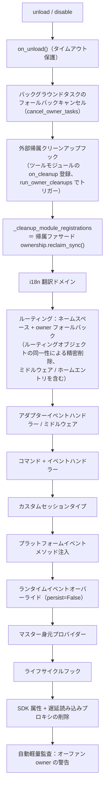

# 帰属システム

> [!TIP]
> **いつこのドキュメントを読むべきか**：リソースリークの調査、アンロード時のクリーンアップチェーンの理解、または帰属リソースの宣言を行う際。不要であれば読み飛ばしても、他の機能の利用には影響しません。

> **読み終えると分かること**：owner コンテキストがどのようにリソースを自動帰属させるか、帰属リソースの全体表、アンロード/無効化時の
> クリーンアップチェーンの完全なシーケンス、そしてどのリソースがアンロード時にクリーンアップされないか（設計上の境界）。
>
> **本ドキュメントで扱わないこと**：リソースが「いつ有効になるか」の権限判定（[スコープ](scope.md) を参照）；
> バックグラウンドタスクの推奨記述方法と強制キャンセルの境界（[ライフサイクル管理 · バックグラウンドタスクの帰属と自動キャンセル](lifecycle.md#バックグラウンドタスクの帰属と自動キャンセル) を参照）。


帰属はモジュールの「プラグアンドプレイ」の基石です：モジュールが読み込み期間中に登録したすべてのフレームワークリソースは自動的に記名され、
アンロード/無効化時に記名に基づいて一括回収されます——モジュール作者はリソースを宣言するだけで、クリーンアップロジックを手書きする必要はありません。

> **関連システム**：スコープはイベントディスパッチ時に「リソースが有効かどうか」を決定し、
> 帰属はライフサイクルにおいて「リソースの帰属先と、誰がアンロードされたときに回収されるか」を決定します。
> スコープの詳細は[統一コントロールプレーン](scope.md)を、バックグラウンドタスクの詳細は
> [ライフサイクル管理](lifecycle.md#バックグラウンドタスクの帰属と自動キャンセル)を参照してください。

{!--< tips >!--}
1. 帰属は**登録の瞬間**に `current_owner` に基づいて自動記録され、モジュールコードは一切変更不要
2. アンロード/無効化は同じクリーンアップチェーン（`_cleanup_module_registrations`）を共用し、各ステップの失敗は警告のみで中断しない
3. ユーザー設定セマンティクスのリソース（永続化オーバーライド / scope ルール / コマンド ACL）はモジュールのアンロード時にクリーンアップ**されない**
4. ツールモジュールが管理する外部ハンドルは `on_cleanup(cb)` でクリーンアップチェーンに組み込め、相手モジュールのアンロード時に自動コールバックされる（[ツールモジュールガイド](#ツールモジュールガイド他のモジュールのハンドルを管理する) を参照）
{!--< /tips >!--}

## owner コンテキスト機構

owner はコンテキスト変数 `current_owner` を通じて伝達されます（`ErisPulse.runtime.context`）：

```python
from ErisPulse.runtime import owner_scope, get_current_owner

with owner_scope("MyModule"):
    # この区間内で登録されるすべてのリソースは自動的に MyModule に帰属します
    assert get_current_owner() == "MyModule"
```

フレームワークは以下のタイミングで自動的に owner を注入します（モジュール/アダプターのコードで手動ラップは不要）：

| タイミング | owner 値 | 場所 |
|------|----------|------|
| モジュール `load()` | モジュール名 | インスタンス化 + `on_load` の全期間 |
| アダプター `start()` / `restart()` | プラットフォーム名 | アダプター起動の全期間 |
| `activate_on` 遅延ロード stub 登録 | モジュール名 | プレースホルダーコマンド/ハンドラー登録 |
| イベントハンドラー実行時 | ハンドラーの帰属モジュール名 | handler / コマンドエントリでの再注入 |

実行時の再注入とは、モジュールが `on_load` 内で宣言したコマンドハンドラーの**実行中**に
登録型 API（`sdk.adapter.on()`、`overrides.*.set(persist=False)` など）を呼び出した場合も、
同様に自動的に当該モジュールに帰属することを意味します。

### bind_owner：帰属をコールバックとスレッドエントリに縫い込む

`owner_scope` はコードブロックに作用します。`bind_owner(fn)` はコンテキストを関数そのものに「縫い込み」ます——
ラップした瞬間に `current_owner` をキャプチャし、その後は誰が、どのスレッドやイベントループから呼び出しても、
元の owner の身分で実行されます。新規スレッドはデフォルトで空のコンテキストを持ち
（Timer / watcher / サードパーティのスレッドプールのトリガーパスでは `current_owner` が None になります）、
その中で作成されたタスクは帰属テーブルに入らず、モジュールのアンロード時にキャンセルできません
（loop を跨いだ残留の原因の一つ）が、ラップすれば帰属が随伴します：

```python
from ErisPulse.runtime import bind_owner

class MyModule(BaseModule):
    async def on_load(self, event):
        # サードパーティのスケジューラ / スレッドプールに渡す前にラップします：
        external_scheduler.submit(bind_owner(self._poll))

    async def _poll(self):
        # 実行中は current_owner == "MyModule" となり、アンロード時に正しく回収されます
        ...
```

- `async` 関数は `async` のまま維持され、owner はすべての `await` を跨いで有効になります。通常の関数は同期実行中のみ有効です
- フレームワーク自身のエントリ（`self.spawn()` / コマンドハンドラー）はすでに自動的に帰属を持ち運ぶため、この関数は**フレームワーク外のトリガーパス**（外部スケジューラ、`threading.Timer`、コールバック登録表など）にのみ使用します

## 帰属リソースの全体像

モジュールが読み込みコンテキスト内で登録した以下のリソースはすべて帰属が記録され、アンロード/無効化時に自動回収されます：

| リソース | 登録方法 | クリーンアップ呼び出し |
|------|----------|----------|
| コマンド | `@command()` / コマンド dict 宣言 | `command.unregister_by_owner()` |
| イベントハンドラー | `@message` / `@notice` / `@request` / `@meta` | `handler.unregister_by_owner()` |
| アダプターイベントリスナー | `sdk.adapter.on()` / `raw=True` | `adapter.unregister_handlers_by_owner()` |
| アダプターミドルウェア | `@sdk.adapter.middleware` | 同上 |
| ルーティング（HTTP/WS/SSE） | `router.http()` / `websocket()` / `sse()` | ネームスペース別 + owner 別の二重フォールバック |
| ルーティングミドルウェア | `@router.middleware()` / `add_middleware()` | `router.unregister_all_by_owner()` |
| Dashboard ホームエントリ | `router.register_home_entry()` | `unregister_home_entries_by_owner()` |
| カスタムセッションタイプ | `register_custom_type()` | `unregister_custom_types_by_owner()` |
| プラットフォームイベントメソッドの注入 | `register_event_method()` / `register_event_mixin()` | `unregister_event_methods_by_owner()`（モジュールのアンロード時に自動回収、旧クロージャのリークは解消） |
| バックグラウンドタスク | `self.spawn()` | `cancel_owner_tasks()` |
| 外部帰属クリーンアップフック（ツールモジュール管理） | `runtime.on_cleanup(cb)` | `run_owner_cleanups()`（アンロード/無効化/アダプター終了チェーン内でトリガー） |
| ライフサイクルフック | `lifecycle.register()` | `lifecycle.unregister_by_owner()` |
| マスター身元プロバイダー | `master.provider` | `master.unregister_by_owner()` |
| i18n 翻訳キー | `I18nClass` 宣言（domain=モジュール名） | `i18n.unregister_domain()` |
| イベントオーバーライド（ランタイム） | `overrides.*.set(persist=False)` | `overrides.unregister_by_owner()` |
| インタラクションセッション（wait_reply 待機 / リース） | `event.wait_reply()` / `sdk.interaction.acquire()` | `interaction.cancel_by_owner()`（待機側は即座にキャンセルを受け取る） |
| コンテキストデータ | `runtime/context` owner 別に記録 | モジュール単位で精密にクリーンアップ |

アダプター側の対応リソース（プラットフォーム名を owner とする）は、アダプターの `shutdown()` / `restart()`
時に `_cleanup_adapter_resources` によって回収され、さらに以下を含みます：

| リソース | クリーンアップ呼び出し |
|------|----------|
| アダプター固有の `on()` ハンドラーとミドルウェア | `adapter.unregister_handlers_by_owner(platform)` |
| プラットフォームイベントメソッド拡張（`EventMixin`） | `unregister_platform_event_methods(platform)` |
| カスタムセッションタイプ | `unregister_custom_types_by_owner(platform)` |
| インタラクションセッション（当該プラットフォームで保留中の wait_reply / リース） | `interaction.cancel_by_platform(platform)` |
| i18n 翻訳ドメイン（domain=設定キー） | `i18n.unregister_domain(設定キー)` |
| 細粒度ネームスペースルーティング | `router.unregister_all_by_owner(platform)` |

## アンロード/無効化のクリーンアップシーケンス

`unload()` と `disable()` は同じクリーンアップチェーンを共用します（各ステップは独立した try/except で、
失敗はログ記録のみで**後続のクリーンアップを中断しません**）：



`sdk.uninit()` の終了時には別途グローバルフォールバックがあります：全アダプター shutdown → 全モジュール unload →
`router.stop()`（ルーティング/ミドルウェア/ホームエントリのクリア）→ `cancel_all_background_tasks()` →
イベントハンドラーとフックのクリア。

## 帰属の統一ファサード（ownership）

クリーンアップチェーンの16のステップは帰属統一ファサード `ErisPulse.Core.ownership` の下に集約され、
4つの動詞が「登録解除・カウント・スキャン・監査」をカバーします——各サブシステムの `*_by_owner` 登録解除
関数は変更されず、ファサードの内部実装として維持されます：

| 動詞 | 用途 |
|------|------|
| `ownership.reclaim(owner)` | owner 名下の全リソースを統一的に登録解除（タスクキャンセル → クリーンアップフック → 登録系リソース；非同期完全版） |
| `ownership.reclaim_sync(owner)` | 登録系リソースの登録解除（同期版、同期アンロードパス用） |
| `ownership.counts(owner=None)` | owner の登録中リソースの読み取り専用統計（None は全 owner） |
| `ownership.orphans()` | オーファンスキャン：リソースは登録中だが owner は既に登録解除済み（リークの確証リスト） |
| `ownership.audit(owner, deep=)` | リーク監査レポート（カウント + オーファン + オプションの gc インスタンス全数調査） |

```python
from ErisPulse.Core import ownership

ownership.reclaim_sync("MyModule")       # {'commands': 1, 'routes_http': 2, ...}
ownership.counts("MyModule")             # 登録中リソースのカウント
ownership.orphans()                      # [{"owner": "ghost", "total": 2, ...}]
```

**監査エントリ**：

- アンロード / リロード後の**自動軽量監査**：オーファン owner リソースを検出した時点で WARNING 警告（オーバーヘッドゼロのカウントスキャン）
- `sdk.module.audit(name, deep=True)`：モジュールインスタンスの gc 全数調査——インスタンスが回収できない場合、
  参照元の型を提示（「誰が旧インスタンスを掴んでいるか」を特定）；グローバル一時停止のオーバーヘッドがあるため、明示的なトラブルシューティングにのみ使用
- 深い全数調査は明示的な操作であり、設定キーは設けず、自動修復も行いません

## 入れ子ライフサイクル（ownership.nest）

> 本セクションの機能には ErisPulse **2.12+** が必要です。

あるモジュール（親）が別の一連の owner（子）を管理することを許可し、親が回収されると子も一括して回収されます。典型的なシナリオ：
スクリプトエンジンモジュール内でのサブプラグインの実行、Dashboard によるパネル拡張の管理、ツールモジュールによる外部レジストリエントリの代行管理。

```python
from ErisPulse.Core import ownership

ownership.nest("ScriptEngine", "ScriptEngine.plugin_a")
ownership.nest("ScriptEngine", "ScriptEngine.plugin_b")

ownership.nested_children("ScriptEngine")
# frozenset({"ScriptEngine.plugin_a", "ScriptEngine.plugin_b"})

ownership.unnest("ScriptEngine", "ScriptEngine.plugin_a")
```

| 項目 | 規約 |
|----|------|
| 回収順序 | 子が親より先；同一レベルは登録の逆順（後で登録されたものから回収） |
| 回収範囲 | リソースレベル（タスク / 接続 / ルーティング / コマンド / tracked リソース / クリーンアップフック）、**子のモジュールレベル `on_unload` はトリガーされない** |
| 循環検出 | `nest` は自己循環と既存の逆方向チェーンを拒否し、`False` を返して警告 |
| 子の先行消滅 | 子が独立して回収される（`reclaim` / `reclaim_sync`）際に自動的に `unnest` され、親側に dangling な関係は保持されない |
| タイムアウト | 個々の子の回収は `CLEANUP_CALLBACK_TIMEOUT_SECS` に制約される；タイムアウト時は警告し、親子関係を解除して続行 |
| 可観測性 | `ownership.counts(parent)` に `nested` カウントが追加；`ownership.orphans()` はネスト関係に対して推移閉包を計算し、親が消滅した残留関係も露出される |

**なぜ子の `on_unload` をトリガーしないのか**：モジュールの完全なアンロードはマネージャーレベルのフロー（遅延プロキシ、
sdk 属性、イベントブロードキャスト）を経由する必要がありますが、`ownership` ファサードはリソース回収のみを担当し、
レイヤーを跨ぐ呼び出しはアンロードロックの再入リスクをもたらします。子の `on_unload` が必要な場合は、
親が自身の `on_unload` 内で明示的に呼び出します：

```python
await self.sdk.module.unload(child, reason="cascade")
```

同期エントリ（`sdk.module.disable` など）はまず非同期カスケードをマークし、バックグラウンドタスクが子リソースを回収します；
`reclaim_sync` は非同期カスケードが進行していない場合にのみ、自身で子の登録系リソースをカスケードします。

## ホットリロード失敗時のロールバック

ホットリロードは「**アンロード前のスナップショット → 失敗時の自動復元 → on_load のリプレイ**」です：新バージョンの構文エラー、
依存関係の欠落、読み込み失敗時には、旧インスタンスと登録状態（レジストリエントリ、sdk 属性、sys.modules
エントリ）が自動的に復元され、その後帰属コンテキスト内で**旧インスタンスの `on_load` をリプレイ**します（`reason`
は `"rollback"`）。これにより、アンロード段階で切断された外部リソースが再構築されます；終了後、
`module.rollback` イベント（ペイロード `{module_name, success}`）を発行します。

アダプターのホットリロード失敗も同様に旧登録状態を復元します；旧インスタンスが実行状態にあり、旧起動タスクが既に終了している場合、
ロールバック後に `start()` をリプレイし、`adapter.rollback` イベント（ペイロード
`{adapter_name, replayed, success}`）を発行します。切断 / bot offline などの unload 副作用
は依然として取り消せません。リプレイと `adapter.rollback` イベントには ErisPulse **2.12+** が必要です。

境界に関する注意：

- リプレイの失敗またはタイムアウトは**警告のみ**で、ロールバックを取り消しません——旧インスタンスは「クリーンアップ済み」状態に留まります
  （2.11.2 以前の動作と一致）。ログに明確に提示されます
- サードパーティが実行時に手動でキャッシュした旧インスタンスへの参照は復元範囲外です
- 対象パッケージが既にアンロードされている（entry-point が消失）場合はアンロード成功とみなし、ロールバックしません
- `on_unload` のペイロードには `reason`（`unload` / `reload` / `disable` /
  `cascade` / `dormant` / `load-failed`）が含まれ、モジュールは `reload` 時に
  リロードを跨いで存続すべきリソースのクローズを延期できます

ホットリロードの完全な能力境界、ループを跨ぐセマンティクス、モジュール側のガイドラインについては次のセクションを参照してください。

## ホットリロードの境界

ホットリロードはコードの置換、登録の再構築、失敗したリロードのロールバックが可能です——しかし、それは**プロセスの再起動ではありません**。
回収されるのは**帰属システムに登録されているランタイムリソース**です；どの owner にも属さないリソース、ユーザー
設定セマンティクスのデータ、サードパーティライブラリ内部にキャッシュされた参照は、リロードと共に消えることはありません。

### 能力の境界

| 対象 | リロード後の動作 | 説明 |
|------|-----------|------|
| モジュールコード / クラス定義 | 対応、再インポート | 旧 `sys.modules` エントリはクリアされる |
| `on_unload` / `on_load` | 対応、順次トリガー | 失敗ロールバック時に `on_load` をリプレイ（前セクション参照） |
| コマンド / ハンドラー / ルーティング / ライフサイクルフック | 対応、自動的に登録解除して再登録 | 帰属回収チェーンを経てクリーンアップ |
| `spawn_background` / `spawn_later` / `spawn_thread` | 対応、owner 別にキャンセル | スレッドは観測登録のみで強制終了は不可 |
| メインループ上の任意の `asyncio.create_task` | 対応、自動帰属キャンセル | タスクファクトリが傍受（サードパーティライブラリ内部での作成を含む） |
| ストレージブリッジループ上で派生したタスク | 対応、自動帰属キャンセル | ブリッジループにもタスクファクトリが導入済み |
| `ownership.track()` で登録されたリソース | 対応、`release()` を呼び出し | タスクファクトリが届かない Loop-bound リソース |
| `on_cleanup` フック | 対応、トリガー | ツールモジュールはこれにより管理していたハンドルを破棄 |
| 永続化オーバーライド（`persist=True`）/ 設定ファイル | 非対応、保持 | ユーザーアセット |
| サードパーティライブラリ内部にキャッシュされたオブジェクト参照 | 非対応 | フレームワークからは見えないため、モジュール自身が参照を解除する必要がある |
| モジュールが自身で `new` したイベントループ / 生スレッド | 回収しない | 以下のガイドラインを参照 |

### 3層リソースガバナンス

1. **シームレス傍受層**——イベントループレベルのタスクファクトリ。owner コンテキスト内での任意のタスク作成は自動的に帰属し、
   メインループとストレージブリッジループをカバーします。
2. **帰属化スケジューリング層**——`spawn_background` / `spawn_later` / `spawn_thread`。
3. **協調登録層**——`ownership.track()` / `on_cleanup()`。構造的に
   届かないリソース（Loop-bound 接続プール、サードパーティ client）用です。

### イベントループの境界

| ループ | 作成者 | タスクファクトリ | 用途 |
|------|--------|-----------|------|
| メインループ | `sdk.run()` / `sdk.init()` | 導入済み | すべてのビジネスコード |
| ストレージブリッジループ | `AsyncBridge`（初回の同期ストレージ呼び出し） | 導入済み | 同期ストレージ API のバックグラウンド実行 |
| 一時ループ | `spawn_background` のフォールバック | 未導入、使用後即クローズ | メインループ未準備時の最終手段 |

**一時ループは最終手段です**：呼び出し元スレッドを同期的にブロックし、ループが閉じられた後にコルーチン内部でさらに派生した
サブタスクは失われます（ログに `temp_loop_fallback` 警告が出力されます）。この警告が表示された場合は、モジュールが誤った
タイミングでバックグラウンドタスクをスケジューリングしたことを意味します。

**ループを跨ぐキャンセルはベストエフォートです**：`cancel_owner_tasks` がタスクが他の実行中のループ上にあることを検出した場合、
`call_soon_threadsafe` でキャンセルを投函し `cross_loop_task_residual`
警告を出しますが、その終了を**待機しません**（ループを跨ぐ待機は安全ではないため）。この警告が表示された場合は、
イベントループを自作していないか確認すべきです。

### モジュール側のガイドライン

```python
# 推奨
spawn_background(self._poll())            # 帰属化バックグラウンドタスク
spawn_later(30, lambda: self._cleanup())  # 帰属化遅延タスク
spawn_thread("poller", self._loop_body)   # 帰属化スレッド（エントリは自動的に owner を帯びる）
ownership.track(pool)                     # Loop-bound リソースを明示的に登録
await sdk.storage.aget(key)               # 非同期コンテキストでは非同期 API を直接使用

# 避けるべき
asyncio.create_task(self._poll())         # 生呼び出し：参照がなく GC されやすい
asyncio.new_event_loop()                  # 自作ループ：帰属システムは完全に届かない
threading.Thread(target=self._loop_body)  # 生スレッド：エントリに owner コンテキストがない
self._storage.get(key)                    # 非同期コンテキストでの同期ストレージ呼び出し：メインループをブロックする
```

### トラブルシューティングチェックリスト

1. ログに `cross_loop_task_residual` がある？→ リソースが自作ループ上に存在する
2. ログに `temp_loop_fallback` がある？→ バックグラウンドタスクがメインループの準備前にスケジューリングされた
3. `attached to a different loop` エラー？→ 自作ループまたはループを跨ぐ接続オブジェクトの再利用を確認する
4. `ownership.orphans()` に出力がある？→ owner 名下のリソースがアンロード後も生存している

## 設計上の境界：アンロード時にクリーンアップされないリソース

帰属は**モジュールコードが登録したランタイムリソース**のみを回収します。以下のリソースは**ユーザー設定セマンティクス**に属し
（制御権はユーザーにあり、意図的に設定されている可能性があります）、モジュールのアンロード後も設定と共に永続的に保持されます：

| リソース | セマンティクス | 説明 |
|------|------|------|
| `overrides.*.set(persist=True)` | 永続化オーバーライド | 設定ファイルに書き込まれ、再起動を跨いで有効；モジュールのアンロードでは削除しない（ユーザーの明示的設定） |
| `scope.set_action()` などのスコープルール | 権限コントロールプレーン | ユーザー/Dashboard が管理し、モジュールのアンロードではルールを回収しない |
| `overrides.acl.set(persist=True)` | コマンド ACL | 同上 |
| Conversation `save()` 永続化 | マルチターン会話アーカイブ | データアセットはクリーンアップしない |

ランタイムの一時書き込み（`persist=False`）は owner と共に回収されます——**永続化するかどうかが
「ユーザーアセット」と「モジュールのランタイム状態」の境界線です**。

## 内部実装：帰属の仕組み

**一言で言えば**：アトリビューションチェーン（contextvar の伝播）が「誰の勘定に記録されるか」を決め、キャンセルチェーン（タスク登録表）が「アンロード時にキャンセルできるか」を決めます——2つのチェーンは独立して動作し、リソースが正しくクリーンアップされるには両方が揃う必要があります。

帰属システムは**2つの独立したチェーン**で構成されており、それらの役割分担を理解することが帰属問題のトラブルシューティングの前提です：

### アトリビューションチェーン（contextvar の伝播）

`runtime/context.py` の `current_owner` などの ContextVar は**アトリビューション**を担当します——
「この瞬間にこのコードが登録したリソース/発した呼び出しが誰の勘定に記録されるか」。伝播ルールは Python
contextvars のセマンティクスに従います：

| 実行パス | context が伝播するか | アトリビューション結果 |
|---------|----------------|---------|
| 同期呼び出しチェーン / `await` チェーン | ✅ 伝播 | 正しいアトリビューション |
| `owner_scope` 内の `asyncio.create_task` | ✅ 伝播（task は作成時点の context をコピー） | タスク**内部**のフレームワーク呼び出しは正しくアトリビュートされる |
| `run_in_executor` / 生スレッド | ❌ 非伝播 | アトリビューション喪失 |
| 自作イベントループ | ❌ 非伝播 | アトリビューション喪失 |

> アトリビューション ≠ 登録：context の伝播は「誰の勘定に記録されるか」にのみ影響し、リソースがクリーンアップされるかどうかは
> 後述のキャンセルチェーンに入ったかどうかに依存します。

### キャンセルチェーン（タスク登録表）

`runtime/tasks.py` の `_owner_tasks` 登録表は**ライフサイクル**を担当します——
「owner 名下にどの未完了タスクがあり、アンロード時に一括キャンセルされるか」。タスクが登録表に入る経路：

1. **明示的スケジューリング**：`spawn_background()` / `self.spawn()` → 作成時に
   `current_owner` をキャプチャ（または明示的な `owner=` 引数）→ 登録表に登録；
2. **Task Factory による自動登録**（2.8.3）：`install_owner_task_factory()`
   がフレームワーク起動時にメインイベントループへ導入——**あらゆる**タスク作成（サードパーティライブラリ内部の
   `create_task` を含む）がファクトリを通過する際に `current_owner` を読み取り、None でなければ登録。

登録表は自己クリーンアップします：各タスクには `done_callback` が付いており、完了した時点で表から削除されるため、リークはありません。

### キャンセルシーケンス（モジュールのアンロード）

```
module.unload()
  → on_unload(event)                    # モジュール自身のクリーンアップ（フォールバックのタイムアウト保護）
  → フレームワークが当該 owner のコマンド/イベント/フック/ルーティングを登録解除
  → cancel_owner_tasks(owner)           # タスク登録表によるフォールバックキャンセル
      → 順次 task.cancel()              # 現在キャンセルロジックを実行中のタスク自身を除外
      → await gather(pending, timeout)  # 回収を待機（タイムアウト時はブロックしない）
```

### トラブルシューティングのアプローチ

- **リソースがクリーンアップされない** → 登録表を確認：`get_owner_tasks("MyModule")` にそのタスクが含まれているか；
  含まれていなければ、登録パスが帰属チェーンを通っていない（import 時 / スレッド / 独立ループ）。上の表と突き合わせて特定します。
- **アトリビューションエラー** → エラーが起きた時点の `get_current_owner()` の値を確認；非同期遅延実行
  （コールバック/タスク）のアトリビューションは実行時ではなく作成時の context から取得されます。

## モジュール作者ガイド

### 推奨記述方法

```python
from ErisPulse import sdk
from ErisPulse.Core.Event import command
from ErisPulse.runtime import owner_scope, spawn_background

class MyModule(BaseModule):
    async def on_load(self, event):
        # フレームワークリソース：自動帰属、手動クリーンアップ不要
        self.task = self.spawn(self.polling())      # バックグラウンドタスク
        sdk.router.register_home_entry("マイモジュール", "/my")  # ホームエントリ

        # モジュール固有リソース：owner_scope で包めば帰属システムに組み込まれる
        with owner_scope("MyModule"):
            self.client.on_event(self._handle)      # 仮想的なカスタム登録

    async def on_unload(self, event):
        # フレームワークリソースは自動回収済み。owner_scope でカバーできない固有リソースのクリーンアップのみ必要
        await self.client.close()
```

### 注意事項

- **import 時の登録は帰属なし**：モジュールのトップレベル（import 時）で登録されたフック/ハンドラーは
  `owner_scope` より前に発生するため、フレームワークレベルのリソース（owner=None）とみなされ**クリーンアップされません**。
  必ず `on_load()` 内で登録してください。
- **カスタム domain の i18n 登録**：`i18n.register(domain=...)` の domain
  がモジュール名と異なる場合は自動回収されません。domain=モジュール名を維持してください。
- **バックグラウンドタスクには `self.spawn()` を推奨**：2.8.3 以降は生の `asyncio.create_task` も**自動的に暗黙帰属**します
  （Task Factory が自動登録し、アンロード時にフォールバックキャンセル）；ただし `self.spawn()` が依然として推奨記述方法です——
  非メインループスレッドからメインループへのスケジューリング、明示的な `owner=` 指定、fire-and-forget の GC 防止に対応しています。
  **2.8.3 以前**のバージョンでは生タスクは帰属しないため、`self.spawn()` を使う必要があります。
- クリーンアップチェーンの「失敗は警告のみ」：単一ステップのクリーンアップ例外は他のリソース回収を妨げません。ログは DEBUG/WARNING
  レベルで確認でき、トラブルシューティング時には TRACE を有効化できます。

### 登録タイミング → 帰属結果の対応表

| 登録シナリオ | 帰属結果 | 説明 |
|---------|---------|------|
| `on_load()` 内でフレームワーク API（コマンド/イベント/lifecycle/ルーティングデコレーター）経由で登録 | モジュールに帰属 | アンロード時に自動登録解除 |
| モジュールのトップレベル（import 時）での登録 | **帰属なし**（owner=None） | クリーンアップされないため使用しないこと |
| `self.spawn()` で作成されたバックグラウンドタスク | モジュールに帰属 | アンロード時に自動キャンセル |
| `owner_scope("Name")` 内でサードパーティ API 経由で登録 | モジュールに帰属 | サードパーティのコールバックが scope 内で同期的に実行されることに依存 |
| 生の `asyncio.create_task`（`loop.create_task` / `ensure_future` を含む） | **自動帰属**（Task Factory、2.8.3+） | 作成の瞬間に `current_owner` を読み取り、owner コンテキスト内で自動登録、アンロード時にフォールバックキャンセル；下記の[内部実装](#内部実装帰属の仕組み)を参照 |
| サードパーティライブラリの非同期コールバック（aiohttp / APScheduler など）内部で作成されたタスク | **自動帰属**（Task Factory、2.8.3+） | コールバック実行時に `current_owner` が注入されていれば（フレームワークハンドラー実行期間など）、タスクは自動登録される |
| `run_in_executor`（スレッドプール） | **帰属なし**（asyncio.Task ではない） | スレッドはタスクファクトリの管轄外のため、ライフサイクルは自己管理が必要 |
| 独立イベントループ（自作 loop）内での登録 | **帰属なし** | Task Factory はメインループにのみ導入；contextvars もイベントループを跨いで伝播しない |

> 原則：**帰属は登録の瞬間の `current_owner` コンテキストに従います**；非同期の遅延、
> スレッドプール、独立ループはいずれもこのコンテキストから離脱します——帰属が必要な場合は明示的に `owner_scope` に入ってください。

## ツールモジュールガイド：他のモジュールのハンドルを管理する

**シナリオ**：定期タスク、レジストリ、接続プールといった「ツールモジュール」は、他のモジュールの代わりにものを保管します——
相手が `on_load` 内で `sdk.Cron.on_trigger(handler)` を呼び出すと、あなたのコンテナには相手のインスタンスを指す
コールバックが保存されます。フレームワークは相手が登録したすべてのフレームワークリソースを自動的にクリーンアップしますが、
あなたの**プライベートコンテナ内の参照**はクリーンアップできません：相手がアンロードされた後もあなたのコンテナがそのインスタンスを引き留めているため、
GC による回収ができません（メモリリーク、`purge` のリーク診断が「回収不可」と報告します）。

**解決策**：相手のものを登録する同じ関数内で `on_cleanup()` を呼び出すと、
フレームワークは相手のアンロード / 無効化時にあなたのクリーンアップ関数を自動的にコールバックします：

```python
from ErisPulse.Core.Bases import BaseModule
from ErisPulse.runtime import off_cleanup, on_cleanup

class CronModule(BaseModule):
    def __init__(self):
        self._entries = {}  # {モジュール名: そのモジュールが管理するコールバックのリスト}

    def on_trigger(self, handler):
        # 呼び出し元モジュール名を自動識別（on_load からの直接呼び出し / module.call いずれも正しく処理）、
        # 戻り値は解析された owner で、そのまま記名キーとして使用可能
        owner = on_cleanup(self._drop)
        self._entries.setdefault(owner, []).append(handler)

    def _drop(self, owner: str):
        """相手モジュールがアンロード/無効化された際にフレームワークが自動的に呼び出す：ハンドルを破棄するだけでよい"""
        self._entries.pop(owner, None)

    async def on_unload(self, event):
        off_cleanup(self._drop)  # ③ 自身のアンロード前にフックを登録解除し、フックテーブルが self を保持するのを回避
```

フレームワークが保証する動作：

| 項目 | 動作 |
|--------|------|
| トリガータイミング | 相手モジュールの unload / disable、またはアダプターの終了——いずれもフレームワークのクリーンアップチェーン内でトリガーされ、purge のリーク診断より早い |
| 呼び出し元の識別 | 直接呼び出しでは `current_owner` を取得；`module.call()` 経由の呼び出しでは呼び出し元（`current_caller`）を取得；`on_cleanup(cb, owner="モジュール名")` で明示的に指定することも可能。**強制検証**：owner が解決できない場合（3つのソースすべてが欠落）は `ValueError` をスロー——プライベートツールモジュールは自身の読み込みコンテキスト内でフックを登録すべきです |
| コールバックシグネチャ | `cb(owner: str)`、同期 / 非同期いずれも可；非同期はタイムアウト保護付き（`CLEANUP_CALLBACK_TIMEOUT_SECS`、デフォルト 10 秒） |
| フォールトトレランス | 個々のコールバックの例外 / タイムアウトはログ記録のみで、他のフックとクリーンアップチェーンには影響しません |
| 重複登録 | 同一の `(owner, callback)` は冪等に重複排除 |

**不要な場合**：相手が登録したのがフレームワークリソース（コマンド、イベントハンドラー、ルーティング、
バックグラウンドタスクなど）であれば、フレームワークが完全に自動でクリーンアップします（上記の[帰属リソースの全体像](#帰属リソースの全体像)を参照）。
あなたのプライベートコンテナ内に保持している相手のハンドルにのみ `on_cleanup` が必要です。
モジュール開発の視点からのクイックリファレンス版は
[ベストプラクティス · ツールモジュール](../developer-guide/modules/best-practices.md#ツールモジュール他のものを管理する際はアンロード通知を受け止める) を参照してください。

## 関連ドキュメント

次のステップの意図に応じて選択してください：

- **「リソースが有効になるかどうか」（権限面）を制御したい** → [スコープ](scope.md)——帰属は「リソースの帰属先とアンロード時に誰が回収するか」を管掌し、スコープは「リソースがいつ有効になるか」を管掌します
- **バックグラウンドタスク / タイマーのフォールバックキャンセル** → [ライフサイクル管理 · バックグラウンドタスクの帰属と自動キャンセル](lifecycle.md#バックグラウンドタスクの帰属と自動キャンセル)
- **独立した owner による分離でカナリアリリースを行う** → [シャドウモジュールとカナリア昇格](shadow.md)
- **モジュール開発の視点からのクイックリファレンスと推奨記述方法** → [モジュールのベストプラクティス](../developer-guide/modules/best-practices.md)