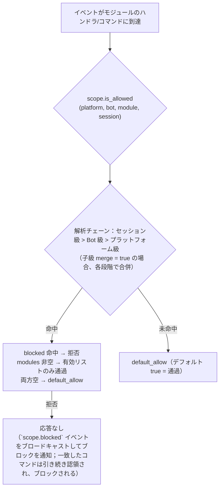

# スコープ（scope）

> [!TIP]
> **この記事を読むべきタイミング**：モジュールの可用性、イベントの受信制限、または出力アクションの制限を制御する必要がある場合。不要な場合は飛ばしても、他の機能の使用に影響はありません。

> **読了後は**：3つのスコープ次元（モジュールの可用性 / イベント受信 / 出力アクション）それぞれの設定経路、判定優先順位と拒否時の挙動、実行時のAPIの使い方、およびブロッキングがどのように可視化されるか（`scope.blocked` イベント）を理解できます。
>
> **本記事では対象外**：リソースの所有権と解放回収（[所有権（owner）システム](ownership.md)を参照）；コマンドACLとイベントの上書き（[イベント処理入門](../getting-started/event-handling.md)を参照）。

> [!NOTE]
> この機能は ErisPulse **2.8.0+** が必要です。

スコープは4つの質問に答える：**どのモジュールが使えるか、どのイベントを受け取るか、特定のモジュールがどのようなテキストを処理するか、モジュールが外部にどのようなアクションを実行できるか**。制御権はすべてユーザーに委ねられます。モジュール / アダプタ / プロセッサ / 出力呼び出しの登録時に**上層**（設定 `ErisPulse.scope` または実行時 `sdk.scope`）で一括して宣言し、イベントパイプラインはエントリ、プロセッサフィルタ、出力ゲートで自動的に読み取り、実行します。

| 次元 | 制御対象 | 拒否時の挙動 | 設定経路 |
|------|---------|---------|---------|
| **① モジュール** | どのモジュールが使えるか（プラットフォーム / Bot / セッションの3段階） | フィルタリングされたモジュールはトリガーされず、返信もされません（`scope.blocked` イベントをブロッキング）。対象となるコマンドは既に認証済みで、ブロックされます。 | `scope.platforms / bots / sessions` |
| **② 身分** | イベントを受け取るかどうか（アダプタ / Bot / セッション / ユーザーの4段階） | エントリで完全に破棄されます（`scope.blocked` イベントをブロッキング）。 | `scope.identity.*` |
| **③ 出力** | モジュールがどのような出力呼び出し（メッセージ / API / リクエスト、メソッドレベルの白黒リスト）を実行できるか | 失敗応答（`retcode=34601`）が返されます。 | `scope.actions` |

> **関連システム**：コマンドは特別なメッセージイベントハンドラであり、そのユーザーの白黒リスト（ACL）と実装パラメータの上書きはコマンドシステムが独自に保持します（`ErisPulse.event.command`）。[イベント処理入門](../getting-started/event-handling.md)と[設定ガイド](../user-guide/configuration.md)を参照してください。

{!--< tips >!--}
1. `from ErisPulse.Core import scope` でシングルトンをインポート（`sdk.scope` は同じオブジェクト）
2. 判定：`scope.is_allowed(...)` / `scope.is_identity_allowed(...)` / `scope.is_action_allowed(...)` は、それぞれ①②③の3つのゲートに対応します
3. 読み書き：次元化されたパラメータメソッド（IDEで補完可能）—— `scope.set_module(...)` / `scope.set_identity(...)` / `scope.set_action(...)`；また、辞書式のバックアップとして `scope.get(path)` / `scope.set(path, v)` / `scope.delete(path)` もあります
4. イベントハンドラのテキスト条件の上書きは、[イベント処理入門 · イベントの上書き](../getting-started/event-handling.md#イベントの上書き-モジュールコードを改ざんせず任意のイベントタイプの挙動を上書き)を参照してください；コマンドACL / パラメータの上書きは[イベント処理入門](../getting-started/event-handling.md)を参照してください
{!--< /tips >!--}

## マッチングエントリの構文（全システムで統一）

スコープのすべての「名前リスト」（モジュール名、身元キー、出力エントリ）は、同一のマッチング構文（`ErisPulse.Core.text_match`）を使用します：

| 構文 | 例 | 説明 |
|------|------|------|
| 精確名 | `"Chat"` | 全値比較、**大文字小文字は区別しない** |
| glob | `"Tool*"`、`"spam_*"` | `*` 任意の文字列 / `?` 1文字 / `[seq]` 文字集合、大文字小文字は区別しない |
| 正規表現 | `"re:^Danger.*"` | `re:` で始まる宣言、正規表現 `search` で一致、デフォルトは大文字小文字は区別しない |

- 不正な正規表現は**静かに無効化**される（エラーは発生せず、クラッシュもしない）
- デコレータのパラメータ（`pattern=` / `regex=`）は固定された意味を持つ：`pattern` は glob、`regex` は正規表現のソースコード（`re:` プレフィックスは付けない）；スコープの設定内の正規表現エントリは**必ず** `re:` プレフィックスを付ける必要がある

## グローバルバックアップ：`default_allow`

`default_allow` は**唯一のグローバルバックアップ**スイッチ（デフォルト `true`）で、2つの判定次元に一括して効果を及ぼします：

- **モジュール次元**：どのバインディングにも一致しない → `default_allow` で許可 / 拒否を決定
- **身元次元**：どの戦略にも一致しない → `default_allow` で許可 / 拒否を決定

`false` に設定すると「暗黙の拒否」厳密モードが有効になり、ホワイトリスト方式で管理されるため、**明示的に許可されていないものはすべて拒否**されます。

> **例外**：③ 出力次元は**`default_allow`の影響を受けない**——これは独立した絞り込みスイッチであり、デフォルトはすべて許可され、明示的なルールでのみ制限される（フレームワーク層の owner が空の呼び出しは常に許可される）。このように厳密なグローバルモードでも、すべてのモジュールのメッセージ返信が意図せず遮断されることはない。コマンド ACL には独立した `ErisPulse.event.command.default_allow` バックアップがあり、互いに影響しない。

## 設定ファイル

```toml
[ErisPulse.scope]
default_allow = true        # グローバルバックアップ（false = 暗黙の拒否厳密モード）
cache_size = 1024           # LRUキャッシュサイズ

# ── ① モジュール次元（優先度：セッション > Bot > プラットフォーム）──
[ErisPulse.scope.platforms.onebot11]
modules = ["Chat", "Tool*"]   # ホワイトリスト：正確な名前 / glob / re: 正規表現
blocked = ["re:^Danger"]
[ErisPulse.scope.bots.onebot11."123456"]
modules = ["Chat"]
merge = true                  # プラットフォームレベルのバインディングに追加（デフォルトは全体を上書き）
[ErisPulse.scope.sessions.onebot11."789012345"]
modules = ["Chat"]

# ── ② 身元次元（優先度：ユーザー > セッション > Bot > アダプタ）──
[ErisPulse.scope.identity.adapters.onebot11]
deny = true                   # アダプタ全体のイベントを完全に破棄
[ErisPulse.scope.identity.bots.onebot11."123456"]
deny = true
[ErisPulse.scope.identity.sessions.onebot11."g_blocked"]
deny = true
[ErisPulse.scope.identity.users.onebot11]
allow = ["u_admin"]           # ユーザー鍵は glob / re: 正規表現をサポート
deny = ["u_bad", "spam_*"]

# ── ③ 出力次元（デフォルトはすべて許可され、明示的な絞り込みのみ制限）──
[ErisPulse.scope.actions.MyModule]
send = { deny = true }                                    # 送信を完全に禁止
api = { allow = ["get_*"] }                               # クエリ系の標準APIのみ許可
request = { deny = true }                                 # リクエスト処理を禁止
```

## ① モジュール次元

**一言で言うと**：プラットフォーム / Bot / セッションの3段階でバインド制御を行い、"このコンテキストでどのモジュールが有効か"を制御します。フィルタリングされたモジュールはトリガされず、応答もしません（一致したコマンドは引き続き認領され、ブロックされます）。

「あるコンテキストで、どのモジュールが有効か」を回答します。デフォルトではすべて開放です。バインドを設定した場合にフィルタリングが開始され、**モジュールとアダプタは一切変更不要です**。



- **解析優先度**：セッション級 > Bot 級 > プラットフォーム級、高優先度のバインドは低優先度を**全体的に上書き**します。  
  子級バインドに `merge = true` を指定した場合は、低優先度と**各項目ごとに合併**されます（`modules` / `blocked` はそれぞれ独立に合併され、`merge` 自体は項目としてカウントされません）。
- **デフォルトの意味**：フィルタリングされたモジュールのコマンドやハンドラはトリガされず、応答もしません。TRACE レベルのログで確認可能（`core.scope.denied`）。  
  同時に `scope.blocked` ライフサイクルイベントをブロードキャストして、誰がブロックされたか、なぜブロックされたかを観測できます。  
  一致した**コマンド**は引き続き認領され、ブロックされます——コマンドのテキストは低優先度のメッセージハンドラに漏れることなく、二重応答の混乱を解消します。
- **フレームワークレベルのハンドラ**（`scope_exempt=True` または owner が空）は影響を受けません。モジュール名が空（フレームワーク層のリソース）の場合は常に通過します。
- **セッション感知のヘルプとコマンド照会**：コマンド照会 API（`command.help` / `get_command` / `get_commands` / `get_group_commands` / `get_visible_commands`、および `module.get_commands_overview`）は、任意の `event=` または明示的な `platform=` / `bot_id=` / `session_id=` キーワードをサポートします。  
  現在のセッションで無効なモジュールのコマンドは結果に含まれません（`get_command` は None を返し、単一コマンドのヘルプは「未登録」として扱われ、デフォルトの意味と一致します）。  
  コンテキストを渡さない場合は、全量の動作を維持します。

### バインドの継承（merge）

デフォルトでは、全体的な上書きの意味が明確で予測可能です。上級バインドに**追加**したい場合は、子級に `merge = true` を指定します：

```toml
[ErisPulse.scope.platforms.onebot11]
modules = ["Chat", "Tool"]      # プラットフォーム級：Chat、Tool を有効

[ErisPulse.scope.bots.onebot11."123456"]
modules = ["Music"]
merge = true                    # この Bot の実効値 = ["Chat", "Tool", "Music"]
```

- 合併ルール：`modules` と `blocked` はそれぞれ**合併**されます。バインド内では `blocked` が `modules` より優先されます。
- 鏈式合併：プラットフォーム → Bot → セッションの順に段階的に追加され、各段階で `merge` または上書きを独立して決定します。

## ② 身元次元（イベント受容）

**一言で言うと**：ユーザー／セッション／Bot／アダプターの4段階の戦略に基づき、イベント配信の入口で「受容すべきでないイベント」を完全に破棄し、deny は allow より優先されます。

「どのユーザーのイベントを受け入れるか」を決定します。拒否されたイベントは**配信の入口で完全に破棄**されます——ミドルウェアや任意のハンドラ（フレームワークレベルを含む）には一切渡らず、TRACE レベルのログ（`core.scope.identity_denied`）でのみ確認できます。

- **解析優先度**：ユーザー > セッション > Bot > アダプター。最も具体的に設定された戦略を採用します。deny は allow より優先されます。
- 各段階のバインディングは二元的な戦略です：`{ allow = true }` または `{ deny = true }`
- ユーザーのキーには glob / 正規表現（例：`"spam_*"` で一括してスパムユーザーをブロック）が使用可能です。
- 代表的な使い方——上位階層で deny し、個別のユーザーに対して allow を設定することで「例外的に許可」を実現します：

```toml
[ErisPulse.scope.identity.adapters.onebot11]
deny = true
[ErisPulse.scope.identity.users.onebot11]
allow = ["u_admin"]   # アダプター階層で拒否されていても、u_admin のイベントは許可されます
```

## ③ 出站次元（制限モジュールが発信する呼び出し）

**一言で言うと**：メソッド単位のホワイトリスト・ブラックリストによって、モジュールが発信するメッセージ / API / リクエスト呼び出しを制限し、拒否された呼び出しはネットワークリクエストを一切行わず、直接 `retcode=34601` を返します。

制限されるモジュールの**発信アクション**：メッセージ送信 / 標準APIアクション / リクエスト操作。  
3つのアクションはそれぞれ下層DSLに対応します：`Event.reply` と `Send`（send）、`Api` / `call_api`（api）、`Request` の accept/reject（request）。イベントハンドラ実行中にモジュールが発信する出站呼び出しは、モジュールのオーナーを含み、この次元で一括して判定されます。

### 規則の形態（インライン表）

各アクションのルールはインライン表です：`{ allow = [...], deny = true|[...] }`。  
同一アクションには1つのルールしか設定できません（TOMLのキーは重複不可、全禁止と細粒度のどちらか1つを選択）：

```toml
[ErisPulse.scope.actions.MyModule]
send = { deny = true }                                  # 送信を全禁止（Event.reply / Send DSL）
# またはメソッド単位の細粒度設定：send = { allow = ["Text", "Image*"], deny = ["File"] }
api = { allow = ["get_*"] }                             # 限定的に取得系標準APIを許可
# またはアクション単位のブラックリスト：api = { deny = ["set_*", "leave_*"] }
request = { deny = true }                               # リクエストのaccept/reject処理を禁止
```

- `send` の項目は**送信メソッド名**（`Text` / `Image` / `File` ...）に一致する
- `api` の項目は**標準アクション名**（`get_group_info` / `set_group_name` ...）に一致する
- 項目は正確な名前 / glob / `re:` 正規表現（全システムと統一された構文で、大文字小文字は区別しない）
- `allow` に1つの文字列を記述することは、1つの項目のリストと同義です：`send = { allow = "Text" }`

### 判定の意味

**デフォルトは全許可**——設定がなければ、またはオーナーが空（フレームワーク層の内部呼び出し）であれば許可されます。  
ルールが設定された場合、以下の順序で判定されます：

1. `deny = true` → 拒否
2. `deny` リストに呼び出し名が一致 → 拒否
3. `allow` リストが空でなく、呼び出し名が一致しない（または呼び出しに名前がない）→ 拒否
4. その他の場合 → 許可

拒否された呼び出しはネットワークリクエストを一切行わず、標準の失敗レスポンスを直接返します（`retcode = 34601`、[api-response §5.3](../standards/api-response.md#53-フレームワーク拡張返却コード34xxx-プラットフォームエラーセグメントの下3桁カスタマイズ)を参照）。  
3つのアクションは互いに独立しており、1つだけを制限することも可能です。

```python
# 実行時API
sdk.scope.set_action("MyModule", "send", deny=True)              # 送信を全禁止
sdk.scope.set_action("MyModule", "send", allow=["Text"])         # 送信はテキストのみ許可
sdk.scope.is_action_allowed("MyModule", "send", name="Image")    # False
sdk.scope.is_action_allowed("MyModule", "api", name="get_user_info")  # 規則に従って判定
sdk.scope.delete_action("MyModule", "send")                      # 許可を復元
sdk.scope.get_action("MyModule", "send")                         # そのアクションの現在のルール
```

## 実行時API

スコープの実行時APIは3つの層に分かれています：**判定**（3つの質問）、**次元ごとの読み書き**（各次元の `set` / `get` / `delete` パラメータ化メソッド、署名はすべて型注釈付き、IDEで補完可能）、**辞書式バックアップ**（ドット区切りのパスで任意の節に直接アクセス）。

```python
from ErisPulse import sdk

scope = sdk.scope
```

### 判定（3つの質問）

```python
scope.is_allowed("onebot11", "123456", "Chat")                 # ① モジュール次元
scope.is_allowed("onebot11", "123456", "Chat", "789012345")    # セッションレベルを含む
scope.is_allowed("onebot11", "123456", None)                   # フレームワーク層のリソース -> True

scope.is_identity_allowed("onebot11", "123456", "group_9", "u1")   # ② 身元次元

scope.is_action_allowed("MyModule", "send")                    # ④ 出力次元
scope.is_action_allowed("MyModule", "send", name="Image")      # メソッドレベルの細粒度
```

### ① モジュール次元

```python
# バインディング（パラメータによって階層が決まります：session_id > bot_id > プラットフォームレベル）
scope.set_module("onebot11", bot_id="123456", modules=["Chat", "Tool*"])
scope.set_module("onebot11", blocked=["re:^Danger"])                       # プラットフォームレベル
scope.set_module("onebot11", bot_id="123456", session_id="g9", modules=["Chat"])  # セッションレベル
scope.set_module("onebot11", bot_id="123456", modules=["Music"], merge=True)      # 現在のバインディングと並列に結合
scope.set_module("onebot11", bot_id="123456", modules=["Chat"], persist=False)    # 実行時のみ

# 読み取り / 削除
scope.get_module("onebot11", bot_id="123456")   # {"modules": ["Chat"], "blocked": []}
scope.delete_module("onebot11", bot_id="123456")
```

> `merge=True` は**書き込み時に並列に結合**（現在のバインディングとエントリを結合）です；階層間の解析時の `merge = true` 設定は上記の[バインディング継承](#バインディング継承merge)をご覧ください——これらは独立したメカニズムです。

> **実行時バインディング（`persist=False`）の意味**：実行時バインディングは独立したオーバーライド層に保存され、**任意の後続の設定書き込み / 設定ファイルのホットアップデートでも削除されません**（設定ツリーが再構築された後に、書き込み順に自動的に再実行されます、実行時削除も含みます）。これらは永続化されず、プロセスの再起動後に失われます；モジュールのアンロード時に、そのモジュールが書き込んだ実行時バインディングはバックアップでクリーンアップされます。その後、同一のパスで `persist=True` を実行すると、ユーザー永続化の意味で実行時ルールが上書きされます。

### ② 身元次元

```python
# 戦略のバインディング（パラメータによって階層が決まります：user > session > bot > adapter；allow / deny のどちらか一方）
scope.set_identity("onebot11", user_id="u_bad", deny=True)
scope.set_identity("onebot11", user_id="spam_*", deny=True)    # キーは glob / re: 正規表現をサポート
scope.set_identity("onebot11", bot_id="123456", session_id="g9", allow=True)

# 読み取り / 削除
scope.get_identity("onebot11", user_id="u_bad")   # {"deny": True}
scope.delete_identity("onebot11", user_id="u_bad")
```

### ③ 出力次元

```python
# 制限ルールの設定（allow: str|list；deny: bool|str|list；ルール全体の置換）
scope.set_action("MyModule", "send", deny=True)                    # 送信を完全に禁止
scope.set_action("MyModule", "send", allow=["Text"])               # テキスト送信のみ許可
scope.set_action("MyModule", "api", deny=["set_*", "leave_*"])     # 管理系APIを禁止

# 読み取り / 削除
scope.get_action("MyModule", "send")       # {"allow": ["Text"]} 元のルール
scope.delete_action("MyModule", "send")    # 個別のアクションを削除
scope.delete_action("MyModule")            # モジュールのすべてのアクション制限を削除
```

### 一般的な操作

```python
scope.get("platforms")   # 辞書式バックアップ：ドット区切りのパスで任意の節を読み取り
scope.topology()         # 全設定ツリー（ダッシュボード用）
scope.stats()
# {"module_calls": .., "module_filtered": .., "identity_checks": .., "identity_denied": ..,
#  "action_checks": .., "action_denied": .., "cache_hits": .., "cache_misses": ..}
scope.reset_stats()
scope.clear()           # 全設定をクリア（メモリ上でのみ有効）
```

### 高度な操作：辞書式ドット区切りパスバックアップ

次元化されたメソッドは日常的なシナリオをカバーします；任意のノード（または将来追加される次元）に直接アクセスする必要がある場合、**辞書式API**を使用できます——`get` / `set` / `delete` はドット区切りのパスを受け取り（dictの深さのマージ、書き込み後すぐに読み取り可能）、`scope[path]` / `scope[path] = v` / `del scope[path]` / `path in scope` プロトコルも提供します：

```python
scope.set("bots.onebot11.123456", {"modules": ["Chat"], "blocked": []})
scope.set("identity.users.onebot11.u_bad", {"deny": True})
scope.get("actions.MyModule.send")

scope["platforms.onebot11"]        # 読み取り（存在しない場合はKeyErrorを送出）
scope["platforms.onebot11"] = {...}  # 書き込み
del scope["platforms.onebot11"]      # 削除
"actions.MyModule" in scope          # 存在確認
```

## 拦截の可視化：`scope.blocked` イベント

スコープのフィルタリング（モジュールのフィルタ / 身元の拒否）が発生すると、**`scope.blocked`** というライフサイクルイベントがブロードキャストされ、"誰がブロックされたか、どのレベルでブロックされたか"をサブスクライブ、統計、ダッシュボードで表示可能になります——ブロックはデフォルトで返信されませんが、不可知のブラックボックスではありません。

| フィールド | 説明 |
|------|------|
| `dimension` | `"module"`（モジュール次元のフィルタ）/ `"identity"`（身元の受信拒否） |
| `module` | フィルタされたモジュール名（モジュール次元のみ） |
| `platform` / `bot_id` / `session_id` / `user_id` | ブロックが発生したソースコンテキスト |

```python
from ErisPulse.Core.lifecycle import lifecycle

@lifecycle.on("scope.blocked")
def on_blocked(data):
    print(f"ブロックされた：{data['dimension']} {data.get('module') or data.get('user_id')}")
```

- イベントは `fire` でバックグラウンドでブロードキャストされます（リスナーがいない場合はオーバーヘッドがなく、ホットパスを遅らせません）
- キャッシュヒットによる重複のブロックは**再ブロードキャストされません**——同じ組み合わせはキャッシュが失効するたびに1回だけブロードキャストされます
- `adapter.event.blocked`（ミドルウェアによる拒否）とは区別されます：これはイベントレベルの破棄であり、本イベントはスコープの受信ゲートのモジュール / 身元フィルタリングです

## キャッシュとホットアップデート

- `is_allowed` / `is_identity_allowed` / `is_action_allowed` の結果は**LRUキャッシュ**（`scope.cache_size` で調整可能）が付いており、`set` / `delete` / 設定のホットアップデート（`config.updated` / `config.set`）で自動的に失効します
- すべての次元の設定は**即座に有効**になります、再起動は不要です
- スコープは**イベントごとの判断**であり、イベント間で状態を記憶しません：設定が変わると、次のイベントは新しいルールに従います

## 設定フォーマットの検証

ロード時 / ホットアップデート時に各セクションの設定フォーマットを検証します：型の間違ったセクション（例：`platforms` が文字列に設定されている）、不正な出力ルール（例：`allow` が数値に設定されている）、未知のアクション名、未知のトップレベルのキー（例：`alow` というスペルミス）は **WARNING** として出力され、対応するセクション / 条目は無視され、他の合法な設定は正常に有効になります——間違った設定は静かに失効するのではなく、警告されます。

## 一般的な問題と注意事項

### 1. 設定の階層と上書き

- モジュール次元：セッションレベル > Botレベル > プラットフォームレベル、**全体的に上書き**（子レベルで `merge = true` の場合は各エントリを並列に結合）。プラットフォームで `Chat` を許可し、Bot で `Music` を追加したい場合は、Bot レベルで `merge = true` を書くか、両方をリストに書く
- 身元次元：ユーザー > セッション > Bot > アダプタ、**最も具体的な**設定された戦略を取ります（例外許可ができます）
- コマンドのユーザーブラックリスト/ホワイトリスト：正確なコマンド名が glob キーに優先されます（`event.command.acl` を参照）

### 2. モジュール/コマンドが反応しない

まず作用域が原因かどうかを疑います：

```python
from ErisPulse import sdk

print(sdk.scope.is_allowed(event.get_platform(), bot_id, "MyModule", session_id))
print(sdk.scope.is_identity_allowed(event.get_platform(), bot_id, session_id, user_id))
print(sdk.scope.stats())   # module_filtered / identity_denied > 0 なら、ブロック記録がある
```

フィルタされた場合、デフォルトでは返信されません（モジュール次元と身元次元、ルールを暴露しないように）；`scope.blocked` ライフサイクルイベントをブロードキャストし、統計は継続的に蓄積されます；ACL で拒否されたコマンドは「権限不足」の返信を表示します。

### 3. 出力アクションが拒否されたときのトラブルシューティング

```python
from ErisPulse import sdk

print(sdk.scope.get("actions.MyModule"))
print(sdk.scope.stats())   # action_denied > 0 なら、呼び出しがブロックされている
```

ブロックは**明示的**です：拒否された呼び出しは `retcode = 34601` の標準の失敗レスポンスを返し、ネットワークリクエストは発生しません。

### 4. セッション識別子のプラットフォーム間隔離

`(platform, session_id)` 組み合わせが唯一の識別子です。`scope.sessions.onebot11."789"` は onebot11 でのみ作用し、telegram 上で同じ `789` のセッションには影響しません。身元次元のユーザーキーも同様です。

## 拓撲ツリーアプリケーションプログラミングインターフェース

`ModuleManager.get_topology()` と `AdapterManager.get_topology()` は、モジュール/アダプタの所属関係データを提供します。`sdk.get_topology()` は、作用域 `scope` を含む一括集約を行います：

```python
from ErisPulse import sdk

topology = sdk.get_topology()
# {
#   "modules": {                                   # モジュール → 持有するリソース
#     "Chat": {
#       "loaded": True, "enabled": True,
#       "commands": ["chat", "translate"],
#       "handlers": {"message": 2, "notice": 1},
#       "routes": {"http": ["/Chat/api"], "ws": [], "sse": []},
#       "lifecycle_hooks": 3,
#     }
#   },
#   "adapters": {                                  # アダプタ → Bot → 作用域
#     "onebot11": {
#       "status": "started", "enabled": True,
#       "bots": {"123456": {"status": "online", "scope": {...}}},
#       "scope": {"modules": [...], "blocked": [...]},
#     }
#   },
#   "scope": {                                     # 作用域（モジュール / 身元 / 出力アクション）
#     "platforms": {...}, "bots": {...}, "sessions": {...},
#     "identity": {"adapters": {...}, "bots": {...}, "sessions": {...}, "users": {...}},
#     "actions": {...},
#   },
# }
```

- モジュールのトポロジーは、登録されたコマンド、イベントハンドラ、HTTP/WS/SSEルート、ライフサイクルフックを統合し、モジュールリソースツリーを描画するのに便利です。
- アダプタのトポロジーは、各アダプタの状態、下位のBotの状態、およびプラットフォーム/Botレベルの作用域バインディング（モジュール次元）を統合します。
- **JSON安全出力**：`get_topology(json_safe=...)` はデフォルトで `True` であり、返された構造は直接 `json.dumps` できます——モジュール `info` は純粋なデータの `meta` サブテーブルのみ保持されます（`module_class` / `strategy` などの実行時オブジェクトは除外）、その他のノード（アダプタ作者が Bot `info` に挿入した任意のオブジェクトを含む）もバックアップで浄化されます（クラスオブジェクトは `__name__` を取得し、シリアライズできないオブジェクトは `str()` に退化します）。ダッシュボード / WebUI は直接シリアライズして返すことができます；原始オブジェクトが必要な場合は `json_safe=False` を渡します。

## 関連ドキュメント

次の意図に応じて選択してください：

- **リソースの所有権とアンロード回収を制御したい** → [所有権（owner）システム](ownership.md)——スコープは「リソースが有効かどうか」を管理し、所有権は「リソースは誰のものか、誰がアンロード時に回収されるか」を管理します。
- **モジュール間の呼び出しを監査したい** → [モジュール間通信](module-communication.md)——`module.call` が呼び出し元のアイデンティティでエグジットゲートを通過する方法
- **モジュールの新バージョンを段階的にリリースしたい** → [影モジュールと段階的リリース](shadow.md)——独立した owner として並行して試運転
- **設定セクションの書式とホットアップデートの動作を確認したい** → [設定ガイド](../user-guide/configuration.md)