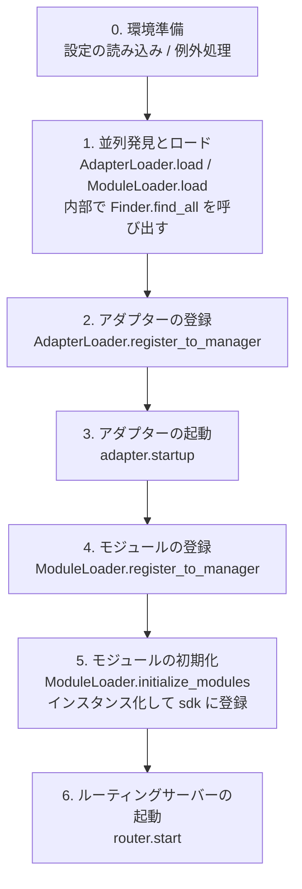

# スタートアップフローと手動制御

> [!TIP]
> **この記事を読むタイミング**：手動でスタートアップの流れを駆動する、カスタムスタートアップ順序、または起動失敗のトラブルシューティングが必要な場合。不要であれば飛ばしても、他の機能の使用には影響しません。

ErisPulse の `await sdk.run()` / `await sdk.init()` は、一連のスタートアップフローを「一行のコード」にラップしています。しかし、部分的なロード、動的登録、ホットプラグ、カスタムロード戦略の注入など、完全にカスタムのスタートアップフローが必要な場合は、このフローの内部で何が起こっているのか、そして各ステップを手動で駆動する方法を理解する必要があります。

本文では、スタートアップフローを独立したコンポーネントに分解し、それぞれの役割と呼び出し順序を説明し、手動で完全に起動するための例を示します。

> 本文では、[最初のロボット](../getting-started/first-bot.md)を実行し、`sdk.run(keep_running=True/False)` の2つのモードを理解していることを前提としています。本文では、`init()` **内部**のフローの分解と、`init()`/`init_task()`/`init_sync()` などのより低レベルのエントリポイントに焦点を当てます。

## SDKのトップレベルエントリ

`run()` の2つの `keep_running` モードに加えて、SDKにはいくつかのより低レベルの初期化エントリが提供されており、**非同期性、戻り値、および例外のラッピング**の違いがあります。

| エントリ | 非同期性 | 戻り値 | 例外処理 | 適用場面 |
|------|--------|--------|----------|----------|
| `await sdk.run(True)` | async、イベントループをブロック | `None`（終了時に自動 `uninit`） | モジュール/アダプターのエラーはキャッチされ、プロセスを停止しない | ロボットアプリケーション |
| `await sdk.run(False)` | async、イベントループをブロックしない | `None`（自動アンロードしない） | 同上 | 初期化後にカスタムロジックを実行 |
| `await sdk.init()` | async、awaitが必要 | `bool` | コンポーネントの例外は内部でキャッチされ、失敗時は `False` を返す | 手動でライフサイクルを制御（`uninit()` と併用） |
| `sdk.init_task()` | async、Taskを返す、イベントループをブロックしない | `asyncio.Task` | `init()` と同じ | 別の初期化を並列実行、またはイベントループがまだ実行されていない場合 |
| `sdk.init_sync()` | **同期**、現在のスレッドをブロック | `bool` | `init()` と同じ | コマンドラインスクリプト、イベントループのない同期エントリ |

> **よくある誤解**：`await sdk.init()` は `await sdk.run(keep_running=False)` と**等価ではありません**。2つの違いがあります：① `init()` は `bool` を返します（失敗時は `False`）、`run()` は `None` を返します；② `init()` は初期化のみを行い、**自動的にアンロードしません**、`run()` はイベントループが終了したときに自動的に `uninit()` を実行します。したがって、手動でアンロードやカスタムライフサイクルを制御する必要がある場合は、`init()` + `uninit()` を使用します。

## スタートアップフローの概要

`sdk.init()`（正確にはその内部の `Initializer.init()`）は、以下の順序でフレームワークを起動します：



対応するコアコンポーネント：

| 層 | コンポーネント | 職責 |
|----|------|------|
| 発見 | `AdapterFinder` / `ModuleFinder` | 既にインストールされたパッケージの entry-points から**発見**する |
| ロード | `AdapterLoader` / `ModuleLoader` | 発見 + インポート + メタデータの読み込み + 有効/無効の判断、オブジェクトリストを返す |
| 登録 | `*Loader.register_to_manager` | オブジェクトを対応するマネージャーに登録する |
| 管理 | `sdk.adapter` / `sdk.module` | アダプター/モジュールのインスタンスを維持し、起動/停止のインターフェースを提供する |
| 初期化 | `ModuleLoader.initialize_modules` | モジュールのインスタンスを作成して sdk に登録する（依存関係のトポロジカルソートを処理） |
| ルーティング | `sdk.router` | HTTP / WebSocket サーバー |

> **重要**：`Finder` と `Loader` は2つの層です。`Loader` は内部で `Finder` を保持しています（`AdapterLoader` は `AdapterFinder` を、`ModuleLoader` は `ModuleFinder` を持っています）。ほとんどの場合、`Loader` を使用するだけで十分です。`Finder` は「インポートせずにリストする」場合にのみ個別に使用します。

## 各コンポーネントの詳細

### 1. 発見層：Finder

Finder は「どのパッケージがアダプター/モジュールを提供しているか」を発見するだけで、インポートやインスタンス化は行いません。

```python
from ErisPulse.finders import AdapterFinder, ModuleFinder

adapter_finder = AdapterFinder()
module_finder = ModuleFinder()

# すべてのインストール済みのアダプター/モジュールの entry-points を検索
adapter_entries = adapter_finder.find_all()    # list[EntryPoint]
module_entries = module_finder.find_all()      # list[EntryPoint]

# 名称で個別に検索
entry = module_finder.find_by_name("MyModule")  # EntryPoint | None
```

各 `EntryPoint` は `.load()` で対応するクラスを得ることができますが、通常は手動で呼び出す必要はありません。`Loader` が処理します。

### 2. ロード層：Loader

Loader は Finder の上に「インポート + メタデータの読み込み + 有効/無効の判断」を行います。

```python
from ErisPulse.loaders import AdapterLoader, ModuleLoader
from ErisPulse import sdk

adapter_loader = AdapterLoader()
module_loader = ModuleLoader()

# load() 内部：finder.find_all() を呼び出す → 各 entry-point を処理 → 3タプルを返す
adapter_objs, enabled_adapters, disabled_adapters = await adapter_loader.load(sdk.adapter)
module_objs, enabled_modules, disabled_modules = await module_loader.load(sdk.module)
```

`load()` が返す3タプル：

| 戻り値 | 意味 |
|--------|------|
| `objs` (`dict`) | 名称 → オブジェクト（アダプタークラス / モジュールラッパー） |
| `enabled` (`list[str]`) | 有効化された名称（設定で無効化されていない） |
| `disabled` (`list[str]`) | 無効化された名称 |

#### ロード失敗時の診断情報

モジュール/アダプターがロードまたは初期化の段階で例外を送出した場合、フレームワークはそのコンポーネントをスキップして他のコンポーネントのロードを継続し、**ユーザーのコードのフレームを要約して**、INFO レベルでエラー位置を特定できるようにします。DEBUG レベルを上げる必要はありません。

```
[ERROR] [ModuleLoader] entry-point からモジュール MyModule のロードに失敗しました、スキップしました: 'NoneType' object has no attribute 'platform'
  → MyModule/Core.py:42 in on_load
      adapter = sdk.platform
  → AttributeError: 'NoneType' object has no attribute 'platform'
  → ヒント: ログレベルを DEBUG に上げて詳細なスタックトレースを確認する；モジュール MyModule の実装コードを確認する
```

診断情報は `ErisPulse.runtime.diagnostics` モジュールによって生成され、フレームワーク内部のフレームは自動的にフィルタリングされ、ユーザーのコードフレームのみが残ります。カスタムロードロジックで再利用するには：

```python
from ErisPulse.runtime import log_diagnostic

try:
    risky_init()
except Exception as e:
    log_diagnostic(e)  # 自動的にユーザーのコードフレームを抽出して ERROR ログに記録する
```

このモジュールには `extract_user_frame()`（構造化されたフレーム情報を返す）と `format_diagnostic_block()`（複数行のテキストを返す）という2つの低レベル関数もあります。

### 3. 登録層：register_to_manager

Loader が出力したオブジェクトをマネージャーに登録し、`sdk.adapter` / `sdk.module` がそれらを認識できるようにします。

```python
# アダプターの登録（すべて成功した場合は True を返す）
await adapter_loader.register_to_manager(enabled_adapters, adapter_objs, sdk.adapter)

# モジュールの登録
await module_loader.register_to_manager(enabled_modules, module_objs, sdk.module)
```

登録後、アダプターはアダプター管理マネージャーに登録され、モジュールはモジュール管理マネージャーに登録されますが、**まだ起動/インスタンス化されていません**。

### 4. アダプターの起動

```python
# すべての登録済みアダプターを起動
await sdk.adapter.startup()
# または特定のプラットフォームを指定
await sdk.adapter.startup("yunhu")
await sdk.adapter.startup(["yunhu", "telegram"])
```

> 登録 ≠ 起動。`register_to_manager` は単に登録するだけで、`startup` がアダプターの `start()` を呼び出し、プラットフォームとの接続を確立します。

### 5. モジュールの初期化

モジュールはアダプターに比べて1つ多く、「**インスタンス化**」して `sdk` に登録する必要があります（これにより `sdk.MyModule.xxx` で呼び出せるようになります）。この段階では、モジュール間の依存関係の宣言とトポロジカルソートも処理されます。

```python
success = await module_loader.initialize_modules(
    enabled_modules, module_objs, sdk.module, sdk
)
```

インスタンス化が成功すると、モジュールは `sdk.<ModuleName>` に登録されます。

### 6. ルーティングサーバーの起動

```python
await sdk.router.start(
    host="0.0.0.0",
    port=8000,
    ssl_certfile=None,
    ssl_keyfile=None,
)
```

ルーティングサーバーは、アダプターからの Webhook / WebSocket コールバックを受信します。これを起動しないと、サーバーモードのアダプターはメッセージを受信できません。

## 完全な手動起動の例

以下のコードは `await sdk.init()` のコアフローと**等価**ですが、各ステップが明示的に公開されており、任意の段階でカスタムロジックを挿入できます：

```python
import asyncio
from ErisPulse import sdk
from ErisPulse.loaders import AdapterLoader, ModuleLoader

async def manual_startup():
    # 0. 環境の準備（設定の読み込み、グローバル例外処理の登録）
    #    _prepare_environment は init() 内部の前置処理です；手動フローでも先に呼び出す必要があります。
    #    そうしないと、Loader は設定を読めず、すべてのアダプター/モジュールを誤って無効化してしまいます。
    if not await sdk._prepare_environment():
        print("環境の準備に失敗しました")
        return False

    # 1. ローダーの作成（内部でそれぞれ Finder を保持）
    adapter_loader = AdapterLoader()
    module_loader = ModuleLoader()

    # 2. 並列で発見とロード（init() 内部と同じ gather を使用）
    (adapter_objs, enabled_adapters, disabled_adapters), \
    (module_objs, enabled_modules, disabled_modules) = await asyncio.gather(
        adapter_loader.load(sdk.adapter),
        module_loader.load(sdk.module),
    )

    # 3. アダプターの登録
    await adapter_loader.register_to_manager(
        enabled_adapters, adapter_objs, sdk.adapter
    )

    # 4. アダプターの起動
    if enabled_adapters:
        await sdk.adapter.startup()

    # 5. モジュールの登録
    await module_loader.register_to_manager(
        enabled_modules, module_objs, sdk.module
    )

    # 6. モジュールの初期化（インスタンス化 + sdk への登録）
    if enabled_modules:
        await module_loader.initialize_modules(
            enabled_modules, module_objs, sdk.module, sdk
        )

    # 7. ルーティングサーバーの起動
    await sdk.router.start(host="0.0.0.0", port=8000)

    print("手動起動が完了しました")
    return True

async def main():
    ok = await manual_startup()
    if ok:
        # プログラムをブロックして維持（手動フローでは自動的にブロックされません）
        await asyncio.Event().wait()

if __name__ == "__main__":
    asyncio.run(main())
```

### いつ手動起動が必要か？

ほとんどの場合、**手動起動は必要ありません**。`await sdk.run()` はすでに上記のすべてを処理しています。手動起動は、以下の場面で価値があります：

- **部分的なロード**：指定されたアダプター/モジュールのみをロードし、他のモジュールをスキップ
- **動的登録**：実行時に条件に応じて新しいアダプター/モジュールを登録
- **カスタム順序**：デフォルトのロード順序を変更したい（例：アダプター起動前に特定のモジュールを起動）
- **戦略の注入**：Loader にカスタムの厳格モードマネージャー、ロード戦略などを注入
- **デバッグ/診断**：特定の段階で失敗した場合、手動で駆動して問題を特定

## 実行時の細粒度制御

### ローカルプラグインのホットリロード

`sdk.enable_plugin_hot_reload()` は、ローカルプラグインディレクトリ（`plugins/`）のソースコード変更を監視して自動的にリロードします：
`epsdk run` は既に自動的に有効化されています。**裸の `sdk.run()` で起動する場合**、プラグインのホットリロードが必要な場合は、`run()` の前に一度呼び出す必要があります（pipでインストールされたモジュール/アダプターには影響しません）：

```python
sdk.enable_plugin_hot_reload()
sdk.run()
```

`sdk.run()` で起動が完了した後でも、実行時に各サブシステムを個別に制御することができます。`run()` は全体の SDK を再起動する必要はありません。

### アダプターのホット起動/停止

```python
# アダプターのホットリスタート（接続を修復、他のプラットフォームには影響しない）
await sdk.adapter.shutdown("yunhu")
await sdk.adapter.startup("yunhu")

# 実行中に新しいプラットフォームを起動
await sdk.adapter.startup("telegram")

# 一時的にプラットフォームをオフラインにする
await sdk.adapter.shutdown("telegram")
```

> `adapter.startup()` はアダプターが**管理マネージャーに登録されている**ことを要求します。登録は `init()`/`run()` 内部で行われるため、これは起動**後の**細粒度制御です。

### ルーティングサーバー

```python
# ホットで webhook サーバーをオフラインにする
await sdk.router.stop()

# 再起動（例：ポートを変更した場合）
await sdk.router.start(host="0.0.0.0", port=9000)
```

### モジュールのオンデマンドロード

```python
# モジュールを手動でロードする（おそらく遅延ロードのモジュール）
await sdk.load_module("MyModule")
```

## エレガントなシャットダウン

2.7.0以降、`sdk.shutdown()` は**プログラム制御によるエレガントなシャットダウン**を提供します：シャットダウンイベントを設定し、`await sdk.run(keep_running=True)` で待機中のメインループを返却させ、`uninit()` をトリガーしてリソースのクリーンアップを完了します。

```python
# 任意のコルーチンで呼び出すことで、エレガントな終了をトリガー（run() が待機から戻り、自動的に uninit() が実行される）
sdk.shutdown()
```

典型的な用途：

```python
async def shutdown_after_idle():
    await asyncio.sleep(3600)
    sdk.shutdown()  # 1時間空きの後、エレガントに終了
```

**シグナル処理**：`run()` 内部では `SIGTERM` / `SIGHUP` ハンドラが登録され、システムシグナルをエレガントなシャットダウンに変換します（Docker `docker stop` や `systemd` でサービスを停止した場合、プロセスは強制終了ではなく `uninit()` を通って終了します）。`SIGUSR1` ハンドラも登録され、プロセス内でのソフトリスタート（`sdk.restart()`）に変換されます（`epsdk restart` は PID 1 のコンテナインスタンスに対して、終了するとコンテナが終了するため、外部から再起動できないため、このシグナルを送ってコンポーネントのホットリロードをトリガーします）。`SIGUSR1` ホットリスタートチャンネルは ErisPulse **2.12+** が必要です。

- Windows は `loop.add_signal_handler` をサポートしていないため、シグナルハンドラは自動的にスキップされます（`sdk.shutdown()` または Ctrl+C で終了をトリガーできます）
- `sdk.shutdown()` を繰り返し呼び出すことは安全です（イベントが設定された後は無操作になります）

## アンロードフロー

起動の逆操作は `await sdk.uninit()` です。これは逆の順序でクリーンアップを行います：

1. すべてのアダプターをシャットダウン（`adapter.shutdown()`）
2. すべてのモジュールをアンロード
3. すべてのイベントハンドラをクリーンアップ
4. マネージャーと SDK 上のモジュール属性をクリーンアップ

手動起動の場面では、終了前に `uninit()` を呼び出すことを忘れないでください。エレガントな終了を保証します：

```python
try:
    await asyncio.Event().wait()   # プログラムを維持
finally:
    await sdk.uninit()
```

## リスタート

SDK は2つのリスタート方法を提供しており、いずれも自分でアンロードする必要はありません。フレームワークが自動的に処理します：

| 方法 | 呼び出し | 行動 | 適用場面 |
|------|------|------|----------|
| ホットリスタート | `await sdk.restart()` | 同一プロセス内で**コンポーネント層のコードレベルのホットリロード**：すべてのモジュールは統一されたリロードパイプラインを経る（全体の構文検証 / スナップショットロールバック / アイデンティティの検証）、アダプターはまず entry-point を再発見（実行中に新しくインストール/アンインストールされたアダプターも即座に有効化）してからコードレベルでリロードされる | pipでコンポーネントをアップグレードまたはインストールした後にコードを有効化、モジュールのホットアップデート |
| ハードリスタート | `await sdk.hard_restart()` | `uninit()` の後に**終了コード 42**でプロセスを終了し、外部監督者が新しいプロセスを起動する | フレームワーク自身のアップグレード（アップグレード後のフレームワークコードは新しいプロセスでのみ有効）、C拡張の副作用、リソースリークの疑いがある場合 |

```python
# ホットリスタート：コンポーネント層のコードレベルのリロード（最も一般的；pipで新しくインストールされたアダプターも起動される）
await sdk.restart()

# ハードリスタート：プロセスを終了し、外部監督者が再起動する（下記の「監督者ガイド」参照）
await sdk.hard_restart("sdk self-update")  # オプションの理由、監督者に表示される
```

> **2点注意**：
> 1. これらのメソッドはバックグラウンドタスクでリスタートを実行するため、**即座に `True` を返す**（「リスタートタスクがスケジュールされた」）が、**リスタートが完了した**わけではありません。実際のリスタートはバックグラウンドで行われ、現在のイベントチェーンを中断することはありません。
> 2. `hard_restart()` の原理は：アンロードして設定を書き込み、**終了コード 42**（`HARD_RESTART_EXIT_CODE`）でプロセスを終了することです——**自身で新しいプロセスを起動するわけではありません**。外部監督者が終了コード 42 を検出したら再起動する必要があります。`python main.py` を直接実行し、監督者がいない場合、終了コード 42 でプロセスが終了した後、**自動的に再起動しません**（フレームワークは警告を出力します）。

> **ホットリスタートの排他とマージ**（2.11.1以降）：すべてのリロード操作（単一モジュールのリロード / 全体リロード / アダプターのリロード / メルヘン / 新しいプラグインのホットロード）は排他で実行されます——保存の嵐で連続したリロードが並列実行されることはありません。実行中のリスタートに新しいリクエストが届いた場合、自動的にマージされます（通常のリロード中やロック中のリクエストも併合して待ち行列に追加され、完了後に1回の補完実行が行われます）。保存時に構文エラーのあるファイルを含む場合、全体のリロードはアンロード前に**一括の構文検証**で拒否されます（エラーのあるファイルと行番号を一括で表示）、アダプター層はそのリロードをスキップし、`restart` は失敗と判定され、すべての旧インスタンスはサービスを継続します；修正後、再度 `restart` を実行すれば可能です。

### ハードリスタートが必要な場面は？

ホットリスタートは、pipでコンポーネントをアップグレード/インストール、モジュールコードのホットアップデート、**実行中に新しくインストールされたアダプターを含む**ほとんどの場面をカバーしています。以下の場面でハードリスタートが必要です：

- **フレームワーク自身のアップグレード**：ErisPulse本体をアップグレードした後、新しいフレームワークコードは新しいプロセスでのみ有効になります（Pythonは既にロードされたフレームワークコードを再インポートしません）。
- **バイナリライブラリ（C拡張）の副作用**：ホットリスタートは同じプロセス内で行われ、C拡張、開かれたファイルディスクリプター、スレッドなどのプロセスレベルのリソースを解放できません；ハードリスタートは新しいプロセスを起動し、これらの副作用を完全にクリアします。
- **リソースリークの調査**：メモリやハンドルのリークが疑われる場合、ハードリスタートでクリーンな環境を手に入れることができます。

> ダッシュボード管理パネルの「フレームワークリスタート」機能は、`hard_restart()` を呼び出しています。

### 終了コード 42 の契約

ハードリスタートはプロセス間の協調です：**SDKが終了（コード42）し、監督者が起動します**。

| 役割 | 行動 |
|------|------|
| SDK（ハードリスタートされるとき） | `uninit()` → 設定を書き込む → ハードリスタートの理由/PIDを記録 → `os._exit(42)` |
| 監督者 | 子プロセスの終了コードが 42 かどうかを検出 → 理由を表示 → 同じコマンドで再起動する |

> `sdk.is_supervised()` は、現在のプロセスが監督者によって起動されたかどうかをクエリできます（環境変数 `ERISPULSE_SUPERVISED` を検出）。CLI `run` コマンドは、起動する子プロセスに自動的にこのマーカーを注入します；systemd / Docker などの外部監督者は注入しません、`is_supervised()` は `False` を返します。この場合、ハードリスタート後にフレームワークは「監督者が検出されない」という警告を出力します。

### 監督者ガイド

監督者を選択し、ハードリスタートを有効化します：

#### 1. CLI run コマンド（開発/簡単なデプロイ、推奨）

`epsdk run main.py` は、監督ループを内蔵しています：子プロセスの終了コードを検出し、42の場合はすぐに再起動（理由を表示）；他の異常終了コードは指数退避で自動的に再試行；`Ctrl+C` は、まずエレガントに子プロセスを終了（コード0は正常終了と見なし、再起動しない）。

```bash
epsdk run main.py
```

`epsdk run --reload`（開発用ホットリロードモード、2.11.1以降）は、監督プロセス + 重載ワーカー子プロセスの構造を採用しています：ワーカー内では `.py` ファイルの保存で**コンポーネントレベルのホットリロード**が発生します（フレームワーク全体のリスタートではなく）；ハードリスタートは監督プロセスが新しいワーカーを再起動し、フレームワークをアップグレードした後、新しいコードが即座に有効になります。

#### 細粒度重載判定（2.12+）

`.py` ファイルの変更後、実行時のソースコードの所属に基づいて最小の重載ユニットを選択し、パス文字列で推測しません：

| 変更されたファイル | 処理 |
|----------|------|
| プラグインディレクトリ（`ErisPulse.framework.plugins_dir`）内 | プラグインホットリロードのウォッチャーが処理し、開発用のウォッチャーは重複して発火しない |
| 既にロードされたモジュールのソースコード（`pip install -e` と site-packages とも） | `sdk.reload_module(モジュール名)` |
| 既に登録されたアダプターのソースコード | `sdk.reload_adapter(プラットフォーム名)` |
| エントリスクリプト | プロセスレベルのリスタート（終了コード 42、監督者が再起動） |
| フレームワーク自身のソースコード（`ErisPulse` パッケージ内） | プロセスレベルのリスタート |
| 複数の所有者に一致する / 所属が不明 | 保守的にプロセスレベルのリスタート |

スクリプトモード（`epsdk run main.py --reload`）では、スクリプトのワーカー化は行われません：スクリプトの子プロセスに開発用のウォッチャーを掛けて、`component_reload_pid` を `.erispulse/runtime.json` に書き込みます；親プロセスがこのマーカーを検出したら、モジュール/アダプター/プラグインの変更は子プロセスに処理させ、エントリスクリプトやフレームワークのソースコードの変更のみがスクリプトプロセスを再起動します。

#### 2. systemd（Linux サーバー）

`RestartForceExitStatus=42` で、終了コード 42 も再起動をトリガーします（デフォルトの `on-failure` は非ゼロコードのみ有効）：

```ini
[Service]
ExecStart=/usr/bin/python3 /opt/mybot/main.py
Restart=on-failure
RestartForceExitStatus=42
RestartSec=2
User=mybot
```

#### 3. Docker / docker-compose

コンテナ内の PID 1 はアプリケーションプロセスであり、終了コード 42 でコンテナが終了します——`restart` ポリシーを使用して自動的に再起動させます：

```yaml
services:
  bot:
    build: .
    restart: unless-stopped   # 42 を含むすべての終了コードで再起動
```

> 容器内 `epsdk restart` は PID 1 インスタンスに対して SIGUSR1 によるプロセス内リスタートを行い、コンテナを終了させません；
> プロセス全体の再起動は `restart` ポリシーが担います。詳しくは [デプロイ → 容器内リスタート](../user-guide/deployment.md#容器内リスタートpid-1-インスタンス) を参照してください。

#### 4. PM2（Node 生態系の運用）

```bash
pm2 start main.py --name mybot --interpreter python3
# 42 は終了コードとして見なされ、PM2 はデフォルトで再起動します；restart_delay を設定して防抖します
pm2 set mybot.restart_delay 2000
```

#### 5. supervisord

```ini
[program:mybot]
command=python3 /opt/mybot/main.py
autorestart=true
exitcodes=0,2,42    # 42 も「正常終了」の再起動を意味します
```

#### 6. 純 Python のカスタム監督者

```python
import subprocess, sys, time

while True:
    p = subprocess.Popen([sys.executable, "main.py"])
    code = p.wait()
    if code == 42:          # ハードリスタート要求
        time.sleep(0.5)
        continue
    if code == 0:           # 正常終了
        break
    time.sleep(3)           # 異常終了、退避して再試行
```

> **監督者がいない場合の動作**：`python main.py` で直接実行した場合、`hard_restart()` を呼び出すとプロセスはコード 42 で終了し、再起動しません。この場合は、上記のいずれかの監督者を接続する必要があります。

## 関連ドキュメント

- [最初のロボットを作成する](../getting-started/first-bot.md) - `keep_running` 2つの基本的なモードの入門
- [ライフサイクル管理](lifecycle.md) - `core.init.start` / `core.init.complete` などの起動イベントを監聴
- [遅延ロードシステム](lazy-loading.md) - モジュールの遅延ロード機構と `load_module`