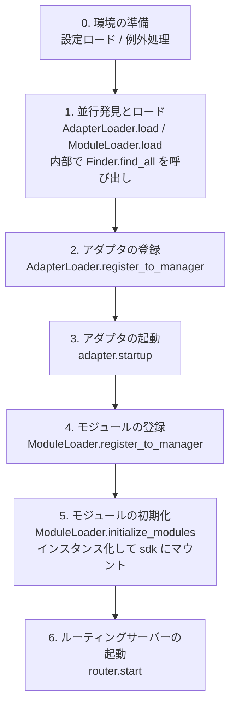

# 起動フローと手動制御

> [!TIP]
> **いつこのドキュメントを読むべきか**：起動チェーンを手動で駆動したい、起動順序をカスタマイズしたい、または起動失敗を調査する必要がある場合。不要であればスキップしても、他の機能の使用には影響しません。


ErisPulse の `await sdk.run()` / `await sdk.init()` は、起動チェーン全体を「1行のコード」にカプセル化しています。しかし、起動フローを完全にカスタマイズしたい場合（例：部分ロード、動的登録、ホットプラグ、カスタムロード戦略の注入）、このチェーンの内部で実際に何が起きているのか、そして各ステップをどう手動で駆動するのかを理解する必要があります。

このドキュメントでは、起動チェーンを独立したステップに分解し、それぞれの責務と呼び出し順序を説明し、完全な手動起動の例を示します。

> このドキュメントは、[最初のボット](../getting-started/first-bot.md) を既に実行したことがあり、`sdk.run(keep_running=True/False)` の2つのモードを理解していることを前提としています。本ドキュメントでは `init()` の**内部**におけるチェーンの分解と、`init()`/`init_task()`/`init_sync()` などのより低レベルなエントリポイントに焦点を当てます。

## SDK トップレベルエントリ一覧

`run()` の2つの `keep_running` モードに加え、SDK はいくつかのより低レベルな初期化エントリを提供しています。違いは**非同期性、戻り値、例外のラップ有無**です：

| エントリ | 非同期性 | 戻り値 | 例外処理 | 適用シナリオ |
|------|--------|--------|----------|----------|
| `await sdk.run(True)` | async、ブロックして維持 | `None`（終了時に自動 `uninit`） | モジュール/アダプタのエラーはインターセプトされ、プロセスをダウンさせない | 純粋な bot アプリケーション |
| `await sdk.run(False)` | async、ブロックしない | `None`（自動アンロードしない） | 同上 | 初期化後にカスタムロジックを実行 |
| `await sdk.init()` | async、await 必須 | `bool` | 内部でコンポーネントの例外をキャッチし、失敗時は `False` を返す | ライフサイクルの手動制御（`uninit()` と併用） |
| `sdk.init_task()` | async、Task を返しブロックしない | `asyncio.Task` | `init()` と同様 | 他の初期化の並行実行、またはイベントループがまだ実行されていない場合 |
| `sdk.init_sync()` | **同期**、現在のスレッドをブロック | `bool` | `init()` と同様 | コマンドラインスクリプト、イベントループのない同期エントリ |

> **よくある誤解**：`await sdk.init()` は `await sdk.run(keep_running=False)` と**等価ではありません**。2つの違いがあります：① `init()` は `bool` を返し（失敗時は `False`）、`run()` は `None` を返す；② `init()` は初期化のみを行い**自動アンロードしない**のに対し、`run()` はイベントループ終了時に自動的に `uninit()` します。したがって、手動でアンロードをペアリングしたりカスタムライフサイクルが必要な場合は、`init()` + `uninit()` を使用してください。

## 起動チェーン全体像

`sdk.init()`（正確にはその内部の `Initializer.init()`）は、以下の順序でフレームワーク全体を立ち上げます：



対応するコアコンポーネント：

| 層 | コンポーネント | 責務 |
|----|------|------|
| 発見 | `AdapterFinder` / `ModuleFinder` | インストール済みパッケージの entry-points からアダプタ/モジュールを**発見** |
| ロード | `AdapterLoader` / `ModuleLoader` | 発見 + インポート + メタデータ読み取り + 有効/無効の判定、オブジェクトリストを返す |
| 登録 | `*Loader.register_to_manager` | オブジェクトを対応するマネージャーに登録 |
| 管理 | `sdk.adapter` / `sdk.module` | アダプタ/モジュールインスタンスを管理し、起動・停止インターフェースを提供 |
| 初期化 | `ModuleLoader.initialize_modules` | モジュールインスタンスを作成して `sdk` にマウント（依存のトポロジカルソートを処理） |
| ルーティング | `sdk.router` | HTTP / WebSocket サーバー |

> **重要**：`Finder` と `Loader` は2つの層です。`Loader` の内部には**すでに** `Finder` が保持されています（`AdapterLoader` は `AdapterFinder` を、`ModuleLoader` は `ModuleFinder` を内蔵）。ほとんどのシナリオでは `Loader` だけを使用すればよく、「インポートせずに一覧表示だけ」が必要な場合にのみ `Finder` を単独で使用します。

## 各ステップの詳細

### 1. 発見層：Finder

Finder は「どのパッケージがアダプタ/モジュールを提供しているかを見つける」ことだけを担当し、インポートもインスタンス化も行いません。

```python
from ErisPulse.finders import AdapterFinder, ModuleFinder

adapter_finder = AdapterFinder()
module_finder = ModuleFinder()

# すべてのインストール済みアダプタ/モジュールの entry-points を検索
adapter_entries = adapter_finder.find_all()    # list[EntryPoint]
module_entries = module_finder.find_all()      # list[EntryPoint]

# 名前で単一のエントリを検索
entry = module_finder.find_by_name("MyModule")  # EntryPoint | None
```

各 `EntryPoint` は `.load()` で対応するクラスを取得できますが、通常は手動で呼び出す必要はありません——Loader が行います。

### 2. ロード層：Loader

Loader は Finder の上に「インポート + メタデータ読み取り + 有効/無効の判定」を実装しています。

```python
from ErisPulse.loaders import AdapterLoader, ModuleLoader
from ErisPulse import sdk

adapter_loader = AdapterLoader()
module_loader = ModuleLoader()

# load() 内部：finder.find_all() を呼び出し → entry-point を順次処理 → 三つ組を返す
adapter_objs, enabled_adapters, disabled_adapters = await adapter_loader.load(sdk.adapter)
module_objs, enabled_modules, disabled_modules = await module_loader.load(sdk.module)
```

`load()` が返す三つ組：

| 戻り値 | 意味 |
|--------|------|
| `objs` (`dict`) | 名前 → オブジェクト（アダプタクラス / モジュールラッパーオブジェクト） |
| `enabled` (`list[str]`) | 有効化された名前（設定で無効化されていない） |
| `disabled` (`list[str]`) | 無効化された名前 |

#### ロード失敗時の診断情報

モジュール/アダプタがロードまたは初期化段階で例外をスローした場合、フレームワークはそのコンポーネントをスキップして他のコンポーネントのロードを継続し、同時に**ユーザーコードフレームの要約**を出力します。これにより、デフォルトの INFO レベルのままでエラー発生位置を特定でき、手動で DEBUG に切り替える必要はありません：

```
[ERROR] [ModuleLoader] entry-point からのモジュール MyModule のロードに失敗、スキップしました: 'NoneType' object has no attribute 'platform'
  → MyModule/Core.py:42 in on_load
      adapter = sdk.platform
  → AttributeError: 'NoneType' object has no attribute 'platform'
  → ヒント: ログレベルを DEBUG に上げると完全なスタックトレースを確認できます；モジュール MyModule の実装コードを確認してください
```

診断情報は `ErisPulse.runtime.diagnostics` モジュールによって生成され、フレームワーク内部のフレームを自動的にフィルタリングし、あなたのコードフレームのみを保持します。カスタムロードロジックで再利用する場合：

```python
from ErisPulse.runtime import log_diagnostic

try:
    risky_init()
except Exception as e:
    log_diagnostic(e)  # 自動的にユーザーコードフレームを抽出し ERROR ログに書き込む
```

このモジュールは、`extract_user_frame()`（構造化フレーム情報を返す）と `format_diagnostic_block()`（複数行テキストを返す）という2つの低レベル関数も提供しています。

### 3. 登録層：register_to_manager

Loader が生成したオブジェクトをマネージャーに登録し、`sdk.adapter` / `sdk.module` がそれらを認識できるようにします。

```python
# アダプタを登録（bool を返し、すべて成功したかどうかを示す）
await adapter_loader.register_to_manager(enabled_adapters, adapter_objs, sdk.adapter)

# モジュールを登録
await module_loader.register_to_manager(enabled_modules, module_objs, sdk.module)
```

登録後、アダプタはアダプタマネージャーに、モジュールはモジュールマネージャーに登録されていますが、**どちらもまだ起動/インスタンス化されていません**。

### 4. アダプタの起動

```python
# すべての登録済みアダプタを起動
await sdk.adapter.startup()
# またはプラットフォームを指定
await sdk.adapter.startup("yunhu")
await sdk.adapter.startup(["yunhu", "telegram"])
```

> 登録 ≠ 起動。`register_to_manager` は登録のみを行い、`startup` が初めてアダプタの `start()` を呼び出してプラットフォームとの接続を確立します。

### 5. モジュールの初期化

モジュールはアダプタより1ステップ多く——**インスタンス化**して `sdk` にマウントする必要があります（これにより `sdk.MyModule.xxx` で呼び出せるようになります）。このステップでは、モジュール間の依存関係の宣言とトポロジカルソートも処理します。

```python
success = await module_loader.initialize_modules(
    enabled_modules, module_objs, sdk.module, sdk
)
```

インスタンス化に成功すると、モジュールは `sdk.<ModuleName>` に出現します。

### 6. ルーティングサーバーの起動

```python
await sdk.router.start(
    host="0.0.0.0",
    port=8000,
    ssl_certfile=None,
    ssl_keyfile=None,
)
```

ルーティングサーバーは、アダプタの Webhook / WebSocket コールバックを受信する役割を担います。起動しない場合、server モードのアダプタはメッセージを受信できません。

## 完全な手動起動の例

以下のコードは `await sdk.init()` のコアフローと**等価**ですが、各ステップがあなたの手に委ねられており、任意のステップでカスタムロジックを挿入できます：

```python
import asyncio
from ErisPulse import sdk
from ErisPulse.loaders import AdapterLoader, ModuleLoader

async def manual_startup():
    # 0. 環境の準備（設定のロード、グローバル例外処理の登録）
    #    _prepare_environment は init() 内部の前処理ステップ；手動フローでも先に呼び出す必要があり、
    #    呼び出さないと Loader が設定を読めず、すべてのアダプタ/モジュールを誤って無効と判定してしまいます。
    if not await sdk._prepare_environment():
        print("環境準備に失敗しました")
        return False

    # 1. ローダーの作成（内部にそれぞれ Finder を保持）
    adapter_loader = AdapterLoader()
    module_loader = ModuleLoader()

    # 2. 並行発見とロード（init() 内部と同様に gather を使用）
    (adapter_objs, enabled_adapters, disabled_adapters), \
    (module_objs, enabled_modules, disabled_modules) = await asyncio.gather(
        adapter_loader.load(sdk.adapter),
        module_loader.load(sdk.module),
    )

    # 3. アダプタの登録
    await adapter_loader.register_to_manager(
        enabled_adapters, adapter_objs, sdk.adapter
    )

    # 4. アダプタの起動
    if enabled_adapters:
        await sdk.adapter.startup()

    # 5. モジュールの登録
    await module_loader.register_to_manager(
        enabled_modules, module_objs, sdk.module
    )

    # 6. モジュールの初期化（インスタンス化 + sdk へのマウント）
    if enabled_modules:
        await module_loader.initialize_modules(
            enabled_modules, module_objs, sdk.module, sdk
        )

    # 7. ルーティングサーバーの起動
    await sdk.router.start(host="0.0.0.0", port=8000)

    print("手動起動が完了しました")
    return True

async def main():
    ok = await manual_startup()
    if ok:
        # ブロックして実行を維持（手動フローは自動的にブロックしない）
        await asyncio.Event().wait()

if __name__ == "__main__":
    asyncio.run(main())
```

### いつ手動起動を使うべきか？

ほとんどの場合、手動起動は**必要ありません**。`await sdk.run()` が上記のすべてを既に行っています。手動起動が価値を持つのは、以下のシナリオのみです：

- **部分ロード**：指定したアダプタ/モジュールのみをロードし、他をスキップする
- **動的登録**：実行時に条件に応じて新しいアダプタ/モジュールを登録する
- **カスタム順序**：デフォルトのロード順序を変更する必要がある場合（例：特定のモジュールを先に起動してからアダプタを起動する）
- **戦略の注入**：Loader にカスタムの厳格モードマネージャーやロード戦略などを注入する
- **デバッグ/診断**：あるステップで失敗した際、手動で駆動して問題を特定する

## 実行時のきめ細かい制御

### ローカルプラグインのホットリロード

`sdk.enable_plugin_hot_reload()` はローカルプラグインディレクトリ（`plugins/`）のソース変更を監視し、自動リロードします：
`epsdk run` では自動的に有効になっているため手動呼び出しは不要です；**素の `sdk.run()` で起動**する場合にプラグインのホットリロードが必要なときは、
`run()` の前に1回呼び出してください（ローカルプラグインディレクトリのみを対象とし、pip でインストールしたモジュール/アダプタには影響しません）：

```python
sdk.enable_plugin_hot_reload()
sdk.run()
```


`sdk.run()` で起動を完了した場合でも、SDK 全体を再起動することなく、実行時に各サブシステムを個別に制御できます：

### アダプタのホット起動・停止

```python
# 特定のアダプタをホットリスタート（接続を修復、他のプラットフォームには影響しない）
await sdk.adapter.shutdown("yunhu")
await sdk.adapter.startup("yunhu")

# 実行中に新しいプラットフォームを立ち上げる
await sdk.adapter.startup("telegram")

# 特定のプラットフォームを一時的にオフラインにする
await sdk.adapter.shutdown("telegram")
```

> `adapter.startup()` はアダプタがマネージャーに**登録済み**であることを要求します。登録は `init()`/`run()` の内部で行われるため、これは起動**後**のきめ細かい制御です。

### ルーティングサーバー

```python
# webhook サーバーを一時的にオフラインにする
await sdk.router.stop()

# 再起動（例：ポートを変更した場合）
await sdk.router.start(host="0.0.0.0", port=9000)
```

### モジュールのオンデマンドロード

```python
# （遅延ロードの可能性がある）モジュールを手動でロードする
await sdk.load_module("MyModule")
```

## グレースフルシャットダウン

2.7.0 以降、`sdk.shutdown()` は**プログラムによるグレースフルシャットダウン**を提供します：シャットダウンイベントを設定し、`await sdk.run(keep_running=True)` で停止しているメインループを戻らせ、さらに `uninit()` をトリガーしてリソースクリーンアップを完了させます。

```python
# 任意のコルーチン内で呼び出し、グレースフル終了をトリガー（run() の停止が戻り、自動的に uninit）
sdk.shutdown()
```

典型的な使用例：

```python
async def shutdown_after_idle():
    await asyncio.sleep(3600)
    sdk.shutdown()  # アイドル1時間後にグレースフル終了
```

**シグナル処理**：`run()` 内部では `SIGTERM` / `SIGHUP` ハンドラーを登録し、システムシグナルをグレースフルシャットダウンに変換します——コンテナオーケストレーション（Docker `docker stop`）や `systemd` がサービスを停止する際、プロセスは強制終了されるのではなく `uninit()` クリーンアップを完了します。また `SIGUSR1` ハンドラーも登録されており、プロセス内ソフトリスタート（`sdk.restart()`）に変換されます——`epsdk restart` はコンテナ内 PID 1 インスタンス（終了するとコンテナが終了し、外部から再起動できない）に対し、代わりにこのシグナルを送信してコンポーネントのホットリロードをトリガーします。SIGUSR1 ホットリスタートチャネルには ErisPulse **2.12+** が必要です。

- Windows は `loop.add_signal_handler` をサポートしないため、シグナルハンドラーは自動的にスキップされます（`sdk.shutdown()` または Ctrl+C によるシャットダウンは引き続き可能）
- `sdk.shutdown()` を繰り返し呼び出すのは安全です（イベントが既に設定された後の再呼び出しは何もしません）

## アンロードフロー

起動の逆操作は `await sdk.uninit()` で、逆順にクリーンアップします：

1. すべてのアダプタをシャットダウン（`adapter.shutdown()`）
2. すべてのモジュールをアンロード
3. すべてのイベントハンドラーをクリーンアップ
4. マネージャーと SDK 上のモジュール属性をクリーンアップ

手動起動のシナリオでは、終了前に `uninit()` を呼び出してグレースフルシャットダウンを保証することを忘れないでください：

```python
try:
    await asyncio.Event().wait()   # 実行を維持
finally:
    await sdk.uninit()
```

## 再起動

SDK は2つの再起動方法を提供しており、どちらも自分で先にアンロードする必要はありません——フレームワークが自動的に処理します：

| 方式 | 呼び出し | 動作 | 適用シナリオ |
|------|------|------|----------|
| ホットリスタート | `await sdk.restart()` | 同一プロセス内での**コンポーネント層コードレベルホットリロード**：全モジュールが統一リロードパイプラインを通過（全体構文事前チェック / スナップショットロールバック / アイデンティティ検証）、アダプタはまず **entry-point を再発見**（実行中に新規インストール/アンインストールされたアダプタが即時有効）してから、1つずつコードレベルでリロード | pip でのアップグレードやコンポーネントインストール後にコードを有効化、モジュールのホット更新 |
| ハードリスタート | `await sdk.hard_restart()` | `uninit()` 後に**終了コード 42** でプロセスを終了し、外部スーパーバイザーが新しいプロセスを立ち上げ | フレームワーク自体のアップグレード（アップグレード後のフレームワークコードは新プロセスでのみ有効）、C 拡張の副作用、リソースリークの疑い |

```python
# ホットリスタート：コンポーネント層コードレベルホットリロード（最も一般的；pip で新規インストールしたアダプタも立ち上がる）
await sdk.restart()

# ハードリスタート：プロセスを終了し、外部スーパーバイザーに再起動を委ねる（下記「スーパーバイザーガイド」参照）
await sdk.hard_restart("sdk self-update")  # スーパーバイザー表示用のオプション reason
```

> **2つの注意点**：
> 1. これらのメソッドはどちらもバックグラウンドタスクで再起動を実行し、**即座に `True` を返します。これは「再起動タスクがスケジュールされた」ことを示すものであり、「再起動が完了した」ことを示すものではありません**。実際の再起動はバックグラウンドで行われ、現在のイベントチェーンの中断を避けます。
> 2. `hard_restart()` の仕組みは：アンロードして設定をディスクにフラッシュした後、**終了コード 42**（`HARD_RESTART_EXIT_CODE`）でプロセスを終了します——**それ自体は新しいプロセスを立ち上げません**。外部スーパーバイザーが終了コード 42 を検出した後に再起動する必要があります。直接 `python main.py` で実行し、スーパーバイザーが何もない場合、プロセスはコード 42 で終了したらそのまま終わり、**自動的に再起動しません**（フレームワークが警告を出します）。

> **ホットリスタートの相互排他と統合**（2.11.1 以降）：すべてのホットリロード操作（単一モジュールリロード / 全量リロード / アダプタリロード / 休眠 / 新規プラグインのホットロード）は全体を通じて相互排他です——保存ストーム下で連続トリガーしても並行で交錯することはなく、進行中の restart が新しいリクエストを受け取ると自動的に統合されます（リクエストが通常のリロードのロック保持期間中に発生した場合も同様に統合・キューイングされ、完了後に最大1ラウンド補完実行します）。構文エラーを含むファイルを保存した場合、全体のリロードラウンドはアンロード前に**集約的な構文事前チェック**で拒否され（すべてのエラーファイルと行番号を一括で列挙）、アダプタ層はこのラウンドのリロードをスキップし、`restart` は失敗と判定し、すべての旧インスタンスがサービスを継続します；修復後に再度 `restart` を実行すればよいだけです。

### いつハードリスタートを使うべきか？

ホットリスタートはすでにほとんどのシナリオをカバーしています（pip でのアップグレード/コンポーネントインストール、モジュールコードのホット更新、**実行中に新規インストールされたアダプタを含む**）。ハードリスタートが必要なのは、以下のシナリオのみです：

- **フレームワーク自体のアップグレード**：ErisPulse 本体をアップグレードした後、新しいフレームワークコードは完全に新しいプロセスでのみ有効になります（Python はロード済みのフレームワークコードを再 import しません）。
- **バイナリライブラリ（C 拡張）の副作用**：ホットリスタートは同一プロセス内で行われるため、C 拡張、開かれたファイルディスクリプタ、スレッドなどのプロセスレベルリソースを解放できません；ハードリスタートは完全に新しいプロセスに切り替わるため、これらの副作用は完全にリセットされます。
- **リソースリークの調査**：メモリやハンドルのリークが疑われる場合、ハードリスタートでクリーンな環境を取得できます。

> Dashboard 管理パネルの「フレームワーク再起動」機能は、内部で `hard_restart()` を呼び出しています。

### 終了コード 42 の契約

ハードリスタートはプロセス間の協調動作です：**SDK は終了（コード 42）を担当し、スーパーバイザーは再起動を担当します**。

| 役割 | 動作 |
|------|------|
| SDK（ハードリスタートされる側） | `uninit()` → 設定をディスクにフラッシュ → ハードリスタートマーカーを書き込み（理由 / PID、スーパーバイザー表示用）→ `os._exit(42)` |
| スーパーバイザー | 子プロセスの終了コードが 42 であることを検出 → ハードリスタート理由を表示 → 同じコマンドを再起動 |

> `sdk.is_supervised()` で現在のプロセスがスーパーバイザーによって起動されたかどうかを照会できます（環境変数 `ERISPULSE_SUPERVISED` を検出）。CLI `run` コマンドは子プロセスを起動する際にこのマーカーを自動的に注入します；systemd / Docker などの外部スーパーバイザーは注入しないため、`is_supervised()` は `False` を返し、この場合ハードリスタート後にフレームワークは「スーパーバイザーが検出されませんでした」という警告を出します。

### スーパーバイザーガイド

あなたに適したスーパーバイザーを選択し、ハードリスタートを実際に機能させましょう：

#### 1. CLI run コマンド（開発/シンプルなデプロイ、推奨）

`epsdk run main.py` には監視ループが組み込まれています：子プロセスの終了コードを検出し、42 の場合は即座に再起動（ハードリスタート理由も表示）；その他の異常終了コードは指数バックオフで自動リトライ；`Ctrl+C` はまず子プロセスをグレースフルに終了させます（コード 0 は正常終了とみなし、再起動しません）。

```bash
epsdk run main.py
```

`epsdk run --reload`（開発用ホットリロードモード、2.11.1 以降）も同様に「監視プロセス + リロード worker 子プロセス」構造を採用しています：worker 内で `.py` ファイルを保存すると**コンポーネントレベルのホットリロード**がトリガーされます（フレームワーク全体は再起動しない）；ハードリスタートは監視プロセスが新しい worker を再起動するため、フレームワークをアップグレードした後の新しいコードは即座に有効になります。

#### きめ細かいリロード判定（2.12+）

`.py` の保存後、実行時のソースコードの帰属に基づいて最小のリロード単位を選択し、パス文字列で推測しません：

| 変更ファイル | 処理 |
|----------|------|
| プラグインディレクトリ（`ErisPulse.framework.plugins_dir`）内 | プラグインホットリロード watcher が処理、dev watcher は重複トリガーしない |
| ロード済みモジュールのソース（`pip install -e` と site-packages を含む） | `sdk.reload_module(モジュール名)` |
| 登録済みアダプタのソース | `sdk.reload_adapter(プラットフォーム名)` |
| エントリスクリプト | プロセスレベル再起動（終了コード 42、スーパーバイザーが再起動） |
| フレームワーク自体のソース（`ErisPulse` パッケージ内） | プロセスレベル再起動 |
| 複数の owner に同時一致 / 帰属不能 | 保守的にプロセスレベル再起動 |

`epsdk upgrade` などの一括アップグレードシナリオでは、`sdk.reload_all_modules()` を使用して登録済みの
全モジュールを一度にリロードできます（依存のトポロジカル順序に従い、単一モジュールの失敗はスキップされロールバックしない）。プロセスの再起動は不要です。

スクリプトモード（`epsdk run main.py --reload`）はスクリプトを worker 化しません：スクリプト子プロセス内に
dev watcher をマウントし、`component_reload_pid` を `.erispulse/runtime.json` に書き込みます；親プロセスは
このマーカーを確認した後、モジュール/アダプタ/プラグインの変更を子プロセスに処理させ、エントリスクリプトまたはフレームワークソースの
変更のみがスクリプトプロセスの再起動を引き起こします。

#### 2. systemd（Linux サーバー）

`RestartForceExitStatus=42` により、終了コード 42 も再起動をトリガーします（デフォルトの `on-failure` は非ゼロコードにのみ有効）：

```ini
[Service]
ExecStart=/usr/bin/python3 /opt/mybot/main.py
Restart=on-failure
RestartForceExitStatus=42
RestartSec=2
User=mybot
```

#### 3. Docker / docker-compose

コンテナ内の PID 1 はアプリケーションプロセスであり、終了コード 42 の後にコンテナが終了します——`restart` ポリシーで自動再起動させます：

```yaml
services:
  bot:
    build: .
    restart: unless-stopped   # すべての終了（42 を含む）で再起動
```

> コンテナ内の `epsdk restart` は PID 1 インスタンスに対して SIGUSR1 によるプロセス内ホットリスタートを行い、コンテナは終了しません；
> プロセス全体の再起動は `restart` ポリシーが担います。詳細は [デプロイ → コンテナ内再起動](../user-guide/deployment.md#容器内重启pid-1-实例) を参照してください。

#### 4. PM2（Node エコシステム運用）

```bash
pm2 start main.py --name mybot --interpreter python3
# 42 は終了コードとみなされ、PM2 はデフォルトで再起動；restart_delay を設定してデバウンス
pm2 set mybot.restart_delay 2000
```

#### 5. supervisord

```ini
[program:mybot]
command=python3 /opt/mybot/main.py
autorestart=true
exitcodes=0,2,42    # 42 も「正常終了だが再起動が必要」とみなす
```

#### 6. 純 Python カスタムスーパーバイザー

```python
import subprocess, sys, time

while True:
    p = subprocess.Popen([sys.executable, "main.py"])
    code = p.wait()
    if code == 42:          # ハードリスタート要求
        time.sleep(0.5)
        continue
    if code == 0:           # 正常終了
        break
    time.sleep(3)           # 異常終了、バックオフリトライ
```

> **スーパーバイザーがない場合の動作**：直接 `python main.py` で実行した場合、`hard_restart()` を呼び出すとプロセスはコード 42 で終了し、再起動されません。この場合は上記のいずれかのスーパーバイザーを導入する必要があります。

## 関連ドキュメント

- [最初のボットを作成](../getting-started/first-bot.md) - `keep_running` の2つの基本モード入門
- [ライフサイクル管理](lifecycle.md) - `core.init.start` / `core.init.complete` などの起動イベントのリッスン
- [遅延ロードシステム](lazy-loading.md) - モジュールの遅延ロードメカニズムと `load_module`