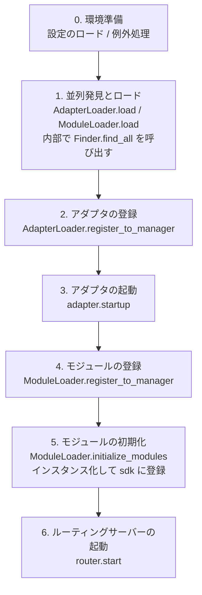

# スタートアップフローと手動制御

> [!TIP]  
> **この記事を読むべきタイミング**：スタータップの流れを手動で制御したい、起動順序をカスタマイズしたい、または起動失敗をトラブルシューティングしたい場合。それ以外はスキップしても他の機能に影響はありません。

ErisPulse の `await sdk.run()` / `await sdk.init()` は、一連のスタータップフローを「一行のコード」にラップしています。しかし、部分的なロード、動的登録、ホットプラグ、カスタムロード戦略の挿入など、完全にカスタマイズされたスタータップフローが必要な場合は、このフローの内部で何が起こっているのか、そして各ステップをどのように手動で駆動するのかを理解する必要があります。

本文では、スタータップフローを独立したステップに分解し、各ステップの役割と呼び出し順序を説明し、手動で完全にスタータップするための例を示します。

> 本文では、すでに [最初のロボット](../getting-started/first-bot.md) を実行し、`sdk.run(keep_running=True/False)` の2つのモードを理解していることを前提としています。本文では、`init()` **内部**のフローの分解と、`init()` / `init_task()` / `init_sync()` などのより低レベルのエントリポイントに焦点を当てています。

## SDK トップレベルエントリポイント一覧

`run()` の2つの `keep_running` モードに加えて、SDK にはいくつかのより低レベルの初期化エントリポイントが提供されています。違いは**非同期性、戻り値、および例外のラッピング**です。

| エントリポイント | 非同期性 | 戻り値 | 例外処理 | 適用場面 |
|------|--------|--------|----------|----------|
| `await sdk.run(True)` | 非同期、イベントループをブロック | `None`（終了時に自動 `uninit`） | モジュール/アダプタエラーはブロックせず、プロセスを停止しない | ロボットアプリケーションのみ |
| `await sdk.run(False)` | 非同期、イベントループをブロックしない | `None`（自動アンロードしない） | 同上 | 初期化後にカスタムロジックを実行する場合 |
| `await sdk.init()` | 非同期、`await` が必要 | `bool` | コンポーネントエラーを内部でキャッチし、失敗時は `False` を返す | 手動でライフサイクルを制御する場合（`uninit()` と併用） |
| `sdk.init_task()` | 非同期、`Task` を返す、イベントループをブロックしない | `asyncio.Task` | `init()` と同じ | 別の初期化処理を並列実行する場合、またはイベントループが実行されていない場合 |
| `sdk.init_sync()` | **同期**、現在のスレッドをブロック | `bool` | `init()` と同じ | コマンドラインスクリプト、イベントループが存在しない同期エントリポイント |

> **よくある誤解**：`await sdk.init()` は `await sdk.run(keep_running=False)` と**等価ではありません**。2つの違いがあります：① `init()` は `bool` を返します（失敗時は `False`）、`run()` は `None` を返します；② `init()` は初期化のみを行い、**自動アンロードはしません**、`run()` はイベントループが終了したときに自動的に `uninit()` を実行します。したがって、手動でアンロードやカスタムライフサイクルを制御する必要がある場合は、`init()` + `uninit()` を使用します。

## スタータップフローの概要

`sdk.init()`（正確にはその内部の `Initializer.init()`）は、以下に示す順序でフレームワーク全体を起動します：



対応するコアコンポーネント：

| 層 | コンポーネント | 役割 |
|----|------|------|
| 発見 | `AdapterFinder` / `ModuleFinder` | entry-points からアダプタ/モジュールを**発見**する |
| ロード | `AdapterLoader` / `ModuleLoader` | 発見 + インポート + メタデータの読み取り + 启用/禁止の判定、オブジェクトリストを返す |
| 登録 | `*Loader.register_to_manager` | オブジェクトを対応するマネージャーに登録する |
| 管理 | `sdk.adapter` / `sdk.module` | アダプタ/モジュールのインスタンスを維持し、起動/停止のインターフェースを提供する |
| 初期化 | `ModuleLoader.initialize_modules` | モジュールのインスタンスを作成し sdk に登録する（依存関係のトポロジカルソートを処理） |
| ルーティング | `sdk.router` | HTTP / WebSocket サーバー |

> **重要**：`Finder` と `Loader` は2つの層です。`Loader` は内部で `Finder` を**保持**しています（`AdapterLoader` は `AdapterFinder` を、`ModuleLoader` は `ModuleFinder` を持っています）。ほとんどの場合、`Loader` を使用するだけで十分で、`Finder` は「インポートしないでリストアップする」場合にのみ使用します。

## 各ステップの詳細

### 1. 発見層：Finder

Finder は「どのパッケージがアダプタ/モジュールを提供しているか」を発見するだけです。インポートやインスタンス化は行いません。

```python
from ErisPulse.finders import AdapterFinder, ModuleFinder

adapter_finder = AdapterFinder()
module_finder = ModuleFinder()

# すべてのインストール済みアダプタ/モジュールの entry-points を検索
adapter_entries = adapter_finder.find_all()    # list[EntryPoint]
module_entries = module_finder.find_all()      # list[EntryPoint]

# 名前で個別に検索
entry = module_finder.find_by_name("MyModule")  # EntryPoint | None
```

各 `EntryPoint` は `.load()` で対応するクラスを得られますが、通常は手動で呼び出す必要はありません。`Loader` が処理します。

### 2. ロード層：Loader

Loader は Finder の上に「インポート + メタデータの読み取り + 启用/禁止の判定」を行います。

```python
from ErisPulse.loaders import AdapterLoader, ModuleLoader
from ErisPulse import sdk

adapter_loader = AdapterLoader()
module_loader = ModuleLoader()

# load() 内部：finder.find_all() を呼び出す → entry-point を順次処理 → 三つ組を返す
adapter_objs, enabled_adapters, disabled_adapters = await adapter_loader.load(sdk.adapter)
module_objs, enabled_modules, disabled_modules = await module_loader.load(sdk.module)
```

`load()` が返す三つ組：

| 戻り値 | 含意 |
|--------|------|
| `objs` (`dict`) | 名称 → オブジェクト（アダプタクラス / モジュールラッパー） |
| `enabled` (`list[str]`) | 启用された名称（設定で禁止されていない） |
| `disabled` (`list[str]`) | 禁止された名称 |

#### ロード失敗時の診断情報

モジュール/アダプタがロードまたは初期化段階で例外を投げた場合、フレームワークはそのコンポーネントをスキップして他のコンポーネントのロードを継続し、**ユーザーのコードフレームのサマリー**を出力します。これにより、INFO レベルでエラー箇所を特定できます。DEBUG レベルを上げる必要はありません。

```
[ERROR] [ModuleLoader] entry-point からモジュール MyModule のロードに失敗しました、スキップしました: 'NoneType' object has no attribute 'platform'
  → MyModule/Core.py:42 in on_load
      adapter = sdk.platform
  → AttributeError: 'NoneType' object has no attribute 'platform'
  → メモ: ログレベルを DEBUG に上げて詳細なスタックを確認するか、モジュール MyModule の実装コードを確認してください
```

診断情報は `ErisPulse.runtime.diagnostics` モジュールによって生成され、フレームワークの内部フレームは自動的にフィルタリングされ、ユーザーのコードフレームのみが残ります。カスタムロードロジックで再利用する場合は：

```python
from ErisPulse.runtime import log_diagnostic

try:
    risky_init()
except Exception as e:
    log_diagnostic(e)  # 自動的にユーザーのコードフレームを抽出して ERROR ログに書き込む
```

このモジュールには `extract_user_frame()`（構造化されたフレーム情報を返す）と `format_diagnostic_block()`（複数行のテキストを返す）という2つの低レベル関数もあります。

### 3. 登録層：register_to_manager

Loader が出力したオブジェクトをマネージャーに登録し、`sdk.adapter` / `sdk.module` がそれらを認識できるようにします。

```python
# アダプタの登録（すべて成功した場合は True を返す）
await adapter_loader.register_to_manager(enabled_adapters, adapter_objs, sdk.adapter)

# モジュールの登録
await module_loader.register_to_manager(enabled_modules, module_objs, sdk.module)
```

登録後、アダプタはアダプタマネージャーに登録され、モジュールはモジュールマネージャーに登録されますが、**まだ起動/インスタンス化はされていません**。

### 4. アダプタの起動

```python
# すべての登録済みアダプタを起動
await sdk.adapter.startup()
# または特定のプラットフォームを指定
await sdk.adapter.startup("yunhu")
await sdk.adapter.startup(["yunhu", "telegram"])
```

> 登録 ≠ 起動。`register_to_manager` は登録のみです。`startup` はアダプタの `start()` を呼び出し、プラットフォームとの接続を確立します。

### 5. モジュールの初期化

モジュールはアダプタよりも1ステップ多く、**インスタンス化**して `sdk` に登録する必要があります（これにより `sdk.MyModule.xxx` で呼び出せるようになります）。このステップでは、モジュール間の依存関係の宣言とトポロジカルソートも処理されます。

```python
success = await module_loader.initialize_modules(
    enabled_modules, module_objs, sdk.module, sdk
)
```

インスタンス化が成功すると、モジュールは `sdk.<ModuleName>` に登録されます。

### 6. ルーティングサーバーの起動

```python
await sdk.router.start(
    host="0.0.0.0",
    port=8000,
    ssl_certfile=None,
    ssl_keyfile=None,
)
```

ルーティングサーバーは、アダプタからの Webhook / WebSocket コールバックを受信します。起動しないと、サーバーモードのアダプタはメッセージを受け取れません。

## 完全な手動起動の例

以下のコードは、`await sdk.init()` のコアフローと**等価**ですが、各ステップを明示的に扱い、任意の段階でカスタムロジックを挿入できます。

```python
import asyncio
from ErisPulse import sdk
from ErisPulse.loaders import AdapterLoader, ModuleLoader

async def manual_startup():
    # 0. 環境準備（設定のロード、グローバル例外処理の登録）
    #    _prepare_environment は init() 内部の前置処理です。手動フローでも先に呼び出す必要があります。
    #    そうしないと、Loader は設定を読めず、すべてのアダプタ/モジュールを誤って禁止と判断します。
    if not await sdk._prepare_environment():
        print("環境準備に失敗しました")
        return False

    # 1. ローダーの作成（それぞれ内部で Finder を保持）
    adapter_loader = AdapterLoader()
    module_loader = ModuleLoader()

    # 2. 並列発見とロード（init() 内部と同じ gather を使用）
    (adapter_objs, enabled_adapters, disabled_adapters), \
    (module_objs, enabled_modules, disabled_modules) = await asyncio.gather(
        adapter_loader.load(sdk.adapter),
        module_loader.load(sdk.module),
    )

    # 3. アダプタの登録
    await adapter_loader.register_to_manager(
        enabled_adapters, adapter_objs, sdk.adapter
    )

    # 4. アダプタの起動
    if enabled_adapters:
        await sdk.adapter.startup()

    # 5. モジュールの登録
    await module_loader.register_to_manager(
        enabled_modules, module_objs, sdk.module
    )

    # 6. モジュールの初期化（インスタンス化 + sdk に登録）
    if enabled_modules:
        await module_loader.initialize_modules(
            enabled_modules, module_objs, sdk.module, sdk
        )

    # 7. ルーティングサーバーの起動
    await sdk.router.start(host="0.0.0.0", port=8000)

    print("手動起動完了")
    return True

async def main():
    ok = await manual_startup()
    if ok:
        # ブロックして実行を維持（手動フローでは自動的にブロックしない）
        await asyncio.Event().wait()

if __name__ == "__main__":
    asyncio.run(main())
```

### 手動起動が必要なタイミング

ほとんどの場合、**手動起動は不要**です。`await sdk.run()` がすべての処理を内包しています。手動起動は、以下の場面で価値があります：

- **部分的ロード**：指定されたアダプタ/モジュールのみをロードし、他のものをスキップする
- **動的登録**：条件に応じて実行時に新しいアダプタ/モジュールを登録する
- **カスタム順序**：デフォルトのロード順序を変更する必要がある（例：あるモジュールをアダプタより先に起動する）
- **戦略の注入**：Loader にカスタムの厳格モードマネージャーやロード戦略を注入する
- **デバッグ/診断**：特定の段階で失敗した場合、手動で駆動して問題を特定する

## 実行時の細粒度制御

`sdk.run()` で起動した後でも、各サブシステムを個別に制御して、SDK 全体を再起動せずに実行中に制御できます。

### アダプタのホットリスタート

```python
# アダプタのホットリスタート（接続の修復、他のプラットフォームには影響しない）
await sdk.adapter.shutdown("yunhu")
await sdk.adapter.startup("yunhu")

# 実行中に新しいプラットフォームを起動
await sdk.adapter.startup("telegram")

# 一時的にプラットフォームをオフラインにする
await sdk.adapter.shutdown("telegram")
```

> `adapter.startup()` はアダプタが**マネージャーに登録されている**必要がある。登録は `init()` / `run()` 内部で行われるため、これは起動**後の**細粒度制御です。

### ルーティングサーバー

```python
# webhook サーバーを一時的にオフラインにする
await sdk.router.stop()

# 再起動（例：ポートを変更した場合）
await sdk.router.start(host="0.0.0.0", port=9000)
```

### モジュールのオンデマンドロード

```python
# ロード（おそらく遅延ロードのモジュール）を手動でロードする
await sdk.load_module("MyModule")
```

## エレガントなシャットダウン

2.7.0 以降、`sdk.shutdown()` は**プログラム的なエレガントなシャットダウン**を提供します。シャットダウンイベントを設定し、`await sdk.run(keep_running=True)` で待機中のメインループを返すようにし、`uninit()` をトリガーしてリソースのクリーンアップを完了します。

```python
# 任意のコルーチン内で呼び出すことで、エレガントな終了をトリガー（run() は待機を返し、自動 uninit を実行）
sdk.shutdown()
```

典型的な用途：

```python
async def shutdown_after_idle():
    await asyncio.sleep(3600)
    sdk.shutdown()  # 空き1時間後にエレガントに終了
```

**シグナル処理**：`run()` 内部では `SIGTERM` / `SIGHUP` ハンドラが登録され、システムシグナルをエレガントなシャットダウンに変換します。これは、Docker `docker stop` や `systemd` でのサービス停止時に、プロセスが強制終了されずに `uninit()` を完了するようにします。

- Windows は `loop.add_signal_handler` をサポートしていないため、シグナルハンドラは自動的に無視されます（`sdk.shutdown()` または Ctrl+C で終了をトリガーできます）
- `sdk.shutdown()` を繰り返し呼び出しても安全です（イベントが設定された後は無効になります）

## アンロードフロー

起動の逆操作は `await sdk.uninit()` で、反対の順序でクリーンアップします：

1. すべてのアダプタを閉じる（`adapter.shutdown()`）
2. すべてのモジュールをアンロードする
3. すべてのイベントハンドラをクリーンアップする
4. マネージャーと SDK 上のモジュール属性をクリーンアップする

手動起動の場合は、終了前に `uninit()` を呼び出してエレガントなシャットダウンを保証する必要があります：

```python
try:
    await asyncio.Event().wait()   # 実行を維持
finally:
    await sdk.uninit()
```

## リスタート

SDK には2種類のリスタート方法があり、自分でアンロードする必要はありません。フレームワークが自動的に処理します：

| 方法 | 呼び出し | 行動 | 適用場面 |
|------|------|------|----------|
| ホットリスタート | `await sdk.restart()` | 同一プロセス内で**コンポーネント層のコードレベルのホットリロード**：すべてのモジュールが統一されたリロードパイプラインを実行（全体の構文検査 / スナップショットロールバック / アイデンティティ確認）、アダプタは entry-point を再発見（実行中に新しくインストール/アンインストールされたアダプタが即座に有効化され、個々のコードレベルでリロード） | pip でコンポーネントをアップグレードまたはインストールした後にコードを有効にする、モジュールのホットアップデート |
| ハードリスタート | `await sdk.hard_restart()` | `uninit()` の後に**終了コード 42**でプロセスを終了し、外部監督者が新しいプロセスを起動する | フレームワーク自体のアップグレード（アップグレード後のフレームワークコードは新しいプロセスでのみ有効）、C 拡張の副作用、リソースリークの疑いがある場合 |

```python
# ホットリスタート：コンポーネント層のコードレベルのリロード（最も一般的に使用；pip で新しくインストールされたアダプタも起動される）
await sdk.restart()

# ハードリスタート：プロセスを終了し、外部監督者が起動する（下記「監督者ガイド」を参照）
await sdk.hard_restart("sdk self-update")  # オプションの理由、監督者が表示する
```

> **2点注意**：
> 1. これらのメソッドはバックグラウンドタスクでリスタートを実行し、**即座に「リスタートタスクがスケジュールされた」を返す**、リスタートが完了したことを意味するものではありません。実際のリスタートはバックグラウンドで行われ、現在のイベントチェーンを中断することはありません。
> 2. `hard_restart()` の原理は、アンロードして設定を書き込み、**終了コード 42**（`HARD_RESTART_EXIT_CODE`）でプロセスを終了することです——**自身で新しいプロセスを起動するものではありません**。終了コード 42 が検出された外部監督者が新しくプロセスを起動する必要があります。`python main.py` で直接実行し、監督者が存在しない場合、終了コード 42 でプロセスが終了した後、**自動的に再起動されません**（フレームワークは警告を出力します）。

> **ホットリスタートの排他とマージ**（2.11.1 以降）：すべてのホットリロード操作（単一モジュールのリロード / 全量リロード / アダプタのリロード / スリープ / 新しいプラグインのホットロード）は完全に排他です——保存の嵐で連続してトリガーされても並列に実行されず、進行中の `restart` に新しいリクエストが届いた場合は自動的にマージされます（通常のリロードのロック中にリクエストが届いてもマージ・キューイングされます）、完了後に最大1回の補完実行が行われます。保存時に構文エラーのあるファイルが含まれている場合、全量リロードはアンロード前に**一括構文検査**で拒否されます（一度にすべてのエラーファイルと行番号をリストアップ）、アダプタ層はそのリロードをスキップし、`restart` は失敗と判定され、すべての旧インスタンスがサービスを継続します。修正後、再度 `restart` すれば可能です。

### ハードリスタートが必要なタイミング

ホットリスタートは、pip でコンポーネントをアップグレード/インストール、モジュールコードのホットアップデート、**実行中に新しくインストールされたアダプタ**など、ほとんどの場面をカバーしています。以下の場面でハードリスタートが必要です：

- **フレームワーク自体のアップグレード**：ErisPulse 本体をアップグレードした後、新しいフレームワークコードは新しいプロセスでのみ有効になります（Python はロード済みのフレームワークコードを再インポートしません）。
- **バイナリライブラリ（C拡張）の副作用**：ホットリスタートは同じプロセス内で行われ、C拡張、開かれたファイルディスクリプタ、スレッドなどのプロセスレベルのリソースを解放できません。ハードリスタートは新しいプロセスを起動し、これらの副作用を完全にクリアします。
- **リソースリークの調査**：メモリやハンドルのリークが疑われる場合、ハードリスタートはクリーンな環境を取得できます。

> ダッシュボード管理パネルの「フレームワークリスタート」機能は、内部で `hard_restart()` を呼び出します。

### 終了コード 42 の契約

ハードリスタートはプロセス間の協調です：**SDK は終了（コード 42）、監督者は起動**。

| 角色 | 行動 |
|------|------|
| SDK（ハードリスタートされるとき） | `uninit()` → 設定を書き込む → 硬リスタートの理由（PID）を書き込む（監督者が表示するため）→ `os._exit(42)` |
| 監督者 | 子プロセスの終了コードが 42 かを検出 → 硬リスタートの理由を表示 → 同じコマンドで再起動する |

> `sdk.is_supervised()` は、現在のプロセスが監督者によって起動されたかどうかをクエリできます（環境変数 `ERISPULSE_SUPERVISED` を検出）。CLI `run` コマンドが子プロセスを起動するときは自動的にこのマークを注入します；systemd / Docker などの外部監督者は注入しないので、`is_supervised()` は `False` を返します。この場合、ハードリスタート後にフレームワークは「監督者を検出できなかった」と警告を出力します。

### 監督者ガイド

監督者を選択して、ハードリスタートを本当に有効化します：

#### 1. CLI run コマンド（開発/簡単なデプロイ、推奨）

`epsdk run main.py` には内部監督ループが含まれています：子プロセスの終了コードを検出し、42 の場合はすぐに再起動（理由を表示）；その他の異常終了コードは指数退避で自動リトライ；`Ctrl+C` はまずエレガントに子プロセスを終了（コード 0 は正常終了と見なし、再起動しない）。

```bash
epsdk run main.py
```

`epsdk run --reload`（開発用ホットリロードモード、2.11.1 以降）は同様に「監督プロセス + 重載ワーカー子プロセス」の構造を採用します：ワーカー内では `.py` ファイルの保存で**コンポーネントレベルのホットリロード**（フレームワークの再起動ではなく）が発生します；ハードリスタートは監督プロセスが新しいワーカーを再起動し、フレームワークをアップグレードした後、新しいコードが即座に有効になります。

#### 細粒度重載判定（2.12+）

`.py` ファイルの保存後に実行時のソースコードの所属に基づいて最小の重載ユニットを選択し、パス文字列で推測しません：

| 変更ファイル | 処理 |
|----------|------|
| プラグインディレクトリ（`ErisPulse.framework.plugins_dir`）内 | プラグインのホットリロードウォッチャーが処理、dev ワッチャーは重複してトリガーしない |
| 既にロードされたモジュールのソースコード（`pip install -e` と site-packages 含む） | `sdk.reload_module(モジュール名)` |
| 既に登録されたアダプタのソースコード | `sdk.reload_adapter(プラットフォーム名)` |
| 入口スクリプト | プロセスレベルの再起動（終了コード 42、監督者が再起動） |
| フレームワーク自身のソースコード（`ErisPulse` パッケージ内） | プロセスレベルの再起動 |
| 複数の owner に一致する / 所属が不明 | 保守的にプロセスレベルの再起動 |

スクリプトモード（`epsdk run main.py --reload`）では、スクリプトワーカー化しません：スクリプト子プロセス内に dev ワッチャーを掛けて、`component_reload_pid` を `.erispulse/runtime.json` に書き込み、親プロセスがこのマークを見ると、モジュール/アダプタ/プラグインの変更は子プロセスに処理させ、入口スクリプトやフレームワークのソースコードの変更はスクリプトプロセスを再起動します。

#### 2. systemd（Linux サーバー）

`RestartForceExitStatus=42` で終了コード 42 も再起動をトリガーするようにします（デフォルトの `on-failure` は非ゼロコードのみ有効）：

```ini
[Service]
ExecStart=/usr/bin/python3 /opt/mybot/main.py
Restart=on-failure
RestartForceExitStatus=42
RestartSec=2
User=mybot
```

#### 3. Docker / docker-compose

コンテナ内の PID 1 はアプリケーションプロセスです。終了コード 42 でコンテナが終了します——`restart` ポリシーを使って自動的に再起動させます：

```yaml
services:
  bot:
    build: .
    restart: unless-stopped   # 42 を含むすべての終了コードで再起動
```

#### 4. PM2（Node 生態系の運用）

```bash
pm2 start main.py --name mybot --interpreter python3
# 42 は終了コードとして扱われ、PM2 はデフォルトで再起動；`restart_delay` で防抖
pm2 set mybot.restart_delay 2000
```

#### 5. supervisord

```ini
[program:mybot]
command=python3 /opt/mybot/main.py
autorestart=true
exitcodes=0,2,42    # 42 も「正常終了と見なして再起動」
```

#### 6. 純 Python 自定義監督者

```python
import subprocess, sys, time

while True:
    p = subprocess.Popen([sys.executable, "main.py"])
    code = p.wait()
    if code == 42:          # 硬リスタートリクエスト
        time.sleep(0.5)
        continue
    if code == 0:           # 正常終了
        break
    time.sleep(3)           # 異常終了、退避して再試行
```

> **監督者がいない場合の動作**：`python main.py` で直接実行した場合、`hard_restart()` を呼び出すとプロセスは終了コード 42 で終了し、再起動しません。この場合、上記のいずれかの監督者を接続する必要があります。

## 関連ドキュメント

- [最初のロボットを作成する](../getting-started/first-bot.md) - `keep_running` 2つの基本モードの入門
- [ライフサイクル管理](lifecycle.md) - `core.init.start` / `core.init.complete` などの起動イベントを監聴
- [遅延ロードシステム](lazy-loading.md) - モジュールの遅延ロードメカニズムと `load_module`