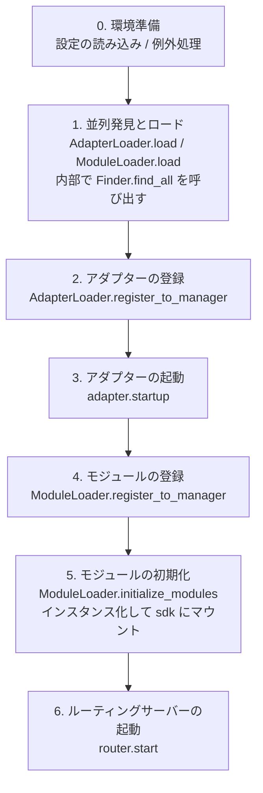

# 起動フローと手動制御

> [!TIP]
> **いつ読む必要があるか**: 起動フローを手動で駆動し、起動順序をカスタマイズする場合、または起動失敗をトラブルシューティングする場合。必要ない場合は飛ばしても、他の機能の使用に影響はありません。

ErisPulse の `await sdk.run()` / `await sdk.init()` は、一連の起動フローを「一行のコード」にラップしています。しかし、部分的なロード、動的登録、ホットプラグ、カスタムロード戦略の注入など、完全にカスタムの起動フローが必要な場合は、このフローの内部で何が起こっているのか、そして各ステップを手動で駆動する方法を理解する必要があります。

本文では、起動フローを個々のステップに分解し、各ステップの役割と呼び出し順序を説明し、手動で完全な起動を行う例を示します。

> 本文では、[最初のロボット](../getting-started/first-bot.md)を実行し、`sdk.run(keep_running=True/False)` の 2 つのモードを理解していることを前提としています。本文は `init()` **内部**のフロー分解と、`init()` / `init_task()` / `init_sync()` などのより下層のエントリポイントに焦点を当てています。

## SDK トップレベルのエントリポイント一覧

`run()` の 2 つの `keep_running` モードに加えて、SDK はいくつかのより下層の初期化エントリポイントを提供しており、それぞれの違いは**非同期性、戻り値、および例外のラッピング**です。

| エントリポイント | 非同期性 | 戻り値 | 例外処理 | 適用場面 |
|------|--------|--------|----------|----------|
| `await sdk.run(True)` | async, 阻塞維持 | `None`（終了時に自動 `uninit`） | モジュール/アダプターのエラーはブロックされず、プロセスを破綻させない | 純粋な bot アプリケーション |
| `await sdk.run(False)` | async, 非阻塞 | `None`（自動アンロードしない） | 同上 | 初期化後にカスタムロジックを実行する |
| `await sdk.init()` | async, await 必要 | `bool` | 内部でコンポーネントの例外をキャッチし、失敗時は `False` を返す | 手動でライフサイクルを制御する場合（`uninit()` と組み合わせる） |
| `sdk.init_task()` | async, Task を返す非阻塞 | `asyncio.Task` | `init()` と同じ | 並列に他の初期化を実行する場合、またはイベントループがまだ実行されていない場合 |
| `sdk.init_sync()` | **同期**, 現在のスレッドを阻塞 | `bool` | `init()` と同じ | コマンドラインスクリプト、イベントループのない同期エントリポイント |

> **よくある誤解**: `await sdk.init()` は `await sdk.run(keep_running=False)` と**等価ではない**。2 つの違いがある: ① `init()` は `bool` を返す（失敗時は `False`）、`run()` は `None` を返す；② `init()` は初期化のみを行い、**自動アンロードしない**、`run()` はイベントループの終了時に自動 `uninit()` を行う。したがって、アンロードやカスタムライフサイクルを手動で制御する必要がある場合は、`init()` + `uninit()` を使用する。

## 起動フローの概要

`sdk.init()`（正確にはその内部の `Initializer.init()`）は、以下のようにフレームワーク全体を起動します:



対応するコアコンポーネント:

| 層 | コンポーネント | 役割 |
|----|------|------|
| 発見 | `AdapterFinder` / `ModuleFinder` | エントリポイントから**発見**する（インストール済みパッケージ内） |
| ロード | `AdapterLoader` / `ModuleLoader` | 発見 + インポート + メタデータの読み込み + 启用/無効の判断、オブジェクトのリストを返す |
| 登録 | `*Loader.register_to_manager` | オブジェクトを対応するマネージャーに登録する |
| 管理 | `sdk.adapter` / `sdk.module` | アダプター/モジュールのインスタンスを維持し、起動/停止のインターフェースを提供する |
| 初期化 | `ModuleLoader.initialize_modules` | モジュールのインスタンスを作成し、`sdk` にマウントする（依存関係のトポロジカルソートを処理） |
| ルーティング | `sdk.router` | HTTP / WebSocket サーバー |

> **重要**: `Finder` と `Loader` は 2 層です。`Loader` は内部で**すでに** `Finder` を保持しています（`AdapterLoader` は `AdapterFinder` を、`ModuleLoader` は `ModuleFinder` を持っています）。ほとんどの場合、`Loader` を使用するだけで十分です。"インポートしない"でリストアップする必要がある場合にのみ、`Finder` を個別に使用します。

## 各ステップの詳細説明

### 1. 発見層: Finder

Finder は、"どのパッケージがアダプター/モジュールを提供しているか"を**検索する**だけです。インポートやインスタンス化は行いません。

```python
from ErisPulse.finders import AdapterFinder, ModuleFinder

adapter_finder = AdapterFinder()
module_finder = ModuleFinder()

# すべてのインストール済みアダプター/モジュールのエントリポイントを検索
adapter_entries = adapter_finder.find_all()    # list[EntryPoint]
module_entries = module_finder.find_all()      # list[EntryPoint]

# 名前で個別に検索
entry = module_finder.find_by_name("MyModule")  # EntryPoint | None
```

各 `EntryPoint` は `.load()` で対応するクラスを得ることができますが、通常は手動で呼び出す必要はありません。`Loader` が行います。

### 2. ロード層: Loader

Loader は、Finder の上に「インポート + メタデータの読み取り + 启用/無効の判断」を行います。

```python
from ErisPulse.loaders import AdapterLoader, ModuleLoader
from ErisPulse import sdk

adapter_loader = AdapterLoader()
module_loader = ModuleLoader()

# load() 内部: finder.find_all() を呼び出す → 各エントリポイントを処理 → 3 つのタプルを返す
adapter_objs, enabled_adapters, disabled_adapters = await adapter_loader.load(sdk.adapter)
module_objs, enabled_modules, disabled_modules = await module_loader.load(sdk.module)
```

`load()` が返す 3 つのタプル:

| 戻り値 | 意味 |
|--------|------|
| `objs` (`dict`) | 名称 → オブジェクト（アダプタークラス / モジュールラッパー） |
| `enabled` (`list[str]`) | 启用された名称（設定で無効化されていない） |
| `disabled` (`list[str]`) | 無効化された名称 |

#### ロード失敗時の診断情報

モジュール/アダプターがロードまたは初期化段階で例外を送出した場合、フレームワークはそのコンポーネントをスキップして他のコンポーネントのロードを継続し、**ユーザーのコードのフレームの要約**を出力します。これにより、デフォルトの INFO レベルでもエラー箇所を特定でき、手動で DEBUG モードを有効にする必要がありません:

```
[ERROR] [ModuleLoader] entry-point からモジュール MyModule をロードできませんでした。スキップしました: 'NoneType' object has no attribute 'platform'
  → MyModule/Core.py:42 in on_load
      adapter = sdk.platform
  → AttributeError: 'NoneType' object has no attribute 'platform'
  → ヒント: ログレベルを DEBUG に上げて完全なスタックを確認する。モジュール MyModule の実装コードを確認する
```

診断情報は `ErisPulse.runtime.diagnostics` モジュールで生成され、フレームワーク内部のフレームを自動的にフィルタリングし、ユーザーのコードフレームのみを残します。カスタムロードロジックで再利用する場合は:

```python
from ErisPulse.runtime import log_diagnostic

try:
    risky_init()
except Exception as e:
    log_diagnostic(e)  # 自動的にユーザーのコードフレームを抽出して ERROR ログに記録
```

このモジュールには、`extract_user_frame()`（構造化されたフレーム情報を返す）と `format_diagnostic_block()`（複数行のテキストを返す）という 2 つの低レベル関数も提供されています。

### 3. 登録層: register_to_manager

Loader が生成したオブジェクトをマネージャーに登録し、`sdk.adapter` / `sdk.module` がそれらを認識できるようにします。

```python
# アダプターの登録（すべて成功した場合は True を返す）
await adapter_loader.register_to_manager(enabled_adapters, adapter_objs, sdk.adapter)

# モジュールの登録
await module_loader.register_to_manager(enabled_modules, module_objs, sdk.module)
```

登録後、アダプターはアダプター管理マネージャーに登録され、モジュールはモジュール管理マネージャーに登録されますが、**まだ起動/インスタンス化されていません**。

### 4. アダプターの起動

```python
# すべての登録済みアダプターを起動
await sdk.adapter.startup()
# または特定のプラットフォームを指定
await sdk.adapter.startup("yunhu")
await sdk.adapter.startup(["yunhu", "telegram"])
```

> 登録 ≠ 起動。`register_to_manager` は単に登録するだけです。`startup` はアダプターの `start()` を呼び出し、プラットフォームとの接続を確立します。

### 5. モジュールの初期化

モジュールはアダプターに比べて 1 つ追加のステップがあります。**インスタンス化**して `sdk` にマウントする必要があります（これにより `sdk.MyModule.xxx` で呼び出せるようになります）。このステップでは、モジュール間の依存関係の宣言とトポロジカルソートも処理されます。

```python
success = await module_loader.initialize_modules(
    enabled_modules, module_objs, sdk.module, sdk
)
```

インスタンス化が成功すると、モジュールは `sdk.<ModuleName>` に表示されます。

### 6. ルーティングサーバーの起動

```python
await sdk.router.start(
    host="0.0.0.0",
    port=8000,
    ssl_certfile=None,
    ssl_keyfile=None,
)
```

ルーティングサーバーは、アダプターの Webhook / WebSocket コールバックを受信する役割を担います。これを起動しないと、サーバーモードのアダプターはメッセージを受信できません。

## 完全な手動起動例

次のコードは `await sdk.init()` のコアフローと**等価**ですが、各ステップが公開されており、任意の段階でカスタムロジックを挿入できます:

```python
import asyncio
from ErisPulse import sdk
from ErisPulse.loaders import AdapterLoader, ModuleLoader

async def manual_startup():
    # 0. 環境準備（設定の読み込み、グローバル例外処理の登録）
    #    _prepare_environment は init() 内部の前置ステップです。手動フローでも先に呼び出す必要があります。
    #    そうしないと、Loader は設定を読めず、すべてのアダプター/モジュールを誤って無効化します。
    if not await sdk._prepare_environment():
        print("環境準備に失敗しました")
        return False

    # 1. ローダーの作成（内部でそれぞれ Finder を保持）
    adapter_loader = AdapterLoader()
    module_loader = ModuleLoader()

    # 2. 並列発見とロード（init() 内部と同じ gather を使用）
    (adapter_objs, enabled_adapters, disabled_adapters), \
    (module_objs, enabled_modules, disabled_modules) = await asyncio.gather(
        adapter_loader.load(sdk.adapter),
        module_loader.load(sdk.module),
    )

    # 3. アダプターの登録
    await adapter_loader.register_to_manager(
        enabled_adapters, adapter_objs, sdk.adapter
    )

    # 4. アダプターの起動
    if enabled_adapters:
        await sdk.adapter.startup()

    # 5. モジュールの登録
    await module_loader.register_to_manager(
        enabled_modules, module_objs, sdk.module
    )

    # 6. モジュールの初期化（インスタンス化 + sdk にマウント）
    if enabled_modules:
        await module_loader.initialize_modules(
            enabled_modules, module_objs, sdk.module, sdk
        )

    # 7. ルーティングサーバーの起動
    await sdk.router.start(host="0.0.0.0", port=8000)

    print("手動起動完了")
    return True

async def main():
    ok = await manual_startup()
    if ok:
        # 阻塞して実行を維持（手動フローでは自動的に阻塞しない）
        await asyncio.Event().wait()

if __name__ == "__main__":
    asyncio.run(main())
```

### 手動起動が必要な場合

ほとんどの場合、**手動起動は必要ありません**。`await sdk.run()` は上記すべてを処理しています。手動起動は、以下の場面でのみ価値があります:

- **部分的ロード**: 指定されたアダプター/モジュールのみをロードし、他のものをスキップ
- **動的登録**: 実行時に条件に応じて新しいアダプター/モジュールを登録
- **カスタム順序**: デフォルトのロード順序を変更する必要がある場合（例: あるモジュールを起動後にアダプターを起動）
- **戦略の注入**: Loader にカスタムの厳密モードマネージャー、ロード戦略などを注入
- **デバッグ/診断**: ある段階で失敗した際に、手動で駆動して問題を特定する

## 実行時細粒度制御

`sdk.run()` を使用して起動した後でも、再起動せずに各サブシステムを個別に制御することができます。

### アダプターのホット起動/停止

```python
# アダプターのホットリスタート（接続を修復し、他のプラットフォームに影響を与えない）
await sdk.adapter.shutdown("yunhu")
await sdk.adapter.startup("yunhu")

# 実行中に新しいプラットフォームを起動
await sdk.adapter.startup("telegram")

# 一時的にプラットフォームをオフラインにする
await sdk.adapter.shutdown("telegram")
```

> `adapter.startup()` はアダプターが**管理マネージャーに登録されている**ことを要求します。登録は `init()` / `run()` 内部で行われるため、これは起動**後の**細粒度制御です。

### ルーティングサーバー

```python
# 一時的に webhook サーバーをオフラインにする
await sdk.router.stop()

# 例えばポートを変更して再起動する
await sdk.router.start(host="0.0.0.0", port=9000)
```

### モジュールのオンデマンドロード

```python
# モジュールを手動でロードする（おそらく遅延ロードのモジュール）
await sdk.load_module("MyModule")
```

## エレガントなシャットダウン

2.7.0 以降、`sdk.shutdown()` は**プログラム的なエレガントなシャットダウン**を提供します: シャットダウンイベントを設定し、`await sdk.run(keep_running=True)` で待機中のメインループが戻るようになり、`uninit()` がトリガーされてリソースのクリーンアップが行われます。

```python
# 任意のコルーチンで呼び出すことで、エレガントな終了をトリガー（run() は待機を戻し、自動 uninit を行う）
sdk.shutdown()
```

典型的な用途:

```python
async def shutdown_after_idle():
    await asyncio.sleep(3600)
    sdk.shutdown()  # 空き 1 時間後にエレガントに終了
```

**シグナル処理**: `run()` 内部では `SIGTERM` / `SIGHUP` ハンドラが登録され、システムシグナルをエレガントなシャットダウンに変換します—コンテナオーケストレーション（Docker `docker stop`）や `systemd` でサービスを停止する場合、プロセスは強制終了ではなく `uninit()` のクリーンアップを完了します。

- Windows は `loop.add_signal_handler` をサポートしていないため、シグナルハンドラは自動的にスキップされます（ただし `sdk.shutdown()` または Ctrl+C でシャットダウンは可能です）
- `sdk.shutdown()` を繰り返し呼び出すことは安全です（イベントが設定された後は無操作になります）

## アンロードフロー

起動の逆操作は `await sdk.uninit()` で、反対の順序でクリーンアップを行います:

1. すべてのアダプターを閉じる（`adapter.shutdown()`）
2. すべてのモジュールをアンロードする
3. すべてのイベントハンドラをクリーンアップする
4. マネージャーと SDK 上のモジュール属性をクリーンアップする

手動起動の場合は、終了前に `uninit()` を呼び出してエレガントなシャットダウンを保証してください:

```python
try:
    await asyncio.Event().wait()   # 実行を維持
finally:
    await sdk.uninit()
```

## リスタート

SDK は 2 通りのリスタート方法を提供しており、いずれも自分自身でアンロードする必要はありません—フレームワークが自動的に処理します:

| 方法 | 呼び出し | 行動 | 適用場面 |
|------|------|------|----------|
| ホットリスタート | `await sdk.restart()` | 同一プロセス内で**コンポーネント層のコードレベルのホットリロード**: 全てのモジュールとアダプターは統一されたリロードパイプラインを実行（構文検証 / スナップショットロールバック / アイデンティティ確認）、`uninit()` / `init()` を行いません | pip でコンポーネントをアップグレードした後にコードを有効にする、モジュールのホットアップデート |
| ハードリスタート | `await sdk.hard_restart()` | `uninit()` の後に**終了コード 42**でプロセスを終了し、外部監視者が新しいプロセスを起動します | メモリ/リソースリークが疑われる場合、完全にクリーンなリスタートが必要な場合 |

```python
# ホットリスタート: コンポーネント層のコードレベルのホットリロード（最も一般的）
await sdk.restart()

# ハードリスタート: プロセスを終了し、外部監視者が起動します（下記「監視者ガイド」参照）
await sdk.hard_restart()
```

> **2 つの注意点**:
> 1. これらのメソッドはバックグラウンドタスクで実行されるため、**リスタートのタスクがスケジュールされたことを示す `True` を即座に返します**、リスタートが完了したことを示すわけではありません。実際のリスタートはバックグラウンドで行われ、現在のイベントチェーンを中断しません。
> 2. `hard_restart()` の仕組みは: アンロードして設定を書き込み、**終了コード 42**（`HARD_RESTART_EXIT_CODE`）でプロセスを終了します—**自身で新しいプロセスを起動するわけではありません**。外部監視者が終了コード 42 を検知した後に再起動する必要があります。`python main.py` で直接実行し、監視者がいない場合は、終了コード 42 でプロセスが終了した後、**自動的に再起動しません**（フレームワークは警告を出力します）。

### ハードリスタートを使うべき時

ハードリスタートは単に「より完全なリスタート」ではなく、以下の場面ではハードリスタートの方が適切で、場合によってはより効率的です:

- **バイナリライブラリ（C 拡張）の副作用**: ホットリスタートは同一プロセス内で行われるため、C 拡張、開かれたファイルディスクリプター、スレッドなどのプロセスレベルのリソースを解放できません。ハードリスタートは新しいプロセスを起動するため、これらの副作用は完全にクリアされます。
- **リソースリークの診断**: メモリやハンドルのリークが疑われる場合、ハードリスタートでクリーンな環境を取得できます。
- **頻繁なリスタートに性能が敏感な場合**: ハードリスタートは同一プロセス内のアンロード→再ロードのオーバーヘッドを省くため、実際にはホットリスタートよりも効率的です。

> ダッシュボード管理パネルの「フレームワークリスタート」機能は、`hard_restart()` を呼び出しています。

### 終了コード 42 の契約

ハードリスタートはプロセス間の協力です: **SDK が終了（コード 42）し、監視者が再起動**します。

| 角色 | 行動 |
|------|------|
| SDK（ハードリスタートされるとき） | `uninit()` → 設定を書き込む → `os._exit(42)` |
| 監視者 | 子プロセスの終了コードが 42 であるかを検出 → 同じコマンドで再起動 |

> `sdk.is_supervised()` は、現在のプロセスが監視者によって起動されたかどうかを検出します（環境変数 `ERISPULSE_SUPERVISED` を検出）。CLI `run` コマンドが子プロセスを起動する際、このマーカーを自動的に注入します。systemd / Docker などの外部監視者は注入しないため、`is_supervised()` は `False` を返し、このときハードリスタート後に「監視者が検出されない」という警告が表示されます。

### 監視者ガイド

適切な監視者を選択し、ハードリスタートを有効にします:

#### 1. CLI run コマンド（開発/簡単なデプロイ、推奨）

`epsdk run main.py` には内部監視ループが含まれており、子プロセスの終了コードを検出し、42 の場合はすぐに再起動します。他の異常終了コードは指数退避で自動的に再試行します。`Ctrl+C` はまず子プロセスをエレガントに終了します（コード 0 は正常終了と見なされ、再起動されません）。

```bash
epsdk run main.py
```

#### 2. systemd（Linux サーバー）

`RestartForceExitStatus=42` で終了コード 42 も再起動をトリガーします（デフォルトの `on-failure` は非ゼロコードのみ有効）:

```ini
[Service]
ExecStart=/usr/bin/python3 /opt/mybot/main.py
Restart=on-failure
RestartForceExitStatus=42
RestartSec=2
User=mybot
```

#### 3. Docker / docker-compose

コンテナ内の PID 1 はアプリケーションプロセスであり、終了コード 42 でコンテナが終了します—`restart` サイクルを使って自動的に再起動します:

```yaml
services:
  bot:
    build: .
    restart: unless-stopped   # 42 を含むすべての終了で再起動
```

#### 4. PM2（Node 生態系の運用）

```bash
pm2 start main.py --name mybot --interpreter python3
# 42 は終了コードとして扱われ、PM2 はデフォルトで再起動します。再起動の遅延を設定
pm2 set mybot.restart_delay 2000
```

#### 5. supervisord

```ini
[program:mybot]
command=python3 /opt/mybot/main.py
autorestart=true
exitcodes=0,2,42    # 42 も「正常終了」として再起動
```

#### 6. 純粋な Python 自作監視者

```python
import subprocess, sys, time

while True:
    p = subprocess.Popen([sys.executable, "main.py"])
    code = p.wait()
    if code == 42:          # ハードリスタート要求
        time.sleep(0.5)
        continue
    if code == 0:           # 正常終了
        break
    time.sleep(3)           # 異常終了、退避して再試行
```

> **監視者がいない場合の動作**: `python main.py` で直接実行し、`hard_restart()` を呼び出すと、プロセスはコード 42 で終了し、再起動しません。このとき、上記のいずれかの監視者を接続する必要があります。

## 関連ドキュメント

- [最初のロボットを作成する](../getting-started/first-bot.md) - `keep_running` の 2 つの基本的なモードの入門
- [ライフサイクル管理](lifecycle.md) - `core.init.start` / `core.init.complete` などの起動イベントを監聴
- [遅延ロードシステム](lazy-loading.md) - モジュールの遅延ロードメカニズムと `load_module`