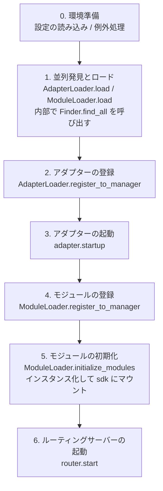

# 起動フローと手動制御

> [!TIP]  
> **この記事を読むべきタイミング**：起動フローを手動で駆動したい、起動順序をカスタマイズしたい、または起動失敗をトラブルシューティングしたい場合。それ以外はスキップしても他の機能の使用に影響はありません。

ErisPulse の `await sdk.run()` / `await sdk.init()` は、一連の起動フローを「一行のコード」でラップしています。しかし、部分的なロード、動的登録、ホットプラグ、カスタムロード戦略の注入など、完全にカスタマイズした起動フローが必要な場合は、このフローの内部で何が起こっているのか、そして各ステップを手動で駆動する方法を理解する必要があります。

本文では、起動フローを個別のステップに分解し、それぞれの役割と呼び出し順序を説明し、手動で完全に起動するための例を示します。

> 本文では、[最初のロボット](../getting-started/first-bot.md)を実行し、`sdk.run(keep_running=True/False)` の2つのモードを理解していることを前提としています。本文では `init()` **内部**のフローの分解、および `init()` / `init_task()` / `init_sync()` などのより低レベルのエントリポイントに焦点を当てます。

## SDK トップレベルエントリ一覧

`run()` の2つの `keep_running` モードに加えて、SDK はいくつかのより低レベルの初期化エントリを提供しています。主な違いは**非同期性、戻り値、および例外のラッピング**です：

| エントリ | 非同期性 | 戻り値 | 例外処理 | 適用場面 |
|------|--------|--------|----------|----------|
| `await sdk.run(True)` | async、イベントループを維持 | `None`（終了時に自動 `uninit`） | モジュール/アダプターのエラーは遮断され、プロセスをクラッシュさせない | ボットアプリケーション |
| `await sdk.run(False)` | async、イベントループを維持しない | `None`（自動アンロードしない） | 同上 | 初期化後にカスタムロジックを実行 |
| `await sdk.init()` | async、awaitが必要 | `bool` | コンポーネントの例外は内部でキャッチされ、失敗時は `False` を返す | 手動でのライフサイクル制御（`uninit()` と併用） |
| `sdk.init_task()` | async、Taskを返す、イベントループを維持しない | `asyncio.Task` | `init()` と同じ | 別の初期化を並列実行する、またはイベントループが起動していない場合 |
| `sdk.init_sync()` | **同期**、現在のスレッドをブロック | `bool` | `init()` と同じ | コマンドラインスクリプト、イベントループのない同期エントリ |

> **よくある誤解**：`await sdk.init()` は `await sdk.run(keep_running=False)` と**等価ではありません**。2つの違いがあります：① `init()` は `bool` を返し、`run()` は `None` を返します；② `init()` は初期化のみを行い、**自動アンロードはしません**。`run()` はイベントループの終了時に自動的に `uninit()` を実行します。したがって、手動でアンロードやライフサイクルをカスタマイズする必要がある場合は、`init()` + `uninit()` を使用します。

## 起動フローの概要

`sdk.init()`（正確にはその内部の `Initializer.init()`）は、以下のようにフレームワーク全体を起動します：



対応するコアコンポーネント：

| 層 | コンポーネント | 職責 |
|----|------|------|
| 発見 | `AdapterFinder` / `ModuleFinder` | entry-points からアダプター/モジュールを**発見**する |
| ロード | `AdapterLoader` / `ModuleLoader` | 発見 + インポート + メタデータの読み込み + 有効/無効の判断、オブジェクトリストを返す |
| 登録 | `*Loader.register_to_manager` | オブジェクトを対応するマネージャーに登録する |
| 管理 | `sdk.adapter` / `sdk.module` | アダプター/モジュールのインスタンスを管理し、起動/停止のインターフェースを提供する |
| 初期化 | `ModuleLoader.initialize_modules` | モジュールのインスタンスを作成し、`sdk` にマウントする（依存性のトポロジカルソートを処理） |
| ルーティング | `sdk.router` | HTTP / WebSocket サーバー |

> **重要**：`Finder` と `Loader` は2つの層です。`Loader` は内部で `Finder` を保持しています（`AdapterLoader` には `AdapterFinder`、`ModuleLoader` には `ModuleFinder` が含まれています）。ほとんどの場合、`Loader` を使用するだけで十分です。"インポートしない"で一覧表示したい場合は、`Finder` を個別に使用します。

## 各ステップの詳細

### 1. 発見層：Finder

Finder は「どのパッケージがアダプター/モジュールを提供しているか」を発見するだけで、インポートやインスタンス化は行いません。

```python
from ErisPulse.finders import AdapterFinder, ModuleFinder

adapter_finder = AdapterFinder()
module_finder = ModuleFinder()

# すべてのインストール済みのアダプター/モジュールの entry-points を検索
adapter_entries = adapter_finder.find_all()    # list[EntryPoint]
module_entries = module_finder.find_all()      # list[EntryPoint]

# 名前で単一の検索
entry = module_finder.find_by_name("MyModule")  # EntryPoint | None
```

各 `EntryPoint` は `.load()` で対応するクラスを得られますが、通常は `Loader` が処理します。

### 2. ロード層：Loader

Loader は Finder の上に「インポート + メタデータの読み込み + 有効/無効の判断」を行います。

```python
from ErisPulse.loaders import AdapterLoader, ModuleLoader
from ErisPulse import sdk

adapter_loader = AdapterLoader()
module_loader = ModuleLoader()

# load() 内部：finder.find_all() を呼び出す → entry-point を1つずつ処理 → 3タプルを返す
adapter_objs, enabled_adapters, disabled_adapters = await adapter_loader.load(sdk.adapter)
module_objs, enabled_modules, disabled_modules = await module_loader.load(sdk.module)
```

`load()` が返す3タプル：

| 戻り値 | 含意 |
|--------|------|
| `objs` (`dict`) | 名称 → オブジェクト（アダプタークラス / モジュールラッパー） |
| `enabled` (`list[str]`) | 有効化された名称（設定で無効化されていない） |
| `disabled` (`list[str]`) | 無効化された名称 |

#### ロード失敗時の診断情報

モジュール/アダプターがロードまたは初期化の段階で例外を送出した場合、フレームワークはそのコンポーネントをスキップして他のコンポーネントのロードを継続し、**ユーザーのコードフレームの要約**を出力します。これにより、デフォルトの INFO レベルでエラー箇所を特定でき、手動で DEBUG レベルを上げる必要はありません。

```
[ERROR] [ModuleLoader] entry-point からモジュール MyModule のロードに失敗しました。読み飛ばしました: 'NoneType' object has no attribute 'platform'
  → MyModule/Core.py:42 in on_load
      adapter = sdk.platform
  → AttributeError: 'NoneType' object has no attribute 'platform'
  → ヒント: ログレベルを DEBUG に上げて詳細なスタックトレースを確認してください。モジュール MyModule の実装コードを確認してください。
```

診断情報は `ErisPulse.runtime.diagnostics` モジュールによって生成され、フレームワーク内部のフレームは自動的にフィルタリングされ、ユーザーのコードフレームのみが残ります。カスタムロードロジックで再利用するには：

```python
from ErisPulse.runtime import log_diagnostic

try:
    risky_init()
except Exception as e:
    log_diagnostic(e)  # 自動的にユーザーのコードフレームを抽出し、ERROR ログに書き込む
```

このモジュールには、`extract_user_frame()`（構造化されたフレーム情報を返す）と `format_diagnostic_block()`（複数行のテキストを返す）という2つの低レベル関数もあります。

### 3. 登録層：register_to_manager

Loader が出力したオブジェクトをマネージャーに登録し、`sdk.adapter` / `sdk.module` がそれらを認識できるようにします。

```python
# アダプターの登録（すべて成功した場合は True を返す）
await adapter_loader.register_to_manager(enabled_adapters, adapter_objs, sdk.adapter)

# モジュールの登録
await module_loader.register_to_manager(enabled_modules, module_objs, sdk.module)
```

登録後、アダプターはアダプターマネージャーに登録され、モジュールはモジュールマネージャーに登録されますが、**まだ起動/インスタンス化されていません**。

### 4. アダプターの起動

```python
# すべての登録済みアダプターを起動
await sdk.adapter.startup()
# または特定のプラットフォームを指定
await sdk.adapter.startup("yunhu")
await sdk.adapter.startup(["yunhu", "telegram"])
```

> 登録 ≠ 起動。`register_to_manager` は登録のみです。`startup` はアダプターの `start()` を呼び出し、プラットフォームとの接続を確立します。

### 5. モジュールの初期化

モジュールはアダプターに比べて1つ追加のステップがあります。**インスタンス化**して `sdk` にマウントする必要があります（これにより、`sdk.MyModule.xxx` で呼び出せるようになります）。このステップでは、モジュール間の依存関係の宣言とトポロジカルソートも処理されます。

```python
success = await module_loader.initialize_modules(
    enabled_modules, module_objs, sdk.module, sdk
)
```

インスタンス化に成功すると、モジュールは `sdk.<ModuleName>` に表示されます。

### 6. ルーティングサーバーの起動

```python
await sdk.router.start(
    host="0.0.0.0",
    port=8000,
    ssl_certfile=None,
    ssl_keyfile=None,
)
```

ルーティングサーバーは、アダプターからの Webhook / WebSocket コールバックを受け取ります。これを起動しないと、サーバーモードのアダプターはメッセージを受け取れません。

## 完全な手動起動の例

以下のコードは `await sdk.init()` のコアフローと**等価**ですが、各ステップが明示的に公開されており、任意の段階でカスタムロジックを挿入できます：

```python
import asyncio
from ErisPulse import sdk
from ErisPulse.loaders import AdapterLoader, ModuleLoader

async def manual_startup():
    # 0. 環境準備（設定の読み込み、グローバル例外処理の登録）
    #    _prepare_environment は init() 内部の前置ステップです。手動フローでも先に呼び出す必要があります。
    #    しないと Loader は設定を読めず、すべてのアダプター/モジュールを無効化と誤認します。
    if not await sdk._prepare_environment():
        print("環境準備に失敗しました")
        return False

    # 1. ローダーの作成（内部でそれぞれ Finder を保持）
    adapter_loader = AdapterLoader()
    module_loader = ModuleLoader()

    # 2. 並列発見とロード（init() 内部と同じ gather を使用）
    (adapter_objs, enabled_adapters, disabled_adapters), \
    (module_objs, enabled_modules, disabled_modules) = await asyncio.gather(
        adapter_loader.load(sdk.adapter),
        module_loader.load(sdk.module),
    )

    # 3. アダプターの登録
    await adapter_loader.register_to_manager(
        enabled_adapters, adapter_objs, sdk.adapter
    )

    # 4. アダプターの起動
    if enabled_adapters:
        await sdk.adapter.startup()

    # 5. モジュールの登録
    await module_loader.register_to_manager(
        enabled_modules, module_objs, sdk.module
    )

    # 6. モジュールの初期化（インスタンス化 + sdk にマウント）
    if enabled_modules:
        await module_loader.initialize_modules(
            enabled_modules, module_objs, sdk.module, sdk
        )

    # 7. ルーティングサーバーの起動
    await sdk.router.start(host="0.0.0.0", port=8000)

    print("手動起動完了")
    return True

async def main():
    ok = await manual_startup()
    if ok:
        # プログラムを維持（手動フローでは自動でブロックされない）
        await asyncio.Event().wait()

if __name__ == "__main__":
    asyncio.run(main())
```

### 手動起動が必要なタイミング

ほとんどの場合、**手動起動は不要**です。`await sdk.run()` がすべての処理を完了しています。手動起動は以下のケースでのみ価値があります：

- **部分的ロード**：特定のアダプター/モジュールのみをロードし、他のものはスキップ
- **動的登録**：条件に応じて実行時に新しいアダプター/モジュールを登録
- **カスタム順序**：デフォルトのロード順序を変更（例：アダプター起動前に特定のモジュールを起動）
- **戦略の注入**：Loader にカスタムの厳密モードマネージャー、ロード戦略などを注入
- **デバッグ/診断**：特定の段階で失敗した場合、手動で駆動して問題を特定

## 実行時の細粒度制御

`sdk.run()` で起動しても、`run()` した後に各サブシステムを個別に制御できます。すべての SDK を再起動する必要はありません。

### アダプターのホットリスタート

```python
# アダプターのホットリスタート（接続の修復、他のプラットフォームへの影響なし）
await sdk.adapter.shutdown("yunhu")
await sdk.adapter.startup("yunhu")

# 実行中に新しいプラットフォームを起動
await sdk.adapter.startup("telegram")

# 一時的にプラットフォームをオフラインにする
await sdk.adapter.shutdown("telegram")
```

> `adapter.startup()` はアダプターが**マネージャーに登録されている**ことを要求します。登録は `init()`/`run()` 内部で行われるため、これは起動**後の**細粒度制御です。

### ルーティングサーバー

```python
# Webhook サーバーを一時的にオフラインにする
await sdk.router.stop()

# 再起動（例：ポートを変更した場合）
await sdk.router.start(host="0.0.0.0", port=9000)
```

### モジュールのオンデマンドロード

```python
# 手動でモジュールをロード（遅延ロードの可能性がある）
await sdk.load_module("MyModule")
```

## エレガントなシャットダウン

2.7.0以降、`sdk.shutdown()` は**プログラム的なエレガントなシャットダウン**を提供します。シャットダウンイベントを設定し、`await sdk.run(keep_running=True)` で待機しているメインループが戻り、`uninit()` がリソースのクリーンアップをトリガーします。

```python
# 任意のコルーチンで呼び出すことで、エレガントな終了をトリガー（run() は待機を戻し、uninit() を自動で実行）
sdk.shutdown()
```

典型的な用途：

```python
async def shutdown_after_idle():
    await asyncio.sleep(3600)
    sdk.shutdown()  # 空き1時間後にエレガントに終了
```

**シグナル処理**：`run()` 内部で `SIGTERM` / `SIGHUP` ハンドラが登録され、システムシグナルをエレガントなシャットダウンに変換します。Docker `docker stop` や `systemd` でサービスを停止する場合、プロセスは強制終了ではなく `uninit()` を完了します。

- Windows では `loop.add_signal_handler` がサポートされていないため、シグナルハンドラは自動的に無視されます（`sdk.shutdown()` または Ctrl+C で終了をトリガーできます）
- `sdk.shutdown()` を繰り返し呼び出しても安全です（イベントが設定された後は無操作になります）

## アンロードフロー

起動の逆操作は `await sdk.uninit()` で、逆順でクリーンアップを行います：

1. すべてのアダプターを閉じる（`adapter.shutdown()`）
2. すべてのモジュールをアンロードする
3. すべてのイベントハンドラをクリーンアップする
4. マネージャーと SDK 上のモジュール属性をクリーンアップする

手動起動の場面では、終了前に `uninit()` を呼び出してエレガントなシャットダウンを保証する必要があります：

```python
try:
    await asyncio.Event().wait()   # プログラムを維持
finally:
    await sdk.uninit()
```

## リスタート

SDK は2種類のリスタート方法を提供しており、自分でアンロードする必要はありません。フレームワークが自動的に処理します：

| 方法 | 呼び出し | 行動 | 適用場面 |
|------|------|------|----------|
| ホットリスタート | `await sdk.restart()` | 同一プロセス内で**コンポーネント層のコードレベルリロード**：全モジュールが統一されたリロードパイプラインを実行（全体の構文検証 / スナップショットロールバック / アイデンティティ確認）、アダプターは entry-point の再発見（実行中に新しくインストール/アンインストールされたアダプターも即座に有効化）した後、コードレベルでリロード | pip でコンポーネントをアップデートした後、コードを有効化する、モジュールのホットアップデート |
| ハードリスタート | `await sdk.hard_restart()` | `uninit()` の後に**終了コード 42**でプロセスを終了し、外部の監督者が新しいプロセスを起動 | フレームワーク自身のアップデート（アップデート後のフレームワークコードは新しいプロセスで有効）、C 拡張の副作用、リソースリークの疑いがある場合 |

```python
# ホットリスタート：コンポーネント層のコードレベルリロード（最も一般的；pip で新しくインストールされたアダプターも起動される）
await sdk.restart()

# ハードリスタート：プロセスを終了し、外部の監督者が再起動する（下の「監督者ガイド」を参照）
await sdk.hard_restart("sdk self-update")  # オプションの理由、監督者が表示する
```

> **2点注意**：
> 1. これらのメソッドはバックグラウンドタスクで実行され、**リスタートがスケジュールされたことを示す `True` を即座に返す**。リスタートが完了したことを示すわけではありません。実際のリスタートはバックグラウンドで行われ、現在のイベントフローを中断しません。
> 2. `hard_restart()` の原理は、アンロードして設定を書き込み、**終了コード 42**（`HARD_RESTART_EXIT_CODE`）でプロセスを終了することです。**自身で新しいプロセスを起動しません**。終了コード 42 を検出する外部の監督者が新しいプロセスを起動する必要があります。`python main.py` で実行し、監督者がいない場合、終了コード 42 でプロセスが終了し、**自動的に再起動しません**（警告が表示されます）。

> **ホットリスタートの排他とマージ**（2.11.1 以降）：すべてのホットリロード操作（単一モジュールのリロード / 全体のリロード / アダプターのリロード / スリープ / 新しいプラグインのホットロード）は完全に排他的です。保存の嵐で連続してトリガーされても、並列に実行されることはありません。実行中の `restart` に新しいリクエストが届いた場合は、自動的にマージされます（通常のリロードのロック中にリクエストが届いても、マージしてキューに追加されます）。完了後、最大1回の追加実行が行われます。保存時に構文エラーがあるファイルを保存した場合、全体のリロードはアンロード前に**一括の構文検証**で拒否されます（エラーのファイルと行番号を一括で表示）。アダプター層はこのリロードをスキップし、`restart` は失敗と判定されます。すべての古いインスタンスはサービスを継続します。修正後に再度 `restart` すれば完了します。

### ハードリスタートが必要なタイミング

ホットリスタートは、pip でコンポーネントをアップデートしたり、モジュールコードをホットアップデートしたり、**実行中に新しくインストールされたアダプター**も含むほとんどのケースをカバーしています。以下のケースでのみハードリスタートが必要です：

- **フレームワーク自体のアップデート**：ErisPulse 本体をアップデートした後、新しいフレームワークコードは新しいプロセスでのみ有効になります（Python は既にロードされたフレームワークコードを再インポートしません）。
- **バイナリライブラリ（C拡張）の副作用**：ホットリスタートは同じプロセス内で行われ、C拡張、開かれたファイルディスクリプター、スレッドなどのプロセスレベルのリソースを解放できません。ハードリスタートは新しいプロセスを起動し、これらの副作用を完全にクリアします。
- **リソースリークの調査**：メモリやハンドルのリークが疑われる場合、ハードリスタートでクリーンな環境を得られます。

> ダッシュボード管理パネルの「フレームワークリスタート」機能は、`hard_restart()` を呼び出しています。

### 終了コード 42 の契約

ハードリスタートはプロセス間の協調です：**SDK は終了（コード 42）、監督者は再起動**。

| 角色 | 行動 |
|------|------|
| SDK（ハードリスタートされるとき） | `uninit()` → 設定を書き込む → 硬リスタートの理由 / PID を書き込む（監督者が表示するため）→ `os._exit(42)` |
| 監督者 | 子プロセスの終了コードが 42 かを検出 → 硬リスタートの理由を表示 → 同じコマンドで再起動 |

> `sdk.is_supervised()` は、現在のプロセスが監督者によって起動されたかどうかを確認できます（環境変数 `ERISPULSE_SUPERVISED` を検出）。CLI `run` コマンドは、子プロセスを起動する際に自動的にこのマーカーを注入します。systemd / Docker などの外部監督者は注入しないので、`is_supervised()` は `False` を返します。この場合、ハードリスタート後に「監督者が検出されなかった」という警告が表示されます。

### 監督者ガイド

自分に合った監督者を選択して、ハードリスタートを有効化しましょう。

#### 1. CLI run コマンド（開発/簡単なデプロイ、推奨）

`epsdk run main.py` には、監督ループが内蔵されています：子プロセスの終了コードを検出し、42 の場合はすぐに再起動（理由を表示）；他の異常終了コードは指数退避で自動リトライ；`Ctrl+C` はまず子プロセスをエレガントに終了（コード 0 は正常終了と見なされ、再起動されない）。

```bash
epsdk run main.py
```

`epsdk run --reload`（開発用ホットリロードモード、2.11.1 以降）も「監督プロセス + 重載ワーカープロセス」構造を採用しています：ワーカー内では `.py` ファイルが保存されると**コンポーネントレベルのホットリロード**が発生（フレームワーク全体のリスタートではない）；ハードリスタートは監督プロセスが新しいワーカーを再起動し、フレームワークをアップデートした後、新しいコードが即座に有効になります。

#### 2. systemd（Linux サーバー）

`RestartForceExitStatus=42` を使って、終了コード 42 もリスタートをトリガーします（デフォルトの `on-failure` は非ゼロコードのみ有効）：

```ini
[Service]
ExecStart=/usr/bin/python3 /opt/mybot/main.py
Restart=on-failure
RestartForceExitStatus=42
RestartSec=2
User=mybot
```

#### 3. Docker / docker-compose

コンテナ内の PID 1 はアプリケーションプロセスであり、終了コード 42 でコンテナが終了します。`restart` ポリシーを使って、自動的に再起動させましょう：

```yaml
services:
  bot:
    build: .
    restart: unless-stopped   # 42 を含むすべての終了コードで再起動
```

#### 4. PM2（Node 生態系の運用）

```bash
pm2 start main.py --name mybot --interpreter python3
# 42 は終了コードとして扱われ、PM2 はデフォルトで再起動；再起動の遅延を設定
pm2 set mybot.restart_delay 2000
```

#### 5. supervisord

```ini
[program:mybot]
command=python3 /opt/mybot/main.py
autorestart=true
exitcodes=0,2,42    # 42 も「正常終了」として再起動
```

#### 6. 純 Python のカスタム監督者

```python
import subprocess, sys, time

while True:
    p = subprocess.Popen([sys.executable, "main.py"])
    code = p.wait()
    if code == 42:          # 硬リスタート要求
        time.sleep(0.5)
        continue
    if code == 0:           # 正常終了
        break
    time.sleep(3)           # 異常終了、退避して再試行
```

> **監督者がいない場合の動作**：`python main.py` で直接実行した場合、`hard_restart()` を呼び出すとプロセスはコード 42 で終了し、再起動されません。この場合は、上記のいずれかの監督者を接続する必要があります。

## 関連ドキュメント

- [最初のロボットを作成する](../getting-started/first-bot.md) - `keep_running` 2つの基本的なモードの入門
- [ライフサイクル管理](lifecycle.md) - `core.init.start` / `core.init.complete` などの起動イベントを監視
- [遅延ロードシステム](lazy-loading.md) - モジュールの遅延ロードメカニズムと `load_module`