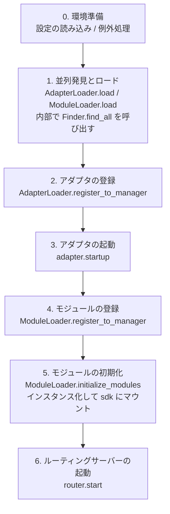

# スタートアップフローと手動制御

> [!TIP]
> **この記事を読むタイミング**: スタートアップフローを手動で駆動し、カスタムの起動順序を設定する場合、または起動失敗をトラブルシューティングする場合に必要です。それ以外の場合はスキップしても、他の機能の使用に影響はありません。

ErisPulse の `await sdk.run()` / `await sdk.init()` は、一連のスタートアップフローを「一行コード」にカプセル化しています。しかし、部分的なロード、動的登録、ホットプラグ、カスタムロード戦略の注入など、完全にカスタムの起動フローが必要な場合は、このフローの内部で何が起こっているのか、そして各ステップをどのように手動で駆動するのかを理解する必要があります。

本文では、スタートアップフローを独立したエレメントに分解し、それぞれの責任と呼び出し順序を説明し、完全な手動起動の例を示します。

> 本文では、[最初のロボット](../getting-started/first-bot.md)を実行し、`sdk.run(keep_running=True/False)` の 2 つのモードを理解していることを前提としています。本文では、`init()` **内部**のフロー分解と、`init()`/`init_task()`/`init_sync()` などのより低レベルのエントリポイントに焦点を当てています。

## SDK トップレベルエントリ一覧

`run()` の 2 つの `keep_running` モードに加え、SDK は以下のより低レベルの初期化エントリを提供しています。これらは、**非同期性、戻り値、および例外のラッピング**の違いによって区別されます：

| エントリ | 非同期性 | 戻り値 | 例外処理 | 適用場面 |
|------|--------|--------|----------|----------|
| `await sdk.run(True)` | 非同期、イベントループをブロック | `None`（終了時に自動 `uninit`） | モジュール/アダプタエラーは捕捉され、プロセスを停止しない | ロボットアプリケーション |
| `await sdk.run(False)` | 非同期、イベントループをブロックしない | `None`（自動アンロードしない） | 同上 | 初期化後にカスタムロジックを実行 |
| `await sdk.init()` | 非同期、awaitが必要 | `bool` | 内部でコンポーネントの例外を捕捉し、失敗時は `False` を返す | 手動でライフサイクルを制御（`uninit()` と併用） |
| `sdk.init_task()` | 非同期、Taskを返す、イベントループをブロックしない | `asyncio.Task` | `init()` と同じ | 並行実行、またはイベントループがまだ実行されていない場合 |
| `sdk.init_sync()` | **同期**、現在のスレッドをブロック | `bool` | `init()` と同じ | コマンドラインスクリプト、イベントループのない同期エントリ |

> **よくある誤解**: `await sdk.init()` は `await sdk.run(keep_running=False)` と等価ではありません。2つの違いがあります：① `init()` は `bool` を返します（失敗時は `False`）、`run()` は `None` を返します；② `init()` は初期化のみを行い、**自動アンロードはしません**、`run()` はイベントループ終了時に自動 `uninit()` を行います。したがって、手動でアンロードやライフサイクルをカスタマイズする必要がある場合は、`init()` + `uninit()` を使用します。

## スタートアップフローの概要

`sdk.init()`（正確にはその内部の `Initializer.init()`）は、以下のようにフレームワーク全体を起動します：



対応するコアコンポーネント：

| 層 | コンポーネント | 職責 |
|----|------|------|
| 発見 | `AdapterFinder` / `ModuleFinder` | エントリポイントからアダプタ/モジュールを**発見**する |
| ロード | `AdapterLoader` / `ModuleLoader` | 発見 + インポート + メタデータの読み取り + 有効/無効の判断、オブジェクトリストを返す |
| 登録 | `*Loader.register_to_manager` | オブジェクトを対応するマネージャーに登録する |
| 管理 | `sdk.adapter` / `sdk.module` | アダプタ/モジュールのインスタンスを維持し、起動/停止のインターフェースを提供する |
| 初期化 | `ModuleLoader.initialize_modules` | モジュールのインスタンスを作成し、`sdk` にマウントする（依存関係のトポロジカルソートを処理） |
| ルーティング | `sdk.router` | HTTP / WebSocket サーバー |

> **重要**: `Finder` と `Loader` は2つの層です。`Loader` は内部で `Finder` を保持しています（`AdapterLoader` は `AdapterFinder` を、`ModuleLoader` は `ModuleFinder` を持っています）。ほとんどの場合、`Loader` を使用するだけで十分です。`Finder` を個別に使用するのは「読み込みせずに一覧表示」が必要な場合です。

## 各エレメントの詳細

### 1. 発見層: Finder

Finder は「どのパッケージがアダプタ/モジュールを提供しているか」を発見するだけです。インポートやインスタンス化はしません。

```python
from ErisPulse.finders import AdapterFinder, ModuleFinder

adapter_finder = AdapterFinder()
module_finder = ModuleFinder()

# すべてのインストール済みアダプタ/モジュールのエントリポイントを検索
adapter_entries = adapter_finder.find_all()    # list[EntryPoint]
module_entries = module_finder.find_all()      # list[EntryPoint]

# 名前で単一の検索
entry = module_finder.find_by_name("MyModule")  # EntryPoint | None
```

各 `EntryPoint` は `.load()` を呼び出すことで対応するクラスを得ることができますが、通常は手動で呼び出す必要はありません。`Loader` が処理します。

#### 拡張ポイント: entry-points

Finder の発見プロトコルは Python の entry-points です。どのインストール済みパッケージでも `pyproject.toml` で対応するグループを宣言すれば、インストール時に検出され、アンインストール時に消えます。フレームワークは以下のようなグループを公開しています：

| グループ | 発見者 | 登録内容 |
|------|--------|----------|
| `erispulse.adapter` | `AdapterFinder`（ロード時に読み取り） | アダプタクラス |
| `erispulse.module` | `ModuleFinder`（ロード時に読み取り） | モジュールクラス |
| `erispulse.storage.backends` | `create_storage()`（ストレージインスタンス作成前にスキャン） | ストレージバックエンドクラス |

ストレージバックエンドをカスタマイズする例では、パッケージはグループとインポートパスを宣言するだけです：

```toml
[project.entry-points."erispulse.storage.backends"]
mydb = "my_erispulse_backend:MyStorage"
```

```toml
# ユーザー側：1行の設定で有効化
[ErisPulse.storage]
backend = "mydb"
```

アダプタ / モジュールも同様にグループを宣言するだけで、詳細は [公開ガイド](../developer-guide/publishing.md) を参照してください。entry-points を使わない場合（ランタイムでの動的登録）は、インポート後に直接登録関数を呼び出します：

```python
from ErisPulse.Core.storage import register_storage_backend

from my_erispulse_backend import MyStorage

register_storage_backend("mydb", MyStorage)
```

ストレージバックエンドの完全な契約（基底クラス、方言、機能宣言）は [ストレージバックエンド](storage-backends.md) を参照してください。

### 2. ロード層: Loader

Loader は Finder の上に「インポート + メタデータの読み取り + 有効/無効の判断」を行います。

```python
from ErisPulse.loaders import AdapterLoader, ModuleLoader
from ErisPulse import sdk

adapter_loader = AdapterLoader()
module_loader = ModuleLoader()

# load() 内部：finder.find_all() を呼び出す → 各エントリポイントを処理する → 三つ組を返す
adapter_objs, enabled_adapters, disabled_adapters = await adapter_loader.load(sdk.adapter)
module_objs, enabled_modules, disabled_modules = await module_loader.load(sdk.module)
```

`load()` が返す三つ組：

| 返り値 | 意味 |
|--------|------|
| `objs` (`dict`) | 名前 → オブジェクト（アダプタクラス / モジュールラッパー） |
| `enabled` (`list[str]`) | 有効化された名前（設定で無効化されていない） |
| `disabled` (`list[str]`) | 無効化された名前 |

#### ロード失敗時の診断情報

モジュール/アダプタがロードまたは初期化段階で例外を送出した場合、フレームワークはそのコンポーネントをスキップして他のコンポーネントのロードを続け、**ユーザーコードのスタックトレース**を出力します。INFO レベルでエラー箇所を特定でき、DEBUG レベルを上げる必要はありません：

```
[ERROR] [ModuleLoader] entry-point からモジュール MyModule をロードできませんでした。スキップしました: 'NoneType' object has no attribute 'platform'
  → MyModule/Core.py:42 in on_load
      adapter = sdk.platform
  → AttributeError: 'NoneType' object has no attribute 'platform'
  → ヒント: ログレベルを DEBUG に上げて完全なスタックトレースを確認してください。モジュール MyModule の実装コードを確認してください
```

診断情報は `ErisPulse.runtime.diagnostics` モジュールで生成され、フレームワーク内部のスタックをフィルタして、ユーザーのコードスタックのみを出力します。カスタムロードロジックで再利用するには：

```python
from ErisPulse.runtime import log_diagnostic

try:
    risky_init()
except Exception as e:
    log_diagnostic(e)  # 自動的にユーザーのコードスタックを抽出して ERROR ログに書き込みます
```

このモジュールには `extract_user_frame()`（構造化されたスタック情報を返す）と `format_diagnostic_block()`（複数行のテキストを返す）という 2 つの低レベル関数もあります。

### 3. 登録層: register_to_manager

Loader が出力したオブジェクトをマネージャーに登録し、`sdk.adapter` / `sdk.module` がそれらを認識できるようにします。

```python
# アダプタの登録（返り値は bool、成功したかどうか）
await adapter_loader.register_to_manager(enabled_adapters, adapter_objs, sdk.adapter)

# モジュールの登録
await module_loader.register_to_manager(enabled_modules, module_objs, sdk.module)
```

登録後、アダプタはアダプタマネージャーに登録され、モジュールはモジュールマネージャーに登録されますが、**まだ起動/インスタンス化されていません**。

### 4. アダプタの起動

```python
# 登録済みのすべてのアダプタを起動
await sdk.adapter.startup()
# または特定のプラットフォームを指定
await sdk.adapter.startup("yunhu")
await sdk.adapter.startup(["yunhu", "telegram"])
```

> 登録 ≠ 起動。`register_to_manager` は登録するだけです。`startup` はアダプタの `start()` を呼び出し、プラットフォームとの接続を確立します。

### 5. モジュールの初期化

モジュールはアダプタよりも 1 ステップ多く、**インスタンス化**して `sdk` にマウントする必要があります（これで `sdk.MyModule.xxx` と呼び出すことができます）。このステップでは、モジュール間の依存宣言とトポロジカルソートも処理されます。

```python
success = await module_loader.initialize_modules(
    enabled_modules, module_objs, sdk.module, sdk
)
```

インスタンス化が成功すると、モジュールは `sdk.<ModuleName>` に表示されます。

### 6. ルーティングサーバーの起動

```python
await sdk.router.start(
    host="0.0.0.0",
    port=8000,
    ssl_certfile=None,
    ssl_keyfile=None,
)
```

ルーティングサーバーは、アダプタの Webhook / WebSocket コールバックを受信します。起動しないと、サーバー形式のアダプタはメッセージを受信できません。

## 完全な手動起動の例

以下のコードは `await sdk.init()` のコアフローと**等価**ですが、各ステップが明示的に表示されており、任意の段階でカスタムロジックを挿入できます：

```python
import asyncio
from ErisPulse import sdk
from ErisPulse.loaders import AdapterLoader, ModuleLoader

async def manual_startup():
    # 0. 環境準備（設定の読み込み、グローバル例外ハンドラーの登録）
    #    _prepare_environment は init() 内部の前置ステップです。手動フローでも先に呼び出す必要があります。
    #    そうでなければ Loader は設定を読み取れず、すべてのアダプタ/モジュールを無効と誤判定します。
    if not await sdk._prepare_environment():
        print("環境準備に失敗しました")
        return False

    # 1. ローダーの作成（内部で Finder を保持）
    adapter_loader = AdapterLoader()
    module_loader = ModuleLoader()

    # 2. 並列発見とロード（init() 内部と同じ gather を使用）
    (adapter_objs, enabled_adapters, disabled_adapters), \
    (module_objs, enabled_modules, disabled_modules) = await asyncio.gather(
        adapter_loader.load(sdk.adapter),
        module_loader.load(sdk.module),
    )

    # 3. アダプタの登録
    await adapter_loader.register_to_manager(
        enabled_adapters, adapter_objs, sdk.adapter
    )

    # 4. アダプタの起動
    if enabled_adapters:
        await sdk.adapter.startup()

    # 5. モジュールの登録
    await module_loader.register_to_manager(
        enabled_modules, module_objs, sdk.module
    )

    # 6. モジュールの初期化（インスタンス化 + sdk にマウント）
    if enabled_modules:
        await module_loader.initialize_modules(
            enabled_modules, module_objs, sdk.module, sdk
        )

    # 7. ルーティングサーバーの起動
    await sdk.router.start(host="0.0.0.0", port=8000)

    print("手動起動完了")
    return True

async def main():
    ok = await manual_startup()
    if ok:
        # 保持して実行（手動フローでは自動でブロックされません）
        await asyncio.Event().wait()

if __name__ == "__main__":
    asyncio.run(main())
```

### いつ手動起動が必要か？

ほとんどの場合、**手動起動は不要**です。`await sdk.run()` はすでに上記のすべてを処理しています。手動起動は、以下の状況でのみ価値があります：

- **部分的ロード**：指定されたアダプタ/モジュールのみをロードし、他のものをスキップする
- **動的登録**：条件に応じて実行時に新しいアダプタ/モジュールを登録する
- **カスタム順序**：デフォルトのロード順序を変更する（例えば、アダプタ起動前に特定のモジュールを起動する）
- **戦略の注入**：Loader にカスタムの厳密モードマネージャー、ロード戦略などを注入する
- **デバッグ/診断**：特定の段階で失敗した場合、手動で駆動して問題を特定する

## 実行時での細粒度制御

### ローカルプラグインのホットリロード

`sdk.enable_plugin_hot_reload()` は、ローカルプラグインディレクトリ（`plugins/`）のソースコード変更を監視して自動的にリロードします：
`epsdk run` では自動的に有効化されており、手動で呼び出す必要はありません。**`sdk.run()` で起動した場合**、プラグインのホットリロードが必要な場合は、`run()` の前に一度呼び出す必要があります（ローカルプラグインディレクトリのみを上書きし、pipでインストールされたモジュール/アダプタには影響しません）：

```python
sdk.enable_plugin_hot_reload()
sdk.run()
```

`sdk.run()` で起動した後でも、実行時に個々のサブシステムを個別に制御することができます。`sdk.run()` で起動した後でも、実行時に個々のサブシステムを個別に制御することができます。`sdk.run()` で起動した後でも、実行時に個々のサブシステムを個別に制御することができます。

### アダプタのホット起動/停止

```python
# アダプタの再起動（接続の修復、他のプラットフォームには影響しない）
await sdk.adapter.shutdown("yunhu")
await sdk.adapter.startup("yunhu")

# 実行中に新しいプラットフォームを起動
await sdk.adapter.startup("telegram")

# 一時的にプラットフォームをオフラインにする
await sdk.adapter.shutdown("telegram")
```

> `adapter.startup()` はアダプタが**マネージャーに登録されている**ことを要求します。登録は `init()`/`run()` 内部で行われるため、これは起動**後の**細粒度制御です。

### ルーティングサーバー

```python
# 一時的に webhook サーバーをオフラインにする
await sdk.router.stop()

# 再起動（たとえばポートを変更した場合）
await sdk.router.start(host="0.0.0.0", port=9000)
```

### モジュールのオンデマンドロード

```python
# 手動でロード（おそらく遅延ロードされるモジュール）
await sdk.load_module("MyModule")
```

## エレガントなシャットダウン

2.7.0 以降、`sdk.shutdown()` は**プログラム的なエレガントなシャットダウン**を提供します。シャットダウンイベントを設定し、`await sdk.run(keep_running=True)` で待機中のメインループを返して、`uninit()` によるリソースのクリーンアップをトリガーします。

```python
# 任意のコルーチンで呼び出し、エレガントな終了をトリガー（run() で待機が返り、自動 uninit が実行される）
sdk.shutdown()
```

典型的な用途：

```python
async def shutdown_after_idle():
    await asyncio.sleep(3600)
    sdk.shutdown()  # 空き1時間後にエレガントに終了
```

**シグナル処理**：`run()` 内部では `SIGTERM` / `SIGHUP` ハンドラが登録され、システムシグナルをエレガントなシャットダウンに変換します。コンテナ編成（Docker `docker stop`）や `systemd` でサービスを停止する場合、プロセスは強制終了ではなく `uninit()` のクリーンアップを完了します。`SIGUSR1` ハンドラも登録され、プロセス内でのソフトリスタート（`sdk.restart()`）に変換されます。`epsdk restart` はコンテナ内の PID 1 インスタンス（終了するとコンテナも終了し、外部から再起動できない）に対してこのシグナルを送信し、コンポーネントのホットリロードをトリガーします。`SIGUSR1` ホットリスタートチャネルは ErisPulse **2.12+** が必要です。

- Windows では `loop.add_signal_handler` がサポートされていないため、シグナルハンドラは自動的にスキップされます（`sdk.shutdown()` または Ctrl+C で終了をトリガーできます）
- `sdk.shutdown()` を繰り返し呼び出しても安全です（イベントが設定された後は無操作になります）

## アンロードフロー

起動の逆操作は `await sdk.uninit()` で、以下のように逆順にクリーンアップを行います：

1. すべてのアダプタを閉じる（`adapter.shutdown()`）
2. すべてのモジュールをアンロードする
3. すべてのイベントハンドラをクリーンアップする
4. マネージャーと SDK 上のモジュール属性をクリーンアップする

手動起動の場合は、終了前に `uninit()` を呼び出してエレガントなシャットダウンを保証してください：

```python
try:
    await asyncio.Event().wait()   # 実行を維持
finally:
    await sdk.uninit()
```

## リスタート

SDK は 2 つのリスタート方法を提供しており、いずれも自分でアンロードする必要はありません。フレームワークが自動的に処理します：

| 方法 | 呼び出し | 行動 | 適用場面 |
|------|------|------|----------|
| ホットリスタート | `await sdk.restart()` | 同一プロセス内で**コンポーネント層のコードレベルリロード**：すべてのモジュールが統一されたリロードパイプラインを経る（全体的な構文検査 / スナップショットロールバック / アイデンティティ確認）、アダプタはまず entry-point を再発見（実行中に新しくインストール/アンインストールされたアダプタも即座に有効化）してから、個々のコードレベルリロードを行う | pip でコンポーネントをアップグレードまたはインストールした後にコードを有効にする、モジュールのホットアップデート |
| ハードリスタート | `await sdk.hard_restart()` | `uninit()` の後に**終了コード 42**でプロセスを終了し、外部の監督者が新しいプロセスを起動する | フレームワーク自身のアップグレード（アップグレード後のフレームワークコードは新しいプロセスでしか有効にならない）、C 拡張の副作用、リソースリークの疑いがある場合 |

```python
# ホットリスタート：コンポーネント層のコードレベルリロード（最も一般的；pip で新しくインストールしたアダプタも起動される）
await sdk.restart()

# ハードリスタート：プロセスを終了し、外部の監督者が起動する（下記「監督者ガイド」参照）
await sdk.hard_restart("sdk self-update")  # オプションの理由、監督者が表示する
```

> **2 つの注意点**：
> 1. これらのメソッドはバックグラウンドタスクでリスタートを実行し、**リスタートタスクがスケジュールされたことを示す `True` を即座に返す**。リスタートが完了したことを示すものではない。実際のリスタートはバックグラウンドで行われ、現在のイベントチェーンを中断しない。
> 2. `hard_restart()` の仕組みは、アンロードして設定を書き込んだ後、**終了コード 42**（`HARD_RESTART_EXIT_CODE`）でプロセスを終了することです。**自身で新しいプロセスを起動するものではない**。外部の監督者が終了コード 42 を検知した後に再起動する必要があります。`python main.py` で直接実行し、監督者が何もなければ、終了コード 42 でプロセスが終了し、**自動的に再起動されない**（フレームワークは警告を出す）。

> **ホットリスタートの排他と結合**（2.11.1 以降）：すべてのホットリロード操作（単一モジュールリロード / 全量リロード / アダプタリロード / 休眠 / 新しいプラグインのホットロード）は完全に排他です。保存の嵐で連続してトリガーされても、並列実行はせず、進行中の `restart` に新しいリクエストが届いた場合は自動的に結合（通常のリロードロック中でも結合してキューに追加）し、完了後に最大 1 回の補完実行が行われます。構文エラーが含まれるファイルを保存した場合、リロードはアンロード前に**一括的な構文検査**で拒否されます（エラーが含まれるファイルと行番号を一括でリストアップ）。アダプタ層はそのリロードをスキップし、`restart` は失敗と判定され、すべての古いインスタンスがサービスを継続します。修正後、再度 `restart` を実行すれば可能です。

### ハードリスタートが必要なのはいつか？

ホットリスタートは、pip でコンポーネントをアップグレード/インストールしたり、モジュールコードをホットアップデートしたりするほとんどの状況をカバーしています。以下のような状況でハードリスタートが必要です：

- **フレームワーク自身のアップグレード**：ErisPulse 自体をアップグレードした後、新しいフレームワークコードは新しいプロセスでしか有効になりません（Python は既にロードされたフレームワークコードを再読み込みしません）。
- **バイナリライブラリ（C拡張）の副作用**：ホットリスタートは同一プロセス内で行われるため、C拡張、開かれたファイルディスクリプタ、スレッドなどのプロセスレベルのリソースを解放できません。ハードリスタートは新しいプロセスを起動し、これらの副作用を完全にクリアします。
- **リソースリークの調査**：メモリやハンドルのリークが疑われる場合、ハードリスタートでクリーンな環境を得ることができます。

> ダッシュボード管理パネルの「フレームワークリスタート」機能は、内部で `hard_restart()` を呼び出します。

### 終了コード 42 の契約

ハードリスタートはプロセス間の協力です：**SDK が終了（コード 42）し、監督者が起動する**。

| 役割 | 行動 |
|------|------|
| SDK（ハードリスタートされるとき） | `uninit()` → 設定を書き込む → ハードリスタートの理由 / PID を記録（監督者が表示）→ `os._exit(42)` |
| 監督者 | 子プロセスの終了コードが 42 であることを検出 → ハードリスタートの理由を表示 → 同じコマンドを再起動する |

> `sdk.is_supervised()` は、現在のプロセスが監督者によって起動されたかどうかを検出します（環境変数 `ERISPULSE_SUPERVISED` を検出）。CLI `run` コマンドで起動する子プロセスには自動的にこのマーカーが注入されます。systemd / Docker などの外部監督者は注入しないため、`is_supervised()` は `False` を返し、この場合、ハードリスタート後は「監督者が検出されない」という警告が表示されます。

### 監督者ガイド

監督者を選択して、ハードリスタートを本当に有効にします：

#### 1. CLI run コマンド（開発/簡単なデプロイ、推奨）

`epsdk run main.py` には監督ループが内蔵されており、子プロセスの終了コードを検出します。42 の場合はすぐに再起動（理由を表示）します。他の異常終了コードは指数退避で自動的に再試行します。`Ctrl+C` はまず子プロセスをエレガントに終了します（コード 0 は正常終了と見なされ、再起動されません）。

```bash
epsdk run main.py
```

`epsdk run --reload`（開発用ホットリロードモード、2.11.1 以降）も「監督プロセス + 重載ワーカー子プロセス」の構造を採用しています。ワーカー内では `.py` ファイルの保存で**コンポーネントレベルのホットリロード**がトリガーされます（フレームワーク全体の再起動ではなく）。ハードリスタートは監督プロセスが新しいワーカーを再起動することで実現し、フレームワークをアップグレードした後、新しいコードが即座に有効になります。

#### 細粒度の重載判定（2.12+）

`.py` ファイルの変更を実行時のソースコードの所有者に基づいて最小単位で重載します。パス文字列で推測するのではなく、正しく判定します：

| 変更ファイル | 処理 |
|----------|------|
| プラグインディレクトリ（`ErisPulse.framework.plugins_dir`）内 | プラグインのホットリロードウォッチャーが処理し、開発用ウォッチャーは重複実行しない |
| 既にロードされたモジュールのソースコード（`pip install -e` と site-packages を含む） | `sdk.reload_module(モジュール名)` |
| 既に登録されたアダプタのソースコード | `sdk.reload_adapter(プラットフォーム名)` |
| エントリスクリプト | プロセスレベルの再起動（終了コード 42、監督者が再起動） |
| フレームワーク自身のソースコード（`ErisPulse` パッケージ内） | プロセスレベルの再起動 |
| 複数の所有者に一致する / 所有者を特定できない | 保守的にプロセスレベルの再起動 |

`epsdk upgrade` などの一括アップグレードの場合は、`sdk.reload_all_modules()` を使って一度に全モジュールを再起動できます（依存関係のトポロジカル順、モジュール単位での失敗はスキップ、ロールバックしない）。スクリプトモード（`epsdk run main.py --reload`）では、スクリプトワーカー化されません。スクリプトワーカー内に開発用ウォッチャーを掛けて、`component_reload_pid` を `.erispulse/runtime.json` に書き込みます。親プロセスはこのマーカーを検出し、モジュール/アダプタ/プラグインの変更はワーカーに処理させ、エントリスクリプトやフレームワークのソースコードの変更のみプロセスを再起動します。

#### 2. systemd（Linux サーバー）

`RestartForceExitStatus=42` を設定して、終了コード 42 も再起動をトリガーします（デフォルトの `on-failure` は非ゼロコードのみ有効です）：

```ini
[Service]
ExecStart=/usr/bin/python3 /opt/mybot/main.py
Restart=on-failure
RestartForceExitStatus=42
RestartSec=2
User=mybot
```

#### 3. Docker / docker-compose

コンテナ内の PID 1 はアプリケーションプロセスです。終了コード 42 でコンテナが終了します。`restart` ポリシーを使って自動的に再起動します：

```yaml
services:
  bot:
    build: .
    restart: unless-stopped   # 42 を含むすべての終了コードで再起動
```

> コンテナ内 `epsdk restart` は PID 1 インスタンスに対して SIGUSR1 でプロセス内リスタートを行い、コンテナを終了しません。プロセス全体の再起動は `restart` ポリシーが担います。[デプロイ → コンテナ内リスタート](../user-guide/deployment.md#コンテナ内リスタートpid-1-インスタンス)を参照してください。

#### 4. PM2（Node 生態系の運用）

```bash
pm2 start main.py --name mybot --interpreter python3
# 42 は終了コードとして扱われ、PM2 はデフォルトで再起動します。再起動の遅延を設定
pm2 set mybot.restart_delay 2000
```

#### 5. supervisord

```ini
[program:mybot]
command=python3 /opt/mybot/main.py
autorestart=true
exitcodes=0,2,42    # 42 も「正常終了」扱いで再起動
```

#### 6. 純 Python のカスタム監督者

```python
import subprocess, sys, time

while True:
    p = subprocess.Popen([sys.executable, "main.py"])
    code = p.wait()
    if code == 42:          # ハードリスタート要求
        time.sleep(0.5)
        continue
    if code == 0:           # 正常終了
        break
    time.sleep(3)           # 異常終了、退避再試行
```

> **監督者がいない場合の動作**：`python main.py` で直接実行した場合、`hard_restart()` を呼び出すとプロセスはコード 42 で終了し、再起動されません。この場合は、上記のいずれかの監督者を接続する必要があります。

## 関連ドキュメント

- [最初のロボットを作成する](../getting-started/first-bot.md) - `keep_running` 2 つの基本的なモードの入門
- [ライフサイクル管理](lifecycle.md) - `core.init.start` / `core.init.complete` などの起動イベントを監視
- [遅延ロードシステム](lazy-loading.md) - モジュールの遅延ロードメカニズムと `load_module`