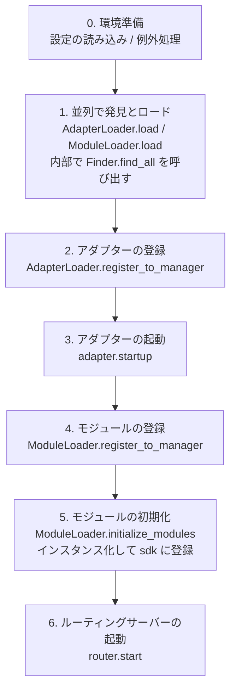

# スタートアップフローと手動制御

> [!TIP]  
> **この記事を読むべきタイミング**：手動でスタートアップのフローを駆動する必要がある場合、起動順序をカスタマイズする場合、または起動失敗をトラブルシューティングする場合。それ以外の場合はスキップしても、他の機能の使用に影響はありません。

ErisPulse の `await sdk.run()` / `await sdk.init()` は、一連のスタートアップフローを「一行のコード」にラップしています。しかし、部分的なロード、動的登録、ホットプラグ、カスタムロード戦略の注入など、完全にカスタムのスタートアップフローが必要な場合は、このフローの内部で何が起こっているのか、そして各ステップを手動で駆動する方法を理解する必要があります。

本文では、スタートアップフローを独立したステップに分解し、それぞれの役割と呼び出し順序を説明し、手動で完全な起動の例を示します。

> 本文では、すでに [最初のロボット](../getting-started/first-bot.md) を実行し、`sdk.run(keep_running=True/False)` の2つのモードを理解していることを前提としています。本文は `init()` **内部**のフローの分解、および `init()` / `init_task()` / `init_sync()` などのより下層のエントリポイントに焦点を当てています。

## SDKのトップレベルエントリ一覧

`run()` の2つの `keep_running` モードに加えて、SDK にはいくつかのより下層の初期化エントリが提供されており、**非同期性、戻り値、および例外のラッピングの有無**で区別されます。

| エントリ | 非同期性 | 戻り値 | 例外処理 | 適用場面 |
|------|--------|--------|----------|----------|
| `await sdk.run(True)` | async、ブロッキング | `None`（終了時に自動 `uninit`） | モジュール/アダプターのエラーはキャッチされ、プロセスをクラッシュさせない | ロボットアプリケーション |
| `await sdk.run(False)` | async、ブロッキングしない | `None`（自動アンロードしない） | 同上 | 初期化後にカスタムロジックを実行する |
| `await sdk.init()` | async、awaitが必要 | `bool` | 内部でコンポーネントの例外をキャッチし、失敗時は `False` を返す | ライフサイクルを手動で制御する場合（`uninit()` と併用） |
| `sdk.init_task()` | async、Taskを返す | `asyncio.Task` | `init()` と同じ | 別の初期化を並行実行する、またはイベントループが起動していない場合 |
| `sdk.init_sync()` | **同期**、現在のスレッドをブロッキング | `bool` | `init()` と同じ | コマンドラインスクリプト、イベントループのない同期エントリ |

> **よくある誤解**：`await sdk.init()` は `await sdk.run(keep_running=False)` と**等価ではない**。2つの違いがある：① `init()` は `bool` を返す（失敗時は `False`）、`run()` は `None` を返す；② `init()` は初期化のみを行い、**自動的にアンロードしない**、`run()` はイベントループが終了したときに自動的に `uninit()` を実行する。したがって、手動でアンロードやカスタムライフサイクルを制御する必要がある場合は、`init()` + `uninit()` を使用する。

## スタートアップフローの概要

`sdk.init()`（正確にはその内部の `Initializer.init()`）は、以下のようにフレームワーク全体を起動する：



対応するコアコンポーネント：

| 層 | コンポーネント | 役割 |
|----|------|------|
| 発見 | `AdapterFinder` / `ModuleFinder` | エントリポイントから**アダプター/モジュールを発見**する |
| ロード | `AdapterLoader` / `ModuleLoader` | 発見 + インポート + メタデータの読み込み + 有効/無効の判定、オブジェクトのリストを返す |
| 登録 | `*Loader.register_to_manager` | オブジェクトを対応するマネージャーに登録する |
| 管理 | `sdk.adapter` / `sdk.module` | アダプター/モジュールのインスタンスを維持し、起動/停止のインターフェースを提供する |
| 初期化 | `ModuleLoader.initialize_modules` | モジュールのインスタンスを作成して `sdk` に登録する（依存関係のトポロジカルソートを処理） |
| ルーティング | `sdk.router` | HTTP / WebSocket サーバー |

> **重要**：`Finder` と `Loader` は2つの層です。`Loader` は内部で `Finder` を保持しています（`AdapterLoader` は `AdapterFinder` を、`ModuleLoader` は `ModuleFinder` を持っています）。ほとんどの場合、`Loader` を使い、`Finder` は「インポートしないでリストアップする」場合にのみ直接使います。

## 各ステップの詳細

### 1. 発見層：Finder

Finder は「どのパッケージがアダプター/モジュールを提供しているか」を発見するだけです。インポートもインスタンス化もしません。

```python
from ErisPulse.finders import AdapterFinder, ModuleFinder

adapter_finder = AdapterFinder()
module_finder = ModuleFinder()

# すべてのインストール済みアダプター/モジュールのエントリポイントを検索
adapter_entries = adapter_finder.find_all()    # list[EntryPoint]
module_entries = module_finder.find_all()      # list[EntryPoint]

# 名前で1つ検索
entry = module_finder.find_by_name("MyModule")  # EntryPoint | None
```

各 `EntryPoint` は `.load()` を呼び出すことで対応するクラスを得られますが、通常は手動で呼び出す必要はありません。`Loader` が処理します。

### 2. ロード層：Loader

Loader は Finder の上に「インポート + メタデータの読み込み + 有効/無効の判定」を行います。

```python
from ErisPulse.loaders import AdapterLoader, ModuleLoader
from ErisPulse import sdk

adapter_loader = AdapterLoader()
module_loader = ModuleLoader()

# load() 内部：finder.find_all() を呼び出す → 各エントリポイントを処理 → 3タプルを返す
adapter_objs, enabled_adapters, disabled_adapters = await adapter_loader.load(sdk.adapter)
module_objs, enabled_modules, disabled_modules = await module_loader.load(sdk.module)
```

`load()` が返す3タプル：

| 戻り値 | 意味 |
|--------|------|
| `objs` (`dict`) | 名称 → オブジェクト（アダプタークラス / モジュールのラッパー） |
| `enabled` (`list[str]`) | 有効化された名称（設定で無効化されていない） |
| `disabled` (`list[str]`) | 無効化された名称 |

#### ロード失敗時の診断情報

モジュール/アダプターがロードまたは初期化の段階で例外を発生させた場合、フレームワークはそのコンポーネントをスキップして他のコンポーネントのロードを継続し、**ユーザーのコードのフレームを要約して**、デフォルトの INFO レベルでエラー位置を特定できるようにします。DEBUG レベルを上げる必要はありません。

```
[ERROR] [ModuleLoader] entry-point からモジュール MyModule のロードに失敗し、スキップしました: 'NoneType' object has no attribute 'platform'
  → MyModule/Core.py:42 in on_load
      adapter = sdk.platform
  → AttributeError: 'NoneType' object has no attribute 'platform'
  → ヒント: ログレベルを DEBUG に上げて詳細なスタックトレースを確認する；モジュール MyModule の実装コードを確認する
```

診断情報は `ErisPulse.runtime.diagnostics` モジュールによって生成され、フレームワークの内部フレームは自動的にフィルタされ、ユーザーのコードフレームのみが残ります。カスタムロードロジックで再利用するには：

```python
from ErisPulse.runtime import log_diagnostic

try:
    risky_init()
except Exception as e:
    log_diagnostic(e)  # 自動的にユーザーのコードフレームを抽出して ERROR ログに書き込む
```

このモジュールには `extract_user_frame()`（構造化されたフレーム情報を返す）と `format_diagnostic_block()`（複数行のテキストを返す）の2つの低レベル関数もあります。

### 3. 登録層：register_to_manager

Loader が出力したオブジェクトをマネージャーに登録し、`sdk.adapter` / `sdk.module` がそれらを認識できるようにします。

```python
# アダプターの登録（戻り値は bool、すべて成功したかを示す）
await adapter_loader.register_to_manager(enabled_adapters, adapter_objs, sdk.adapter)

# モジュールの登録
await module_loader.register_to_manager(enabled_modules, module_objs, sdk.module)
```

登録後、アダプターはアダプター管理マネージャーに登録され、モジュールはモジュール管理マネージャーに登録されますが、**まだ起動/インスタンス化されていません**。

### 4. アダプターの起動

```python
# すべての登録済みアダプターを起動
await sdk.adapter.startup()
# または特定のプラットフォームを指定
await sdk.adapter.startup("yunhu")
await sdk.adapter.startup(["yunhu", "telegram"])
```

> 登録 ≠ 起動。`register_to_manager` は登録するだけです；`startup` はアダプターの `start()` を呼び出し、プラットフォームとの接続を確立します。

### 5. モジュールの初期化

モジュールはアダプターに比べて1ステップ多く、**インスタンス化**して `sdk` に登録する必要があります（これで `sdk.MyModule.xxx` を呼び出せるようになります）。このステップではモジュール間の依存宣言とトポロジカルソートも処理されます。

```python
success = await module_loader.initialize_modules(
    enabled_modules, module_objs, sdk.module, sdk
)
```

インスタンス化が成功すると、モジュールは `sdk.<ModuleName>` に登録されます。

### 6. ルーティングサーバーの起動

```python
await sdk.router.start(
    host="0.0.0.0",
    port=8000,
    ssl_certfile=None,
    ssl_keyfile=None,
)
```

ルーティングサーバーはアダプターの Webhook / WebSocket コールバックを受信します。起動しないと、サーバーモードのアダプターはメッセージを受け取れません。

## 完全な手動起動の例

以下のコードは `await sdk.init()` のコアフローと**等価**ですが、各ステップが公開されており、任意の段階でカスタムロジックを挿入できます：

```python
import asyncio
from ErisPulse import sdk
from ErisPulse.loaders import AdapterLoader, ModuleLoader

async def manual_startup():
    # 0. 環境準備（設定の読み込み、グローバル例外処理の登録）
    #    _prepare_environment は init() 内部の前置ステップ；手動フローでも先に呼び出す必要がある。
    #    そうでないと Loader は設定を読めず、すべてのアダプター/モジュールを誤って無効化してしまう。
    if not await sdk._prepare_environment():
        print("環境準備に失敗しました")
        return False

    # 1. ローダーの作成（内部でそれぞれ Finder を保持）
    adapter_loader = AdapterLoader()
    module_loader = ModuleLoader()

    # 2. 並列で発見とロード（init() 内部と同じ gather を使用）
    (adapter_objs, enabled_adapters, disabled_adapters), \
    (module_objs, enabled_modules, disabled_modules) = await asyncio.gather(
        adapter_loader.load(sdk.adapter),
        module_loader.load(sdk.module),
    )

    # 3. アダプターの登録
    await adapter_loader.register_to_manager(
        enabled_adapters, adapter_objs, sdk.adapter
    )

    # 4. アダプターの起動
    if enabled_adapters:
        await sdk.adapter.startup()

    # 5. モジュールの登録
    await module_loader.register_to_manager(
        enabled_modules, module_objs, sdk.module
    )

    # 6. モジュールの初期化（インスタンス化 + sdk に登録）
    if enabled_modules:
        await module_loader.initialize_modules(
            enabled_modules, module_objs, sdk.module, sdk
        )

    # 7. ルーティングサーバーの起動
    await sdk.router.start(host="0.0.0.0", port=8000)

    print("手動起動が完了しました")
    return True

async def main():
    ok = await manual_startup()
    if ok:
        # ブロッキングして実行を維持（手動フローでは自動的にブロッキングしない）
        await asyncio.Event().wait()

if __name__ == "__main__":
    asyncio.run(main())
```

### 手動起動が必要なタイミング

ほとんどの場合、**手動起動は不要**です。`await sdk.run()` はすでに上記のすべてを処理しています。手動起動は以下の場面でのみ価値があります：

- **部分的なロード**：指定されたアダプター/モジュールのみをロードし、他の部分をスキップする
- **動的登録**：実行時に条件に応じて新しいアダプター/モジュールを登録する
- **カスタム順序**：デフォルトのロード順序を変更する必要がある（例：特定のモジュールを起動してからアダプターを起動する）
- **戦略の注入**：Loader にカスタムの厳格モードマネージャー、ロード戦略などを注入する
- **デバッグ/診断**：特定の段階で失敗した場合、手動で駆動して問題を特定する

## 実行時の細粒度制御

`sdk.run()` で起動した後でも、再起動せずに各サブシステムを個別に制御することができます：

### アダプターのホットリスタート

```python
# 特定のアダプターをホットリスタート（接続を修復し、他のプラットフォームには影響しない）
await sdk.adapter.shutdown("yunhu")
await sdk.adapter.startup("yunhu")

# 実行中に新しいプラットフォームを起動
await sdk.adapter.startup("telegram")

# 一時的に特定のプラットフォームをオフラインにする
await sdk.adapter.shutdown("telegram")
```

> `adapter.startup()` はアダプターが**マネージャーに登録されている**必要がある。登録は `init()` / `run()` 内部で行われるため、これは起動**後の**細粒度制御です。

### ルーティングサーバー

```python
# 一時的に webhook サーバーをオフラインにする
await sdk.router.stop()

# 再起動（例：ポートを変更した場合）
await sdk.router.start(host="0.0.0.0", port=9000)
```

### モジュールのオンデマンドロード

```python
# 手動でモジュールをロードする（おそらく遅延ロードのモジュール）
await sdk.load_module("MyModule")
```

## エレガントなシャットダウン

2.7.0 以降、`sdk.shutdown()` は**プログラムによるエレガントなシャットダウン**を提供します：シャットダウンイベントを設定し、`await sdk.run(keep_running=True)` で待機しているメインループが返り、`uninit()` がリソースのクリーンアップをトリガーします。

```python
# 任意のコルーチンで呼び出すことで、エレガントな終了をトリガー（run() は返り、uninit() が自動的に実行される）
sdk.shutdown()
```

典型的な用途：

```python
async def shutdown_after_idle():
    await asyncio.sleep(3600)
    sdk.shutdown()  # 空き1時間後にエレガントに終了
```

**シグナル処理**：`run()` 内部では `SIGTERM` / `SIGHUP` ハンドラが登録され、システムシグナルをエレガントなシャットダウンに変換します——コンテナ編成（Docker `docker stop`）や `systemd` でサービスを停止する場合、プロセスは強制終了ではなく `uninit()` を完了します。

- Windows は `loop.add_signal_handler` をサポートしていないため、シグナルハンドラは自動的にスキップされます（`sdk.shutdown()` または Ctrl+C で終了をトリガーできます）
- `sdk.shutdown()` を繰り返し呼び出しても安全です（イベントが設定された後は無操作になります）

## アンロードフロー

起動の逆操作は `await sdk.uninit()` で、反対の順序でクリーンアップされます：

1. すべてのアダプターを閉じる（`adapter.shutdown()`）
2. すべてのモジュールをアンロードする
3. すべてのイベントハンドラをクリーンアップする
4. マネージャーと SDK 上のモジュール属性をクリーンアップする

手動起動の場合は、終了前に `uninit()` を呼び出してエレガントなシャットダウンを保証してください：

```python
try:
    await asyncio.Event().wait()   # 実行を維持
finally:
    await sdk.uninit()
```

## リスタート

SDK は2つのリスタート方法を提供しており、自分でアンロードする必要はありません——フレームワークが自動的に処理します：

| 方法 | 呼び出し | 行動 | 適用場面 |
|------|------|------|----------|
| ホットリスタート | `await sdk.restart()` | 同一プロセス内で**コンポーネントレベルのコードリロード**：すべてのモジュールが統一されたリロードパイプラインを実行（全体的な構文検査 / スナップショットロールバック / アイデンティティ確認）、アダプターは**エントリポイントの再発見**（実行中に新しくインストール/アンインストールされたアダプターも即座に有効化）された後、個別にコードリロードされる | pip でコンポーネントをアップグレードまたはインストールした後にコードを有効化する、モジュールのホットアップデート |
| ハードリスタート | `await sdk.hard_restart()` | `uninit()` の後、**終了コード 42** でプロセスを終了し、外部の監視者が新しいプロセスを起動する | フレームワーク自体のアップグレード（アップグレード後のフレームワークコードは新しいプロセスでのみ有効）、C 拡張の副作用、リソースリークを疑う場合 |

```python
# ホットリスタート：コンポーネントレベルのコードリロード（最も一般的；pip で新しくインストールされたアダプターも起動される）
await sdk.restart()

# ハードリスタート：プロセスを終了し、外部監視者が再起動する（下記「監視者ガイド」を参照）
await sdk.hard_restart("sdk self-update")  # オプションの理由、監視者が表示する
```

> **2点注意**：
> 1. これらのメソッドはバックグラウンドタスクでリスタートを実行するため、**即座に「リスタートタスクがスケジュールされた」を返す**、リスタートが完了したことを示すものではない。実際のリスタートはバックグラウンドで実行され、現在のイベントフローを中断しない。
> 2. `hard_restart()` の原理は：アンロードして設定を書き込んだ後、**終了コード 42**（`HARD_RESTART_EXIT_CODE`）でプロセスを終了する——**自身で新しいプロセスを起動しない**。外部監視者が終了コード 42 を検知して再起動する必要がある。`python main.py` で直接実行し、監視者がいない場合、終了コード 42 でプロセスが終了し、**自動的に再起動しない**（フレームワークは警告を出す）。

> **ホットリスタートの排他とマージ**（2.11.1 以降）：すべてのホットリロード操作（単一モジュールのリロード / 全体のリロード / アダプターのリロード / 睡眠）は完全に排他的に実行される——保存の嵐下で連続したトリガーは並行して交差しない。進行中の restart に新しいリクエストが届いた場合は自動的にマージされ、完了後に最大1ラウンドを補う。保存時に構文エラーのあるファイルを保存した場合、全体のリロードはアンロード前に**集中的な構文検査**で拒否される（エラーのあるファイルと行番号を一括で表示）、すべての古いインスタンスはサービスを継続する。

### ハードリスタートが必要なタイミング

ホットリスタートは、pip でコンポーネントをアップグレード/インストール、モジュールコードのホットアップデート、**実行中に新しくインストールされたアダプター**を含む、ほとんどの場面をカバーしている。以下の場面でハードリスタートが必要です：

- **フレームワーク自体のアップグレード**：ErisPulse 本体をアップグレードした後、新しいフレームワークコードは新しいプロセスでのみ有効になる（Python は既にロードされたフレームワークコードを再インポートしない）。
- **バイナリライブラリ（C拡張）の副作用**：ホットリスタートは同一プロセス内で実行され、C拡張、開かれたファイルディスクリプタ、スレッドなどのプロセスレベルのリソースを解放できない。ハードリスタートは新しいプロセスを起動し、これらの副作用を完全にクリアする。
- **リソースリークの調査**：メモリやハンドルのリークが疑われる場合、ハードリスタートはきれいな環境を取得できる。

> ダッシュボード管理パネルの「フレームワークリスタート」機能は、`hard_restart()` を呼び出している。

### 終了コード 42 の契約

ハードリスタートはプロセス間の協力：**SDK が終了（コード 42）、監視者が再起動**。

| 角色 | 行動 |
|------|------|
| SDK（ハードリスタートされるとき） | `uninit()` → 設定を書き込む → 硬リスタートのマーキング（理由 / PID、監視者が表示）→ `os._exit(42)` |
| 監視者 | 子プロセスの終了コードが 42 かを検出 → 硬リスタートの理由を表示 → 同じコマンドで再起動 |

> `sdk.is_supervised()` は、現在のプロセスが監視者によって起動されたかを確認する（環境変数 `ERISPULSE_SUPERVISED` を検出）。CLI `run` コマンドが起動する子プロセスには自動的にこのマーキングが注入される；systemd / Docker などの外部監視者は注入しないため、`is_supervised()` は `False` を返し、ハードリスタート後に「監視者を検出できなかった」と警告が出る。

### 監視者ガイド

自分に合った監視者を選択して、ハードリスタートを有効にする：

#### 1. CLI run コマンド（開発/簡単なデプロイ、推奨）

`epsdk run main.py` には監視ループが内蔵されている：子プロセスの終了コードを検出し、42 の場合はすぐに再起動（硬リスタートの理由を表示）；他の異常終了コードは指数退避で自動リトライ；`Ctrl+C` はまず子プロセスをエレガントに終了（コード 0 は正常終了と見なし、再起動しない）。

```bash
epsdk run main.py
```

`epsdk run --reload`（開発用のホットリロードモード、2.11.1 以降）は同様に「監視プロセス + 重載ワーカー子プロセス」の構造を使う：ワーカー内では `.py` ファイルが保存されると**コンポーネントレベルのホットリロード**（フレームワークの再起動はしない）が発生する；ハードリスタートは監視プロセスが新しいワーカーを再起動し、フレームワークをアップグレードした後、新しいコードが即座に有効になる。

#### 2. systemd（Linux サーバー）

`RestartForceExitStatus=42` で、終了コード 42 も再起動をトリガーする（デフォルトの `on-failure` は非ゼロコードのみ有効）：

```ini
[Service]
ExecStart=/usr/bin/python3 /opt/mybot/main.py
Restart=on-failure
RestartForceExitStatus=42
RestartSec=2
User=mybot
```

#### 3. Docker / docker-compose

コンテナ内の PID 1 はアプリケーションプロセスであり、終了コード 42 でコンテナが終了する——`restart` ポリシーを使って自動的に再起動させる：

```yaml
services:
  bot:
    build: .
    restart: unless-stopped   # 42 を含むすべての終了で再起動
```

#### 4. PM2（Node 生態系の運用）

```bash
pm2 start main.py --name mybot --interpreter python3
# 42 は終了コードとして扱われ、PM2 はデフォルトで再起動；restart_delay を設定してデバウンス
pm2 set mybot.restart_delay 2000
```

#### 5. supervisord

```ini
[program:mybot]
command=python3 /opt/mybot/main.py
autorestart=true
exitcodes=0,2,42    # 42 も「正常終了として再起動」
```

#### 6. 純 Python でカスタム監視者

```python
import subprocess, sys, time

while True:
    p = subprocess.Popen([sys.executable, "main.py"])
    code = p.wait()
    if code == 42:          # ハードリスタート要求
        time.sleep(0.5)
        continue
    if code == 0:           # 正常終了
        break
    time.sleep(3)           # 異常終了、退避して再試行
```

> **監視者がいない場合の動作**：`python main.py` で直接実行し、`hard_restart()` を呼び出すと、プロセスはコード 42 で終了し、再起動しない。この場合は、上記のいずれかの監視者を接続する必要がある。

## 関連ドキュメント

- [最初のロボットを作成する](../getting-started/first-bot.md) - `keep_running` 2つの基本的なモードの入門
- [ライフサイクル管理](lifecycle.md) - `core.init.start` / `core.init.complete` などの起動イベントを監視
- [遅延ロードシステム](lazy-loading.md) - モジュールの遅延ロードメカニズムと `load_module`