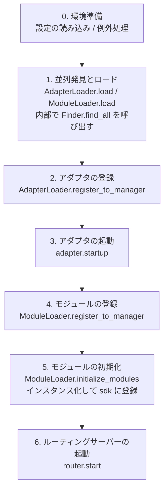

# 起動プロセスと手動制御

> [!TIP]
> **この記事を読むタイミング**：起動チェーンを手動で制御したい、起動順序をカスタマイズしたい、または起動失敗をトラブルシューティングしたい場合に読んでください。必要なければ飛ばしても、他の機能の使用に影響はありません。

ErisPulse の `await sdk.run()` / `await sdk.init()` は、起動チェーンを「一行のコード」に封じ込めています。しかし、部分的なロード、動的な登録、ホットプラグ、カスタムロード戦略の注入など、起動プロセスを完全にカスタマイズしたい場合には、起動チェーンの内部で何が起こっているのか、そして各ステップをどのように手動で駆動するのかを理解する必要があります。

このドキュメントでは、起動チェーンを個々のステップに分解し、それぞれの役割と順序を説明し、手動で完全な起動を行うための例を示します。

> 本文は、[最初のロボット](../getting-started/first-bot.md)を実行し、`sdk.run(keep_running=True/False)` の2種類のモードを理解していることを前提としています。本文は `init()` **内部**のプロセスの分解、および `init()` / `init_task()` / `init_sync()` 等のより低レベルなエントリポイントに焦点を当てています。

## SDK の上位エントリ一覧

`run()` の2種類の `keep_running` モードに加えて、SDK には以下のより低レベルな初期化エントリが用意されています。これらは**非同期性、戻り値、および例外のラッピング**の点で異なります：

| エントリ | 非同期性 | 戻り値 | 例外処理 | 適用場面 |
|------|--------|--------|----------|----------|
| `await sdk.run(True)` | async、イベントループを保持 | `None`（終了時に自動 `uninit`） | モジュール/アダプタのエラーは捕捉され、プロセスを停止させない | ロボットアプリケーション |
| `await sdk.run(False)` | async、イベントループを保持しない | `None`（自動アンロードしない） | 同上 | 初期化後にカスタムロジックを実行する |
| `await sdk.init()` | async、`await` が必要 | `bool` | 内部でコンポーネントの例外を捕捉し、失敗時は `False` を返す | ライフサイクルを手動で制御する場合（`uninit()` と併用） |
| `sdk.init_task()` | async、`Task` を返し、イベントループを保持しない | `asyncio.Task` | 同 `init()` | 別の初期化を並行実行する、またはイベントループがまだ実行されていない場合 |
| `sdk.init_sync()` | **同期**、現在のスレッドをブロック | `bool` | 同 `init()` | コマンドラインスクリプト、イベントループのない同期エントリ |

> **よくある誤解**：`await sdk.init()` は `await sdk.run(keep_running=False)` と**等価ではない**。2つの違いがある：① `init()` は `bool` を返す（失敗時は `False`）、`run()` は `None` を返す；② `init()` は初期化のみを行い、**自動アンロードしない**、`run()` はイベントループが終了したときに自動で `uninit()` を実行する。したがって、手動でアンロードやカスタムライフサイクルを管理する必要がある場合は、`init()` + `uninit()` を使用する。

## 起動チェーンの概要

`sdk.init()`（正確にはその内部の `Initializer.init()`）は、以下の順序でフレームワーク全体を起動します：



対応するコアコンポーネント：

| 層 | コンポーネント | 職責 |
|----|------|------|
| 発見 | `AdapterFinder` / `ModuleFinder` | entry-points からアダプタ/モジュールを**発見**する |
| ロード | `AdapterLoader` / `ModuleLoader` | 発見 + インポート + メタデータの読み込み + 有効/無効の判断、オブジェクトリストを返す |
| 登録 | `*Loader.register_to_manager` | オブジェクトを対応するマネージャーに登録する |
| 管理 | `sdk.adapter` / `sdk.module` | アダプタ/モジュールインスタンスを維持し、起動/停止のインターフェースを提供する |
| 初期化 | `ModuleLoader.initialize_modules` | モジュールインスタンスを作成して `sdk` に登録する（依存関係のトポロジカルソートを処理） |
| ルーティング | `sdk.router` | HTTP / WebSocket サーバー |

> **重要**：`Finder` と `Loader` は2つの層です。`Loader` は内部で `Finder` を保持しています（`AdapterLoader` は `AdapterFinder` を、`ModuleLoader` は `ModuleFinder` を持っています）。ほとんどの場合、`Loader` を使用するだけで十分です。"インポートせずにリストする"だけが必要な場合は、`Finder` を個別に使用します。

## 各ステップの詳細説明

### 1. 発見層：Finder

Finder は、どのパッケージがアダプタ/モジュールを提供しているかを**発見**するだけです。インポートやインスタンス化はしません。

```python
from ErisPulse.finders import AdapterFinder, ModuleFinder

adapter_finder = AdapterFinder()
module_finder = ModuleFinder()

# すべてのインストール済みアダプタ/モジュール entry-points を検索
adapter_entries = adapter_finder.find_all()    # list[EntryPoint]
module_entries = module_finder.find_all()      # list[EntryPoint]

# 名称で1つ検索
entry = module_finder.find_by_name("MyModule")  # EntryPoint | None
```

各 `EntryPoint` は `.load()` で対応するクラスを得られますが、通常は手動で呼び出す必要はありません。`Loader` が処理します。

### 2. ロード層：Loader

Loader は、Finder の上に「インポート + メタデータの読み込み + 有効/無効の判断」を行います。

```python
from ErisPulse.loaders import AdapterLoader, ModuleLoader
from ErisPulse import sdk

adapter_loader = AdapterLoader()
module_loader = ModuleLoader()

# load() 内部：finder.find_all() を呼び出す → 各 entry-point を処理 → 三つ組を返す
adapter_objs, enabled_adapters, disabled_adapters = await adapter_loader.load(sdk.adapter)
module_objs, enabled_modules, disabled_modules = await module_loader.load(sdk.module)
```

`load()` が返す三つ組：

| 戻り値 | 説明 |
|--------|------|
| `objs` (`dict`) | 名称 → オブジェクト（アダプタクラス / モジュールラッパー） |
| `enabled` (`list[str]`) | 有効化された名称（設定で無効化されていない） |
| `disabled` (`list[str]`) | 無効化された名称 |

#### ロード失敗時の診断情報

モジュール/アダプタがロードまたは初期化の段階で例外を送出した場合、フレームワークはそのコンポーネントをスキップして他のコンポーネントのロードを続け、**ユーザーコードのフレームを要約して出力**します。これにより、INFO レベルでエラー箇所を特定できます。DEBUG レベルに上げる必要はありません。

```
[ERROR] [ModuleLoader] entry-point からモジュール MyModule をロードできませんでした。スキップしました: 'NoneType' object has no attribute 'platform'
  → MyModule/Core.py:42 in on_load
      adapter = sdk.platform
  → AttributeError: 'NoneType' object has no attribute 'platform'
  → ヒント: ログレベルを DEBUG に上げて詳細なスタックトレースを確認する。モジュール MyModule の実装コードを確認する
```

診断情報は `ErisPulse.runtime.diagnostics` モジュールによって生成され、フレームワーク内部のフレームは自動的にフィルタリングされ、ユーザーのコードフレームのみが残ります。カスタムロードロジックで再利用する場合：

```python
from ErisPulse.runtime import log_diagnostic

try:
    risky_init()
except Exception as e:
    log_diagnostic(e)  # ユーザーのコードフレームを自動抽出し、ERROR ログに記録する
```

このモジュールには、`extract_user_frame()`（構造化されたフレーム情報を返す）と `format_diagnostic_block()`（複数行のテキストを返す）という2つの低レベル関数もあります。

### 3. 登録層：register_to_manager

Loader が出力したオブジェクトをマネージャーに登録し、`sdk.adapter` / `sdk.module` がそれらを認識できるようにします。

```python
# アダプタの登録（すべて成功した場合に `bool` を返す）
await adapter_loader.register_to_manager(enabled_adapters, adapter_objs, sdk.adapter)

# モジュールの登録
await module_loader.register_to_manager(enabled_modules, module_objs, sdk.module)
```

登録後、アダプタはアダプタマネージャーに登録され、モジュールはモジュールマネージャーに登録されますが、**まだ起動/インスタンス化されていません**。

### 4. アダプタの起動

```python
# すべての登録済みアダプタを起動
await sdk.adapter.startup()
# または特定のプラットフォームを指定
await sdk.adapter.startup("yunhu")
await sdk.adapter.startup(["yunhu", "telegram"])
```

> 登録 ≠ 起動。`register_to_manager` は登録のみです。`startup` はアダプタの `start()` を呼び出し、プラットフォームとの接続を確立します。

### 5. モジュールの初期化

モジュールはアダプタよりも1ステップ多く、**インスタンス化**して `sdk` に登録する必要があります（これにより `sdk.MyModule.xxx` で呼び出せるようになります）。このステップでは、モジュール間の依存関係の宣言とトポロジカルソートも処理されます。

```python
success = await module_loader.initialize_modules(
    enabled_modules, module_objs, sdk.module, sdk
)
```

インスタンス化が成功すると、モジュールは `sdk.<ModuleName>` に登録されます。

### 6. ルーティングサーバーの起動

```python
await sdk.router.start(
    host="0.0.0.0",
    port=8000,
    ssl_certfile=None,
    ssl_keyfile=None,
)
```

ルーティングサーバーは、アダプタからの Webhook / WebSocket コールバックを受信する役割を担います。起動しないと、サーバーモードのアダプタはメッセージを受信できません。

## 完全な手動起動の例

以下のコードは `await sdk.init()` のコアプロセスと**等価**ですが、各ステップを明示的に制御できるため、任意の段階でカスタムロジックを挿入できます：

```python
import asyncio
from ErisPulse import sdk
from ErisPulse.loaders import AdapterLoader, ModuleLoader

async def manual_startup():
    # 0. 環境準備（設定の読み込み、グローバル例外処理の登録）
    #    _prepare_environment は init() 内部の前置ステップです。手動プロセスでも事前に呼び出す必要があります。
    #    そうしないと Loader が設定を読めず、すべてのアダプタ/モジュールを無効と誤認します。
    if not await sdk._prepare_environment():
        print("環境準備に失敗しました")
        return False

    # 1. ローダーの作成（内部でそれぞれ Finder を保持）
    adapter_loader = AdapterLoader()
    module_loader = ModuleLoader()

    # 2. 並列発見とロード（init() 内部と同じ gather を使用）
    (adapter_objs, enabled_adapters, disabled_adapters), \
    (module_objs, enabled_modules, disabled_modules) = await asyncio.gather(
        adapter_loader.load(sdk.adapter),
        module_loader.load(sdk.module),
    )

    # 3. アダプタの登録
    await adapter_loader.register_to_manager(
        enabled_adapters, adapter_objs, sdk.adapter
    )

    # 4. アダプタの起動
    if enabled_adapters:
        await sdk.adapter.startup()

    # 5. モジュールの登録
    await module_loader.register_to_manager(
        enabled_modules, module_objs, sdk.module
    )

    # 6. モジュールの初期化（インスタンス化 + sdk に登録）
    if enabled_modules:
        await module_loader.initialize_modules(
            enabled_modules, module_objs, sdk.module, sdk
        )

    # 7. ルーティングサーバーの起動
    await sdk.router.start(host="0.0.0.0", port=8000)

    print("手動起動完了")
    return True

async def main():
    ok = await manual_startup()
    if ok:
        # プログラムを保持（手動プロセスでは自動的に保持されない）
        await asyncio.Event().wait()

if __name__ == "__main__":
    asyncio.run(main())
```

### 手動起動が必要な場合

ほとんどの場合、**手動起動は不要**です。`await sdk.run()` がすべての手順を処理しています。手動起動が必要なのは、以下のケースのみです：

- **部分的ロード**：指定されたアダプタ/モジュールのみをロードし、他のものはスキップ
- **動的登録**：条件に応じて実行時に新しいアダプタ/モジュールを登録
- **順序のカスタマイズ**：デフォルトのロード順序を変更（例：アダプタ起動前に特定のモジュールを起動）
- **戦略の注入**：Loader にカスタムの厳格モードマネージャー、ロード戦略などを注入
- **デバッグ/診断**：特定の段階で失敗した場合、手動で駆動して問題を特定

## 実行時の細粒度制御

`sdk.run()` で起動しても、各サブシステムを個別に制御して、SDK 全体を再起動することなく実行中の状態を調整できます。

### アダプタのホットリスタート

```python
# ホットリスタート（接続を修復し、他のプラットフォームには影響しない）
await sdk.adapter.shutdown("yunhu")
await sdk.adapter.startup("yunhu")

# 実行中に新しいプラットフォームを起動
await sdk.adapter.startup("telegram")

# 一時的にプラットフォームをオフラインにする
await sdk.adapter.shutdown("telegram")
```

> `adapter.startup()` は、アダプタが**マネージャーに登録されている**必要がある。登録は `init()`/`run()` 内部で行われるため、これは起動後の細粒度制御です。

### ルーティングサーバー

```python
# 一時的に webhook サーバーをオフラインにする
await sdk.router.stop()

# 再起動（例：ポートを変更した場合）
await sdk.router.start(host="0.0.0.0", port=9000)
```

### モジュールのオンデマンドロード

```python
# 手動でロード（遅延ロードのモジュールも可能）
await sdk.load_module("MyModule")
```

## エレガントなシャットダウン

2.7.0 以降、`sdk.shutdown()` は**プログラム的なエレガントなシャットダウン**を提供します。シャットダウンイベントを設定し、`await sdk.run(keep_running=True)` で待機中のメインループを返すことで、`uninit()` によるリソースのクリーンアップをトリガーします。

```python
# 任意のコルーチンで呼び出すことで、エレガントな終了をトリガー（run() が待機を終了し、自動で uninit() が実行される）
sdk.shutdown()
```

典型的な用途：

```python
async def shutdown_after_idle():
    await asyncio.sleep(3600)
    sdk.shutdown()  # 空き1時間後にエレガントに終了
```

**シグナル処理**：`run()` 内部では `SIGTERM` / `SIGHUP` ハンドラが登録され、システムシグナルをエレガントなシャットダウンに変換します。Docker の `docker stop` や `systemd` でサービスを停止する場合、プロセスは強制終了ではなく `uninit()` を通ってクリーンアップされます。

- Windows では `loop.add_signal_handler` がサポートされていないため、シグナルハンドラは自動的に無視されます（`sdk.shutdown()` や Ctrl+C で終了をトリガーできる）
- `sdk.shutdown()` を繰り返し呼び出しても安全です（イベントが設定された後は無操作）

## アンロードプロセス

起動の逆操作は `await sdk.uninit()` で、逆の順序でリソースを解放します：

1. すべてのアダプタをシャットダウン（`adapter.shutdown()`）
2. すべてのモジュールをアンロード
3. すべてのイベントハンドラをクリーンアップ
4. マネージャーと SDK 上のモジュール属性をクリーンアップ

手動起動の場合は、終了前に `uninit()` を呼び出してエレガントなシャットダウンを保証する必要があります：

```python
try:
    await asyncio.Event().wait()   # プログラムを保持
finally:
    await sdk.uninit()
```

## 再起動

SDK には2種類の再起動方法があり、自分でアンロードする必要はありません。フレームワークが自動的に処理します：

| 方法 | 呼び出し | 行動 | 適用場面 |
|------|------|------|----------|
| ホットリスタート | `await sdk.restart()` | プロセス内で**コンポーネント層のコードレベルリロード**：すべてのモジュールが統一されたリロードパイプラインを経る（全体の構文検査 / スナップショットロールバック / アイデンティティ確認）、アダプタは entry-point を再発見（実行中に新しくインストール/アンインストールされたアダプタが即座に有効化）して、コードレベルでリロード | pip でコンポーネントをアップグレードまたはインストールした後にコードを有効化、モジュールのホットリロード |
| ハードリスタート | `await sdk.hard_restart()` | `uninit()` の後に**終了コード 42**でプロセスを終了し、外部監督者が新しいプロセスを起動する | フレームワーク自体のアップグレード（アップグレード後のフレームワークコードは新しいプロセスでのみ有効）、C 拡張の副作用、リソースリークの疑いがある場合 |

```python
# ホットリスタート：コンポーネント層のコードレベルリロード（最も一般的；pip で新しくインストールされたアダプタも有効化される）
await sdk.restart()

# ハードリスタート：プロセスを終了し、外部監督者が再起動する（下記「監督者ガイド」参照）
await sdk.hard_restart("sdk self-update")  # オプションの理由、監督者が表示する
```

> **2点注意**：
> 1. これらのメソッドはバックグラウンドタスクで再起動を実行し、**即座に「再起動タスクがスケジュールされた」を返す**、再起動が完了したことを示すものではない。実際の再起動はバックグラウンドで行われ、現在のイベントチェーンを中断しない。
> 2. `hard_restart()` の仕組みは、アンロードと設定のフラッシュ後に**終了コード 42**（`HARD_RESTART_EXIT_CODE`）でプロセスを終了する。**自身で新しいプロセスを起動しない**ため、終了コード 42 を検出したら外部監督者が再起動する必要がある。`python main.py` で直接実行し、監督者がいない場合、終了コード 42 でプロセスが終了し、**自動再起動しない**（フレームワークは警告を出力する）。

> **ホットリスタートの排他とマージ**（2.11.1 以降）：すべてのホットリロード操作（単一モジュールのリロード / 全体のリロード / アダプタのリロード / 眠り）は、保存の嵐下で並行実行されない。進行中のリスタートに新しいリクエストが来た場合、自動的にマージされ、完了後に最大1回の実行が補う。保存時に文法エラーがあるファイルを保存した場合、全体のリロードはアンロード前に**一括的な文法検査**で拒否され（エラーのあるファイルと行番号を一括でリストアップ）、すべての古いインスタンスがサービスを継続する。

### ハードリスタートが必要な場合

ホットリスタートは、pip でコンポーネントをアップグレード/インストール、モジュールコードのホットリロード、**実行中に新しくインストールされたアダプタ**を含む、ほとんどのケースをカバーしています。以下のケースでハードリスタートが必要です：

- **フレームワーク自体のアップグレード**：ErisPulse 自体をアップグレードした後、新しいフレームワークコードは新しいプロセスでのみ有効になります（Python は既にロードされたフレームワークコードを再インポートしません）。
- **バイナリライブラリ（C拡張）の副作用**：ホットリスタートは同じプロセス内で行われるため、C 拡張、開かれたファイルディスクリプタ、スレッドなどのプロセスレベルのリソースを解放できません。ハードリスタートは新しいプロセスを起動し、これらの副作用を完全にクリアします。
- **リソースリークの調査**：メモリやハンドルのリークが疑われる場合、ハードリスタートでクリーンな環境を得られます。

> ダッシュボード管理パネルの「フレームワーク再起動」機能は、`hard_restart()` を呼び出しています。

### 終了コード 42 の契約

ハードリスタートはプロセス間の協調です：**SDK が終了（コード 42）、監督者が再起動**。

| 角色 | 行動 |
|------|------|
| SDK（ハードリスタートされるとき） | `uninit()` → 設定をフラッシュ → 硬リスタートの理由と PID を記録 → `os._exit(42)` |
| 監督者 | 子プロセスの終了コードが 42 かを検出 → 硬リスタートの理由を表示 → 同じコマンドで再起動 |

> `sdk.is_supervised()` で、現在のプロセスが監督者によって起動されたかを確認できます（環境変数 `ERISPULSE_SUPERVISED` を検出）。CLI `run` コマンドで起動する子プロセスには、このマーカーが自動的に注入されます。systemd / Docker などの外部監督者は注入しないため、`is_supervised()` は `False` を返し、この場合、ハードリスタート後に「監督者が検出されない」という警告が表示されます。

### 監督者ガイド

監督者を選択して、ハードリスタートを有効化します：

#### 1. CLI run コマンド（開発/簡単なデプロイ、推奨）

`epsdk run main.py` には、監督ループが内蔵されています：子プロセスの終了コードを検出し、42 の場合はすぐに再起動（原因を表示）；他の異常終了コードは指数退避で自動リトライ；`Ctrl+C` はまず子プロセスをエレガントに終了（コード 0 は正常終了と見なし、再起動しない）。

```bash
epsdk run main.py
```

`epsdk run --reload`（開発用ホットリロードモード、2.11.1 以降）は、監督プロセス + 重載ワーカープロセスの構造を使います：ワーカーは `.py` ファイルを保存するたびに**コンポーネントレベルのホットリロード**を実行（フレームワーク全体の再起動は行わない）；ハードリスタートは監督プロセスが新しいワーカーを再起動し、フレームワークをアップグレードした後、新コードが即座に有効になります。

#### 2. systemd（Linux サーバー）

`RestartForceExitStatus=42` で、終了コード 42 も再起動をトリガーします（デフォルトの `on-failure` は非ゼロコードのみ有効）：

```ini
[Service]
ExecStart=/usr/bin/python3 /opt/mybot/main.py
Restart=on-failure
RestartForceExitStatus=42
RestartSec=2
User=mybot
```

#### 3. Docker / docker-compose

コンテナ内の PID 1 はアプリケーションプロセスです。終了コード 42 でコンテナが終了します。`restart` ポリシーで自動再起動させます：

```yaml
services:
  bot:
    build: .
    restart: unless-stopped   # 42 を含むすべての終了コードで再起動
```

#### 4. PM2（Node 生態系の運用）

```bash
pm2 start main.py --name mybot --interpreter python3
# 42 は終了コードと見なされ、PM2 はデフォルトで再起動；restart_delay を設定して防抖
pm2 set mybot.restart_delay 2000
```

#### 5. supervisord

```ini
[program:mybot]
command=python3 /opt/mybot/main.py
autorestart=true
exitcodes=0,2,42    # 42 も「正常終了」と見なし、再起動
```

#### 6. 純 Python 自定義監督者

```python
import subprocess, sys, time

while True:
    p = subprocess.Popen([sys.executable, "main.py"])
    code = p.wait()
    if code == 42:          # 硬リスタート要求
        time.sleep(0.5)
        continue
    if code == 0:           # 正常終了
        break
    time.sleep(3)           # 異常終了、退避して再試行
```

> **監督者がいない場合の動作**：`python main.py` で直接実行した場合、`hard_restart()` を呼び出すとプロセスは終了コード 42 で終了し、再起動しません。この場合は、上記のいずれかの監督者を接続する必要があります。

## 関連ドキュメント

- [最初のロボットを作成する](../getting-started/first-bot.md) - `keep_running` 2種類の基本モードの入門
- [ライフサイクル管理](lifecycle.md) - `core.init.start` / `core.init.complete` などの起動イベントの監視
- [遅延ロードシステム](lazy-loading.md) - モジュールの遅延ロードメカニズムと `load_module`