以下是 ErisPulse SDK 适配器开发文档（知识库）。请基于文档内容回答；
文档未覆盖的 API 以 SDK 源码 docstring 为准，不要编造不存在的接口或行为。


---


=================
ErisPulse 适配器开发指南
=================


====
框架理解
====


### 架构概览

# アーキテクチャ概要

> [!TIP]
> **この記事を読むタイミング**：フレームワークが背後で何をしているのか、1 つのメッセージがどのように流れるのか、モジュールがどのような順序で初期化されるのか、ホットリロード時に何が起こるのか、または「フレームワークがなぜそのように振る舞うのか」を理解したいときに読んでください。ハンドラを書くだけなら [イベント処理の入門](getting-started/event-handling.md) で十分です。必要なければ飛ばしてください。

ユーザーが送信したメッセージがロボットに返信されるまで、メッセージはアダプタ変換、ミドルウェア、スコープフィルタリング、優先度スケジューリングといった数段階を経ます。モジュールも起動時にすべて読み込まれるわけではありません。この記事では、このチェーンを図で明確に描き、各段階で何ができるかを説明します。

## SDK のコアアーキテクチャ

下図は、SDK のコアモジュールの構成とその関係を示しています：

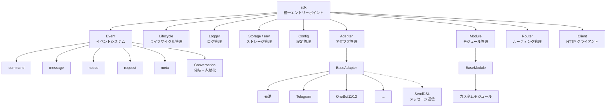

### コアモジュールの説明

| モジュール | 説明 |
|------|------|
| **Event** | イベントシステム。command / message / notice / request / meta の 5 種類のイベント処理と、Conversation 多輪対話機能を提供します。|
| **Adapter** | アダプタマネージャー。複数のプラットフォーム用アダプタの登録、起動、停止を管理します。|
| **Module** | モジュールマネージャー。プラグインの登録、ロード、アンロードを管理し、依存関係の宣言とトポロジカルソートをサポートします。|
| **Lifecycle** | ライフサイクルマネージャー。イベント駆動のライフサイクルフックを提供します。|
| **Storage** | SQLite を基にしたキー値ストレージシステム。一般的な SQL チェーン式クエリをサポートします。|
| **Config** | TOML 形式の設定ファイルを管理します。|
| **Logger** | モジュール化されたログシステム。サブロガーをサポートします。|
| **Router** | HTTP/WebSocket ルーティング管理。抽象層を介して下層バックエンド（現在は FastAPI + Uvicorn）をカプセル化し、デコレータールーティング、ミドルウェア、グループ、リクエスト制限、CORS をサポートします。|
| **Client** | 統一 HTTP/WS クライアント（2.8.0 以前は `HttpClient` で、互換性のエイリアスを保持）。抽象層を介して下層リクエストライブラリ（現在は aiohttp）をカプセル化し、リクエスト統計、リトライ、ログ、WebSocket クライアント、ErisPulse の例外体系等功能を提供します。クライアントとサーバーの WebSocket は `WebSocketConnectionBase` 基底クラスを共有します。|

## 初期化の流れ

下図は `sdk.init()` の完全な初期化プロセスを示しています：

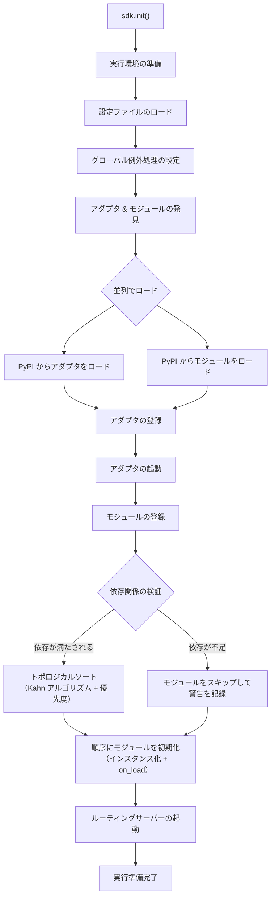

### 初期化段階の詳細

> 完全な初期化の流れを分解した（Finder / Loader / Manager / Router）、下層のエントリーポイント（`init()` / `init_task()` / `init_sync()`）と手動での完全起動については [起動プロセスと手動制御](advanced/startup.md) を参照してください。

## イベント処理の流れ

下図は、プラットフォームからハンドラまでのメッセージの完全な流れを示しています：

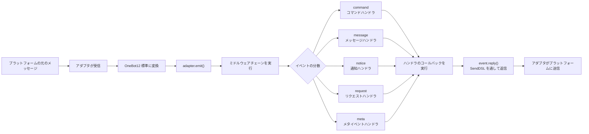

### イベント処理のチェーンの詳細

上記の図は「結果」です。下に `adapter.emit()` の後でフレームワークが**背後で何をしたか**を分解します。これは 3 層の分散チェーンです：

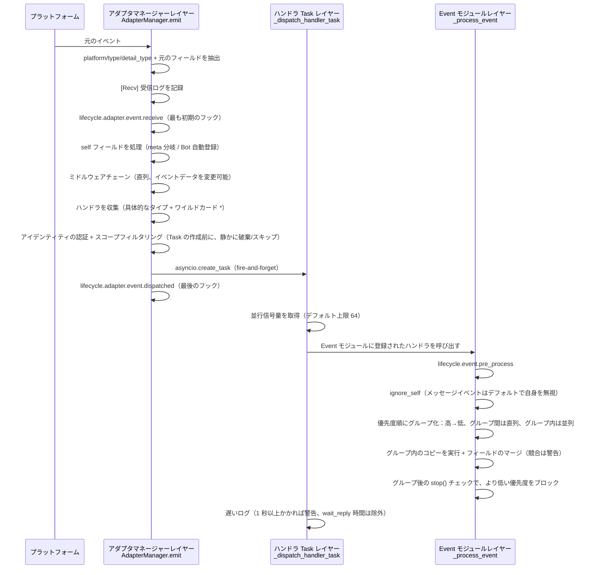

**各ステップでフレームワークが何をしたか、そして何を干预できるか：**

| ステージ | フレームワークが何をしたか | あなたが干预できる |
|------|-------------|-----------|
| 受信 | 標準フィールドを抽出し、`{platform}_raw` の元のデータを保持。`[Recv]` ログを記録 | `adapter.event.receive` を監視して初期イベントを取得 |
| self フィールド | meta イベントは connect/disconnect/heartbeat 分岐を処理。通常のイベントは Bot を自動登録し、`adapter.bot.online` をトリガー | `adapter.bot.online` / `bot.offline` を監視 |
| ミドルウェア | **直列**で実行。戻り値が None でなければイベントデータを置き換える | ミドルウェアを登録してイベントを変更/ブロック |
| 分発と収集 | 具体的なタイプのハンドラを先に取得し、次に `*` ワイルドカードハンドラを取得 | — |
| アイデンティティ次元 | 分発の入口はユーザー > 会話 > Bot > アダプタの順に判定し、イベントを受け取るかどうかを決定（`scope.is_identity_allowed`）。**拒否された場合はイベントは完全に破棄される** | `ErisPulse.scope.identity` をバインド |
| スコープフィルタリング | モジュールの所有者に応じて `scope.is_allowed` を判定（会話レベル > Bot レベル > プラットフォームレベル）。**不通過の場合は静かにスキップ** | スコープのホワイトリスト/ブラックリストを設定 |
| スケジューリング | 各マッチするハンドラは独立した `asyncio.Task` で実行される。`emit()` はハンドラの完了を待たずに即座に返却される | — |
| 優先度 | 高優先度のグループが先に実行される。**グループ間は直列、グループ内は並列**（グループ内の各ハンドラはイベントのコピーを持ち、フィールドをマージし、競合は WARNING として警告）。 | `@command(..., priority=N)` / 登録時に priority を指定 |
| ブロッキング | 各グループの処理後、`event.is_stopped()` をチェックし、マッチした場合は**より低い優先度は実行されない** | `event.mark_processed(stop=True)` / `event.done()` |

> **よくある誤解**：
> 1. **スコープフィルタリングは静かに実行される**— フィルターされたハンドラはエラーもレスポンスも出さず、TRACE ログレベルでのみ表示される（`core.scope.denied`）。"私のモジュールにメッセージが届かない"場合は、まずスコープのバインドを確認してください。
> 2. **ハンドラは天然並列**— フレームワークは各ハンドラに独立した Task を作成しており、**自分で `asyncio.create_task` をラップする必要はない**。
> 3. **同じ優先度のグループ内ではブロッキングされない**— `mark_processed(stop=True)` は、より低い優先度のグループをブロックするだけで、同じグループ内で並行実行中のハンドラは途中で中断されない。
> 4. **遅いログの閾値は固定の 1 秒**— ハンドラの処理時間が 1 秒を超えると、ログに WARNING が出る（`wait_reply` の待機時間は処理時間から除外される）が、実行は中断されない。

> スコープのモジュール次元の 3 級バインド、アイデンティティ次元の認証と出力アクション制限の詳細は [スコープ（scope）](advanced/scope.md) を参照してください。イベントスコープのテキストフィルタリングとコマンドユーザー ACL は [イベント処理の入門](getting-started/event-handling.md) を参照してください。並列上限の設定は [設定ガイド](user-guide/configuration.md#フレームワーク設定) を参照してください。

## ライフサイクルイベント

下図はフレームワーク各コンポーネントのライフサイクルイベントの発生順序を示しています：

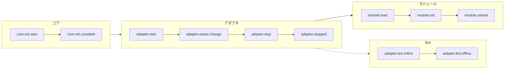

### ライフサイクルイベントの監視

> 完全なイベント監視方法（`lifecycle.on()` / `once()` / `has_handlers()`）、すべてのライフサイクルイベントリストとデータ形式は [ライフサイクル管理](advanced/lifecycle.md) を参照してください。

## モジュールのロード戦略

ErisPulse は 3 つのモジュールロード戦略をサポートし、`get_load_strategy()` が返す `ModuleLoadStrategy` によって宣言されます：

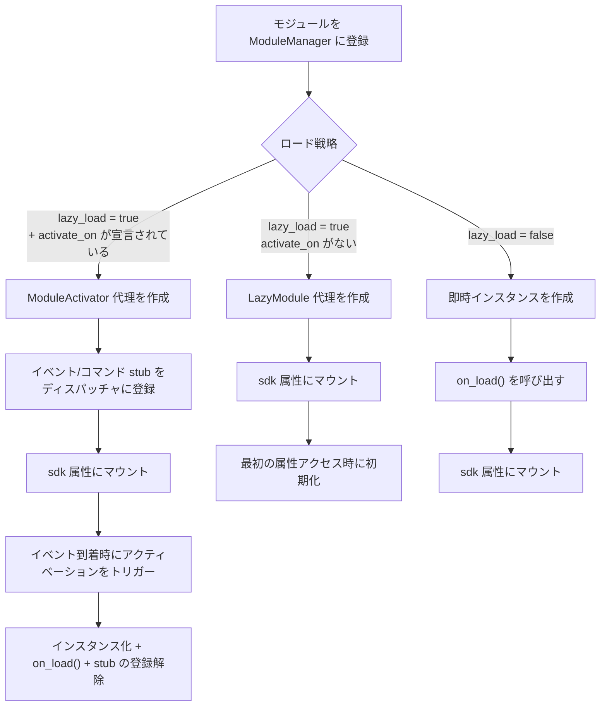

> 詳細は [遅延ロードシステム](advanced/lazy-loading.md)、[ライフサイクル管理](advanced/lifecycle.md) およびモジュールのドキュメントを参照してください。

### イベント駆動遅延アクティベーション（`activate_on`）のトリガーアーキテクチャ

> [!NOTE]
> この機能は ErisPulse **2.8.0+** が必要です。

`activate_on` を使用すると、モジュールは**最初のマッチするイベント/コマンドが到着した時点で**初めてロードされ、常駐メモリを避けることができ、同時にイベントのロスも防げます：

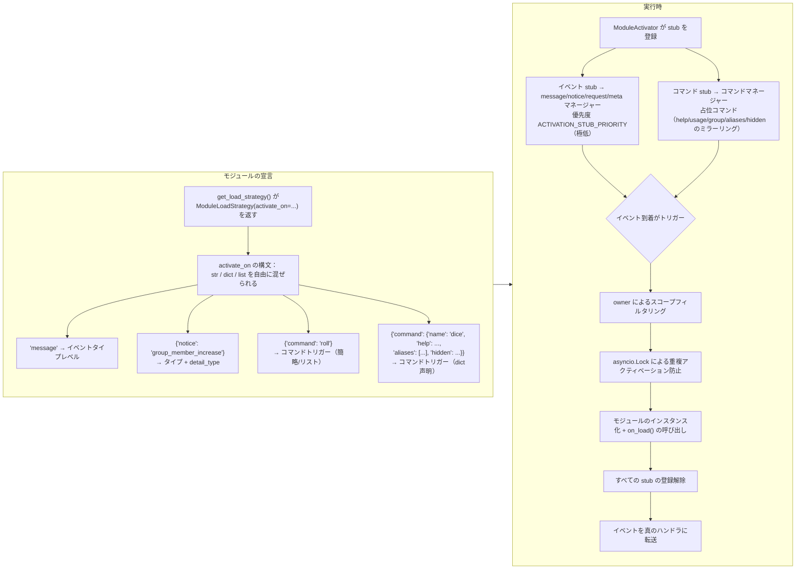

**トリガの意味の要点：**

> 完全な `activate_on` 構文（str / dict / list）、コマンド dict 声明、占位コマンド help のフォールバックチェーン、スコープフィルタリング、失敗の意味については [遅延ロードシステム](advanced/lazy-loading.md#イベント駆動遅延アクティベーションactivate_on) を参照してください。

## 本地プラグインフォルダのアーキテクチャ

> [!NOTE]
> この機能は ErisPulse **2.8.0+** が必要です。

ローカルプラグイン（`plugins/` ディレクトリ）は、パッケージ化して公開する必要がなく、フレームワークの起動時に自動的に発見され、ロードされます：

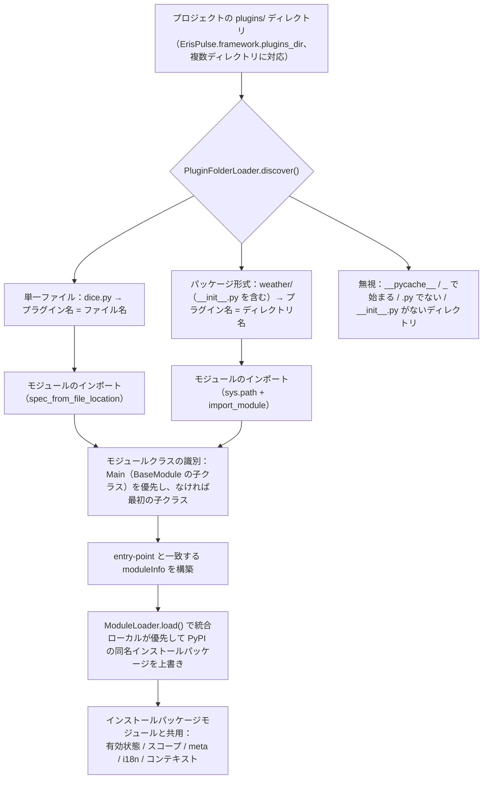

**約束と特性：**

- プラグイン名の由来：単一ファイルはファイル名、パッケージ形式はディレクトリ名
- ローカルプラグイン `moduleInfo.meta.source == "plugin_folder"` で、PyPI インストールパッケージモジュールとシームレスに共存
- 同名の場合はローカルが優先（ローカルの上書きデバッグに便利）、無効化された場合は同名の entry-point 条目も削除

## モジュールのホットリロードアーキテクチャ

ホットリロードは**すべてのモジュールソース**に対して一貫しています：ローカルプラグイン（`plugins/` ディレクトリ）、実行時登録（`sdk.module.register()`）、PyPI インストールパッケージモジュールはすべて `sdk.reload_module()` / `sdk.module.reload()` でホットリロードできます。**デフォルトは全量リロード**（トップレベルパッケ名で import キャッシュをクリアし、依存者コードを再インポート、`full=False` は軽量の逃生門）；`sdk.reload_all_modules()` / `sdk.module.reload_all()` で登録済みのすべてのモジュールを一度に全量リロードできます（pip で一括アップデート後に呼び出すことですべてが有効になります）：

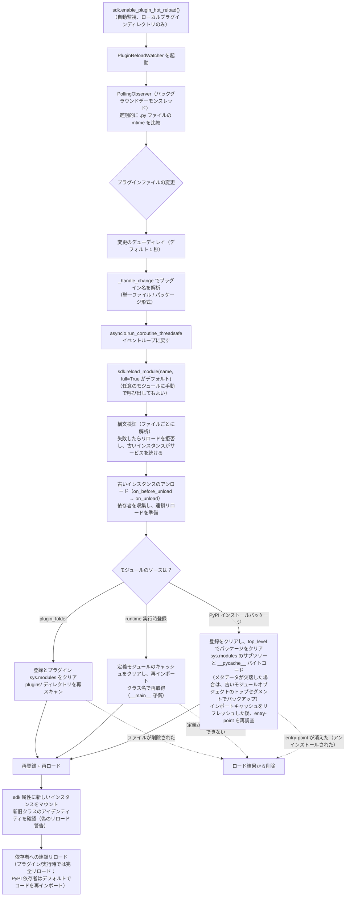

**3 つのソースの違いは発見段階のみ**、検証、アンロード、連鎖リロードは完全に同じです：

- **ローカルプラグイン**（`moduleInfo.meta.source == "plugin_folder"`）：`sys.modules` をクリアした後、`plugins/` ディレクトリを再スキャンします。ファイルが削除された場合は、ロード結果から削除されます。
- **実行時登録**（`source == "runtime"`）：定義モジュールを再インポートし、クラス名で再取得して再登録します。`__main__` に定義されている、またはソースファイルのないクラスは再インポートを拒否します（守衛アラート、エントリースクリプトの再実行を防ぎます）。
- **PyPI インストールパッケージ**：`meta.top_level` に基づいて、`sys.modules` のサブツリーをクリアし、インポートキャッシュをリフレッシュします（entry-point 60 秒キャッシュを突破）。再調査して再インポートします。entry-point が消えた（pip でアンインストールされた）場合は、ロード結果から削除されます。

**デフォルトの意味と信頼性の保証（2.11）：**

- **reload は全量リロード**：デフォルトで、トップレベルパッケージ名に基づいて `sys.modules` をクリアし、依存者コードを再インポートします。`full=False` は、メタデータに基づいてクリアし、PyPI 依存者は直接再インスタンス化するだけです（巨大な依存ツリーのパフォーマンスのための逃生門）。
- **構文検証のゲート**：アンロードのプロセスに入る前に、ファイルごとに構文解析を行い、失敗した場合はリロードを拒否します。古いインスタンスはアンロードされず、サービスを継続します。構文エラーは、モジュールを「半死」状態にすることがありません（巨大なパッケージでファイル数上限を超えた場合は、検証をスキップします）。
- **キャッシュのバックアップ**：`top_level` メタデータが欠落した場合は、「旧モジュールオブジェクト `__name__` 前方一致 → モジュールクラス `__module__` 前方一致」の 2 段階でクリア範囲を推定します。リロードの際には、ソースファイルのバイトコードキャッシュ（`__pycache__`）もクリアし、秒単位で長さが同じ小さな変更でも有効になります。
- **アイデンティティの確認**：リロードが成功した後、新旧のクラスアイデンティティが変化しているかをアサーションし、変化していない場合（C 拡張など、キャッシュがクリアできない場合）は明示的に警告し、`module.reload` イベントに `identity_changed: false` を含めます。`module.get_info()` は `running_identity` / `stale` フィールドで「登録されたバージョン ≠ 実行中のバージョン」を公開します。
- **失敗の確認**：load 失敗の現場（例外 + traceback）は、`module.last_error(名前)` / `get_info()["last_error"]` から直接確認できます。失敗したパスは、そのモジュールの import キャッシュをクリアします。「コードを変更してから再 reload する」ことで、必ず新しいコードを読み込むことができます。
- 重載は、もともと遅延ロードのモジュールを強制的にアクティブにします（明示的なログ）。`reload_all_modules()` は、遅延ロードの戦略を維持し、重載前に既にロード済みのモジュールを再アクティブにし、スリープ（休眠）中のモジュールはスリープのままにします。
- `reload_all_modules()` は依存関係のトポロジカル順序で再ロードし、単一モジュールの失敗は診断を記録してスキップします（全体のロールバックはしない—on_unload の副作用は取り消せないため、単一モジュールのホットリロードのベストエフォートの意味と一致）。重載失敗でロールバックされた状況も同様で、ログには明確に旧インスタンスが終了済みであることが示されます。

## アダプタのホットリロードアーキテクチャ

アダプタのコードレベルのホットリロード（2.11）は、モジュールのパイプラインと同構造です：`sdk.adapter.reload(プラットフォーム名)` / `sdk.reload_adapter(プラットフォーム名)` は、**ローカルプラグイン**と **PyPI インストールパッケージ**の 2 つのソースに対して実行されます：

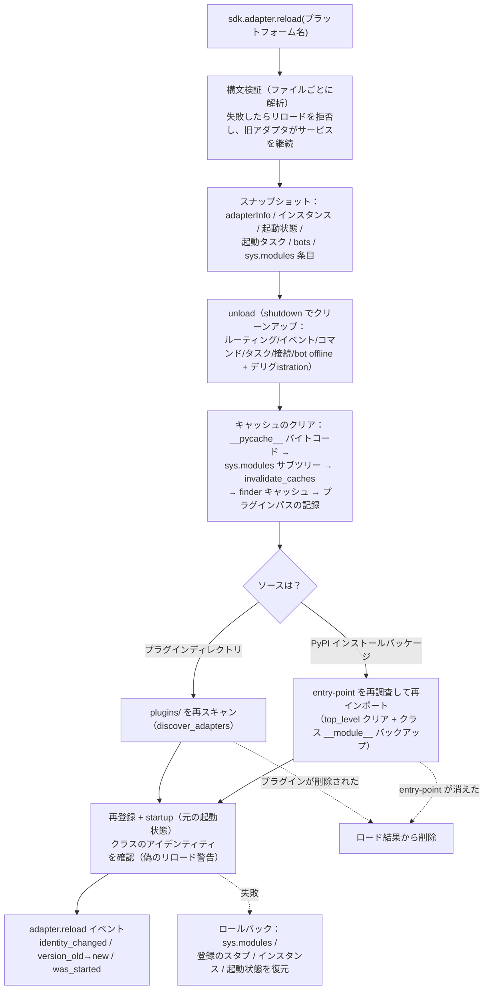

**モジュールのパイプラインとの違い：**

- アダプタには遅延ロードや依存の連鎖リロードがない：リロードは**依存する他のアダプタには連鎖しない**（警告のみ—依存先は登録表を間接的に消費しており、インスタンスの連鎖的な意味はない）。
- 起動は非同期のチェーン（`startup` は `_run_adapter` で発行され、依存のスキップと指数的バックオフリトライを含む）：起動の一時的な失敗は**リロードの失敗とは見なされない**（コードはすでに新しいものに変わっているため）、結果は `adapter.status.change` で通知される。
- `register()` のインスタンスの再利用の落とし穴（同じオブジェクトは旧インスタンスが再利用される）は、「pyc クリア + sys.modules クリア + アイデンティティの確認」の 3 つの手段でバックアップされる。
- ライフサイクルイベント：`adapter.reload`（payload に `adapter_name` / `success` / `full` / `duration_ms` / `identity_changed` / `version_old→new` / `was_started` / `source` を含む）

## 次に進むべきこと

- **起動/終了を手動で制御したい**：[起動プロセスと手動制御](advanced/startup.md) を参照してください。初期化の各段階を分解し、個別にアダプタやルーティングを起動・停止できます。
- **遅延ロードとスリープを理解したい**：[遅延ロードシステム](advanced/lazy-loading.md) を参照してください。`activate_on` イベント駆動遅延アクティベーションの完全な構文が含まれています。
- **モジュールを書くときにライフサイクルを上手く使う**：[ライフサイクル管理](advanced/lifecycle.md) を参照してください。すべてのライフサイクルイベントと監視方法が含まれています。


====
快速上手
====


### 快速开始

# 速習

> **これが最初の一歩です。** 5 分でゼロから ErisPulse ロボットを起動しましょう。まずは効果を見て、その後各ステップを詳しく説明します。

## 60 秒効果：まずロボットが 1 文だけ返信するようにする

**1. インストール**（Python >= 3.10）：

```bash
pip install ErisPulse
```

**2. プロジェクトの初期化**。ウィザードがプロジェクト名の設定、プラットフォームアダプターの選択、および設定の完了を促し、`main.py` と `config/config.toml` を生成します：

```bash
epsdk init
```

**3. `main.py` を開き、以下の 9 行のコードに置き換えます**：

```python
from ErisPulse import sdk
from ErisPulse.Core.Event import command

@command("ping", help="ロボットがオンラインかどうかをテストする")
async def ping_handler(event):
    await event.reply("Pong！ロボットは正常に動作しています。")

if __name__ == "__main__":
    import asyncio
    asyncio.run(sdk.run(keep_running=True))
```

**4. 実行**：

```bash
epsdk run main.py
```

ターミナルには、フレームワークの起動ログとアダプターの接続情報が出力されます。この時点で、接続したプラットフォームでロボットに `/ping` を送信すると、以下のように返信されます：

> Pong！ロボットは正常に動作しています。

この返信が見られれば、フレームワーク、アダプター、イベント処理の連携が確立されたことを意味します。連携がうまくいかない場合は、文末の[問題が発生した場合](#問題が発生した場合)を参照してください。うまくいく場合は、各ステップの選択肢についても以下に説明します。

## ErisPulse のインストール：3 つの方法

上記では最も直接的な pip を使用しています。環境に応じて選択してください。

### pip を使用したインストール

Python のバージョンが 3.10 以上であることを確認し、pip を使用してインストールします：

```bash
pip install ErisPulse
```

既に [uv](https://github.com/astral-sh/uv) をインストールしている場合は、`uv pip install ErisPulse` を使用して、より高速にインストールできます。

プロジェクト環境を汚染せずに `epsdk` コマンドラインツールをグローバルにインストールしたい場合は、`uv tool install` を推奨します：

```bash
uv tool install ErisPulse
```

インストール後、`epsdk` はグローバルに利用可能になります。プロジェクトディレクトリ内で実行すると、プロジェクトの `.venv` を自動的に感知し、`epsdk install` でプロジェクト環境にインストールし、`epsdk run` でプロジェクト環境で実行されます。フレームワーク本体はツール環境から提供されます。詳しくは[インストールの参考](user-guide/installation.md)を参照してください。

### 1 つでインストールするスクリプト（新規環境に推奨）

インストールスクリプトは、環境（Docker、Python、uv）を自動検出し、最適なインストール方法を選択するよう誘導します。多言語（中国語/English/日本語/Русский/繁体中国語）に対応しています。

Windows (PowerShell):
```powershell
irm https://get.erisdev.com/install.ps1 -OutFile install.ps1; powershell -ExecutionPolicy Bypass -File install.ps1
```

macOS / Linux:
```bash
curl -fsSL https://get.erisdev.com/install.sh -o install.sh && chmod +x install.sh && ./install.sh
```

スクリプトは以下を完了するよう誘導します：

- **Docker インストール**（Docker が検出された場合に推奨）：イメージソース（Docker Hub / GHCR）、バージョンチャネル（安定版 / プレビュー版）、Dashboard 管理パネルの設定、ポートの設定を選択
- **グローバル CLI インストール（uv tool、推奨）**：`epsdk` をグローバルコマンドとしてインストールし、仮想環境を必要とせず、uv が Python を自動管理します（システムのバージョンが低くても可能です）；プロジェクトディレクトリ内で実行すると、プロジェクトの `.venv` を自動的に感知します
- **従来のインストール**：自動的に仮想環境を作成し、ErisPulse のバージョンを選択し、オプションで Dashboard 管理パネルモジュールをインストールできます

### Docker を使用する

Docker イメージには、ErisPulse フレームワークと Dashboard 管理パネルが事前インストールされており、`linux/amd64` および `linux/arm64` アーキテクチャをサポートしています。

```bash
# docker-compose.yml をダウンロード
curl -O https://raw.githubusercontent.com/ErisPulse/ErisPulse/main/docker-compose.yml

# Dashboard トークンを設定して起動
ERISPULSE_DASHBOARD_TOKEN=your-token docker compose up -d
```

<details>
<summary>Docker Hub が利用できない場合？</summary>

GitHub Container Registry のイメージを使用する場合は、`docker-compose.yml` の image を次のように変更します：

```yaml
image: ghcr.io/erispulse/erispulse:latest
```

</details>

起動後、`http://<host>:8000/Dashboard` にアクセスし、設定したトークンでログインします。

## プロジェクトの初期化

### インタラクティブな初期化（推奨）

```bash
epsdk init
```

これにより、インタラクティブなガイドが起動し、以下の手順をガイドします：
- プロジェクト名の設定
- ログレベルの設定
- サーバー設定（ホストとポート）
- アダプターの選択と設定
- プロジェクト構造の作成

### ファスト初期化

```bash
# プロジェクト名を指定する高速モード
epsdk init -q -n my_bot

# または、プロジェクト名のみを指定
epsdk init -n my_bot
```

### 手動でのプロジェクト作成

手動でプロジェクトを作成したい場合は：

```bash
mkdir my_bot && cd my_bot
epsdk init
```

## モジュールのインストール

### CLI によるインストール

```bash
epsdk install Yunhu AIChat
```

### 利用可能なモジュールの確認

```bash
epsdk list-remote
```

### インタラクティブなインストール

パッケージ名を指定しない場合、インタラクティブなインストール画面に移行します。

```bash
epsdk install
```

## プロジェクトの実行

```bash
# 通常実行
epsdk run main.py

# ホットリロードモード（開発時に推奨）
epsdk run main.py --reload
```

## IDE補完の有効化（オプション）

ErisPulse はモジュール/アダプターを動的に発見するため、IDE はデフォルトではプラットフォーム固有のメソッドを補完できません。  
以下のコマンドを実行して型のスタブを生成してください：

```bash
epsdk types
```

生成後、インポートした型を変数の型ヒントとして使用することで、正確な補完が得られます（詳細は [IDE補完ガイド](./getting-started/ide-completion.md) を参照してください）：

```python
from _ep_types import Yunhu
from ErisPulse import sdk

adapter: Yunhu = sdk.adapter.get("yunhu")
await adapter.Send.To("group", "123").Board(...)  # プラットフォーム固有のメソッドの補完
```

## プロジェクト構造

初期化後のプロジェクト構造：

```
my_bot/
├── config/
│   └── config.toml          # 設定ファイル
└── main.py                  # エントリーファイル

```

## 設定ファイル

基本的な `config.toml` 設定：

```toml
[ErisPulse.server]
host = "0.0.0.0"
port = 8000

[ErisPulse.logger]
level = "INFO"

[Yunhu_Adapter]
# アダプターの設定
```

## 次のステップ

ロボットが起動したら、目的に応じて選択してください：

### グループ用ロボットを作りたい（メッセージ処理、グループ管理、通知）

- [イベント処理の入門](getting-started/event-handling.md) — メッセージ、通知、リクエストイベントの書き方
- [一般的なタスクの例](getting-started/common-tasks.md) — ストレージ、定期タスク、権限制御

### 自分のモジュール / アダプターを書きたい

- [基本概念](getting-started/basic-concepts.md) — アダプター / モジュール / イベントの設計を理解する
- [モジュール開発の入門](developer-guide/modules/getting-started.md)
- [アダプター開発の入門](developer-guide/adapters/getting-started.md)
- [アーキテクチャ概要](architecture.md) — 可視化されたアーキテクチャ図

### ロボットを長期的に動かしたい

- [デプロイガイド](user-guide/deployment.md)
- [設定ファイルの説明](user-guide/configuration.md)

### 問題に遭遇した場合

- [最初のロボットを作成する](getting-started/first-bot.md) — 最初のロボットの詳細な手順
- [起動プロセスと手動制御](advanced/startup.md) — モジュール / アダプターのロード失敗の診断
- [CLIコマンドリファレンス](user-guide/cli-reference.md) — `epsdk` のすべてのサブコマンド


### 创建第一个机器人

# 最初のロボットを作成する

> [!TIP]
> **この記事を読むタイミング**：ロボットが動作している状態で、最初の `/hello` コマンドハンドラを実装し、`sdk.run` とコマンドデコレータがそれぞれ何をしているのかを理解したい場合。まだ ErisPulse をインストールしておらず、プロジェクトを初期化していない場合は、まず [5 分間クイックスタート](../quick-start.md) の「インストール」「プロジェクトの初期化」「プロジェクトの実行」の 3 ステップを完了してください。必要ない場合はスキップしてください。

クイックスタートを実行したのは第一歩です。この記事では、最初のコマンドハンドラを実装し、フレームワーク内で各行のコードが何を行っているのかを解説します。

## 最初のステップ：最初のコマンドを記述する

`main.py` を開き、シンプルなコマンドハンドラを記述します。

```python
from ErisPulse import sdk
from ErisPulse.Core.Event import command

@command("hello", help="挨拶メッセージを送信します")
async def hello_handler(event):
    """hello コマンドを処理します"""
    user_name = event.get_user_nickname() or "友達"
    await event.reply(f"こんにちは、{user_name}！私は ErisPulse ロボットです。")

@command("ping", help="ロボットがオンラインかどうかをテストします")
async def ping_handler(event):
    """ping コマンドを処理します"""
    await event.reply("Pong！ロボットは正常に動作しています。")

async def main():
    """メインエントリーポイント関数"""
    print("ErisPulse を起動しています...")
    
    # keep_running=True（デフォルト）：フレームワークはブロックして実行を維持し、終了信号（例：Ctrl+C）が受信されるまで待ちます
    await sdk.run(keep_running=True)

if __name__ == "__main__":
    import asyncio
    asyncio.run(main())
```

### `keep_running` パラメータ

`sdk.run(keep_running)` は、フレームワークがブロックして実行を維持するかどうかを制御します。

- **`keep_running=True`（デフォルト）**：`run()` はブロックし続け、終了信号（例：Ctrl+C）が受信されるまで待ちます。これは純粋な bot アプリケーションに適しています。
- **`keep_running=False`**：`run()` は初期化後に即座に返ります。**フレームワークはアンロードされません**——起動されたアダプタ/モジュールはバックグラウンドタスクとしてメッセージイベントの処理を続けます。その後、独自のロジックを実行し、イベントループが終了するまでフレームワークは閉じられません。例：

```python
async def main():
    await sdk.run(keep_running=False)   # 初期化後に即座に返ります
    # フレームワークはバックグラウンドで実行中です。ここでは他の処理を続行できます
    while True:
        await asyncio.sleep(3600)
        print("1時間ごとにチェックします")
```

> `run()` の2つのモードに加えて、`init()`/`uninit()` を使用したライフサイクルの手動制御、個別のアダプタ/ルーティングの起動/停止など、より細かい制御方法もあります。詳細は [起動プロセスと手動制御](../advanced/startup.md) を参照してください。

## 第二ステップ：ロボットの実行

```bash
# 通常実行
epsdk run main.py

# 開発モード（ホットリロードをサポート）
epsdk run main.py --reload
```

## 第三段階：ロボットのテスト

チャットプラットフォームで次のコマンドを送信します：

```
/hello
```

これで、ロボットからの返信が届くはずです。

## コード説明

### コマンドデコレータ

```python
@command("hello", help="挨拶メッセージを送信")
```

- `hello`：コマンド名。ユーザーは `/hello` で呼び出します。
- `help`：コマンドのヘルプ説明。`/help` コマンドで表示されます。

### イベントパラメータ

```python
async def hello_handler(event):
```

`event` パラメータは Event オブジェクトであり、以下を含みます：
- メッセージ内容：`event.get_text()`
- 送信者情報：`event.get_user_id()`、`event.get_user_nickname()`
- プラットフォーム情報：`event.get_platform()`
- グループ情報：`event.get_group_id()`
- 元のデータ：`event.get_raw()`

> 完全な Event オブジェクトのメソッドについては、[Event 包装クラスの詳細](../developer-guide/modules/event-wrapper.md) を参照してください。

### レスポンスの送信

```python
await event.reply("レスポンスの内容")
```

`event.reply()` は、送信者にメッセージを送信するための便利なメソッドです。

## 拡張機能：追加の機能を追加

ErisPulse は、豊富なイベント処理とデータ処理機能を提供します：

- **メッセージの監視**：`@message.on_message()` を使用して、さまざまなメッセージを監視します → [イベント処理の入門](event-handling.md)
- **通知の監視**：`@notice.on_friend_add()` などの通知を監視します → [イベント処理の入門](event-handling.md)
- **データの保存**：`sdk.storage.get/set` を使用してデータを永続化します → [一般的なタスクの例](common-tasks.md)

## よくある質問

### コマンドが反応しない？

1. アダプタが正しく設定されているか確認し、`config/config.toml` 内のアダプタの `status` が `true` であることを確認します。
2. ターミナルのログ出力を確認し、エラー情報（特に `ERROR` レベルのログ）がないか確認します。
3. コマンドのプレフィックスが正しいか確認します（デフォルトは `/` です）。設定ファイルの `[ErisPulse.event.command]` 部分で確認できます。
4. コマンド名のスペルが正しいか、大文字小文字の区別が正しく設定されているか確認します。

### コマンドのプレフィックスを変更するには？

`config.toml` に以下を追加します：

```toml
[ErisPulse.event.command]
prefix = "!"
case_sensitive = false
```

### 複数のプラットフォームをサポートするには？

ErisPulse は OneBot12 標準を用いて、異なるプラットフォームのイベント形式を統一しています。`@command` および `@message` で登録されたハンドラは、すべてのプラットフォームからのイベントを自動的に受け取ります。イベントの元プラットフォームを区別するには、`event.get_platform()` を使用します：

```python
@command("hello")
async def hello_handler(event):
    platform = event.get_platform()
    
    if platform == "yunhu":
        await event.reply("你好！来自云湖")
    elif platform == "telegram":
        await event.reply("Hello! From Telegram")
    else:
        await event.reply("你好！")
```

> 詳細な多プラットフォーム対応のテクニックについては、[よくあるタスクの例](common-tasks.md#多プラットフォーム適応) を参照してください。

## 次のステップ

- **学習の流れに従って進む**：[基本概念](basic-concepts.md)を読んで、コマンドプロセッサの背後でフレームワークが何をしているかを理解する
- **より多くのメッセージタイプに対応したい**：[イベント処理の入門](event-handling.md)、メッセージ / 通知 / 要求 / メタイベントのハンドラの書き方
- **実用的な機能を追加したい**：[一般的なタスクの例](common-tasks.md)、永続化、定時タスク、権限制御の既製コード


### 基础概念

# 基本概念

> [!NOTE]
> **L1 コア必読**——ドキュメントトップページの「L1 コア5編」のうちの第2編（モジュール開発入門 → **基本概念** → Event ラッパークラス → 設定ファイルの説明 → 例外キャッチ）。

ユーザーがメッセージを送ってからボットが返信するまでの間に、どのようなコンポーネントを経由するのでしょうか？アダプターとモジュールはそれぞれ何を担当しているのでしょうか？この記事を読み終えれば、ハンドラーを書く際に直面する設計上の問題を自力で答えられるようになり、例をただ写すだけではなくなります。

## イベント駆動アーキテクチャ

ErisPulse はイベント駆動アーキテクチャを採用しており、すべての対話はイベントを通じて伝達・処理されます。

### イベントフロー

```
ユーザーがメッセージを送信
      │
      ▼
プラットフォームが受信
      │
      ▼
アダプターがプラットフォームのネイティブイベントを受信
      │
      ▼
OneBot12 標準イベントに変換
      │
      ▼
イベントシステムへ送出
      │
      ▼
登録済みのハンドラーに配信
      │
      ▼
モジュールがイベントを処理
      │
      ▼
アダプターを通じてレスポンスを送信
      │
      ▼
プラットフォームがユーザーに表示
```

### OneBot12 標準

ErisPulse は OneBot12 をコアイベント標準として使用しています。OneBot12 は汎用のチャットボットアプリケーションインターフェース標準であり、統一されたイベント形式を定義しています。

すべてのアダプターはプラットフォーム固有のイベントを OneBot12 形式に変換し、コードの一貫性を保証します。

## コアコンポーネント

### 1. SDK オブジェクト

SDK はすべての機能の統一されたエントリーポイントであり、コアコンポーネントへのアクセスを提供します。

```python
from ErisPulse import sdk

# コアモジュールへのアクセス
sdk.storage    # ストレージシステム
sdk.config     # 設定システム
sdk.logger     # ログシステム
sdk.adapter    # アダプターシステム
sdk.module     # モジュールシステム
sdk.router     # ルーティングシステム
sdk.client     # HTTPクライアント
sdk.lifecycle  # ライフサイクルシステム
```

> [!WARNING]
> **ルートから一括インポート**：`from ErisPulse.Core import adapter` / `import ErisPulse.Core.adapter`
> これらの書き方は**マネージャーインスタンス**（`AdapterManager` シングルトン）にバインドされます。`ErisPulse.Core`
> パッケージの再エクスポートは同名のサブモジュールを覆い隠します。テスト、パッチ、またはモジュールオブジェクト自体が必要な場合は、
> 一律 `from ErisPulse import sdk` ルートインポート（`sdk.adapter` はマネージャーインスタンス）を使用してください。

### 2. Event オブジェクト

Event オブジェクトはイベントデータをラップし、便利なアクセスメソッドを提供します。

```python
@command("info")
async def info_handler(event):
    # イベント情報を取得
    event_id = event.get_id()
    user_id = event.get_user_id()
    platform = event.get_platform()
    text = event.get_text()
    
    # レスポンスを送信
    await event.reply(f"ユーザー: {user_id}, プラットフォーム: {platform}")
```

### 3. アダプター

アダプターは ErisPulse と外部プラットフォームの間のブリッジです。

**役割：**
- プラットフォームのネイティブイベントを受け取る
- OneBot12 標準形式に変換する
- 標準形式のイベントをプラットフォームに送信する

**例のアダプター：**
- Yunhu アダプター：雲湖プラットフォームとの通信
- Telegram アダプター：Telegram Bot API との通信
- OneBot11 アダプター：OneBot11 兼容アプリとの通信
- Email アダプター：メールの送受信処理

### 4. モジュール

モジュールは機能拡張の基本単位であり、以下を実現できます：
- イベントハンドラの登録
- ビジネスロジックの実装
- アダプターを呼び出してメッセージを送信
- コアモジュールが提供するサービスの利用

#### モジュール発見メカニズム

ErisPulse は Python の `importlib.metadata.entry_points` を使用して、インストール済みのモジュールを発見します。モジュールは `pyproject.toml` でエントリーポイントを宣言します：

```toml
[project.entry-points."erispulse.module"]
MyModule = "my_package:Main"
```

SDK の初期化時に、`erispulse.module` グループのすべてのエントリーポイントをスキャンし、モジュールクラスを `ModuleManager` に登録し、依存関係に基づいてトポロジカルソートした後、順次初期化します。

#### 最小限のモジュール

```python
from ErisPulse.Core.Bases import BaseModule
from ErisPulse import sdk

class Main(BaseModule):
    def __init__(self):
        self.sdk = sdk
        self.logger = sdk.logger.get_child("MyModule")

    async def on_load(self, event):
        self.logger.info("モジュールがロードされました")

    async def on_unload(self, event):
        self.logger.info("モジュールがアンロードされました")
```

#### モジュールのライフサイクル

- **登録**：SDK がモジュールクラスを発見し、マネージャーに登録
- **ロード**：モジュールインスタンスを作成し、`on_load(event)` を呼び出す（`event = {"module_name": "MyModule"}`）
- **アンロード**：`on_unload(event)` を呼び出し、リソースをクリーンアップ

#### ロード戦略

`get_load_strategy()` を使用して、モジュールのロード動作を宣言します：

```python
from ErisPulse.loaders import ModuleLoadStrategy

class Main(BaseModule):
    @staticmethod
    def get_load_strategy():
        return ModuleLoadStrategy(
            lazy_load=True,   # ラグジュアリーなロードかどうか（デフォルトは True）
            priority=0        # ロード優先度、数値が大きいほど初期化が早くなる
        )
```

- **`lazy_load=True`（デフォルト）**：`sdk.MyModule` に初めてアクセスしたときにモジュールを初期化し、起動時間を短縮
- **`lazy_load=False`**：SDK の起動時に即座に初期化し、ライフサイクルイベントを監視するか、定時タスクを実行するモジュールに適しています
- **`priority`**：同じ優先度のモジュールは登録順にロードされ、数値が大きいほど初期化が早くなります

> 詳細なラグジュアリーなロードの仕組みについては、[ラグジュアリーなロードシステム](../advanced/lazy-loading.md)を参照してください。

## イベントタイプ

ErisPulse は 5 種類のイベントをサポートしています：

| イベントタイプ | デコレーター | 説明 |
|---------|--------|------|
| メッセージイベント | `@message.on_message()` | ユーザーが送信したすべてのメッセージ（個人チャット、グループチャット） |
| コマンドイベント | `@command("name")` | コマンドプレフィックスで始まるメッセージ（例：`/hello`） |
| 通知イベント | `@notice.on_friend_add()` など | システム通知（フレンド追加、グループメンバーの変更など） |
| リクエストイベント | `@request.on_friend_request()` など | ユーザーリクエスト（フレンドリクエスト、グループ招待） |
| メタイベント | `@meta.on_connect()` など | システムレベルのイベント（接続、切断、ハートビート） |

> 各イベントタイプの詳細な使い方とコード例については、[イベント処理入門](event-handling.md) を参照してください。

## コアモジュールの説明

### Storage（ストレージ）

SQLite ベースのキーバリューストレージシステムで、データの永続化に使用します。

```python
# 値の設定
sdk.storage.set("key", "value")

# 値の取得
value = sdk.storage.get("key", "default_value")

# 一括操作
sdk.storage.set_multi({
    "key1": "value1",
    "key2": "value2"
})

# トランザクション
with sdk.storage.transaction():
    sdk.storage.set("key1", "value1")
    sdk.storage.set("key2", "value2")
```

### Config（設定）

TOML 形式の設定ファイル管理。

```python
# 設定の取得
config = sdk.config.getConfig("MyModule", {})

# 設定の保存
sdk.config.setConfig("MyModule", {"key": "value"})

# ネストされた設定の読み取り
value = sdk.config.getConfig("MyModule.subkey", "default")
```

### Logger（ログ）

モジュール化されたログシステム。

```python
# ログの記録
sdk.logger.info("これは情報メッセージです")
sdk.logger.warning("これは警告メッセージです")
sdk.logger.error("これはエラーメッセージです")

# 子ロガーの取得
child_logger = sdk.logger.get_child("submodule")
child_logger.info("サブモジュールのログ")
```

**属性アクセスのシンタックスシュガー**

`get_child()` メソッドを使用する以外に、**属性アクセス**の方法で子ロガーを作成することもできます。これはより簡潔な**シンタックスシュガー**の書き方です：

```python
# 属性アクセスで子ロガーを作成
sdk.logger.mymodule.info("モジュールメッセージ")

# ネストされたアクセスもサポート
sdk.logger.mymodule.database.info("データベースメッセージ")
```

### Router（ルーティング）

FastAPI + Uvicorn ベースの HTTP および WebSocket ルーティング管理。デコレータールーティング、ミドルウェア、グループ化、レート制限、CORS をサポートします。

```python
from ErisPulse.Core import HttpRequest

@sdk.router.get("MyModule", "/api")
async def handler(request: HttpRequest):
    data = await request.json()
    return {"status": "ok"}
```

> ルーティング API の完全な情報（WebSocket、ミドルウェア、レート制限、CORS など）については、[ルートマネージャー](../advanced/router.md) を参照してください。

### Client（ネットワーククライアント）

統合されたネットワーククライアントで、HTTP リクエスト、WebSocket 接続、コネクションプール管理、自動リトライ、タイムアウト制御、リクエスト統計、ライフサイクルイベント統合を集約しています。

```python
from ErisPulse.Core import client

# HTTP リクエスト
resp = await client.get("https://api.example.com/users")
data = await resp.json()

# リトライとタイムアウト付き
resp = await client.get(url, timeout=30, max_retries=3)

# WebSocket 接続
ws = await client.ws_connect("wss://example.com/ws")
async for text in ws.iter_text():
    await ws.send_text(f"Echo: {text}")
```

> ネットワーククライアント API の完全な情報については、[ネットワーククライアント](../advanced/http-client.md) を参照してください。

## SendDSL メッセージ送信

アダプターはチェーン呼び出しのメッセージ送信インターフェースを提供します。

### 基本的な送信

```python
# アダプターインスタンスの取得
yunhu = sdk.adapter.get("yunhu")

# メッセージの送信
await yunhu.Send.To("user", "U1001").Text("Hello")

# 送信アカウントの指定
await yunhu.Send.Using("bot1").To("group", "G1001").Text("グループメッセージ")
```

### チェーン修飾

```python
# @ユーザー
await yunhu.Send.To("group", "G1001").At("U2001").Text("@メッセージ")

# メッセージへの返信
await yunhu.Send.To("group", "G1001").Reply("msg123").Text("返信")

# @全員
await yunhu.Send.To("group", "G1001").AtAll().Text("お知らせ")
```

### Event 返信メソッド

Event オブジェクトは便利な返信メソッドを提供しています：

```python
@command("test")
async def test_handler(event):
    # シンプルなテキスト返信
    await event.reply("返信内容")
    
    # 画像の送信
    await event.reply("http://example.com/image.jpg", method="Image")
    
    # 音声の送信
    await event.reply("http://example.com/voice.mp3", method="Voice")
```

## 遅延読み込みシステム

ErisPulse はデフォルトでモジュールの遅延読み込みを有効にしており、モジュールは初めてアクセスされた時（例：`sdk.MyModule`）にのみ初期化されるため、起動速度が大幅に向上します。

```python
from ErisPulse.loaders import ModuleLoadStrategy

class Main(BaseModule):
    @staticmethod
    def get_load_strategy():
        return ModuleLoadStrategy(
            lazy_load=True,   # 遅延読み込みを有効化（デフォルト）
            priority=0        # ロード優先度、数値が大きいほど先に初期化されます
        )
```

**遅延読み込みを無効にする必要があるシナリオ（`lazy_load=False`）：**
- ライフサイクルイベントをリッスンするモジュール（例：`core.init.complete`）
- 定期タスクやバックグラウンドサービスを起動するモジュール
- 他のモジュールがロードされる前に初期化を完了する必要があるモジュール

> 遅延読み込みメカニズムの詳細と注意事項については、[遅延読み込みシステム](../advanced/lazy-loading.md) を参照してください。

## 次のステップ

- **L1 パスに沿って続行**：次は [Event ラッパークラス](../developer-guide/modules/event-wrapper.md) で、イベントオブジェクトのすべての読み書きメソッドを習得します
- **書きながら学びたい**：[イベント処理入門](event-handling.md) ではイベントタイプ別にコピーしてすぐ使えるハンドラーの書き方を紹介しています。[よくあるタスクの例](common-tasks.md) では永続化、定期タスク、権限制御などのよく使う機能を網羅しています


### 事件处理入门

# イベント処理入門

> [!TIP]
> **このドキュメントを読むべきタイミング**：ボットにメッセージ、コマンド、通知、リクエストへ応答させたい場合や、返信の待機 / マルチターン会話の実装、「コマンドがトリガーされないのはなぜか」のトラブルシューティングが必要なときに読んでください。フレームワークの設計だけを知りたい場合は、[基本概念](basic-concepts.md) を参照すれば十分です。必要なければスキップしてください。

イベントハンドラーとは、ボットがユーザーの意図を「理解」して反応する場です。このドキュメントでは、5種類のイベントごとにそのままコピーして使える実装例を示し、パラメータ解析、権限、スロットリング、マルチターン対話といった実践的なシナリオも網羅します。

## イベントタイプの概要

ErisPulse は以下のイベントタイプをサポートしています：

| イベントタイプ | 説明 | 適用場面 |
|---------|------|---------|
| メッセージイベント | ユーザーが送信したすべてのメッセージ | チャットボット、コンテンツフィルタ |
| コマンドイベント | コマンド接頭辞で始まるメッセージ | コマンド処理、機能入口 |
| 通知イベント | システム通知（友達追加、グループメンバー変更など） | メッセージ歓迎、ステータス通知 |
| 要求イベント | ユーザーの要求（友達リクエスト、グループ招待） | 要求の自動処理 |
| 元イベント | システムレベルのイベント（接続、ハートビート） | 接続監視、ステータスチェック |

## メッセージイベントの処理

> **ヒント**: IDEの自動補完と型チェックのサポートを得るために、イベントハンドラで `Event` タイプ注釈を使用することを推奨します。

```python
from ErisPulse.Core.Event import Event  # 注釈に使用するイベントタイプをインポート
```

### すべてのメッセージを監視

```python
from ErisPulse.Core.Event import message, Event

@message.on_message()
async def message_handler(event: Event):
    text = event.get_text()
    user_id = event.get_user_id()
    sdk.logger.info(f"{user_id} からのメッセージ: {text}")
```

### プライベートメッセージを監視

```python
@message.on_private_message()
async def private_handler(event: Event):
    user_id = event.get_user_id()
    await event.reply(f"こんにちは，{user_id}！これはプライベートメッセージです。")
```

### グループメッセージを監視

```python
@message.on_group_message()
async def group_handler(event: Event):
    group_id = event.get_group_id()
    user_id = event.get_user_id()
    sdk.logger.info(f"グループ {group_id} で {user_id} がメッセージを送信しました")
```

### @メッセージを監視

```python
@message.on_at_message()
async def at_handler(event: Event):
    # @されたユーザーのリストを取得
    mentions = event.get_mentions()
    await event.reply(f"あなたは以下のユーザーを@しました: {mentions}")
```

### ワイルドカードと正規表現の監視

4つのメッセージデコレータ（`on_message` / `on_private_message` / `on_group_message` /
`on_at_message`）は `pattern`（glob ワイルドカード）と `regex`（正規表現）をサポートし、一致しないメッセージは**ハンドラをトリガーしません**：

```python
# glob ワイルドカード：* 任意の文字列、? 単一文字、[seq] 文字集合
@message.on_message(pattern="签到*")
async def signin_handler(event: Event):
    await event.reply("签到成功")

# 正規表現：金額をマッチ
@message.on_message(regex=r"\d+\s*元")
async def price_handler(event: Event):
    await event.reply(f"受信金額：{event.get_text()}")

# pattern と regex が両方指定された場合 → 両方一致する必要がある
@message.on_message(pattern="*元", regex=r"\d+\s*元")
async def combined_handler(event: Event):
    pass
```

`wait_reply` もこの2つのパラメータをサポートします（[返信待ち機能](../developer-guide/modules/event-wrapper.md#返信待ち機能)を参照）。

## コマンドイベント処理

### 基本コマンド

```python
from ErisPulse.Core.Event import command

@command("help", help="ヘルプ情報を表示")
async def help_handler(event):
    help_text = """
利用可能なコマンド：
/help - ヘルプを表示
/ping - 接続をテスト
/info - 情報を表示
    """
    await event.reply(help_text)
```

### コマンドエイリアス

```python
@command(["help", "h"], aliases=["帮助"], help="ヘルプ情報を表示")
async def help_handler(event):
    await event.reply("ヘルプ情報...")
```

ユーザーは以下のいずれかの方法で呼び出すことができます：
- `/help`
- `/h`
- `/帮助`

### コマンド引数

```python
@command("echo", help="メッセージを返す")
async def echo_handler(event):
    # コマンド引数を取得
    args = event.get_command_args()
    
    if not args:
        await event.reply("返信するメッセージを入力してください")
    else:
        await event.reply(f"あなたが言った: {' '.join(args)}")
```

引数はユーザー入力の元の大文字小文字を保持します（設定が大文字小文字無視であっても、コマンド名の一致は正規化されますが、引数の内容には影響しません）。

### 宣言的引数とオプション（args= / options=）

手動で引数を解析するには、自分で型変換とエラーメッセージを処理する必要があります。`args=` / `options=` を宣言すると、フレームワークは権限チェックを通過した後にコマンド引数を自動的に解析し、**名前でハンドラに注入**します。ユーザーが入力ミスをした場合、自動的にローカライズされたエラーメッセージと使い方を返し（例外が発生してクラッシュすることはありません）、`/help <コマンド>` でも自動的に使い方が表示されます：

```python
@command(
    "roll",
    args="<count:int> [sides:int=6]",
    options={"verbose": "-v/--verbose", "label": "--label"},
    help="サイコロを振る",
)
async def roll_handler(event, count: int, sides: int = 6, verbose: bool = False, label: str = ""):
    total = sum(random.randint(1, sides) for _ in range(count))
    await event.reply(f"{count}回 {sides}面サイコロを振った、合計点数：{total}")
```

`args=` 位置引数の構文：`<count:int>` 必須、`[sides:int=6]` 省略可能（デフォルト値付き）。サポートされる型：

| 型 | 例 | 説明 |
|------|---------|------|
| `str` | `hello` | テキスト（デフォルト型） |
| `int` / `float` | `3` / `0.5` | 数値 |
| `bool` | `はい` / `yes` / `はい` / `да` / `true` / `no` / `取消` | ブール値、イベント確認（`Event.confirm()`）の確認語リストを再利用 |
| `literal` | `<mode:literal=fast|slow>` | 列挙、指定された値のみを受け入れる；省略形はデフォルトで最初のものを取る |
| `duration` | `90s`、`1h30m`、`1d` | 時間、秒に換算してfloatで返す |
| `rest` | `<text:rest>` | 残りのすべてのテキスト（最後に位置する必要がある） |

`options=` オプションは辞書形式で宣言：キーはハンドラの引数名、値はフラグ形式（複数のエイリアスは `/` で区切る）。注釈が `bool` の引数はブールフラグ（存在すれば `True`）；それ以外（デフォルトは `str`）は値付きオプションで、`--label hello` と `--label=hello` の両方の形式がサポートされ、型はハンドラの注釈に従う。オプションは最初に認識されて除外され、残りのトークンは `args=` に従って解析される（`rest` はオプションを除外した後の残りのテキストをカバーする）。

**動作の要点**：

- 権限チェックは引数解析より先に実行される——権限のないユーザーは解析をトリガーしない
- 解析失敗（型が合わない / 必須引数が足りない / 引数が多すぎる / 未知のオプション）は自動的にローカライズされたエラーと使い方を返し、コマンドは引き継がれる
- 宣言された引数名はハンドラのシグネチャに存在しなければならない、さもなければ登録時に `ValueError` を投げる
- `args=` / `options=` を宣言しないコマンドは動作がまったく変わらない（後方互換性）

### コマンド管理（cooldown= / rate_limit= / usage_limit= / deprecated=）

手動でクールダウン、リミット、使用制限、非推奨メッセージを宣言で置き換え、これらは任意に組み合わせることができる。

**クールダウン**——時間の書式は `args=` の `duration` 型と同じ（例：`"30s"`、`"1h30m"`、`"1d"`）：

```python
@command("daily", cooldown="1d", cooldown_key="user", cooldown_reply="今日のサインイン済み")
async def daily_handler(event):
    await event.reply("サインイン成功！")
```

**リミット**——スライディングウィンドウの宣言 `"回数/ウィンドウ"`（例：`"5/minute"`、`"10/s"`、`"3/2m"`）：

```python
@command("search", rate_limit="5/minute", rate_limit_key="user")
async def search_handler(event):
    await event.reply("検索結果")
```

**制限**——周期内での総回数上限（例：`"100/day"`、`"10/hour"`、`"500/30d"`）、上限を超えると実行を拒否する：

```python
@command("translate", usage_limit="100/day", usage_limit_key="user",
         usage_limit_reply="今日の翻訳回数が上限に達しました")
async def translate_handler(event):
    ...
```

クールダウン / リミットとは異なり、制限のカウントは**永続化されたストレージに保存**される（KVキー `erispulse.usage.<key>`、再起動しても失われない）：
ストレージが利用できない場合は自動的にメモリ内カウントに退化し、警告を出力する（この場合、制限は再起動でリセットされる）。カウントは制限周期の切り替えごとに自動的にリセットされ、モジュールのアンロード時にクリアされる。

**非推奨**——呼び出し時に自動的に非推奨の文を返し、`deprecated_reject=True` で実行を拒否する：

```python
@command("oldcmd", deprecated="代わりに /newcmd を使用してください", deprecated_reject=True)
async def old_handler(event): ...
```

キーの粒度（`cooldown_key=` / `rate_limit_key=`）：`"user"`（デフォルト、同一ユーザーが共有）、
`"session"`（同一セッションが共有、同じグループ内）、`"global"`（すべてのユーザーとセッションが共有）。

**動作の要点**：

- クールダウン / リミット / 制限がヒットした場合、デフォルトでは**静かに破棄**される（作用域の静かさに対応）；`cooldown_reply=` / `rate_limit_reply=` / `usage_limit_reply=` を宣言した場合、ヒットしたらその文を返す
- コマンドがヒットした時点で認識される——管理がヒットしたコマンドは低優先度のメッセージハンドラに漏れることはない
- 管理の判定はすべての権限チェックと引数解析が通過し、実際の実行の直前に行われる：権限のないユーザーはトリガーされず、引数エラーは消費されない
- クールダウンとリミットを同時に宣言した場合、クールダウンが先に判定される（クールダウンがヒットしてもリミットのウィンドウは消費されない）；制限はクールダウン / リミットの判定の後に行われる
- `deprecated=` はデフォルトで返信文を返した後に**実行を続ける**；`deprecated_reject=True` で実行を拒否する（`command.executed` フックは `success=False, error="deprecated"` として記録される）
- `/help` のリストと単一コマンドのヘルプは自動的に非推奨マークと文を表示する
- クールダウンとリミットの状態はプロセス内メモリに保存され、モジュールのアンロード時に自動的にクリアされる；プロセス間共有 / 再起動時の永続化は含まれない（**usageの制限カウントのみ**——ストレージに永続化されている、上記参照）
- 宣言は登録時に検証される（fail-fast）：書式が不正、キーの粒度がホワイトリスト外、replyが主宣言と組み合わされていない場合、すべて `ValueError` を投げる

### ハンドラのスロットリング（throttle=）とデバウンス（debounce=）

メッセージハンドラのスパム防止宣言——同じキーのイベントは間隔内に1件のみ処理され、残りは静かに破棄される：

```python
from ErisPulse import sdk

@sdk.message.on_message(throttle="2s", throttle_key="user")
async def handler(event): ...
```

デバウンスとスロットリングは補完的です：**ウィンドウ内では最後の1件のみ実行**され、前の実行中のタスクは自動的にキャンセルされる（例：「入力停止後に処理する」検索連想などに適しています）：

```python
@sdk.message.on_message(debounce="2s", debounce_key="user")
async def search(event): ...
```

`on_message` / `on_private_message` / `on_group_message` / `on_at_message`
はすべてサポートされます；`throttle_key=` / `debounce_key=` はコマンド管理と同じキーの粒度
（user / session / global）で、時間の書式は `duration` と同じです。スロットリングと `pattern=` /
`regex=` などの既存の条件は重複して効果を発揮します（すべて満たす場合にのみトリガー）；間隔内に破棄されたイベントはTRACEログとして記録されます；
宣言は登録時に検証されます；`throttle=` と `debounce=` は意味的に排他的です（両方宣言すると `ValueError` を投げる）。

> **デバウンスは途中で業務を中断しない**：待機ウィンドウを越えていない未実行タスクはキャンセルされる；すでに越えて実行中のハンドラは新しいイベントによってキャンセルされない（任意の await 点で部分副作用が発生するのを避ける）。

### 依存注入（Depends）

共通の依存（データベースセッション、設定の読み取りなど）は依存関数として抽出し、ハンドラは
`Depends(依存関数)` をパラメータのデフォルト値として宣言し、フレームワークは呼び出し前にコンテキストオブジェクトを使って依存関数を自動的に呼び出し、名前で注入する：

```python
from ErisPulse.Core import Depends

async def get_session(event):
    return await sdk.module.call("DB", "get_session")

@command("admin")
async def admin_handler(event, db=Depends(get_session)):
    ...
```

デフォルトで**リクエストレベルのキャッシュ**が有効です：1回のイベント配信内では、同じ依存関数は1回しか解析されず、すべての注入ポイントで結果を共有します（`get_db` は1回のイベント内で1回だけデータベースセッションを確立します）；リクエスト間では自動的に再利用されません。`Depends(get_db, use_cache=False)` を使用して1つの依存のキャッシュを無効にできます。

フレームワークのすべての注入ポイントをオーバーライドします——コマンドハンドラ、イベントハンドラ（`message.on_message()` など）、ライフサイクルフック（`sdk.lifecycle.on`）、SSEルートハンドラ。依存関数の最初のパラメータは注入ポイントのコンテキストオブジェクト（イベントの場合は `Event`、ライフサイクルの場合はイベント `data`、ルートの場合は `HttpRequest` / `SseEmitter`）です；同期および非同期の依存関数を宣言できます。

**他のモジュールのサービスを宣言する**（糖衣構文）：

```python
@command("query")
async def query_handler(event, session=Depends.module("DB", "get_session")):
    ...
```

`Depends.module(モジュール名, メソッド名, *固定引数)` は、依存関数内で `sdk.module.call(...)` を呼び出すのと同等です。モジュールのインスタンス化（`__init__`）は対象外です——インスタンス化時にはコンテキストオブジェクトがありません；FastAPIでホストされるHTTPルートはFastAPIの原生 `fastapi.Depends` を使用してください。

**動作の要点**：

- 宣言は登録時に検証される（fail-fast）：依存が呼び出せない、または `args=` / `options=` パラメータと重複する場合、`ValueError` を投げる
- 依存関数が投げた例外は、ハンドラ自身の例外と同じ方法で処理される（コマンドはエラーを自動的に返す）
- `Depends` を宣言しないハンドラはゼロオーバーヘッド（配信時に反射は一切行わない）
- FastAPIでホストされるHTTPルートは、FastAPIの原生 `fastapi.Depends` を使用してください

### コマンドグループ

```python
@command("admin.reload", group="admin", help="モジュールを再読み込み")
async def reload_handler(event):
    await event.reply("モジュールを再読み込みしました")

@command("admin.stop", group="admin", help="ロボットを停止")
async def stop_handler(event):
    await event.reply("ロボットを停止しました")
```

`group` パラメータはヘルプリストの分類にのみ使用されます；上記の例では `admin.reload` は**全体のコマンド名**（ドットは命名スタイルに過ぎず、ユーザーは `/admin.reload` を入力する必要があります）です。

### サブコマンド

コマンド名は**スペース区切りの複数トークン形式**をサポートし、`/admin add`、`/admin user ban` などのサブコマンドを実現します：

```python
@command("admin", help="管理コマンド")
async def admin_handler(event):
    await event.reply("使い方：/admin add | /admin remove")

@command("admin add", help="管理者を追加")
async def admin_add_handler(event):
    target = event.get_command_args()[0]
    await event.reply(f"{target} を追加しました")

@command("admin remove", aliases=["a remove"], help="管理者を削除")
async def admin_remove_handler(event):
    await event.reply("管理者を削除しました")
```

マッチングルール（**最長接頭辞マッチ**）：

- `/admin add x` は `admin add` に優先的にマッチし、`event.get_command_args()` は `["x"]` を返す（サブコマンド名以降の引数）
- `admin` だけが登録されている場合、`/admin add x` は `admin` にマッチし、`get_command_args()` は `["add", "x"]` を返す（従来の動作は変更なし）
- エイリアスは複数トークン形式（`a remove`）をサポートし、単一トークンエイリアス（`a`）もサブコマンドに指定できる
- 親子コマンドが同時に登録されている場合、登録されていないサブコマンドの入力（例：`/admin list x`）は親コマンドに降格される

**権限の継承**：サブコマンドが `permission` を宣言していない場合、直近に権限を宣言した祖先コマンドを自動的に継承する——`/admin` を保護すれば、その下のすべてのサブコマンドも自動的に保護される；サブコマンド自身が宣言した権限が優先される：

```python
def is_admin(event):
    return event.get_user_id() in {"user123"}

@command("admin", permission=is_admin, help="管理コマンド")
async def admin_handler(event):
    ...

# permissionを再宣言する必要はない、is_adminを自動的に継承する
@command("admin add", help="管理者を追加")
async def admin_add_handler(event):
    ...
```

注意：`master=True` と `hidden` は**継承されない**、必要であればサブコマンドで個別に宣言する必要がある；ユーザーACL（ホワイトリスト/ブラックリスト）はコマンドの完全名でマッチし、globルール（例：`"admin*"`）はサブコマンド全体をカバーできる。

`/help` のコマンド概要では、サブコマンドは表示可能な親コマンドに自動的にインデントして表示される
（`admin` → `admin add` は1段階インデント、`admin user` → `admin user ban` は2段階インデント）。

### コマンドの権限とアクセス制御

コマンドの権限は3層に分かれ、上から下へ順に判定される（**上層が拒否すると下層は見ない**）：

```python
# ① コマンドの権限ACL（ユーザー側設定）：コマンドのユーザーホワイトリスト/ブラックリスト、拒否時は「権限不足」を返す
# ② master=True —— フレームワークのオーナーのみ実行可能（フレームワークが自動的にチェック、拒否時は「権限不足」を返す）
@command("restart", master=True, help="モジュールを再起動")
async def restart_handler(event):
    await event.reply("モジュールを再起動しました")

# ③ permission=呼び出し関数 —— コマンド自身の制御ロジック（Trueを返す場合のみ実行）
def is_admin(event):
    return event.get_user_id() in {"user123", "user456"}

@command("panel", permission=is_admin, help="管理パネル")
async def panel_handler(event):
    await event.reply("管理パネルへようこそ")
```

**コマンドのユーザーACL**（`ErisPulse.event.command.acl`）：ユーザーは任意のコマンドにユーザーホワイトリスト/ブラックリストを設定でき、コマンド名は正確なマッチとglobパターン（例：`"roll*"`）をサポートし、拒否時は「権限不足」を返す：

```toml
# config.toml —— restartコマンドは123456のみ実行可能；666は一律拒否
[ErisPulse.event.command.acl.restart]
allow = ["onebot11:123456"]
deny = ["onebot11:666"]
```

判定順序：`deny` がヒット → 拒否；`allow` が空でないかつヒットしない → 拒否；ACLが設定されていない場合は
`event.command.default_allow`（`false` = 严格モード、ACLがないと拒否；`true` は開発者側のデフォルト
`master=True` / `permission` に任せる）に従う。実行時API（コマンド名はglobをサポート）：

```python
from ErisPulse.Core.Event import command

command.allow_user("restart", "onebot11", "123456")   # 允許リスト
command.deny_user("restart", "onebot11", "666")       # 拒否リスト
command.remove_acl("restart")                          # ホワイトリスト/ブラックリストを削除
command.get_acl("restart")                             # 現在のリストを取得
```

> コマンドハンドラはイベントパッケージからインポートする：`from ErisPulse.Core.Event import command`；
> またはSDKイベントパッケージからアクセスすることもできる：`sdk.Event.command`（両者は同一のシングルトン）。
> モジュール内では通常、コマンドデコレータからインポートされている（`from ErisPulse.Core.Event import command`）。

コマンド間 / ユーザー間の**イベントレベル**のアクセス制御（特定のユーザー / グループ / Botのメッセージを受信するかどうか）
は作用域**アイデンティティ次元**（`scope.identity`）を通じて行う；**モジュールレベル**の可用性（どのモジュールが使えるか）
は作用域**モジュール次元**（`scope.platforms / bots / sessions`）を通じて行う。
詳細は[作用域（scope）](../advanced/scope.md)を参照してください。

> 建議：コマンド内部でビジネスロジックを連動させる場合は `master=True` / `permission` を使用する；ユーザー / グループごとのアクセス制御を行う場合は作用域アイデンティティ次元を使用する；モジュールの可用性を制御する場合は作用域モジュール次元を使用する。

### コマンドの優先度

```python
# 優先度の数値が大きいほど、実行が早くなる
@message.on_message(priority=10)
async def high_priority_handler(event):
    await event.reply("高優先度ハンドラ")

@message.on_message(priority=1)
async def low_priority_handler(event):
    await event.reply("低優先度ハンドラ")
```

### 並列イベント処理

ErisPulseのイベントシステムは**同優先度で並列、異なる優先度で直列**のスケジューリングモデルを採用しています：

```
イベント到着
    ↓
priority=10 組: [ハンドラC || ハンドラD] 並列 → 結果を結合
    ↓ (中断しない場合)
priority=0 組: [ハンドラA || ハンドラB] 並列 → 結果を結合
    ↓
...
```

- **同優先度で並列**：優先度が同じ複数のハンドラは同時に実行され、スループットを向上させる
- **異なる優先度で直列**：異なる優先度のグループは順番に実行される（数値が大きいほど先に実行）、高優先度ハンドラが先に実行されることを保証する
- **Copy-On-Write**：ハンドラが変更しない場合はコピーを作成せず、ゼロオーバーヘッドを確保する
- **競合処理**：同優先度の複数ハンドラが同じフィールドを変更した場合、最後に変更された値を使用し、警告ログを記録する
- **中断メカニズム**：任意のハンドラが `event.done()`（デフォルト）または `event.done(claim=False)` を呼び出した後、以降の低優先度グループはスキップされる。認領とブロッキングの違いは下記の[「リンク制御：認領とブロッキング」](#リンク制御認領とブロッキング)を参照してください。

```python
# 例：同優先度ハンドラが並列に実行される
@message.on_message(priority=0)
async def handler_a(event):
    # タスクAを処理
    event['result_a'] = process_a()

@message.on_message(priority=0)
async def handler_b(event):
    # handler_aと並列に実行される
    event['result_b'] = process_b()

# 異なる優先度で直列に実行される
@message.on_message(priority=10)
async def handler_c(event):
    # 最も優先度が高い、最初に実行される
    pass
```

> **並列上限**：すべてのマッチするハンドラのTaskは**即座に作成**されるが、シグナルマネージャーによって**同時に実行される数**を制限し、デフォルト上限は **64**（`ErisPulse.framework.handler_max_concurrency`、ホットアップデート可能）。上限を超えたTaskはシグナルマネージャー上でキューに並び、前の処理が完了してから実行される。イベントの洪水時にこれが「圧力緩和弁」になる。
>
> **遅延ログ**：単一ハンドラの処理時間が**1秒**を超える場合、フレームワークはログにWARNINGを出力する（`handler_slow`）。`wait_reply`の待機時間は処理時間から除外され、「返信を待つ」ことで誤って遅延と判定されない。

## ミドルウェア：配分前に変更または拒否

ミドルウェアはイベント配分**の前に**順序実行され、ファイアウォール、レート制限、イベントの脱敏などの正統な実装ポイントである：

```python
from ErisPulse.Core import adapter

@adapter.middleware
async def firewall(data):
    if _is_banned(data.get("user_id")):
        return False          # 拒否：イベントは破棄され、どのハンドラにも渡されず、出力の副作用もない
    data["checked"] = True    # 戻り値が dict の場合：イベントの負荷を変更して配分を続ける
    # 戻り値が None の場合：放行、負荷は変更されない（歴史的な動作）
    return data
```

| 戻り値 | 行動 |
|--------|------|
| `False` | **拒否**：イベントは即座に破棄され、どのハンドラにも渡されない |
| `dict` | イベントの負荷を変更して配分を続ける |
| `None` | 放行、負荷は変更されない |

拒否した場合、フレームワークは TRACE ログを出力し、`adapter.event.blocked` ライフサイクルフックをトリガー（ミドルウェア名と完全なイベント）し、イベントがなぜ応答しなかったかを監査する。

## コマンド配信の決定チェーン：なぜコマンドが発動しなかったのか

1 つのコマンドメッセージは次のように順次処理されます：**コマンドテキストの判定 → コマンド名/別名の一致（一致しなければスペルチェックの提案あり）→ 一致即ち認領 → スコープ → ユーザー ACL → オーナー → 権限 → クールダウン/リクエスト制限 → 使用量制限（usage）→ 廃棄（deprecated、notice/rejected）→ パラメータ解析 → 実行**（ミドルウェアはイベント層で否決することも可能、前節参照）。いずれかのステップで条件を満たさない場合、処理はそこで終了します。配信制限（クールダウン/リクエスト制限/使用量制限）はデフォルトで静かに無視され、権限に関する拒否はユーザーに返信されます。廃棄は宣言通りに返信または拒否されます。

テスト環境の `ErisPulse-Testing` では、`dispatch()` がこの決定チェーン（`DispatchTrace`、`trace.explain()` で各ステップの因果関係を出力）を直接返します。本番環境では `ErisPulse.Core.Event.start_dispatch_trace()` を使用して同様の記録を収集できます。

さらに `ErisPulse.runtime` は、2 組のトラブルシューティング用 API を提供しています：`explain_module(モジュール名)` は「なぜモジュールがロードされなかったのか」を回答します（未登録 / 遅延ロード / 設定による無効化 / 依存関係の欠如 / SDK バージョンが満たさない、各項目に原因を明示）、`explain_event(イベント)` は「なぜイベントが応答されなかったのか」を回答します（アダプタ未登録 / 身元ブラックリスト / モジュールのセッション遮断 / コマンドが一致しない）；併せて `format_report()` を使用して人間が読みやすい形式に整形できます。

## 作用域フィルタ：なぜ私のモジュールがメッセージを受け取らないのか

イベントが到着した後、2つの**静か**なフィルタがある（どちらも返信せず、エラーも出さない）：

1. **アイデンティティ次元**（`ErisPulse.scope.identity`）：イベントが配分エントランスに到着した時点で、ユーザー > グループ > Bot > アダプターの順に判定し、受け取るかどうかを決める。
   拒否された**イベント全体**は破棄され、どのハンドラ（コマンドディスパッチャーを含む）もトリガーされない。
2. **モジュール次元**（`ErisPulse.scope`）：イベントが特定のモジュールのハンドラ/コマンドに到着した時点で、セッション > Bot > プラットフォームの順に判定し、
   このモジュールが利用可能かどうかを確認し、**通過しない場合は静かにスキップ**する。

```toml
# 例1：あるグループのすべてのメッセージを伝播しない
[ErisPulse.scope.identity.sessions.onebot11."group_123"]
deny = true

# 例2：MyModuleを特定のBotにブロック
[ErisPulse.scope.bots.onebot11."123456"]
blocked = ["MyModule"]
```

この場合、そのグループのメッセージが到着したときに、`MyModule` のコマンドとイベントハンドラは**すべてスケジュールされない**。これはバグではなく、フィルタリング機構である——「モジュールが反応しない」の原因を調査するときは、まず作用域のアイデンティティとモジュールのバインディングを確認する。

- フィルタリングのログは **TRACE** 級にのみ表示される（`core.scope.identity_denied` / `core.scope.denied`）、デフォルトの INFO では痕跡は見えない
- フレームワークのハンドラ（コマンドディスパッチャー `scope_exempt=True`）は**モジュール次元**の影響を受けないが、**アイデンティティ次元**の影響を受ける（イベント全体が破棄されている）
- コマンド実行前の第三のフィルタは、コマンドのユーザー ACL（拒否された場合は「権限不足」を返す、上節参照）
- 第四のフィルタは**イベントオーバーライド**（次節参照）

> [!NOTE]
> **作用域フィルタとイベント認領（claim）の関係**：2つの静かのフィルタはハンドラ
> **スケジュールの前**に発生する——フィルタでスキップされたハンドラは実行されず、当然
> `event.done()` / `mark_processed()` の認領ステータスにも参加しない。イベントが
> 認領されたかどうかは、**実行された**ハンドラ（コマンドが認領された、返信が認領された、明示的に呼び出された）によって決定される；
> 作用域拒否自体は認領もブロックもしない（静かにスキップし、メッセージは残りの配分チェーンを完了する）。

> 作用域の設定、マッチングの構文、実行時 API は [作用域（scope）](../advanced/scope.md)を参照。

## イベントオーバーライド：モジュールのコードを変更せずに、任意のイベントタイプの動作をオーバーライド

> [!NOTE]
> この機能は ErisPulse **2.8.0+** が必要。

イベントハンドラが登録時に宣言したパラメータ（`pattern` / `regex` / `master` / `hidden` など）は**開発者のデフォルト**に過ぎない。
統一オーバーライドシステムは、ユーザーが**イベントタイプ**ごとに任意のモジュールの動作をオーバーライドできるようにする——OneBot12標準タイプ
（meta / message / notice / request）と ErisPulse 拡張タイプ（command）それぞれに固有のオーバーライド可能なパラメータがある：

| イベントタイプ | オーバーライド可能なパラメータ | 作用 |
|---------|-----------|------|
| `message` | `pattern` / `regex` / `detail_types` | テキストトリガー条件 + メッセージサブタイプホワイトリスト |
| `notice` | `detail_types` / `pattern` / `regex` | 通知サブタイプホワイトリスト + テキスト条件 |
| `request` | `detail_types` / `pattern` / `regex` | リクエストサブタイプホワイトリスト + テキスト条件 |
| `meta` | `detail_types` | メタイベントサブタイプホワイトリスト（connect / heartbeat など） |
| `command` | `master` / `hidden` / `aliases` / `prefix` / `help` / `usage` | コマンド実装パラメータ（ユーザー優先） |
| `acl`（command専用） | `allow` / `deny` | コマンドのユーザーホワイトリスト/ブラックリスト（コマンド名 glob） |

```toml
# message：テキストトリガー条件をオーバーライド（コード内の条件と AND）
[ErisPulse.event.overrides.message.ChatModule]
pattern = "闲聊*"

# notice：特定の通知サブタイプのみを応答
[ErisPulse.event.overrides.notice.MyModule]
detail_types = ["group_increase"]

# command：実装パラメータをオーバーライド（ユーザー優先——制限または開放できる）
[ErisPulse.event.overrides.command.MyModule.restart]
master = true
hidden = true

# acl：コマンドのユーザーホワイトリスト/ブラックリスト（コマンド名 glob）
[ErisPulse.event.overrides.acl."roll*"]
allow = ["onebot11:u_vip"]

# ACLのデフォルト（false = シャープモード：ACLがない場合は拒否）
acl_default_allow = true
```

実行時 API（`from ErisPulse.Core.Event import overrides` または `sdk.Event.overrides`，
**タイプサブネームスペース**——各タイプに対称的な `set` / `get` / `delete` 三件セット）：

```python
from ErisPulse.Core.Event import overrides

overrides.message.set("ChatModule", pattern="闲聊*")   # messageのテキスト条件
overrides.notice.set("MyModule", detail_types=["group_increase"])
overrides.command.set("MyModule", "restart", master=True)  # コマンドパラメータ
overrides.acl.set("roll*", deny=["onebot11:u_bad"])    # コマンドのユーザーブラックリスト

overrides.message.get("ChatModule")     # {"pattern": "闲聊*"}
overrides.message.delete("ChatModule")  # 開発者のデフォルトに戻す
```

- オーバーライド条件とハンドラコード内の条件は**同時に有効**（ANDの意味）；`command`のパラメータは開発者の宣言と**深くマージ**（オーバーライドが優先）
- `detail_types`：イベントに `detail_type` がない場合は通過（未知のイベントを誤って破棄しない）
- `pattern` / `regex`：テキストのないイベント（connect / heartbeat など）は制約を受けず、直接通過
- `command`のオーバーライドキー `master` は同期的にストレージキー `must_master` にマッピング；コマンドの禁止はすべて `acl` deny で行う
- **キー名のマッピング説明**：`overrides.command.set("My", "restart", master=True)` のパラメータ名
  `master` は設定の別名に過ぎず、実際のストレージキーと `get()` の返り値のキー名は統一して **`must_master`**
  （`get()` は `{"must_master": true}` を返す）——実行時判定はストレージキーを読み取るため、`master` キー名で読み取らないでください
- 設定は変更すると即座に有効（ホットアップデート）、形式検証の警告（未知のパラメータ / 不正な項目は無視）

## リンク制御：認領とブロック

> [!NOTE]
> `event.done()` / `event.mark_processed()` の `claim=` / `stop=` パラメータはこの機能には ErisPulse **2.7.1+** が必要。

ErisPulse は「認領」と「ブロック」の2つの正交的な意味を分離し、`event.done()` で統一的に制御することで、コマンド処理の周囲にログ、監査、権限などの観察層を重ねることができる。

**2つの概念の正確な定義**：

- **認領（claim）**：イベントがこのハンドラによって処理されたことをマークする（`_processed` に書き込む）。コマンドディスパッチャーは認領されたイベントを見ると**重複処理を防ぐ**——同じメッセージが複数のコマンドハンドラに重複して処理されない。典型的な場面：コマンドがマッチした後に認領し、コマンドディスパッチャーが介入しないようにする。
- **ブロック（stop）**：イベントが**より低い優先度**のハンドラに伝播しないようにする（`_propagation_stopped` に書き込む）。低優先度のハンドラはこのイベントを見ない。典型的な場面：高優先度のハンドラがイベントを完全に処理した後、低優先度のハンドラが実行されないようにする。

| `event.done(...)` | 認領 | ブロック | 場面 |
|-------------------|------|------|------|
| `event.done()` | ✔ | ✔ | コマンド / ハンドラ処理完了の標準的なやり方 |
| `event.done(stop=False)` | ✔ | ✘ | 認領のみ、低優先度の観察者（ログ / 統計）は引き続き見る |
| `event.done(claim=False)` | ✘ | ✔ | ブロックのみ（ファイアウォール / レート制限）、認領はしない |

`event.done(claim=, stop=)` は `event.mark_processed(claim=, stop=)` の別名であり、パラメータと動作は完全に等価。

```python
@command("help")
async def help_cmd(event):
    event.done()            # 認領 + ブロック（コマンド処理完了の標準的なやり方）

@message.on_message(priority=50)
async def observer(event):
    event.done(stop=False)  # 認領のみ：低優先度は引き続き実行（ログ / 統計）

@message.on_message(priority=100)
async def firewall(event):
    if denied(event):
        event.done(claim=False)  # ブロックのみ：低優先度は実行しない、認領はしない
```

### コマンドと返信の block 設定

**コマンドがマッチした時点で認領**：メッセージが登録されたコマンド名（サブコマンド/エイリアスを含む）にマッチした場合、権限や判定の結果に関係なく、認領され、デフォルトでブロックされる——権限拒否されたコマンドは低優先度のメッセージハンドラに漏れない（「コマンドが拒否された後に on_message がもう一度反応する」二重反応を防ぐ）。

ブロックを解除して、低優先度の観察者（ログ / 監査 / 権限）がこれらのメッセージを見られるようにすることができる：

```toml
[ErisPulse.event.command]
block = false   # コマンドメッセージは低優先度のハンドラに流れる（認領は影響しない、重複消費はしない）

[ErisPulse.event.wait_reply]
block = false   # wait_reply で消費された返信は低優先度のハンドラに流れる
```

> 注意：`block` は**ブロック**（stop）だけを制御し、**認領**（claim）には影響しない——マッチしたコマンドは決してメッセージハンドラに重複消費されない；コマンドにマッチしなかったメッセージは通常通りメッセージハンドラに流れる。

## 通知イベントの処理

### 友達追加

```python
from ErisPulse.Core.Event import notice

@notice.on_friend_add()
async def friend_add_handler(event):
    user_id = event.get_user_id()
    nickname = event.get_user_nickname() or "新朋友"
    await event.reply(f"欢迎添加我为好友，{nickname}！")
```

### グループメンバーの増加

```python
@notice.on_group_increase()
async def member_increase_handler(event):
    group_id = event.get_group_id()
    user_id = event.get_user_id()
    await event.reply(f"欢迎新成员 {user_id} 加入群 {group_id}")
```

### グループメンバーの減少

```python
@notice.on_group_decrease()
async def member_decrease_handler(event):
    group_id = event.get_group_id()
    user_id = event.get_user_id()
    await event.reply(f"成员 {user_id} 离开了群 {group_id}")
```

## 要求イベントの処理

### 友達リクエスト

```python
from ErisPulse.Core.Event import request

@request.on_friend_request()
async def friend_request_handler(event):
    user_id = event.get_user_id()
    comment = event.get_comment()
    
    sdk.logger.info(f"收到好友请求: {user_id}, 附言: {comment}")
    
    # 适配器 API でリクエストを処理することができる
    # 具体的な実装は各适配器のドキュメントを参照
```

### グループ招待リクエスト

```python
@request.on_group_request()
async def group_request_handler(event):
    group_id = event.get_group_id()
    user_id = event.get_user_id()
    
    await event.reply(f"收到群 {group_id} 的邀请，来自 {user_id}")
```

## 元イベントの処理

### 接続イベント

```python
from ErisPulse.Core.Event import meta

@meta.on_connect()
async def connect_handler(event):
    platform = event.get_platform()
    sdk.logger.info(f"{platform} 平台已连接")

@meta.on_disconnect()
async def disconnect_handler(event):
    platform = event.get_platform()
    sdk.logger.warning(f"{platform} 平台已断开连接")
```

### ハートビートイベント

```python
@meta.on_heartbeat()
async def heartbeat_handler(event):
    platform = event.get_platform()
    sdk.logger.debug(f"{platform} 心跳检测")
```

### Bot 状態の照会

适配器が meta イベントを送信した後、フレームワークは自動的に Bot 状態を追跡し、いつでも照会できる：

```python
from ErisPulse import sdk

# 特定の Bot がオンラインかどうかをチェック
if sdk.adapter.is_bot_online("telegram", "123456"):
    telegram = sdk.adapter.get("telegram")
    await telegram.Send.To("user", "123456").Text("Bot 在线")

# 現在のすべてのオンライン Bot をリストアップ
bots = sdk.adapter.list_bots()
for platform, bot_list in bots.items():
    for bot_id, info in bot_list.items():
        print(f"{platform}/{bot_id}: {info['status']}")

# 完全な状態サマリーを取得
summary = sdk.adapter.get_status_summary()
```

## 対話処理

### reply メソッドを使用して返信を送信

`event.reply()` メソッドは、@、返信などの機能をサポートするさまざまな修飾パラメータを提供します：

```python
# 簡単な返信
await event.reply("你好")

# 異なるタイプのメッセージを送信
await event.reply("http://example.com/image.jpg", method="Image")  # 画像
await event.reply("http://example.com/voice.mp3", method="Voice")  # 音声

# @単一ユーザー
await event.reply("你好", at_users=["user123"])

# @複数ユーザー
await event.reply("大家好", at_users=["user1", "user2", "user3"])

# 返信
await event.reply("回复内容", reply_to="msg_id")

# @全員
await event.reply("公告", at_all=True)

# 組み合わせ：@ユーザー + 返信メッセージ
await event.reply("内容", at_users=["user1"], reply_to="msg_id")
```

### ユーザーの返信を待つ

```python
@command("ask", help="询问用户")
async def ask_handler(event):
    await event.reply("请输入你的名字:")
    
    # ユーザーの返信を待つ、タイムアウト時間 30 秒
    reply = await event.wait_reply(timeout=30)
    
    if reply:
        name = reply.get_text()
        await event.reply(f"你好，{name}！")
    else:
        await event.reply("等待超时，请重新输入。")
```

> [!TIP]
> **待機中もコマンドは使用可能**（2.8.3+）：コマンド接頭辞で始まり、登録されたコマンドに一致する
> メッセージ（例：`/cancel`）は**コマンドとして実行**され、返信として扱われず、待機は継続する——
> ユーザーはいつでもキャンセル/切り替えでき、コマンド実行後も返信を続けることができる。旧来の「すべてのテキストを待機中に吸収する」
> 行動が必要な場合は：設定 `ErisPulse.event.wait_reply.cmdpass = true`、または単回
> `wait_reply(cmdpass=True)`。

### 認証付きの待機返信

```python
@command("age", help="询问年龄")
async def age_handler(event):
    def validate_age(event_data):
        """年齢が有効かどうかを認証"""
        try:
            age = int(event_data.get_text())
            return 0 <= age <= 150
        except ValueError:
            return False
    
    await event.reply("请输入你的年龄 (0-150):")
    
    reply = await event.wait_reply(
        timeout=60,
        validator=validate_age
    )
    
    if reply:
        age = int(reply.get_text())
        await event.reply(f"你的年龄是 {age} 岁")
    else:
        await event.reply("输入无效或超时")
```

### コールバック付きの待機返信

```python
@command("confirm", help="确认操作")
async def confirm_handler(event):
    async def handle_confirmation(reply_event):
        text = reply_event.get_text().lower()
        
        if text in ["是", "yes", "y"]:
            await event.reply("操作已确认！")
        else:
            await event.reply("操作已取消。")
    
    await event.reply("确认执行此操作吗？(是/否)")
    
    await event.wait_reply(
        timeout=30,
        callback=handle_confirmation
    )
```

### 確認対話 (confirm)

ユーザーの確認または否定を待つ、自動的に組み込みの中英確認語を認識する：

```python
@command("confirm", help="确认操作")
async def confirm_handler(event):
    if await event.confirm("确定要执行此操作吗？"):
        await event.reply("已确认，执行中...")
    else:
        await event.reply("已取消")

# 自定義確認語
if await event.confirm("继续吗？", yes_words={"go", "继续"}, no_words={"stop", "停止"}):
    pass
```

### 選択メニュー (choose)

ユーザーは選択番号または選択肢のテキストを返信できる：

```python
@command("choose", help="选择")
async def choose_handler(event):
    choice = await event.choose(
        "请选择颜色：",
        ["红色", "绿色", "蓝色"]
    )
    
    if choice is not None:
        colors = ["红色", "绿色", "蓝色"]
        await event.reply(f"你选择了：{colors[choice]}")
    else:
        await event.reply("超时未选择")
```

**マージモード**：`merge_prompt=True` の場合、オプションをプロンプトにマージし、指定された `method` で1つのメッセージとして送信する：

```python
# Markdown でマージされたプロンプト + オプションを送信
choice = await event.choose(
    "## 请选择颜色\n{options}\n请回复编号",
    ["红色", "绿色", "蓝色"],
    method="Markdown",
    merge_prompt=True,
)
```

> `{options}` プレースホルダはオプションの挿入位置を制御する；書かなければプロンプトの末尾に追加される。
> `placeholder` パラメータでプレースホルダをカスタマイズできる（例：`placeholder="[choices]"`）。
> `options_format="auto"`（デフォルト）は method に応じて自動的にスタイルを選択する：Markdown→箇条書き、Html→番号付きリスト、その他の→純粋なテキストリスト。
> テキスト系メソッド（Text/Markdown/Html など）はデフォルトでオプションを末尾にマージする；非テキスト系メソッド（Image など）はデフォルトで2つのメッセージに分割する。

### フォームの収集 (collect)

複数ステップでユーザー入力を収集する：

```python
@command("register", help="注册")
async def register_handler(event):
    data = await event.collect([
        {"key": "name", "prompt": "请输入姓名："},
        {"key": "age", "prompt": "请输入年龄：", 
         "validator": lambda e: e.get_text().isdigit()},
        {"key": "email", "prompt": "请输入邮箱："}
    ])
    
    if data:
        await event.reply(f"注册成功！\n姓名：{data['name']}\n年龄：{data['age']}\n邮箱：{data['email']}")
    else:
        await event.reply("注册超时或输入无效")
```

### 任意イベントの待機 (wait_for)

特定の条件を満たす任意のイベントを待つ、同一ユーザーに限らない：

```python
@command("wait_member", help="等待新成员")
async def wait_member_handler(event):
    await event.reply("等待群成员加入...")
    
    evt = await event.wait_for(
        event_type="notice",
        condition=lambda e: e.get_detail_type() == "group_member_increase",
        timeout=120
    )
    
    if evt:
        await event.reply(f"欢迎新成员：{evt.get_user_id()}")
    else:
        await event.reply("等待超时")
```

### 連続対話 (conversation)

インタラクティブな連続対話コンテキストを作成する：

```python
@command("survey", help="问卷调查")
async def survey_handler(event):
    conv = event.conversation(timeout=60)
    
    await conv.say("欢迎参与问卷调查！")
    
    while conv.is_active:
        reply = await conv.wait()
        
        if reply is None:
            await conv.say("对话超时，再见！")
            break
        
        text = reply.get_text()
        
        if text == "退出":
            await conv.say("再见！")
            break
        
        await conv.say(f"你说了：{text}，继续输入或回复'退出'结束")
```

### 組み込みの確認語

ErisPulse は中英の確認語の集合を内蔵しています：

- **確認語** (`CONFIRM_YES_WORDS`): 是、yes、y、确认、确定、好、好的、ok、true、对、嗯、行、同意、没问题...
- **否定語** (`CONFIRM_NO_WORDS`): 否、no、n、取消、不、不要、不行、cancel、false、错、拒绝、不可以...

## イベントデータのアクセス

### Event オブジェクトの一般的なメソッド

```python
@command("info")
async def info_handler(event):
    # 基本情報
    event_id = event.get_id()
    event_time = event.get_time()
    event_type = event.get_type()
    detail_type = event.get_detail_type()
    
    # 送信者情報
    user_id = event.get_user_id()
    nickname = event.get_user_nickname()
    
    # メッセージ内容
    message_segments = event.get_message()
    alt_message = event.get_alt_message()
    text = event.get_text()
    
    # グループ情報
    group_id = event.get_group_id()
    
    # ロボット情報
    self_id = event.get_self_user_id()
    self_platform = event.get_self_platform()
    
    # 原始データ
    raw_data = event.get_raw()
    raw_type = event.get_raw_type()
    
    # プラットフォーム情報
    platform = event.get_platform()
    
    # メッセージタイプの判定
    is_private = event.is_private_message()
    is_group = event.is_group_message()
    is_at = event.is_at_message()
    
    # コマンド情報
    if event.is_command():
        cmd_name = event.get_command_name()
        cmd_args = event.get_command_args()
        cmd_raw = event.get_command_raw()
```

### プラットフォーム拡張メソッド

ビルトインメソッドに加えて、各プラットフォームアダプターはプラットフォーム固有のメソッドを登録し、プラットフォーム特有のデータに簡単にアクセスできます。

```python
from ErisPulse.Core.Event import message

@message.on_message()
async def handle_message(event):
    platform = event.get_platform()

    # プラットフォームに応じて固有メソッドを呼び出す
    if platform == "telegram":
        chat_type = event.get_chat_type()      # Telegram 固有メソッド
    elif platform == "email":
        subject = event.get_subject()           # メール固有メソッド
```

どのプラットフォームがどのメソッドを登録したかわからない場合は、特定のプラットフォームが登録したメソッドを照会できます：

```python
from ErisPulse.Core.Event import get_platform_event_methods

methods = get_platform_event_methods("telegram")
# ["get_chat_type", "is_bot_message", ...]
```

> 各プラットフォームが登録した固有メソッドは、対応する [プラットフォームドキュメント](../platform-guide/) を参照してください。

## イベント処理のベストプラクティス

### 1. エラーハンドリング

```python
@command("process")
async def process_handler(event):
    try:
        # ビジネスロジック
        result = await do_some_work()
        await event.reply(f"結果: {result}")
    except ValueError as e:
        # 予期されたビジネスエラー
        await event.reply(f"パラメータエラー: {e}")
    except Exception as e:
        # 予期されないエラー
        sdk.logger.error(f"処理失敗: {e}")
        await event.reply("処理失敗、後で再試行してください")
```

### 2. ログ記録

```python
@message.on_message()
async def message_handler(event):
    user_id = event.get_user_id()
    text = event.get_text()
    
    sdk.logger.info(f"メッセージを処理: {user_id} - {text}")
    
    # モジュール独自のログを使用
    from ErisPulse import sdk
    logger = sdk.logger.get_child("MyHandler")
    logger.debug(f"詳細なデバッグ情報")
```

### 3. 条件処理

```python
@message.on_message(priority=0)
async def conditional_handler(event):
    """条件処理 - ハンドラ内で判定"""
    # 特定ユーザーのメッセージだけを処理
    if event.get_user_id() in ["bot1", "bot2"]:
        return
    
    # 特定キーワードを含むメッセージだけを処理
    if "关键词" not in event.get_text():
        return
    
    await event.reply("条件が満たされた、メッセージを処理します")
```

## 次のステップ

- **イベントオブジェクトそのものを操作したい**：[Event ラッパークラス詳解](../developer-guide/modules/event-wrapper.md) を参照してください。Event の全メソッドに関する権威あるリファレンスです
- **より複雑なメッセージを送りたい**：[プラットフォーム特性ガイド](../platform-guide/README.md) では、SendDSL によるチェーン送信、送信ルール、一括構築について詳しく解説しています。[よくあるタスクの例](common-tasks.md) には、リトライ / タイムアウト / 一括処理のすぐに使えるコードが用意されています
- **機能を実装し終えたら設定とデプロイ**：[ユーザーガイド](../user-guide/) に進みましょう。設定ファイルと CLI の管理はすべてそこにあります


### IDE 补全

# 型スタブ生成（IDE 補完）

> [!TIP]
> **このドキュメントを読むべきケース**：IDE の補完にアダプターのプラットフォーム固有メソッド（例：云湖の `Board`）やモジュールのカスタムメソッドが表示されない場合は、`epsdk types` コマンドを 1 回実行して型スタブを生成すれば解決します。不要であれば読み飛ばしてください。

ErisPulse は entry-points を通じてモジュール/アダプターを動的に検出するため、エントリーポイントからは静的な段階でユーザークラスの具体的な型を知ることができません。
`epsdk types` コマンドは、インストール済みのモジュール/アダプターをスキャンして型スタブファイルを生成します。これにより、ユーザーはこれらの型を変数アノテーションとして使用できるようになり、IDE 補完を受けられます。

## 核心設計原則

スタブファイルは**型のみをエクスポート**し、実行時のインスタンスは一切提供しません。

- すべてのインポートは ``TYPE_CHECKING`` の下で行われ、**実行時のオーバーヘッドはゼロ、動作の変更も一切ありません**
- クラス名はエントリーポイント名の PascalCase 形式を採用します（例: ``yunhu`` → ``Yunhu``）。これは ``sdk.adapter.get()`` / ``sdk.module.get()`` に渡す名前に対応しています
- ユーザーはコード内で通常通り ``sdk.module.get(...)`` / ``sdk.adapter.get(...)`` を使用してインスタンスを取得しますが、インポートされた型は**変数の型注釈**にのみ使用します

## 基本的な使い方

プロジェクトのルートディレクトリで実行します：

```bash
epsdk types
```

現在のディレクトリに `_ep_types.py` が生成され、インストール済みのすべてのモジュール/アダプタの型が含まれます。

## コード内での使用方法

```python
from _ep_types import MyModule, Yunhu
from ErisPulse import sdk

# 導入された型を変数の型ヒントとして使用することで、IDE がそのクラスのメソッドを補完します
my_mod: MyModule = sdk.module.get("MyModule")
my_mod.hello()                  # ← IDE が hello を補完

my_adapter: Yunhu = sdk.adapter.get("yunhu")
await my_adapter.Send.To("group", "123").Board(...)   # ← プラットフォーム固有のメソッドを補完
```

## 動作原理

1. `erispulse.adapter` / `erispulse.module` entry-points のスキャン
2. サブプロセスを介して、対象の Python 環境内でインスペクションを行い、各アダプタ/モジュールの実際のクラス情報を収集（モジュールパスと限定名を含む）
3. `.py` ファイルを生成し、以下を含む：
   - `TYPE_CHECKING` の下ではすべての ``from xxx import Yyy as Zzz`` が有効
   - ``Zzz`` は entry-point 名の PascalCase 形式
4. IDE は ``TYPE_CHECKING`` 部分を読み取り、補完を提供する。実行時にはコードは一切実行されない

生成されたスタブの例：

```python
# _ep_types.py（自動生成）
from typing import TYPE_CHECKING

if TYPE_CHECKING:
    # アダプタ
    from MyAdapter.Core import MyAdapter as MyAdapter
    from YunhuAdapter.Core import YunhuAdapter as Yunhu

    # モジュール
    from MyModule.Core import Main as MyModule

    __all__ = ['MyAdapter', 'Yunhu', 'MyModule']
```

## コマンドオプション

| オプション | 説明 |
|------|------|
| `-o, --output PATH` | 出力ファイルのパスを指定します（デフォルト: `./_ep_types.py`） |
| `--force` | 既存のスタブファイルを上書きします |
| `--adapters-only` | アダプターのみをスキャンします |
| `--modules-only` | モジュールのみをスキャンします |

## 再生成のタイミング

- 新しいモジュールやアダプターをインストール/アンインストールした後
- モジュール/アダプターが公開 API を更新した後
- IDEの補完が機能しない、または型が期限切れになった場合

## SendDSL 標準メソッドとの関係

`SendDSL` 基底クラスには、標準の送信メソッド（Text/Image/Voice/Video/File）が既に組み込まれており、どのような方法で取得した `SendDSL` インスタンスでも、これらのメソッドが補完されます。  
`types` コマンドは主に、**プラットフォーム固有のメソッド**（例：雲湖の `Board`、沙盒の `Dice`）および**モジュール固有のメソッド**を補完するために使用されます。

## 次のステップ

- **どの送信メソッドがすべてのプラットフォームで共通して使えるか知りたい**：[SendDSL 詳解](../developer-guide/adapters/send-dsl.md) をご覧ください。Text / Image / Voice などの標準メソッドの権威ある説明が載っています
- **独自のアダプターを開発している場合**：[アダプター開発入門](../developer-guide/adapters/getting-started.md) からアダプタープロジェクトの作成を始めましょう


=====
适配器开发
=====


### 适配器开发入门

# アダプタ開発入門

> [!TIP]
> **この記事を読むタイミング**：アダプタ開発の入門記事（必読）。ゼロからアダプタを作成し、アダプタの役割とプロジェクト構造を理解する。読了後は必要に応じて [イベントコンバーター](converter.md) と [SendDSL 詳解](send-dsl.md) に進む。

このガイドを完了すると、イベントを受信・メッセージを送信できる最小限のアダプタ（主クラス + コンバーター + Send）が完成し、各コンポーネントの役割が明確になります。新しいプラットフォームへの接続はここから始まります。

## アダプタの概要

### アダプタとは

アダプタは ErisPulse と各メッセージプラットフォームをつなぐ橋渡しの役割を担い、以下の機能を提供します：

1. **正方向変換**：プラットフォームのイベントを OneBot12 標準形式に変換（Converter）
2. **逆方向変換**：OneBot12 メッセージセグメントをプラットフォーム API 呼び出しに変換（`Raw_ob12`）
3. プラットフォームとの接続管理（WebSocket/WebHook）
4. 統一された SendDSL メッセージ送信インターフェースの提供

### アダプタのアーキテクチャ

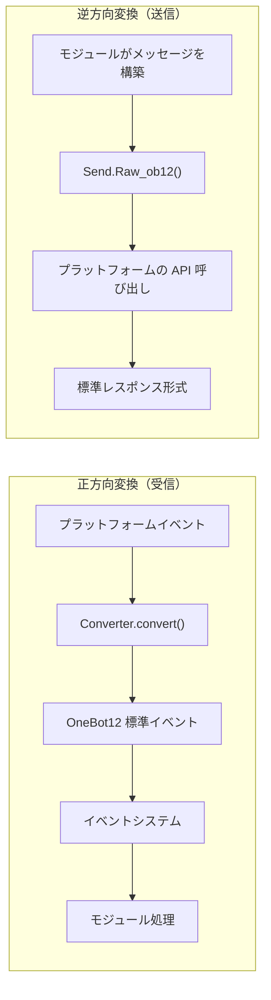

## ディレクトリ構造

標準的なアダプタのプロジェクト構造は以下の通りです：

```
MyAdapter/
├── pyproject.toml          # プロジェクト設定
├── README.md               # プロジェクト説明
├── LICENSE                 # ライセンス
└── MyAdapter/
    ├── __init__.py          # パッケージエントリ
    ├── Core.py               # アダプタ主クラス
    └── Converter.py          # イベントコンバーター
```

## 早速始める

### 1. プロジェクトの作成

脚手架（scaffold）を使って、pyproject.toml、主クラス、コンバーターを含む完全なプロジェクト構造を作成することを推奨します：

```bash
# パッケージとしてビルド・公開用
epsdk create adapter -n MyAdapter

# ローカルアダプタプラグイン（ビルド不要、plugins/ ディレクトリに配置するだけで自動読み込み可能、後述の「ローカル開発」参照）
epsdk create adapter -n MyAdapter --local
```

脚手架はデフォルトで WebSocket サーバーの骨格を生成します。プラットフォームの接続方式が異なる場合は、`--template` オプションで通信モードのテンプレートを選択し、`start`/`shutdown` を自分で書く必要がなくなります：

```bash
epsdk create adapter -n MyAdapter --template polling   # HTTP ポーリング型（getUpdates によるプル）
epsdk create adapter -n MyAdapter --template webhook   # HTTP コールバック型（プラットフォームのプッシュ）
```

> 3 種類の接続モードの違いと、半成品の基底クラスの最小実装は、[アダプタのコア概念 - 接続モードの半成品基底クラス](core-concepts.md#接続モード半成品基底クラス) を参照してください。実行可能な完全な例は、リポジトリの `examples/example-adapter-polling/` と `examples/example-adapter-webhook/` を参照してください。

手動で作成することも可能です：

```bash
mkdir MyAdapter && cd MyAdapter
```

### 2. pyproject.toml の作成

```toml
[project]
name = "ErisPulse-MyAdapter"
version = "1.0.0"
description = "MyAdapterプラットフォームアダプタ"
readme = "README.md"
requires-python = ">=3.10"
license = { file = "LICENSE" }
authors = [ { name = "yourname", email = "your@mail.com" } ]

dependencies = [
    "ErisPulse>=2.4.0"  # ErisPulse には aiohttp が内蔵されているため、通常は個別に依存関係を指定する必要はない
]

[project.urls]
"homepage" = "https://github.com/yourname/MyAdapter"

[project.entry-points."erispulse.adapter"]
"MyAdapter" = "MyAdapter:MyAdapter"
```

### 3. アダプタ主クラスの作成

フレームワークは `ConfigClass` / `AccountConfigClass` を用いた宣言的設定管理を提供しており、アダプタは設定クラスを宣言するだけで自動的に設定の読み込み、検証、テンプレートの生成が行われます。

```python
# MyAdapter/Core.py
from dataclasses import dataclass, field
# 推奨のルートインポート（2.10+）：頻出シンボルはルートパッケージから直接インポートし、深いパスも互換性がある
from ErisPulse import BaseAdapter, BaseConfig

@dataclass
class MyAdapterConfig(BaseConfig):
    """MyAdapter 設定"""
    api_endpoint: str = field(
        default="https://api.example.com",
        metadata={
            "description": {"i18n": "my_adapter.api_endpoint", "default": "API アドレス"},
            "required": False,
            "ui": {"widget": "text", "group": "connection", "order": 1},
        },
    )
    token: str = field(
        default="",
        metadata={
            "description": {"i18n": "my_adapter.token", "default": "プラットフォーム Token"},
            "required": True,
            "secret": True,
            "ui": {"widget": "password", "group": "basic", "order": 2},
        },
    )

class MyAdapter(BaseAdapter):
    ConfigClass = MyAdapterConfig  # 設定クラスを宣言し、フレームワークが自動管理
    
    # __init__ をオーバーライドする必要はない！フレームワークが自動処理する：
    # - self.sdk / self.logger の自動設定
    # - self.cfg による設定のリアルタイム読み込み
    # - self.Send / self.Request の自動初期化
    
    def _setup_converter(self):
        from .Converter import MyPlatformConverter
        return MyPlatformConverter()
```

> ⚠️ **__init__ について**：新バージョンでは `BaseAdapter.__init__(self, sdk=None)` が SDK の参照、ログの初期化、設定の読み込みを自動的に処理する。ほとんどのアダプタは `__init__` をオーバーライドする必要はない。詳細は [__init__ 注意事項](#init-注意事项) を参照してください。

> ⚠️ **super().__init__() について**：`BaseAdapter.__init__()` は `Send` と `Request` ファクトリのインスタンスを作成する。呼び忘れると、すべてのメッセージ送信とリクエスト操作で `AttributeError` が発生する。詳細は [__init__ 注意事項](#init-注意事项) を参照してください。

### 4. 必須メソッドの実装

```python
class MyAdapter(BaseAdapter):
    # ... __init__ コード ...
    
    async def start(self):
        """アダプタの起動（必須実装）"""
        # WebSocket または WebHook ルートを登録
        router.register_websocket(
            module_name="myplatform",
            path="/ws",
            handler=self._ws_handler
        )
        self.logger.info("アダプタが起動しました")
    
    async def shutdown(self):
        """アダプタの終了（必須実装）"""
        router.unregister_websocket(
            module_name="myplatform",
            path="/ws"
        )
        # 接続とリソースのクリーンアップ
        self.logger.info("アダプタが終了しました")
    
    async def call_api(self, endpoint: str, **params):
        """プラットフォーム API の呼び出し（必須実装）"""
        raise NotImplementedError("call_api を実装する必要があります")
```

#### メタイベントの送信

アダプタは Bot のオンライン状態をフレームワークに通知するために、メタイベントを送信する必要があります。`emit_meta()` を使用すると、一行で実現できます：

```python
class MyAdapter(BaseAdapter):
    async def _ws_handler(self, websocket):
        bot_id = self._get_bot_id()

        # Bot がオンライン
        await self.emit_meta("connect", bot_id, user_name="MyBot")

        try:
            while True:
                data = await websocket.receive_text()
                event = self.convert(data)
                if event:
                    await self.adapter.emit(event)
        except WebSocketDisconnect:
            pass
        finally:
            # Bot がオフライン
            await self.emit_meta("disconnect", bot_id)
```

> Bot の状態管理とメタイベントの詳細は、[アダプタのベストプラクティス - Bot 状態管理とメタイベント](best-practices.md#bot-状態管理と-meta-イベント) を参照してください。

### 5. Send クラスの実装

`At`/`AtAll`/`Reply` 修飾子は SendDSL 基底クラスで既に実装済みです。アダプタは `Raw_ob12` と具体的な送信メソッドを実装するだけで済みます。

フレームワークは以下の 2 つの重要な補助メソッドを提供します：
- `self._apply_modifiers(message)` — At/AtAll/Reply 修飾子を自動的にメッセージセグメントに統合
- `self.send_context` — 送信コンテキスト辞書を取得（`target_type`、`target_id`、`account_id`）

```python
import asyncio

class MyAdapter(BaseAdapter):
    # ... 他のコード ...

    class Send(BaseAdapter.Send):

        def Raw_ob12(self, message, **kwargs):
            """
            OneBot12 形式のメッセージを送信する（必須実装）

            _apply_modifiers を使用して修飾子の状態を自動的に統合し、
            send_context を使用して送信コンテキストを取得する。
            """
            async def _do_send():
                segments = self._apply_modifiers(message)
                return await self._adapter.call_api(
                    endpoint="/send_message",
                    message=segments,
                    **self.send_context,
                    **kwargs
                )
            return asyncio.create_task(_do_send())

        # Text/Image/Voice/Video/File は SendDSL 基底クラスから継承されているため、
        # デフォルトでは Raw_ob12 に委譲するだけで実装不要。
        # プラットフォーム固有のロジックが必要な場合は、個別のメソッドをオーバーライドする：
        # def Text(self, text: str):
        #     return self.Raw_ob12([{"type": "text", "data": {"text": text}}])
```

**メディア送信メソッド（Image/Video/File）の実装ポイント：**

- 基底クラスのデフォルト実装は `file` パラメータを OneBot12 メッセージセグメントにカプセル化して `Raw_ob12` に渡す。アダプタは `Raw_ob12` でダウンロード/アップロードを処理する必要がある。
- `file` パラメータは `bytes` 二進データと `str` URL の両方をサポートする。
- URL が渡された場合は、ファイルをダウンロードしてからプラットフォームにアップロードする必要がある。
- プラットフォームでは通常、まずアップロード API を呼び出してファイル識別子を取得し、次に送信 API を呼び出す。

**`__getattr__` マジックメソッド：**

- 実装メソッド名は大文字小文字を区別しない（`Text`、`text`、`TEXT` はすべて呼び出せる）。
- 未定義のメソッドはエラーではなく、エラーメッセージを返す。

**`Raw_ob12` メソッド：**

- OneBot12 標準メッセージ形式をプラットフォーム形式に変換して送信する。
- `self._apply_modifiers(message)` を使用して At/AtAll/Reply 修飾子を自動的に処理する。
- `**self.send_context` を使用して送信ターゲット情報とアカウント情報を渡す。

### 6. コンバーターの実装

```python
# MyAdapter/Converter.py
import time
import uuid

class MyPlatformConverter:
    def convert(self, raw_event):
        """プラットフォームの生イベントを OneBot12 標準形式に変換する"""
        if not isinstance(raw_event, dict):
            return None
        
        onebot_event = {
            "id": str(raw_event.get("event_id", uuid.uuid4())),
            "time": int(time.time()),
            "type": self._convert_event_type(raw_event.get("type")),
            "detail_type": self._convert_detail_type(raw_event),
            "platform": "myplatform",
            "self": {
                "platform": "myplatform",
                "user_id": str(raw_event.get("bot_id", ""))
            },
            "myplatform_raw": raw_event,
            "myplatform_raw_type": raw_event.get("type", "")
        }
        
        return onebot_event
    
    def _convert_event_type(self, event_type):
        """イベントタイプを変換する"""
        type_map = {
            "message": "message",
            "notice": "notice"
        }
        return type_map.get(event_type, "unknown")
    
    def _convert_detail_type(self, raw_event):
        """詳細タイプを変換する"""
        return "private"  # 簡単化のため
```

### 7. Request クラスの実装（リクエスト操作）

プラットフォームがフレンドリクエスト、グループ招待など、Bot が判断を必要とするリクエストに対応している場合、`Request` 内部クラスを実装できます：

```python
from ErisPulse import BaseAdapter, RequestDSL

class MyAdapter(BaseAdapter):
    # ... Send と他のコード ...

    class Request(RequestDSL):
        """リクエスト操作の実装（フレンドリクエスト、グループ招待など）"""

        def accept(self, **kwargs):
            """リクエストを承認する"""
            async def _do():
                result = await self._adapter.call_api(
                    endpoint="/set_request",
                    request_id=self._request_id,
                    approve=True,
                    **kwargs,
                )
                return {
                    "status": "ok" if result.get("code") == 0 else "failed",
                    "retcode": result.get("code", 0),
                    "data": None,
                    "message_id": "",
                    "message": result.get("message", ""),
                }
            return self._create_task(_do())

        def reject(self, **kwargs):
            """リクエストを拒否する"""
            async def _do():
                result = await self._adapter.call_api(
                    endpoint="/set_request",
                    request_id=self._request_id,
                    approve=False,
                    **kwargs,
                )
                return {
                    "status": "ok" if result.get("code") == 0 else "failed",
                    "retcode": result.get("code", 0),
                    "data": None,
                    "message_id": "",
                    "message": result.get("message", ""),
                }
            return self._create_task(_do())
```

モジュール開発者の使用方法：

```python
from ErisPulse import request

@request.on_friend_request()
async def handle_friend_request(event):
    # Event から便利なメソッドを使用
    await event.approve()
    # またはアダプタ経由で直接操作
    await adapter.myplatform.Request("req_id").accept()
```

> プラットフォームがリクエスト操作をサポートしていない場合は、`Request` 内部クラスを実装する必要はありません。基底クラスはデフォルトで `retcode=10002`（サポートされていない操作）を返します。[リクエスト操作規格](../../standards/request-action-spec.md)を参照してください。

### 8. パッケージエントリの作成

```python
# MyAdapter/__init__.py
from .Core import MyAdapter
```

## ローカル開発（ビルド不要）

モジュールと同様に、アダプタもプロジェクトのローカルプラグインディレクトリ（デフォルトは `plugins/`、`ErisPulse.framework.plugins_dir` で設定可能）に直接開発できます。**`pip install -e .` は不要**です：

```bash
# ローカルアダプタプラグインの生成
epsdk create adapter -n MyAdapter --local
# 生成される構造：
# plugins/
# └── MyAdapter/
#     ├── __init__.py
#     ├── Core.py
#     └── Converter.py
```

フレームワークの起動時に、プラグインディレクトリを自動スキャンし、その中のモジュールやアダプタをロードします（entry-point でインストールしたパッケージと同じ扱い：有効化状態、設定の宣言、ホットリロード、アンロードのクリーンアップなどすべて同じです）：

- **識別ルール**：`__init__.py` を含むパッケージディレクトリまたは単一の `.py` ファイルでも認識されます。`Main` という名前のクラスが優先的に認識されますが、なければプラグイン内の最初の `BaseAdapter` / `BaseModule` のサブクラスが使われます。
- **同名の上書き**：ローカルプラグインと PyPI でインストールされたアダプタが同名の場合、ローカルプラグインが優先されます（デバッグの上書きが可能）。
- **ホットリロード**：`sdk.enable_plugin_hot_reload()` で有効化されたプラグインディレクトリの監視はアダプタにも適用されます。アダプタのコードレベルのホットリロードは 2.11 から提供されています。`await sdk.adapter.reload("プラットフォーム名")` または `await sdk.reload_adapter("プラットフォーム名")` で実行できます（構文検証 → クリーンアップ → キャッシュクリアと再インポート → 再登録と起動、失敗時は自動ロールバック）。[アーキテクチャ概要](../../architecture.md)を参照してください。

### ローカルプラグインから公開

ローカルで検証が完了したら、`pack` サブコマンドを使ってプラグインを一括で公開可能な標準プロジェクトに変換します（インタラクティブにプラグインを選択し、メタ情報を補完し、entry-point を含む pyproject を生成）：

```bash
epsdk create pack
# プラグインディレクトリからプラグインを選択 → プロジェクト名/説明/作者を入力 → MyAdapter/ プロジェクトディレクトリを生成
cd MyAdapter
pip install -e .   # 標準インストールに変換；その後、公開プロセスに従って PyPI にアップロード
```

> **注意**：変換後は、`plugins/` 内の元ファイルを削除することを推奨します。同名のローカルプラグインとインストールパッケージが重複して読み込まれると、ローカルが優先されるため、インストールパッケージが有効であると誤解する可能性があります。

## 依存関係の宣言（オプション、2.8.0+）

アダプタは他のアダプタやモジュールへの依存関係を宣言し、アダプタ間の連携やオプション機能を実現できます：

```python
from typing import ClassVar

class MyAdapter(BaseAdapter):
    # ハード依存：存在しない場合、起動をスキップ（警告 + status=skipped-dependency イベント）
    depends: ClassVar[dict] = {
        "adapters": ["onebot11"],   # 依存するアダプタ（プラットフォーム名）
        "modules": ["TranslateEngine"],  # 依存するモジュール（登録名）
    }
    # ソフト依存：存在しない場合、起動に影響しない。モジュールのロード/アンロード時にコールバックを受ける（オプション機能モード）
    optional_modules: ClassVar[list] = ["TranslateEngine"]
```

- **起動順序**：モジュールのハード依存を宣言したアダプタは、**モジュールの初期化完了後に起動**されます。
- **ソフト依存の通知**：`optional_modules`（またはモジュールのハード依存）に含まれるモジュールがロードされたときに `on_dependency_ready(module_name)` が呼び出されます。アンロードされたときは `on_dependency_lost(module_name)` が呼び出されます（デフォルトでは空実装で、オーバーライド可能です）— 早めのロードやホットリロードの場面をカバーします：

```python
async def on_dependency_ready(self, module_name):
    """ソフト依存モジュールが準備完了：対応するオプション機能を有効化"""
    if module_name == "TranslateEngine":
        self._translate = self.sdk.TranslateEngine

async def on_dependency_lost(self, module_name):
    """ソフト依存モジュールが失われた：機能を降格"""
    if module_name == "TranslateEngine":
        self._translate = None
```

> [!NOTE]
> この機能は ErisPulse **2.8.0+** が必要です。

## `__init__` に関する注意事項

アダプタ開発では、`__init__` のオーバーライドが3つのレベルで発生する可能性があります。以下は各レベルの正しい使い方です。

### 1. BaseAdapter 層（多くの場合オーバーライドは不要）

`BaseAdapter.__init__(self, sdk=None)` は `Send` / `Request` ファクトリインスタンスを作成し、以下の処理を自動的に行います：

- `sdk` パラメータを受け取り、`self.sdk`、`self.logger` を設定
- `ConfigClass` を宣言した場合、`self.cfg` でグローバル設定をリアルタイムに読み取れる
- `AccountConfigClass` を宣言した場合、`self.accounts` で複数アカウントの設定をリアルタイムに読み取れる

**多くの場合、`__init__` をオーバーライドする必要はありません**。`ConfigClass` を宣言するだけで十分です：

```python
class MyAdapter(BaseAdapter):
    ConfigClass = MyAdapterConfig  # 設定クラスを宣言するとフレームワークが自動管理
    
    async def start(self):
        cfg = self.cfg  # タイプセーフでリアルタイムに読み取れる
        ...
```

もし本当にカスタム初期化が必要な場合は、`super().__init__(sdk)` を呼び出します：

```python
class MyAdapter(BaseAdapter):
    ConfigClass = MyAdapterConfig
    
    def __init__(self, sdk=None):
        super().__init__(sdk)  # sdk を渡す
        self.converter = self._setup_converter()
        self.convert = self.converter.convert
```

### 2. Send 内部クラス（多くの場合オーバーライドは不要）

`SendDSL.__init__` は、連鎖呼び出しの状態（ターゲットタイプ、ターゲットID、アカウントなど）を伝達します。**多くの場合、メソッド（`Raw_ob12`、`Text` など）をオーバーライドするだけで、`__init__` をオーバーライドする必要はありません**。

もし本当に必要（例えば、プラットフォーム特有の状態を初期化する場合）であれば、**すべてのパラメータを透過する必要があります**：

```python
class MyAdapter(BaseAdapter):
    class Send(BaseAdapter.Send):
        # パラメータ：adapter, target_type, target_id, account_id
        def __init__(self, adapter, target_type=None, target_id=None, account_id=None):
            super().__init__(adapter, target_type, target_id, account_id)  # ← 必須透過
            self._my_state = None  # プラットフォーム特有の初期化
```

**なぜ透過が必要ですか？** 連鎖呼び出しの各ステップは `self.__class__(...)` を使って新しいインスタンスを作成します：

```python
adapter.Send.To("user", "123")               # → Send(adapter, "user", "123", None)
adapter.Send.To("user", "123").Using("bot1")  # → Send(adapter, "user", "123", "bot1")
```

もし `__init__` のシグネチャが一致していない、または `super()` を呼び出していない場合、連鎖呼び出しは中断します。

### 3. Request 内部クラス（多くの場合オーバーライドは不要）

Send と同じです。パラメータは `adapter`, `request_id`, `account_id` です：

```python
class MyAdapter(BaseAdapter):
    class Request(RequestDSL):
        # パラメータ：adapter, request_id, account_id
        def __init__(self, adapter, request_id=None, account_id=None):
            super().__init__(adapter, request_id, account_id)  # ← 必須透過
            self._my_state = None  # プラットフォーム特有の初期化
```

### まとめ

| レベル | いつオーバーライドするか | 必須の処理 |
|------|------------|-----------|
| **BaseAdapter** | カスタム初期化が必要な場合 | `super().__init__(sdk)` （sdk パラメータを渡す） |
| **Send 内部クラス** | 送信関連の状態を初期化する必要がある場合 | `super().__init__(adapter, target_type, target_id, account_id)` |
| **Request 内部クラス** | リクエスト関連の状態を初期化する必要がある場合 | `super().__init__(adapter, request_id, account_id)` |
| 3つのレベル | 多くの場合 | **ConfigClass を宣言するだけで、`__init__` は触らない** |

### 9. 接続情報とルート発見

アダプタがルートを登録した後、フレームワークはすべてのルート情報を記録します。ユーザーは以下の API を使ってアダプタの接続アドレスを確認できます：

```python
from ErisPulse import sdk

# アダプタの完全な接続情報を取得
info = sdk.adapter.get_connection_info("myplatform")
# {
#   "platform": "myplatform",
#   "status": "started",
#   "connection": {
#     "base_url": "http://localhost:8080",
#     "http_routes": [
#       {"path": "/myplatform/webhook", "method": "POST",
#        "url": "http://localhost:8080/myplatform/webhook"}
#     ],
#     "websocket_routes": [
#       {"path": "/myplatform/ws",
#        "url": "ws://localhost:8080/myplatform/ws"}
#     ]
#   }
# }

# すべての名前空間（アダプタ/モジュール）のルートを一覧表示
namespaces = sdk.router.list_namespaces()
# {"myplatform": {"http": ["/myplatform/webhook"], "websocket": ["/myplatform/ws"]}}

# 名前空間の完全な接続 URL を取得
urls = sdk.router.get_module_urls("myplatform")
# {"base_url": "http://localhost:8080", "http": [...], "websocket": [...]}

# 名前空間の詳細なルート情報を取得
routes = sdk.router.get_module_routes("myplatform")
# {"http": [{"path": "/myplatform/webhook", "methods": ["POST"]}],
#  "websocket": [{"path": "/myplatform/ws", "auth": false}]}
```

> **注意**：`get_connection_info()` が返す情報は、ユーザーに表示するのに適しています（例：WebUI）。プラットフォーム側のコールバックアドレスや WebSocket 接続アドレスの設定に役立ちます。ルート登録時の `module_name` は、ErisPulse でアダプタを登録するときの `platform` 名と完全に一致している必要があります。一致していないと、ルート発見が正しく関連付けられません。

### 10. SSE (Server-Sent Events) のサポート

ErisPulse はサーバーに依存しない SSE を内蔵しており、モジュールやアダプタは `@sdk.router.sse()` を使って SSE エンドポイントを登録できます。

#### 基本的な使用法

```python
import asyncio
from ErisPulse import sdk

@sdk.router.sse("MyModule", "/events")
async def event_stream(sse):
    """SSE イベントを送信する"""
    count = 0
    while not sse.closed:
        await sse.send({"count": count}, event="update")
        count += 1
        await asyncio.sleep(1)
```

#### リクエストパラメータの使用

ハンドラは `request` パラメータを宣言してクライアントリクエスト情報をアクセスできます：

```python
@sdk.router.sse("MyModule", "/events")
async def event_stream(request, sse):
    token = request.query_params.get("token")
    if not validate_token(token):
        await sse.close()
        return

    while not sse.closed:
        data = await fetch_data(token)
        await sse.send(data)
        await asyncio.sleep(5)
```

#### SseEmitter API

| メソッド | 説明 |
|------|------|
| `sse.send(data, event=None, id=None, retry=None)` | SSE イベントを送信する。str 以外の data は自動的に JSON シリアライズされる |
| `sse.close()` | SSE 接続を安全に閉じる（複数回呼び出しても安全） |
| `sse.closed` | 接続が閉じられているか |
| `sse.request` | ベースのリクエストオブジェクト（クエリパラメータ、ヘッダーなどを読み取るのに使用可能） |

#### RouteGroup での使用

```python
api = sdk.router.group("MyModule", "/api", version="1")

@api.sse("/events")
async def events(sse):
    await sse.send({"msg": "hello"})
```

#### ルート発見

SSE ルートは自動的にルート発見 API に含まれる：

```python
# list_namespaces は "sse" キーを含む
sdk.router.list_namespaces()
# {"MyModule": {"http": [...], "websocket": [...], "sse": ["/MyModule/events"]}}

# get_module_routes は streaming: true をマークする
sdk.router.get_module_routes("MyModule")
# {"http": [...], "websocket": [...], "sse": [{"path": "/MyModule/events", "streaming": true}]}

# get_module_urls は完全な URL を生成する
sdk.router.get_module_urls("MyModule")
# {"sse": [{"path": "/MyModule/events", "url": "http://localhost:8080/MyModule/events"}]}
```

> **サーバーに依存しない設計**：`SseEmitter` はコールバックと下層の HTTP フレームワークを分離する。フレームワークは `register_sse()` と `@sse` デコレータを統一的な登録エントリとして提供し、アダプタは下層の HTTP フレームワークに直接依存することなく SSE エンドポイントを実装できる。

## 次のステップ

### アダプタの3つの主要コンポーネントを完成させる

- [イベントコンバーター](converter.md) - プラットフォームイベント → OneBot12 の実装詳細とよくある落とし穴
- [SendDSL 詳解](send-dsl.md) - メッセージ送信チェーン、修飾子メソッド、送信ルール
- [アダプタのコア概念](core-concepts.md) - BaseAdapter / ライフサイクル / マルチアカウントの仕組み

### スケルトンが走り始めたら

- [アダプタのベストプラクティス](best-practices.md) - 接続リトライ、ハートビート、エラーハンドリングのエンジニアリング的な仕上げ
- [公開とモジュールストアガイド](../publishing.md) - PyPI とモジュールストアへの公開


### 适配器核心概念

# アダプタのコアコンセプト

> [!TIP]
> **この記事を読むタイミング**：アダプタ開発経路内に必須（BaseAdapter / SendDSL / ライフサイクル等の全メカニズムの詳細説明）。入門だけしたい場合は先に [アダプタ開発入門](getting-started.md) を読んで、"なぜ"の疑問が生じたらここに戻って調べる。

この記事では、アダプタの動作メカニズムを説明します。AdapterManager がどのようにアダプタを登録・イベントを分配するか、`BaseAdapter` が初期化時に何をしてくれたか、設定と複数アカウントの宣言方法など。アダプタを開発する際に「なぜこのように書くのか？」という疑問が生じたときは、ここに来て調べてください。

## アダプタアーキテクチャ

### コンポーネント関係

```
正方向変換（受信方向）                           反方向変換（送信方向）
─────────────────                           ─────────────────
                                             
┌──────────────────┐                        ┌──────────────────┐
│ プラットフォーム原生イベント     │                        │ モジュール構築メッセージ     │
└────────┬─────────┘                        └────────┬─────────┘
         │                                           │
         ↓                                           ↓
┌──────────────────┐   ┌──────────────────┐   ┌──────────────────┐
│                  │   │  アダプタ (MyAdapter) │   │ Send.Raw_ob12()  │
│  Converter       │   │ ┌──────────────┐ │   │ (反方向変換エントリ)   │
│  (イベント変換器)    │──→│ │              │ │   │                  │
│                  │   │ │              │ │   │                  │
└──────────────────┘   │ └──────────────┘ │   └────────┬─────────┘
                       └──────────────────┘            │
                                │                      ↓
                                ↓              ┌──────────────────┐
                       ┌──────────────────┐    │ プラットフォーム API 呼び出し    │
                       │ OneBot12 標準イベント │    └────────┬─────────┘
                       └────────┬─────────┘             │
                                │                      ↓
                                ↓              ┌──────────────────┐
                       ┌──────────────────┐    │ 標準レスポンス形式     │
                       │ イベントシステム         │    └──────────────────┘
                       └────────┬─────────┘
                                │
                                ↓
                       ┌──────────────────┐
                       │ モジュール (イベント処理)  │
                       └──────────────────┘
```

**コアの対称性**：
- **正方向変換**（Converter）：プラットフォーム原生イベント → OneBot12 標準イベント、元データは `{platform}_raw` に保持
- **反方向変換**（Raw_ob12）：OneBot12 メッセージセグメント → プラットフォーム API 呼び出し、返り値は標準レスポンス形式

## AdapterManager アダプタマネージャー

`AdapterManager` は ErisPulse アダプタシステムのコアコンポーネントで、すべてのプラットフォームアダプタの登録、起動、停止、イベント分配を管理します。

### コア機能

- **アダプタ登録**：複数のプラットフォームアダプタを登録・管理
- **ライフサイクル管理**：アダプタの起動と停止を制御
- **イベント分配**：OneBot12 標準イベントとプラットフォーム原生イベントを分配
- **設定管理**：アダプタの有効/無効状態を管理
- **ミドルウェアサポート**：OneBot12 イベントミドルウェアをサポート

### 基本的な使用法

```python
from ErisPulse import sdk

# アダプタの登録（通常は Loader が自動的に実行）
sdk.adapter.register("myplatform", MyPlatformAdapter)

# すべてのアダプタを起動
await sdk.adapter.startup()

# 指定アダプタを起動
await sdk.adapter.startup(["myplatform"])
# すべてのアダプタを起動
await sdk.adapter.startup()

# アダプタインスタンスを取得
my_adapter = sdk.adapter.get("myplatform")
# または属性でアクセス
my_adapter = sdk.adapter.myplatform

# すべてのアダプタを停止
await sdk.adapter.shutdown()
```

### 起動と停止

#### アダプタの起動

```python
# すべての登録済みアダプタを起動
await sdk.adapter.startup()

# 指定プラットフォームを起動
await sdk.adapter.startup(["platform1", "platform2"])
```

**起動フロー**：

1. `adapter.start` ライフサイクルイベントを送信
2. `adapter.status.change` イベントを送信（starting）
3. 各アダプタを並行起動
4. 起動失敗した場合は自動リトライ（指数バックオフ戦略）
5. 起動成功後 `adapter.status.change` イベントを送信（started）

**リトライメカニズム**：

- 最初の4回のリトライ：60秒、10分、30分、60分
- 5回目以降：3時間固定間隔

#### アダプタの停止

```python
# すべてのアダプタを停止
await sdk.adapter.shutdown()
```

**停止フロー**：

1. `adapter.stop` ライフサイクルイベントを送信
2. すべてのアダプタの `shutdown()` メソッドを呼び出す
3. ルーティングサーバーを閉じる
4. イベントハンドラをクリアする
5. `adapter.stopped` ライフサイクルイベントを送信

### 設定管理

#### プラットフォームの状態確認

```python
# プラットフォームが登録されているか確認
exists = sdk.adapter.exists("myplatform")

# プラットフォームが有効か確認
enabled = sdk.adapter.is_enabled("myplatform")

# in 演算子を使用
if "myplatform" in sdk.adapter:
    print("プラットフォームが存在し、有効です")
```

#### プラットフォームの一覧表示

```python
# すべての登録済みプラットフォームを取得
platforms = sdk.adapter.list_registered()

# すべてのプラットフォームとその状態を取得
status_dict = sdk.adapter.list_items()
# 戻り値: {"platform1": true, "platform2": false, ...}

# 有効なプラットフォームのリストを取得
enabled_platforms = [p for p, enabled in status_dict.items() if enabled]
```

### イベントの監視

#### OneBot12 標準イベント

```python
from ErisPulse import sdk

# すべてのプラットフォームの標準メッセージイベントを監視
@sdk.adapter.on("message")
async def handle_message(data):
    print(f"OneBot12メッセージを受け取りました: {data}")

# 特定プラットフォームの標準メッセージイベントを監視
@sdk.adapter.on("message", platform="myplatform")
async def handle_platform_message(data):
    print(f"myplatformメッセージを受け取りました: {data}")

# すべてのイベントを監視
@sdk.adapter.on("*")
async def handle_any_event(data):
    print(f"イベントを受け取りました: {data.get('type')}")
```

#### プラットフォーム原生イベント

```python
# 特定プラットフォームの原生イベントを監視
@sdk.adapter.on("raw_event_type", raw=True, platform="myplatform")
async def handle_raw_event(data):
    print(f"原生イベントを受け取りました: {data}")

# すべてのプラットフォームの原生イベントを監視（ワイルドカード）
@sdk.adapter.on("*", raw=True)
async def handle_all_raw_events(data):
    print(f"原生イベントを受け取りました: {data}")
```

#### イベント分配メカニズム

`adapter.emit(event_data)` を呼び出したとき：

1. **ミドルウェア処理**：まずすべての OneBot12 ミドルウェアを実行
2. **標準イベント分配**：マッチする OneBot12 イベントハンドラに分配
3. **原生イベント分配**：元データがあれば、原生イベントハンドラに分配

**マッチルール**：

- 精確マッチ：`@sdk.adapter.on("message")` は `message` イベントのみマッチ
- ワイルドカード：`@sdk.adapter.on("*")` はすべてのイベントにマッチ
- プラットフォームフィルタ：`platform="myplatform"` は指定プラットフォームのイベントのみ分配

### ミドルウェア

#### ミドルウェアの追加

```python
@sdk.adapter.middleware
async def logging_middleware(data):
    """ログ記録ミドルウェア"""
    print(f"イベントを処理しています: {data.get('type')}")
    return data  # 必ずデータを返す

@sdk.adapter.middleware
async def filter_middleware(data):
    """イベントフィルタミドルウェア"""
    # 不要なイベントをフィルタ
    if data.get("type") == "notice":
        return None  # None を返すとミドルウェアチェーンはその返り値を無視し、元のデータをそのまま次に渡す
    return data  # 必ずデータを返して次に渡す
```

#### ミドルウェアの返り値契約

| 返り値 | 行為 |
|--------|------|
| `dict` | イベントペイロードを上書き（後続のハンドラは変更後のイベントを受け取る） |
| `None` | 通過、ペイロードは変更なし（WARNING ログを出力するが、明示的に `return data` を推奨） |
| `False` | **否決**：イベントは破棄され、ハンドラには一切の副作用が発生しない |

否決はファイアウォール、リクエスト制限、ブラックリストなど、"イベントレベルで直接破棄"する場面に適しています（以前は高優先度のイベントハンドラで回避するしかありませんでした）。否決時にフレームワークは TRACE ログを出力し、`adapter.event.blocked` ライフサイクルフックをトリガーします（`middleware` ミドルウェア名、完全な `event`、`platform` / `event_type` / `detail_type` を含む）、これにより"なぜイベントが応答されなかったのか"をトラブルシューティングできます：

```python
@sdk.adapter.middleware
async def rate_limit_middleware(data):
    """リクエスト制限ミドルウェア"""
    if _is_rate_limited(data):
        return False  # 否決：イベントは破棄
    data["rate_marked"] = True
    return data

@sdk.lifecycle.on("adapter.event.blocked")
async def on_event_blocked(data):
    print(f"イベントは {data['middleware']} によって否決されました: {data['event_type']}")
```

#### ミドルウェアの実行順序

ミドルウェアは登録順に実行され、後から登録されたミドルウェアが先に実行されます。

> **注意**：ミドルウェアが `None` を返した場合（`return data` を忘れている場合）、フレームワークはその返り値を無視して元のデータをそのまま次に渡し、warning レベルのログを出力します。これにより、個々のミドルウェアのミスがイベントチェーン全体の中断を引き起こすことはありません。

```python
# 登録順
sdk.adapter.middleware(middleware1)  # 最後に実行
sdk.adapter.middleware(middleware2)  # 中間に実行
sdk.adapter.middleware(middleware3)  # 最初に実行

# 実行順序：middleware3 -> middleware2 -> middleware1
```

### アダプタインスタンスの取得

#### get() メソッド

```python
adapter = sdk.adapter.get("myplatform")
if adapter:
    await adapter.Send.To("user", "123").Text("Hello")
```

#### 属性アクセス

```python
# 属性名でアクセス（大文字小文字を区別しない）
adapter = sdk.adapter.myplatform
await adapter.Send.To("user", "123").Text("Hello")
```

## BaseAdapter 基底クラス

### 基本構造

```python
from dataclasses import dataclass, field
from ErisPulse.Core import BaseAdapter
from ErisPulse.Core.Bases import BaseConfig, BotAccountConfig

@dataclass
class MyConfig(BaseConfig):
    """アダプタ設定（宣言後、フレームワークが自動的に管理）"""
    token: str = field(
        default="",
        metadata={
            "description": {"i18n": "my_adapter.token", "default": "Bot Token"},
            "required": True,
            "secret": True,
            "ui": {"widget": "password", "group": "basic", "order": 1},
        },
    )

class MyAdapter(BaseAdapter):
    ConfigClass = MyConfig  # 設定クラスを宣言
    
    # __init__ をオーバーライドする必要はない、フレームワークが自動的に処理する：
    # - self.sdk, self.logger
    # - self.cfg（型安全な設定インスタンス、リアルタイムで読み取り）
    # - self.Send, self.Request
    
    async def start(self):
        """アダプタを起動する（必須実装）"""
        cfg = self.cfg  # 自動的にロードされる型安全な設定
        pass
    
    async def shutdown(self):
        """アダプタを停止する（必須実装）"""
        pass
    
    async def call_api(self, endpoint: str, **params):
        """プラットフォーム API を呼び出す（必須実装）"""
        pass
```

### 設定管理

フレームワークは宣言的設定管理を提供し、dataclass を使って設定構造を定義し、フレームワークが自動的にロード、検証、テンプレート生成を処理します。

#### 単一アカウント設定

```python
from dataclasses import dataclass, field
from ErisPulse.Core.Bases import BaseConfig

@dataclass
class TelegramConfig(BaseConfig):
    token: str = field(default="", metadata={
        "description": {"i18n": "telegram.token", "default": "Bot Token"},
        "required": True,
        "secret": True,
        "ui": {"widget": "password", "group": "basic", "order": 1},
    })
    proxy: str = field(default="", metadata={
        "description": {"i18n": "telegram.proxy", "default": "プロキシアドレス"},
        "ui": {"widget": "text", "group": "advanced", "order": 10},
    })

class TelegramAdapter(BaseAdapter):
    ConfigClass = TelegramConfig
    
    async def start(self):
        cfg = self.cfg  # 型安全、リアルタイムで読み取り
        if not cfg.token:
            raise ValueError("Token が設定されていません")
        await self._connect(cfg.token, proxy=cfg.proxy)
```

#### 複数アカウント設定

`BotAccountConfig` 基底クラスは `enabled` と `name` フィールドを提供します。ほとんどのアダプタはプラットフォームプロトコルやログイン応答から自動的に bot_id を取得でき、イベント変換時にアカウント設定に注入されます。：

```python
from dataclasses import dataclass, field
from ErisPulse.Core.Bases import BotAccountConfig

# 大多数のアダプタ：bot_id は実行時に自動取得、設定は不要
@dataclass
class MyBotConfig(BotAccountConfig):
    token: str = field(default="", metadata={
        "description": {"i18n": "my_adapter.bot_token", "default": "Token"},
        "required": True,
    })

# ログイン時に bot_id を取得できない場合は、ユーザーに設定してもらう
@dataclass
class YunhuBotConfig(BotAccountConfig):
    bot_id: str = field(default="", metadata={
        "description": {"i18n": "yunhu.bot_id", "default": "ロボットID"},
        "required": True,
    })
    token: str = field(default="", metadata={
        "description": {"i18n": "yunhu.token", "default": "Token"},
        "required": True,
    })

class MyAdapter(BaseAdapter):
    AccountConfigClass = MyBotConfig
    
    async def start(self):
        for name, account in self.enabled_accounts.items():
            user_id = await self._login(name, account)
            await self.emit_meta("connect", user_id)
```

#### metadata 約定

フィールド metadata は TOML 注釈生成と WebUI フォームレンダリングの両方に使用されます：

```python
metadata = {
    "description": str | dict,  # フィールド説明（i18n をサポート）
    "required": bool,         # 必須か（検証 + WebUI 必須マーク）
    "secret": bool,           # 敏感か（WebUI では *** に表示、ログでは脱敏）
    "example": bool,          # 落盤しないフラグ：config.toml に書き込まない（デフォルト値/テンプレートは除外）、config.full.example にのみレンダリング；schema に "example": true が付いていれば、CLI 設定ウィザードはデフォルトでスキップ；ユーザーが手動で設定した後は通常の永続化を行う
    "min": number, "max": number,  # 数値範囲検証
    "ui": {                   # WebUI コントロール設定（旧名 "webui" は互換性あり）
        "widget": str,        # コントロールタイプ: "text" | "switch" | "select" | "number" | "password"
        "group": str,         # グループ: "basic" | "advanced" | "connection" など
        "order": int,         # ソートウェイト（小さいほど先に表示）
        "options": list,      # select コントロールの選択肢 [{label, value}]、label は i18n をサポート
        "placeholder": str | dict,  # 入力欄のプレースホルダー（i18n をサポート）
    },
    "extra": dict,            # 余分な拡張フィールド（schema に透かし渡す）
}
```

すべてのユーザーが見えるテキストフィールドは i18n をサポートし、`{"i18n": "key", "default": "text"}` 形式で統一されます。純粋な文字列はそのまま透かし渡されます（後方互換性）。サポートされる i18n フィールド：

| フィールド | 位置 | 説明 |
|------|------|------|
| `description` | field metadata | フィールド説明 |
| `options[].label` | `ui.options` | select コントロールの選択肢ラベル |
| `placeholder` | `ui.placeholder` | 入力欄のプレースホルダー |
| `group_labels` | `_schema_meta` | グループ表示名（Dashboard 分区タイトル） |

i18n を使用する場合は、翻訳キーを i18n システムに事前に登録する必要があります（[i18n ドキュメント](../../advanced/i18n.md#配置フィールド多言語)を参照）。

**description / placeholder / options label** の例：

```python
token: str = field(
    default="",
    metadata={
        "description": {"i18n": "my_adapter.token", "default": "Bot Token"},
        "ui": {
            "widget": "text",
            "placeholder": {"i18n": "my_adapter.token.ph", "default": "Token を入力してください"},
        },
    },
)
mode: str = field(
    default="a",
    metadata={
        "description": {"i18n": "my_adapter.mode", "default": "モード"},
        "ui": {
            "widget": "select",
            "options": [
                {"label": {"i18n": "my_adapter.mode.a", "default": "オプションA"}, "value": "a"},
                {"label": "純粋な文字列のラベル", "value": "b"},  # 純粋な文字列はそのまま透かし渡す
            ],
        },
    },
)
```

**group_labels** の例（設定クラス定義後に宣言）：

```python
MyConfig._schema_meta = {
    "group_labels": {
        "basic": {"i18n": "my_adapter.group.basic", "default": "基本設定"},
        "advanced": {"i18n": "my_adapter.group.advanced", "default": "高度設定"},
    }
}
```

フレームワークの `resolve_config_schema()` は現在の言語に応じて上記のすべてのフィールドの i18n キーを自動的に解決します。`get_config_schema()` は i18n ディクショナリをそのまま透かし渡し、フロントエンドが独自に解決します。

#### docstring から自動生成されるフィールド説明（v2.8.0+）

metadata で `description` を宣言していないフィールドは、フレームワークが設定クラスの docstring からフィールド説明を自動的に抽出してバックアップとして使用します。2 つの一般的なスタイルをサポートします（混在可能）：

```python
@dataclass
class MyConfig(BaseConfig):
    """
    MyAdapter 設定

    :ivar endpoint: プラットフォーム API アドレス        # reST スタイル
    :ivar timeout: リクエストタイムアウト秒数
    """

    endpoint: str = "https://api.example.com"   # metadata description がない → 注釈/説明は docstring から
    timeout: int = 30

    # Google スタイルもサポート（Attributes: 段）：
    # Attributes:
    #     endpoint: プラットフォーム API アドレス
```

優先順位：**metadata description > docstring フィールド説明 > 空**。i18n ディクショナリ形式の description は影響を受けません（常に優先されます）。

#### 嵌套設定（v2.8.0+）

フィールド型がネストされた dataclass の場合、フレームワークは再帰的に処理します：schema は `"type": "table"` + `"fields"` サブツリーで構成され（WebUI では折りたたみ可能なネストされたグループとしてレンダリング）、TOML テンプレートは `[サブテーブル]` セクションとしてレンダリングされ、デフォルト値、埋め込み、検証、i18n 解析はすべて再帰的に有効になります。

```python
@dataclass
class RetryConfig(BaseConfig):
    """リトライ戦略

    :ivar max_retries: 最大リトライ回数
    """
    max_retries: int = 3
    backoff: float = 0.5

@dataclass
class MyConfig(BaseConfig):
    """MyAdapter 設定"""
    endpoint: str = "https://api.example.com"
    retry: RetryConfig = field(default_factory=RetryConfig)   # 嵌套設定セクション
```

生成される TOML テンプレート：

```toml
endpoint = "https://api.example.com"

[retry]
# 最大リトライ回数
max_retries = 3
backoff = 0.5
```

> 嵌套型は直接型注釈を使うことを推奨します；文字列注釈（遅延評価の場面など）は、型が設定クラスのモジュール全体、`__qualname__` 外側のクラス名空間、またはクラス属性から名前で解決できることを保証する必要があります。

#### 落盤しない example フィールド（v2.8.0+）

```python
gc_interval: int = field(default=300, metadata={"example": True})
```

`example: True` が付いたフィールドは：

- config.toml に書き込まれない（アダプタ/モジュール設定テンプレートとデフォルト値は除外、実行時はコードのデフォルト値を使用）
- config.full.example にのみレンダリングされる（ユーザーが参考として手動で config.toml にコピーする）
- schema に `"example": true` が付いている（コンポーネントが表示戦略を独自に決定できる）、CLI 設定ウィザードはデフォルトでスキップ
- ユーザーがこのキーを手動で設定した後は通常の永続化、通常のホットアップデート（ユーザーの明示的な意図が優先）

"冗長でめったに触れない"高度な設定項目に適しており、ユーザーの config.toml を最小限に保ちます。

> ⚠️ `_schema_meta` はクラスレベルのメタデータ（設定フィールドではない）。dataclass のクラス本体で宣言する場合は、`ClassVar` 注釈を付ける必要があります（`_schema_meta: ClassVar[dict] = {...}`）、そうでないと dataclass は普通のフィールドと見なされます。フレームワークはアンダースコアで始まるフィールドを防御的に除外しています（どの schema / テンプレート / デフォルト値 / 検証出力にも含まれません）、それでも規範的な宣言を推奨します。

### 宣言的翻訳キー（v2.7.0+）

アダプタは `ConfigClass` を宣言するのと同じように、`I18nClass` をネストして翻訳キーを一括宣言できます。フレームワークは `__init__` 階段（設定テンプレート生成前）に自動的に宣言されたすべての翻訳キーを登録し、設定説明で参照される i18n キーがテンプレート生成時に利用可能になることを保証します。

```python
from ErisPulse.Core.Bases import BaseAdapter, BaseI18n, I18nKey

class MyAdapter(BaseAdapter):
    class I18nClass(BaseI18n):
        endpoint: I18nKey = I18nKey(
            default="API Endpoint",
            zh_CN="API アドレス",
            zh_TW="API 位址",
            en="API Endpoint",
            ja="APIアドレス",
            ru="API адрес",
        )
        token: I18nKey = I18nKey(
            default="Platform Token",
            zh_CN="プラットフォーム Token",
            zh_TW="平台權杖",
            en="Platform Token",
            ja="プラットフォームトークン",
            ru="Токен платформы",
        )
```

> ``I18nKey.default`` は**言語に依存しないバックアップテキスト**で、どの言語にも登録されません。翻訳を有効にするには、少なくとも1つの言語パラメータを明示的に渡す必要があります。

詳細な使い方（キーのパスルール、明示的な key パラメータなど）は [i18n ドキュメント](../../advanced/i18n.md#推奨書き方-i18nclass-で翻訳キーを宣言する-v270) を参照してください。

### 宣言的イベント拡張メソッド（v2.7.0+）

アダプタは `EventMixin` を使ってプラットフォーム固有のイベント拡張メソッドを一括宣言し、フレームワークが自動的に現在のプラットフォームに登録します。

```python
from ErisPulse.Core import BaseAdapter

class MyAdapter(BaseAdapter):
    class EventMixin:
        def get_chat_name(self):
            """チャット名を取得"""
            return self.get("myplatform_raw", {}).get("chat", {}).get("name", "")

        def is_official_message(self):
            """公式メッセージか判定"""
            raw = self.get("myplatform_raw", {})
            return raw.get("sender", {}).get("is_official", False)
```

登録後、イベントオブジェクトはこれらのメソッドを直接呼び出せます：

```python
@message.on_group_message()
async def handler(event):
    if event.is_official_message():
        chat_name = event.get_chat_name()
        await event.reply(f"[{chat_name}] 公式メッセージを受け取りました")
```

> アダプタのイベント拡張メソッドは自身のプラットフォーム（``self._platform``）に登録されます。モジュールが跨プラットフォームのイベント拡張を必要とする場合は、従来の ``register_event_mixin()`` API を使用してください。

#### アカウント解決

マルチアカウントアダプタは `_resolve_account()` を使って送信先アカウントを自動的に解決できます：

```python
async def call_api(self, endpoint: str, **params):
    account_id = params.pop("account_id", None)
    name, account = self._resolve_account(account_id)
    # name: アカウント名, account: 設定インスタンス
```

解決戦略：アカウント名一致 → `bot_id` フィールド一致 → 他の str フィールド一致 → 最初の有効アカウント。

#### 設定のホットアップデート

サブクラスは `on_config_update()` をオーバーライドして設定変更に応答できます：

```python
class MyAdapter(BaseAdapter):
    ConfigClass = MyConfig
    
    def on_config_update(self, old_config, new_config):
        if old_config.token != new_config.token:
            self.logger.info("Token が更新されました、再接続します")
```

### 初期化プロセス

フレームワークは `BaseAdapter.__init__(self, sdk=None)` で自動的に以下の作業を行います：

1. **SDK リファレンス**：`self.sdk`、`self.logger` を設定
2. **Send/Request ファクトリ**：`self.Send` と `self.Request` を作成
3. **設定テンプレート**：`ConfigClass` を宣言した場合、自動的にデフォルト設定テンプレートを生成（初回）
4. **アカウントテンプレート**：`AccountConfigClass` を宣言した場合、自動的にデフォルトアカウントテンプレートを生成（初回）
5. **EventMixin 登録**：`EventMixin` を宣言した場合、`AdapterManager` がプラットフォーム名を注入した後に自動的に登録

設定は `self.cfg` / `self.accounts` でリアルタイムに読み取ります（各アクセスで設定ストアから最新値を読み取ります）。`self.config` は `self.cfg` の互換性のあるエイリアスとして引き続き使用できます。

ほとんどのアダプタは `__init__` をオーバーライドする必要はありません。カスタム初期化が必要な場合は：

```python
class MyAdapter(BaseAdapter):
    ConfigClass = MyConfig
    
    def __init__(self, sdk=None):
        super().__init__(sdk)  # sdk を渡す
        self.converter = self._setup_converter()
        self.convert = self.converter.convert
```

## Send メッセージ送信 DSL

### 継承関係

```python
class MyAdapter(BaseAdapter):
    class Send(BaseAdapter.Send):
        """Send 嵌套クラス、BaseAdapter.Send から継承"""
        pass
```

### 利用可能な属性

`Send` クラスは呼び出し時に自動的に以下の属性を設定します：

| 属性 | 説明 | 設定方法 |
|-----|------|---------|
| `_target_id` | 目標ID | `To(id)` または `To(type, id)` |
| `_target_type` | 目標タイプ | `To(type, id)` |
| `_target_to` | 簡化目標ID | `To(id)` |
| `_account_id` | 送信アカウントID | `Using(account_id)` |
| `_adapter` | アダプタインスタンス | 自動設定 |
| `_at_user_ids` | @ユーザーIDリスト | `At(user_id)` |
| `_reply_message_id` | 返信メッセージID | `Reply(message_id)` |
| `_at_all` | 全員@するか | `AtAll()` |

> **推奨**：`self.send_context` 属性を使って `target_type`、`target_id`、`account_id` を一括で取得する方が、インスタンス変数を直接アクセスするよりも明確です。

### フレームワーク補助メソッド

| メソッド/属性 | 説明 |
|-----------|------|
| `self._apply_modifiers(message)` | At/AtAll/Reply 修飾子の状態をメッセージセグメントリストにマージ |
| `self.send_context` | `{target_type, target_id, account_id}` ディクショナリを返す |

### 基本メソッド

アダプタは `Raw_ob12` を実装するだけで済み、標準メソッド（Text/Image/Voice/Video/File）は `SendDSL` 基底クラスから継承され、既定で `Raw_ob12` に委譲されます：

```python
class Send(BaseAdapter.Send):
    def Raw_ob12(self, message, **kwargs):
        """OneBot12 メッセージセグメント → プラットフォーム API（必須実装）"""
        async def _do_send():
            segments = self._apply_modifiers(message)
            return await self._adapter.call_api(
                endpoint="/send_message",
                message=segments,
                **self.send_context,
                **kwargs
            )
        return asyncio.create_task(_do_send())

    # Text/Image/Voice/Video/File は基底クラスから継承され、Raw_ob12 に自動的に委譲されるため、再実装は不要
    # プラットフォーム固有のロジックが必要な場合は、個別メソッドをオーバーライドする：
    # def Text(self, text: str):
    #     return self.Raw_ob12([{"type": "text", "data": {"text": text}}])
```

### チェーン式修飾メソッド

```python
class Send(BaseAdapter.Send):

    def __init__(self, adapter, target_type=None, target_id=None, account_id=None):
        super().__init__(adapter, target_type, target_id, account_id)
        self.buttons = []

    def Button(self, content: list) -> 'Send':
        self.buttons.append(content)
        return self
```

## イベント変換器

### 変換フロー

```
プラットフォーム原生イベント
    ↓
Converter.convert()
    ↓
OneBot12 標準イベント
```

### 必須フィールド

変換後のイベントはすべて以下のフィールドを含む必要があります：

```python
{
    "id": "イベントのユニークな識別子",
    "time": 1234567890,           # 10桁の Unix タイムスタンプ
    "type": "message/notice/request/meta",
    "detail_type": "イベントの詳細なタイプ",
    "platform": "プラットフォーム名",
    "self": {
        "platform": "プラットフォーム名",
        "user_id": "ロボットID"     # bot_id と一致する必要がある
    },
    "{platform}_raw": {...},       # 原始データ（必須）
    "{platform}_raw_type": "..."    # 原始タイプ（必須）
}
```

### 変換器の例

```python
class MyPlatformConverter:
    def convert(self, raw_event):
        """プラットフォーム原生イベントを OneBot12 標準形式に変換"""
        if not isinstance(raw_event, dict):
            return None
        
        # イベントIDを生成
        event_id = raw_event.get("event_id") or str(uuid.uuid4())
        
        # タイムスタンプを変換
        timestamp = raw_event.get("timestamp")
        if timestamp and timestamp > 10**12:
            timestamp = int(timestamp / 1000)
        else:
            timestamp = int(timestamp) if timestamp else int(time.time())
        
        # イベントタイプを変換
        event_type = self._convert_type(raw_event.get("type"))
        detail_type = self._convert_detail_type(raw_event)
        
        # 標準イベントを構築
        onebot_event = {
            "id": str(event_id),
            "time": timestamp,
            "type": event_type,
            "detail_type": detail_type,
            "platform": "myplatform",
            "self": {
                "platform": "myplatform",
                "user_id": str(raw_event.get("bot_id", ""))
            },
            "myplatform_raw": raw_event,
            "myplatform_raw_type": raw_event.get("type", "")
        }
        
        return onebot_event
```

## 接続管理

### start() の2つの正しい書き方

クライアントモードのアダプタ（WebSocketクライアント、HTTPポーリングなど）は `start()` で常駐接続ループを起動する必要があります。フレームワークは2つの書き方をサポートしていますが、**どちらか一方のみ使用できます**：

**書き方1：spawn-返却式（推奨）**—`spawn_client_loop()` でループをプラットフォームに属するバックグラウンドタスクとしてスケジュールし、`start()` は即座に返ります：

```python
class MyAdapter(BaseAdapter):
    async def start(self):
        # ループタスクは self._platform に属するため、shutdown でフレームワークが自動的にキャンセル
        self.spawn_client_loop(self._connect_loop())
        # start はここで終了—"起動は成功"、接続失敗はループ内でリトライ

    async def _connect_loop(self):
        while True:
            try:
                await self._connect_and_receive()   # 断線は例外 → 下方の退避
            except asyncio.CancelledError:
                raise
            except Exception:
                await asyncio.sleep(5)              # ループ内で自ら退避して再接続
```

**書き方2：常駐式**—`start()` でループを `await` し、決して返りません：

```python
class MyAdapter(BaseAdapter):
    async def start(self):
        await self._connect_loop()   # 常駐して返りません；ループが例外を投げると start は失敗
```

2つの書き方の違いと共通点：

| | spawn-返却式 | 常駐式 |
|---|---|---|
| `start()` の返りタイミング | ループを起動した後即座に返る | 接続ループが終了/失敗したとき（フレームワークが退避戦略でリトライ） |
| 接続失敗の処理 | ループ内で自ら例外を捕まえて退避 | 例外を上流に投げ、フレームワークのリトライチェーンに任せる |
| 適用場面 | 複数接続、ルーティング登録後に他のタスクを起動する必要がある場合 | "接続即起動"の単純な実装 |

`spawn_client_loop(coro, *, name="client_loop")` は書き方1のスケジューラーのエントリポイントです：タスクは `self._platform` に属して登録され、アダプタの `shutdown()` 時にフレームワークが自動的にキャンセルします。ループ内で例外が捕まえられていない場合は、自動的にログに記録されます（意図した切断再接続はループ内で自ら捕まえてください）。

> **唯一の誤った書き方は混用**です：spawn した後に同じループを `await` する—これにより `start()` は即座に返る意味を失い、タスクのキャンセル経路も予測不能になります。

### 接続モードの半完成基底クラス

前節の2つの書き方の他に、最も一般的な2つの接続モードに対してフレームワークは「半完成」の基底クラス（`ErisPulse.Core.Bases.adapter_patterns`、ルートパッケージから直接インポート可能）を提供しています：`start` / `shutdown` のライフサイクルの編排はすべて基底クラスが行い、サブクラスは業務のフックだけを実装します。

#### PollingAdapter（HTTPポーリング型）

「クライアントが定期的にイベントを取得する」プラットフォーム（Telegram getUpdates型）に適しています。基底クラスはspawn-返却式で常駐ポーリングループを起動し、失敗した場合に自動的にログを残して指数退避します（基数1秒、上限60秒、成功後はゼロに戻る；定数 `POLLING_ADAPTER_BACKOFF_BASE_SECS` / `POLLING_ADAPTER_BACKOFF_MAX_SECS` は `Core/constants.py` で調整可能）：

```python
from ErisPulse import PollingAdapter

class MyAdapter(PollingAdapter):
    # ポーリング間隔はデフォルト5秒；ConfigClass に poll_interval フィールドを宣言すると設定値が優先され（ホットアップデート有効）
    poll_interval = 5.0

    async def fetch_events(self):
        """プラットフォーム原生イベントを1回取得する（基底クラスが退避を統一して処理するため、try/except は不要）"""
        resp = await self.sdk.client.get(f"{self.cfg.endpoint}/getUpdates")
        data = await resp.json()
        return data.get("result", [])

    def convert_one(self, raw):
        """1つの原生イベントを OneBot12 に変換；None を返すとスキップ"""
        return self.converter.convert(raw)

    async def call_api(self, endpoint: str, **params):
        ...  # 普通のアダプタと同じ
```

最小実装面：`fetch_events` / `convert_one` / `call_api`。`start()` でループを起動して即座に返る；`shutdown()` はサブクラスで処理する必要はない（ポーリングループは owner に属して自動的にキャンセルされる）。

#### WebhookAdapter（HTTPコールバック型）

「プラットフォームがコールバックを送信する」プラットフォームに適しています。基底クラスの `start()` はフレームワーク router に受信ルートを登録します（最終的なパスは `/{プラットフォーム名}/webhook`、POSTメソッド）、登録は `owner_scope` に含まれる—アダプタのアンロード時に owner に従って自動的にクリーンアップされ、手動でアン登録する必要はない：

```python
from ErisPulse import WebhookAdapter

class MyAdapter(WebhookAdapter):
    def verify_request(self, request) -> bool:
        """オプションフック：コールバック検証（デフォルトは通す；False を返すと基底クラスは403で拒絶）"""
        cfg = self.cfg
        if not cfg.token:
            return True
        auth = request.headers.get("authorization", "")
        return auth == f"Bearer {cfg.token}"

    def convert(self, payload):
        """コールバックペイロードを OneBot12 に変換；None を返すとスキップ"""
        return self.converter.convert(payload)

    async def call_api(self, endpoint: str, **params):
        ...  # 普通のアダプタと同じ
```

最小実装面：`convert` / `call_api`（`verify_request` はオプション）。コールバックアドレスは `sdk.adapter.get_connection_info(platform)` で取得してプラットフォームのバックエンドに設定する；検証失敗のリクエストは403、ペイロード解析失敗は400、正常は `{"status": "ok"}` を返す。

#### 3つのモードの選択

| プラットフォームプロトコル | 継承 | フットプリント |
|---|---|---|
| プラットフォームが接続してくる（WebSocket サーバー） | `BaseAdapter` | `epsdk create adapter`（デフォルト ws-server） |
| 自分が接続してくる（HTTP ポーリング） | `PollingAdapter` | `epsdk create adapter --template polling` |
| プラットフォームが送ってくる（HTTP コールバック） | `WebhookAdapter` | `epsdk create adapter --template webhook` |

完全に実行可能な例はリポジトリの `examples/example-adapter/`（ws-server）、`examples/example-adapter-polling/`、`examples/example-adapter-webhook/` にあります。

### WebSocket 接続

```python
class MyAdapter(BaseAdapter):
    async def start(self):
        """WebSocket ルートの登録"""
        router.register_websocket(
            module_name="myplatform",
            path="/ws",
            handler=self._ws_handler,
            auth_handler=self._auth_handler
        )
    
    async def _ws_handler(self, websocket):
        """WebSocket 接続ハンドラ"""
        self.connection = websocket
        
        try:
            while True:
                data = await websocket.receive_text()
                onebot_event = self.convert(data)
                if onebot_event:
                    await self.adapter.emit(onebot_event)
        except WebSocketDisconnect:
            self.logger.info("接続が切断されました")
        finally:
            self.connection = None
    
    async def _auth_handler(self, websocket) -> bool:
        """WebSocket 認証"""
        token = websocket.query_params.get("token")
        return token == "valid_token"
```

### WebHook 接続

```python
class MyAdapter(BaseAdapter):
    async def start(self):
        """WebHook ルートの登録"""
        router.register_http_route(
            module_name="myplatform",
            path="/webhook",
            handler=self._webhook_handler,
            methods=["POST"]
        )
    
    async def _webhook_handler(self, request):
        """WebHook リクエストハンドラ"""
        data = await request.json()
        onebot_event = self.convert(data)
        if onebot_event:
            await self.adapter.emit(onebot_event)
        return {"status": "ok"}
```

> 純粋なコールバック型のプラットフォームは、上記の登録/検証/クリーンアップの編排を手動で書く必要はありません—`[WebhookAdapter` 半完成基底クラス](#接続モード半完成基底クラス)を継承し、`convert`（オプションで `verify_request` をオーバーライド）を実装するだけで済みます。

> **ルート情報の照会**：アダプタが登録したルート（HTTP、WebSocket、SSE）は `sdk.adapter.get_connection_info(platform)` と `sdk.router.get_module_urls(module_name)` を使って完全な接続アドレス（`base_url` + パス）を照会できます。[アダプタ開発入門 - 接続情報とルート発見](getting-started.md#9-接続情報とルート発見)と [SSE 支援](getting-started.md#10-sse-server-sent-events-サポート)を参照してください。

## API 応答標準

フレームワークは `make_response()` と `make_error()` メソッドを使って標準化された応答を構築し、手動で応答辞書を構築する必要はありません。

### 成功応答

```python
async def call_api(self, endpoint: str, **params):
    try:
        raw_response = await self._platform_api_call(endpoint, **params)
        
        return self.make_response(
            data=raw_response.get("data"),
            message_id=raw_response.get("data", {}).get("message_id", ""),
            raw=raw_response,
        )
    except Exception as e:
        return self.make_error(message=str(e), raw=None)
```

### 手動構築応答（旧版方式は互換性あり）

```python
async def call_api(self, endpoint: str, **params):
    return {
        "status": "ok",
        "retcode": 0,
        "data": {...},
        "message_id": "msg_id",
        "message": "",
        "myplatform_raw": raw_response
    }
```

## 多アカウントサポート

### 宣言的設定（推奨）

`AccountConfigClass` を宣言して設定クラスを定義した後、フレームワークが自動的に多アカウントのロード、検証、テンプレート生成を管理します：

```python
from dataclasses import dataclass, field
from ErisPulse.Core.Bases import BotAccountConfig

@dataclass
class MyBotConfig(BotAccountConfig):
    bot_id: str = field(default="", metadata={"description": "Bot ID", "required": True})
    token: str = field(default="", metadata={"description": "Token", "required": True, "secret": True})

class MyAdapter(BaseAdapter):
    AccountConfigClass = MyBotConfig
    
    async def start(self):
        for name, account in self.enabled_accounts.items():
            self.logger.info(f"アカウント {name}: {account.bot_id} を起動します")
            await self._connect(name, account)
    
    async def call_api(self, endpoint: str, **params):
        account_id = params.pop("account_id", None)
        name, account = self._resolve_account(account_id)
        # account.token, account.bot_id などのフィールドを使用
```

### アカウント設定ファイル

```toml
[MyAdapter.accounts.account1]
bot_id = "bot_001"
token = "token1"
enabled = true

[MyAdapter.accounts.account2]
bot_id = "bot_002"
token = "token2"
enabled = true
```

### 指定アカウントで送信

```python
# Using メソッドでアカウントを指定
my_adapter = adapter.get("myplatform")

# event から self.user_id を使う（推奨、最も汎用的）
await my_adapter.Send.Using(event["self"]["user_id"]).To("user", "123").Text("Hello")

# アカウント名で指定
await my_adapter.Send.Using("account1").To("user", "123").Text("Hello")
```

### self.user_id と Using の関係

フレームワークのイベント返信メカニズムは、イベントの `self` フィールドから `account_id`（優先）または `user_id` を取り出し、`Using` パラメータとして渡します。アダプタ開発者は、Converter で `self.user_id` の値が `AccountConfigClass` に定義された識別フィールド（例：`bot_id`）と一致するようにし、`_resolve_account()` が正しいアカウントとマッチできるようにする必要があります。

**フレームワーク内部の動作**：

```python
# フレームワークが bot_id を取り出すロジック
bot_id = self.get("self", {}).get("account_id", "") or self.get("self", {}).get("user_id", "")

# bot_id が空でない場合にのみ Using を呼び出す
if bot_id:
    send_chain = send_chain.Using(bot_id)
```

> **重要な点**：アダプタが1つの Bot 設定しか使わなくても、Converter が `self.user_id` を正しく設定している限り、フレームワークはそれを `Using` パラメータとして渡します。アダプタは `self.user_id` が `AccountConfigClass` の識別フィールド（例：`bot_id`）と一致するようにし、`_resolve_account()` が正しいアカウントとマッチできるようにする必要があります。`self.user_id` が空の場合、フレームワークは `Using` を呼び出さず、`call_api` に渡される `account_id` は `None` となり、`_resolve_account(None)` は最初の有効なアカウントを返します。

## エラー処理

### 接続リトライ

```python
import asyncio

class MyAdapter(BaseAdapter):
    async def start(self):
        retry_count = 0
        max_retries = 5
        
        while retry_count < max_retries:
            try:
                await self._connect_to_platform()
                break
            except Exception as e:
                retry_count += 1
                if retry_count < max_retries:
                    wait_time = min(60 * (2 ** retry_count), 600)
                    self.logger.warning(f"接続失敗、{wait_time}秒後にリトライします")
                    await asyncio.sleep(wait_time)
                else:
                    raise
```

### API エラー処理

```python
async def call_api(self, endpoint: str, **params):
    try:
        # 推奨は SDK 内部クライアントを使う
        from ErisPulse.Core import client
        from ErisPulse.Core.Bases.errors import ClientError, ClientTimeoutError
        resp = await client.post(
            f"https://api.platform.com/{endpoint}",
            json=params,
            max_retries=2,
        )
        response = await resp.json()
        return self._standardize_response(response)
    except ClientTimeoutError:
        self.logger.error(f"リクエストタイムアウト: {endpoint}")
        return self._error_response("リクエストタイムアウト", 32000)
    except ClientError as e:
        self.logger.error(f"ネットワークエラー: {e}")
        return self._error_response("ネットワークリクエスト失敗", 33000)
    except Exception as e:
        self.logger.error(f"未知のエラー: {e}")
        return self._error_response(str(e), 34000)
```

> **後方互換性**：`aiohttp.ClientSession` を直接使う古いアダプタコードは影響を受けず、`aiohttp.ClientError` をキャッチできます。2つの方式は共存可能です。新規コードは `sdk.client` + ErisPulse の例外体系を使うことを推奨します。

## Bot 状態管理

AdapterManager には Bot 状態を追跡するシステムが内蔵されており、登録されたすべての Bot のオンライン状態、アクティブ時間、メタ情報を自動的に管理します。

### 自動発見メカニズム

アダプタが `adapter.emit()` でイベントを送信するとき、フレームワークはイベントの `self` フィールドを自動的にチェックします：

- **meta イベント**：`detail_type` に応じて対応する操作を実行（connect で登録/disconnect でオフラインをマーク/heartbeat でアクティブ時間を更新）
- **通常イベント**（message/notice/request）：Bot を自動的に発見し、アクティブ時間を更新

```python
# self フィールドを含むすべてのイベントは自動発見をトリガー
await self.adapter.emit({
    "type": "message",
    "platform": "myplatform",
    "self": {"platform": "myplatform", "user_id": "bot123"},
    # ...
})
# Bot "bot123" は自動的に登録（初めて出現した場合）され、アクティブ時間を更新されます
```

### Meta イベントタイプ

| `detail_type` | 説明 | フレームワークの動作 |
|---|---|---|
| `connect` | Bot 接続 | Bot を登録し、`adapter.bot.online` ライフサイクルイベントをトリガー |
| `disconnect` | Bot 切断 | Bot をオフラインにマークし、`adapter.bot.offline` ライフサイクルイベントをトリガー |
| `heartbeat` | Bot ハートビート | Bot のアクティブ時間とメタ情報を更新 |

### アダプタによる Meta イベント送信

送信方法（`emit_meta()` で一行送信、ハートビートイベントと手動構造化フォーマット）は [アダプタのベストプラクティス - Bot 状態管理と Meta イベント](best-practices.md#bot-状態管理と-meta-イベント) を参照してください。

### `self` フィールドの拡張情報

`self` フィールドは必須の `platform` と `user_id` の他に、以下のオプションフィールドをサポートします：

| フィールド | 説明 |
|---|---|
| `user_name` | Bot ユーザー名 |
| `nickname` | Bot ニックネーム |
| `avatar` | Bot アイコン URL |
| `account_id` | 複数アカウント識別 |

### Bot 状態の照会

照会 API（`get_bot_info()` / `list_bots()` / `is_bot_online()` / `get_status_summary()`）は [アダプタシステム API - Bot 状態管理](../../api-reference/adapter-system.md#bot-状態管理) を参照してください。

### Bot ライフサイクルの監視

`adapter.bot.online` / `adapter.bot.offline` ライフサイクルイベントの表と監視の例は [アダプタシステム API - Bot 状態管理](../../api-reference/adapter-system.md#bot-状態管理) を参照してください。


### SendDSL 详解

# SendDSL の詳細解説

> [!TIP]
> **この記事を読む必要があるのはいつか**：アダプター開発の経路において必須（送信 DSL）。必要ない場合は飛ばしても、他の機能の使用に影響はありません。

SendDSL は、メッセージ送信を一連のチェーンとして指定する方法を提供します：送信先の指定、@ / 返信、リトライ / タイムアウト / 遅延、一括送信。一行のチェーン呼び出しで全てを完了できます。本記事では、送信メソッド、修飾メソッド、送信ルール、および送信チェーンの内部メカニズムについて説明します。

## 基本的な呼び出し方法

### 1. 型とIDを指定する

```python
await adapter.Send.To("group", "123").Text("Hello")
```

### 2. IDのみを指定する

```python
await adapter.Send.To("123").Text("Hello")
```

### 3. 送信アカウントを指定する

```python
await adapter.Send.Using("bot1").Text("Hello")
```

### 4. 組み合わせて使用する

```python
await adapter.Send.Using("bot1").To("group", "123").Text("Hello")
```

## メソッドチェーン

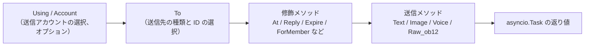

## 送信方法

すべての送信メソッドは `asyncio.Task` オブジェクトを返します。

### 基本メソッド（基底クラスに内包）

以下に示す標準メソッドは `SendDSL` 基底クラスに内包されており、**デフォルトでは `Raw_ob12` に委譲**されます。アダプタのサブクラスでは、これらのメソッドを再実装する必要がなく、直接使用できます。また、IDE による補完も可能です。

| メソッド名 | 説明 | 戻り値 |
|--------|------|---------|
| `Text(text: str)` | テキストメッセージの送信 | `asyncio.Task` |
| `Image(file: bytes \| str)` | 画像の送信 | `asyncio.Task` |
| `Voice(file: bytes \| str)` | 音声の送信（OneBot12 `audio` 段） | `asyncio.Task` |
| `Video(file: bytes \| str)` | 動画の送信 | `asyncio.Task` |
| `File(file: bytes \| str, filename: str = None)` | ファイルの送信 | `asyncio.Task` |

アダプタは、プラットフォーム固有のロジックを提供するために、標準メソッドを個別にオーバーライドできます：

```python
class Send(SendDSL):
    def Raw_ob12(self, message, **kwargs):
        # 必須実装
        ...

    # オプション：Text をオーバーライドしてプラットフォーム固有のロジックを提供
    # def Text(self, text: str):
    #     return self.Raw_ob12([{"type": "text", "data": {"text": text}}])
```

### プロトコルメソッド

| メソッド名 | 説明 | 戻り値 | 必須か |
|--------|------|---------|---------|
| `Raw_ob12(message)` | OneBot12 形式のメッセージを送信 | `asyncio.Task` | **必須実装** |

> **重要**：`Raw_ob12` はアダプタの中心的なメソッドであり、**必ず実装する必要があります**。これは OneBot12 → プラットフォームへの逆変換の統一エントリポイントです。実装しない場合、基底クラスは error ログを記録し、標準のエラー応答（`status: "failed"`, `retcode: 10002`）を返します。標準メソッド（`Text`、`Image` など）はデフォルトで `Raw_ob12` に委譲されます。

### プラットフォーム特有のメソッド

アダプタは `Send` サブクラスに、プラットフォーム固有の送信メソッドを追加できます（`event.supports()` / `event.available_methods()` で識別されます）：

```python
class Send(SendDSL):
    def Raw_ob12(self, message, **kwargs): ...

    # プラットフォーム特有のメソッド
    def Sticker(self, sticker_id: str):
        return self.Raw_ob12([{"type": "sticker", "data": {"id": sticker_id}}])
```

## 修飾メソッド

修飾メソッドは `self` を返すことで、メソッドチェーンをサポートします。

### At メソッド

```python
# @1人のユーザー
await adapter.Send.To("group", "123").At("456").Text("こんにちは")

# @複数のユーザー
await adapter.Send.To("group", "123").At("456").At("789").Text("こんにちは")
```

### AtAll メソッド

```python
# @全員
await adapter.Send.To("group", "123").AtAll().Text("皆さん、こんにちは")
```

### Reply メソッド

```python
# メッセージへの返信
await adapter.Send.To("group", "123").Reply("msg_id").Text("返信内容")
```

### 修飾の組み合わせ

```python
await adapter.Send.To("group", "123").At("456").Reply("msg_id").Text("返信@メッセージ")
```

### プラットフォーム固有の修飾メソッド

`At` / `AtAll` / `Reply` に加えて、アダプターは**プラットフォーム固有の修飾メソッド**を定義できます。このようなメソッドは**`self` を返すだけ**で、デコレータは必要ありません。フレームワークが自動的に認識します。

- `self`（SendDSL インスタンス）を返す → 修飾メソッド。送信パッケージやライフサイクルイベントはトリガーせず、メソッドチェーンを継続します。
- `Task` / `Awaitable` を返す → 送信メソッド。

```python
class Send(SendDSL):
    def Raw_ob12(self, message, **kwargs): ...

    # 修飾メソッド：self を返す、送信はしない
    def Expire(self, seconds: int):
        self._expire = seconds
        return self

    def ForMember(self, user_id: str):
        self._member = user_id
        return self

    # 送信メソッド：Task を返す、修飾メソッドで設定された状態に依存
    def Board(self, content: str, **kwargs):
        return self.Raw_ob12([{"type": "board", "data": {"text": content}}])
```

使用例：

```python
# 修飾メソッドは連続してメソッドチェーンで使用できます
await adapter.Send.To("group", "big").Expire(3600).ForMember("114").Board("ボードの内容")
```

## Event 包装クラスで修飾メソッドを使用する

> [!NOTE]
> `reply(via=)` と `event.send_chain()` は、ErisPulse **2.7.0+** が必要です。

`event.reply()` はデフォルトで `at_sender`/`at_users`/`at_all`/`quote` などの組み込み修飾パラメータのみ公開します。プラットフォーム固有の修飾メソッドを使用するには、2 通りの方法があります。

### 方法1: reply() の via パラメータ

少量で既知の修飾メソッドに適しています：

```python
await event.reply("看板内容", method="Board",
                  via=[("Expire", 3600), ("ForMember", "114514")])
```

`via` はリストであり、各要素は以下のいずれかの形式です：

| 形式 | 等価な連鎖呼び出し |
|------|-------------|
| `"Name"` | `.Name()` |
| `("Name", arg1, arg2)` | `.Name(arg1, arg2)` |
| `("Name", (arg1,), {kw: val})` | `.Name(arg1, kw=val)` |

### 方法2: event.send_chain()

**複数の修飾メソッド**または**内容パラメータのないアクション型メソッド**（例：取り消し、削除）に適しています。`send_chain()` は `To`/`Using` が設定された送信チェーンを返し、任意の修飾メソッドと送信メソッドを自由に追加できます：

```python
# プラットフォーム固有の修飾メソッド + 看板送信
await event.send_chain().Expire(3600).Board("一時間後に期限切れ")

# 複数の修飾メソッドを連続して使用
await (event.send_chain()
       .Expire(3600)
       .ForMember("114514")
       .Board("看板内容", content_type="markdown"))

# 組み込み修飾メソッドも使用可能
await event.send_chain().At("123").Reply("msg_id").Text("hi")

# 内容パラメータのないアクション型メソッド
await event.send_chain().DismissBoard()
```

> `send_chain()` は完全な SendDSL インスタンスを返すため、**すべての連鎖特性が使用可能**です — 修飾メソッドだけでなく、送信ルールや一括構築も含まれます：

```python
# 送信ルール：再試行 + タイムアウト + 成功時のコールバック
await (event.send_chain()
       .Retry(3).Timeout(10)
       .Hook(lambda r: print("送信成功"))
       .Text("信頼性の高い送信"))

# 遅延送信 + プラットフォーム修飾 + 看板
await event.send_chain().Defer(5).Expire(3600).Board("遅延看板")

# 一括構築モード
results = await (event.send_chain()
                 .Build()
                 .Text("第一句").Image("pic.jpg").Text("第二句")
                 .send_all())
```

## アカウント管理

### Using メソッド

`Using()` は、メッセージの送信に使用するアカウントを指定するために使用されます。渡された識別子は、`_resolve_account()` によって以下の優先順位でマッチされます：

1. **アカウント名** — 設定ファイルのキー名（例: `"default"`、`"bot1"`）
2. **実行時に注入された bot_id** — イベントの変換時に自動的に注入される識別子
3. **任意の str フィールド** — 設定ファイルの他の文字列フィールド
4. **デフォルト** — 最初に有効化されたアカウント

```python
# アカウント名を使用
await adapter.Send.Using("account1").To("user", "123").Text("Hello")

# bot_id を使用（イベント内の self.user_id に相当）
await adapter.Send.Using("bot_123").To("user", "123").Text("Hello")
```

### Account メソッド

`Account` メソッドは `Using` と同等です：

```python
await adapter.Send.Account("account1").To("user", "123").Text("Hello")
```

## 非同期処理

### 結果を待たない

```python
# メッセージはバックグラウンドで送信されます
task = adapter.Send.To("user", "123").Text("Hello")

# 他の操作を続行します
# ...
```

### 結果を待つ

```python
# await を直接使用して結果を取得します
result = await adapter.Send.To("user", "123").Text("Hello")
print(f"送信結果: {result}")

# Task を保存して後で待つ
task = adapter.Send.To("user", "123").Text("Hello")
# ... 他の操作 ...
result = await task
```

## 送信ルールシステム

SendDSL には、ルールデコレータとして一連の送信ルールが組み込まれており、ルールはメソッドチェーンで追加され、最終的な送信時に一括で適用されます。ルールは一般的な生産環境のシナリオをカバーしています：タイムアウト制御、失敗時の再試行、成功時のコールバック、遅延送信、優先度による破棄、進捗監視。

ルールメソッドは**selfを返します**（At/AtAll/Replyと同様）、送信メソッド（Text/Imageなど）の前に呼び出す必要があります。ルールは`To`/`Using`/`Account`によって作成された新しいインスタンスと共に伝播されます。

### ルールメソッド一覧

| メソッド | 説明 |
|--------|------|
| `.Hook(callback)` | 送信が成功した後に実行されるコールバック（複数回呼び出すことができ、順番に実行されます） |
| `.Retry(times=1)` | 失敗時に自動的にN回再試行（最初を含めて合計N+1回） |
| `.Timeout(seconds)` | 単一の送信がタイムアウトした場合、現在の試行をキャンセルします（Retryと重ねて使用できます） |
| `.Defer(seconds=1.0)` | 送信を遅延（プロセス内でのタイマー、永続化されません） |
| `.Priority(level, drop_if_busy=False)` | 送信の優先度を設定；送信が溜まっている場合、破棄することができます |
| `.OnProgress(callback)` | 各段階の進捗コールバック（SendContextを引数として渡されます） |
| `.OnError(callback)` | 最終的に失敗した際のエラーコールバック（1回のみ実行されます） |

### 送信成功後に実行するロジック（Hook）

```python
# 同期コールバック
await (adapter.Send.To("user", "123")
       .Hook(lambda r: print(f"送信成功、メッセージID: {r['message_id']}"))
       .Text("你好"))

# 異步コールバック
async def deduct_points(result):
    await db.update(user_id="123", points=-1)

await adapter.Send.To("user", "123").Hook(deduct_points).Text("扣积分")
```

Hookは、送信が最終的に成功した場合（再試行成功を含む）にのみ実行されます。失敗、タイムアウト、キャンセルの場合はトリガーされません。

### 失敗時の自動再試行（Retry）

```python
# 初回失敗後に2回再試行し、合計3回試行します
result = await adapter.Send.To("user", "123").Retry(2).Text("带重试")
```

再試行のトリガー条件：送信時に例外が発生した場合、送信がタイムアウトした場合、送信が`status == "failed"`のレスポンスを返した場合。

### タイムアウトによる自動キャンセル（Timeout）

```python
# 単一の送信が10秒を超えるとキャンセルされます
await adapter.Send.To("user", "123").Timeout(10).Text("带超时")

# タイムアウト + 再試行：各試行10秒、最大3回
await adapter.Send.To("user", "123").Timeout(10).Retry(2).Text("超时重试")
```

### 進捗監視（OnProgress / OnError）

```python
def on_progress(ctx):
    print(f"段階: {ctx.stage}, 試行: {ctx.attempt + 1}/{ctx.max_attempts}, 耗時: {ctx.elapsed:.2f}s")
    if ctx.stage == "failed":
        print(f"  エラー: {ctx.error!r}")

async def on_error(ctx):
    await notify_admin(f"送信先 {ctx.target_id} に送信失敗: {ctx.error!r}")

await (adapter.Send.To("user", "123")
       .Retry(3).Timeout(10)
       .OnProgress(on_progress)
       .OnError(on_error)
       .Text("监控"))
```

`SendContext` に含まれるフィールド：`task_id`、`platform`、`method`、`target_type`、`target_id`、`bot_id`、`stage`、`attempt`、`max_attempts`、`started_at`、`finished_at`、`elapsed`、`error`、`result`、`extra`。

`stage` の可能な値：`pending`、`sending`、`retrying`、`success`、`failed`、`timeout`、`cancelled`、`dropped`。

### 遅延送信（Defer）

```python
# 5秒後に送信
await adapter.Send.To("user", "123").Defer(5).Text("迟到消息")
```

> 注意：遅延はプロセス内でのタイマーであり、プロセスの再起動で失われます。永続化は提供されません。

### 優先度と送信の破棄（Priority）

```python
# 低優先度のメッセージ。送信キューが溜まっている場合、自動的に破棄されます
result = await (adapter.Send.To("user", "123")
               .Priority(-1, drop_if_busy=True)
               .Text("可放弃的通知"))
# 破棄された場合、result["status"] == "failed"
```

`drop_if_busy`を有効にすると、送信中のタスク数がしきい値（デフォルトは64）を超えた場合、今回の送信を放棄します。`.PriorityThreshold(n)`でグローバルなしきい値を調整できます。

### ルールの組み合わせとバックグラウンド実行

```python
# メインのフローをブロックせず、ルールは正常に適用されます
task = (adapter.Send.To("user", "123")
        .Hook(lambda r: print("送信成功！"))
        .Retry(3)
        .Timeout(10)
        .OnProgress(on_progress)
        .Text("你好"))

# 他の操作を継続実行
await handle_next_action()
```

### ルールの伝播

ルールは`To`/`Using`/`Account`によって作成された新しいインスタンスと共に伝播され、メソッドチェーンの呼び出し中にルールが失われることを防ぎます：

```python
# Toの前にルールを設定しても、Toによって作成されたインスタンスにも伝播されます
builder = adapter.Send.Retry(3).Timeout(10)
send = builder.To("user", "123")  # sendはRetry(3)とTimeout(10)を引き継ぎます
await send.Text("hi")
```

複数のインスタンスのルールは相互に独立しています（hooksリストは深くコピーされます）。

## バッチ構築モード（Build）

単発モードに加えて、SendDSL はバッチ構築モードもサポートしています。1つのチェーンに複数の送信メソッドを書き込み、最後に一括して実行します。これは「一気に複数のメッセージを送信する」場面に適しています。

### 構築モードに入る

送信メソッドの前に `.Build()` を呼び出すと、`SendBuilder` が返されます。以降、送信メソッド（Text/Image など）は即座に実行されず、送信意図として蓄積されます：

```python
results = await (adapter.Send.To("user", "123")
                 .Build()                    # 構築モードに入る
                 .Text("第一句")
                 .Image("pic.jpg")
                 .Text("第二句")
                 .send_all())                 # 一括実行
# results = [Text結果, Image結果, Text結果]
```

`.send_all()` は `asyncio.Task` を返し、await 後に結果リスト（意図の順序で）が得られます。

### 並列と直列

デフォルトでは**並列**実行（並行送信、総所要時間は最遅の1つに近い）されます。メッセージの到着順序を保証する必要がある場合は、`.Sequential()` を呼び出します：

```python
# 直列：順に送信
await (adapter.Send.To("group", "456")
       .Build()
       .Sequential()
       .Text("先発这个").Text("再发这个")
       .send_all())

# 並列（デフォルト、明示的に呼び出しても可）
await (adapter.Send.To("group", "456")
       .Build()
       .Parallel()
       .Text("并发1").Text("并发2")
       .send_all())
```

### 失敗しても続行とリトライ

バッチ実行では**失敗しても続行**の戦略を採用しています。1つの送信が失敗しても、他の送信は中断されません。`.Retry()` と併用すると、失敗した項目は自動的にリトライされます（リトライは個々の送信に作用し、バッチ全体をリトライするものではありません）：

```python
await (adapter.Send.To("user", "123")
       .Build()
       .Retry(2)                       # 各送信がそれぞれ2回リトライ
       .Text("可能失败的").Image("也可能失败的")
       .send_all())
```

### バッチ全体のルールとコールバック

ルールはバッチ全体に適用されます：

| メソッド | 説明 |
|--------|------|
| `.Timeout(seconds)` | 各送信の単一タイムアウト |
| `.Retry(times)` | 各送信が個別にリトライ（失敗しても続行） |
| `.Defer(seconds)` | バッチ全体の送信を遅延 |
| `.Hook(callback)` | バッチ全体が成功した後にトリガーされ、`results` リストを受け取る |
| `.OnError(callback)` | バッチに失敗がある場合にトリガーされ、`BatchContext` を受け取る |
| `.OnProgress(callback)` | 各送信が完了するたびにトリガーされ、`BatchContext` を受け取る |

```python
def on_progress(ctx):
    print(f"進捗: {ctx.completed}/{ctx.total}, 成功 {ctx.succeeded}, 失敗 {ctx.failed}")

async def on_error(ctx):
    print(f"バッチに {ctx.failed} 件の失敗があります")

results = await (adapter.Send.To("user", "123")
               .Build()
               .Retry(2).Timeout(10)
               .OnProgress(on_progress)
               .OnError(on_error)
               .Hook(lambda rs: print("バッチ送信完了"))
               .Text("a").Text("b").Text("c")
               .send_all())
```

`BatchContext` には、`task_id`、`total`、`completed`、`succeeded`、`failed`、`stage`、`results`、`errors`、`elapsed`、`extra` が含まれます。

`stage` の値は次のいずれかです：`pending`、`sending`、`success`（すべて成功）、`partial`（一部成功）、`failed`（すべて失敗）。

### デコレータとルールの継承

`.Build()` の前の At/AtAll/Reply デコレータとルールはバッチ全体に継承され、各メッセージに作用します：

```python
await (adapter.Send.To("group", "456")
       .At("789")                        # 継承：各メッセージに @789 が付与
       .Build()
       .Retry(2)                         # 継承 + 追加：各送信がそれぞれリトライ
       .Text("@你的通知")
       .Image("公告图")
       .send_all())
```

Build 後でもデコレータを追加できます（バッチ全体に作用）：

```python
await (adapter.Send.To("group", "456")
       .Build()
       .At("111").At("222")             # 追加 @、バッチ全体に作用
       .Text("@多人")
       .send_all())
```

### バックグラウンド実行

単発と同じように、`.send_all()` は Task を返し、await せずにバックグラウンドで実行させることもできます：

```python
task = (adapter.Send.To("user", "123")
        .Build()
        .Hook(lambda rs: print("バッチ送信完了"))
        .Text("a").Text("b")
        .send_all())

# 主処理をブロックしない
await do_something_else()
```

## 命名規則

### PascalCase 命名

すべての送信メソッドは大文字で始まるキャメルケース（PascalCase）を使用します：

```python
# ✅ 正しい
def Text(self, text: str):
    pass

def Image(self, file: bytes):
    pass

# ❌ 間違っている
def text(self, text: str):
    pass

def send_image(self, file: bytes):
    pass
```

### プラットフォーム固有のメソッド

プラットフォームのプレフィックスを付けるメソッドの追加は推奨されません：

```python
# ✅ 推奨
def Sticker(self, sticker_id: str):
    pass

# ❌ 推奨されない
def TelegramSticker(self, sticker_id: str):
    pass
```

`Raw` メソッドを使用して代用します：

```python
# ✅ 推奨
await adapter.Send.Raw_ob12([{"type": "sticker", ...}])

# ❌ 推奨されない
def TelegramSticker(self, ...):
    pass
```

## 送信リンクの内部分解

`await adapter.Send.To("group", "123").Text("x")` という1回の処理の裏で、フレームワークは以下の処理をすべて代行しています：

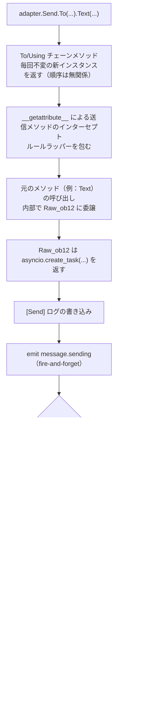

**フレームワークが行った各ステップの内容：**

| 階段 | フレームワークが行ったこと |
|------|-------------|
| チェーンの結合 | `To`/`Using`/`Account` の各呼び出しは**不変の新インスタンスを生成**し、既に設定されたフィールドを継承するため、`To(...).Using(...)` と `Using(...).To(...)` は**等価**で、順序は無関係 |
| メソッドのラッピング | 送信メソッド（`Text` など）は `__getattribute__` でインターセプトされ、ラッパーを包む。修飾メソッド（`To`/`Using`/`At`/`Retry` など）は**ラッピングされない**。ネストされた `Raw_ob12` の呼び出しは、 `_in_rule_wrap` マーカーにより重複ラッピングを防ぐ |
| Task の作成 | `Raw_ob12` 内部の `asyncio.create_task()` が Task の真の作成ポイントである。`Text()` は Task を同期的に返すだけで、**ブロックしない** |
| 送信ログ | `[Send] platform/method -> target` というイベントログを記録する（`exclude_levels=["EVENT"]` で非表示にすることも可能） |
| `message.sending` | 送信メソッドが呼び出された際に**即座に** fire-and-forget でトリガーされる（ハンドラが存在する場合に限る、`has_handlers` による短絡） |
| `message.sent` | Task の `done_callback` にバインドされる——**ルールがある場合は、リトライプロセス全体の最終結果を上書きする**、ルールがない場合は元の Task の完了を意味する |

### アカウント解決の優先順位

アダプター内部で `_resolve_account(account_id)` を呼び出すとき、以下の順序で具体的なアカウントに解決される：

1. 単一アカウントアダプター（`AccountConfigClass` がない）→ 直接返す
2. アカウント名が `account_id` と正確に一致
3. 各アカウントの `bot_id` フィールドが一致
4. 各アカウントの任意の `str` フィールド値が一致（`enabled`/`name` を除外）
5. 最後の手段として、最初の有効なアカウント
6. すべて失敗 → `ValueError` を投げる

> あなたが渡した `account_id` は、`Using()` で明示的に指定されたもの > イベントの `self` フィールド（`account_id` は `user_id` より優先され、`event.reply()` が自動的に注入）> 指定しない（アダプターが最初の有効なアカウントをデフォルトで使用）

### 送信ルールエンジン（リトライ/タイムアウト/遅延）

ルールは `Raw_ob12` が Task を返した**後に**、外側の Task にラップされるため、メインの処理には影響しない。重要な事実：

| ルール | 説明 |
|------|------|
| `Retry(n)` | 総試行回数は `n+1` 回。**失敗後は即座に再送信し、指数バックオフはなし** |
| `Timeout(s)` | 単一送信のタイムアウトはキャンセル（`asyncio.wait_for`）、未使用の場合は再試行 |
| `Defer(s)` | 送信前に遅延 sleep |
| `Priority(level, drop_if_busy)` | 累積が閾値を超えた場合は、即座に `{status:"failed", retcode:10002, message:"dropped_low_priority"}` を返す |
| `Hook(fn)` | 最終的に成功した場合のみ、順序通りに実行される |
| `on_progress` / `on_error` | 各段階および最終的な失敗時のコールバック |

> **注意**：リトライは「即座に再送信」であり、退避間隔は存在しない。プラットフォームのリクエスト制限がある場合は、`on_error` コールバックで sleep した後に手動で再送信を行う必要がある。ルールの成功判定は、返却される dict の `status == "ok"` に基づく（`retcode == 0`）。

> 標準的なレスポンス形式と `retcode` の完全な意味は、[API レスポンス規格](../../standards/api-response.md)を参照してください。

## 戻り値

### Task オブジェクト

すべての送信メソッドは `asyncio.Task` を返します。アダプタは `Raw_ob12` を実装するだけでよく、標準メソッド（Text/Image など）はデフォルトで它に委譲されます：

```python
import asyncio

def Raw_ob12(self, message, **kwargs):
    async def _do_send():
        segments = self._apply_modifiers(message)
        return await self._adapter.call_api(
            endpoint="/send_message",
            message=segments,
            **self.send_context,
            **kwargs,
        )
    return asyncio.create_task(_do_send())

# Text/Image/Voice/Video/File は基底クラスから継承され、自動的に Raw_ob12 に委譲されます。
# 標準メソッドをオーバーライドする場合は、asyncio.Task を返すだけです：
# def Text(self, text: str):
#     return self.Raw_ob12([{"type": "text", "data": {"text": text}}])
```

### 応答の標準化

`call_api` は標準化された応答を返す必要があります。`make_response()` / `make_error()` メソッドを推奨します：

```python
async def call_api(self, endpoint: str, **params):
    try:
        result = await self._do_api_call(endpoint, **params)
        return self.make_response(
            data=result.get("data"),
            message_id=result.get("message_id", ""),
            raw=result,
        )
    except Exception as e:
        return self.make_error(message=str(e))
```

手動で構築することも可能です（旧バージョンの方式も互換性があります）：

```python
async def call_api(self, endpoint: str, **params):
    return {
        "status": "ok" または "failed",
        "retcode": 0 またはエラーコード,
        "data": {...},
        "message_id": "msg_id" または "",
        "message": "",
        "{platform}_raw": raw_response
    }
```

## 完整例

### 基本使用

```python
from ErisPulse.Core import adapter

my_adapter = adapter.get("myplatform")

# テキストの送信
await my_adapter.Send.To("user", "123").Text("Hello World!")

# 画像の送信
await my_adapter.Send.To("group", "456").Image("https://example.com/image.jpg")

# ファイルの送信
with open("document.pdf", "rb") as f:
    await my_adapter.Send.To("user", "123").File(f.read())
```

### チェーン呼び出し

```python
# @ユーザー + リプライ
await my_adapter.Send.To("group", "456").At("789").Reply("msg123").Text("リプライ@のメッセージ")

# @全員 + 複数の修飾
await my_adapter.Send.Using("bot1").To("group", "456").AtAll().Text("お知らせメッセージ")
```

### 原始メッセージとメッセージ構築

`Raw_ob12` は逆変換の中心となるエントリポイントです（OB12 メッセージセグメント → プラットフォーム API 呼び出し）。`MessageBuilder` はそれに伴うチェーン式メッセージセグメント構築ツールです。

> 完全な `Raw_ob12` 実装の規格、`MessageBuilder` の使い方およびコード例については、以下のドキュメントを参照してください：
> - [送信メソッド規格 §6 逆変換規格 (OneBot12 → プラットフォーム)](../../standards/send-method-spec.md#6-逆変換規格onebot12--プラットフォーム)
> - [送信メソッド規格 §11 メッセージビルダー](../../standards/send-method-spec.md#11-メッセージビルダー-messagebuilder)


### 适配器开发最佳实践

# アダプタ開発のベストプラクティス

> [!TIP]  
> **この記事を読むタイミング**: アダプタの基本的な構造が動いた後にお勧めです（工程化のベストプラクティス）。必要ない場合は飛ばしても、他の機能の使用に影響はありません。

ここでは、アダプタ開発における工程上の約束事項をまとめます：Botの状態報告、接続の再試行とハートビート、複数アカウントの解析、標準化されたエラー応答——これらを実装することで、接続の切断が気づかれない、複数アカウントで送信先が間違える、エラーの原因が特定しにくいといったプラットフォームへの接続時によくある問題を回避できます。

## Botの状態管理とMetaイベント

アダプタは、`adapter.emit()` によってMetaイベントを送信し、フレームワークがBotの接続状態、オンライン/オフライン、ハートビート情報を自動的に追跡できるようにする必要があります。

### 1. いつMetaイベントを送信するか

| イベント | `detail_type` | 発生タイミング | フレームワークの動作 |
|------|--------------|---------|---------|
| 接続 | `"connect"` | Botがプラットフォームと接続したとき | Botを登録し、`adapter.bot.online`のライフサイクルイベントをトリガー |
| 切断 | `"disconnect"` | Botがプラットフォームと切断したとき | Botをオフラインとマークし、`adapter.bot.offline`のライフサイクルイベントをトリガー |
| ハートビート | `"heartbeat"` | 定期的に送信（推奨：30〜60秒） | Botのアクティブ時間とメタ情報を更新 |

### 2. Metaイベントの送信

フレームワークは`emit_meta()`メソッドを提供しており、一行でMetaイベントを送信できます：

```python
class MyAdapter(BaseAdapter):
    async def _ws_handler(self, websocket):
        bot_id = self._get_bot_id()

        # Botがオンライン：一行でconnectイベントを送信
        await self.emit_meta("connect", bot_id, user_name="MyBot", nickname="私のロボット")

        try:
            while True:
                data = await websocket.receive_text()
                event = self.convert(data)
                if event:
                    await self.adapter.emit(event)
        except WebSocketDisconnect:
            pass
        finally:
            # Botがオフライン
            await self.emit_meta("disconnect", bot_id)
```

また、標準的なMetaイベントを手動で構築することもできます（旧バージョンの方式も互換性があります）：

```python
await self.adapter.emit({
    "id": str(uuid4()),
    "time": int(time.time()),
    "type": "meta",
    "detail_type": "connect",
    "platform": "myplatform",
    "self": {
        "platform": "myplatform",
        "user_id": bot_id,
        "user_name": "MyBot",
        "avatar": "https://example.com/avatar.jpg",
    },
    "myplatform_raw": raw_data,
    "myplatform_raw_type": "connected",
})
```

### 3. ハートビートイベント

アダプタは、接続が維持されている間、定期的にハートビートイベントを送信してBotのアクティブ時間を更新する必要があります：

```python
class MyAdapter(BaseAdapter):
    async def _heartbeat_loop(self, bot_id: str):
        while self._connected:
            # フレームワークにmeta heartbeatを送信（一行で完了）
            await self.emit_meta("heartbeat", bot_id)
            await asyncio.sleep(30)
```

### 4. `self`フィールドの自動検出

フレームワークの`adapter.emit()`は、すべてのイベント（Metaイベントに限らず）の`self`フィールドを自動的に処理します：

- **通常のイベント**（message/notice/request）の`self`フィールドは自動的にBotを登録します
- **`self`フィールドの拡張情報**：`user_name`、`nickname`、`avatar`、`account_id`などのオプションフィールドがサポートされています

```python
# 転換器にselfフィールドがあれば、Botは自動的に登録され、アクティブ時間が更新されます
onebot_event = {
    "type": "message",
    "detail_type": "private",
    "platform": "myplatform",
    "self": {
        "platform": "myplatform",
        "user_id": "bot123",
        "user_name": "MyBot",
        "nickname": "私のロボット",
    },
    # ... 他のフィールド
}
await self.adapter.emit(onebot_event)
# Bot "bot123" は自動的に登録され、アクティブ時間が更新されます
```

### 5. Botの状態の照会

照会API（`get_bot_info()` / `list_bots()` / `is_bot_online()` / `get_status_summary()`）とBotのライフサイクルイベントの表は、[アダプタシステムAPI - Botの状態管理](../../api-reference/adapter-system.md#bot-状態管理)をご覧ください。

## 接続管理

### 1. 接続の再試行の実装

```python
import asyncio

class MyAdapter(BaseAdapter):
    async def start(self):
        retry_count = 0
        max_retries = 5
        
        while retry_count < max_retries:
            try:
                await self._connect_to_platform()
                self.logger.info("接続成功")
                break
            except Exception as e:
                retry_count += 1
                if retry_count < max_retries:
                    # 指数バックオフ戦略
                    wait_time = min(60 * (2 ** retry_count), 600)
                    self.logger.warning(
                        f"接続失敗、{wait_time}秒後に再試行 ({retry_count}/{max_retries}): {e}"
                    )
                    await asyncio.sleep(wait_time)
                else:
                    self.logger.error("接続失敗、最大再試行回数に達しました")
                    raise
```

### 2. 接続状態の管理

```python
class MyAdapter(BaseAdapter):
    async def start(self):
        self.connection = None
        self._connected = False
    
    async def _ws_handler(self, websocket: WebSocket):
        self.connection = websocket
        self._connected = True
        self.logger.info("接続が確立されました")
        
        try:
            while True:
                data = await websocket.receive_text()
                await self._process_event(data)
        except WebSocketDisconnect:
            self.logger.info("接続が切断されました")
        finally:
            self.connection = None
            self._connected = False
```

### 3. ハートビート保活とMetaハートビート

アダプタのハートビートは、プラットフォームへのハートビート保活とフレームワークへのmeta heartbeatイベントの送信の両方を完了する必要があります。

```python
class MyAdapter(BaseAdapter):
    async def start(self):
        self.connection = await self._connect_to_platform()
        self._heartbeat_task = asyncio.create_task(self._heartbeat_loop())

    async def _heartbeat_loop(self):
        while self.connection:
            try:
                # 1. プラットフォームにハートビート保活を送信
                await self.connection.send_json({"type": "ping"})

                # 2. フレームワークにmeta heartbeatを送信（emit_metaで一行で完了）
                await self.emit_meta("heartbeat", self._bot_id)

                await asyncio.sleep(30)
            except Exception as e:
                self.logger.error(f"ハートビート失敗: {e}")
                break
```

### 4. 接続情報の公開

アダプタが登録したルートは、ユーザーがプラットフォーム側のコールバックアドレスを設定できるように、ユーザーに見えるようにする必要があります。`start()`で接続情報を積極的に出力することをお勧めします：

```python
class MyAdapter(BaseAdapter):
    async def start(self):
        router.register_websocket(
            module_name=self.platform,
            path="/ws",
            handler=self._ws_handler
        )

        if self.sdk:
            info = self.sdk.adapter.get_connection_info(self.platform)
            if info:
                self.logger.info(f"WebSocketアドレス: "
                    f"{info.get('connection', {}).get('base_url', '')}"
                    f"{info.get('connection', {}).get('websocket_routes', [])}")
```

ユーザーは以下のAPIを使って、アダプタのすべてのルートと接続アドレスを確認できます：

```python
from ErisPulse import sdk

# アダプタレベルの接続情報（推奨）
info = sdk.adapter.get_connection_info("myplatform")

# ルートマネージャレベルの照会
sdk.router.list_namespaces()              # すべての名前空間をリストアップ
sdk.router.get_module_routes("myplatform")  # 詳細なルート情報
sdk.router.get_module_urls("myplatform")    # 完全な接続URL
```

> **注意**: ルートを登録する際の`module_name`は、ErisPulseに登録されたアダプタの`platform`名と完全に一致する必要があります。一致しないと`get_connection_info()`でルートを関連付けることができません。複数アカウントアダプタは、異なる`module_name`ではなく、各アカウントにサブパス（例：`/account1/webhook`、`/account2/webhook`）を登録する必要があります。

## イベントの転換

### 1. OneBot12標準に厳密に従う

```python
class MyPlatformConverter:
    def convert(self, raw_event):
        """イベントを転換"""
        onebot_event = {
            "id": str(raw_event.get("event_id", uuid.uuid4())),
            "time": int(time.time()),
            "type": self._convert_type(raw_event.get("type")),
            "detail_type": self._convert_detail_type(raw_event),
            "platform": "myplatform",
            "self": {
                "platform": "myplatform",
                "user_id": str(raw_event.get("bot_id", ""))
            },
            "myplatform_raw": raw_event,  # 保持したまま（必須）
            "myplatform_raw_type": raw_event.get("type", "")  # 元のタイプ（必須）
        }
        return onebot_event
```

### 2. 時間スタンプの標準化

```python
def _convert_timestamp(self, timestamp):
    """10桁の秒単位の時間スタンプに変換"""
    if not timestamp:
        return int(time.time())
    
    # ミリ秒単位の時間スタンプの場合
    if timestamp > 10**12:
        return int(timestamp / 1000)
    
    # 秒単位の時間スタンプの場合
    return int(timestamp)
```

### 3. イベントIDの生成

```python
import uuid

def _generate_event_id(self, raw_event):
    """イベントIDを生成"""
    event_id = raw_event.get("event_id")
    if event_id:
        return str(event_id)
    # プラットフォームがIDを提供していない場合、UUIDを生成
    return str(uuid.uuid4())
```

## SendDSLの実装

`At`/`AtAll`/`Reply`修飾子は、フレームワークのSendDSL基底クラスに既に実装されているため、アダプタは`Raw_ob12`と具体的な送信メソッドを実装するだけで済みます。`self._apply_modifiers(message)`と`self.send_context`を使用して開発を簡素化します。

### 1. 必ずTaskオブジェクトを返す

```python
class Send(BaseAdapter.Send):
    def Raw_ob12(self, message, **kwargs):
        """推奨実装：フレームワークの補助メソッドを使用"""
        async def _do_send():
            segments = self._apply_modifiers(message)
            return await self._adapter.call_api(
                endpoint="/send_message",
                message=segments,
                **self.send_context,
                **kwargs
            )
        return asyncio.create_task(_do_send())

    def Text(self, text: str):
        return self.Raw_ob12([{"type": "text", "data": {"text": text}}])
```

### 2. 鏈式修飾メソッドはselfを返す

```python
class Send(BaseAdapter.Send):

    def __init__(self, adapter, target_type=None, target_id=None, account_id=None):
        super().__init__(adapter, target_type, target_id, account_id)
        self.buttons = []

    def Button(self, content: list) -> 'Send':
        self.buttons.append(content)
        return self # selfを返す
```

### 3. プラットフォーム固有のメソッドをサポート

```python
class Send(BaseAdapter.Send):
    def Sticker(self, sticker_id: str):
        """スタンプを送信"""
        return asyncio.create_task(
            self._adapter.call_api(
                endpoint="/send_sticker",
                message=[{"type": "sticker", "data": {"id": sticker_id}}],
                **self.send_context
            )
        )
    
    def Card(self, card_data: dict):
        """カードメッセージを送信"""
        return asyncio.create_task(
            self._adapter.call_api(
                endpoint="/send_card",
                message=[{"type": "card", "data": {"card_data": card_data}}],
                **self.send_context
            )
        )
```

## API応答

### 1. 標準化された応答フォーマット

フレームワークは`make_response()`と`make_error()`メソッドを提供し、標準化された応答を構築できます：

```python
async def call_api(self, endpoint: str, **params):
    try:
        raw_response = await self._platform_api_call(endpoint, **params)
        
        if raw_response.get("success"):
            return self.make_response(
                data=raw_response.get("data"),
                message_id=raw_response.get("data", {}).get("message_id", ""),
                raw=raw_response,
            )
        else:
            return self.make_error(
                retcode=raw_response.get("code", 10001),
                message=raw_response.get("message", ""),
                raw=raw_response,
            )
    except Exception as e:
        return self.make_error(message=str(e))
```

`make_response()`は自動的に`{platform}_raw`キーを持つ応答辞書を生成します。`make_error()`はデフォルトで`retcode=34000`（Platform Error）を使用します。

### 2. エラーコードの規範

OneBot12標準のエラーコードに従います：

```python
# 1xxxx - アクションリクエストエラー
10001: Bad Request
10002: Unsupported Action
10003: Bad Param

# 2xxxx - アクションハンドラエラー
20001: Bad Handler
20002: Internal Handler Error

# 3xxxx - アクション実行エラー
31000: Database Error
32000: Filesystem Error
33000: Network Error
34000: Platform Error
35000: Logic Error
```

## 複数アカウントのサポート

### 1. 宣言的設定（推奨）

`AccountConfigClass`を宣言して設定クラスを定義した後、フレームワークが複数アカウントのロード、検証、テンプレート生成を自動的に管理します。`BotAccountConfig`基底クラスは`enabled`と`name`フィールドを提供しており、アダプタは宣言する必要はありません：

```python
from dataclasses import dataclass, field
from ErisPulse.Core.Bases import BotAccountConfig

@dataclass
class MyBotConfig(BotAccountConfig):
    token: str = field(default="", metadata={
        "description": {"i18n": "my_adapter.bot_token", "default": "Bot Token"},
        "required": True,
        "secret": True,
    })

class MyAdapter(BaseAdapter):
    AccountConfigClass = MyBotConfig
    
    async def start(self):
        for name, account in self.enabled_accounts.items():
            self.logger.info(f"アカウント {name} を起動中")
            await self._connect(name, account.token)
            # bot_idはフレームワークがプラットフォームプロトコル/ログイン応答から自動的に取得して戻し埋めします
    
    async def call_api(self, endpoint: str, **params):
        account_id = params.pop("account_id", None)
        name, account = self._resolve_account(account_id)
        # name: アカウント名, account: MyBotConfigインスタンス
```

設定ファイルは自動的に生成されます：

```toml
[MyAdapter.accounts.default]
token = ""
enabled = true
name = ""
```

### 2. アカウント選択メカニズム

フレームワークは`_resolve_account()`メソッドを内蔵しており、優先順位でアカウントを照合します：

1. **アカウント名** — 設定のキー名で正確に一致
2. **`bot_id`フィールド** — 自動的に取得されたbot_id（イベントの`event["self"]["user_id"]`から）
3. **任意のstrフィールド** — 設定の他の文字列フィールド
4. **デフォルト** — 最初に有効なアカウント

```python
# アカウント名で照合
name, account = self._resolve_account("account1")

# bot_idで照合（イベントからの最も一般的な方法）
name, account = self._resolve_account("bot_123")

# 任意の値で照合（Noneを渡すと最初の有効なアカウントが返る）
name, account = self._resolve_account(None)
```

## エラー処理

### 1. エラーの分類処理

`make_error()`を使って標準化されたエラー応答を構築します。`sdk.client`を使ってリクエストする際は、ErisPulseの例外をキャッチします：

```python
from ErisPulse.Core.Bases.errors import ClientError, ClientTimeoutError

async def call_api(self, endpoint: str, **params):
    try:
        from ErisPulse.Core import client
        resp = await client.post(
            f"https://api.platform.com/{endpoint}",
            json=params,
            max_retries=2,
        )
        response = await resp.json()
        return self.make_response(data=response, raw=response)
    except ClientTimeoutError:
        self.logger.error(f"リクエストタイムアウト: {endpoint}")
        return self.make_error(retcode=32000, message="リクエストタイムアウト")
    except ClientError as e:
        self.logger.error(f"ネットワークエラー: {e}")
        return self.make_error(retcode=33000, message="ネットワークリクエスト失敗")
    except json.JSONDecodeError:
        self.logger.error("JSON解析失敗")
        return self.make_error(retcode=10006, message="レスポンスフォーマットエラー")
    except Exception as e:
        self.logger.error(f"未知のエラー: {e}", exc_info=True)
        return self.make_error(message=str(e))
```

> **後方互換性**: `aiohttp`を使用する旧アダプタのコードは影響を受けません。`aiohttp.ClientError`をキャッチできます。例外の変換は、`sdk.client`を使ってリクエストする場合にのみ有効です。

### 2. ログ記録

フレームワークは、アダプタごとにサブloggerを自動的に作成します（`sdk.logger.get_child("MyAdapter")`）。手動で初期化する必要はありません：

```python
class MyAdapter(BaseAdapter):
    # ConfigClass = ...  # 設定クラスを宣言するとself.loggerが自動的に利用可能になります
    
    async def start(self):
        self.logger.info("アダプタが起動中です...")
        # ...
        self.logger.info("アダプタの起動が完了しました")
    
    async def shutdown(self):
        self.logger.info("アダプタが終了中です...")
        # ...
        self.logger.info("アダプタの終了が完了しました")
```

## テスト

### 1. 単体テスト

```python
import pytest
from ErisPulse.Core.Bases import BaseAdapter

class TestMyAdapter:
    def test_converter(self):
        """転換器のテスト"""
        converter = MyPlatformConverter()
        raw_event = {"type": "message", "content": "Hello"}
        result = converter.convert(raw_event)
        assert result is not None
        assert result["platform"] == "myplatform"
        assert "myplatform_raw" in result
    
    def test_api_response(self):
        """APIの応答フォーマットのテスト"""
        adapter = MyAdapter()
        response = adapter.call_api("/test", param="value")
        assert "status" in response
        assert "retcode" in response
```

### 2. 集成テスト

```python
@pytest.mark.asyncio
async def test_adapter_start():
    """アダプタの起動テスト"""
    adapter = MyAdapter()
    await adapter.start()
    assert adapter._connected is True

@pytest.mark.asyncio
async def test_send_message():
    """メッセージ送信のテスト"""
    adapter = MyAdapter()
    await adapter.start()
    
    result = await adapter.Send.To("user", "123").Text("Hello")
    assert result is not None
```

## 逆転換とメッセージ構築

`Raw_ob12`はアダプタが**必須実装**すべきメソッドであり、OneBot12 → プラットフォームの逆転換の統一エントリーポイントです。標準メソッド（`Text`、`Image`など）は`Raw_ob12`に委譲し、修飾子の状態（`At`/`Reply`/`AtAll`）は`Raw_ob12`内でメッセージセグメントに統合する必要があります。

`MessageBuilder`は`Raw_ob12`と併用するメッセージセグメント構築ツールで、チェーン呼び出しと迅速な構築をサポートします。

> 完全な実装規範、コード例、使用方法は、以下のドキュメントを参照してください：
> - [送信メソッド規範 §6 逆転換規範](../../standards/send-method-spec.md#6-逆転換規範onebot12--プラットフォーム)
> - [送信メソッド規範 §11 メッセージビルダー](../../standards/send-method-spec.md#11-メッセージビルダー-messagebuilder)

## プラットフォームイベントメソッドの拡張

アダプタはEventラッパークラスにプラットフォーム固有のメソッドを登録し、モジュール開発者がプラットフォーム特有のデータに簡単にアクセスできるようにすることができます。

### 1. Mixinクラスを使用した一括登録（推奨）

プラットフォームに複数の固有メソッドがある場合、Mixinクラスを使用することをお勧めします：

```python
# アダプタのstart()またはモジュールレベルで登録
from ErisPulse.Core.Event import register_event_mixin

class MyPlatformEventMixin:
    def get_chat_name(self):
        """チャット名を取得"""
        return self.get("myplatform_raw", {}).get("chat", {}).get("name", "")

    def is_official_message(self):
        """公式メッセージかどうか判定"""
        raw = self.get("myplatform_raw", {})
        return raw.get("sender", {}).get("is_official", False)

    def get_message_type(self):
        """プラットフォームのメッセージタイプを取得"""
        return self.get("myplatform_raw", {}).get("msg_type", "text")

# 一括登録
register_event_mixin("myplatform", MyPlatformEventMixin)
```

### 2. デコレーターを使用した単一メソッドの登録

```python
from ErisPulse.Core.Event import register_event_method

@register_event_method("myplatform")
def get_chat_name(self):
    return self.get("myplatform_raw", {}).get("chat", {}).get("name", "")
```

### 3. アダプタの終了時のクリーンアップ

```python
from ErisPulse.Core.Event import unregister_platform_event_methods

class MyAdapter(BaseAdapter):
    async def shutdown(self):
        # プラットフォームイベントメソッドの登録をクリーンアップ
        unregister_platform_event_methods("myplatform")
        # ... 他のクリーンアップ
```

> 詳細な登録とアンロードの説明は、[イベントシステムAPI - プラットフォーム拡張メソッドの登録](../../api-reference/event-system.md#アダプタ-プラットフォーム拡張メソッドの登録)をご覧ください。

## ドキュメントの維持

### 1. プラットフォーム特性ドキュメントの維持

`docs/ja/platform-guide/`に`{platform}.md`ドキュメントを作成します（他の言語バージョンは自動生成されます）：

```markdown
# プラットフォーム名アダプタドキュメント

## 基本情報
- 対応モジュールバージョン: 1.0.0
- 維持者: あなたの名前

## 支援するメッセージ送信タイプ
...

## 特有のイベントタイプ
...

## 設定オプション
...
```

### 2. バージョン情報の更新

新しいバージョンをリリースする際、ドキュメント内のバージョン情報を更新します：

```toml
[project]
version = "2.0.0"  # バージョン番号を更新
```


### 事件转换器

# イベントコンバーター実装ガイド

> [!TIP]
> **この文書を読むべきタイミング**：アダプター開発パス内では必読（イベントコンバーター）。必要なければスキップしても、他の機能の利用には影響しません。


アダプターがプラットフォームのネイティブイベントを受信すると、イベントコンバーター (Converter) がそれを ErisPulse の統一された OneBot12 標準形式へ変換します。プラットフォームイベントがどのようにフレームワークへ取り込まれるかは、この1つのクラスが決定します。

## Converter の責務

```
プラットフォームネイティブイベント ──→ Converter.convert() ──→ OneBot12 標準イベント
```

Converter は**順方向変換**（受信方向）のみを担当します。つまり、プラットフォームのネイティブイベントデータを OneBot12 標準形式に変換します。逆方向変換（送信方向）は `Send.Raw_ob12()` メソッドが処理します。

### 基本原則

1. **無損失変換**：元のデータは必ず `{platform}_raw` フィールドに完全な形で保持すること
2. **標準互換**：変換後のイベントは OneBot12 標準形式に準拠すること
3. **プラットフォーム拡張**：プラットフォーム固有のデータは `{platform}_` プレフィックス付きフィールドに保存すること

## BaseConverter 基底クラス（推奨）

2.7.0 以降、フレームワークは `BaseConverter` 基底クラス（`ErisPulse.Core.Bases`）を提供しており、OneBot12 イベントの**共通フィールド構築**と**よく使うメッセージセグメントのヘルパー**をカプセル化しているため、コンバーターは型マッピングに集中するだけでよくなります：

```python
from ErisPulse.Core.Bases import BaseConverter


class MyConverter(BaseConverter):
    def __init__(self):
        super().__init__(platform="myplatform")

    def convert(self, raw_event: dict) -> dict | None:
        if not isinstance(raw_event, dict):
            return None
        event_type = raw_event.get("type", "")
        base = self.build_base_event(raw_event, event_type)  # id/time/platform/self/raw
        if event_type == "message":
            base["type"] = "message"
            base["detail_type"] = "group" if raw_event.get("group_id") else "private"
            base["user_id"] = str(raw_event.get("sender_id", ""))
            base["message"] = [self.text(raw_event.get("content", ""))]
            base["alt_message"] = raw_event.get("content", "")
            return base
        return None
```

`build_base_event()` が自動的に埋める共通フィールド：

| フィールド | 供給元 |
|------|------|
| `id` | `raw_event["event_id"]`、未指定時は UUID を自動生成 |
| `time` | `raw_event["timestamp"]`、未指定時は現在時刻 |
| `platform` | コンストラクタで渡された `platform` |
| `self` | `{"platform": ..., "user_id": raw_event["bot_id"]}` |
| `{platform}_raw` | 元のイベント（「無損失変換」の原則を満たす） |
| `{platform}_raw_type` | 元のイベントタイプ |

よく使うメッセージセグメントのヘルパーメソッド（いずれも静的メソッドで、そのまま再利用できます）：

```python
converter.text("hi")          # {"type": "text", "data": {"text": "hi"}}
converter.at("123456")        # {"type": "at", "data": {"user_id": "123456"}}
converter.image("file.png")   # {"type": "image", "data": {"file": "file.png"}}
```

> 手動で実装する場合、`build_base_event` の共通フィールド構築は毎回書く必要があるボイラープレートコードです。`BaseConverter` を使えばこの部分を省略でき、「無損失変換」（元のイベントは常に `{platform}_raw` に入る）も自然に満たされます。

## convert() メソッド

### メソッドシグネチャ

```python
def convert(self, raw_event: dict) -> dict:
    """
    プラットフォームのネイティブイベントを OneBot12 標準形式に変換する

    :param raw_event: プラットフォームのネイティブイベントデータ
    :return: OneBot12 標準形式のイベント辞書
    """
    pass
```

### 戻り値の構造

変換後のイベント辞書には、以下の標準フィールドを含める必要があります：

```python
{
    "id": "イベントの一意なID",
    "time": 1234567890,           # Unix タイムスタンプ（秒）
    "type": "message",             # イベントタイプ
    "detail_type": "private",      # 詳細タイプ
    "platform": "myplatform",      # プラットフォーム名
    "self": {
        "platform": "myplatform",
        "user_id": "bot_user_id"
    },

    # メッセージイベントのフィールド
    "user_id": "sender_id",
    "message": [...],              # OneBot12 メッセージセグメントのリスト
    "alt_message": "プレーンテキストの内容",

    # 元のデータを必ず保持する
    "myplatform_raw": { ... },     # プラットフォームネイティブイベントの完全なデータ
    "myplatform_raw_type": "ネイティブイベントの型名",
}
```

## 必須フィールドのマッピング

### 共通フィールド（すべてのイベントタイプ）

| OB12 フィールド | 型 | 説明 |
|-----------|------|------|
| `id` | str | イベントの一意な識別子 |
| `time` | int | Unix タイムスタンプ（秒） |
| `type` | str | イベントタイプ：`message` / `notice` / `request` / `meta` |
| `detail_type` | str | 詳細タイプ：`private` / `group` / `friend` など |
| `platform` | str | プラットフォーム名。アダプターの登録名と一致させること |
| `self` | dict | ボット情報：`{"platform": "...", "user_id": "..."}` |

### メッセージイベントの追加フィールド

| OB12 フィールド | 型 | 説明 |
|-----------|------|------|
| `user_id` | str | 送信者 ID |
| `message` | list[dict] | OneBot12 メッセージセグメントのリスト |
| `alt_message` | str | プレーンテキストの代替内容 |

### 通知イベントの追加フィールド

| OB12 フィールド | 型 | 説明 |
|-----------|------|------|
| `user_id` | str | 関連するユーザー ID |
| `operator_id` | str | 操作者の ID（グループメンバーの増減など） |

## メッセージセグメントの変換

OneBot12 標準では、以下のメッセージセグメントタイプが定義されています：

```python
# テキスト
{"type": "text", "data": {"text": "Hello"}}

# 画像
{"type": "image", "data": {"file": "https://example.com/img.jpg"}}

# 音声
{"type": "audio", "data": {"file": "https://example.com/audio.mp3"}}

# 動画
{"type": "video", "data": {"file": "https://example.com/video.mp4"}}

# ファイル
{"type": "file", "data": {"file": "https://example.com/doc.pdf"}}

# @メンション
{"type": "mention", "data": {"user_id": "123"}}

# @全員
{"type": "mention_all", "data": {}}

# 返信
{"type": "reply", "data": {"message_id": "msg_123"}}
```

プラットフォームに対応していないメッセージセグメントタイプがある場合は、そのセグメントを省略するか、最も近い標準タイプに変換できます。

## alt_message のレンダリング規約

`alt_message` はメッセージイベントのプレーンテキストの代替内容で、ログのアーカイブ、`extract_text` によるテキストマッチング、コマンドディスパッチのフォールバックに使用されます。各アダプターは `alt_message` を生成する際、以下の規約に従う必要があります（特に mention セグメントに注意）：

- **mention セグメント**は優先的に `@ニックネーム` とレンダリングします。プラットフォームがニックネームを提供しない場合は `@{user_id}` にフォールバックし、`user_id` が `all`（@全員）の場合は `@メンバー全員` とレンダリングします
- ニックネームと `user_id` の**両方が欠けている場合はそのセグメントを省略**し、空の `"@"` を出力してはいけません。`"@ ヘルプ"` のようになると、テキストマッチングやコマンド解析の基準が汚染されます
- `data.get("user_name", fallback)` の罠に注意：メッセージセグメントの構築時に `user_name` のデフォルトとして空文字列が保存されていると、キーが存在するためにフォールバックが永久に機能しません。`data.get("user_name") or data.get("user_id")` という書き方を使うべきです
- その他のメッセージセグメントのレンダリングスタイル（`[画像]`、`[音声]` など）や、セグメント間の連結方法（`""` または `" "`）は、アダプター自身の既存の方針を維持し、強制的な統一は行いません

```python
# mention セグメントのレンダリング例
data = seg.get("data") or {}
user_id = str(data.get("user_id") or "").strip()
user_name = str(data.get("user_name") or "").strip()
if user_id == "all":
    parts.append("@メンバー全員")
elif user_name:
    parts.append(f"@{user_name}")
elif user_id:
    parts.append(f"@{user_id}")
```

## プラットフォーム拡張フィールド

プラットフォーム固有のデータは、標準フィールドとの衝突を避けるため `{platform}_` プレフィックスを付けて保存する必要があります：

```python
{
    # 標準フィールド
    "type": "message",
    "detail_type": "group",
    # ...

    # プラットフォーム拡張フィールド
    "myplatform_raw": { ... },          # 元のイベントデータ（必須）
    "myplatform_raw_type": "chat",      # 元のイベントタイプ（必須）

    # その他のプラットフォーム固有フィールド
    "myplatform_group_name": "グループ名",
    "myplatform_sender_role": "admin",
}
```

> **重要**：`{platform}_raw` フィールドは必須です。ErisPulse のイベントシステムやモジュールは、プラットフォームの元のデータにアクセスするためにこのフィールドに依存している可能性があります。

## 完全な実装例

以下は完全な Converter の実装例です：

```python
class MyConverter:
    def __init__(self, platform: str):
        self.platform = platform

    def convert(self, raw_event: dict) -> dict:
        event_type = raw_event.get("type", "")

        base_event = {
            "id": raw_event.get("id", ""),
            "time": raw_event.get("timestamp", 0),
            "platform": self.platform,
            "self": {
                "platform": self.platform,
                "user_id": raw_event.get("self_id", ""),
            },
            "myplatform_raw": raw_event,
            "myplatform_raw_type": event_type,
        }

        if event_type == "chat":
            return self._convert_message(raw_event, base_event)
        elif event_type == "notification":
            return self._convert_notice(raw_event, base_event)
        elif event_type == "request":
            return self._convert_request(raw_event, base_event)

        return base_event

    def _convert_message(self, raw: dict, base: dict) -> dict:
        base["type"] = "message"
        base["detail_type"] = "group" if raw.get("group_id") else "private"
        base["user_id"] = raw.get("sender_id", "")
        base["message"] = self._convert_message_segments(raw.get("content", ""))
        base["alt_message"] = raw.get("content", "")

        if raw.get("group_id"):
            base["group_id"] = raw["group_id"]

        return base

    def _convert_message_segments(self, content: str) -> list:
        segments = []
        if content:
            segments.append({"type": "text", "data": {"text": content}})
        return segments

    def _convert_notice(self, raw: dict, base: dict) -> dict:
        base["type"] = "notice"
        notification_type = raw.get("notification_type", "")

        if notification_type == "member_join":
            base["detail_type"] = "group_member_increase"
            base["user_id"] = raw.get("user_id", "")
            base["group_id"] = raw.get("group_id", "")
            base["operator_id"] = raw.get("operator_id", "")
        elif notification_type == "friend_add":
            base["detail_type"] = "friend_increase"
            base["user_id"] = raw.get("user_id", "")

        return base

    def _convert_request(self, raw: dict, base: dict) -> dict:
        base["type"] = "request"
        request_type = raw.get("request_type", "")

        if request_type == "friend":
            base["detail_type"] = "friend"
            base["user_id"] = raw.get("user_id", "")
            base["comment"] = raw.get("message", "")
        elif request_type == "group_invite":
            base["detail_type"] = "group"
            base["group_id"] = raw.get("group_id", "")
            base["user_id"] = raw.get("inviter_id", "")

        return base
```

## リッチメディアメッセージの変換例

実際のプラットフォームのメッセージには、通常、画像、@メンション、返信などのリッチメディアコンテンツが含まれます。以下は、`_convert_message_segments` で複数のメッセージタイプを処理する例です：

```python
def _convert_message_segments(self, raw_content: list) -> list:
    """プラットフォームのネイティブメッセージセグメントのリストを OneBot12 標準メッセージセグメントに変換する"""
    segments = []

    for item in raw_content:
        item_type = item.get("type", "")

        if item_type == "text":
            segments.append({
                "type": "text",
                "data": {"text": item.get("content", "")}
            })

        elif item_type == "image":
            file_url = item.get("url") or item.get("file_id", "")
            segments.append({
                "type": "image",
                "data": {"file": file_url}
            })

        elif item_type == "at":
            segments.append({
                "type": "mention",
                "data": {"user_id": item.get("target_id", "")}
            })

        elif item_type == "reply":
            segments.append({
                "type": "reply",
                "data": {"message_id": item.get("reply_to_id", "")}
            })

        elif item_type == "at_all":
            segments.append({"type": "mention_all", "data": {}})

        else:
            segments.append({
                "type": "text",
                "data": {"text": f"[未対応のメッセージタイプ: {item_type}]"}
            })

    return segments
```

## よくある落とし穴

### 1. `{platform}_raw` フィールドの欠落

これは最もよくある間違いです。元のデータのフィールドが欠落すると、モジュールがプラットフォーム固有の情報にアクセスできなくなります。

```python
base_event["myplatform_raw"] = raw_event        # 必須！
base_event["myplatform_raw_type"] = event_type   # 必須！
```

### 2. タイムスタンプ形式の誤り

OneBot12 標準では、`time` フィールドは Unix 秒単位のタイムスタンプ（整数）でなければなりません。プラットフォームがミリ秒のタイムスタンプや ISO 形式の文字列を返す場合は、変換が必要です：

```python
import time

# ミリ秒 → 秒
"time": raw_event.get("timestamp", 0) // 1000

# ISO 文字列 → 秒
"time": int(time.mktime(time.strptime(raw_event["created_at"], "%Y-%m-%dT%H:%M:%S")))
```

### 3. `self` フィールドの欠落

`self` フィールドにはボット自身の情報が含まれ、`user_id` はボットのアカウント ID です。マルチボットのシナリオでは、このフィールドが極めて重要です：

```python
"self": {
    "platform": self.platform,
    "user_id": raw_event.get("bot_id", ""),   # ボット自身の ID
}
```

### 4. detail_type に非標準の値を使用している

`detail_type` は、`private`、`group`、`friend_increase`、`group_member_increase` など、OneBot12 標準で定義された値を使用しなければなりません。プラットフォーム固有の命名は使用しないでください。

### 5. ラウンドトリップの一貫性

Converter が生成するメッセージセグメントタイプが、Send 側がサポートするメソッドと対応していることを確認してください。たとえば、Converter がプラットフォームの画像メッセージを `{"type": "image", ...}` に変換するなら、Send 側の `Image()` メソッドは画像の送信を処理できる必要があります。

## ベストプラクティス

1. **常に元のデータを保持する**：`{platform}_raw` フィールドは省略できません
2. **標準メッセージセグメントを使用する**：プラットフォームのメッセージはできる限り OneBot12 標準のメッセージセグメントに変換します
3. **detail_type を適切に設定する**：標準タイプ（`private`/`group`/`channel` など）を使用し、独自定義はしないでください
4. **エッジケースを処理する**：元のイベントには一部のフィールドが欠けている可能性があるため、`.get()` を使い適切なデフォルト値を提供します
5. **パフォーマンスへの配慮**：`convert()` はすべてのイベントで呼び出されるため、その中で時間のかかる処理を実行することは避けてください


=====
发布与工具
=====


### 发布模块到模块商店

# リリースとモジュールストアガイド

> [!TIP]
> **いつこのドキュメントを読むべきか**：作品を PyPI / モジュールストアにリリースする場合。必要なければスキップしても、他の機能の利用には影響しません。


開発したモジュールやアダプターを ErisPulse モジュールストアにリリースすることで、他のユーザーが簡単に発見・インストールできるようになります。

## モジュールストアの概要

ErisPulse モジュールストアは集中型のモジュールレジストリであり、ユーザーは CLI ツールを使ってコミュニティが提供するモジュールやアダプターを閲覧・検索・インストールできます。

### 閲覧と検索

```bash
# リモートで利用可能なすべてのパッケージを一覧表示
epsdk list-remote

# モジュールのみ表示
epsdk list-remote -t modules

# アダプターのみ表示
epsdk list-remote -t adapters

# リモートパッケージリストを強制更新
epsdk list-remote -r
```

[ErisPulse 公式サイト](https://www.erisdev.com/#market) にアクセスして、オンラインでモジュールストアを閲覧することもできます。

### サポートされている提出タイプ

| タイプ | 説明 | Entry-point グループ |
|------|------|----------------|
| モジュール (Module) | ボット機能の拡張、ビジネスロジックの実装 | `erispulse.module` |
| アダプター (Adapter) | 新しいメッセージプラットフォームへの接続 | `erispulse.adapter` |

## クイックリリース

全体のプロセスは 3 つのステップのみです：プロジェクトの設定 → PyPI へのリリース → モジュールストアへの提出。

### 1. pyproject.toml の設定

プロジェクトディレクトリに `pyproject.toml` と `README.md` が含まれていることを確認し、タイプに応じて entry-points を設定します：

#### モジュール

```toml
[project]
name = "ErisPulse-MyModule"
version = "1.0.0"
description = "モジュール機能の説明"
requires-python = ">=3.10"
license = { text = "MIT" }
authors = [ { name = "yourname" } ]
dependencies = [
    "ErisPulse>=2.0.0",
]

[project.entry-points."erispulse.module"]
"MyModule" = "MyModule:Main"
```

#### アダプター

```toml
[project]
name = "ErisPulse-MyAdapter"
version = "1.0.0"
description = "アダプター機能の説明"
requires-python = ">=3.10"

[project.entry-points."erispulse.adapter"]
"myplatform" = "MyAdapter:MyAdapter"
```

> **注意**：パッケージ名は `ErisPulse-` で始めることを推奨します。ユーザーが識別しやすくなります。Entry-point のキー名（例：`"MyModule"`）は、SDK 内でモジュールにアクセスする際の名前として使用されます。

### 2. PyPI へのリリース

```bash
# ビルド + リリース（PyPI アカウントが必要）
pip install build twine
python -m build
python -m twine upload dist/*
```

リリースが成功したら、インストールを検証します：

```bash
pip install ErisPulse-MyModule
```

### 3. モジュールストアへの提出

[ErisPulse モジュールストア](https://www.erisdev.com/#market) にアクセスし、「モジュールを提出」をクリックして、ログイン後にモジュール情報を入力するだけです。

サポートされているログイン方式：**GitHub**、**Codeberg**、**云湖**、いずれかを選択できます。

記入のポイント：
- モジュール名、説明、リポジトリ URL
- 最低 SDK バージョン：不明な場合は、[ErisPulse 最新リリース](https://pypi.org/project/ErisPulse/) のバージョン番号を記入すれば OK です

提出後すぐに有効になり、ユーザーはモジュールソースからインストールできます。モジュールは「未検証」としてマークされ、メンテナーによる審査が通ると「検証済み」に変わります。

> **検証ステータスについて**：
> - 「未検証」は公式審査をまだ受けていないことを示すだけで、モジュールに問題があることを意味しません
> - ユーザーが `epsdk install` で未検証モジュールをインストールする際にはリスク警告が表示され、確認後にインストールを続行できます

### 4. リリース済みモジュールの管理

モジュールストアで「モジュールを提出」をクリックしてログインすると、「マイモジュール」タブに切り替えて、以下の操作ができます：

- **編集** — モジュールの説明、リポジトリ URL、タグなどの情報を変更。バージョン番号は PyPI から自動同期されます
- **削除** — モジュールストアからモジュールを削除（取り消し不可）

> 提出したばかりのモジュールが「マイモジュール」リストに表示されるまで、数分かかる場合があります。

## リリース済みモジュールの更新

1. `pyproject.toml` の `version` を更新
2. 再ビルドしてアップロード：`python -m build && python -m twine upload dist/*`
3. モジュールストアは PyPI 上の最新バージョンを自動同期します

ユーザーは `epsdk upgrade MyModule` でアップグレードできます。

## リリース前チェックリスト

PyPI にプッシュする前に、以下の項目を一つずつ確認してください：

### コード品質

- [ ] すべての公開 API に型アノテーションがある（関数シグネチャと戻り値）
- [ ] すべての公開メソッドに docstring がある（`"""..."""` 形式、`:param` / `:return` / `:raises` を含む）
- [ ] `ruff check` に合格（警告なし）
- [ ] テストカバレッジ ≥ 80%
- [ ] `pytest` の全テストケースに合格

### 互換性

- [ ] `pyproject.toml` で最低 SDK バージョンを宣言している：`dependencies = ["ErisPulse>=x.y.z"]`
- [ ] モジュールが `get_meta()` の `ModuleMeta(min_sdk_version="x.y.z")` で実行時の最低 SDK バージョンを宣言している（アダプターはクラス属性 `min_sdk_version` を使用）——ユーザー環境の SDK バージョンが低すぎる場合、フレームワークがロード時に明確なエラーを出してスキップし、原因を特定しにくいランタイム例外を発生させないようにするため
- [ ] Python 3.10 / 3.11 / 3.12 / 3.13 でテストした
- [ ] 対象 OS でテストした（Windows / Linux / macOS、該当する場合）
- [ ] 循環インポート依存がない

### 設定

- [ ] 宣言的設定（`ConfigClass` + `BaseConfig` / `BotAccountConfig`）を使用する場合、設定フィールドに `description`（i18n 形式を推奨）と `ui` メタデータがある
- [ ] i18n 翻訳キーを登録した場合、すべての 5 言語（zh-CN / zh-TW / en / ja / ru）をカバーしている
- [ ] 機密フィールドに `secret=True` をマークしている

### ドキュメント

- [ ] `README.md` にインストール手順と基本的な使用例がある
- [ ] `README.md` に設定方法が記載されている（設定ファイル例 + 環境変数）
- [ ] `CHANGELOG.md` にすべての変更が記録されている
- [ ] アダプターのプラットフォーム機能ドキュメントを更新した（対応する Send タイプ、イベントタイプなど）

### リリース

- [ ] `pyproject.toml` のバージョン番号を更新した
- [ ] ビルドに合格：`python -m build`
- [ ] PyPI にプッシュ済み：`python -m twine upload dist/*`
- [ ] インストール検証に合格：`pip install ErisPulse-xxx && epsdk run`

## 開発モードでのテスト

正式なリリース前に、編集可能モード（editable mode）でローカルテストができます：

```bash
epsdk install -e /path/to/MyModule
# または
pip install -e /path/to/MyModule
```

## よくある質問

### パッケージ名は必ず `ErisPulse-` で始める必要がありますか？

必須ではありませんが、強く推奨します。ユーザーが PyPI 上で ErisPulse エコシステムのパッケージを識別しやすくなります。

### 1 つのパッケージで複数のモジュールを登録できますか？

できます。`entry-points` に複数のキーと値のペアを設定するだけです：

```toml
[project.entry-points."erispulse.module"]
"ModuleA" = "MyPackage:ModuleA"
"ModuleB" = "MyPackage:ModuleB"
```

### 審査にはどのくらい時間がかかりますか？

通常 1〜3 営業日以内に完了します。モジュールストアの「マイモジュール」で検証ステータスを確認できます。

## Docker イメージによるアプリの配布

アプリが PyPI へのリリースに適さない場合（プライベート依存関係を含む、事前設定済み環境が必要など）、**GitHub Container Registry (GHCR)** で Docker イメージを公開することで、他のユーザーが `docker pull` でワンクリック起動できるようになります。

### 適用シナリオ

- **完全なボットアプリケーション**（モジュール + 設定 + エントリースクリプト）があり、ワンクリックで配布したい
- モジュール/アダプターが**プライベートパッケージ**に依存していたり、特殊なインストール手順があり、PyPI に適さない
- **すぐに使える**デプロイソリューションを提供し、ユーザーの利用ハードルを下げたい

### 1. Dockerfile の作成

ErisPulse 公式イメージをベースにビルドし、自分のモジュールを追加するだけです：

```dockerfile
FROM erispulse/erispulse:latest

LABEL org.opencontainers.image.title="ErisPulse-MyModule" \
      org.opencontainers.image.description="モジュールの説明" \
      org.opencontainers.image.url="https://github.com/yourname/ErisPulse-MyModule" \
      org.opencontainers.image.source="https://github.com/yourname/ErisPulse-MyModule"

COPY pyproject.toml README.md ./
COPY MyModule/ ./MyModule/

RUN uv pip install --system -e .
```

モジュールに追加のシステム依存関係（SSH クライアントなど）が必要な場合は、`RUN uv pip install` の後に追加します：

```dockerfile
RUN apt-get update && apt-get install -y --no-install-recommends \
    openssh-client \
    && rm -rf /var/lib/apt/lists/*
```

> `erispulse/erispulse:latest` には ErisPulse、ErisPulse-Dashboard、Python ランタイム、uv が既に含まれているため、再インストールは不要です。

### 2. GitHub Actions ワークフローの作成

`.github/workflows/docker-publish.yml` に作成します：

```yaml
name: Docker イメージの公開

on:
  workflow_dispatch:
  push:
    branches:
      - main
    tags:
      - "v*"

permissions:
  contents: read
  packages: write

env:
  REGISTRY: ghcr.io
  IMAGE_NAME: ${{ github.repository_owner }}/my-bot

jobs:
  docker-publish:
    runs-on: ubuntu-latest

    steps:
      - name: コードのチェックアウト
        uses: actions/checkout@v4

      - name: QEMU のセットアップ（マルチアーキテクチャ対応）
        uses: docker/setup-qemu-action@v3

      - name: Docker Buildx のセットアップ
        uses: docker/setup-buildx-action@v3

      - name: GitHub Container Registry へのログイン
        uses: docker/login-action@v3
        with:
          registry: ${{ env.REGISTRY }}
          username: ${{ github.actor }}
          password: ${{ secrets.GITHUB_TOKEN }}

      - name: Docker メタデータの抽出
        id: meta
        uses: docker/metadata-action@v5
        with:
          images: ${{ env.REGISTRY }}/${{ env.IMAGE_NAME }}
          tags: |
            type=semver,pattern={{version}}
            type=semver,pattern={{major}}.{{minor}}
            type=raw,value=latest

      - name: Docker イメージのビルドとプッシュ
        uses: docker/build-push-action@v6
        with:
          context: .
          file: ./Dockerfile
          platforms: linux/amd64,linux/arm64
          push: true
          tags: ${{ steps.meta.outputs.tags }}
          labels: ${{ steps.meta.outputs.labels }}
          cache-from: type=gha
          cache-to: type=gha,mode=max
```

> `GITHUB_TOKEN` は GitHub Actions が自動的に提供するため、手動でシークレットを作成する必要はありません。

### 3. ビルドのトリガー

コードをプッシュするか、タグを打つだけで自動ビルドされます：

```bash
# main ブランチへのプッシュでトリガー
git push origin main

# またはタグを打ってトリガー
git tag v1.0.0
git push origin v1.0.0
```

GitHub リポジトリの **Actions** ページから手動でトリガーすることもできます。

### 4. イメージを公開設定にする

GHCR イメージはデフォルトで **private** です。GitHub で Public に設定しないと、他のユーザーはログインなしでプルできません：

1. リポジトリに入る → **Packages** → 該当する Package をクリック
2. **Package settings** → **Danger Zone** → **Change visibility** → **Public**

### 5. ユーザーの使用

ビルドが完了すると、ユーザーは `docker run` の 1 行で起動できます：

```bash
docker run -d \
  --name my-bot \
  -p 8000:8000 \
  -v $(pwd)/config:/app/config \
  -e TZ=Asia/Shanghai \
  -e ERISPULSE_DASHBOARD_TOKEN=your-token \
  --restart unless-stopped \
  ghcr.io/<your-username>/my-bot:latest
```

または `docker-compose.yml` を使用：

```yaml
services:
  my-bot:
    image: ghcr.io/<your-username>/my-bot:latest
    container_name: my-bot
    ports:
      - "8000:8000"
    volumes:
      - ./config:/app/config
    environment:
      - TZ=Asia/Shanghai
      - ERISPULSE_DASHBOARD_TOKEN=${ERISPULSE_DASHBOARD_TOKEN:-}
    restart: unless-stopped
```

### Docker Hub への同時公開

ワークフローを拡張し、ログインステップの前に Docker Hub ログインを追加し、`images` に Docker Hub アドレスを追加します：

```yaml
      - name: Docker Hub へのログイン
        uses: docker/login-action@v3
        with:
          registry: docker.io
          username: ${{ secrets.DOCKERHUB_USERNAME }}
          password: ${{ secrets.DOCKERHUB_TOKEN }}

      - name: Docker メタデータの抽出
        id: meta
        uses: docker/metadata-action@v5
        with:
          images: |
            docker.io/<your-dockerhub-username>/my-bot
            ghcr.io/${{ github.repository_owner }}/my-bot
```

> リポジトリの **Settings → Secrets** に `DOCKERHUB_USERNAME` と `DOCKERHUB_TOKEN` を追加する必要があります。

### Docker イメージ vs PyPI リリース

| 特徴 | Docker イメージ (GHCR) | PyPI リリース |
|------|---------------------|-----------|
| 配布方法 | `docker pull` でワンクリック実行 | `pip install` + 手動設定 |
| 適用範囲 | 完全なアプリ/ソリューション | 単一のモジュール/アダプター |
| プライベート依存関係 | 標準で対応 | プライベート PyPI ソースが必要 |
| モジュールストア | 対象外 | モジュールストアに提出可能 |
| マルチアーキテクチャ | amd64/arm64 対応 | アーキテクチャに依存しない |

2 つの方法は競合しません——PyPI 経由でモジュールをモジュールストアにリリースすると同時に、GHCR 経由ですぐに使える Docker イメージを提供することもできます。

## 次のステップ

### リリース前に品質を確保する

- [モジュールテスト（ErisPulse-Testing）](testing.md) — 自動テストで上記のチェックリストを先に一通り実行
- [モジュールのベストプラクティス](modules/best-practices.md) / [アダプターのベストプラクティス](adapters/best-practices.md) — リリース前のエンジニアリング仕上げ

### リリース後にユーザーが使えるようにする

- [CLI コマンド](../user-guide/cli-reference.md) — ユーザー側の `epsdk install` / `epsdk upgrade` の動作
- [プラットフォーム機能ガイド](../platform-guide/README.md) — アダプター作者がプラットフォームドキュメントを整備するための参照先


### 模块测试（ErisPulse-Testing）

# モジュールテスト（ErisPulse-Testing）

> [!TIP]  
> **この記事を読むタイミング**：独自のモジュールに自動テストを書く場合。必要なければスキップし、他の機能の使用に影響はありません。

[ErisPulse-Testing](https://github.com/ErisPulse/ErisPulse-Testing) は公式のテストツールキットです。  
`TestBot`、テスト用イベントファクトリー、出力メッセージのキャプチャとアサーション機能を提供し、モジュールのテストを普通の pytest のように簡単にできます。

```bash
pip install ErisPulse-Testing
```

> フレームワークの開発期にのみ使用する依存関係、実行時には介入しません。実際のアダプタープラットフォームのスモークテストは、フレームワークリポジトリの `tests/devs/test_adapter.py` を使用してください。

## 速習

```python
import pytest
from ErisPulse.Core.Event.command import command
from ErisPulse_Testing import TestBot, create_command_event

async def test_daily(make_testbot):
    async with make_testbot(prefix="/") as bot:
        @command("daily", cooldown="1d", cooldown_reply="今日已签到")
        async def daily(event):
            await event.reply("签到成功！")

        await bot.dispatch(create_command_event("daily", user_id="123"))
        assert bot.last_reply.text == "签到成功！"

        await bot.dispatch(create_command_event("daily", user_id="123"))
        bot.assert_reply_contains("今天已签到")   # 第二次命中冷却
```

`TestBot` は `async with` で使用することを推奨します：起動時に MockAdapter を登録（すべての出力メッセージをキャプチャ）、イベントの重複除去を無効化、設定の上書きを適用します。終了時にはフレームワークのグローバル状態を自動的にクリーンアップし、テストケース間の汚染を防ぎます。

pytest fixtures として利用可能（インストール後自動的に利用可能）：

- `testbot`：function レベルの標準 TestBot（platform=`test`、前缀 `/`）
- `make_testbot(**kwargs)`：カスタムパラメータのファクトリー（`prefix` / `config` / `platform` / `bot_id` ...）

テストプロジェクトの設定に `asyncio_mode = "auto"`（`[tool.pytest.ini_options]`）を追加することを推奨します。  
または、テストケースに `@pytest.mark.asyncio` を付与してください。

## イベントファクトリー

| 関数 | 説明 |
|------|------|
| `create_message_event(text, user_id=..., group_id=None, ...)` | メッセージイベント；`group_id` が空の場合はプライベートチャット |
| `create_command_event("roll 3", prefix="/")` | コマンドメッセージ（自動的に前缀を追加、既に前缀がある場合は重複しない） |
| `create_notice_event(type, ...)` | 通知イベント（例：`friend_add`） |
| `create_request_event(type, ...)` | 要求イベント（例：友達申請） |
| `create_meta_event("connect", ...)` | meta イベント（`connect` で Bot をオンラインにできる） |

すべてのイベントは uuid を使用して一意の `id` を持つため、フレームワークのイベント重複除去を回避できます。

注意：合成されたイベントには**プラットフォームの元の報文は含まれません**（`event.get_raw()` は空の dict を返します）。グループチャット / プライベートチャットなどの状況を判断するには、`event.is_group_message()` / `event.get_detail_type()` / `event.get_group_id()` などのアクセサを使用してください。raw データを直接読み取らないでください。

## TestBot API

### ディスパッチ

```python
trace = await bot.dispatch(event)          # ディスパッチし、ハンドラが実行されるのを待機して、結果を返す
await bot.dispatch(event, drain=False)     # 交互作用の最初のメッセージ：待機しない（wait_reply ハンドラは長く待機）
await bot.send_message("你好")             # メッセージを送信するショートカット
await bot.reply_as("18", user_id="u1")     # wait_reply ユーザーの返信をシミュレート（自動的に waiter の準備を待つ）
```

`dispatch()` は emit 後にすべての処理中の Task を gather し、返却時に処理が完了します。**テストでは sleep を必要としません**。

### 出力メッセージのアサーション

```python
bot.replies                # 全ての出力メッセージ（SentMessage のリスト）
bot.last_reply.text        # 最後の返信のテキスト
bot.replies_to("123")      # 目標でフィルタリング
bot.clear_replies()        # テスト間の隔離
bot.assert_replied()                       # 出力メッセージが存在する
bot.assert_replied(contains="签到", to="123")
bot.assert_not_replied()                   # 出力メッセージが存在しない
bot.assert_reply_contains("签到成功")       # 指定されたテキストを含む出力メッセージが存在する
await bot.wait_for_reply(timeout=2)        # 異なる返信が現れるのを待つ
```

`SentMessage` のフィールド：`text`（テキストの最初の部分）、`segments`（完全なメッセージセグメント）、  
`target_type` / `target_id` / `bot_id`（送信のコンテキスト）、`has_modifier("at")` など。

### モジュールのロード

```python
await bot.load_module("MyModule")   # 既に登録されたモジュール名（entry-point の発見が完了したフレームワーク sdk.init() が必要）
await bot.load_module(MyModule)     # または BaseModule のサブクラス（自動的に register + load、推奨）
await bot.unload_module("MyModule")
```

`on_load` で登録されたコマンド / イベントハンドラはモジュールに属し、アンロード時に自動的にクリーンアップされます。これにより「アンロード後にコマンドが無効になる」ことを直接アサーションできます。  
注意：文字列形式では**entry-point のスキャンは行われません**（TestBot はフレームワークの発見プロセスを初期化しません）。ソフト依存モジュールをテストする場合は、クラスオブジェクトを直接渡すか、`module.register` した後に名前を渡してください。

### 依存の置換（EP>=2.9.0-dev が必要）

```python
with bot.patch_dependency(get_session, fake_session) as mock:
    await bot.dispatch(create_command_event("query"))
    assert mock.called
```

置換されるのは、コマンド登録表で `Depends(get_session)` で宣言された関数です。`with` の終了時に自動的に元に戻ります。

### 設定の上書き

```python
bot = TestBot(prefix="//", config={
    "ErisPulse.event.command.case_sensitive": False,
    "MyModule.api_key": "test-key",     # モジュールの設定（self.cfg から読み取れる）
})
```

設定はメモリ層に注入され、コマンドの前缀などは即座に更新されます。2点注意：

1. **永続化**：上書きはフレームワークの遅延書き込み戦略（デフォルトで約5秒）に従って cwd の `config/config.toml` に落とされます。テスト対象のプロジェクトリポジトリでは、`config/` を `.gitignore` に追加してください。
2. **モジュール実行時の設定書き戻しとの競合（既知の制限）**：テスト対象のモジュールが `self.cfg = ...`（例：サブスクライブリスト）のように設定を一括で書き戻す場合、この点分の上書きと並存すると、ConfigManager の読み書きの一貫性の問題が発生します。モジュールが一括で読み取る場合、上書きされた値が見えない可能性があります。また、上書きされた値も書き戻し時に一括書き戻しによって上書きされる可能性があります（ErisPulse 2.9.0-dev.2 で修正済み、2.8.x では影響あり）。「実行時に設定を書き戻す」用例では、2.8.x では fixture で一括書き戻し方式で関連設定をリセットすることを推奨します。

## ディスパッチの判定チェーン（「コマンドがなぜ実行されなかったか」を調査する場合；EP>=2.9.0-dev が必要）

`dispatch()` は `DispatchTrace` を返します。これは、今回のディスパッチで経過した各判定ポイントの因果チェーンです：

```python
trace = await bot.dispatch(create_command_event("dailyx", user_id="123"))

trace.verdict        # executed / rejected / dropped / failed / no_match / passed
trace.explain()      # 因果の1行ずつ説明（現在の言語）
trace.command        # 命中のコマンド名（未命中の場合は None）
trace.steps("cooldown")  # フェーズごとに判定記録をフィルタ

trace.assert_executed("daily")  # 実行されたことをアサーション（失敗時は因果チェーンを含む）
trace.assert_rejected()         # 権限系の判定で拒否されたことをアサーション
trace.assert_dropped()          # クールダウンなどで静かにドロップされたことをアサーション
trace.assert_no_match()         # コマンドが一致しなかったことをアサーション
```

判定のカバー範囲：コマンドのテキスト判定、コマンドの一致判定（一致しなかった場合は類似語の提案）、作用域、ユーザー ACL、オーナーのチェック、権限関数、クールダウンによるドロップ、パラメータの解析、実行結果、ミドルウェアによる拒否。

本番環境でも、フレームワーク内に `ErisPulse.Core.Event.trace`（`start_dispatch_trace()` / `format_dispatch_trace()`）が用意されており、判定チェーンの収集とレンダリングが可能です。

## 次のステップ

### テストで「コマンドが実行されなかった」問題が発生した場合

### テストが通って、配信の準備が整った場合

- [モジュールの基本概念](modules/core-concepts.md) — モジュールのアーキテクチャと設定宣言の詳細を補完
- [配布とモジュールストアのガイド](publishing.md) — PyPI とモジュールストアへの配布の完全なプロセス


### CLI 命令参考

# CLI コマンドリファレンス

> [!TIP]
> **いつこのドキュメントを読むべきか**：`epsdk` コマンドの引数を忘れたとき、コンポーネント管理をスクリプトに組み込みたいとき、run / stop / restart の挙動を制御したいときに参照してください。日常的に `init` / `install` / `run` しか使わないなら、これだけ覚えておけば十分です：`epsdk <コマンド> --help` でいつでも引数の説明を確認できるため、本文全体を読み通す必要はありません。

`epsdk` は ErisPulse のコマンドラインツールです。プロジェクトの初期化、モジュールとアダプターのインストール / アップグレード、コンポーネントの対話式設定、ボットの実行と停止、環境の診断が、この一つのコマンドで行えます。

> **ヒント**：`epsdk`（コマンドなし）のメインヘルプはカテゴリ別にグループ化して表示されます：**プロジェクト**（init / create / run）、**コンポーネント管理**（install / uninstall / upgrade / list / list-remote / types）、**設定と診断**（config / doctor / i18n）、**その他**（self-update / version）。

---

## パッケージ管理コマンド

| コマンド | エイリアス | パラメータ | 説明 |
|------|------|------|------|
| `install` | `i`, `add` | `[package]... [--upgrade/-U] [--pre] [-e PATH] [--user] [--no-deps] [-t DIR] [--index-url URL] [--extra-index-url URL] [--no-cache-dir] [-r FILE] [-c FILE] [--force-reinstall] [--ignore-installed] [--compile/--no-compile] [--prefix DIR] [--src DIR] [--config-settings SETTINGS] [--no-binary FORMAT] [--only-binary FORMAT] [--prefer-binary] [--build-isolation/--no-build-isolation] [--upgrade-strategy {eager,only-if-needed,to-satisfy-only}] [--break-system-packages] [--no-uv]` | モジュール/アダプターのインストール |
| `uninstall` | `rm`, `remove` | `<package>... [--no-uv]` | モジュール/アダプターのアンインストール |
| `upgrade` | `up` | `[package]... [--force/-f] [--pre] [--no-uv]` | 指定モジュールまたはすべてをアップグレード |
| `self-update` | `su`, `update` | `[version] [--pre] [--force/-f] [--no-uv]` | SDK 自体を更新 |

## 診断コマンド

| コマンド | エイリアス | パラメータ | 説明 |
|------|------|------|------|
| `doctor` | `diag` | `[--verbose] [--fix]` | 環境を診断してヘルスレポートを出力。`--fix` で自動修復を試みる |

### install

ErisPulse モジュールまたはアダプターパッケージをインストールします。パッケージ名を指定しない場合は対話式インストール画面に入ります。

**エイリアス：** `i`, `add`

> **uv プロジェクト連携**（2.11.1+）：uv が管理するプロジェクト内（`uv.lock` または `[tool.uv]` が存在する場合）では、
> `install` / `upgrade` / `uninstall` は自動的に `uv add` / `uv remove` に切り替わります——依存関係は
> `pyproject.toml` と `uv.lock` に同時に書き込まれ、`uv sync` で epsdk がインストールしたコンポーネントが消えることはなくなります。失敗した場合は自動的に
> uv pip / pip 経路へフォールバックします。`--user` など uv が対応していない引数は直接 pip を使用します。ターゲット環境の解決順序：
> `ERISPULSE_PYTHON` → `UV_PROJECT_ENVIRONMENT` → プロジェクトの `.venv` → `UV_PYTHON` →
> `VIRTUAL_ENV` → 現在のインタープリター（完全な判断チェーンは `epsdk doctor` で確認できます）。

**パラメータ：**

| パラメータ | 短縮形 | 説明 |
|------|--------|------|
| `[package]...` | | インストールするパッケージ名、複数指定可 |
| `--upgrade` | `-U` | インストール時に最新バージョンへアップグレード |
| `--pre` | | プレリリース版のインストールを許可 |
| `--editable` | `-e` | 編集可能モードでインストール（パス指定が必要） |
| `--user` | | ユーザーの site-packages ディレクトリにインストール |
| `--no-deps` | | 依存関係をインストールしない |
| `--target` | `-t` | 指定ディレクトリにインストール |
| `--index-url` | | PyPI ミラーソースのアドレスを指定 |
| `--extra-index-url` | | 追加の PyPI ミラーソースアドレス（複数回指定可） |
| `--no-cache-dir` | | キャッシュを無効化 |
| `--requirement` | `-r` | requirements ファイルからインストール |
| `--constraint` | `-c` | 制約ファイルからインストール |
| `--force-reinstall` | | 強制的に再インストール |
| `--ignore-installed` | | インストール済みパッケージを無視 |
| `--compile` | | インストール後に .pyc ファイルをコンパイル |
| `--no-compile` | | インストール後に .pyc ファイルをコンパイルしない |
| `--prefix` | | 指定プレフィックスディレクトリにインストール |
| `--src` | | 編集可能インストール時に使用するソースディレクトリ |
| `--config-settings` | | ビルドバックエンドに渡す設定（複数回指定可） |
| `--no-binary` | | バイナリパッケージを使用しないよう制限（形式例 `:all:`） |
| `--only-binary` | | バイナリパッケージのみ使用に制限（形式例 `:all:`） |
| `--prefer-binary` | | バイナリパッケージを優先 |
| `--build-isolation` | | ビルド分離を有効化 |
| `--no-build-isolation` | | ビルド分離を無効化 |
| `--upgrade-strategy` | | アップグレード戦略：`eager`、`only-if-needed`、`to-satisfy-only` |
| `--break-system-packages` | | システムパッケージマネージャーが管理する Python パッケージの変更を許可 |
| `--no-uv` | | uv の代わりに pip を使用 |

**例：**

```bash
# 単一モジュールをインストール
epsdk install Weather

# 複数モジュールをインストール
epsdk install Yunhu Weather

# ミラーソースからインストールしてアップグレード
epsdk install Weather -U --index-url https://pypi.tuna.tsinghua.edu.cn/simple

# 編集可能モードでインストール（開発モード）
epsdk install -e ./my-adapter
```

### uninstall

インストール済みの ErisPulse モジュールまたはアダプターパッケージをアンインストールします。パッケージ名を指定しない場合は対話式アンインストール画面に入ります。

**エイリアス：** `rm`, `remove`

**パラメータ：**

| パラメータ | 説明 |
|------|------|
| `<package>...` | アンインストールするパッケージ名、複数指定可 |
| `--no-uv` | uv の代わりに pip を使用 |

**例：**

```bash
# 単一モジュールをアンインストール
epsdk uninstall Weather

# 複数モジュールをアンインストール
epsdk uninstall Yunhu Weather
```

### upgrade

インストール済みの ErisPulse コンポーネントをアップグレードします。パッケージ名を指定しない場合は対話式ですべてをアップグレードします。

**エイリアス：** `up`

**パラメータ：**

| パラメータ | 短縮形 | 説明 |
|------|--------|------|
| `[package]...` | | アップグレードするパッケージ名、複数指定可 |
| `--force` | `-f` | 確認をスキップして強制アップグレード |
| `--pre` | | プレリリース版へのアップグレードを許可 |
| `--no-uv` | | uv の代わりに pip を使用 |

**例：**

```bash
# すべてのパッケージをアップグレード
epsdk upgrade

# 指定したパッケージをアップグレード
epsdk upgrade Weather

# 強制アップグレード（確認をスキップ）
epsdk upgrade -f
```

### self-update

ErisPulse SDK 自体を最新バージョンに更新します。

**エイリアス：** `su`, `update`

**パラメータ：**

| パラメータ | 短縮形 | 説明 |
|------|--------|------|
| `[version]` | | 更新先のターゲットバージョン番号を指定 |
| `--pre` | | プレリリース版への更新を許可 |
| `--force` | `-f` | 確認をスキップして強制更新 |
| `--no-uv` | | uv の代わりに pip を使用 |

**例：**

```bash
# 最新安定版に更新
epsdk self-update

# 指定したバージョンに更新
epsdk self-update 1.2.3

# プレリリース版を許可
epsdk self-update --pre

# 強制更新
epsdk self-update -f
```

> [!NOTE]
> `uv tool install ErisPulse` でインストールした場合、このコマンドは自動的に `uv tool upgrade ErisPulse` に切り替わります（バージョン指定時は `uv tool install ErisPulse==<バージョン> --force`）。pip で直接ツール環境をアップグレードすると、uv のマニフェスト復元によって消されてしまいます。
> Windows での更新は新しいコンソールウィンドウで行われます：現在の CLI はツール環境ファイルの占有を解除するため先に終了する必要があり、ウィンドウに完了の表示が出たらターミナルを開き直してください。

---

## 情報照会コマンド

| コマンド | エイリアス | パラメータ | 説明 |
|------|------|------|------|
| `list` | `l`, `ls` | `[--type/-t {modules,adapters,all}] [--outdated/-o]` | インストール済みコンポーネントの一覧表示 |
| `list-remote` | `lsr` | `[--type/-t {modules,adapters,all}] [--refresh/-r]` | リモートで利用可能なコンポーネントの一覧表示 |
| `version` | `ver` | | SDK と Python のバージョン情報を表示（`-V` と同等） |

### list

インストール済みの ErisPulse モジュールとアダプターを一覧表示します。

**エイリアス：** `l`, `ls`

**パラメータ：**

| パラメータ | 短縮形 | 説明 |
|------|--------|------|
| `--type` | `-t` | タイプを指定：`modules`、`adapters`、`all`（デフォルト） |
| `--outdated` | `-o` | アップグレード可能なパッケージのみ表示 |

**例：**

```bash
# インストール済みのすべてのコンポーネントを一覧表示
epsdk list

# モジュールのみ一覧表示
epsdk list -t modules

# アダプターのみ一覧表示
epsdk list -t adapters

# アップグレード可能なパッケージのみ表示
epsdk list -o
```

### list-remote

リモートリポジトリで利用可能な ErisPulse モジュールとアダプターを一覧表示します。

**エイリアス：** `lsr`

**パラメータ：**

| パラメータ | 短縮形 | 説明 |
|------|--------|------|
| `--type` | `-t` | タイプを指定：`modules`、`adapters`、`all`（デフォルト） |
| `--refresh` | `-r` | リモートパッケージリストのキャッシュを強制更新 |

**例：**

```bash
# リモートで利用可能なすべてのコンポーネントを一覧表示
epsdk list-remote

# リモートモジュールのみ一覧表示
epsdk list-remote -t modules

# キャッシュを強制更新してから一覧表示
epsdk list-remote -r
```

---

## 設定コマンド

| コマンド | エイリアス | パラメータ | 説明 |
|------|------|------|------|
| `config` | `cfg`, `conf` | `[name] [--list/-l] [--json]` | アダプター/モジュールの宣言的設定項目を対話式で設定 |

### config

アダプター/モジュールの宣言的設定項目を対話式で入力します。ウィザードはアダプター/モジュールが宣言する設定クラス（`ConfigClass` / `AccountConfigClass`）によって駆動され、フォームを自動生成して検証するため、config.toml を手書きする必要はありません。

アダプターはさらにマルチアカウント（bot アカウント）管理に対応します：アカウントの追加/編集/削除、および有効/無効の切り替え。

**エイリアス：** `cfg`, `conf`

**パラメータ：**

| パラメータ | 短縮形 | 説明 |
|------|--------|------|
| `[name]` | | 対象名（アダプターのプラットフォーム名またはモジュール名）。空欄で対話選択へ |
| `--list` | `-l` | すべての対象の設定状態のみ一覧表示し、ウィザードには入りません |
| `--json` | | すべての対象とその設定状態を JSON で出力（CI / スクリプトで利用）。ウィザードには入りません |

**例：**

```bash
# すべてのアダプター/モジュールの設定状態を確認
epsdk config --list

# 設定状態を JSON で出力（CI / スクリプトで利用）
epsdk config --json

# 対話式で対象を選択して設定
epsdk config

# 指定したアダプターを直接設定
epsdk config yunhu

# 指定したモジュールを直接設定
epsdk config MyModule
```

**説明：**

- 設定状態は 4 段階に分かれます：`準備完了`（検証通過）、`要改善`（必須項目の欠落または検証失敗）、`未設定`（一度も生成されていない）、`設定なし`（対象が設定クラスを宣言していない）
- フィールド値には出所ラベルが付きます：既存の設定がある場合は `（現在:値）` と表示され、未設定の場合は schema のデフォルト値 `（デフォルト:値）` が表示されます。そのまま Enter を押せばその値が保持されます
- シークレット系フィールド（`secret` 宣言）は入力時にエコー表示されず、Enter で設定済みの値が保持されます
- 対話選択モードでは、1 つのウィザード終了後に選択メニューへ戻ります（状態は更新済み）。複数の対象を連続して設定でき、空欄入力で終了します
- グローバルフォームの検証に失敗して再入力を中止した場合、そのウィザードは中断され、いかなる設定も書き込まれません（「有効化されているが設定が不完全」な中途半端な状態の発生を回避）
- 保存後、直ちに `config/config.toml` に書き込まれ、Dashboard と実行中の SDK のどちらからでも参照できます。実行中のアダプターが新しいアカウント設定を適用する必要がある場合は、プロセスを再起動するだけで反映されます
- `epsdk install`（対話式インストール）と `epsdk init` でアダプターのインストールに成功した後、設定宣言が検出された場合は自動的に本ウィザードへ誘導します。コマンドラインでパッケージ名を直接指定してインストールした場合は、設定ヒントの表示のみ行われます

---

## 実行制御コマンド

> [!TIP]
> `epsdk run` はプロジェクトディレクトリ下の `.venv` 仮想環境を自動検出してボットを実行します
> （`ERISPULSE_PYTHON` 環境変数でインタープリターを明示的に指定することも可能）。`epsdk install` /
> `uninstall` / `upgrade` / `list` も同様にプロジェクトの仮想環境に対して作用します。

| コマンド | エイリアス | パラメータ | 説明 |
|------|------|------|------|
| `run` | `r` | `[script] [--reload] [--strict/--no-strict]` | 指定スクリプトまたは SDK を実行 |
| `stop` | — | `[--force] [--pid PID]` | 実行中のインスタンスを停止（`epsdk run` で起動されたもの） |
| `restart` | — | `[--force] [--pid PID]` | 実行中のインスタンスを再起動（停止後、元の引数で再起動） |

### run

ErisPulse プロジェクトのスクリプトを実行、または SDK を直接起動します。ホットリロードモードをサポートします。

**エイリアス：** `r`

**パラメータ：**

| パラメータ | 説明 |
|------|------|
| `[script]` | 実行するスクリプトファイル。未指定の場合は SDK を実行 |
| `--reload` | ホットリロードモードを有効化：ファイル変更を監視し、自動的にコンポーネントレベルのコードホットリロードをトリガー（プロセス全体の再起動は不要）。デフォルトでは `.venv`/`.git` などのディレクトリを無視（`ErisPulse.framework.watch_ignore_dirs` で設定可能）。プラグインディレクトリはプラグイン用ホットリロード watcher が正確に処理 |
| `--strict` / `--no-strict` | 厳格モードを一時的にオン / オフ（今回のみ有効、設定には書き込まない）。デフォルトは `ErisPulse.framework.strict_mode` に従う |

**例：**

```bash
# SDK を直接実行
epsdk run

# 指定したスクリプトファイルを実行
epsdk run main.py

# ホットリロードモードで実行（ファイル変更で自動的にコードレベルのホットリロードをトリガー）
epsdk run main.py --reload

# SDK のホットリロードモード
epsdk run --reload

# 一時的な厳格モード：起動前セルフチェックに失敗したら即終了、フレームワークの厳格レベルは今回少なくとも 1 に引き上げられる
epsdk run main.py --strict

# 一時的な寛容モード（設定で strict_mode が有効だが、今回はとりあえず動かしたい場合）
epsdk run main.py --no-strict
```

**起動前セルフチェック：** `run` は起動前に、`config/config.toml` の解析可能性とインストール済みコンポーネントの必須設定の完全性を素早くチェックします。厳格さはデフォルトで `ErisPulse.framework.strict_mode` に従います（0 以外の場合はチェック失敗時に即終了、0 の場合は警告のみで続行）。設定ファイルの欠落は正常な初回起動とみなされ、通知のみで失敗とは判定されません。`--strict` で一時的に有効化：事前チェックに失敗すると即終了し、同時にフレームワークの厳格レベルは今回のみ少なくとも 1 に引き上げられます（非準拠コンポーネントをスキップ、`ERISPULSE_FRAMEWORK_STRICT_MODE` 環境変数を介して実行プロセスに伝達され、設定ファイルには書き込まれません）；`--no-strict` はその逆で、一時的に寛容レベルへ下げます。セルフチェック自体に異常が発生した場合は自動的にスキップされ、ネットワーク検出は含まれないため、起動をブロックしません。

> **`--reload` の監督構造**（2.11.1 以降）：`epsdk run --reload` は「監督プロセス + リロード worker 子プロセス」として実行されます。`.py` ファイルの保存によってトリガーされるホットリロードはすべて worker 内で完了します（排他直列実行、ストーム統合）；モジュール側の構文エラーは全体事前チェックで拒否され、旧インスタンスがサービスを継続します。`sdk.hard_restart()` が実行されると worker は終了コード 42 で終了し、監督プロセスが理由を表示した後、自動的にまったく新しい worker を再起動します——フレームワーク本体をアップグレードした後、新しいコードが即座に有効になります。

### stop

実行中の ErisPulse インスタンス（`epsdk run` で起動され、同じプロジェクトディレクトリで実行されているもの）を停止します。
`run` は起動時に、監督プロセスの PID、現在のフレームワーク子プロセスの PID、元の起動コマンドを
`.erispulse/runtime.json` に書き込み、`stop` はこれに基づいてインスタンスを特定します。

**停止順序：** POSIX ではまず監督プロセスに SIGINT を送信します（Ctrl+C と同じ優雅な終了パス——
finally チェーンが自動的にフレームワーク子プロセスを終了）。タイムアウト時は段階的に SIGTERM / SIGKILL へエスカレートします。Windows には
プロセスシグナルのセマンティクスがないため、まずフレームワーク子プロセスを終了させてから監督プロセスを終了します（監督者が強制終了をクラッシュと誤判定して
再起動することを避けるため）。

**パラメータ：**

| パラメータ | 説明 |
|------|------|
| `--force` | 優雅な停止をスキップし、直接強制終了 |
| `--pid PID` | 対象プロセスの PID を直接指定（実行状態ファイルを上書き。非標準の起動方法用） |

**例：**

```bash
# 現在のプロジェクトの実行インスタンスを停止
epsdk stop

# 強制終了
epsdk stop --force
```

### restart

実行中の ErisPulse インスタンスを再起動します：`stop` のセマンティクスに従って停止した後、状態ファイルに記録された
**元の起動コマンド**で再起動します（フォアグラウンドで現在のターミナルを引き継ぎ、新しいインスタンスは新しい実行状態ファイルを書き込みます）。

**パラメータ：** `stop` と同じ（`--force` / `--pid PID`）。

**例：**

```bash
# 優雅な再起動（pip でアダプター/モジュールをアップグレードした後にコードを反映；実行中のモジュールは
# sdk.reload_module / sdk.adapter.reload によるコードレベルのホットリロードも可能で、再起動は不要）
epsdk restart
```

> [!NOTE]
> `python main.py` など `epsdk run` をバイパスする起動方法では実行状態ファイルは書き込まれません——この種の
> プロセスはシステムツールで管理するか、`epsdk stop --pid <PID>` で PID を指定してください。

---

## プロジェクト管理コマンド

| コマンド | エイリアス | パラメータ | 説明 |
|------|------|------|------|
| `init` | — | `[path] [--project-name/-n <name>] [--path <dir>] [--adapter/-a <name>] [--quick/-q] [--force/-f] [--here] [--no-uv] [--no-venv]` | ErisPulse プロジェクトの初期化 |
| `create` | — | `{module,adapter,pack} [--name/-n <name>] [--description/-d <desc>] [--author/-a <name>] [--email/-e <mail>] [--homepage <url>] [--output/-o <dir>] [--force/-f] [--local]` | モジュール/アダプターのスキャフォールドを作成；`pack` はローカルプラグインを公開可能なプロジェクトに変換 |

### init

新しい ErisPulse プロジェクトを初期化します。対話式モードとクイックモードに対応し、2.8.4 以降は `pyproject.toml`（依存マニフェスト）を生成、オプションでプロジェクトの `.venv` 仮想環境を作成してフレームワークとアダプターをインストールし、**任意のディレクトリ指定**にも対応します。

**パラメータ：**

| パラメータ | 短縮形 | 説明 |
|------|--------|------|
| `[path]` | | ターゲットパス（親ディレクトリを含められます、例 `../apps/mybot`。名前のみの場合は `--project-name` と同等） |
| `--project-name` | `-n` | プロジェクト名 |
| `--path` | | プロジェクトの親ディレクトリ（`-n` と組み合わせて作成場所を指定） |
| `--adapter` | `-a` | プリインストールするアダプターを事前選択（繰り返し指定またはカンマ区切り可）。指定時はアダプターの問い合わせと選択をスキップ |
| `--quick` | `-q` | クイックモード、対話式ウィザードをスキップ（デフォルトで `.venv` を作成し依存関係をインストール） |
| `--force` | `-f` | 既存の設定ファイルを強制上書き |
| `--here` | | 現在のディレクトリで初期化し、サブディレクトリを作成しない |
| `--no-uv` | | uv の代わりに pip を使用 |
| `--no-venv` | | 仮想環境の作成と依存関係のインストールをスキップ |

**例：**

```bash
# 対話式で初期化
epsdk init

# クイック初期化（現在のディレクトリに my_bot/ を作成、pyproject.toml + .venv を含む）
epsdk init -q -n my_bot

# クイック初期化とアダプターのプリインストール（非対話、スクリプト / CI シナリオ向け）
epsdk init -q -n my_bot --adapter yunhu,telegram

# 任意のディレクトリを指定して初期化（../apps/mybot）
epsdk init ../apps/mybot

# 親ディレクトリとプロジェクト名を組み合わせ
epsdk init -n my_bot --path ../apps

# 既存の設定を強制上書き
epsdk init -f

# 現在のディレクトリで初期化
epsdk init --here -n my_bot

# プロジェクト構造のみ生成し、仮想環境は作成しない
epsdk init --no-venv -n my_bot
```

init の生成物：`main.py`、`pyproject.toml`（依存マニフェスト）、`config/config.toml` + `config.full.example`、`config/ssl/`、`logs/`、`.gitignore`、`README.md`；仮想環境の作成を選択した場合は追加で `.venv` が生成され、`erispulse` と選択したアダプターがその中にインストールされます。

> [!NOTE]
> `.gitignore` はグループ化されたテンプレート：Python バイトコードとビルド成果物、仮想環境と `.env`、ツールキャッシュ、エディターとシステムファイルが含まれ、**`config/` と `logs/` のランタイムディレクトリを丸ごと除外**します——`config.toml` にはアダプターのトークンなどの機密情報が含まれるため、リポジトリへの登録は推奨されません。設定の雛形を共有する場合は `config.full.example` を使用してください。

> [!WARNING]
> **`uv run epsdk run` でボットを実行しないでください**。`uv run` は `pyproject.toml` が存在しないディレクトリで実行されると**使い捨ての分離環境**を作成します——そこで `epsdk install` によってインストールしたアダプターは永続化されません。プロジェクトディレクトリ内で `epsdk run` を使用するか（プロジェクトの `.venv` を自動使用）、先に仮想環境をアクティブ化してから実行してください。

### create

ErisPulse モジュールまたはアダプターのスキャフォールドプロジェクトを作成します；`pack` サブコマンドはローカルプラグイン（`plugins/` ディレクトリ）を公開可能な標準プロジェクトに変換します。

**パラメータ：**

| パラメータ | 短縮形 | 説明 |
|------|--------|------|
| `{module,adapter,pack}` | | 作成するタイプ：`module` / `adapter` / `pack`（プラグインをプロジェクトへ変換）|
| `--name` | `-n` | プロジェクト名（PascalCase） |
| `--description` | `-d` | プロジェクトの説明 |
| `--author` | `-a` | 作者名 |
| `--email` | `-e` | 作者のメールアドレス |
| `--homepage` | | プロジェクトのホームページ URL |
| `--output` | `-o` | 出力ディレクトリ（デフォルトは現在のディレクトリ） |
| `--force` | `-f` | 既存のディレクトリを強制上書き |
| `--local` | | ローカルプラグインを作成（`module` / `adapter` で使用可能）：`plugins/<name>/` パッケージ構造を生成、パッケージング不要のインストール |

**例：**

```bash
# 対話式で作成（タイプの選択と情報入力をガイド）
epsdk create

# Module プロジェクトを直接作成
epsdk create module -n MyModule

# ローカルプラグインを作成（プロジェクトの plugins/ ディレクトリに配置され、起動時に自動検出）
epsdk create module -n MyModule --local

# ローカルアダプタープラグインを作成（同上、パッケージング不要の開発）
epsdk create adapter -n MyAdapter --local

# Adapter プロジェクトを直接作成
epsdk create adapter -n MyAdapter

# ローカルプラグインを公開可能なプロジェクトに変換（対話でプラグインを選択 → メタ情報を補完 → 標準プロジェクトを生成）
epsdk create pack

# 完全なパラメータ
epsdk create module -n MyModule -d "モジュールの説明" -a "作者" -e "mail@example.com"

# 出力ディレクトリを指定
epsdk create module -n MyModule -o ./projects

# 既存のディレクトリを強制上書き
epsdk create module -n MyModule -f
```

---

## 言語コマンド

| コマンド | エイリアス | パラメータ | 説明 |
|------|------|------|------|
| `i18n` | `language`, `lang` | `[lang] [--list/-l]` | CLI の表示言語の確認または切り替え |

### i18n

現在の CLI 言語の確認、サポートされている言語の一覧表示、表示言語の切り替えを行います。引数を指定しない場合は対話式選択画面に入ります。

**エイリアス：** `language`, `lang`

**パラメータ：**

| パラメータ | 短縮形 | 説明 |
|------|--------|------|
| `[lang]` | | 切り替え先の言語コード（例：`zh-CN`、`en`、`ja`、`ru`） |
| `--list` | `-l` | サポートされているすべての言語を一覧表示 |

**例：**

```bash
# 対話式で言語を選択
epsdk i18n

# 英語に切り替え
epsdk i18n en

# 日本語に切り替え
epsdk i18n ja

# サポートされているすべての言語を一覧表示
epsdk i18n --list
```

---

## 型スタブコマンド

| コマンド | エイリアス | パラメータ | 説明 |
|------|------|------|------|
| `types` | `t`, `stub` | `[--output/-o <path>] [--force] [--adapters-only] [--modules-only]` | IDE 補完を有効にするための型スタブファイルを生成 |

### types

インストール済みの ErisPulse モジュールとアダプターをスキャンし、それらに対して `.pyi` 型スタブファイルを生成することで、IDE で正確なコード補完と型チェックのサポートを受けられます。

**エイリアス：** `t`, `stub`

**パラメータ：**

| パラメータ | 短縮形 | 説明 |
|------|--------|------|
| `--output` | `-o` | 出力パス（デフォルトは現在のディレクトリの `ep-stubs/`） |
| `--force` | | 既存のスタブファイルを強制上書き |
| `--adapters-only` | | アダプターの型スタブのみ生成 |
| `--modules-only` | | モジュールの型スタブのみ生成 |

> **注意：** `--adapters-only` と `--modules-only` は相互に排他的で、同時に指定した場合は後者が有効になります。

**例：**

```bash
# インストール済みのすべてのモジュールとアダプターの型スタブを生成
epsdk types

# アダプターのスタブのみ生成
epsdk types --adapters-only

# 指定したディレクトリに出力
epsdk types -o ./typings

# 既存のファイルを強制上書き
epsdk types --force
```

---

## グローバルパラメータ

以下のパラメータはすべてのコマンドに適用されます：

| パラメータ | 短縮形 | 説明 |
|------|--------|------|
| `--help` | `-h` | ヘルプ情報を表示 |
| `--version` | `-V` | バージョン情報を表示 |
| `--verbose` | `-v` | 詳細出力を表示（`-vv`/`-vvv` のように重ね掛け可能） |
| `--no-color` | | カラー出力を無効化（CI / ログ収集に適する） |
| `--no-banner` | | 起動 Banner をスキップ（スクリプトからの呼び出し / CI シナリオ向け。非対話ターミナルと `ERISPULSE_NO_BANNER=1` の場合は自動的にサイレント化） |
| `--yes` | `-y` | すべての対話プロンプトを自動確認（非対話実行） |

---

## 環境診断

### doctor

> [!NOTE]
> このコマンドには ErisPulse **2.7.0+** が必要です。

現在の CLI 実行環境を診断し、ヘルスレポートを出力します。「なぜインストールできない / 接続できない」類の問題の切り分けに使用します。

| パラメータ | 説明 |
|------|------|
| `--verbose` | 詳細な診断情報を表示 |
| `--fix` | 診断後に修復可能な問題の自動修復を試みる |

**チェック項目**：
- **Python**：インタープリターのバージョンとパス
- **インストールバックエンド**：`uv` と `pip` のどちらを使用しているか
- **ターゲットインタープリター**：パッケージが実際にインストールされるターゲットの Python 環境
- **設定ファイル**：`config/config.toml` が存在するか
- **コンポーネント設定**：インストール済みコンポーネントの宣言的設定の完全性（「インストールしたのに動かない」の多くは必須項目の欠落が原因）
- **設定汚染**（2.11.1+）：過去のアップグレードで残った残留キーをスキャン（旧バージョンのランタイムがバインドしていたシャドウ状態キー、遊離した設定セクション）。検出時は通知を表示
- **PyPI 接続性**：PyPI にアクセスできるか（発見されたコンポーネント数も表示）
- **システムプロキシ**：プロキシが検出されたかどうか

**自動修復（`--fix`）**：
- `config.toml` の欠落 → 現在の言語に基づいて初期設定ファイルを生成（`init` によるプロジェクト作成と同源）
- コンポーネント設定が「要改善」 → 順番に対話式設定ウィザードを起動して必須項目を補完（非対話環境では `epsdk config <名前>` の使用を促すメッセージを表示）
- 設定汚染の残留キー → 出所を明示した上で確認後に削除（tomlclass の可逆経路、コメントと順序は保持）
- Python バージョンが低すぎる、PyPI にアクセスできないなど人手による介入が必要な問題 → 対処提案のみ出力

```bash
# 環境診断を実行
epsdk doctor

# エイリアスを使用
epsdk diag

# 診断して自動修復を試みる
epsdk doctor --fix
```

---

## 対話式インストール

`epsdk install` をパッケージ名を指定せずに実行すると、対話式インストールに入ります：

```bash
epsdk install
```

対話画面で提供される項目：
1. アダプター選択
2. モジュール選択
3. カスタムインストール

## よくある使い方

### モジュールのインストール

```bash
# 単一モジュールをインストール
epsdk install Weather

# 複数モジュールをインストール
epsdk install Yunhu Weather

# モジュールをアップグレード
epsdk install Weather -U
```

### コンポーネントの一覧表示

```bash
# すべてのコンポーネントを一覧表示
epsdk list

# アダプターのみ一覧表示
epsdk list -t adapters

# アップグレード可能なコンポーネントのみ一覧表示
epsdk list -o

# リモートで利用可能なコンポーネントを確認
epsdk list-remote
```

### コンポーネントのアンインストール

```bash
# 単一コンポーネントをアンインストール
epsdk uninstall Weather

# 複数コンポーネントをアンインストール
epsdk uninstall Yunhu Weather
```

### コンポーネントの設定

```bash
# 設定状態を確認
epsdk config --list

# 対話式で対象を選択して設定
epsdk config

# 指定したアダプターを設定
epsdk config yunhu
```

### コンポーネントのアップグレード

```bash
# すべてのコンポーネントをアップグレード
epsdk upgrade

# 指定したコンポーネントをアップグレード
epsdk upgrade Weather

# 強制アップグレード
epsdk upgrade -f
```

### プロジェクトの実行

```bash
# 通常実行
epsdk run main.py

# ホットリロードモード
epsdk run main.py --reload
```

### 言語の切り替え

```bash
# 対話式で言語を選択
epsdk i18n

# 英語に直接切り替え
epsdk i18n en

# サポートされている言語を一覧表示
epsdk i18n --list
```

### 型スタブの生成

```bash
# すべての型スタブを生成
epsdk types

# モジュールの型スタブのみ生成
epsdk types --modules-only
```

### プロジェクトの初期化

```bash
# 対話式で初期化
epsdk init

# クイック初期化
epsdk init -q -n my_bot
```

### スキャフォールドの作成

```bash
# 対話式で作成（タイプの選択と情報入力をガイド）
epsdk create

# Module プロジェクトを直接作成
epsdk create module -n MyModule

# Adapter プロジェクトを直接作成
epsdk create adapter -n MyAdapter

# 完全なパラメータ
epsdk create module -n MyModule -d "モジュールの説明" -a "作者" -e "mail@example.com"

# 既存のディレクトリを強制上書き
epsdk create module -n MyModule -f
```

## 次のステップ

- **コンポーネントをインストールしたら設定の入力が必要**：`epsdk config` の対話式ウィザードを使用するか、[設定ファイルの説明](configuration.md) で手動編集
- **コードを書いたら IDE 補完が欲しい**：`epsdk types` を実行。詳細は [型スタブ生成](../getting-started/ide-completion.md) を参照
- **ボットが動かない**：まず `epsdk doctor` で環境を診断し（[環境診断](#環境診断) を参照）、長期的なデプロイの場合は [デプロイガイド](deployment.md) を参照


======
API 参考
======


### 适配器系统 API

# アダプターシステム API

> [!TIP]
> **このドキュメントを読むべきケース**：アダプターの管理（インスタンスの取得、起動・停止、Bot のオンライン状態の確認）、Send DSL によるメッセージ送信、ミドルウェアの登録、またはアダプターへの Bot ステータス報告（meta イベント）の実装が必要な場合に本文をご参照ください。該当しない場合はスキップしてください。

このドキュメントでは、ErisPulse アダプターシステムの API について詳しく説明します。

## Adapter マネージャー

### アダプターの取得

```python
from ErisPulse import sdk

# 名前でアダプターを取得
adapter = sdk.adapter.get("platform_name")

# または、属性で直接アクセスすることもできます
adapter = sdk.adapter.platform_name
```

### アダプターイベントリスナーの使用
> 通常は、イベントの監視/処理には`Event`モジュールを使用することをお勧めします。
>
> また、`Event`モジュールは強力なラッパーを提供しており、モジュール開発にさらに便利さをもたらします。

```python
# OneBot12 標準イベントをリッスン
@sdk.adapter.on("message")
async def handle_message(event):
    pass

# 特定プラットフォームの標準イベントをリッスン
@sdk.adapter.on("message", platform="yunhu")
async def handle_yunhu_message(event):
    pass

# プラットフォームのネイティブイベントをリッスン
@sdk.adapter.on("raw_event", raw=True, platform="yunhu")
async def handle_raw_event(data):
    pass
```

### アダプターの管理

```python
# すべてのプラットフォームを取得
platforms = sdk.adapter.platforms

# アダプターが存在するかどうかを確認
exists = sdk.adapter.exists("platform_name")

# アダプターの有効化/無効化
sdk.adapter.enable("platform_name")
sdk.adapter.disable("platform_name")

# アダプターの起動/終了
# 以下のメソッドはいずれも引数を渡す場合の例であり、引数なしの場合は登録済みのすべてのアダプターの起動/停止を意味します
await sdk.adapter.startup(["platform1", "platform2"])
await sdk.adapter.shutdown(["platform1", "platform2"])

# アダプターが実行中かどうかを確認
is_running = sdk.adapter.is_running("platform_name")

# 実行中のすべてのアダプターを一覧表示
running = sdk.adapter.list_running()

# アダプターのメタ情報を取得（module.get_meta と整合、パネル/ストアなどで利用される）
info = sdk.adapter.get_info("platform_name")   # 登録情報（meta + クラス名、json-safe）
meta = sdk.adapter.get_meta("platform_name")   # 紹介メタ情報（description は i18n 解析に対応）
raw = sdk.adapter.get_meta("platform_name", resolve_i18n=False)  # 生の i18n 辞書をそのまま返す
```

## ミドルウェア

ミドルウェアは、イベントがハンドラーにディスパッチされる前に実行され、イベントデータの変更、フィルタリング、記録などを行うことができます。

### ミドルウェアの登録

```python
@sdk.adapter.middleware
async def my_middleware(event):
    sdk.logger.info(f"ミドルウェア処理: {event}")
    return event
```

### ミドルウェアの実行モデル

- **実行順序**：ミドルウェアは登録順に実行されます（先に登録されたものが先に実行される）
- **データの受け渡し**：各ミドルウェアは、直前のミドルウェアが返した `event` データを受け取ります。いずれかのミドルウェアが `None` を返した場合、その戻り値は無視され、元のデータが保持されたまま引き続き渡されます（同時に `warning` レベルのログが出力されます）
- **データの変更**：ミドルウェアはイベントデータを変更し、変更後の辞書を返すことができます
- **イベントの否決**：ミドルウェアが明示的に `False` を返した場合、イベントは否決されます。イベントは破棄され、どのハンドラーにも渡されず、アウトバウンドの副作用も一切発生しません。否決時には TRACE ログが出力され、`adapter.event.blocked` ライフサイクルフックがトリガーされます（ミドルウェア名と完全なイベントが渡されます）

```python
@sdk.adapter.middleware
async def add_timestamp(event):
    event["processed_at"] = time.time()
    return event

@sdk.adapter.middleware
async def filter_spam(event):
    if event.get("detail_type") == "private":
        text = event.get("alt_message", "")
        if "スパム広告" in text:
            return False  # 否決：イベントは破棄され、どのハンドラーにも渡されません
    return event
```

> **注意**：イベントを否決するのは、明示的に `False` を返した場合のみです（空の辞書 / `0` / `""` などの falsy 値を返しても否決されません）。
> `None` を返した場合も通過し、ペイロードは変更されません。否決されたイベントは、
> `adapter.event.blocked` フックをリッスンすることで、「イベントがなぜ応答しなかったのか」の監査や調査が可能です。

## Send メッセージ送信

### 基本的な送信

```python
# アダプターを取得
adapter = sdk.adapter.get("platform")

# テキストメッセージを送信
await adapter.Send.To("user", "123").Text("Hello")

# 画像メッセージを送信
await adapter.Send.To("group", "456").Image("https://example.com/image.jpg")
```

### 送信アカウントの指定

```python
# アカウント名を使用
await adapter.Send.Using("account1").To("user", "123").Text("Hello")

# アカウント ID を使用
await adapter.Send.Using("bot_id").To("user", "123").Text("Hello")
```

### サポートされる送信メソッドの照会

```python
# プラットフォームがサポートするすべての送信メソッドを一覧表示
methods = sdk.adapter.list_sends("onebot11")
# 戻り値: ["Text", "Image", "Voice", "Markdown", ...]

# 特定のメソッドの詳細情報を取得
info = sdk.adapter.send_info("onebot11", "Text")
# 戻り値:
# {
#     "name": "Text",
#     "parameters": [
#         {"name": "text", "type": "str", "default": null, "annotation": "str"}
#     ],
#     "return_type": "Awaitable[Any]",
#     "docstring": "テキストメッセージを送信..."
# }
```

### チェーン装飾

```python
# @ユーザー
await adapter.Send.To("group", "456").At("789").Text("こんにちは")

# @全員
await adapter.Send.To("group", "456").AtAll().Text("皆さん、こんにちは")

# メッセージに返信
await adapter.Send.To("group", "456").Reply("msg_id").Text("返信内容")

# 組み合わせて使用
await adapter.Send.To("group", "456").At("789").Reply("msg_id").Text("@したメッセージへの返信")
```

## API 呼び出し

### call_api メソッド

> **注意**：`call_api` はプラットフォームのネイティブ API を直接呼び出す低レベルメソッドです。パラメータや戻り値はプラットフォームによって異なる場合があるため、対応するプラットフォームのアダプタードキュメントをご参照ください。**メッセージの送信には Send DSL の使用をお勧めします**。`call_api` は、Send DSL が対応していないシナリオ（プラットフォーム固有のデータの取得やプラットフォーム管理インターフェースの呼び出しなど）でのみ使用してください。

```python
# プラットフォーム API を呼び出す
result = await adapter.call_api(
    endpoint="/send",
    content="Hello",
    recvId="123",
    recvType="user"
)

# 標準化されたレスポンス
{
    "status": "ok",
    "retcode": 0,
    "data": {...},
    "message_id": "msg_id",
    "message": "",
    "{platform}_raw": raw_response
}
```

## アダプター基底クラス

### BaseAdapter のメソッド

```python
from ErisPulse import sdk
from ErisPulse.Core import BaseAdapter

class MyAdapter(BaseAdapter):
    def __init__(self):
        super().__init__()
        self.sdk = sdk
        # アダプターの初期化
        pass
    
    async def start(self):
        """アダプターを起動する（実装必須）"""
        pass
    
    async def shutdown(self):
        """アダプターを終了する（実装必須）"""
        pass
    
    async def call_api(self, endpoint: str, **params):
        """プラットフォーム API を呼び出す（実装必須）"""
        pass
```

### Send ネストクラス

```python
class MyAdapter(BaseAdapter):
    class Send(BaseAdapter.Send):
        def Text(self, text: str):
            """テキストメッセージを送信する"""
            import asyncio
            return asyncio.create_task(
                self._adapter.call_api(
                    endpoint="/send",
                    content=text,
                    recvId=self._target_id,
                    recvType=self._target_type
                )
            )
```

## Bot ステータス管理

アダプターは、OneBot12 標準の **`meta` イベント**を送信することで、フレームワークに Bot の接続状態を通知します。システムはそこから自動的に Bot 情報を抽出し、ステータスの追跡を行います。

### meta イベントの報告

アダプターは `meta` イベントを通じて Bot のステータスを報告します。`detail_type` は 3 種類あります：`connect`（登録してオンライン）、`heartbeat`（ハートビートによる生存維持）、`disconnect`（オフラインとしてマーク）。`emit_meta()` を使って 1 行で送信することをお勧めします。meta イベントを送信しない場合でも、フレームワークは通常のイベント（message/notice/request）の `self` フィールドから自動的に Bot を検出します。

- **meta イベントの形式と送信方法**（送信タイミング、`emit_meta()` の使い方、手動での形式構築）については、[アダプターのベストプラクティス - Bot ステータス管理と Meta イベント](../developer-guide/adapters/best-practices.md#bot-状态管理与-meta-事件) をご参照ください
- **自動検出メカニズムとフレームワークの動作**については、[アダプターのコアコンセプト - Bot ステータス管理](../developer-guide/adapters/core-concepts.md#bot-状态管理) をご参照ください

### Bot ステータスの照会

```python
# すべてのアダプターと Bot の完全なステータスを取得（WebUI フレンドリー）
summary = sdk.adapter.get_status_summary()
# {
#     "adapters": {
#         "telegram": {
#             "status": "started",
#             "bots": {
#                 "123456": {
#                     "status": "online",
#                     "last_active": 1712345678.0,
#                     "info": {"nickname": "MyBot"}
#                 }
#             }
#         }
#     }
# }

# すべての Bot を一覧表示
all_bots = sdk.adapter.list_bots()

# 指定したプラットフォームの Bot を一覧表示
tg_bots = sdk.adapter.list_bots("telegram")

# 単一の Bot の詳細を取得
info = sdk.adapter.get_bot_info("telegram", "123456")

# Bot がオンラインかどうかを確認
if sdk.adapter.is_bot_online("telegram", "123456"):
    print("Bot はオンラインです")
```

### Bot ステータスの値

| ステータス | 説明 |
|------|------|
| `online` | オンライン（イベントを継続的に受信、またはアダプターによる明示的なマーク） |
| `offline` | オフライン（アダプターによる明示的なマーク、またはシステム終了時に自動設定） |
| `unknown` | 不明（登録のみでステータス未確認） |

### ライフサイクルイベント

| イベント名 | 発生タイミング | データ |
|--------|---------|------|
| `adapter.bot.online` | 新しい Bot を初めて自動検出した時 | `{platform, bot_id, status}` |
| `adapter.status.change` | アダプターのステータス変化時 | `{platform, status}`。status のすべての値：`starting` / `started` / `start_failed` / `stopping` / `stopped` / `stop_failed` / `skipped-dependency`（依存するアダプターが未準備のため起動をスキップ）/ `disabled`（設定により無効化） |

```python
# Bot オンラインイベントをリッスン
@sdk.lifecycle.on("adapter.bot.online")
def on_bot_online(event):
    print(f"Bot がオンライン: {event['data']['platform']}/{event['data']['bot_id']}")

# アダプターのステータス変化をリッスン
@sdk.lifecycle.on("adapter.status.change")
def on_status_change(event):
    print(f"アダプター状態: {event['data']['platform']} -> {event['data']['status']}")
```

> システム終了時（`shutdown`）には、すべての Bot が自動的に `offline` としてマークされます。


### 核心模块 API

# コアモジュール API

> [!TIP]
> **この記事を読むべきタイミング**：ストレージ、設定、ログ、モジュール管理、ルーティング、HTTP クライアントなどのコア機能を使用する際、メソッドのシグネチャが思い出せない場合に、この記事をすばやく参照してください。必要ない場合はスキップしてください。

このドキュメントは、ErisPulse コアモジュールの API の速見リファレンスを提供します。各モジュールの「完全なドキュメント」リンクをクリックして、詳細な使用方法と例をご覧ください。

## Storage モジュール

設定可能なバックエンド（SQLite/MySQL/PostgreSQL）に基づくキー/値ストレージシステムで、汎用的な SQL チェーンクエリがサポートされています。バックエンドは設定によって簡単に切り替えられます。詳細は [ストレージバックエンド](../advanced/storage-backends.md) を参照してください。

### 基本操作

```python
from ErisPulse import sdk

sdk.storage.set("key", "value")
value = sdk.storage.get("key", default_value)
keys = sdk.storage.keys()
sdk.storage.delete("key")
```

### バッチ操作

```python
sdk.storage.set_multi({"key1": "val1", "key2": "val2"})
values = sdk.storage.get_multi(["key1", "key2"])
sdk.storage.delete_multi(["key1", "key2"])
```

### トランザクション操作

```python
with sdk.storage.transaction():
    sdk.storage.set("key1", "value1")
    sdk.storage.set("key2", "value2")
```

### 属性アクセス

```python
sdk.storage.my_key          # sdk.storage.get("my_key") と同等
sdk.storage.my_key = "val"  # sdk.storage.set("my_key", "val") と同等
```

### SQL チェーンクエリ

Storage モジュールはチェーン呼び出しスタイルの汎用 SQL クエリビルダーを提供し、カスタムテーブルの CRUD 操作がサポートされています。

```python
sdk.storage.CreateTable("users", {
    "id": "INTEGER PRIMARY KEY AUTOINCREMENT",
    "name": "TEXT NOT NULL",
})

sdk.storage.Table("users").Insert({"name": "Alice"}).Execute()
rows = sdk.storage.Table("users").Select("name").Where("id > ?", 0).Execute()
```

> 完全なチェーンクエリ API（Select/Insert/Update/Delete/Where/OrderBy/Limit、AlterTable、トランザクションなど）は [SQL クエリビルダー](../advanced/sql-builder.md) を参照してください。

### ストレージバックエンド抽象

`StorageManager` は `BaseStorage` 抽象基底クラスを継承し、Redis、MySQL などの他のストレージメディアを拡張可能です。

```python
from ErisPulse.Core.Bases.storage import BaseStorage, BaseQueryBuilder
```

### 非同期インターフェース

Storage と Config モジュールは非同期メソッド（接頭辞 `a`）を提供しています。**非同期はネイティブの主インターフェースで、同期メソッドは互換性層**（バックグラウンドのイベントループに橋渡し）です。既存の同期コードは変更する必要がありません。非同期ハンドラでは、非同期メソッドを優先的に使用してください。

```python
# 非同期ストレージ
value = await sdk.storage.aget("key")
await sdk.storage.aset("key", "value")
await sdk.storage.adelete("key")
keys = await sdk.storage.aget_all_keys()
await sdk.storage.aclear()

# 非同期バッチ操作
values = await sdk.storage.aget_multi(["k1", "k2"])
await sdk.storage.aset_multi({"k1": "v1", "k2": "v2"})
await sdk.storage.adelete_multi(["k1", "k2"])

# 非同期設定
value = await sdk.config.agetConfig("MyModule.key")
await sdk.config.asetConfig("MyModule.key", "value")
await sdk.config.aforce_save()
await sdk.config.areload()
```

## Config モジュール

TOML 形式の設定ファイル管理で、ドット区切りのキー経路がサポートされています。

### API 概要

| メソッド | 説明 |
|------|------|
| `getConfig(key, default)` | 設定を読み込み、ドット経路 `"MyModule.subkey"` などもサポート |
| `getAllConfig()` | 全量設定スナップショット（深いコピー、未保存の待機値も含む） |
| `setConfig(key, value, immediate=False)` | 設定を書き込み。`immediate=True` の場合、ファイルに即座に保存 |
| `delConfig(key, immediate=False)` | 設定キーを削除（空にすることとは異なり、ファイルから削除）；`config.set` イベントをトリガー（`new_value=None`） |
| `force_save()` | メモリ内の設定をファイルに強制的に書き込む |
| `reload()` | ファイルから設定を再読み込み |
| `agetConfig(key, default)` | 非同期で設定を読み込む |
| `agetAllConfig()` | 非同期で全量設定スナップショットを取得 |
| `asetConfig(key, value, immediate)` | 非同期で設定を書き込む |
| `adelConfig(key, immediate)` | 非同期で設定キーを削除（`delConfig` と同じ動作） |
| `aforce_save()` | 非同期で強制保存 |
| `areload()` | 非同期で再読み込み |

### 例

```python
config = sdk.config.getConfig("MyModule", {})
value = sdk.config.getConfig("MyModule.timeout", 30)

snapshot = sdk.config.getAllConfig()          # 全量スナップショット（深いコピー）
sdk.config.delConfig("MyModule.deprecated")  # キーを削除（遅延書き込み）

sdk.config.setConfig("MyModule", {"key": "value"})
sdk.config.setConfig("MyModule.timeout", 60, immediate=True)

# 非同期インターフェース（非同期ハンドラでは優先的に使用）
snapshot = await sdk.config.agetAllConfig()
await sdk.config.adelConfig("MyModule.deprecated")  # 非同期でキーを削除
```

> `setConfig` はデフォルトで遅延書き込み（5秒ごとのバッチ保存）を使用し、`immediate=True` で即座に設定ファイルに永続化できます。設定の変更は `config.set` ライフサイクルイベントをトリガーします。  
> `delete` は遅延書き込みと `config.set` イベント（`new_value=None`）をサポートし、既存の `on_config_update` 監視者は変更なしで削除を感知できます。

## Logger モジュール

モジュールベースのログシステムで、Rich による出力がサポートされ、サブロガーとモジュールレベルの制御が可能です。

### 基本的な使用法

```python
sdk.logger.debug("デバッグ情報")
sdk.logger.info("実行情報")
sdk.logger.warning("警告情報")
sdk.logger.error("エラー情報")
sdk.logger.critical("致命的エラー")
```

### サブロガー

```python
child_logger = sdk.logger.get_child("MyModule")
child_logger.info("サブモジュールのログ")

child_logger.get_child("utils")  # ネストもサポート
```

### ログレベルの制御

```python
sdk.logger.set_level("DEBUG")                          # グローバルレベル
sdk.logger.set_module_level("MyModule", "DEBUG")       # モジュールレベル

# 支持されるレベル（低い順）：
# TRACE, DEBUG, INFO, WARNING, ERROR, CRITICAL
# TRACE は最低レベルで、イベントの配信、ルーティング登録などのフレームワーク内部の詳細なデバッグ情報を出力
sdk.logger.set_level("TRACE")                          # 全てのログを有効にする
```

### ログのサブスクリプション（プッシュ型）

Dashboard などのモジュールが構造化されたログをリアルタイムに受信できるようにし、レベルのフィルタリングや履歴の補填が可能です。

> **低レベルログの明示的なサブスクリプション**：サブスクライバの `min_level` はグローバルのログレベルより低く設定できます。この場合、低レベルのログは**マッチするサブスクライバにのみプッシュされ**、コンソールには出力されず、メモリにも記録されません。これにより、メインのログストリームが汚染されることを防ぎます。
>
> ```python
> # グローバルが INFO でも、独自に DEBUG ログをサブスクライブ可能
> @sdk.logger.handler("debug-tracer", min_level="DEBUG")
> def on_debug(log_data: dict): ...
> ```

```python
# デコレータ方式
@sdk.logger.handler("my-handler", min_level="INFO")
def on_log(log_data: dict):
    # log_data = {
    #     "timestamp": "2026-06-29T22:00:00.123456",
    #     "level": "WARNING", "level_num": 30,
    #     "module": "ErisPulse.Core.adapter",
    #     "message": "厳密モード：...",
    # }
    pass

# 直接呼び出し方式
sdk.logger.handler("my-handler", min_level="INFO")(on_log)
sdk.logger.remove_handler("my-handler")
```

| メソッド | 説明 |
|------|------|
| `handler(id, *, min_level)(func)` | デコレータ/直接呼び出しの両方に対応。`id` が空の場合は関数名を使用。`min_level` はグローバルレベルより低く設定可能（サブスクライバにのみ送信、コンソール/メモリには出力されない）。登録時に履歴ログが自動的に補填される |
| `remove_handler(id)` | サブスクライバを削除 |

### 出力制御

```python
sdk.logger.set_output_file("app.log")
sdk.logger.save_logs("log.txt")
sdk.logger.get_logs("MyModule")
sdk.logger.set_memory_limit(1000)
```

## Adapter モジュール

アダプタマネージャーで、複数プラットフォームのアダプタの登録、起動、停止を管理します。

### API 概要

| メソッド | 説明 |
|------|------|
| `get(platform)` | アダプタのインスタンスを取得 |
| `exists(platform)` | アダプタが登録されているか確認 |
| `enable(platform)` / `disable(platform)` | アダプタを有効化/無効化 |
| `is_enabled(platform)` | 有効化されているか確認 |
| `startup(platforms)` / `shutdown(platforms)` | アダプタを起動/停止 |
| `is_running(platform)` | アダプタが実行中か確認 |
| `list_running()` | 実行中のアダプタをすべてリスト |
| `platforms` | すべてのプラットフォーム名のリストを取得 |
| `get_info(platform)` | アダプタの登録情報（json-safe：meta + クラス名） |
| `get_meta(platform, resolve_i18n=True)` | アダプタの紹介メタ情報（`module.get_meta` と同期、i18n 解析をサポート） |

### アダプタイベント

```python
@sdk.adapter.on("message")
async def handle_message(event):
    pass

@sdk.adapter.on("message", platform="yunhu")
async def handle_yunhu_message(event):
    pass
```

### Bot 状態の照会

```python
sdk.adapter.get_bot_info("telegram", "123456")
sdk.adapter.list_bots("telegram")
sdk.adapter.is_bot_online("telegram", "123456")
sdk.adapter.get_status_summary()
```

> 完全なアダプタ管理 API は [アダプタシステム API](adapter-system.md) を参照してください。

## Module モジュール

モジュールマネージャーで、プラグインの登録、ロード、アンロードを管理します。

### API 概要

| メソッド | 説明 |
|------|------|
| `get(name)` | モジュールのインスタンスまたは遅延ロードプロキシを取得（登録済みだがロードされていない場合はプロキシを返す） |
| `exists(name)` | 登録されているか確認 |
| `is_loaded(name)` | ロードされているか確認 |
| `is_enabled(name)` | 有効化されているか確認 |
| `enable(name)` / `disable(name)` | モジュールを有効化/無効化 |
| `load(name)` / `unload(name)` | モジュールをロード/アンロード |
| `call(module, method, *args, timeout=None, **kwargs)` | ターゲットモジュールのサービスメソッドを呼び出す（プロトコル化された RPC） |
| `list_registered()` | 登録済みモジュールをすべてリスト |
| `list_loaded()` | ロード済みモジュールをすべてリスト |
| `get_info(name)` | モジュール情報を取得 |
| `get_status_summary()` | モジュールの状態サマリーを取得 |

### 属性アクセス

```python
module = sdk.module.get("ModuleName")
module = sdk.module.ModuleName
module = sdk.ModuleName  # 等価なショートカット
```

### モジュール間呼び出し（RPC）

```python
# プロトコル化された呼び出し：型付けされたエラー / 遅延モジュールの自動起動 / owner の帰属 / タイムアウトの意味
result = await sdk.module.call("Chat", "get_history", session_id, n=20)
```

サービス側の裸属性アクセス `sdk.module.Chat.get_history(...)` との違い：

| | `module.call()` | 裸属性アクセス |
|---|---|---|
| ターゲットが未登録/無効 | `ModuleNotAvailableError` を投げる | `AttributeError` を投げる |
| 遅延ロードモジュール | 自動起動 | 非同期初期化で `RuntimeError` を投げる |
| `current_owner` | ターゲットモジュールに帰属する | 呼び出し元のまま |
| タイムアウト | デフォルト 30s、オーバーライド可能 | なし |
| scope 審査 | `actions.<呼び出し元>.call` | なし |

### サービス契約（meta.services）

サービス側は `get_meta()` の `services` フィールドで公開ホワイトリストを宣言（`commands` と対称）、宣言後は呼び出し側の制限が厳しくなる：

```python
class ChatModule(BaseModule):
    @staticmethod
    def get_meta() -> ModuleMeta:
        return ModuleMeta(services=["get_history", "translate"])

    async def get_history(self, session_id, n=20): ...
```

- **デフォルト = 開発者に影響なし**：`services` を宣言していない場合、任意の**公開**メソッドが呼び出せる（後方互換性）、アンダースコア付きの私的メソッドは常に禁止される；制限の主な制御権はユーザー側の scope 設定にある
- 宣言後：ホワイトリスト内のメソッドのみ呼び出せる、越境すると `ServiceNotProvidedError` を投げる
- 呼び出し側の制限：`scope.set_action("CallerModule", "call", deny="Chat.get_history")`

**サービス紹介（description）**：`services` は各サービスに紹介を宣言できる dict 形態もサポート（純文字列または i18n ディクショナリ）、サービスディレクトリ / AI 呼び出し点の説明に利用できる：

```python
return ModuleMeta(
    services=[
        "get_history",                              # 簡単な形態：紹介はメソッドの docstring 首行から自動取得
        {"name": "translate", "description": "テキストを指定の言語に翻訳する"},
        {"name": "summarize", "description": {"i18n": "Chat.meta.svc.summarize", "default": "会話の要約"}},
    ],
)
```

紹介の解析優先順位：**明示的な description（i18n は現在の言語に解析）> メソッドの docstring 首行 > 空文字列**。

### サービスディレクトリ（services）

```python
sdk.module.services()
# {'Chat': [{'name': 'get_history', 'signature': '(session_id, n=20)',
#            'description': '会話履歴を取得'}]}

sdk.module.services("Chat")  # 指定モジュールのみ照会
```

`meta.services` を**明示的に宣言した**モジュールのみをリストし、各サービスにはメソッドのシグネチャ文字列と紹介テキストが付いており、MCP 化（AI に呼び出し点を公開）のためのデータ基盤となる。

> 定向イベント送信はライフサイクル層に属する：`lifecycle.emit(event, data, to="ModuleName")`、[モジュール間通信](../advanced/module-communication.md) を参照してください。

## Lifecycle モジュール

イベント駆動のライフサイクルマネージャーで、イベントの提出と監視機能を提供します。

### API 概要

| メソッド | 説明 |
|------|------|
| `on(event, priority=0)` | イベントハンドラを登録するデコレータ、ドットマッチとワイルドカード `*` をサポート |
| `register(event, handler, priority=0)` | 関数形式でハンドラを登録 |
| `unregister(event, handler=None)` | ハンドラを削除 |
| `emit(event, data, to=None)` | 非同期でイベントをトリガー；`to` に owner を指定すると対象モジュールに送信 |
| `emit_sync(event, data, to=None)` | 同期でイベントをトリガー（非同期ハンドラでは create_task でスケジュール） |
| `submit_event(event_type, msg, data, source, to=None)` | 標準形式のイベントを提出（旧版と互換） |
| `start_timer(id)` / `stop_timer(id)` | パフォーマンス計測タイマー |

### 例

```python
@sdk.lifecycle.on("module.init")
async def handle_module_init(event_data):
    print(f"モジュール初期化: {event_data}")

@sdk.lifecycle.on("module")
async def handle_any_module_event(event_data):
    print(f"モジュールイベント: {event_data}")

await sdk.lifecycle.emit("custom.event", {"key": "value"})

# 対象送信：Chat モジュールに登録されたフックにのみ配信
await sdk.lifecycle.emit("message_received", {"text": "hi"}, to="Chat")
```

> 完全な標準イベントリストと詳細な使用法は [ライフサイクル管理](../advanced/lifecycle.md) を参照してください。

## Router モジュール

HTTP/WebSocket ルーティングマネージャーで、FastAPI + Uvicorn をベースにし、デコレータルーティング、ミドルウェア、グループ化、リクエスト制限、CORS をサポートします。

> 完全なルーティング API ドキュメント（デコレータルーティング、WebSocket、ミドルウェア、リクエスト制限、CORS、セキュリティヘッダーなど）は [ルーティングマネージャー](../advanced/router.md) を参照してください。

### 速見リファレンス

```python
# HTTP ルーティング
@sdk.router.get("MyModule", "/api")
async def handler(request: HttpRequest):
    return {"status": "ok"}

# WebSocket ルーティング
@sdk.router.ws("MyModule", "/ws")
async def ws_handler(ws: WebSocketConnection):
    async for text in ws.iter_text():
        await ws.send_text(f"Echo: {text}")

# ルーティンググループ
group = sdk.router.group("MyModule", prefix="/v1")
@group.get("/users")
async def list_users(request: HttpRequest):
    return {"users": []}
```

## HTTP Client モジュール

統一されたネットワーククライアントで、HTTPリクエスト、WebSocket接続、接続プール管理、自動リトライ、リクエスト統計、ライフサイクルイベント統合を統合します。

> 完全なネットワーククライアントドキュメント（リクエストメソッド、レスポンスオブジェクト、WebSocketクライアント、例外体系など）は [ネットワーククライアント](../advanced/http-client.md) を参照してください。

### 速見リファレンス

```python
from ErisPulse.Core import client

# HTTPリクエスト
resp = await client.get("https://api.example.com/users")
data = await resp.json()

# WebSocket
ws = await client.ws_connect("wss://example.com/ws")
async for text in ws.iter_text():
    await ws.send_text(f"Echo: {text}")
```

## SDK デバッグ

### dump_state()

フレームワークの現在の実行状態をスナップショットとしてエクスポートし、デバッグや診断に使用します。

```python
import json
state = sdk.dump_state()
print(json.dumps(state, indent=2, ensure_ascii=False, default=str))
```

返却される構造には以下のサブシステムの状態が含まれます：

| フィールド | 説明 |
|------|------|
| `sdk` | SDK初期化状態、Pythonバージョン、実行プラットフォーム、タイムスタンプ |
| `adapters` | 登録済み/起動済みのアダプタリスト、各プラットフォームのBotオンライン状態 |
| `modules` | 登録済み/有効化済み/無効化済み/遅延ロード済みのモジュールリスト |
| `events` | 各種イベントハンドラ数（message/notice/request/meta/commands） |
| `router` | サーバーの実行状態、HTTP/WebSocketルーティング数 |

> [!NOTE]
> ErisPulse **2.5.2+** で追加

## Interaction 交互会話

wait_replyの待機とセッション排他リース（`sdk.interaction`）を管理します。

### 一般的なメソッド

```python
# セッションのタイムアウトリマインダー：5分以内に返信がなければリマインダー、ユーザーの返信で自動キャンセル
reminder = event.remind(300, "まだいますか？")
reminder.cancel()  # 手動キャンセル

# タイムアウトのアップグレード：時間内に必ず到達（返信でキャンセルされない）
event.escalate(1800, lambda e: notify_master("30分未処理"))

# 複数ルートの待機：先着順
which, reply = await event.select(
    event.expect(pattern="同意*", user="A"),
    event.expect(pattern="拒否*", user="B"),
    timeout=60,
)

# セッションレベルの待機：同じグループの誰かの返信で応答
reply = await event.wait_reply(session=True, prompt="誰か答えてくれませんか？")

# セッションの現在の所有者を照会（誰がこのユーザーと対話しているか）
owner = sdk.interaction.get_owner_of(event)

# セッション排他リースの宣言（占有されていたら None を返す）
lease = sdk.interaction.acquire(event)
if lease:
    try:
        ...  # 独占対話
    finally:
        lease.release()

# コンテキストマネージャー形式（占有されていたら SessionOccupiedError を投げる）
with sdk.interaction.hold(event) as lease:
    ...

# セッションの待機統計
sdk.interaction.counts()  # {'waits': 2, 'leases': 1, 'timers': 3, 'owners': {'Chat': 3}}
```

モジュールのアンロード / アダプタの停止時に、その待機とタイマーは自動的にキャンセルされます（待機者は即座に `None` を返す）、返信がヒットした際には、スコープ権限を再確認します（ユーザーがブラックリストに追加 / モジュールが解除された場合、待機を終了する）。

> [!NOTE]
> 本節の機能は ErisPulse **2.8.0+** で追加

## Transcript 会話受信箱

各セッションの最近のメッセージストリームを自動的に記録・照会する（`sdk.transcript`）、AI対話、重複防止などのコンテキスト記憶型モジュールの共通ベースとして使用されます。

### 一般的なメソッド

```python
# 便利な照会（推奨）：現在のセッションの最近20件（ユーザーとロボットの両方、時間昇順）
messages = await event.history(20)
for m in messages:
    print(m["role"], ":", m["text"])

# マネージャーAPI
sdk.transcript.append(event, "user", "テキスト")
sdk.transcript.get(event, n=20)
sdk.transcript.clear(event)
```

設定（`ErisPulse.transcript`）：`enabled`（デフォルトで有効）、`max_per_session`（各セッションの上限、デフォルト 50）、`ttl_hours`（グローバルの有効期限、デフォルト 168 時間）。データは独立した SQLite テーブルに保存され、上限/期限を超えたものは惰性でクリーンアップされます。

> [!NOTE]
> 本節の機能は ErisPulse **2.8.0+** で追加


====
高级主题
====


### HTTP 客户端

# ネットワーククライアント

> [!TIP]
> **この記事を読む必要があるのは**：出力（outbound）の HTTP / WebSocket リクエストが必要な場合。必要ない場合はスキップしても、他の機能への影響はありません。

ErisPulse は、HTTP リクエスト、WebSocket 接続、および接続プール管理を統合した一貫したネットワーククライアントを提供しています。モジュールやアダプタは、**このクライアントを優先的に使用する必要があります**。`aiohttp` / `httpx` / `requests` などの外部ライブラリを直接インポートしてはいけません。

## 概要

ネットワーククライアントの主な機能は以下の通りです：

- **統一されたインターフェース**：`get` / `post` / `put` / `delete` / `patch` / `request` メソッドを提供
- **WebSocketクライアント**：`ws_connect` でクライアントWebSocket接続を確立
- **自動ログ**：すべてのリクエストに対して自動的にログと統計情報を記録
- **ライフサイクル統合**：リクエストごとに `client.request` ライフサイクルイベントがトリガーされ、WS接続は `client.ws.connect` イベントを発生
- **リトライサポート**：自動リトライの回数と間隔を設定可能
- **タイムアウト制御**：接続タイムアウトとリクエストタイムアウトを個別に設定
- **接続プールの再利用**：aiohttp.ClientSession に基づく接続プール管理
- **例外体系**：aiohttpの例外をErisPulseの例外（ClientError体系）に自動変換

## 速習

### HTTPリクエスト

```python
from ErisPulse.Core import client

# GETリクエスト
resp = await client.get("https://httpbin.org/get")
data = await resp.json()
print(resp.status)  # 200

# POSTリクエスト
resp = await client.post(
    "https://httpbin.org/post",
    json={"key": "value"},
)
data = await resp.json()
```

### WebSocket接続

```python
from ErisPulse import client   # 2.10+ からのルートインポート（ErisPulse.Core.client は深階層でも互換性あり）

ws = await client.ws_connect("wss://example.com/ws")

async for text in ws.iter_text():
    await ws.send_text(f"Echo: {text}")
```

#### 出力接続の自動プール登録（2.10+）

`ws_connect` で確立された接続は**デフォルトでフレームワークの接続プールに登録**されます（`track=False` で無効化可能）：
`connections.list(owner=...)` で確認でき、その接続にブロードキャストが可能。接続が閉じられたり、リモートが切断された場合、自動的に登録解除されます。
**モジュールのアンロード / アダプターの停止時に、フレームワークがその名下のすべての出力接続を一括で閉じる**ため、リークを防ぎます。

```python
from ErisPulse import client, connections

ws = await client.ws_connect("wss://example.com/ws")
print(ws.id, ws.owner)   # 登録済み：接続IDと所有者

# ownerコンテキストが使用できない場合（例：ツールスレッドのコールバック）は、明示的に所有者を指定し、アンロード時に自動回収されるようにする：
ws2 = await client.ws_connect("wss://example.com/ws2", owner="MyAdapter")
```

接続プールとブロードキャストの詳細は[接続プールとブロードキャスト](connections.md)を参照してください。

## HttpResponse

すべてのリクエストメソッドは `HttpResponse` オブジェクトを返します：

```python
from ErisPulse.Core import client

resp = await client.get("https://httpbin.org/get")

resp.status       # int - HTTPステータスコード (例: 200, 404)
resp.reason       # str | None - ステータス説明 (例: "OK")
resp.headers      # レスポンスヘッダー (大文字小文字を区別しない)
resp.content_type # str | None - Content-Type
resp.url          # 最終URL (リダイレクトにより変更される可能性がある)
resp.raw          # 低レベルの元のレスポンスオブジェクト (現在は aiohttp.ClientResponse)

# レスポンスボディの読み取り
body = await resp.read()       # bytes
text = await resp.text()       # str
data = await resp.json()       # JSONを解析
text = await resp.text("gbk")  # 指定したエンコーディング
```

## リクエストメソッド

### GET

```python
from ErisPulse.Core import client

resp = await client.get(
    "https://api.example.com/users",
    params={"page": "1", "limit": "10"},
    headers={"Authorization": "Bearer token"},
)
```

### POST

```python
from ErisPulse.Core import client

# JSONリクエストボディ
resp = await client.post(
    "https://api.example.com/users",
    json={"name": "Alice", "age": 30},
)

# フォームリクエストボディ
resp = await client.post(
    "https://api.example.com/login",
    data={"username": "admin", "password": "123"},
)

# バイナリデータ
resp = await client.post(
    "https://api.example.com/upload",
    data=b"raw bytes",
    headers={"Content-Type": "application/octet-stream"},
)

# ファイルアップロード (filesパラメータを使用、aiohttpをインポートする必要はない)
# 形式: {フィールド名: ファイルオブジェクト/bytes/(filename, file)/(filename, file, content_type)}
resp = await client.post(
    "https://api.example.com/upload",
    data={"description": "プロフィール画像"},            # 任意: 通常のフォームフィールドも同時に送信可能
    files={
        "file": ("photo.png", open("photo.png", "rb"), "image/png"),
    },
)

# 簡略化された書き方: ファイルオブジェクトを直接渡す
resp = await client.post(
    "https://api.example.com/upload",
    files={"file": open("photo.png", "rb")},
)

# メモリ内のデータを直接アップロード (ファイルに落とす必要はない)
import io

resp = await client.post(
    "https://api.example.com/upload",
    files={"file": ("data.txt", io.BytesIO(b"file content"), "text/plain")},
)
```

### PUT / DELETE / PATCH

```python
from ErisPulse.Core import client

resp = await client.put("https://api.example.com/users/1", json={"name": "Bob"})
resp = await client.delete("https://api.example.com/users/1")
resp = await client.patch("https://api.example.com/users/1", json={"age": 31})
```

### 一般的なrequest

```python
from ErisPulse.Core import client

resp = await client.request(
    "OPTIONS",
    "https://api.example.com/resource",
    headers={"Origin": "https://example.com"},
)
```

## パラメータの説明

### HTTPリクエストパラメータ

| パラメータ | 型 | 説明 |
|------|------|------|
| `url` | `str` | リクエストURL |
| `params` | `dict[str, str]` | クエリパラメータ (オプション) |
| `headers` | `dict[str, str]` | 追加のリクエストヘッダー (オプション) |
| `data` | `Any` | リクエストボディ (フォームまたはバイナリデータ) (オプション) |
| `json` | `Any` | JSONリクエストボディ (オプション) |
| `files` | `dict[str, Any]` | ファイルアップロードフィールド (オプション、multipart/form-dataを自動構築) |
| `timeout` | `float` | 今回のリクエストのタイムアウト (秒) (オプション、デフォルト値を上書き) |
| `max_retries` | `int` | 今回の最大リトライ回数 (オプション、デフォルト値を上書き) |

### ws_connect パラメータ

| パラメータ | 型 | 説明 |
|------|------|------|
| `url` | `str` | WebSocketサーバーのURL |
| `headers` | `dict[str, str]` | 追加のリクエストヘッダー (オプション) |
| `heartbeat` | `float` | ハートビートの間隔 (秒) (オプション) |

## タイムアウトとリトライ

```python
from ErisPulse.Core import Client

# タイムアウトを設定したクライアントを作成
client = Client(
    timeout=60,           # リクエスト全体のタイムアウト 60秒
    connect_timeout=5,    # 接続のタイムアウト 5秒
    max_retries=3,        # 失敗時に自動リトライ 3回
    retry_delay=2,        # リトライ間隔 2秒
)

# 単一のリクエストでタイムアウトを上書き
resp = await client.get("https://slow-api.example.com/data", timeout=120)
```

> [!NOTE]
> クライアントクラスは 2.8.0 から `Client` に名前が変更されました（`sdk.client` の属性名は変更されません）；`HttpClient` は旧名として互換性の別名として残されています。古いコードは変更する必要はありません。

## デフォルトヘッダーのカスタマイズ

```python
client = Client(
    headers={
        "Authorization": "Bearer token",
        "X-App-Id": "my-app",
    },
    user_agent="MyBot/1.0",
)
```

## リクエスト統計

```python
from ErisPulse.Core import client

# 統計情報の取得
stats = client.stats
# {"total_requests": 42, "total_errors": 1, "total_bytes_sent": 0, "total_bytes_received": 0}

# 統計情報のリセット
client.reset_stats()
```

## ライフサイクルイベント

### HTTPリクエストイベント

リクエストが完了するたびに `client.request` イベントがトリガーされ、監視に使用できます：

```python
from ErisPulse.Core import lifecycle

@lifecycle.on("client.request")
async def on_request(event_data):
    print(f"{event_data['method']} {event_data['url']} -> {event_data['status']} ({event_data['elapsed']}s)")
```

### WebSocket接続イベント

WebSocket接続が確立されたたびに `client.ws.connect` イベントがトリガーされます：

```python
from ErisPulse.Core import lifecycle

@lifecycle.on("client.ws.connect")
async def on_ws_connect(event_data):
    print(f"WS接続: {event_data['url']}")
```

## コンテキストマネージャー

```python
# コンテキストマネージャーとして使用し、セッションを自動的に閉じる
async with Client(timeout=30) as client:
    resp = await client.get("https://httpbin.org/get")
    data = await resp.json()
```

## WebSocketクライアント

`client.ws_connect()` を使用して WebSocketクライアント接続を確立し、`ClientWebSocket` オブジェクトを返します。クライアントとサーバーの WebSocket は `WebSocketConnectionBase` 基底クラスを共有し、send/receive/iter のインターフェースは完全に一致します。

### 基本的な使い方

```python
from ErisPulse.Core import client

ws = await client.ws_connect("wss://example.com/ws", heartbeat=30)

await ws.send_text("Hello")
await ws.send_bytes(b"\x00\x01\x02")
await ws.send_json({"type": "ping"})
```

### メッセージの受信

#### 高レベルメソッド（推奨）

メッセージの種類を自動的にフィルタリングし、切断時に `WebSocketDisconnect` をスローします：

```python
from ErisPulse.Core import client
from ErisPulse.Core.Bases.errors import WebSocketDisconnect

ws = await client.ws_connect("wss://example.com/ws")

# 単一のメッセージ受信
text = await ws.receive_text()    # str
data = await ws.receive_bytes()   # bytes
obj = await ws.receive_json()     # dict / list

# 繰り返し受信 (切断時に自動的に停止)
async for text in ws.iter_text():
    print(text)

async for data in ws.iter_bytes():
    print(data)

async for obj in ws.iter_json():
    print(obj)
```

#### 低レベルメソッド

`receive()` と `iter_messages()` を使用して、原始メッセージの種類を処理し、TEXT / BINARY / CLOSE / ERROR を区別できます：

```python
from ErisPulse.Core import client
from ErisPulse.Core.Bases.websocket import WSMessage

ws = await client.ws_connect("wss://example.com/ws")

# 単一の原始メッセージ受信
msg = await ws.receive()
# msg.type  -> WSMessage.TEXT / WSMessage.BINARY / WSMessage.CLOSE / WSMessage.ERROR
# msg.data  -> str | bytes | None

# 繰り返し原始メッセージ受信 (CLOSE/ERROR で自動的に停止)
async for msg in ws.iter_messages():
    if msg.type == WSMessage.TEXT:
        print(f"テキスト: {msg.data}")
    elif msg.type == WSMessage.BINARY:
        print(f"バイナリ: {len(msg.data)} bytes")
```

### WSMessage

`WSMessage` は、低レベルライブラリに依存しない統一された WebSocketメッセージ型です：

| 属性 | 型 | 説明 |
|------|------|------|
| `type` | `str` | メッセージの種類: `WSMessage.TEXT` / `WSMessage.BINARY` / `WSMessage.CLOSE` / `WSMessage.ERROR` |
| `data` | `Any` | メッセージデータ |

### ClientWebSocket 属性

| 属性 | 型 | 説明 |
|------|------|------|
| `url` | `URL` | 接続URL |
| `headers` | `Headers` | レスポンスヘッダー |
| `closed` | `bool` | 接続が閉じられているか |
| `raw` | `object` | 低レベルの元のオブジェクト (aiohttp.ClientWebSocketResponse) |

### ライフサイクルフック

`サービス側 WebSocketConnection` と同様に、`on_disconnect` と `on_error` のコールバックがサポートされています：

```python
from ErisPulse.Core import client

ws = await client.ws_connect("wss://example.com/ws")

@ws.on_disconnect
async def handle_disconnect(ws, reason="unknown"):
    print(f"接続が切断されました: {reason}")

@ws.on_error
async def handle_error(ws, error=""):
    print(f"接続エラー: {error}")
```

### 接続の閉じ方

```python
await ws.close(code=1000, reason="正常な切断")
```

## 例外体系

ErisPulse は、統一された例外階層を定義し、`sdk.client` からリクエストを発行すると、aiohttpの例外がErisPulseの例外に自動的に変換されます。

> **後方互換性**：`aiohttp.ClientSession` を直接使用する古いモジュール/アダプターは完全に影響を受けません。例外変換は `sdk.client` からリクエストを発行する場合にのみ有効で、aiohttpを直接使用するコードは `aiohttp.ClientError` などの元の例外をキャッチします。2つの方法は共存可能です。

### 例外階層

```
ErisPulseError
├── ClientError                  # HTTP/WSクライアントリクエスト例外の基底クラス
│   ├── ClientConnectionError    # 接続失敗 (DNS解決失敗、接続拒否、ネットワーク不可)
│   ├── ClientTimeoutError       # 接続タイムアウトまたはリクエストタイムアウト
│   └── HTTPStatusError          # HTTP 4xx/5xxステータスコードエラー
└── WebSocketError               # WebSocket例外の基底クラス
    └── WebSocketDisconnect      # WebSocket接続切断 (クライアントとサーバー共通)
```

### 例外のキャッチ

```python
from ErisPulse.Core import client
from ErisPulse.Core.Bases.errors import (
    ClientError,
    ClientConnectionError,
    ClientTimeoutError,
    HTTPStatusError,
    WebSocketDisconnect,
    WebSocketError,
)

# HTTPリクエストの例外処理
try:
    resp = await client.get("https://api.example.com/data")
    data = await resp.json()
except ClientConnectionError:
    print("サーバーに接続できません")
except ClientTimeoutError:
    print("リクエストがタイムアウトしました")
except ClientError as e:
    print(f"リクエストが失敗しました: {e}")

# WebSocketの例外処理
try:
    ws = await client.ws_connect("wss://example.com/ws")
    async for text in ws.iter_text():
        await ws.send_text(f"Echo: {text}")
except WebSocketDisconnect as e:
    print(f"接続が切断されました: code={e.code}, reason={e.reason}")
except WebSocketError as e:
    print(f"WebSocketエラー: {e}")
```

### 統一的なキャッチ

`ClientError` を使用して、HTTP/WSクライアントリクエストのすべての例外を統一的にキャッチします：

```python
from ErisPulse.Core.Bases.errors import ClientError

try:
    resp = await client.get("https://api.example.com/data")
except ClientError as e:
    print(f"クライアントエラー: {e}")
```

### HTTPStatusError

リクエスト後にステータスコードをチェックして例外をスローする必要がある場合、手動で使用できます：

```python
from ErisPulse.Core.Bases.errors import HTTPStatusError

resp = await client.get("https://api.example.com/data")
if resp.status >= 400:
    raise HTTPStatusError(resp.status, await resp.text())
```

## アダプターでの使用

アダプターは、グローバルクライアントまたは独自のクライアントインスタンスを使用してプラットフォームAPIリクエストを送信できます：

```python
from ErisPulse.Core import client
from ErisPulse.Core.Bases import BaseAdapter
from ErisPulse.Core.Bases.errors import ClientError

class MyAdapter(BaseAdapter):
    async def call_api(self, endpoint, **params):
        try:
            resp = await client.post(
                f"https://api.platform.com/{endpoint}",
                json=params,
                headers={"Authorization": f"Bearer {self.token}"},
            )
            return await resp.json()
        except ClientError as e:
            self.logger.error(f"API呼び出しに失敗しました: {e}")
            raise
```

> `from ErisPulse import sdk` を使用して `sdk.client` を使うことも可能で、効果は同じです。

## 最適な実践

1. **グローバルクライアントの優先使用**：`from ErisPulse.Core import client` を使用してグローバルシングルトンを取得し、フレームワークによる統一管理と監視を容易にする
2. **直接 aiohttp のインポートを避ける**：`client` を使用して `aiohttp.ClientSession` を置き換え、将来の下層実装の変更に伴うコード変更を必要としないようにする。古いコードは直接 aiohttp を使用しても正常に動作し、2つの方法は共存可能
3. **ErisPulse例外体系の使用**：`sdk.client` からのリクエストでは `aiohttp.ClientError` ではなく `ClientError` をキャッチし、特定のHTTPライブラリに依存しないコードを保証する。直接 aiohttp を使用する古いコードは影響を受けない
4. **適切なタイムアウトの設定**：APIの応答速度に応じて適切なタイムアウト時間を設定し、長時間のブロッキングを避ける
5. **リトライメカニズムの使用**：不安定なAPIにはリトライを有効にして、信頼性を高める
6. **リクエスト統計の監視**：`sdk.client.stats` または `client.request` ライフサイクルイベントを使用してリクエスト状況を監視する
7. **WebSocketの高レベルメソッドの使用**：`iter_text` / `iter_json` などの高レベルメソッドを優先し、メッセージの種類を区別する必要がある場合にのみ `iter_messages` を使用する


### SQL 查询构建器

# SQL クエリビルダ

> [!TIP]
> **このドキュメントを読むタイミング**：チェーン式の SQL クエリやカスタムストレージバックエンドが必要な場合。不要な場合はスキップしても、他の機能の使用に影響はありません。

ErisPulse の Storage モジュールは、チェーン式の呼び出しスタイルを採用した汎用的な SQL クエリビルダを提供し、カスタムテーブルの作成、クエリ、更新、削除操作をサポートしています。

## 架構設計

```
Bases/storage.py                    Core/storage.py
┌─────────────────────┐             ┌──────────────────────────┐
│  BaseStorage (ABC)  │◄────────────│  StorageManager          │
│  BaseQueryBuilder   │             │  (backend dispatch:      │
│    (ABC)            │             │   sqlite/mysql/postgres) │
└─────────────────────┘             │  SQLiteQueryBuilder      │
                                    │  AlterTableBuilder       │
                                    └──────────────────────────┘
```

- `BaseStorage` / `BaseQueryBuilder` は抽象基底クラスで、統一されたインターフェースを定義します。フレームワークには、SQLite / MySQL / PostgreSQL の 3 種類の実装が内蔵されています（カスタムバックエンドもこの方式で拡張可能です。詳しくは[ストレージバックエンド](storage-backends.md)をご覧ください）。
- `StorageManager` は `ErisPulse.storage.backend` 設定に従って具体的なバックエンドをスケジュールします。デフォルトは SQLite で、完全に後方互換性があります。

## 導入

```python
from ErisPulse import sdk
# または
from ErisPulse.Core import storage

# ABC 基底クラス（型注釈またはカスタム実装用）
from ErisPulse.Core.Bases.storage import BaseStorage, BaseQueryBuilder
```

## テーブル管理

### テーブル作成

```python
sdk.storage.CreateTable("users", {
    "id": "INTEGER PRIMARY KEY AUTOINCREMENT",
    "name": "TEXT NOT NULL",
    "age": "INTEGER DEFAULT 0",
    "email": "TEXT"
})
```

### テーブルの存在確認

```python
if sdk.storage.HasTable("users"):
    print("users テーブルは既に存在しています")
```

### テーブル削除

```python
sdk.storage.DropTable("users")
```

### テーブル構造の変更

```python
# 列の追加
sdk.storage.AlterTable("users").AddColumn("email", "TEXT").Execute()

# テーブル名の変更
sdk.storage.AlterTable("users").RenameTo("members").Execute()

# 連鎖的な複数操作
sdk.storage.AlterTable("users") \
    .AddColumn("phone", "TEXT") \
    .AddColumn("address", "TEXT") \
    .Execute()
```

## チェーン呼び出しによるクエリ

### データの挿入

```python
# 単一行挿入（辞書を渡す）
sdk.storage.Table("users").Insert({"name": "Alice", "age": 30}).Execute()

# バッチ挿入（辞書のリストを渡す）
sdk.storage.Table("users").InsertMulti([
    {"name": "Bob", "age": 25},
    {"name": "Charlie", "age": 35},
    {"name": "Dave", "age": 40}
]).Execute()
```

### データの取得

> **重要**：`Select()` は `list[tuple]`（タプルのリスト）を返します。辞書ではなく、列の順序に従ってインデックスでアクセスする必要があります。

```python
# 全列を取得
rows = sdk.storage.Table("users").Select().Execute()
# rows: [(1, "Alice", 30), (2, "Bob", 25), ...]

# 指定列を取得
rows = sdk.storage.Table("users").Select("name", "age").Execute()
# rows: [("Alice", 30), ("Bob", 25), ...]

# インデックスで値を取得
for row in rows:
    name = row[0]   # "Alice"
    age = row[1]    # 30
```

#### タプルを辞書に変換

`ToDict()` をチェーン内で呼び出すことを推奨します。SELECT の結果は自動的に辞書で返されます（列名 → 値）：

```python
# ToDict チェーン：結果は list[dict] で、列名はクエリメタデータから自動取得（SELECT * に対しても同様）
rows = sdk.storage.Table("users").Select("name", "age").ToDict().Execute()
# rows: [{"name": "Alice", "age": 30}, {"name": "Bob", "age": 25}, ...]

for row in rows:
    print(row["name"], row["age"])

# ExecuteOne でも同様に有効
row = sdk.storage.Table("users").Select("name", "age") \
    .Where("id = ?", 1) \
    .ToDict() \
    .ExecuteOne()
# row: {"name": "Alice", "age": 30} または None
```

> `ToDict()` はチェーン呼び出しのマーカー（self を返す）です：`ToDict()` を呼び出さないチェーンは元の `list[tuple]` の振る舞いを保ち、完全に後方互換性があります。`copy()` はこのマーカーを保持します。

手動で zip を使用する方法（ToDict と同等、チェーンを変更できない場合に適しています）：

```python
columns = ["id", "name", "age"]
rows = sdk.storage.Table("users").Select(*columns).Execute()

# 方法1：ループ内で zip
for row in rows:
    record = dict(zip(columns, row))
    print(record["name"], record["age"])

# 方法2：一度に辞書のリストに変換
records = [dict(zip(columns, row)) for row in rows]
```

#### 単一行の取得

```python
row = sdk.storage.Table("users").Select("name", "age") \
    .Where("id = ?", 1) \
    .ExecuteOne()

# row は tuple または None
if row is not None:
    name = row[0]  # "Alice"
    age = row[1]   # 30
```

### 条件フィルタ

> `Where(condition, *params)` は、複数のパラメータを渡すことで、複数の `?` プレースホルダに対応します。

```python
# 単一条件（1つのプレースホルダ、1つのパラメータ）
rows = sdk.storage.Table("users").Select("name") \
    .Where("age > ?", 18) \
    .Execute()

# 1つの Where で複数のプレースホルダを使用
rows = sdk.storage.Table("users").Select("name") \
    .Where("age > ? AND age < ?", 20, 40) \
    .Execute()

# Where を複数回呼び出す（AND で連結）
rows = sdk.storage.Table("users").Select("name") \
    .Where("age > ?", 20) \
    .Where("age < ?", 40) \
    .Execute()
```

### ソート、ページング

```python
# 昇順
rows = sdk.storage.Table("users").Select("name", "age") \
    .OrderBy("name") \
    .Execute()

# 降順
rows = sdk.storage.Table("users").Select("name") \
    .OrderBy("age", desc=True) \
    .Execute()

# ページング
rows = sdk.storage.Table("users").Select("name") \
    .OrderBy("id") \
    .Limit(10) \
    .Offset(20) \
    .Execute()
```

### データの更新

```python
# 条件付き更新
sdk.storage.Table("users") \
    .Update({"age": 31}) \
    .Where("name = ?", "Alice") \
    .Execute()

# 全件更新
sdk.storage.Table("users") \
    .Update({"status": "active"}) \
    .Execute()
```

### データの削除

```python
# 条件付き削除
sdk.storage.Table("users") \
    .Delete() \
    .Where("name = ?", "Bob") \
    .Execute()

# 全件削除
sdk.storage.Table("users").Delete().Execute()
```

### カウントと存在確認

```python
# カウント
count = sdk.storage.Table("users").Count()
count = sdk.storage.Table("users").Where("age > ?", 18).Count()

# 存在確認
exists = sdk.storage.Table("users").Where("name = ?", "Alice").Exists()
```

## クエリ条件の再利用

`copy()` を使用してビルダーを深くコピーし、基本条件を再利用します：

```python
base = sdk.storage.Table("users").Where("age > ?", 20)

# 同じ条件に基づいてクエリを実行
rows = base.copy().Select("name").OrderBy("name").Limit(5).Execute()

# 同じ条件に基づいてカウント
count = base.copy().Count()

# 同じ条件に基づいて存在確認
exists = base.copy().Where("name = ?", "Alice").Exists()
```

## ビルダーのリセット

```python
builder = sdk.storage.Table("users").Select("name").Where("age > ?", 18)
builder.clear()

# クエリを再構築
builder.Select("name", "age").Where("name = ?", "Alice")
rows = builder.Execute()
```

## トランザクションでの使用

チェーン呼び出しはトランザクションを完全にサポートします：

```python
# トランザクションをコミット
with sdk.storage.transaction():
    sdk.storage.Table("users").Insert({"name": "Eve", "age": 22}).Execute()
    sdk.storage.Table("users").Update({"age": 23}).Where("name = ?", "Eve").Execute()

# ロールバックの例
try:
    with sdk.storage.transaction():
        sdk.storage.Table("users").Delete().Where("name = ?", "Alice").Execute()
        raise Exception("force rollback")
except Exception:
    pass
# Alice のレコードは依然として存在します
```

## 非同期のネイティブ API

2.8.0 以降、ストレージ層は非同期をネイティブの主インターフェースとしています。すべての終端メソッドには、`a` が付いた非同期版が用意されており、非同期ハンドラ内ではイベントループのブロッキングを避けるために推奨されます：

```python
# 非同期トランザクション
async with sdk.storage.atransaction():
    await sdk.storage.aset("key1", "value1")
    await sdk.storage.aset("key2", {"nested": True})

# 非同期チェーンクエリ
rows = await sdk.storage.Table("users").Select("name", "age").ToDict().aExecute()
row = await sdk.storage.Table("users").Select("*").Where("id = ?", 1).aExecuteOne()
total = await sdk.storage.Table("users").Where("age > ?", 18).aCount()
exists = await sdk.storage.Table("users").Where("name = ?", "Alice").aExists()

# 非同期 KV
await sdk.storage.aset("app.name", "MyApp")
value = await sdk.storage.aget("app.name")
keys = await sdk.storage.aget_all_keys()
```

| 同期（互換層） | 非同期ネイティブ |
|------|------|
| `get` / `set` / `delete` | `aget` / `aset` / `adelete` |
| `get_all_keys` / `clear` | `aget_all_keys` / `aclear` |
| `get_multi` / `set_multi` / `delete_multi` | `aget_multi` / `aset_multi` / `adelete_multi` |
| `transaction()` | `atransaction()` |
| `CreateTable` / `DropTable` / `HasTable` | `aCreateTable` / `aDropTable` / `aHasTable` |
| `Execute` / `ExecuteOne` / `Count` / `Exists` | `aExecute` / `aExecuteOne` / `aCount` / `aExists` |

## 戻り値の説明

| 操作 | 戻り値の型 | 説明 |
|------|---------|------|
| `Select().Execute()` | `list[tuple]` | タプルのリスト、列の順序で並べ替え |
| `Select().ExecuteOne()` | `tuple \| None` | 単一行のタプルまたは None |
| `Insert().Execute()` | `int` | 受影響された行数 |
| `InsertMulti().Execute()` | `int` | 挿入された行数 |
| `Update().Execute()` | `int` | 受影響された行数 |
| `Delete().Execute()` | `int` | 受影響された行数 |
| `Count()` | `int` | 一致する行数 |
| `Exists()` | `bool` | 存在するか |

### 戻り値の処理例

```python
# Select はタプルを返し、インデックスで値を取得します
rows = sdk.storage.Table("users").Select("name", "age").Execute()
first_name = rows[0][0]  # 最初の行、最初の列 name
first_age = rows[0][1]   # 最初の行、2番目の列 age

# 推奨：列名リスト + zip を使って辞書に変換、コードの可読性が向上
cols = ["name", "age"]
rows = sdk.storage.Table("users").Select(*cols).Execute()
for row in rows:
    d = dict(zip(cols, row))
    print(d["name"], d["age"])

# ExecuteOne は単一行のタプルまたは None を返します
row = sdk.storage.Table("users").Select("name").Where("id = ?", 1).ExecuteOne()
name = row[0] if row else None

# Insert/Update/Delete は影響された行数を返します
affected = sdk.storage.Table("users").Delete().Where("age < ?", 18).Execute()
print(f"削除されたレコード数: {affected}")
```

## パラメータ化されたクエリ

すべての WHERE パラメータは `?` プレースホルダを使用し、パラメータは `Where()` の追加引数として渡します（**タプルやリストではありません**）：

```python
# 正しい ✓ — 複数のパラメータを個別に渡す
sdk.storage.Table("users").Where("age > ? AND name = ?", 18, "Alice").Execute()

# 正しい ✓ — Where を複数回呼び出す
sdk.storage.Table("users").Where("age > ?", 18).Where("name = ?", "Alice").Execute()

# 間違っている ✗ — タプルを渡さないでください
sdk.storage.Table("users").Where("age > ? AND name = ?", (18, "Alice")).Execute()
# これはタプル全体を最初のプレースホルダの値として扱います

# 間違っている ✗ — SQL インジェクションのリスクがあります
sdk.storage.Table("users").Where(f"name = '{user_input}'").Execute()
```

### Where パラメータの渡し方

```python
# Where(condition: str, *params: Any)
# params は可変引数で、個別に渡します

# 単一パラメータ
.Where("name = ?", "Alice")

# 複数パラメータ
.Where("age > ? AND age < ?", 18, 60)

# LIKE クエリ
.Where("name LIKE ?", "A%")

# IN クエリ（プレースホルダを手動で構築する必要があります）
.Where("name IN (?, ?, ?)", "Alice", "Bob", "Charlie")
```

## カスタムストレージバックエンド

2.8.0 以降、抽象層は**非同期メソッドをネイティブ契約**としています：`BaseStorage` を継承して非同期抽象メソッドを実装し、同期 `get/set/Execute` などは基底クラスが自動的にブリッジで提供します：

```python
from ErisPulse.Core.Bases.storage import BaseStorage, BaseQueryBuilder

class MyQueryBuilder(BaseQueryBuilder):
    async def aExecute(self):
        # 実際の実行ロジックを実装
        ...

    async def aExecuteOne(self):
        ...

    async def aCount(self):
        ...

    async def aExists(self):
        ...


class MyStorage(BaseStorage):
    async def aget(self, key, default=None):
        ...

    async def aset(self, key, value):
        ...

    # 他の非同期抽象メソッドとトランザクション接続のフックを実装 ...
    def Table(self, table_name):
        return MyQueryBuilder(self, table_name)
```

> [!TIP]
> トランザクション接続ルーティング（`conn` キーワード引数）を実装したくない場合は、クラス属性を
> `_SUPPORTS_CONN_ROUTING = False`（デフォルト）のままにしておけば、トランザクション機能は使用可能ですが、隔離性は制限されます。
> 純粋な SQL バックエンドの場合は、`Core/Bases/sql_base.py` の `SQLStorageBase` +
> `SQLQueryBuilder` を直接継承し、接続管理と方言の実行フーニャーを提供するだけで済みます。詳しくは
> [ストレージバックエンド](storage-backends.md)を参照してください。


### 生命周期管理

# ライフサイクル管理

> [!TIP]
> **この記事を読むタイミング**：フレームワークのライフサイクルイベント（起動 / 加載 / 状態変化）をサブスクライブする必要がある場合。必要ない場合はスキップしても、他の機能の使用に影響はありません。

> **この記事を読むことでわかる内容**：ライフサイクルイベントの登録 / 発動 / 特定の送信メカニズム、4つのトリガーAPIの違いと選択方法、フレームワークが事前に埋め込んだすべてのフックの断点（core / module / adapter / server / messageなど）のそれぞれのデータ形式。
>
> **この記事では扱わない内容**：モジュール自身が実装するライフサイクルメソッド（`on_load` / `on_unload`、[モジュール開発ガイド](../developer-guide/modules/getting-started.md)を参照）；起動プロセスの各段階の経緯（[起動フローと手動制御](startup.md)を参照）。

モジュールの加載失敗、設定の変更、メッセージの送信、コマンド実行などのノードで通知を受け取り、自身のロジックを実行したい場合（監査、統計、アラート、連携など）は、フレームワークのライフサイクルイベントをサブスクライブするだけでよい。フレームワークは各重要なノードにフックの断点を事前に埋め込んでおり、`@sdk.lifecycle.on("イベント名")` と一行で接続できる。本文末尾には、すべての断点の一覧が付属している。

システムは3種類のトリガー方式をサポートしています：
- `await lifecycle.emit("event", data)` — 精簡版、任意のデータを渡す（`to="Owner"`の場合は特定の送信）
- `lifecycle.emit_sync("event", data)` — 同期版（非非同期コンテキストで使用）
- `await lifecycle.submit_event("event", ...)` — 旧バージョンと互換性があり、標準のイベント形式を自動的に構築する

## イベント処理メカニズム

### ハンドラの登録

```python
from ErisPulse import sdk

# デコレーターモード
@sdk.lifecycle.on("module.load")
async def on_module_load(data):
    print(f"モジュールのロード: {data}")

# プログラミング登録
sdk.lifecycle.register("module.load", on_module_load, priority=10)

# 登録解除
sdk.lifecycle.unregister("module.load", on_module_load)

# 所有者ごとに一括登録解除（モジュール/アダプターのアンロード時にフレームワークが自動的に呼び出す）
removed = sdk.lifecycle.unregister_by_owner("MyModule")
print(f"クリーンアップしたライフサイクルフック数: {removed}")
```

### 優先度

ハンドラは `priority` パラメータをサポートし、数値が大きいほど先に実行されます（モジュールローダーと同じ）：

```python
@sdk.lifecycle.on("adapter.event.receive", priority=10)  # 最初に実行
async def first_handler(data):
    pass

@sdk.lifecycle.on("adapter.event.receive", priority=0)  # 後に実行
async def second_handler(data):
    pass
```

### ポイント構造イベント

具体的なイベントをトリガーする際、その親イベントもトリガーされます：
- `module.load` をトリガーすると、`module` もトリガーされます
- `adapter.event.receive` をトリガーすると、`adapter.event` と `adapter` もトリガーされます

### ワイルドカード

`*` を登録してすべてのイベントをキャッチできます：

```python
@sdk.lifecycle.on("*")
async def on_anything(data):
    print(f"イベントを受け取りました: {data}")
```

### 定向送信（emit to=）

> [!NOTE]
> この機能は ErisPulse **2.8.0+** が必要です。

`emit()` に `to` パラメータを指定すると、定向送信モードになります：イベントは、その所有者（owner）として登録されたハンドラにのみ配信されます（モジュールが `on_load` 内で登録したフックは自動的に本モジュールに所属します）、他のモジュールやワイルドカード `*` ハンドラは感知しません。

```python
# 送信元：イベントは Chat モジュールが登録したフックにのみ送信されます
await sdk.lifecycle.emit("message_received", {"text": "hi"}, to="Chat")

# 受信元（Chat モジュール内）：同名のフックを登録し、owner は登録時に自動的に記録されます
@sdk.lifecycle.on("message_received")
async def on_message_received(data): ...

@sdk.lifecycle.on("message")   # ポイント構造の親プレフィックスも同様に有効（owner でフィルタリング）
async def on_any(data): ...
```

- 目標の owner に登録されたフックがない場合 → イベントは**消費されません**（`has_handlers()` で事前に検出可能）
- `data` が dict の場合、自動的に `_trace_id` を追加します（既存の値を上書きしません）
- `emit_sync` / `submit_event` でも `to=` パラメータをサポート
- モジュール間通信の3層モデル（RPC / 定向 / ブロードキャスト）は
  [モジュール間通信](module-communication.md) を参照

### 一回限りの登録（once）

2.7.0 から、`lifecycle.once()` で登録されたハンドラは**一度実行後、自動的に登録解除**されます。これは「初回準備完了」のような一回限りのフックに適しています：

```python
@sdk.lifecycle.once("core.init.complete")
async def on_first_ready(data):
    print("初回準備完了、以降はトリガーされません")
```

- `on()` と同じ優先度パラメータの意味（`priority` 数値が大きいほど先に実行）
- 自動的に登録解除、手動での `unregister` は不要
- 同期/非同期ハンドラの両方をサポート

### 監視者確認（has_handlers）

ホットパスの短絡処理では、`has_handlers()` を使って監視者が存在するかを事前に確認し、不要なイベントのループやタスクのスケジューリングを避けることができます：

```python
if sdk.lifecycle.has_handlers("message.sending"):
    await sdk.lifecycle.emit("message.sending", send_ctx)
```

- 精確なイベント名、ワイルドカード `*`、親イベントの3種類のマッチをカバー
- 監視者がいない場合は `False` を返し、`emit` を安全にスキップできます

## フックのブレークポイント一覧

プラットフォームからフレームワークにメッセージが届き、処理が完了するまでの典型的なライフサイクルイベントの時系列は以下の通りです。

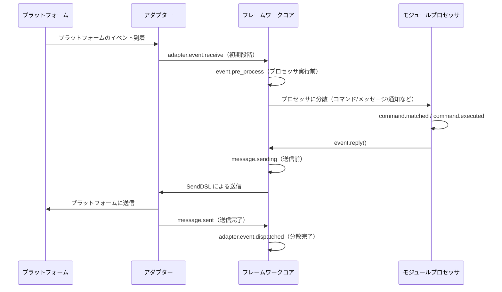

フレームワークは以下のフックのブレークポイントを内蔵しており、`@sdk.lifecycle.on()` で任意のブレークポイントを監視してカスタムロジックを実装できます。

### コア初期化

| フック名 | 発生タイミング | データ |
|---------|---------|------|
| `core.init.start` | SDKの初期化開始 | `{}` |
| `core.init.stage` | 初期化の各段階開始（バックグラウンドで発生） | `{"stage": str}`、値は `discovery` / `adapter_register` / `adapter_start` / `module_register` / `module_init` / `adapter_start_deferred` / `router_start` |
| `core.init.complete` | SDKの初期化完了 | `{"duration": float, "success": bool, "stages": {stage: float}, "adapters": {"enabled": [str], "disabled": [str]}, "modules": {"enabled": [str], "disabled": [str]}, "error": str(失敗時のみ)}` |
| `core.uninit.complete` | SDKの逆初期化完了 | `{"duration": float, "success": bool, "adapters_closed": int, "modules_unloaded": int, "module_properties_cleared": int, "module_properties_to_clear": [str], "error": str(失敗時のみ)}` |

**例：起動進捗表示**

```python
@sdk.lifecycle.on("core.init.stage")
def show_stage(data):
    print(f"[起動] 階段に到達: {data['stage']}")
```

### 設定変更

| フック名 | 発生タイミング | データ |
|---------|---------|------|
| `config.set` | 設定項目が変更された | `{"key": str, "old_value": Any, "new_value": Any}` |
| `config.updated` | 外部で config.toml を編集した後にツリー全体の変更が検出された | `{"old_config": dict, "new_config": dict, "config_file": str}` |

**例：設定監査**

```python
@sdk.lifecycle.on("config.set")
def audit_config(data):
    print(f"[監査] {data['key']}: {data['old_value']} -> {data['new_value']}")
```

### モジュールのライフサイクル

| フック名 | 発生タイミング | データ |
|---------|---------|------|
| `module.register` | モジュールクラスがマネージャーに登録された | `{"module_name": str, "success": bool}` |
| `module.load` | モジュールのロードが完了した（インスタンス化成功）；失敗時は `payload` に追加で `"error": str, "traceback": str`（失敗時の現場は `module.last_error(名前)` でも取得可能） | `{"module_name": str, "success": bool}` |
| `module.init` | モジュールの初期化が完了した（遅延ロード含む） | `{"module_name": str, "success": bool}` |
| `module.before_unload` | アンロードの最初のステップ（`on_unload` とリソース回収の前；モジュールインスタンスフック `on_before_unload` が同期的に発生） | `{"module_name": str, "reason": str}`；`reason` の値は `unload` / `reload` / `disable` / `cascade` / `dormant` |
| `module.sleep` | モジュールの休眠が完了した（遅延ロードの休眠：リソースは解放され、アクセス時に自動的に復活） | `{"module_name": str, "success": bool}` |
| `module.unload` | モジュールのアンロードまたは無効化（`disable` と `unload` は依存関係に通知するため同等；`on_dependency_lost` の契約には「無効化」が含まれる） | `{"module_name": str, "success": bool}` |
| `module.reload` | モジュールのホットリロードが完了した（依存モジュールも含む） | `{"module_name": str, "success": bool, "full": bool, "duration_ms": int}`；単一モジュールの場合、`"identity_changed": bool`（False = プロセス内で古いコードが実行されている可能性あり、C拡張のキャッシュなど）、`"version_old": str, "version_new": str` を追加で持つ；全量リロード（`reload_all`）の場合は `module_name` が `"All"` になり、`payload` に `"results": dict[str, bool]` を追加で持つ |

> **モジュールインスタンスフック `on_before_unload`**：`module.before_unload` イベントに対応するオプションのライフサイクルメソッド——`event["reason"]` に理由が記載され、リソース解放前に `sdk.storage` に状態を保存し、復活/リロード後に `on_load` で復元するのに適している（遅延ロードの休眠の状態継続はこれに基づく）。フックの失敗は警告のみで、アンロードプロセスをブロックしない。

### アダプターのライフサイクル

| フック名 | 発生タイミング | データ |
|---------|---------|------|
| `adapter.load` | アダプターの登録が完了した | `{"platform": str, "success": bool}` |
| `adapter.reload` | アダプターのコードレベルでのホットリロードが完了した | `{"adapter_name": str, "success": bool, "full": bool, "duration_ms": int, "identity_changed": bool, "version_old": str, "version_new": str, "was_started": bool, "source": str}`；`identity_changed=False` = プロセス内で古いコードが実行されている可能性あり |
| `adapter.start` | アダプターの起動 | `{"platforms": [str]}` |
| `adapter.status.change` | アダプターの状態が変化した | `{"platform": str, "status": str, "retry_count": int, "error": str(失敗時のみ)}`；status の完全な値は：`starting` / `started` / `start_failed` / `stopping` / `stopped` / `stop_failed` / `skipped-dependency` / `disabled` |
| `adapter.stop` | アダプターの停止 | `{"platforms": [str]}` |
| `adapter.stopped` | アダプターの停止が完了した | `{"platforms": [str]}` |
| `adapter.bot.online` | Botのオンライン | `{"platform": str, "bot_id": str, "info": dict, "status": str}` |
| `adapter.bot.offline` | Botのオフライン | `{"platform": str, "bot_id": str, "status": str}` |

### イベントの受信と処理

| フック名 | 発生タイミング | データ |
|---------|---------|------|
| `adapter.event.receive` | 外部プラットフォームイベントを受信した（初期段階） | `{"platform": str, "event_type": str, "raw_event_type": str}` |
| `adapter.event.blocked` | ミドルウェアがイベントを拒否した（`False` を返した、イベントは破棄されプロセッサに渡らない） | `{"middleware": str, "platform": str, "event_type": str, "detail_type": str, "event": dict, "_trace_id": str}` |
| `adapter.event.dispatched` | イベントの分散が完了した | `{"platform": str, "event_type": str, "raw_event_type": str, "onebot_handlers_count": int}` |
| `event.pre_process` | イベントプロセッサが実行される直前 | `{"event_type": str, "platform": str, "detail_type": str}` |

**例：イベント統計**

```python
event_counter = {}

@sdk.lifecycle.on("adapter.event.receive")
def count_events(data):
    platform = data["platform"]
    event_counter[platform] = event_counter.get(platform, 0) + 1

@sdk.lifecycle.on("adapter.event.dispatched")
def log_unhandled(data):
    if data["onebot_handlers_count"] == 0:
        print(f"[未処理] {data['platform']}/{data['event_type']}")
```

### メッセージの送信

| フック名 | 発生タイミング | データ |
|---------|---------|------|
| `message.sending` | メッセージが送信される直前 | `{"platform": str, "method": str, "detail_type": str, "target_id": str, "bot_id": str}` |
| `message.sent` | メッセージの送信が完了した | `{"platform": str, "method": str, "detail_type": str, "target_id": str, "bot_id": str}` |

**例：メッセージ送信監査**

```python
@sdk.lifecycle.on("message.sending")
def log_sending(data):
    print(f"[送信] -> {data['platform']}/{data['detail_type']}/{data['target_id']} via {data['method']}")
```

### コマンドシステム

| フック名 | 発生タイミング | データ |
|---------|---------|------|
| `command.matched` | コマンドがマッチし、実行される直前 | `{"command": str, "args": list[str], "platform": str, "user_id": str}` |
| `command.executed` | コマンドの実行が完了した | `{"command": str, "args": list[str], "platform": str, "user_id": str, "success": bool, "error": str(失敗時のみ)}` |

**例：コマンド統計**

```python
@sdk.lifecycle.on("command.matched")
def count_commands(data):
    print(f"[コマンド] /{data['command']} from {data['user_id']}@{data['platform']}")
```

### HTTPルーティング

| フック名 | 発生タイミング | データ |
|---------|---------|------|
| `server.request` | HTTPリクエストが受信された | `{"method": str, "path": str, "client_ip": str, "request_id": str}` |
| `server.response` | HTTPレスポンスが送信された | `{"method": str, "path": str, "status_code": int, "client_ip": str, "request_id": str}` |

> `request_id` は [X-Request-ID リクエスト連絡ID](router.md#リクエスト連絡-idx-request-id)：クライアントリクエストヘッダーを優先して使用し、なければUUIDを生成する。これによりリクエストとレスポンスを関連付けることができる。

**例：リクエストログ**

```python
@sdk.lifecycle.on("server.response")
def log_http(data):
    print(f"[HTTP] {data['method']} {data['path']} -> {data['status_code']}")
```

### WebSocket

| フック名 | 発生タイミング | データ |
|---------|---------|------|
| `server.start` | ルーティングサーバーが起動した | `{"base_url": str, "host": str, "port": int, "success": bool, "error": str(失敗時のみ)}` |
| `server.stop` | ルーティングサーバーが停止した | `{}` |
| `server.websocket.connect` | WebSocket接続が確立した | `{"path": str, "module_name": str, "client_ip": str}` |
| `server.websocket.disconnect` | WebSocket接続が切断された | `{"path": str, "module_name": str, "reason": str, "error": str(異常時のみ)}` |

**例：WebSocket接続監視**

```python
@sdk.lifecycle.on("server.websocket.connect")
def on_ws_connect(data):
    print(f"[WS] 接続: {data['path']} from {data['client_ip']}")

@sdk.lifecycle.on("server.websocket.disconnect")
def on_ws_disconnect(data):
    print(f"[WS] 切断: {data['path']} ({data['reason']})")
```

### ストレージ接続状態

ストレージバックエンドの接続プールの確立、障害、および復旧（すべてバックグラウンドで発生し、ストレージ操作をブロックしない）：

| フック名 | 発生タイミング | データ |
|---------|---------|------|
| `storage.ready` | ストレージバックエンドの接続プールが準備完了（各イベントループで最初のプール確立に成功した） | `{"backend": str}` |
| `storage.unreachable` | 重試回数が尽き、クールダウン期間に入る（この間は操作が即座に失敗する） | `{"backend": str, "error": str, "cooldown": float}` |
| `storage.recovered` | クールダウンが終了し、再接続に成功し、ストレージが再び利用可能になった | `{"backend": str}` |

**例：ストレージ障害アラート**

```python
@sdk.lifecycle.on("storage.unreachable")
def alert_storage_down(data):
    print(f"[アラート] ストレージバックエンド {data['backend']} に到達不可: {data['error']}、{data['cooldown']}秒後に自動的に再接続されます")

@sdk.lifecycle.on("storage.recovered")
def notify_storage_back(data):
    print(f"[復旧] ストレージバックエンド {data['backend']} が再び利用可能になりました")
```

### HTTPクライアント

`sdk.client` のリクエストと接続イベント（すべてバックグラウンドで発生）：

| フック名 | 発生タイミング | データ |
|---------|---------|------|
| `client.request.success` | HTTPリクエストが成功した | `{"method": str, "url": str, "status": int, "elapsed": float}` |
| `client.request.failed` | HTTPリクエストの再試行が尽き、最終的に失敗した | `{"method": str, "url": str, "error": str, "attempts": int, "elapsed": float}` |
| `client.ws.connect` | WebSocket接続が確立した | `{"url": str}` |

### 国際化

| フック名 | 発生タイミング | データ |
|---------|---------|------|
| `i18n.language.changed` | フレームワークの言語が切り替わった（`i18n.set_language`） | `{"language": str, "previous": str}` |

## 標準イベント定義

```python
STANDARD_EVENTS = {
    "core": ["init.start", "init.stage", "init.complete", "uninit.complete"],
    "module": ["load", "before_unload", "init", "sleep", "unload", "register", "reload"],
    "adapter": [
        "load", "start", "status.change", "reload", "stop", "stopped",
        "event.receive", "event.blocked", "event.dispatched",
        "bot.online", "bot.offline",
    ],
    "server": [
        "start", "stop",
        "request", "response",
        "websocket.connect", "websocket.disconnect",
    ],
    "event": ["pre_process"],
    "message": ["sending", "sent"],
    "command": ["matched", "executed"],
    "config": ["set", "updated"],
    "storage": ["ready", "unreachable", "recovered"],
    "client": ["request.success", "request.failed", "ws.connect"],
    "i18n": ["language.changed"],
}
```

## 完全な API リファレンス

### 登録と解除

| メソッド | 説明 |
|------|------|
| `@lifecycle.on(event, *, priority=0)` | デコレータによるハンドラの登録 |
| `lifecycle.register(event, handler, *, priority=0)` | プログラム的な登録 |
| `lifecycle.unregister(event, handler=None)` | 登録の解除（handler=None の場合はそのイベントの全ハンドラを解除） |

### 発火

| メソッド | 説明 |
|------|------|
| `await lifecycle.emit(event, data=None, *, to=None)` | 非同期で発火し、ハンドラは**並列実行**（互いにブロックせず、返却時に全て完了）、返り値が None でない場合、優先度順に data をチェーンで置き換え返す；`to` に owner を指定すると、特定のオブジェクトに投递 |
| `lifecycle.fire(event, data=None, *, to=None)` | **バックグラウンド発火（投げっぱなし）**：ハンドラはバックグラウンドタスクで並列実行され、待機せず、返り値なし；リスナーがいない場合はオーバーヘッドゼロ。高頻度のホットパスや純粋な観測イベントに適している（`server.request` / `storage.ready`）；順序に敏感な処理（`config.set`）やシャットダウンシーケンスは `emit` を使用すること |
| `lifecycle.emit_sync(event, data=None, *, to=None)` | 同期で発火、非同期ハンドラは create_task でスケジュール |
| `await lifecycle.submit_event(event_type, *, source, msg, data, to=None, background=False)` | 旧版との互換性、標準イベント形式を自動構築；`background=True` の場合、`fire` のバックグラウンド発火経路を使用 |

**4種類の発火 API の対照表**：

| メソッド | 呼び出し形態 | ハンドラの完了を待つか | 代表的な使用場面 |
|------|---------|------------------|---------|
| `emit` | `await`（非同期） | **待つ**——ハンドラは並列実行、返却時に全て完了、返り値は優先度順に data をチェーンで置き換え返す | 通常の発火；順序に敏感な消費（`config.set`）やシャットダウンシーケンスには必ずこれを使用 |
| `fire` | 直接呼び出し（同期で返却） | **待たない**——バックグラウンドタスクで並列実行、返り値なし；リスナーがいない場合はオーバーヘッドゼロ | 高頻度のホットパスや純粋な観測イベント（`server.request` / `storage.ready`） |
| `emit_sync` | 直接呼び出し（同期） | 同期ハンドラは即時完了；非同期ハンドラは `create_task` でスケジュール（返り値は返却できない） | 非同期コンテキスト外（同期コード）でイベントを発火する場合 |
| `submit_event` | `await`（非同期） | 待つ（`background=True` の場合は `fire` と同じ待たない） | 旧版との互換性：自動で標準イベント形式（`source` / `msg` / `timestamp`）を構築 |

### ユーティリティ

| メソッド | 説明 |
|------|------|
| `lifecycle.start_timer(timer_id)` | タイマーを開始 |
| `lifecycle.get_duration(timer_id)` | 経過時間を取得（秒） |
| `lifecycle.stop_timer(timer_id)` | タイマーを停止し、経過時間を返す |
| `lifecycle.list_hooks()` | 登録済みの全てのフックとハンドラ数をリストアップ |
| `lifecycle.clear()` | 全てのハンドラとタイマーをクリア |

## モジュールでの使用例

```python
from ErisPulse.Core.Bases import BaseModule
from ErisPulse import sdk

class Main(BaseModule):
    async def on_load(self, event):
        # 簡単なメッセージ数カウントの実装
        self.msg_count = 0
        
        @sdk.lifecycle.on("adapter.event.receive")
        async def count(data):
            if data["event_type"] == "message":
                self.msg_count += 1
        
        # すべてのコマンドを監視
        @sdk.lifecycle.on("command.matched")
        async def log_cmd(data):
            sdk.logger.info(f"コマンド実行: /{data['command']} by {data['user_id']}")
        
        # 設定変更の監査
        @sdk.lifecycle.on("config.set")
        def audit(data):
            sdk.logger.info(f"設定変更: {data['key']} = {data['new_value']}")
```

## バックグラウンドタスクの所有者と自動キャンセル

> [!NOTE]
> この機能は ErisPulse **2.8.0+** が必要です。

モジュールが作成した asyncio バックグラウンドタスクが `on_unload` でキャンセルされない場合、`self` の参照が保持され、モジュールインスタンスの回収ができなくなります（ホットリロード後に古いインスタンスが残存）。フレームワークは以下のバックアップメカニズムを提供します：

- **`self.spawn(coro)`**（モジュール内で推奨）：タスクはモジュール名に自動的に所属し、モジュールのアンロード時にフレームワークが `on_unload` **後に**未終了のタスクをキャンセルし、警告を記録します
- **`spawn_background(coro)`**（`ErisPulse.runtime`）：現在の `owner_scope` コンテキストを自動的にキャプチャします；`cancel_owner_tasks(owner)` で所属をキャンセル、`cancel_all_background_tasks()` は `sdk.uninit()` のバックアップ用
- **アダプター**：停止時にプラットフォーム名の下のバックグラウンドタスクもバックアップでキャンセル

```python
async def on_load(self, event):
    # 推奨：バックグラウンドタスクは self.spawn() を使用し、アンロード時にフレームワークがバックアップでキャンセル
    self.spawn(self._poll())

async def on_unload(self, event):
    # 精密制御の場合は、手動でキャンセルし、終了処理を待機する必要があります
    if self._poll_task:
        self._poll_task.cancel()
        await asyncio.gather(self._poll_task, return_exceptions=True)

async def _poll(self):
    while True:
        await asyncio.sleep(60)
        ...
```

> [!IMPORTANT]
> フレームワークのバックアップは**強制キャンセル**（`cancel_owner_tasks`）で、`on_unload` の返り値の後に行われます。したがって、優雅な終了処理が必要なタスク（バッファのフラッシュ、状態の永続化、接続の閉鎖）は**必ず**`on_unload` で `cancel()` + `await` で完了する必要があります — バックアップが終了処理を保持することを期待しないでください。フレームワークは「`self` を保持するタスクが残らないように」することを保証しますが、「優雅」を保証するわけではありません。`await` の結果が必要なタスクは直接 `await` してください、バックグラウンドタスクに投げないでください。

## 注意事項

1. **ハンドラは同期または非同期**：システムが自動的に識別し、正しく呼び出します
2. **データの渡し方**：`emit()` モードでは、ハンドラが `None` 以外の値を返すと、後続のハンドラに渡される `data` を変更します
3. **イベント名の命名規則**：点構造のイベント名を使用することを推奨します、親イベントの監視が容易になります
4. **エラーの隔離**：ハンドラの1つが例外を発生しても、他のハンドラの実行に影響しません
5. **同期トリガーの制限**：`emit_sync()` では、非同期ハンドラは fire-and-forget 方式でスケジュールされ、返り値は回伝できません
6. **ライフサイクルのクリーンアップ**：`sdk.uninit()` を呼び出すと、すべての登録されたハンドラとタイマーがクリーンアップされます
7. **ロード優先性**：フレームワークの初期化段階でイベントをサブスクライブしたい場合は、高優先度を設定し、遅延ロードを無効化することを推奨します


### 懶加载系统

# ラグロードモジュールシステム

> [!TIP]  
> **この記事を読む必要があるタイミング**：ラグロードモジュールを使用する場合、または activate_on イベント駆動型のアクティベーションを使用する場合。それ以外の場合はスキップしても、他の機能の使用に影響はありません。

ErisPulse SDK のラグロードモジュールシステムは、モジュールの初期化を**実際にアクセスされたタイミングまで遅らせます**。起動フェーズではプレースホルダーエージェントのみを登録し、使用されなかったモジュールは起動時間やメモリを占有しません。

## 概要

ErisPulse のコア機能の 1 つである遅延ロードモジュールシステムは、以下の方法で動作します。

- **遅延初期化**：モジュールは、初めてアクセスされたときにのみ実際に読み込まれ、初期化されます。
- **透明な使用**：開発者にとって、遅延ロードモジュールは通常のモジュールと使用上ほとんど違いがありません。
- **自動依存管理**：モジュールの依存関係は、使用されるときに自動的に初期化されます。
- **ライフサイクルサポート**：`BaseModule` を継承したモジュールに対しては、ライフサイクルメソッドが自動的に呼び出されます。

## 動作原理

### LazyModule クラス

ラグジュアリー・ロード・システムの中心となるのが `LazyModule` クラスです。これは、最初にアクセスされたときにのみモジュールを実際に初期化するラッパーです。

### 初期化プロセス

モジュールが初めてアクセスされたとき、`LazyModule` は以下の操作を実行します：

1. モジュールクラスの `__init__` パラメータ情報を取得します
2. パラメータに基づいて `sdk` リファレンスを渡すかどうかを決定します
3. モジュールの `moduleInfo` 属性を設定します
4. `BaseModule` を継承したモジュールの場合、`on_load` メソッドを呼び出します
5. `module.init` ライフサイクルイベントをトリガーします

## イベント駆動型遅延起動（activate_on）

> [!NOTE]
> この機能は ErisPulse **2.8.0+** が必要です。

`lazy_load=True` のモジュールはデフォルトで**最初の属性アクセス時**にのみロードされます。モジュールがコマンド/イベントハンドラを登録している場合、従来の方法では `lazy_load=False` として即時ロードするしかありませんでした。`activate_on` は第三の選択肢を提供します：**トリガを宣言し、最初の一致するイベント/コマンドが到着した時点でモジュールを自動的にアクティブ化する**——メモリに常駐させることなく、トリガのエントリポイントを失うこともありません。

```python
from ErisPulse.loaders import ModuleLoadStrategy

class MyModule(BaseModule):
    @staticmethod
    def get_load_strategy():
        return ModuleLoadStrategy(
            lazy_load=True,
            activate_on=[
                # ---- イベントトリガ（受動的到着、ユーザーの意識を必要としない）----
                "message",                                    # タイプレベル：任意のメッセージイベント
                {"notice": "group_member_increase"},          # タイプ + 単一 detail_type
                {"message": ["private", "group"]},            # タイプ + 複数 detail_type

                # ---- コマンドトリガ（能動的入力、Help に表示されるプレースホルダーコマンド）----
                {"command": "roll"},                          # 簡易表記：コマンド名
                {"command": ["roll", "dice"]},                # コマンド名リスト
                {"command": {                                 # dict 形式で宣言（name は必須）
                    "name": "dice",
                    "help": "サイコロを振る",
                    "usage": "/dice",
                    "group": "娯楽",
                    "aliases": ["d"],
                    "hidden": False,
                }},
            ],
        )
```

### コマンド dict 形式の宣言パラメータ

dict 形式は `@command()` デコレータのユーザーレベルのパラメータを反映し、モジュールのロード前にプレースホルダーコマンドを登録するのに使用されます。

| パラメータ | 型 | デフォルト | 説明 |
|------|------|------|------|
| `name` | `str` | **必須** | コマンド名；`on_load` での `@command(name)` と一致する必要がある。一致しない場合、アクティブ化後にプレースホルダーが削除され、コマンドは存在しなくなる |
| `help` | `str` | フォールバックチェーン | Help に表示される説明；未宣言の場合、フォールバックチェーンから値を取得する（以下参照） |
| `usage` | `str` | 自動生成 | 使用法行；デフォルトは `{prefix}{name}` |
| `group` | `str` | `None` | コマンドグループ |
| `aliases` | `list[str]` | `[]` | 別名を同時に登録し、**別名の入力でもトリガとして機能する** |
| `hidden` | `bool` | `False` | `True` の場合、プレースホルダーコマンドも非表示（アクティブ化後の実際のコマンドの非表示の意味と一致）；コマンド名を知っているユーザーの入力でもトリガとして機能する |

**サポートされていない** `priority` / `permission` / `master`：プレースホルダーコマンドの役割はトリガの起動だけであり、権限チェックはアクティブ化後の実際のコマンドが実行する（プレースホルダー段階で権限チェックを行うと、「コマンド入力による起動」が無効になる）。

### 占位コマンドの Help フォールバックチェーン

モジュールがロードされていない場合、Help に表示されるコマンドの説明は以下の順序で取得されます（最初に見つかった値を使用）：

1. dict 形式で宣言されたコマンドレベルの `help`（最も正確）
2. モジュールの `get_meta()` の `description`
3. モジュールの `__description__` 属性
4. パッケージのメタデータの `Summary`（PyPI パッケージの概要）
5. 一般的なメッセージ：「このコマンドは遅延ロードモジュール X から来ています。初めて使用すると、モジュールが自動的にロードされます」

### トリガの意味

- **イベントスタブ**：対応するイベントマネージャーに非常に低い優先度（`ACTIVATION_STUB_PRIORITY`）で登録され、すべての通常のハンドラの後にバックアップとしてトリガされる。アクティブ化後、現在のイベントはモジュールの実際のハンドラに転送される
- **コマンドスタブ**：プレースホルダーコマンドを登録する。アクティブ化後、プレースホルダーは削除され、実際のコマンドがトリガを引き継ぐ
- **再入防止**：`asyncio.Lock` を使用して、並行トリガ時に一度だけアクティブ化されるように保証する
- **スコープフィルタリング**：スタブにはモジュールの所有者アイデンティティが含まれ、モジュールが Bot / セッション / プラットフォームに対して有効化されていない場合はトリガされない
- **失敗時の処理**：アクティブ化に失敗した場合はクールダウン期間（`ACTIVATE_RETRY_COOLDOWN_SECS`、30秒）に入る。クールダウン中はイベントが短絡的に処理され、繰り返し試行されない。クールダウン後に再トリガされると、自動的に再試行され、スタブは全期間保持される
- **重複排除**：同名のコマンドが簡易表記と dict 形式で混在して宣言された場合、重複は排除され（dict が優先される）。dict で `name` が欠落している、またはイベントの `detail_type` が dict として誤って記述された場合は警告が表示され、無視される

> アーキテクチャ図と完全な意味については、[アーキテクチャ概要](../architecture.md#イベント駆動型遅延起動activate_onトリガアーキテクチャ)を参照してください。

## 懒惰ロードの休眠（dormant_after）

> [!NOTE]
> この機能は ErisPulse **2.11.0+** が必要です。

長期間使用されていない遅延ロードモジュールに対して、フレームワークはその**休眠**を可能にします。これにより、実行時のリソース（タスク、接続、イベントの登録など）を解放しますが、遅延ロードプロキシと登録のスタブは保持されます。モジュールは「登録済みだがロードされていない」状態に戻り、次回の属性アクセス、`module.call`、`activate_on` イベントによって**透明に再起動**されます（再インスタンス化され、`on_load` が実行されます）。再起動のための API は一切不要です。休眠後のシステムの状態は、「一度も起動されていない」場合と完全に同一です。

### 宣言方法

```python
@staticmethod
def get_load_strategy():
    return ModuleLoadStrategy(
        lazy_load=True,
        dormant_after="30m",   # 30 分間の無使用で自動的に休眠；宣言しない場合は休眠しない（デフォルト）
    )
```

時間の指定は、コマンド管理の `cooldown` と同じ形式です（`90s` / `1h30m` / `1d`）。スクリーナーは固定間隔（60 秒）でスキャンを行い、実際の休眠時刻は閾値 + 最大でスキャン間隔分のずれがあります。また、手動で休眠させることも可能です：`await sdk.module.sleep("モジュール名")`。明示的な `unload` は完全なアンロード（遅延プロキシも削除）になります。

### 状態の継続

休眠前にフレームワークは `on_before_unload(reason="dormant")` をトリガーします（アンロードの最初のステップ、リソースはまだ有効）。モジュールは `sdk.storage` に状態を保存します。再起動後は `on_load` で状態を復元します：

```python
async def on_before_unload(self, event):
    if event["reason"] in ("dormant", "reload", "disable"):
        await self.sdk.storage.aset(f"{self._module_name}:counter", self._count)

async def on_load(self, event):
    self._count = await self.sdk.storage.aget(f"{self._module_name}:counter") or 0
```

### 意味と境界

- **依存先の安全性**：遅延モジュールの依存先は、永続的なプロキシ（`sdk.<Name>`）または `module.call` を通じてアクセスします。休眠前後で動作は一貫しています。直接に実際のインスタンスの参照を持つことは反パターンです（監査ツールで漏れが確認できます）。
- **イベントの到達**：休眠中のモジュールはイベントを受け取らなくなります。イベントによって再起動が必要なモジュールは、`activate_on` を同時に宣言してください（イベントが先に再起動し、その後転送されます）。「コマンドが反応しない」問題を調査する際は、モジュールが休眠状態にあるかどうかを確認してください。
- **再起動失敗時の自己修復**：再起動（再初期化）に失敗した場合、30 秒間のクールダウンに入り、クールダウン後に再びアクセスすると自動的に再試行されます。永久的に失敗することはありません。

## 懒惰ロードの設定

### グローバル設定

設定ファイルでグローバルな遅延ロードを有効または無効にします：

```toml
[ErisPulse.framework]
enable_lazy_loading = true  # true=遅延ロードを有効にする(デフォルト), false=遅延ロードを無効にする
```

### モジュールレベルの制御

モジュールは `get_load_strategy()` 静的メソッドを実装することで、ロード戦略を制御できます：

```python
from ErisPulse.Core.Bases import BaseModule
from ErisPulse.loaders import ModuleLoadStrategy

class MyModule(BaseModule):
    @staticmethod
    def get_load_strategy():
        """モジュールのロード戦略を返す"""
        return ModuleLoadStrategy(
            lazy_load=False,  # Falseを返すと即時ロード
            priority=100      # ロードの優先度、数値が大きいほど優先度が高い
        )
```

## ラグロードモジュールの使用

### 基本的な使い方

開発者にとって、ラグロードモジュールは通常のモジュールと使用方法にほとんど違いはありません：

```python
# SDKを介してラグロードモジュールにアクセス
from ErisPulse import sdk

# 以下のようにアクセスするとモジュールのラグロードがトリガーされます
result = await sdk.my_module.my_method()
```

### モジュールの取得の統一されたエントリーポイント

SDK属性、モジュールマネージャー属性を通じてアクセスする場合でも、`module.get()`で検索する場合でも、
「登録済みだがまだロードされていない」ラグロードモジュールに対しては、すべて同じラグロードプロキシが返り、
そのプロパティにアクセスすることで初めてモジュールの初期化がトリガーされます：

```python
# 3つの方法で取得できるのはすべてラグロードプロキシです（モジュールがロードされていない場合）、動作は一貫しており、ユーザーには透明です
sdk.my_module          # ロードをトリガーするエントリーポイント
sdk.module.my_module   # 同様にラグロードプロキシを返します
sdk.module.get("my_module")  # これもラグロードプロキシを返します。この操作自体はロードをトリガーしません

# プロキシの任意の属性にアクセスすることで、モジュールの初期化が実際に行われます
result = await sdk.my_module.my_method()
```

`module.get()`は**検索**用のインターフェースであり、ロードをトリガーしません：
- モジュールが既にロード済み → 実際のインスタンスを返します
- モジュールが登録済みだが未ロード → ラグロードプロキシを返します（プロパティにアクセスしたときに初期化されます）
- モジュールが未登録 → `None`を返します

明示的にロードをトリガーするには、`await sdk.load_module("my_module")`を使用してください。

### 非同期初期化

非同期初期化が必要なモジュールについては、まず明示的にロードすることを推奨します：

```python
# まずモジュールを明示的にロード
await sdk.load_module("my_module")

# その後モジュールを使用
result = await sdk.my_module.my_method()
```

### 同期初期化

非同期初期化を必要としないモジュールについては、直接アクセスできます：

```python
# 直接アクセスすると自動的に同期初期化されます
result = sdk.my_module.some_sync_method()
```

## 最佳実践

ロード戦略を選択する際は、以下の決定フローを参考にしてください。

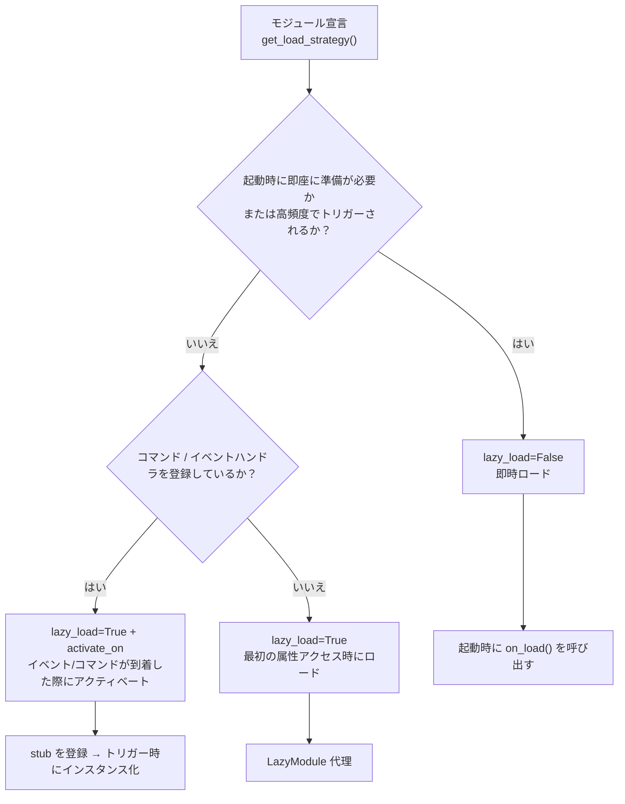

### 懒惰ロード（lazy_load=True）を使用することを推奨する場面

- 他のモジュールによって呼び出されるだけの受動的なユーティリティモジュール（例：データクエリモジュール、フォーマット変換器など）
- コマンド/イベントハンドラを登録しているが高頻度で使用されないモジュール — `activate_on` を使ってトリガを宣言し、最初の一致するイベント/コマンドが到着した際に自動的にアクティベートする。これにより、lazy_loadを放棄せずに済む。

### 懒惰ロードを禁止することを推奨する場面（lazy_load=False）

- 起動時に即座に準備が必要なモジュール（他のモジュールに基礎サービスを提供するコアモジュールなど）
- 高頻度でトリガーされるリスナー（各メッセージごとに処理が必要） — `activate_on` による転送には1回のアクティベートオーバーヘッドがあるため、高頻度の場面では即時ロードした方が直接的
- タイマータスクモジュール
- アプリケーション起動時に初期化が必要なモジュール

> `priority` パラメータは、即時ロードされるモジュール間の初期化順序を制御します。数値が大きいほど先に初期化されます。同じ優先度のモジュールは登録順にロードされます。

## 注意事項

1. モジュールが遅延ロードを使用している場合、ErisPulse内で他のモジュールによって一度も呼び出されない場合、そのモジュールは決して初期化されません。
2. モジュール内にEventの監視など、他のモジュールを積極的に監視するモジュールが含まれている場合、2つの選択肢があります：`activate_on` トリガーを宣言して遅延ロードを維持し、イベントが到達したときに自動的にアクティブ化するか、または即時ロードを必要とすることを宣言する（`lazy_load=False`）か、さもなければモジュールの正常な業務に影響を及ぼす可能性があります。
3. 特殊な要望がない限り、遅延ロードを無効にすることは推奨しません。そうしないと、依存管理やライフサイクルイベントなどの問題が生じる可能性があります。
4. `activate_on` のコマンド dict 声明において、`name` はモジュールの `on_load` で `@command()` によって登録された実際のコマンド名と一致する必要があります。一致しない場合、モジュールがアクティブ化された後にプレースホルダーコマンドが解除され、宣言と実装が一致しないコマンドは存在しません。


### 国际化（i18n）系统

# 国際化 (i18n) システム

> [!TIP]
> **この記事を読む必要があるのは**：多言語の文案、翻訳の登録、言語の検出が必要な場合です。必要ない場合は、他の機能の使用に影響を与えることなく、この記事は飛ばしてください。

ErisPulse v2.5.0 以降、完全な国際化 (i18n) 機能が内蔵されています。フレームワークのコアおよび CLI インターフェースは、システム言語に応じて表示されるテキストを自動的に切り替えることができ、外部モジュールが独自の翻訳を登録することもサポートしています。

## 支援言語

| 言語 | コード | 説明 |
|------|------|------|
| 简体中文 | `zh-CN` | デフォルト言語（フレームワークの原生言語） |
| 繁體中文 | `zh-TW` | 繁体中文（香港/澳门/台湾） |
| English | `en` | 英文（一般的フォールバック言語） |
| 日本語 | `ja` | 日本語 |
| Русский | `ru` | ロシア語 |

## 早速体験

### 環境変数による切り替え

```bash
# Windows PowerShell
$env:ERISPULSE_LANG = "en"
epsdk run

# macOS / Linux
ERISPULSE_LANG=ja epsdk run
```

### 設定ファイルによる切り替え

`config/config.toml` に以下を追加します：

```toml
[ErisPulse.i18n]
language = "zh-TW"
```

`"auto"`（デフォルト値）に設定すると、システム言語を自動検出します。

### コード内で手動で切り替え

```python
from ErisPulse import i18n

# 言語を手動で設定
i18n.set_language("en")
print(i18n.get_language())  # "en"

# 自動検出に戻す
i18n.reset_language()
```

## 言語検出メカニズム

フレームワークは、以下の優先順位でユーザーの言語を検出します：

1. **環境変数 `ERISPULSE_LANG`** — 最も高い優先順位で、テストや一時的な切り替えに使用
2. **Windows API** — `GetUserDefaultLocaleName`（Windowsに限定、Git Bashなどのツールが `LANG` を上書きする影響を受けない）
3. **環境変数** — `LANGUAGE` > `LC_ALL` > `LC_MESSAGES` > `LANG`（Unix/macOSの標準）
4. **システムロケール** — `locale.getlocale()` / `locale.getdefaultlocale()`
5. **デフォルト** — en（英語）

### 近接マッピング原則

検出された言語が正確に一致しない場合、サポートされている言語に近接する原則でマッピングされます：

- `zh-TW`, `zh-HK`, `zh-MO`, `zh-Hant` → **繁体中国語**
- その他のすべての `zh-*`（例: `zh-CN`, `zh-SG`）→ **簡体中国語**
- `en-US`, `en-GB`, `en-AU` など → **英語**
- `ja-JP` → **日本語**
- `ru-RU` → **ロシア語**
- その他の未認識の言語 → **簡体中国語（デフォルト）**

## モジュールでの i18n の使用

独自のモジュールに翻訳テキストを登録することで、多言語をサポートできます。

### 推奨方法：I18nClass を使って翻訳キーを宣言する（v2.7.0+）

v2.7.0 以降、モジュールやアダプターは `ConfigClass` を宣言するのと同じように、ネストされたクラス `I18nClass` を使って翻訳キーを宣言できます。フレームワークはロード時に**自動的に**宣言されたすべての翻訳キーを登録します。手動で `i18n.register()` を呼び出す必要はありません。

```python
from dataclasses import dataclass, field

from ErisPulse.Core.Bases import BaseConfig, BaseI18n, BaseModule, I18nKey


class MyModule(BaseModule):
    # 設定クラス（オプション）
    @dataclass
    class ConfigClass(BaseConfig):
        welcome_msg: str = field(
            default="欢迎",
            metadata={
                # ここでは i18n キー mymodule.welcome_msg を参照
                "description": {"i18n": "mymodule.welcome_msg", "default": "欢迎消息"},
            },
        )

    # 翻訳キー集合クラス（オプション）
    # 宣言されたキーはフレームワークによって自動的に登録され、
    # ConfigClass がデフォルト設定を生成するよりも優先されます
    class I18nClass(BaseI18n):
        # 属性名が自動的に結合されて完全なキー経路 <モジュール名>.<属性名> になります
        welcome_msg: I18nKey = I18nKey(
            default="Welcome Message",   # 言語に依存しないデフォルト値、どの言語にも登録されません
            zh_CN="欢迎消息",
            en="Welcome Message",
            ja="ウェルカムメッセージ",
            ru="Приветственное сообщение",
            zh_TW="歡迎訊息",
        )
        # 业务で使用する他の翻訳キー
        hello: I18nKey = I18nKey(
            default="Hello, {name}!",
            zh_CN="你好，{name}！",
            zh_TW="你好，{name}！",
            en="Hello, {name}!",
            ja="こんにちは、{name}！",
            ru="Привет, {name}!",
        )

        # 完全なキー経路を明示的に指定することもできます（属性名の結合を使わない）
        custom: I18nKey = I18nKey(
            key="mymodule.deep.nested.key",
            default="Default text",
            zh_CN="默认文本",
            zh_TW="預設文本",
            en="Default text",
            ja="デフォルトテキスト",
            ru="Текст по умолчанию",
        )
```

#### なぜ I18nClass が推奨されるのか？

| シナリオ | 手動 i18n.register() | I18nClass 宣言式 |
|------|-----------------------|------------------|
| 設定の説明に参照される i18n キー | 手動で登録する必要があり、設定生成前に登録する必要がある | フレームワークが設定生成前に自動的に登録する |
| 多言語翻訳の宣言 | on_load() 内に散在する | クラス内で一括して宣言され、一目瞭然 |
| キー名の命名の一貫性 | 拼写ミスが発生しやすい | 属性名がキー名の接尾辞として使用され、IDE による補完が可能 |
| アンロード時のクリーンアップ | 手動で unregister_domain() を呼び出す必要がある | フレームワークが統一されたドメインで登録する |

#### I18nClass のキー経路ルール

- **デフォルト**：``<モジュール登録名>.<属性名>`` を完全なキー経路として使用
  - 例：モジュール名が ``MyModule``、属性 ``welcome`` → キー経路 ``MyModule.welcome``
- **明示的**：``I18nKey(key="...")`` パラメータを使って任意のドット区切り経路を指定
  - 深層ネストされたキー名（例：``mymodule.config.basic.token``）に適している

#### アダプターでの使用

アダプターも `I18nClass` をサポートしており、使用方法は完全に同じです：

```python
from ErisPulse.Core import BaseAdapter
from ErisPulse.Core.Bases import BaseConfig, BaseI18n, I18nKey


class MyAdapter(BaseAdapter):
    @dataclass
    class ConfigClass(BaseConfig):
        endpoint: str = field(
            default="",
            metadata={
                # 設定の説明は adapter.MyAdapter.endpoint キーを参照
                "description": {"i18n": "MyAdapter.endpoint", "default": "API 地址"},
            },
        )

    class I18nClass(BaseI18n):
        # 集中して設定の説明に参照されるキーとその他の業務用キーの多言語訳を宣言
        endpoint: I18nKey = I18nKey(
            default="API Endpoint",
            zh_CN="API 地址",
            zh_TW="API 位址",
            en="API Endpoint",
            ja="APIアドレス",
            ru="API адрес",
        )
```

アダプターの `I18nClass` は `__init__` 階段（つまり設定テンプレート生成の前）に自動的に登録され、設定の説明に参照される i18n キーが利用可能になります。

### 手動でカスタム翻訳を登録する（旧方法）

`I18nClass` を使用しない場合、`i18n.register()` を直接呼び出して翻訳テキストを登録することもできます。

```python
from ErisPulse import i18n

# 中文翻訳を登録
i18n.register("zh-CN", {
    "my_module.welcome": "欢迎使用我的模块！",
    "my_module.goodbye": "再见！",
    "my_module.hello": "你好，{name}！",
}, domain="my_module")

# 英文翻訳を登録
i18n.register("en", {
    "my_module.welcome": "Welcome to my module!",
    "my_module.goodbye": "Goodbye!",
    "my_module.hello": "Hello, {name}!",
}, domain="my_module")
```

### 翻訳の使用

```python
from ErisPulse import i18n

# 簡単な翻訳
i18n.t("my_module.welcome")  # 現在の言語が自動的に使用されます

# フォーマットパラメータ付き
i18n.t("my_module.hello", name="Alice")

# デフォルト値を指定（翻訳キーが存在しない場合に返される）
i18n.t("my_module.unknown_key", default="默认文本")
```

### モジュールクラスでの使用

```python
from dataclasses import dataclass, field
from ErisPulse import i18n
from ErisPulse.Core.Bases import BaseConfig, BaseModule

@dataclass
class MyModuleConfig(BaseConfig):
    welcome_msg: str = field(
        default="欢迎",
        metadata={
            "description": {"i18n": "my_module.welcome_msg", "default": "欢迎消息"},
            "ui": {"widget": "text", "group": "basic", "order": 1},
        },
    )

class MyModule(BaseModule):
    ConfigClass = MyModuleConfig

    async def on_load(self, event):
        # 実時で設定を読み取る（各アクセスで最新値が反映される）
        self.logger.info(self.cfg.welcome_msg)
        self.logger.info(i18n.t("my_module.welcome"))

    @command("hello")
    async def hello_handler(self, event):
        name = event.get_user_nickname() or "friend"
        await event.reply(i18n.t("my_module.hello", name=name))

    async def on_unload(self, event):
        pass
```

### 翻訳のアンロード

```python
# ドメイン全体の翻訳をアンロード
i18n.unregister_domain("my_module")
```

---

## 設定フィールドの多言語対応

v2.5.2 以降、設定の Schema は i18n を全面的にサポートします。ユーザーが見られるすべてのテキストフィールドは i18n キーを参照でき、WebUI およびその他の消費者は、現在の言語に応じて自動的に対応するテキストに解析します。

### 対応する i18n フィールド

| フィールド | 位置 | 説明 |
|------|------|------|
| `description` | field metadata | フィールドの説明 |
| `options[].label` | `ui.options` | select コントロールのオプションラベル |
| `placeholder` | `ui.placeholder` | 入力欄のプレースホルダー |
| `group_labels` | `_schema_meta` | グループ表示名（Dashboard のセクションタイトル） |

すべての i18n フィールドは `{"i18n": "key", "default": "テキスト"}` の形式を採用し、純粋な文字列はそのまま透過されます（後方互換性を保つため）。

### i18n フィールドの宣言

すべてのユーザーが見られるテキストフィールドは i18n をサポートします：

```python
from dataclasses import dataclass, field
from ErisPulse.Core.Bases import BaseConfig

@dataclass
class MyAdapterConfig(BaseConfig):
    # description i18n
    token: str = field(
        default="",
        metadata={
            "description": {"i18n": "my_adapter.token", "default": "プラットフォーム Token"},
            "required": True,
            "secret": True,
            "ui": {
                "widget": "password",
                "group": "basic",
                "order": 1,
                # placeholder i18n
                "placeholder": {"i18n": "my_adapter.token.ph", "default": "Token を入力してください"},
            },
        },
    )
    # options label i18n
    mode: str = field(
        default="a",
        metadata={
            "description": {"i18n": "my_adapter.mode", "default": "実行モード"},
            "ui": {
                "widget": "select",
                "group": "basic",
                "order": 2,
                "options": [
                    {"label": {"i18n": "my_adapter.mode.a", "default": "モードA"}, "value": "a"},
                    {"label": {"i18n": "my_adapter.mode.b", "default": "モードB"}, "value": "b"},
                ],
            },
        },
    )

    # group_labels i18n（グループ表示名）
    _schema_meta = {
        "group_labels": {
            "basic": {"i18n": "my_adapter.group.basic", "default": "基本設定"},
        }
    }
```

`default` はバックアップテキストです。翻訳が登録されていない場合、または検索に失敗した場合に表示されます。

### secret 脱敏と設定検証

`"secret": True` とマークされたフィールドは、2.7.0 以降、**脱敏保護**が自動で適用されます：

- **テンプレート生成時の脱敏**：`dataclass_to_toml_with_comments()` が設定テンプレートを生成する際、secret フィールドの実際の値はファイルに書き込まれません（空のプレースホルダーとして表示され、機密情報がディスク上に残らないようにします）。
- **一般的な脱敏ツール**：`redact_secret(value)` は非空値を `***` に置き換え、空値はそのまま返します。これはログ出力などの場面で使用できます。

```python
from ErisPulse.Core.Bases.config_schema import redact_secret

redact_secret("sk-xxxxxx")  # '***'
redact_secret("")           # ''
```

**設定検証**（`validate_config()`）は、`required` の非空チェックに加えて、2.7.0 以降、以下の検証もサポートします：

| 検証項目 | メタデータ | 例 |
|--------|--------|------|
| 型の一致 | フィールドの宣言型 | `int` 型のフィールドに文字列を渡すとエラーになります |
| 列挙制約 | `ui.options` またはトップレベルの `options` | 値は許可されたオプションに属している必要があります |
| 数値範囲 | トップレベルの `min` / `max` | `metadata={"min": 1, "max": 65535}` |

```python
from ErisPulse.Core.Bases.config_schema import validate_config

@dataclass
class C(BaseConfig):
    mode: str = field(default="a", metadata={"ui": {"widget": "select", "options": ["a", "b"]}})
    port: int = field(default=80, metadata={"min": 1, "max": 65535})

errors = validate_config(C(mode="x", port=70000))  # 2つのエラー：列挙制約と範囲制約
```

### 設定の翻訳登録

設定フィールドの i18n キーは、通常の翻訳キーと同じように `i18n.register()` を使って登録できます：

```python
from ErisPulse import i18n

# 登録する中国語（default と同じでも、異なるものでも可）
i18n.register("zh-CN", {
    "my_adapter.token": "プラットフォーム Token",
}, domain="my_adapter")

# 登録する英語
i18n.register("en", {
    "my_adapter.token": "Platform Token",
}, domain="my_adapter")
```
> **推奨方法**：`I18nClass` を使って翻訳キーを宣言し、フレームワークが自動的に登録します（上記「推奨方法」の章を参照）。  
> 手動で `i18n.register()` や `register_config_i18n()` を呼び出す必要はありません。

また、便利な関数 `register_config_i18n()` も提供されており、設定クラスからキーを自動的に抽出して登録できます：

```python
from ErisPulse.Core.Bases.config_schema import register_config_i18n

# 自動的に description.default を zh-CN の翻訳として登録
register_config_i18n(MyAdapterConfig, "zh-CN")

# 手動で英語の翻訳を提供
register_config_i18n(MyAdapterConfig, "en", {
    "my_adapter.token": "Platform Token",
})
```

### WebUI での消費方法

`get_config_schema()` が返す schema では、i18n ディクショナリはそのまま透過されます。WebUI のフロントエンドは、現在の言語に応じて `i18n.t()` を呼び出して解析できます。

i18n をサポートしないフロントエンドに直接文字列を返す必要がある場合、`resolve_config_schema()` を使用します。この関数は、`description`、`options[].label`、`placeholder`、`group_labels` をすべて現在の言語の文字列に解析します：

```python
from ErisPulse.Core.Bases.config_schema import resolve_config_schema

# すべての i18n フィールドが現在の言語の文字列に解析されています
schema = resolve_config_schema(MyAdapterConfig)
print(schema["fields"]["token"]["description"])    # "プラットフォーム Token" または "Platform Token"
print(schema["fields"]["token"]["placeholder"])   # "Token を入力してください" または "Enter Token"
print(schema["fields"]["mode"]["options"][0]["label"])  # "モードA" または "Mode A"
print(schema["group_labels"]["basic"])             # "基本設定" または "Basic"
```

> `BaseConfig`、`BotAccountConfig`、`register_config_i18n()`、`resolve_config_schema()`  
> などの型とツール関数の実際の定義は `ErisPulse.Core.Bases.config_schema` にあります。  
> `ErisPulse.runtime.config_schema` は互換性のための shims として残されています。  
> **推奨は `ErisPulse.Core.Bases` から一括でインポートすること**（i18n 翻訳キーに関連する型は例外で、`ErisPulse.Core.Bases.i18n_schema` にあります）。

## API リファレンス

### I18nManager

#### 核心メソッド

| メソッド | 説明 |
|------|------|
| `t(key, default=None, **kwargs)` | 翻訳テキストを取得する（`gettext()` はエイリアス） |
| `set_language(lang)` | 手動で言語を設定する |
| `get_language()` | 現在の言語を取得する |
| `reset_language()` | 自動検出にリセットし、環境を再検出する |
| `get_supported_languages()` | すべてのサポート言語のリストを取得する |
| `has_translation(key, lang=None)` | 翻訳キーが存在するか確認する |
| `register(lang, translations, domain)` | 自定義翻訳を登録する |
| `unregister_domain(domain)` | 指定されたドメインのすべての翻訳をアンロードする |
| `reload()` | 内部翻訳を再読み込みし、言語を再検出する |

#### `t()` メソッドの詳細

```python
def t(self, key, /, default=None, **kwargs):
```

- `key` — 翻訳キー（位置引数のみ、`**kwargs` の `key=` と衝突しない）
- `default` — 翻訳が存在しない場合に返すデフォルト値、デフォルトは `None`（キー名そのものを返す）
- `**kwargs` — 翻訳値中の `{placeholder}` を埋め込むためのフォーマットパラメータ

例：

```python
# 翻訳定義: "greeting": "你好，{name}！欢迎来到{place}。"
i18n.t("greeting", name="Alice", place="ErisPulse")
# 戻り値: "你好，Alice！欢迎来到ErisPulse。"
```

### BaseI18n / I18nKey（宣言的翻訳キー）

v2.7.0 から、`ErisPulse.Core.Bases` はクラス属性に基づく翻訳キーの宣言ツールを提供しています（`ErisPulse.Core.Bases` から統一的にインポートすることを推奨します）：

> ``I18nKey.default`` は**言語に依存しないデフォルトテキスト**であり、どの言語にも登録されません。  
> 翻訳を有効にするには、少なくとも1つの言語パラメータ（``zh_CN=`` / ``en=`` / ``ja=`` など）を明示的に渡す必要があります。  
> これにより、各国の開発者は `default` を自分の母国語で自由に記入でき、フレームワークはその内容を一切仮定しません。

| 名称 | 説明 |
|------|------|
| `I18nKey(default, *, key=None, zh_CN, zh_TW, en, ja, ru)` | 単一の翻訳キーの宣言、`default` は言語に依存しないデフォルト |
| `BaseI18n` | 翻訳キー集合の基底クラス（`BaseConfig` と命名を揃える）、子クラスはクラス属性で複数の `I18nKey` を宣言する |
| `BaseI18n.register(prefix="", domain="app")` | クラスメソッド：宣言されたすべてのキーを i18n システムに登録する |
| `key` | `I18nKey` のエイリアス（より簡潔な書き方） |

使用例：

```python
from ErisPulse.Core.Bases import BaseI18n, key

class MyKeys(BaseI18n):
    # 簡潔なエイリアス書き方
    hello = key(
        default="Hello",
        zh_CN="你好",
        zh_TW="你好",
        en="Hello",
        ja="こんにちは",
        ru="Привет",
    )
    bye = key(
        default="Bye",
        zh_CN="再见",
        zh_TW="再見",
        en="Bye",
        ja="さようなら",
        ru="До свидания",
    )

# 独立使用（手動で登録）
MyKeys.register(prefix="myapp.", domain="myapp")
```

### SDK インスタンスからのアクセス

```python
from ErisPulse import sdk

# sdk.i18n は直接インポートした i18n と同じオブジェクト
sdk.i18n.set_language("en")
print(sdk.i18n.t("core.sdk.init.starting"))
```

## 実行時設定

### 設定APIを介してi18n設定を読み取る

```python
from ErisPulse.Core.Bases import I18nConfig
from ErisPulse.runtime import get_i18n_config

config = get_i18n_config()
print(config["language"])  # "auto" または具体的な言語コード

# I18nConfig は dataclass であり、設定テンプレートの生成に使用可能
schema = I18nConfig.__dataclass_fields__
```

### 設定項目の説明

`config/config.toml` の `[ErisPulse.i18n]` 部分で：

```toml
[ErisPulse.i18n]
# 表示言語。選択可能な値:
# - "auto"      — システム言語を自動検出（デフォルト）
# - "zh-CN"     — 簡体字中国語
# - "zh-TW"     — 繁体字中国語
# - "en"        — 英語
# - "ja"        — 日本語
# - "ru"        — ロシア語
language = "auto"
```

---

## 最佳実践

### 翻訳キーの命名

ドットで区切られた名前空間形式の命名を推奨します：

```
<モジュール名>.<カテゴリ>.<説明>
```

例：`my_module.command.hello_desc`、`core.adapter.start_failed`

### 多言語のカバー

すべての言語の翻訳を一度に提供する必要はありません。不足している言語は自動的に英語にフォールバックされ、英語もなければキー名そのものが表示されます。

### 動的コンテンツ

ユーザー名、数値などの動的に生成されるコンテンツについては、`{placeholder}` 形式でフォーマットします：

```python
# 翻訳定義
"user_count": "現在オンラインのユーザー：{count} 人"

# 使用
i18n.t("user_count", count=len(users))
```

### ログメッセージ

モジュールがフレームワークの Logger を使用している場合、これらのメッセージも自動的に現在の言語で表示されます：

```python
self.logger.info(i18n.t("my_module.startup"))
```

## CLI i18n との関係

CLI には**独立**した国際化モジュール (`ErisPulse.CLI.i18n`) があり、フレームワークのコアの国際化モジュールとは完全に分離されています。

- **Core i18n** — フレームワークのコアモジュールで使用され、外部モジュールは翻訳を登録できます。
- **CLI i18n** — コマンドラインインターフェース内で使用され、Core と翻訳データを共有しません。

この設計により、CLI の翻訳の変更がフレームワークのコアの安定性に影響を与えることがありません。


### 统一控制面（scope）

# スコープ（scope）

> [!TIP]
> **この記事を読むべきタイミング**：モジュールの可用性、イベントの受信制限、または出力アクションの制限を制御する必要がある場合。不要な場合は飛ばしても、他の機能の使用に影響はありません。

> **読了後は**：3つのスコープ次元（モジュールの可用性 / イベント受信 / 出力アクション）それぞれの設定経路、判定優先順位と拒否時の挙動、実行時のAPIの使い方、およびブロッキングがどのように可視化されるか（`scope.blocked` イベント）を理解できます。
>
> **本記事では対象外**：リソースの所有権と解放回収（[所有権（owner）システム](ownership.md)を参照）；コマンドACLとイベントの上書き（[イベント処理入門](../getting-started/event-handling.md)を参照）。

> [!NOTE]
> この機能は ErisPulse **2.8.0+** が必要です。

スコープは4つの質問に答える：**どのモジュールが使えるか、どのイベントを受け取るか、特定のモジュールがどのようなテキストを処理するか、モジュールが外部にどのようなアクションを実行できるか**。制御権はすべてユーザーに委ねられます。モジュール / アダプタ / プロセッサ / 出力呼び出しの登録時に**上層**（設定 `ErisPulse.scope` または実行時 `sdk.scope`）で一括して宣言し、イベントパイプラインはエントリ、プロセッサフィルタ、出力ゲートで自動的に読み取り、実行します。

| 次元 | 制御対象 | 拒否時の挙動 | 設定経路 |
|------|---------|---------|---------|
| **① モジュール** | どのモジュールが使えるか（プラットフォーム / Bot / セッションの3段階） | フィルタリングされたモジュールはトリガーされず、返信もされません（`scope.blocked` イベントをブロッキング）。対象となるコマンドは既に認証済みで、ブロックされます。 | `scope.platforms / bots / sessions` |
| **② 身分** | イベントを受け取るかどうか（アダプタ / Bot / セッション / ユーザーの4段階） | エントリで完全に破棄されます（`scope.blocked` イベントをブロッキング）。 | `scope.identity.*` |
| **③ 出力** | モジュールがどのような出力呼び出し（メッセージ / API / リクエスト、メソッドレベルの白黒リスト）を実行できるか | 失敗応答（`retcode=34601`）が返されます。 | `scope.actions` |

> **関連システム**：コマンドは特別なメッセージイベントハンドラであり、そのユーザーの白黒リスト（ACL）と実装パラメータの上書きはコマンドシステムが独自に保持します（`ErisPulse.event.command`）。[イベント処理入門](../getting-started/event-handling.md)と[設定ガイド](../user-guide/configuration.md)を参照してください。

{!--< tips >!--}
1. `from ErisPulse.Core import scope` でシングルトンをインポート（`sdk.scope` は同じオブジェクト）
2. 判定：`scope.is_allowed(...)` / `scope.is_identity_allowed(...)` / `scope.is_action_allowed(...)` は、それぞれ①②③の3つのゲートに対応します
3. 読み書き：次元化されたパラメータメソッド（IDEで補完可能）—— `scope.set_module(...)` / `scope.set_identity(...)` / `scope.set_action(...)`；また、辞書式のバックアップとして `scope.get(path)` / `scope.set(path, v)` / `scope.delete(path)` もあります
4. イベントハンドラのテキスト条件の上書きは、[イベント処理入門 · イベントの上書き](../getting-started/event-handling.md#イベントの上書き-モジュールコードを改ざんせず任意のイベントタイプの挙動を上書き)を参照してください；コマンドACL / パラメータの上書きは[イベント処理入門](../getting-started/event-handling.md)を参照してください
{!--< /tips >!--}

## マッチングエントリの構文（全システムで統一）

スコープのすべての「名前リスト」（モジュール名、身元キー、出力エントリ）は、同一のマッチング構文（`ErisPulse.Core.text_match`）を使用します：

| 構文 | 例 | 説明 |
|------|------|------|
| 精確名 | `"Chat"` | 全値比較、**大文字小文字は区別しない** |
| glob | `"Tool*"`、`"spam_*"` | `*` 任意の文字列 / `?` 1文字 / `[seq]` 文字集合、大文字小文字は区別しない |
| 正規表現 | `"re:^Danger.*"` | `re:` で始まる宣言、正規表現 `search` で一致、デフォルトは大文字小文字は区別しない |

- 不正な正規表現は**静かに無効化**される（エラーは発生せず、クラッシュもしない）
- デコレータのパラメータ（`pattern=` / `regex=`）は固定された意味を持つ：`pattern` は glob、`regex` は正規表現のソースコード（`re:` プレフィックスは付けない）；スコープの設定内の正規表現エントリは**必ず** `re:` プレフィックスを付ける必要がある

## グローバルバックアップ：`default_allow`

`default_allow` は**唯一のグローバルバックアップ**スイッチ（デフォルト `true`）で、2つの判定次元に一括して効果を及ぼします：

- **モジュール次元**：どのバインディングにも一致しない → `default_allow` で許可 / 拒否を決定
- **身元次元**：どの戦略にも一致しない → `default_allow` で許可 / 拒否を決定

`false` に設定すると「暗黙の拒否」厳密モードが有効になり、ホワイトリスト方式で管理されるため、**明示的に許可されていないものはすべて拒否**されます。

> **例外**：③ 出力次元は**`default_allow`の影響を受けない**——これは独立した絞り込みスイッチであり、デフォルトはすべて許可され、明示的なルールでのみ制限される（フレームワーク層の owner が空の呼び出しは常に許可される）。このように厳密なグローバルモードでも、すべてのモジュールのメッセージ返信が意図せず遮断されることはない。コマンド ACL には独立した `ErisPulse.event.command.default_allow` バックアップがあり、互いに影響しない。

## 設定ファイル

```toml
[ErisPulse.scope]
default_allow = true        # グローバルバックアップ（false = 暗黙の拒否厳密モード）
cache_size = 1024           # LRUキャッシュサイズ

# ── ① モジュール次元（優先度：セッション > Bot > プラットフォーム）──
[ErisPulse.scope.platforms.onebot11]
modules = ["Chat", "Tool*"]   # ホワイトリスト：正確な名前 / glob / re: 正規表現
blocked = ["re:^Danger"]
[ErisPulse.scope.bots.onebot11."123456"]
modules = ["Chat"]
merge = true                  # プラットフォームレベルのバインディングに追加（デフォルトは全体を上書き）
[ErisPulse.scope.sessions.onebot11."789012345"]
modules = ["Chat"]

# ── ② 身元次元（優先度：ユーザー > セッション > Bot > アダプタ）──
[ErisPulse.scope.identity.adapters.onebot11]
deny = true                   # アダプタ全体のイベントを完全に破棄
[ErisPulse.scope.identity.bots.onebot11."123456"]
deny = true
[ErisPulse.scope.identity.sessions.onebot11."g_blocked"]
deny = true
[ErisPulse.scope.identity.users.onebot11]
allow = ["u_admin"]           # ユーザー鍵は glob / re: 正規表現をサポート
deny = ["u_bad", "spam_*"]

# ── ③ 出力次元（デフォルトはすべて許可され、明示的な絞り込みのみ制限）──
[ErisPulse.scope.actions.MyModule]
send = { deny = true }                                    # 送信を完全に禁止
api = { allow = ["get_*"] }                               # クエリ系の標準APIのみ許可
request = { deny = true }                                 # リクエスト処理を禁止
```

## ① モジュール次元

**一言で言うと**：プラットフォーム / Bot / セッションの3段階でバインド制御を行い、"このコンテキストでどのモジュールが有効か"を制御します。フィルタリングされたモジュールはトリガされず、応答もしません（一致したコマンドは引き続き認領され、ブロックされます）。

「あるコンテキストで、どのモジュールが有効か」を回答します。デフォルトではすべて開放です。バインドを設定した場合にフィルタリングが開始され、**モジュールとアダプタは一切変更不要です**。

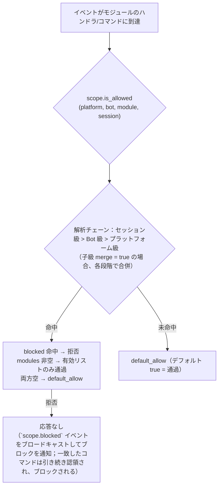

- **解析優先度**：セッション級 > Bot 級 > プラットフォーム級、高優先度のバインドは低優先度を**全体的に上書き**します。  
  子級バインドに `merge = true` を指定した場合は、低優先度と**各項目ごとに合併**されます（`modules` / `blocked` はそれぞれ独立に合併され、`merge` 自体は項目としてカウントされません）。
- **デフォルトの意味**：フィルタリングされたモジュールのコマンドやハンドラはトリガされず、応答もしません。TRACE レベルのログで確認可能（`core.scope.denied`）。  
  同時に `scope.blocked` ライフサイクルイベントをブロードキャストして、誰がブロックされたか、なぜブロックされたかを観測できます。  
  一致した**コマンド**は引き続き認領され、ブロックされます——コマンドのテキストは低優先度のメッセージハンドラに漏れることなく、二重応答の混乱を解消します。
- **フレームワークレベルのハンドラ**（`scope_exempt=True` または owner が空）は影響を受けません。モジュール名が空（フレームワーク層のリソース）の場合は常に通過します。
- **セッション感知のヘルプとコマンド照会**：コマンド照会 API（`command.help` / `get_command` / `get_commands` / `get_group_commands` / `get_visible_commands`、および `module.get_commands_overview`）は、任意の `event=` または明示的な `platform=` / `bot_id=` / `session_id=` キーワードをサポートします。  
  現在のセッションで無効なモジュールのコマンドは結果に含まれません（`get_command` は None を返し、単一コマンドのヘルプは「未登録」として扱われ、デフォルトの意味と一致します）。  
  コンテキストを渡さない場合は、全量の動作を維持します。

### バインドの継承（merge）

デフォルトでは、全体的な上書きの意味が明確で予測可能です。上級バインドに**追加**したい場合は、子級に `merge = true` を指定します：

```toml
[ErisPulse.scope.platforms.onebot11]
modules = ["Chat", "Tool"]      # プラットフォーム級：Chat、Tool を有効

[ErisPulse.scope.bots.onebot11."123456"]
modules = ["Music"]
merge = true                    # この Bot の実効値 = ["Chat", "Tool", "Music"]
```

- 合併ルール：`modules` と `blocked` はそれぞれ**合併**されます。バインド内では `blocked` が `modules` より優先されます。
- 鏈式合併：プラットフォーム → Bot → セッションの順に段階的に追加され、各段階で `merge` または上書きを独立して決定します。

## ② 身元次元（イベント受容）

**一言で言うと**：ユーザー／セッション／Bot／アダプターの4段階の戦略に基づき、イベント配信の入口で「受容すべきでないイベント」を完全に破棄し、deny は allow より優先されます。

「どのユーザーのイベントを受け入れるか」を決定します。拒否されたイベントは**配信の入口で完全に破棄**されます——ミドルウェアや任意のハンドラ（フレームワークレベルを含む）には一切渡らず、TRACE レベルのログ（`core.scope.identity_denied`）でのみ確認できます。

- **解析優先度**：ユーザー > セッション > Bot > アダプター。最も具体的に設定された戦略を採用します。deny は allow より優先されます。
- 各段階のバインディングは二元的な戦略です：`{ allow = true }` または `{ deny = true }`
- ユーザーのキーには glob / 正規表現（例：`"spam_*"` で一括してスパムユーザーをブロック）が使用可能です。
- 代表的な使い方——上位階層で deny し、個別のユーザーに対して allow を設定することで「例外的に許可」を実現します：

```toml
[ErisPulse.scope.identity.adapters.onebot11]
deny = true
[ErisPulse.scope.identity.users.onebot11]
allow = ["u_admin"]   # アダプター階層で拒否されていても、u_admin のイベントは許可されます
```

## ③ 出站次元（制限モジュールが発信する呼び出し）

**一言で言うと**：メソッド単位のホワイトリスト・ブラックリストによって、モジュールが発信するメッセージ / API / リクエスト呼び出しを制限し、拒否された呼び出しはネットワークリクエストを一切行わず、直接 `retcode=34601` を返します。

制限されるモジュールの**発信アクション**：メッセージ送信 / 標準APIアクション / リクエスト操作。  
3つのアクションはそれぞれ下層DSLに対応します：`Event.reply` と `Send`（send）、`Api` / `call_api`（api）、`Request` の accept/reject（request）。イベントハンドラ実行中にモジュールが発信する出站呼び出しは、モジュールのオーナーを含み、この次元で一括して判定されます。

### 規則の形態（インライン表）

各アクションのルールはインライン表です：`{ allow = [...], deny = true|[...] }`。  
同一アクションには1つのルールしか設定できません（TOMLのキーは重複不可、全禁止と細粒度のどちらか1つを選択）：

```toml
[ErisPulse.scope.actions.MyModule]
send = { deny = true }                                  # 送信を全禁止（Event.reply / Send DSL）
# またはメソッド単位の細粒度設定：send = { allow = ["Text", "Image*"], deny = ["File"] }
api = { allow = ["get_*"] }                             # 限定的に取得系標準APIを許可
# またはアクション単位のブラックリスト：api = { deny = ["set_*", "leave_*"] }
request = { deny = true }                               # リクエストのaccept/reject処理を禁止
```

- `send` の項目は**送信メソッド名**（`Text` / `Image` / `File` ...）に一致する
- `api` の項目は**標準アクション名**（`get_group_info` / `set_group_name` ...）に一致する
- 項目は正確な名前 / glob / `re:` 正規表現（全システムと統一された構文で、大文字小文字は区別しない）
- `allow` に1つの文字列を記述することは、1つの項目のリストと同義です：`send = { allow = "Text" }`

### 判定の意味

**デフォルトは全許可**——設定がなければ、またはオーナーが空（フレームワーク層の内部呼び出し）であれば許可されます。  
ルールが設定された場合、以下の順序で判定されます：

1. `deny = true` → 拒否
2. `deny` リストに呼び出し名が一致 → 拒否
3. `allow` リストが空でなく、呼び出し名が一致しない（または呼び出しに名前がない）→ 拒否
4. その他の場合 → 許可

拒否された呼び出しはネットワークリクエストを一切行わず、標準の失敗レスポンスを直接返します（`retcode = 34601`、[api-response §5.3](../standards/api-response.md#53-フレームワーク拡張返却コード34xxx-プラットフォームエラーセグメントの下3桁カスタマイズ)を参照）。  
3つのアクションは互いに独立しており、1つだけを制限することも可能です。

```python
# 実行時API
sdk.scope.set_action("MyModule", "send", deny=True)              # 送信を全禁止
sdk.scope.set_action("MyModule", "send", allow=["Text"])         # 送信はテキストのみ許可
sdk.scope.is_action_allowed("MyModule", "send", name="Image")    # False
sdk.scope.is_action_allowed("MyModule", "api", name="get_user_info")  # 規則に従って判定
sdk.scope.delete_action("MyModule", "send")                      # 許可を復元
sdk.scope.get_action("MyModule", "send")                         # そのアクションの現在のルール
```

## 実行時API

スコープの実行時APIは3つの層に分かれています：**判定**（3つの質問）、**次元ごとの読み書き**（各次元の `set` / `get` / `delete` パラメータ化メソッド、署名はすべて型注釈付き、IDEで補完可能）、**辞書式バックアップ**（ドット区切りのパスで任意の節に直接アクセス）。

```python
from ErisPulse import sdk

scope = sdk.scope
```

### 判定（3つの質問）

```python
scope.is_allowed("onebot11", "123456", "Chat")                 # ① モジュール次元
scope.is_allowed("onebot11", "123456", "Chat", "789012345")    # セッションレベルを含む
scope.is_allowed("onebot11", "123456", None)                   # フレームワーク層のリソース -> True

scope.is_identity_allowed("onebot11", "123456", "group_9", "u1")   # ② 身元次元

scope.is_action_allowed("MyModule", "send")                    # ④ 出力次元
scope.is_action_allowed("MyModule", "send", name="Image")      # メソッドレベルの細粒度
```

### ① モジュール次元

```python
# バインディング（パラメータによって階層が決まります：session_id > bot_id > プラットフォームレベル）
scope.set_module("onebot11", bot_id="123456", modules=["Chat", "Tool*"])
scope.set_module("onebot11", blocked=["re:^Danger"])                       # プラットフォームレベル
scope.set_module("onebot11", bot_id="123456", session_id="g9", modules=["Chat"])  # セッションレベル
scope.set_module("onebot11", bot_id="123456", modules=["Music"], merge=True)      # 現在のバインディングと並列に結合
scope.set_module("onebot11", bot_id="123456", modules=["Chat"], persist=False)    # 実行時のみ

# 読み取り / 削除
scope.get_module("onebot11", bot_id="123456")   # {"modules": ["Chat"], "blocked": []}
scope.delete_module("onebot11", bot_id="123456")
```

> `merge=True` は**書き込み時に並列に結合**（現在のバインディングとエントリを結合）です；階層間の解析時の `merge = true` 設定は上記の[バインディング継承](#バインディング継承merge)をご覧ください——これらは独立したメカニズムです。

> **実行時バインディング（`persist=False`）の意味**：実行時バインディングは独立したオーバーライド層に保存され、**任意の後続の設定書き込み / 設定ファイルのホットアップデートでも削除されません**（設定ツリーが再構築された後に、書き込み順に自動的に再実行されます、実行時削除も含みます）。これらは永続化されず、プロセスの再起動後に失われます；モジュールのアンロード時に、そのモジュールが書き込んだ実行時バインディングはバックアップでクリーンアップされます。その後、同一のパスで `persist=True` を実行すると、ユーザー永続化の意味で実行時ルールが上書きされます。

### ② 身元次元

```python
# 戦略のバインディング（パラメータによって階層が決まります：user > session > bot > adapter；allow / deny のどちらか一方）
scope.set_identity("onebot11", user_id="u_bad", deny=True)
scope.set_identity("onebot11", user_id="spam_*", deny=True)    # キーは glob / re: 正規表現をサポート
scope.set_identity("onebot11", bot_id="123456", session_id="g9", allow=True)

# 読み取り / 削除
scope.get_identity("onebot11", user_id="u_bad")   # {"deny": True}
scope.delete_identity("onebot11", user_id="u_bad")
```

### ③ 出力次元

```python
# 制限ルールの設定（allow: str|list；deny: bool|str|list；ルール全体の置換）
scope.set_action("MyModule", "send", deny=True)                    # 送信を完全に禁止
scope.set_action("MyModule", "send", allow=["Text"])               # テキスト送信のみ許可
scope.set_action("MyModule", "api", deny=["set_*", "leave_*"])     # 管理系APIを禁止

# 読み取り / 削除
scope.get_action("MyModule", "send")       # {"allow": ["Text"]} 元のルール
scope.delete_action("MyModule", "send")    # 個別のアクションを削除
scope.delete_action("MyModule")            # モジュールのすべてのアクション制限を削除
```

### 一般的な操作

```python
scope.get("platforms")   # 辞書式バックアップ：ドット区切りのパスで任意の節を読み取り
scope.topology()         # 全設定ツリー（ダッシュボード用）
scope.stats()
# {"module_calls": .., "module_filtered": .., "identity_checks": .., "identity_denied": ..,
#  "action_checks": .., "action_denied": .., "cache_hits": .., "cache_misses": ..}
scope.reset_stats()
scope.clear()           # 全設定をクリア（メモリ上でのみ有効）
```

### 高度な操作：辞書式ドット区切りパスバックアップ

次元化されたメソッドは日常的なシナリオをカバーします；任意のノード（または将来追加される次元）に直接アクセスする必要がある場合、**辞書式API**を使用できます——`get` / `set` / `delete` はドット区切りのパスを受け取り（dictの深さのマージ、書き込み後すぐに読み取り可能）、`scope[path]` / `scope[path] = v` / `del scope[path]` / `path in scope` プロトコルも提供します：

```python
scope.set("bots.onebot11.123456", {"modules": ["Chat"], "blocked": []})
scope.set("identity.users.onebot11.u_bad", {"deny": True})
scope.get("actions.MyModule.send")

scope["platforms.onebot11"]        # 読み取り（存在しない場合はKeyErrorを送出）
scope["platforms.onebot11"] = {...}  # 書き込み
del scope["platforms.onebot11"]      # 削除
"actions.MyModule" in scope          # 存在確認
```

## 拦截の可視化：`scope.blocked` イベント

スコープのフィルタリング（モジュールのフィルタ / 身元の拒否）が発生すると、**`scope.blocked`** というライフサイクルイベントがブロードキャストされ、"誰がブロックされたか、どのレベルでブロックされたか"をサブスクライブ、統計、ダッシュボードで表示可能になります——ブロックはデフォルトで返信されませんが、不可知のブラックボックスではありません。

| フィールド | 説明 |
|------|------|
| `dimension` | `"module"`（モジュール次元のフィルタ）/ `"identity"`（身元の受信拒否） |
| `module` | フィルタされたモジュール名（モジュール次元のみ） |
| `platform` / `bot_id` / `session_id` / `user_id` | ブロックが発生したソースコンテキスト |

```python
from ErisPulse.Core.lifecycle import lifecycle

@lifecycle.on("scope.blocked")
def on_blocked(data):
    print(f"ブロックされた：{data['dimension']} {data.get('module') or data.get('user_id')}")
```

- イベントは `fire` でバックグラウンドでブロードキャストされます（リスナーがいない場合はオーバーヘッドがなく、ホットパスを遅らせません）
- キャッシュヒットによる重複のブロックは**再ブロードキャストされません**——同じ組み合わせはキャッシュが失効するたびに1回だけブロードキャストされます
- `adapter.event.blocked`（ミドルウェアによる拒否）とは区別されます：これはイベントレベルの破棄であり、本イベントはスコープの受信ゲートのモジュール / 身元フィルタリングです

## キャッシュとホットアップデート

- `is_allowed` / `is_identity_allowed` / `is_action_allowed` の結果は**LRUキャッシュ**（`scope.cache_size` で調整可能）が付いており、`set` / `delete` / 設定のホットアップデート（`config.updated` / `config.set`）で自動的に失効します
- すべての次元の設定は**即座に有効**になります、再起動は不要です
- スコープは**イベントごとの判断**であり、イベント間で状態を記憶しません：設定が変わると、次のイベントは新しいルールに従います

## 設定フォーマットの検証

ロード時 / ホットアップデート時に各セクションの設定フォーマットを検証します：型の間違ったセクション（例：`platforms` が文字列に設定されている）、不正な出力ルール（例：`allow` が数値に設定されている）、未知のアクション名、未知のトップレベルのキー（例：`alow` というスペルミス）は **WARNING** として出力され、対応するセクション / 条目は無視され、他の合法な設定は正常に有効になります——間違った設定は静かに失効するのではなく、警告されます。

## 一般的な問題と注意事項

### 1. 設定の階層と上書き

- モジュール次元：セッションレベル > Botレベル > プラットフォームレベル、**全体的に上書き**（子レベルで `merge = true` の場合は各エントリを並列に結合）。プラットフォームで `Chat` を許可し、Bot で `Music` を追加したい場合は、Bot レベルで `merge = true` を書くか、両方をリストに書く
- 身元次元：ユーザー > セッション > Bot > アダプタ、**最も具体的な**設定された戦略を取ります（例外許可ができます）
- コマンドのユーザーブラックリスト/ホワイトリスト：正確なコマンド名が glob キーに優先されます（`event.command.acl` を参照）

### 2. モジュール/コマンドが反応しない

まず作用域が原因かどうかを疑います：

```python
from ErisPulse import sdk

print(sdk.scope.is_allowed(event.get_platform(), bot_id, "MyModule", session_id))
print(sdk.scope.is_identity_allowed(event.get_platform(), bot_id, session_id, user_id))
print(sdk.scope.stats())   # module_filtered / identity_denied > 0 なら、ブロック記録がある
```

フィルタされた場合、デフォルトでは返信されません（モジュール次元と身元次元、ルールを暴露しないように）；`scope.blocked` ライフサイクルイベントをブロードキャストし、統計は継続的に蓄積されます；ACL で拒否されたコマンドは「権限不足」の返信を表示します。

### 3. 出力アクションが拒否されたときのトラブルシューティング

```python
from ErisPulse import sdk

print(sdk.scope.get("actions.MyModule"))
print(sdk.scope.stats())   # action_denied > 0 なら、呼び出しがブロックされている
```

ブロックは**明示的**です：拒否された呼び出しは `retcode = 34601` の標準の失敗レスポンスを返し、ネットワークリクエストは発生しません。

### 4. セッション識別子のプラットフォーム間隔離

`(platform, session_id)` 組み合わせが唯一の識別子です。`scope.sessions.onebot11."789"` は onebot11 でのみ作用し、telegram 上で同じ `789` のセッションには影響しません。身元次元のユーザーキーも同様です。

## 拓撲ツリーアプリケーションプログラミングインターフェース

`ModuleManager.get_topology()` と `AdapterManager.get_topology()` は、モジュール/アダプタの所属関係データを提供します。`sdk.get_topology()` は、作用域 `scope` を含む一括集約を行います：

```python
from ErisPulse import sdk

topology = sdk.get_topology()
# {
#   "modules": {                                   # モジュール → 持有するリソース
#     "Chat": {
#       "loaded": True, "enabled": True,
#       "commands": ["chat", "translate"],
#       "handlers": {"message": 2, "notice": 1},
#       "routes": {"http": ["/Chat/api"], "ws": [], "sse": []},
#       "lifecycle_hooks": 3,
#     }
#   },
#   "adapters": {                                  # アダプタ → Bot → 作用域
#     "onebot11": {
#       "status": "started", "enabled": True,
#       "bots": {"123456": {"status": "online", "scope": {...}}},
#       "scope": {"modules": [...], "blocked": [...]},
#     }
#   },
#   "scope": {                                     # 作用域（モジュール / 身元 / 出力アクション）
#     "platforms": {...}, "bots": {...}, "sessions": {...},
#     "identity": {"adapters": {...}, "bots": {...}, "sessions": {...}, "users": {...}},
#     "actions": {...},
#   },
# }
```

- モジュールのトポロジーは、登録されたコマンド、イベントハンドラ、HTTP/WS/SSEルート、ライフサイクルフックを統合し、モジュールリソースツリーを描画するのに便利です。
- アダプタのトポロジーは、各アダプタの状態、下位のBotの状態、およびプラットフォーム/Botレベルの作用域バインディング（モジュール次元）を統合します。
- **JSON安全出力**：`get_topology(json_safe=...)` はデフォルトで `True` であり、返された構造は直接 `json.dumps` できます——モジュール `info` は純粋なデータの `meta` サブテーブルのみ保持されます（`module_class` / `strategy` などの実行時オブジェクトは除外）、その他のノード（アダプタ作者が Bot `info` に挿入した任意のオブジェクトを含む）もバックアップで浄化されます（クラスオブジェクトは `__name__` を取得し、シリアライズできないオブジェクトは `str()` に退化します）。ダッシュボード / WebUI は直接シリアライズして返すことができます；原始オブジェクトが必要な場合は `json_safe=False` を渡します。


### 归属权（owner）系统

# 所有権（owner）システム

> [!TIP]
> **この文書を読むべき場面**：リソースリークの調査、アンロード時のクリーンアップフローの理解、または帰属リソースの宣言を行うとき。必要なければ読み飛ばしても、他の機能の利用には影響しません。

> **読み終えるとわかること**：owner コンテキストがどのようにリソースを自動帰属させるか、帰属リソースの一覧表、アンロード/無効化時の
> クリーンアップチェーンの完全な時系列、そしてどのリソースがアンロード時にクリーンアップされないか（設計上の境界）。
>
> **この文書の対象外**：リソースが「いつ有効になるか」の権限判定（[スコープ](scope.md)を参照）；
> バックグラウンドタスクの推奨される書き方と強制キャンセルの境界（[ライフサイクル管理 · バックグラウンドタスクの帰属と自動キャンセル](lifecycle.md#バックグラウンドタスクの帰属と自動キャンセル)を参照）。


所有権はモジュールの「プラグアンドプレイ」を支える礎です：モジュールがロード中に登録したすべてのフレームワークリソースは自動的に記名され、
アンロード/無効化時には記名に基づいて一括回収されます——モジュール作者はリソースを宣言するだけで、クリーンアップロジックを手書きする必要はありません。

> **関連システム**：スコープはイベント配信時に「リソースが有効かどうか」を決定し、
> 所有権はライフサイクルにおいて「リソースが誰に帰属し、誰のアンロード時に回収されるか」を決定します。
> スコープの詳細は[統一コントロールプレーン](scope.md)を、バックグラウンドタスクの詳細は
> [ライフサイクル管理](lifecycle.md#バックグラウンドタスクの帰属と自動キャンセル)を参照してください。

{!--< tips >!--}
1. 帰属は**登録の瞬間**に `current_owner` に基づいて自動記録され、モジュールコードの変更は一切不要
2. アンロード/無効化は同一のクリーンアップチェーン（`_cleanup_module_registrations`）を共用し、各ステップの失敗は警告のみで中断しない
3. ユーザー設定セマンティクスのリソース（永続化オーバーライド / scope ルール / コマンド ACL）はモジュールのアンロード時にクリーンアップ**されない**
4. ユーティリティモジュールが管理する外部ハンドルは `on_cleanup(cb)` でクリーンアップチェーンに組み込め、相手モジュールのアンロード時に自動コールバックされる（[ユーティリティモジュールガイド](#ユーティリティモジュールガイド他モジュールのハンドル管理)を参照）
{!--< /tips >!--}

## owner コンテキストの仕組み

owner はコンテキスト変数 `current_owner` で伝播します（`ErisPulse.runtime.context`）：

```python
from ErisPulse.runtime import owner_scope, get_current_owner

with owner_scope("MyModule"):
    # この区間内で登録されたすべてのリソースは自動的に MyModule に帰属する
    assert get_current_owner() == "MyModule"
```

フレームワークは以下のタイミングで owner を自動注入します（モジュール/アダプターコードで手動ラップは不要）：

| タイミング | owner の値 | 場所 |
|------|----------|------|
| モジュール `load()` | モジュール名 | インスタンス化 + `on_load` の全工程 |
| アダプター `start()` / `restart()` | プラットフォーム名 | アダプター起動の全工程 |
| `activate_on` 遅延ロード stub 登録 | モジュール名 | プレースホルダーコマンド/ハンドラーの登録 |
| イベントハンドラー実行中 | ハンドラーの帰属先モジュール名 | handler / コマンドエントリーでの再注入 |

実行期の再注入とは：モジュールが `on_load` 内で宣言したコマンドハンドラーが**実行中**に
登録型 API（`sdk.adapter.on()`、`overrides.*.set(persist=False)` など）を呼び出した場合も、
同様に自動的に当該モジュールに帰属することを意味します。

## 帰属リソース一覧

モジュールがロードコンテキスト内で登録した以下のリソースはすべて帰属が記録され、アンロード/無効化時に自動回収されます：

| リソース | 登録方法 | クリーンアップ呼び出し |
|------|----------|----------|
| コマンド | `@command()` / コマンド dict 宣言 | `command.unregister_by_owner()` |
| イベントハンドラー | `@message` / `@notice` / `@request` / `@meta` | `handler.unregister_by_owner()` |
| アダプターイベントリスナー | `sdk.adapter.on()` / `raw=True` | `adapter.unregister_handlers_by_owner()` |
| アダプターミドルウェア | `@sdk.adapter.middleware` | 同上 |
| ルーティング（HTTP/WS/SSE） | `router.http()` / `websocket()` / `sse()` | ネームスペース別 + owner 別の二重フォールバック |
| ルーティングミドルウェア | `@router.middleware()` / `add_middleware()` | `router.unregister_all_by_owner()` |
| Dashboard ホームエントリー | `router.register_home_entry()` | `unregister_home_entries_by_owner()` |
| カスタムセッションタイプ | `register_custom_type()` | `unregister_custom_types_by_owner()` |
| プラットフォームイベントメソッド注入 | `register_event_method()` / `register_event_mixin()` | `unregister_event_methods_by_owner()`（モジュールアンロード時に自動回収、旧クロージャーのリークなし） |
| バックグラウンドタスク | `self.spawn()` | `cancel_owner_tasks()` |
| 外部帰属クリーンアップフック（ユーティリティモジュール預かり） | `runtime.on_cleanup(cb)` | `run_owner_cleanups()`（アンロード/無効化/アダプター終了チェーン内で発火） |
| ライフサイクルフック | `lifecycle.register()` | `lifecycle.unregister_by_owner()` |
| マスター識別プロバイダー | `master.provider` | `master.unregister_by_owner()` |
| i18n 翻訳キー | `I18nClass` 宣言（domain=モジュール名） | `i18n.unregister_domain()` |
| イベントオーバーライド（ランタイム） | `overrides.*.set(persist=False)` | `overrides.unregister_by_owner()` |
| 対話セッション（wait_reply 待機 / リース） | `event.wait_reply()` / `sdk.interaction.acquire()` | `interaction.cancel_by_owner()`（待機側は即座にキャンセルを受け取る） |
| コンテキストデータ | `runtime/context` が owner ごとに記録 | モジュール単位で精密にクリーンアップ |

アダプター側の対応リソース（プラットフォーム名を owner とする）は、アダプターの `shutdown()` / `restart()` 時に
`_cleanup_adapter_resources` によって回収されます。さらに以下を含みます：

| リソース | クリーンアップ呼び出し |
|------|----------|
| アダプター自身の `on()` ハンドラーとミドルウェア | `adapter.unregister_handlers_by_owner(platform)` |
| プラットフォームイベントメソッド拡張（`EventMixin`） | `unregister_platform_event_methods(platform)` |
| カスタムセッションタイプ | `unregister_custom_types_by_owner(platform)` |
| 対話セッション（当該プラットフォームで保留中の wait_reply / リース） | `interaction.cancel_by_platform(platform)` |
| i18n 翻訳ドメイン（domain=設定キー） | `i18n.unregister_domain(設定キー)` |
| 細粒度ネームスペースルーティング | `router.unregister_all_by_owner(platform)` |

## アンロード/無効化クリーンアップシーケンス

`unload()` と `disable()` は同一のクリーンアップチェーンを共用します（各ステップは独立した try/except で、
失敗はログに記録されるだけで**後続のクリーンアップは中断しません**）：

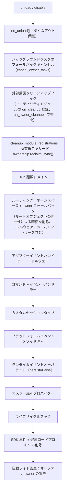

`sdk.uninit()` の終了時には別途グローバルなフォールバックがあります：全アダプター shutdown → 全モジュール unload →
`router.stop()`（ルーティング/ミドルウェア/ホームエントリーのクリア）→ `cancel_all_background_tasks()` →
イベントハンドラーとフックのクリア。

## 所有権統一ファサード（ownership）

クリーンアップチェーンの 16 ステップは、所有権統一ファサード `ErisPulse.Core.ownership` に集約されています。
4 つの動詞が「登録解除、カウント、スキャン、監査」をカバーします——サブシステムごとの `*_by_owner` 登録解除関数は
そのまま維持され、ファサードの内部実装として機能します：

| 動詞 | 用途 |
|------|------|
| `ownership.reclaim(owner)` | owner 名義の下にある全リソースを一括登録解除（タスクキャンセル → クリーンアップフック → 登録系リソース；非同期の完全版） |
| `ownership.reclaim_sync(owner)` | 登録系リソースの登録解除（同期版、同期アンロードパス用） |
| `ownership.counts(owner=None)` | owner の在籍リソースを読み取り専用で集計（None は全 owner） |
| `ownership.orphans()` | オーファンスキャン：リソースは在籍しているが owner は登録解除済み（リーク確定リスト） |
| `ownership.audit(owner, deep=)` | リーク監査レポート（カウント + オーファン + 任意の gc インスタンス全数調査） |

```python
from ErisPulse.Core import ownership

ownership.reclaim_sync("MyModule")       # {'commands': 1, 'routes_http': 2, ...}
ownership.counts("MyModule")             # 在籍リソースのカウント
ownership.orphans()                      # [{"owner": "ghost", "total": 2, ...}]
```

**監査エントリー**：

- アンロード / リロード後の**自動ライト監査**：オーファン owner リソースを検出したら WARNING 警告（ゼロオーバーヘッドのカウントスキャン）
- `sdk.module.audit(name, deep=True)`：モジュールインスタンスの gc 全数調査——インスタンスが回収不能な場合、
  参照元の型を提示（「誰が旧インスタンスを掴んでいるか」を特定）；グローバルな一時停止のオーバーヘッドがあるため、明示的なトラブルシューティングのみに使用
- 深い全数調査は明示的な操作であり、設定キーを設けず、自動修復も行いません

## ホットリロード失敗時のロールバック

ホットリロードは「**アンロード前スナップショット → 失敗時自動リストア**」に変更されました：新バージョンの構文エラー、依存関係の欠落、
ロード失敗時には、旧インスタンスと登録状態（レジストリエントリー、sdk 属性、sys.modules エントリー）が
自動的に復元され、サービスは中断せず、ログに「旧インスタンスへロールバックしサービスを継続しています」と表示されます。

ベストエフォートのセマンティクス（ドキュメント化された境界）：

- `on_unload` が実行済みの副作用（切断済みの接続、キャンセル済みのタスク）は取り消せません——
  復元後の旧インスタンスは「後片付け済み」の状態にあり、再度ロードをトリガーしないと完全には利用できません
- サードパーティが実行時に手動でキャッシュした旧インスタンスへの参照は復元対象外です
- 対象パッケージが既にアンロードされている場合（entry-point が消失）はアンロード成功とみなし、ロールバックしません

## 設計上の境界：アンロード時にクリーンアップされないリソース

所有権が回収するのは**モジュールコードが登録したランタイムリソース**のみです。以下のリソースは**ユーザー設定のセマンティクス**
（制御権はユーザーにあり、意図的な設定である可能性がある）に属し、モジュールのアンロード後も設定と共に永続的に保持されます：

| リソース | セマンティクス | 説明 |
|------|------|------|
| `overrides.*.set(persist=True)` | 永続化オーバーライド | 設定ファイルに書き込まれ、再起動を跨いで有効；モジュールのアンロードでは削除されない（ユーザーの明示的な設定） |
| `scope.set_action()` などのスコープルール | 権限コントロールプレーン | ユーザー/Dashboard が管理し、モジュールをアンロードしてもルールは回収されない |
| `overrides.acl.set(persist=True)` | コマンド ACL | 同上 |
| Conversation `save()` 永続化 | 複数回対話のアーカイブ | データ資産はクリーンアップされない |

ランタイムの一時書き込み（`persist=False`）は owner と共に回収されます——**永続化するかどうかが
「ユーザー資産」と「モジュールのランタイム状態」の境界線です**。

## 内部実装：帰属の仕組み

**ひとことで言うと**：アトリビューションチェーン（contextvar の伝播）が「誰の頭に記録されるか」を決め、
キャンセルチェーン（タスク登録表）が「アンロード時にキャンセル可能か」を決めます——2 つのチェーンは独立して動作しており、
リソースを正しくクリーンアップするには両方が揃う必要があります。

帰属システムは**2 つの独立したチェーン**で構成されており、その分担を理解することが帰属問題のトラブルシューティングの前提となります：

### アトリビューションチェーン（contextvar の伝播）

`runtime/context.py` の `current_owner` などの ContextVar は**アトリビューション**を担います——
「今まさにこのコードが登録したリソース/発行した呼び出しが誰の頭に記録されるか」。伝播ルールは Python の
contextvars のセマンティクスに従います：

| 実行パス | context は伝播するか | アトリビューション結果 |
|---------|----------------|---------|
| 同期呼び出しチェーン / `await` チェーン | ✅ 伝播 | 正しく帰属 |
| `owner_scope` 内の `asyncio.create_task` | ✅ 伝播（task は作成時点の context をコピー） | タスク**内部**のフレームワーク呼び出しは正しく帰属 |
| `run_in_executor` / 素のスレッド | ❌ 非伝播 | アトリビューション喪失 |
| 独立イベントループ | ❌ 非伝播 | アトリビューション喪失 |

> アトリビューション ≠ 登録：context の伝播は「誰の頭に記録されるか」にのみ影響し、リソースがクリーンアップ可能かどうかは
> 後述のキャンセルチェーンに入っているかどうかで決まります。

### キャンセルチェーン（タスク登録表）

`runtime/tasks.py` の `_owner_tasks` 登録表は**ライフサイクル**を担います——
「owner 名義の下にどの未完了タスクがあり、アンロード時に一括キャンセルされるか」。タスクが登録表に入る経路：

1. **明示的なスケジューリング**：`spawn_background()` / `self.spawn()` → 作成時に
   `current_owner`（または明示的な `owner=` 引数）をキャプチャ → 登録表に記載；
2. **Task Factory 自動登録**（2.8.3）：`install_owner_task_factory()` がフレームワーク起動時に
   メインイベントループへインストール——**あらゆる**タスク作成（サードパーティライブラリ内部の
   `create_task` を含む）がファクトリーを通過する際に `current_owner` を読み取り、非 None であれば登録。

登録表は自己クリーンアップします：各タスクは `done_callback` を持ち、完了と同時に表から削除されるため、リークはありません。

### キャンセル時系列（モジュールアンロード）

```
module.unload()
  → on_unload(event)                    # モジュール自身のクリーンアップ（フォールバックのタイムアウト保護）
  → フレームワークが当該 owner のコマンド/イベント/フック/ルーティングを登録解除
  → cancel_owner_tasks(owner)           # タスク登録表によるフォールバックキャンセル
      → task.cancel() を一件ずつ実行    # キャンセル処理を実行中のタスク自身は除外
      → await gather(pending, timeout)  # 回収を待機（タイムアウト時はそれ以上ブロックしない）
```

### トラブルシューティングの考え方

- **リソースがクリーンアップされない** → 登録表を確認：`get_owner_tasks("MyModule")` に当該タスクが含まれているか；
  含まれていなければ登録パスが帰属チェーンを経由していない（import 時 / スレッド / 独立ループ）。上記の表と照らし合わせて特定してください。
- **アトリビューションが誤っている** → エラー発生時点の `get_current_owner()` の値を確認；非同期の遅延実行
  （コールバック/タスク）のアトリビューションは実行時ではなく作成時点の context から取得されます。

## モジュール作者ガイド

### 推奨される書き方

```python
from ErisPulse import sdk
from ErisPulse.Core.Event import command
from ErisPulse.runtime import owner_scope, spawn_background

class MyModule(BaseModule):
    async def on_load(self, event):
        # フレームワークリソース：自動帰属、手動クリーンアップ不要
        self.task = self.spawn(self.polling())      # バックグラウンドタスク
        sdk.router.register_home_entry("私のモジュール", "/my")  # ホームエントリー

        # モジュール固有リソース：owner_scope で包めば帰属体系に組み込まれる
        with owner_scope("MyModule"):
            self.client.on_event(self._handle)      # 仮想のカスタム登録

    async def on_unload(self, event):
        # フレームワークリソースは自動回収済み。owner_scope の及ばない固有リソースだけをクリーンアップ
        await self.client.close()
```

### 注意点

- **import 時の登録は帰属しない**：モジュールのトップレベル（import 時）で登録されたフック/ハンドラーは
  `owner_scope` の前に発生するため、フレームワークレベルのリソース（owner=None）とみなされ**クリーンアップされません**。
  すべて `on_load()` 内で登録してください。
- **カスタム domain の i18n 登録**：`i18n.register(domain=...)` の domain が
  モジュール名と異なる場合、自動回収されません。domain=モジュール名を維持してください。
- **バックグラウンドタスクには `self.spawn()` を推奨**：2.8.3 以降、素の `asyncio.create_task` も**自動的に暗黙帰属**します
  （Task Factory が自動登録し、アンロード時にフォールバックキャンセル）；ただし `self.spawn()` が依然として推奨の書き方です——
  非メインループのスレッドからメインループへのスケジューリング、明示的な `owner=` 指定、fire-and-forget の GC 防止をサポートします。
  **2.8.3 より前**のバージョンでは素のタスクは帰属しないため、必ず `self.spawn()` を使用してください。
- クリーンアップチェーンは「失敗時は警告のみ」：単一ステップのクリーンアップで例外が発生しても、他のリソースの回収は妨げられません。ログは
  DEBUG/WARNING レベルで確認でき、トラブルシューティング時には TRACE を有効にしてください。

### 登録タイミング → 帰属結果の対照表

| 登録シナリオ | 帰属結果 | 説明 |
|---------|---------|------|
| `on_load()` 内でフレームワーク API（コマンド/イベント/lifecycle/ルーティングのデコレーター）経由で登録 | モジュールに帰属 | アンロード時に自動登録解除 |
| モジュールのトップレベル（import 時）に登録 | **帰属なし**（owner=None） | クリーンアップされないため使用しないでください |
| `self.spawn()` で作成したバックグラウンドタスク | モジュールに帰属 | アンロード時に自動キャンセル |
| `owner_scope("Name")` 内でサードパーティ API 経由で登録 | モジュールに帰属 | サードパーティのコールバックが scope 内で同期的に実行されることに依存 |
| 素の `asyncio.create_task`（`loop.create_task` / `ensure_future` を含む） | **自動帰属**（Task Factory、2.8.3+） | 作成の瞬間に `current_owner` を読み取り、owner コンテキスト内では自動登録・アンロード時にフォールバックキャンセル；詳細は後述の[内部実装](#内部実装帰属の仕組み)を参照 |
| サードパーティライブラリの非同期コールバック（aiohttp / APScheduler など）内部で作成されたタスク | **自動帰属**（Task Factory、2.8.3+） | コールバック実行時に `current_owner` が注入済み（フレームワークハンドラー実行中など）であれば、タスクは自動登録 |
| `run_in_executor`（スレッドプール） | **帰属なし**（非 asyncio.Task） | スレッドはタスクファクトリーの管轄外のため、ライフサイクルは自己管理が必要 |
| 独立イベントループ（自前の loop）内の登録 | **帰属なし** | Task Factory はメインループにのみインストール；contextvars もイベントループを跨いで伝播しません |

> 原則：**帰属は登録の瞬間の `current_owner` コンテキストに従います**；あらゆる非同期の遅延実行、
> スレッドプール、独立ループはこのコンテキストから外れます——帰属させたい場合は明示的に `owner_scope` に入ってください。

## ユーティリティモジュールガイド：他モジュールのハンドル管理

**シナリオ**：定時タスク、レジストリ、コネクションプールといった「ユーティリティモジュール」は、他のモジュールに代わってものを預かります——
相手が `on_load` 内で `sdk.Cron.on_trigger(handler)` を呼び出すと、あなたのコンテナには相手のインスタンスを指す
コールバックが保存されます。フレームワークは相手が登録したすべてのフレームワークリソースを自動クリーンアップしますが、
**あなたのプライベートコンテナ内の参照**まではクリーンアップできません：相手がアンロードされた後もあなたのコンテナがそのインスタンスを
握り続けると、GC で回収できなくなります（メモリリーク。`purge` のリーク診断では「回収不可」と報告されます）。

**解決策**：相手のものを登録するのと同じ関数内で `on_cleanup()` を呼び出せば、
フレームワークが相手のアンロード / 無効化時にあなたのクリーンアップ関数を自動コールバックします：

```python
from ErisPulse.Core.Bases import BaseModule
from ErisPulse.runtime import off_cleanup, on_cleanup

class CronModule(BaseModule):
    def __init__(self):
        self._entries = {}  # {モジュール名: そのモジュールが預けたコールバックのリスト}

    def on_trigger(self, handler):
        # 呼び出し元モジュール名を自動識別（on_load からの直接呼び出し / module.call 経由のどちらも正しく）、
        # 戻り値は解決済みの owner で、記名キーとしてそのまま使用可能
        owner = on_cleanup(self._drop)
        self._entries.setdefault(owner, []).append(handler)

    def _drop(self, owner: str):
        """相手モジュールがアンロード/無効化された際にフレームワークから自動呼び出し：そのハンドルを破棄するだけ"""
        self._entries.pop(owner, None)

    async def on_unload(self, event):
        off_cleanup(self._drop)  # ③ 自身のアンロード前にフックを登録解除し、フック表が self を保持するのを防ぐ
```

フレームワークが保証する動作：

| 項目 | 動作 |
|--------|------|
| 発火タイミング | 相手モジュールの unload / disable、またはアダプターのシャットダウン——いずれもフレームワークのクリーンアップチェーン内で発火し、purge のリーク診断より前に実行 |
| 呼び出し元の識別 | 直接呼び出しでは `current_owner` を取得；`module.call()` 経由の呼び出しでは呼び出し元（`current_caller`）を取得；`on_cleanup(cb, owner="モジュール名")` での明示指定も可能。**強制検証**：owner を解決できない場合（3 つの取得元がすべて欠落）は `ValueError` をスロー——プライベートユーティリティモジュールは自身のロードコンテキスト内でフックを登録すべき |
| コールバックシグネチャ | `cb(owner: str)`、同期 / 非同期どちらも可；非同期にはタイムアウト保護付き（`CLEANUP_CALLBACK_TIMEOUT_SECS`、デフォルト 10 秒） |
| 耐障害性 | 単一のコールバックの例外 / タイムアウトはログへの記録のみで、他のフックとクリーンアップチェーンには影響しない |
| 重複登録 | 同一 `(owner, callback)` は冪等に重複排除 |

**必要ない場合**：相手が登録したのがフレームワークリソース（コマンド、イベントハンドラー、ルーティング、
バックグラウンドタスクなど）であれば、フレームワークがすでに完全自動でクリーンアップします（上記の[帰属リソース一覧](#帰属リソース一覧)を参照）。
`on_cleanup` が必要なのは、あなたのプライベートコンテナ内に保持している相手のハンドルだけです。
モジュール開発者視点のクイックリファレンス版は
[ベストプラクティス · ユーティリティモジュール](../developer-guide/modules/best-practices.md#ユーティリティモジュール他者のものを預かるときはアンロード通知を受け止める)を参照してください。


### 影子模块与灰度转正

# シャドウモジュールとカナリア昇格

> [!TIP]
> **このドキュメントを読むべきタイミング**：カナリアリリース——新バージョンの並行トライアル実行、動作比較、昇格・ロールバックが必要なとき。不要であればスキップしても、他の機能の利用には影響しません。

> **読み終えるとわかること**：シャドウモジュールの5つの分離ゲート、動作 diff のアライメント方法、
> `promote` による昇格と失敗時のロールバック手順、そしてフレームワークでは防げない誠実な限界。
>
> **このドキュメントでは扱わないこと**：通常モジュールのホットリロードとオーナーのクリーンアップに関する汎用メカニズム
> （[オーナー（owner）システム](ownership.md) を参照）。


シャドウ = 同一モジュールの**新バージョン**であり、独立した owner（例：`roll_shadow`）として本番の旧バージョンと
共存しながらトライアル実行します：実際のイベントの**コピー**を受け取り、そのアウトバウンドは本当に送信されるのではなく
**傍受して記録**されます——`shadow_diff` で2つのバージョンの動作を比較し、無害であることを確認したら `promote` で
ワンクリック昇格、`dismiss` でいつでも破棄できます。**モジュールコードは一切変更不要、全工程がランタイム API 駆動**：
`load / unload / reload` と同種の運用アクションであり、Dashboard / カスタム管理モジュールから直接
呼び出せ、書くべき設定項目は一切ありません。

{!--< tips >!--}
1. 起動：``await sdk.module.shadow_start("roll", source="path/to/v2")``
   ——新バージョンのコードは独立した owner（デフォルトはパス名）として旧バージョンと共存
2. シャドウは実際のディスパッチと依存グラフには参加しません：同名コマンドはシャドウのカタログに入り、ルートは登録のみでマウントせず、
   ライフサイクルブロードキャストはサイレント、`module.call` と依存解決は引き続き v1 を指します
3. 昇格は常に人間が確認します：``await sdk.module.promote_shadow("roll")``、失敗時は
   自動ロールバックで旧インスタンスがサービスを継続；``dismiss_shadow`` でいつでも破棄
{!--< /tips >!--}

## クイックスタート

```python
# v2 コード：通常のモジュールの書き方、シャドウを一切意識しない（任意のディレクトリ、例：downloads/roll_v2/）
```

```python
# 本番ボット内で（Dashboard / 管理モジュールから呼び出し）、1行でカナリアを起動：
await sdk.module.shadow_start("roll", source="downloads/roll_v2")
# → シャドウは独立した owner "roll_v2" として v1 と共存し、アウトバウンドは傍受・記録される

# トライアル実行中に動作を比較：
report = sdk.module.shadow_diff("roll")
# {"shadow_owner": "roll_v2", "count": 3, "aligned": [...]}
```

- **v1 の実際の送信**：受信箱（transcript）からの bot タイムライン
- **v2 の送信意図**：シャドウ台帳（アウトバウンドゲートが記録した「送りたかったもの」）
- 両者は `trace_id` で整列されます——同じメッセージについて、2つのバージョンがそれぞれなぜ発火した/しなかった、
  何を送りたかった/実際に送ったのかが一目瞭然

問題ないことを確認したら昇格：

```python
await sdk.module.promote_shadow("roll")   # 昇格、失敗時は自動的に v1 へロールバック
await sdk.module.dismiss_shadow("roll")   # または：シャドウを破棄
```

## 5つの分離ゲート

| ゲート | メカニズム |
|----|------|
| イベントコピー | シャドウハンドラーはイベントの**独立したコピー**を受け取る（`shadow` マーク付き）——シャドウによる改変 / 引き取り / 伝播停止はコピーにのみ作用し、元のイベントチェーンには影響しない |
| アウトバウンドゲート | シャドウの `Send` DSL と `Api` 呼び出しはすべて傍受して記録（成功形状のフェイクレスポンスを返却）、実際には送信しない——シャドウが重複して返信することはない |
| ストレージオーバーレイ | シャドウの KV 書き込みはメモリ上のオーバーレイに入り、実DBへの永続化は破棄；読み取りはまずオーバーレイを確認し、ミスなら実DBへ透過（カナリアは実際のデータに対して実行）；削除はトゥームストーンとして記録 |
| ルートブロック | シャドウの HTTP/WS/SSE ルートは登録のみでマウントしない；同名コマンドはシャドウのコマンドカタログに入り、プラットフォームイベントメソッドの注入は禁止 |
| ライフサイクルサイレント | シャドウは自身のライフサイクルイベントをブロードキャストせず、エコシステムの依存グラフに参加しない（`module.call` と依存解決は引き続き v1 を指し、未完成品が依存されるのを回避） |

設定の継承：シャドウはデフォルトで**元モジュールの設定セクションを継承**します（そうでないとカナリアの結果が歪みます）。昇格後は設定がそのまま有効になります。

## 誠実な限界（防げないもの）

- フレームワーク経由の送信 / API / KV ストレージ / 統一 HTTP クライアントは**すべて傍受可能**；
  モジュールがフレームワークを迂回して生の `aiohttp` を起動したり、スレッドを立てて外部システムへ書き込むことは——フレームワークでは防げません
- **ORM の読み書きはオーバーレイのセマンティクス外**です（行単位の overlay は SQL レイヤーではクリーンに実装できない）——
  シャドウ期間中は ORM 書き込み分離への依存を避けることを推奨
- **シャドウソースはローカルパス**：新バージョンのコードはパスからインポートされ、独立した owner としてロード；同一 PyPI パッケージは
  同一インタプリタ内では `sys.modules` の単一キー制限を受け、新旧2バージョンの共存は不可能
- リーク監査器（`sdk.module.audit`）はシャドウリソースの帰属を可視化；フレームワークを迂回した副作用も、
  少なくとも無音のままにはなりません

## 昇格とロールバック

`promote` の流れ：現在のバージョンをスナップショット（カスケード依存モジュールを含む）→ 完全アンロード → シャドウを本名で登録・
ロード → いずれかのステップが失敗すれば自動ロールバック、旧インスタンスがサービスを継続（ベストエフォートのセマンティクス：`on_unload` で
既に実行された副作用は取り消し不可、ロールバック後の旧インスタンスは終了処理済みの状態）。昇格成功後、シャドウのリソースは
回収され、バインドは解除；元モジュールの設定セクションがそのまま有効になります。

**永続化の注意**：promote はランタイムでの切り替えです——再起動後も v2 で動作し続けるには、新バージョンを
**永続的にインストール**する必要があります（`pip install -U` で新バージョンを導入 / プラグインファイルを差し替え）。
ランタイムでの切り替えはパッケージ管理を代行しません。


### 模块间通信

# モジュール間通信

> [!TIP]
> **この記事を読むタイミング**：RPCによるモジュール間呼び出し、サービス契約、宛先指定イベント、またはコールドスタート時のイベントリプレイが必要な場合。必要なければ飛ばしても、他の機能の使用に影響はありません。

> **この記事を読んだ後には**：3層通信モデル（RPC / 宛先指定イベント / ブロードキャスト）の選択のコツ、`meta.services` によるサービス契約とサービスディレクトリ、出向き監査の設定方法、およびラグドウォーキングとコールドスタート時のイベントリプレイについて理解できます。
>
> **この記事では扱いません**：ライフサイクルイベントシステム自体の登録 / 発火 / 優先度のメカニズム（[ライフサイクル管理](lifecycle.md)を参照）；ラグドロードの設定と activate_on の宣言（[ラグドロードシステム](lazy-loading.md)を参照）。

> [!NOTE]
> 本章の内容は ErisPulse **2.8.0+** が必要です。

ErisPulse では、モジュール間には**3層の通信モデル**が存在し、「点対点 → 宛先指定 → ブロードキャスト」の順序で構成されています：

| 層 | API | 意味 | 代表的なシナリオ |
|---|---|---|---|
| **RPC** | `await sdk.module.call("Chat", "get_history", ...)` | 点対点のリクエスト-レスポンス、契約 / 監査 / タイムアウト付き | 他のモジュールの機能を呼び出す（履歴の取得、翻訳、返金など） |
| **宛先指定イベント** | `await lifecycle.emit("message_received", {...}, to="Chat")` | 指定されたモジュールが登録したライフサイクルフックにのみ配信 | 上流の状態変化を下流に通知する（「新しいメッセージを受け取りました」など） |
| **ブロードキャスト** | `await lifecycle.emit("config.updated", {...})` | フレームワーク全体で見えるライフサイクルイベント | 設定のホットアップデート、モジュールの起動 / 終了 |

{!--< tips >!--}
選択のコツ：**返り値が必要な場合は `call` を使い、特定のモジュールのフックに通知したい場合は `emit(..., to=...)` を使い、全員に通知したい場合は `emit(...)` を使う**。
{!--< /tips >!--}

## RPC: module.call

```python
result = await sdk.module.call("Chat", "get_history", session_id, n=20)
```

`sdk.module.Chat.get_history(...)`（変更なし）の属性アクセスとの違いは以下の通りです：

| | `module.call()` | 属性アクセス |
|---|---|---|
| 目標が登録されていない / 有効になっていない | `ModuleNotAvailableError` をスロー | `AttributeError` をスロー |
| ラグジュアリーなモジュール | **自動的に起動**（イベント駆動モジュールはアクティベーションロックを通過） | 非同期初期化モジュールは `RuntimeError` をスロー |
| `current_owner` | **ターゲットモジュール**に帰属（内部の wait_reply / 送信 / ログは正しい帰属） | 呼び出し元に保持 |
| タイムアウト | 30秒（`timeout=` で上書き、None でタイムアウトなし） | なし |
| scope 審査 | 呼び出し元が出口のゲートを通過 `actions.<呼び出し元>.call` | なし |
| 契約検証 | `meta.services` のホワイトリスト | なし |

### エラー体系

```
ModuleError                      # モジュールシステムのエラー基底クラス
└── ModuleCallError              # 跨モジュール呼び出しの基底クラス（module / method 属性を含む）
    ├── ModuleNotAvailableError  # 目標が登録されていない / 有効になっていない / 起動に失敗
    ├── ServiceNotProvidedError  # メソッドが services ホワイトリストにない / 私的メソッド / 存在しない
    └── ModuleCallTimeoutError   # クロージャー関数がタイムアウト
```

すべて `ErisPulseError` 体系に属し、`from ErisPulse.Core import ModuleCallError` でキャッチ可能です。

## サービス契約: meta.services

サービス提供者は `get_meta()` で公開するホワイトリストを宣言します（`commands` と対称）：

```python
from ErisPulse.Core.Bases import BaseModule, ModuleMeta

class ChatModule(BaseModule):
    @staticmethod
    def get_meta() -> ModuleMeta:
        return ModuleMeta(
            name="チャット",
            services=[
                "get_history",                                       # 簡単な形
                {"name": "translate", "description": "テキストを指定された言語に翻訳する"},  # 説明付き
            ],
        )

    async def get_history(self, session_id, n=20): ...
    async def translate(self, text, target_lang): ...
    def _internal_helper(self): ...   # 下線付きメソッドは外部から呼び出し禁止
```

**開発者は無感覚なデフォルト**：

- `services` を宣言していない → **公開**メソッドはすべて `module.call()` で呼び出せる（属性アクセスと同様）、宣言は不要
- 宣言後 → ホワイトリストに絞られ、越境呼び出しは `ServiceNotProvidedError` をスロー——「これが外部に約束したメソッド」を明示する
- 制限の**主制御権はユーザー側**：`scope.actions` の設定が「誰が誰を呼び出せるか」を決定（後述の審査参照）、モジュール作者の `services` はサービス面の宣言に過ぎず、2つの層は互いに置換不可能

**サービス紹介**：各サービスに人間 / AI が読める説明を付ける——不要なら何も書かなくてよい、説明は**メソッドの docstring 首行**（フレームワークは docstring 形式を要求している）から自動取得：

```python
async def translate(self, text, target_lang):
    """テキストを指定された言語に翻訳する"""    # ← この行がサービス紹介として自動取得される
    ...
```

**パラメータ提示**：呼び出し元（特に AI エージェント）は各パラメータの意味を知る必要がある。不要なら何も書かなくてよい、提示はメソッドの docstring の **`:param:` 行**から自動取得：

```python
async def render_card(self, html, width=800, height=0):
    """HTMLを画像ファイルにレンダリングする

    :param html: レンダリングするHTMLテキスト          ← 自動的にパラメータ提示として取得される
    :param width: 画布の幅ピクセル、0は内容に応じて自動調整
    :param height: 画布の高さピクセル、0は内容に応じて自動調整
    """
```

微調整が必要な場合（docstring を上書き / 多言語対応）は dict 形式で `description` と `parameters` を宣言（両方とも i18n 辞書に対応；`parameters` は**パラメータ**と docstring をマージし、docstring が優先、宣言されたが存在しないパラメータはフィルタリングされる）：

```python
services=[
    {"name": "translate", "description": "テキストを指定された言語に翻訳する"},
    {"name": "summarize", "description": {"i18n": "Chat.meta.svc.summarize", "default": "会話の要約"}},
    {
        "name": "render_card",
        "description": "HTMLを画像ファイルにレンダリングする",
        "parameters": {"html": "HTMLテキスト", "width": "幅ピクセル、0は自動調整"},
    },
]
```

## サービスディレクトリ: services()

```python
sdk.module.services()
# {'Chat': [{'name': 'get_history', 'signature': '(session_id, n=20)',
#            'description': 'テキストを指定された言語に翻訳する',
#            'parameters': {'session_id': 'セッションID', 'n': '返却件数'}}]}

sdk.module.services("Chat")   # 指定されたモジュールのみを照会
```

- **明示的に `meta.services` を宣言したモジュール**のみをリストアップ（宣言していないモジュールはディレクトリに表示されない）
- 各サービスにはメソッドのシグネチャ文字列（`inspect.signature` から抽出）、説明文、パラメータ提示が付く
- **ラグジュアリーなモジュールもディレクトリに表示される**（サービス発見はロードより先に発生）——呼び出し元はこれにより、`call()` でターゲットモジュールを起動するかを判断できる
- トポロジーにも反映される：`sdk.module.get_topology()` の各モジュール項目に `services` フィールドが含まれる

{!--< tips >!--}
**MCP 化の道筋**：サービスディレクトリ（名前 + シグネチャ + 説明 + パラメータ提示）は MCP tool の形状に相当する——各サービスは自然に ``{"name", "description", "parameters"}`` になる。将来、フレームワークは ``services()`` を直接 MCP サーバエンドポイントとして公開し、AI がモジュールの能力を発見して呼び出せるようにする。また、``scope.actions.call`` 審査は AI 呼び出しのセキュリティゲートとして自然に機能する。
{!--< /tips >!--}

## 出力審査: 誰が誰を呼び出せるか

`module.call()` は**呼び出し元モジュール**の立場で scope の出力ゲートを通過する：

```toml
[ErisPulse.scope.actions.CallerModule.call]
deny = ["Chat.get_history"]        # CallerModule が Chat の get_history を呼び出すことを禁止
# allow = ["Chat.get_*"]           # またはホワイトリスト：get で始まるサービスのみを許可
```

- `name` の形式は `<ターゲットモジュール>.<メソッド名>`、正確な一致 / glob / `re:` 正規表現が可能
- フレームワーク層の呼び出し（owner コンテキストがない、例：起動スクリプト）は審査制約を受けない
- 拒否された呼び出しは `ModuleCallError` をスロー（TRACE ログ `core.module.call_denied`）

設定方法は [作用域（scope）](scope.md) の出力側の詳細を参照。

## 指定イベント: lifecycle.emit の to パラメータ

ライフサイクルイベントは指定送信をサポート：`to` でターゲット所有者（owner）を指定すると、イベントはその owner として登録されたフックにのみ配信される（`on_load` 内で登録されたフックは自動的に本モジュールに帰属）、他のモジュールやワイルドカード `*` ハンドラは感知しない。

```python
from ErisPulse.Core.lifecycle import lifecycle

# 投递元：イベントは Chat モジュールが登録したフックにのみ投递される
await lifecycle.emit("message_received", {"text": "hi", "from": "u1"}, to="Chat")

# 訂閱元（Chat モジュール内）：同名のフックを登録し、owner は登録時に自動的に記録される
@lifecycle.on("message_received")
async def on_message_received(data): ...

@lifecycle.on("message")          # 点式の親前缀も同様に有効（owner でフィルタリング）
async def on_any(data): ...
```

意味の詳細：

- ターゲット owner に登録されたフックがない → イベントは**静かに破棄**（**存在しない場所には送らない**）、`lifecycle.has_handlers("message_received")` で事前に検出可能
- `data` が dict の場合、`_trace_id` が自動的に付与される（既存値を上書きしない）、全トラッキングと連携
- ブロードキャストと指定は同じフック登録を共有：`emit(...)` に `to` を指定しないと全フレームワークにブロードキャスト、`to` を指定すると同一イベントはターゲットモジュールにのみ見える
- `emit_sync` / `submit_event`（互換 API）も `to=` パラメータをサポート

> [!NOTE]
> 指定イベントは軽量な通知であり、**ターゲットの検証やラグジュアリーな起動は行わない**；ターゲットの存在性検証、契約審査、または返り値が必要な場合は、[RPC: module.call](#rpcmodulecall) を使用してください。

## ラグジュアリーなモジュールと呼び出し

`module.call()` はラグジュアリーなモジュールに対して**透明な起動**を行う：

- イベント駆動ラグジュアリーなモジュール（`activate_on` で宣言）→ 活性化ロック `_activate()` を通る、活性化後はトリガースタブが自動的に登録解除
- 通常のラグジュアリーなモジュール → 同期初期化または通常のロード経路（冪等）
- 起動に失敗 → `ModuleNotAvailableError`

つまり：**呼び出し元はターゲットモジュールがロードされているかどうかを気にする必要はない**、また、ターゲットを起動するために特定のイベントを待つ必要もない。

指定イベント（`lifecycle.emit(..., to=...)`）はラグジュアリーな起動を行わない——ターゲットがロードされていないとフックが存在しない、イベントは静かに破棄される；確実に送信したい場合は `module.call()` を使用してください。

## クールスタート時の再再生

新規インストール / 再起動のモジュールは一部のチャットを逃した——`get_load_strategy(replay=...)` により、フレームワークはモジュールが準備された後、会話の受信箱に含まれる最近のメッセージを**再再生**してモジュール自身に送る：

```python
from ErisPulse.loaders import ModuleLoadStrategy

class MyAIModule(BaseModule):
    @staticmethod
    def get_load_strategy():
        return ModuleLoadStrategy(
            lazy_load=False,
            priority=100,
            replay="5m",        # 最近の5分間を再再生（"1h" / "300"秒の形式も可）
        )

    async def on_load(self, event):
        @message.on_message()
        async def handle(e):
            if e.get("replayed"):
                # 合成イベント：コンテキストの補完のみ、送信などの副作用は発生しない
                ...
```

意味の詳細：

- データソースは[会話の受信箱](interaction.md#会話受信箱eventhistory)（`sdk.transcript.recent()`）であり、モジュールのロード完了後にバックグラウンドで実行され、起動をブロックしない
- 合成イベントには `replayed: True` フラグ、`platform / detail_type / user_id / alt_message` が含まれ、**本モジュールのハンドラにのみ分発される**——他のモジュールには再再生の影響を受けない
- 受信箱が有効 / 記録がない / 時間の宣言が不正（`replay_invalid` 警告）の場合は静かにスキップされる

## イベントの冪等性と重複除去

プラットフォームの websocket 再接続後に同じイベントが重複送信されることがよくある（同じ `event["id"]`）——配信エントリは id に基づいて LRU で重複除去（容量 4096）、同じ id のイベントは1回しか配信されない。

```toml
[ErisPulse.framework]
event_dedupe = true   # 既定で有効；テスト環境で固定 id の合成イベントを生成する場合は無効化可能
```

アダプターが**登録**（新接続のライフサイクルの起点）されたときに、自動的に重複除去キャッシュがリセットされる。


### 启动流程与手动控制

# 起動フローと手動制御

> [!TIP]  
> **この記事を読むべきタイミング**：起動フローを手動で駆動したい、起動順序をカスタマイズしたい、または起動失敗をトラブルシューティングしたい場合。それ以外はスキップしても他の機能の使用に影響はありません。

ErisPulse の `await sdk.run()` / `await sdk.init()` は、一連の起動フローを「一行のコード」でラップしています。しかし、部分的なロード、動的登録、ホットプラグ、カスタムロード戦略の注入など、完全にカスタマイズした起動フローが必要な場合は、このフローの内部で何が起こっているのか、そして各ステップを手動で駆動する方法を理解する必要があります。

本文では、起動フローを個別のステップに分解し、それぞれの役割と呼び出し順序を説明し、手動で完全に起動するための例を示します。

> 本文では、[最初のロボット](../getting-started/first-bot.md)を実行し、`sdk.run(keep_running=True/False)` の2つのモードを理解していることを前提としています。本文では `init()` **内部**のフローの分解、および `init()` / `init_task()` / `init_sync()` などのより低レベルのエントリポイントに焦点を当てます。

## SDK トップレベルエントリ一覧

`run()` の2つの `keep_running` モードに加えて、SDK はいくつかのより低レベルの初期化エントリを提供しています。主な違いは**非同期性、戻り値、および例外のラッピング**です：

| エントリ | 非同期性 | 戻り値 | 例外処理 | 適用場面 |
|------|--------|--------|----------|----------|
| `await sdk.run(True)` | async、イベントループを維持 | `None`（終了時に自動 `uninit`） | モジュール/アダプターのエラーは遮断され、プロセスをクラッシュさせない | ボットアプリケーション |
| `await sdk.run(False)` | async、イベントループを維持しない | `None`（自動アンロードしない） | 同上 | 初期化後にカスタムロジックを実行 |
| `await sdk.init()` | async、awaitが必要 | `bool` | コンポーネントの例外は内部でキャッチされ、失敗時は `False` を返す | 手動でのライフサイクル制御（`uninit()` と併用） |
| `sdk.init_task()` | async、Taskを返す、イベントループを維持しない | `asyncio.Task` | `init()` と同じ | 別の初期化を並列実行する、またはイベントループが起動していない場合 |
| `sdk.init_sync()` | **同期**、現在のスレッドをブロック | `bool` | `init()` と同じ | コマンドラインスクリプト、イベントループのない同期エントリ |

> **よくある誤解**：`await sdk.init()` は `await sdk.run(keep_running=False)` と**等価ではありません**。2つの違いがあります：① `init()` は `bool` を返し、`run()` は `None` を返します；② `init()` は初期化のみを行い、**自動アンロードはしません**。`run()` はイベントループの終了時に自動的に `uninit()` を実行します。したがって、手動でアンロードやライフサイクルをカスタマイズする必要がある場合は、`init()` + `uninit()` を使用します。

## 起動フローの概要

`sdk.init()`（正確にはその内部の `Initializer.init()`）は、以下のようにフレームワーク全体を起動します：

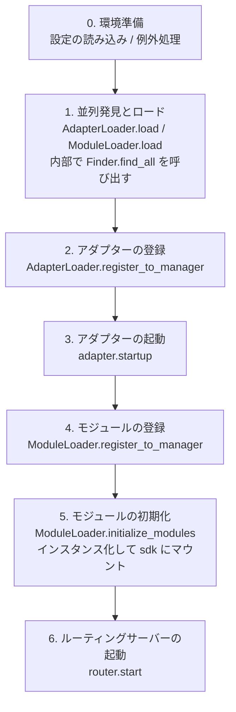

対応するコアコンポーネント：

| 層 | コンポーネント | 職責 |
|----|------|------|
| 発見 | `AdapterFinder` / `ModuleFinder` | entry-points からアダプター/モジュールを**発見**する |
| ロード | `AdapterLoader` / `ModuleLoader` | 発見 + インポート + メタデータの読み込み + 有効/無効の判断、オブジェクトリストを返す |
| 登録 | `*Loader.register_to_manager` | オブジェクトを対応するマネージャーに登録する |
| 管理 | `sdk.adapter` / `sdk.module` | アダプター/モジュールのインスタンスを管理し、起動/停止のインターフェースを提供する |
| 初期化 | `ModuleLoader.initialize_modules` | モジュールのインスタンスを作成し、`sdk` にマウントする（依存性のトポロジカルソートを処理） |
| ルーティング | `sdk.router` | HTTP / WebSocket サーバー |

> **重要**：`Finder` と `Loader` は2つの層です。`Loader` は内部で `Finder` を保持しています（`AdapterLoader` には `AdapterFinder`、`ModuleLoader` には `ModuleFinder` が含まれています）。ほとんどの場合、`Loader` を使用するだけで十分です。"インポートしない"で一覧表示したい場合は、`Finder` を個別に使用します。

## 各ステップの詳細

### 1. 発見層：Finder

Finder は「どのパッケージがアダプター/モジュールを提供しているか」を発見するだけで、インポートやインスタンス化は行いません。

```python
from ErisPulse.finders import AdapterFinder, ModuleFinder

adapter_finder = AdapterFinder()
module_finder = ModuleFinder()

# すべてのインストール済みのアダプター/モジュールの entry-points を検索
adapter_entries = adapter_finder.find_all()    # list[EntryPoint]
module_entries = module_finder.find_all()      # list[EntryPoint]

# 名前で単一の検索
entry = module_finder.find_by_name("MyModule")  # EntryPoint | None
```

各 `EntryPoint` は `.load()` で対応するクラスを得られますが、通常は `Loader` が処理します。

### 2. ロード層：Loader

Loader は Finder の上に「インポート + メタデータの読み込み + 有効/無効の判断」を行います。

```python
from ErisPulse.loaders import AdapterLoader, ModuleLoader
from ErisPulse import sdk

adapter_loader = AdapterLoader()
module_loader = ModuleLoader()

# load() 内部：finder.find_all() を呼び出す → entry-point を1つずつ処理 → 3タプルを返す
adapter_objs, enabled_adapters, disabled_adapters = await adapter_loader.load(sdk.adapter)
module_objs, enabled_modules, disabled_modules = await module_loader.load(sdk.module)
```

`load()` が返す3タプル：

| 戻り値 | 含意 |
|--------|------|
| `objs` (`dict`) | 名称 → オブジェクト（アダプタークラス / モジュールラッパー） |
| `enabled` (`list[str]`) | 有効化された名称（設定で無効化されていない） |
| `disabled` (`list[str]`) | 無効化された名称 |

#### ロード失敗時の診断情報

モジュール/アダプターがロードまたは初期化の段階で例外を送出した場合、フレームワークはそのコンポーネントをスキップして他のコンポーネントのロードを継続し、**ユーザーのコードフレームの要約**を出力します。これにより、デフォルトの INFO レベルでエラー箇所を特定でき、手動で DEBUG レベルを上げる必要はありません。

```
[ERROR] [ModuleLoader] entry-point からモジュール MyModule のロードに失敗しました。読み飛ばしました: 'NoneType' object has no attribute 'platform'
  → MyModule/Core.py:42 in on_load
      adapter = sdk.platform
  → AttributeError: 'NoneType' object has no attribute 'platform'
  → ヒント: ログレベルを DEBUG に上げて詳細なスタックトレースを確認してください。モジュール MyModule の実装コードを確認してください。
```

診断情報は `ErisPulse.runtime.diagnostics` モジュールによって生成され、フレームワーク内部のフレームは自動的にフィルタリングされ、ユーザーのコードフレームのみが残ります。カスタムロードロジックで再利用するには：

```python
from ErisPulse.runtime import log_diagnostic

try:
    risky_init()
except Exception as e:
    log_diagnostic(e)  # 自動的にユーザーのコードフレームを抽出し、ERROR ログに書き込む
```

このモジュールには、`extract_user_frame()`（構造化されたフレーム情報を返す）と `format_diagnostic_block()`（複数行のテキストを返す）という2つの低レベル関数もあります。

### 3. 登録層：register_to_manager

Loader が出力したオブジェクトをマネージャーに登録し、`sdk.adapter` / `sdk.module` がそれらを認識できるようにします。

```python
# アダプターの登録（すべて成功した場合は True を返す）
await adapter_loader.register_to_manager(enabled_adapters, adapter_objs, sdk.adapter)

# モジュールの登録
await module_loader.register_to_manager(enabled_modules, module_objs, sdk.module)
```

登録後、アダプターはアダプターマネージャーに登録され、モジュールはモジュールマネージャーに登録されますが、**まだ起動/インスタンス化されていません**。

### 4. アダプターの起動

```python
# すべての登録済みアダプターを起動
await sdk.adapter.startup()
# または特定のプラットフォームを指定
await sdk.adapter.startup("yunhu")
await sdk.adapter.startup(["yunhu", "telegram"])
```

> 登録 ≠ 起動。`register_to_manager` は登録のみです。`startup` はアダプターの `start()` を呼び出し、プラットフォームとの接続を確立します。

### 5. モジュールの初期化

モジュールはアダプターに比べて1つ追加のステップがあります。**インスタンス化**して `sdk` にマウントする必要があります（これにより、`sdk.MyModule.xxx` で呼び出せるようになります）。このステップでは、モジュール間の依存関係の宣言とトポロジカルソートも処理されます。

```python
success = await module_loader.initialize_modules(
    enabled_modules, module_objs, sdk.module, sdk
)
```

インスタンス化に成功すると、モジュールは `sdk.<ModuleName>` に表示されます。

### 6. ルーティングサーバーの起動

```python
await sdk.router.start(
    host="0.0.0.0",
    port=8000,
    ssl_certfile=None,
    ssl_keyfile=None,
)
```

ルーティングサーバーは、アダプターからの Webhook / WebSocket コールバックを受け取ります。これを起動しないと、サーバーモードのアダプターはメッセージを受け取れません。

## 完全な手動起動の例

以下のコードは `await sdk.init()` のコアフローと**等価**ですが、各ステップが明示的に公開されており、任意の段階でカスタムロジックを挿入できます：

```python
import asyncio
from ErisPulse import sdk
from ErisPulse.loaders import AdapterLoader, ModuleLoader

async def manual_startup():
    # 0. 環境準備（設定の読み込み、グローバル例外処理の登録）
    #    _prepare_environment は init() 内部の前置ステップです。手動フローでも先に呼び出す必要があります。
    #    しないと Loader は設定を読めず、すべてのアダプター/モジュールを無効化と誤認します。
    if not await sdk._prepare_environment():
        print("環境準備に失敗しました")
        return False

    # 1. ローダーの作成（内部でそれぞれ Finder を保持）
    adapter_loader = AdapterLoader()
    module_loader = ModuleLoader()

    # 2. 並列発見とロード（init() 内部と同じ gather を使用）
    (adapter_objs, enabled_adapters, disabled_adapters), \
    (module_objs, enabled_modules, disabled_modules) = await asyncio.gather(
        adapter_loader.load(sdk.adapter),
        module_loader.load(sdk.module),
    )

    # 3. アダプターの登録
    await adapter_loader.register_to_manager(
        enabled_adapters, adapter_objs, sdk.adapter
    )

    # 4. アダプターの起動
    if enabled_adapters:
        await sdk.adapter.startup()

    # 5. モジュールの登録
    await module_loader.register_to_manager(
        enabled_modules, module_objs, sdk.module
    )

    # 6. モジュールの初期化（インスタンス化 + sdk にマウント）
    if enabled_modules:
        await module_loader.initialize_modules(
            enabled_modules, module_objs, sdk.module, sdk
        )

    # 7. ルーティングサーバーの起動
    await sdk.router.start(host="0.0.0.0", port=8000)

    print("手動起動完了")
    return True

async def main():
    ok = await manual_startup()
    if ok:
        # プログラムを維持（手動フローでは自動でブロックされない）
        await asyncio.Event().wait()

if __name__ == "__main__":
    asyncio.run(main())
```

### 手動起動が必要なタイミング

ほとんどの場合、**手動起動は不要**です。`await sdk.run()` がすべての処理を完了しています。手動起動は以下のケースでのみ価値があります：

- **部分的ロード**：特定のアダプター/モジュールのみをロードし、他のものはスキップ
- **動的登録**：条件に応じて実行時に新しいアダプター/モジュールを登録
- **カスタム順序**：デフォルトのロード順序を変更（例：アダプター起動前に特定のモジュールを起動）
- **戦略の注入**：Loader にカスタムの厳密モードマネージャー、ロード戦略などを注入
- **デバッグ/診断**：特定の段階で失敗した場合、手動で駆動して問題を特定

## 実行時の細粒度制御

`sdk.run()` で起動しても、`run()` した後に各サブシステムを個別に制御できます。すべての SDK を再起動する必要はありません。

### アダプターのホットリスタート

```python
# アダプターのホットリスタート（接続の修復、他のプラットフォームへの影響なし）
await sdk.adapter.shutdown("yunhu")
await sdk.adapter.startup("yunhu")

# 実行中に新しいプラットフォームを起動
await sdk.adapter.startup("telegram")

# 一時的にプラットフォームをオフラインにする
await sdk.adapter.shutdown("telegram")
```

> `adapter.startup()` はアダプターが**マネージャーに登録されている**ことを要求します。登録は `init()`/`run()` 内部で行われるため、これは起動**後の**細粒度制御です。

### ルーティングサーバー

```python
# Webhook サーバーを一時的にオフラインにする
await sdk.router.stop()

# 再起動（例：ポートを変更した場合）
await sdk.router.start(host="0.0.0.0", port=9000)
```

### モジュールのオンデマンドロード

```python
# 手動でモジュールをロード（遅延ロードの可能性がある）
await sdk.load_module("MyModule")
```

## エレガントなシャットダウン

2.7.0以降、`sdk.shutdown()` は**プログラム的なエレガントなシャットダウン**を提供します。シャットダウンイベントを設定し、`await sdk.run(keep_running=True)` で待機しているメインループが戻り、`uninit()` がリソースのクリーンアップをトリガーします。

```python
# 任意のコルーチンで呼び出すことで、エレガントな終了をトリガー（run() は待機を戻し、uninit() を自動で実行）
sdk.shutdown()
```

典型的な用途：

```python
async def shutdown_after_idle():
    await asyncio.sleep(3600)
    sdk.shutdown()  # 空き1時間後にエレガントに終了
```

**シグナル処理**：`run()` 内部で `SIGTERM` / `SIGHUP` ハンドラが登録され、システムシグナルをエレガントなシャットダウンに変換します。Docker `docker stop` や `systemd` でサービスを停止する場合、プロセスは強制終了ではなく `uninit()` を完了します。

- Windows では `loop.add_signal_handler` がサポートされていないため、シグナルハンドラは自動的に無視されます（`sdk.shutdown()` または Ctrl+C で終了をトリガーできます）
- `sdk.shutdown()` を繰り返し呼び出しても安全です（イベントが設定された後は無操作になります）

## アンロードフロー

起動の逆操作は `await sdk.uninit()` で、逆順でクリーンアップを行います：

1. すべてのアダプターを閉じる（`adapter.shutdown()`）
2. すべてのモジュールをアンロードする
3. すべてのイベントハンドラをクリーンアップする
4. マネージャーと SDK 上のモジュール属性をクリーンアップする

手動起動の場面では、終了前に `uninit()` を呼び出してエレガントなシャットダウンを保証する必要があります：

```python
try:
    await asyncio.Event().wait()   # プログラムを維持
finally:
    await sdk.uninit()
```

## リスタート

SDK は2種類のリスタート方法を提供しており、自分でアンロードする必要はありません。フレームワークが自動的に処理します：

| 方法 | 呼び出し | 行動 | 適用場面 |
|------|------|------|----------|
| ホットリスタート | `await sdk.restart()` | 同一プロセス内で**コンポーネント層のコードレベルリロード**：全モジュールが統一されたリロードパイプラインを実行（全体の構文検証 / スナップショットロールバック / アイデンティティ確認）、アダプターは entry-point の再発見（実行中に新しくインストール/アンインストールされたアダプターも即座に有効化）した後、コードレベルでリロード | pip でコンポーネントをアップデートした後、コードを有効化する、モジュールのホットアップデート |
| ハードリスタート | `await sdk.hard_restart()` | `uninit()` の後に**終了コード 42**でプロセスを終了し、外部の監督者が新しいプロセスを起動 | フレームワーク自身のアップデート（アップデート後のフレームワークコードは新しいプロセスで有効）、C 拡張の副作用、リソースリークの疑いがある場合 |

```python
# ホットリスタート：コンポーネント層のコードレベルリロード（最も一般的；pip で新しくインストールされたアダプターも起動される）
await sdk.restart()

# ハードリスタート：プロセスを終了し、外部の監督者が再起動する（下の「監督者ガイド」を参照）
await sdk.hard_restart("sdk self-update")  # オプションの理由、監督者が表示する
```

> **2点注意**：
> 1. これらのメソッドはバックグラウンドタスクで実行され、**リスタートがスケジュールされたことを示す `True` を即座に返す**。リスタートが完了したことを示すわけではありません。実際のリスタートはバックグラウンドで行われ、現在のイベントフローを中断しません。
> 2. `hard_restart()` の原理は、アンロードして設定を書き込み、**終了コード 42**（`HARD_RESTART_EXIT_CODE`）でプロセスを終了することです。**自身で新しいプロセスを起動しません**。終了コード 42 を検出する外部の監督者が新しいプロセスを起動する必要があります。`python main.py` で実行し、監督者がいない場合、終了コード 42 でプロセスが終了し、**自動的に再起動しません**（警告が表示されます）。

> **ホットリスタートの排他とマージ**（2.11.1 以降）：すべてのホットリロード操作（単一モジュールのリロード / 全体のリロード / アダプターのリロード / スリープ / 新しいプラグインのホットロード）は完全に排他的です。保存の嵐で連続してトリガーされても、並列に実行されることはありません。実行中の `restart` に新しいリクエストが届いた場合は、自動的にマージされます（通常のリロードのロック中にリクエストが届いても、マージしてキューに追加されます）。完了後、最大1回の追加実行が行われます。保存時に構文エラーがあるファイルを保存した場合、全体のリロードはアンロード前に**一括の構文検証**で拒否されます（エラーのファイルと行番号を一括で表示）。アダプター層はこのリロードをスキップし、`restart` は失敗と判定されます。すべての古いインスタンスはサービスを継続します。修正後に再度 `restart` すれば完了します。

### ハードリスタートが必要なタイミング

ホットリスタートは、pip でコンポーネントをアップデートしたり、モジュールコードをホットアップデートしたり、**実行中に新しくインストールされたアダプター**も含むほとんどのケースをカバーしています。以下のケースでのみハードリスタートが必要です：

- **フレームワーク自体のアップデート**：ErisPulse 本体をアップデートした後、新しいフレームワークコードは新しいプロセスでのみ有効になります（Python は既にロードされたフレームワークコードを再インポートしません）。
- **バイナリライブラリ（C拡張）の副作用**：ホットリスタートは同じプロセス内で行われ、C拡張、開かれたファイルディスクリプター、スレッドなどのプロセスレベルのリソースを解放できません。ハードリスタートは新しいプロセスを起動し、これらの副作用を完全にクリアします。
- **リソースリークの調査**：メモリやハンドルのリークが疑われる場合、ハードリスタートでクリーンな環境を得られます。

> ダッシュボード管理パネルの「フレームワークリスタート」機能は、`hard_restart()` を呼び出しています。

### 終了コード 42 の契約

ハードリスタートはプロセス間の協調です：**SDK は終了（コード 42）、監督者は再起動**。

| 角色 | 行動 |
|------|------|
| SDK（ハードリスタートされるとき） | `uninit()` → 設定を書き込む → 硬リスタートの理由 / PID を書き込む（監督者が表示するため）→ `os._exit(42)` |
| 監督者 | 子プロセスの終了コードが 42 かを検出 → 硬リスタートの理由を表示 → 同じコマンドで再起動 |

> `sdk.is_supervised()` は、現在のプロセスが監督者によって起動されたかどうかを確認できます（環境変数 `ERISPULSE_SUPERVISED` を検出）。CLI `run` コマンドは、子プロセスを起動する際に自動的にこのマーカーを注入します。systemd / Docker などの外部監督者は注入しないので、`is_supervised()` は `False` を返します。この場合、ハードリスタート後に「監督者が検出されなかった」という警告が表示されます。

### 監督者ガイド

自分に合った監督者を選択して、ハードリスタートを有効化しましょう。

#### 1. CLI run コマンド（開発/簡単なデプロイ、推奨）

`epsdk run main.py` には、監督ループが内蔵されています：子プロセスの終了コードを検出し、42 の場合はすぐに再起動（理由を表示）；他の異常終了コードは指数退避で自動リトライ；`Ctrl+C` はまず子プロセスをエレガントに終了（コード 0 は正常終了と見なされ、再起動されない）。

```bash
epsdk run main.py
```

`epsdk run --reload`（開発用ホットリロードモード、2.11.1 以降）も「監督プロセス + 重載ワーカープロセス」構造を採用しています：ワーカー内では `.py` ファイルが保存されると**コンポーネントレベルのホットリロード**が発生（フレームワーク全体のリスタートではない）；ハードリスタートは監督プロセスが新しいワーカーを再起動し、フレームワークをアップデートした後、新しいコードが即座に有効になります。

#### 2. systemd（Linux サーバー）

`RestartForceExitStatus=42` を使って、終了コード 42 もリスタートをトリガーします（デフォルトの `on-failure` は非ゼロコードのみ有効）：

```ini
[Service]
ExecStart=/usr/bin/python3 /opt/mybot/main.py
Restart=on-failure
RestartForceExitStatus=42
RestartSec=2
User=mybot
```

#### 3. Docker / docker-compose

コンテナ内の PID 1 はアプリケーションプロセスであり、終了コード 42 でコンテナが終了します。`restart` ポリシーを使って、自動的に再起動させましょう：

```yaml
services:
  bot:
    build: .
    restart: unless-stopped   # 42 を含むすべての終了コードで再起動
```

#### 4. PM2（Node 生態系の運用）

```bash
pm2 start main.py --name mybot --interpreter python3
# 42 は終了コードとして扱われ、PM2 はデフォルトで再起動；再起動の遅延を設定
pm2 set mybot.restart_delay 2000
```

#### 5. supervisord

```ini
[program:mybot]
command=python3 /opt/mybot/main.py
autorestart=true
exitcodes=0,2,42    # 42 も「正常終了」として再起動
```

#### 6. 純 Python のカスタム監督者

```python
import subprocess, sys, time

while True:
    p = subprocess.Popen([sys.executable, "main.py"])
    code = p.wait()
    if code == 42:          # 硬リスタート要求
        time.sleep(0.5)
        continue
    if code == 0:           # 正常終了
        break
    time.sleep(3)           # 異常終了、退避して再試行
```

> **監督者がいない場合の動作**：`python main.py` で直接実行した場合、`hard_restart()` を呼び出すとプロセスはコード 42 で終了し、再起動されません。この場合は、上記のいずれかの監督者を接続する必要があります。


====
技术标准
====


### 会话类型标准

# ErisPulse セッションタイプ標準

> [!TIP]
> **このドキュメントを読むべきケース**：アダプターでプラットフォームのネイティブセッションを標準タイプ（private/group/channel/guild/thread）にマッピングする場合や、モジュールで `Send.To()` にどのターゲットタイプを渡せばよいかわからない場合、`event.reply()` の自動変換を把握したい場合に本ドキュメントを参照してください。不要な場合はスキップしてください。

このドキュメントでは、受信イベントタイプと送信ターゲットタイプを含む、ErisPulse がサポートするセッションタイプの標準を定義します。

## 1. 基本概念

### 1.1 受信タイプ && 送信タイプ

ErisPulse は2種類のセッションタイプを区別します：

- **受信タイプ（Receive Type）**：受信するイベントの `detail_type` フィールド
- **送信タイプ（Send Type）**：メッセージ送信時に `Send.To()` メソッドへ渡すターゲットタイプ

### 1.2 タイプマッピング関係

```
受信タイプ (detail_type)     送信タイプ (Send.To)
─────────────────        ────────────────
private                 →        user
group                   →        group
channel                 →        channel
guild                   →        guild
thread                  →        thread
user                    →        user
```

**重要なポイント**：
- `private` は受信時のタイプであり、送信時の標準タイプは `user` です
- `group`、`channel`、`guild`、`thread` は受信時と送信時でタイプが同じです
- **推奨パス**：`event.reply()` を直接使用する——タイプ変換とターゲット推論が自動的に行われ、手動処理は不要です（`private` → `user` の自動変換はここで行われます）
- **手動送信時**：送信タイプを直接渡してください（例：`Send.To("user", ...)`）。手動で `Send.To("private", ...)` のように受信タイプを渡しても自動変換されますが、推奨されません（§6.1 参照）

## 2. 標準セッションタイプ

### 2.1 OneBot12 標準タイプ

#### private
- **受信タイプ**：`private`
- **送信タイプ**：`user`
- **説明**：一対一のプライベートチャットメッセージ
- **ID フィールド**：`user_id`
- **対応プラットフォーム**：プライベートチャットをサポートするすべてのプラットフォーム

#### group
- **受信タイプ**：`group`
- **送信タイプ**：`group`
- **説明**：グループチャットメッセージ。各種形式のグループ（Telegram の supergroup など）を含みます
- **ID フィールド**：`group_id`
- **対応プラットフォーム**：グループチャットをサポートするすべてのプラットフォーム

#### user
- **受信タイプ**：`user`
- **送信タイプ**：`user`
- **説明**：ユーザータイプ。一部のプラットフォーム（Telegram など）では、プライベートチャットを private ではなく user として表現します
- **ID フィールド**：`user_id`
- **対応プラットフォーム**：Telegram などのプラットフォーム

### 2.2 ErisPulse 拡張タイプ

#### channel
- **受信タイプ**：`channel`
- **送信タイプ**：`channel`
- **説明**：チャンネルメッセージ。複数ユーザーへのブロードキャスト形式のメッセージをサポートします
- **ID フィールド**：`channel_id`
- **対応プラットフォーム**：Discord、Telegram、Line など

#### guild
- **受信タイプ**：`guild`
- **送信タイプ**：`guild`
- **説明**：サーバー/コミュニティメッセージ。通常、Discord の Guild レベルのイベントに使用されます
- **ID フィールド**：`guild_id`
- **対応プラットフォーム**：Discord など

#### thread
- **受信タイプ**：`thread`
- **送信タイプ**：`thread`
- **説明**：トピック/サブチャンネルメッセージ。コミュニティ内のサブディスカッションに使用されます
- **ID フィールド**：`thread_id`
- **対応プラットフォーム**：Discord Threads、Telegram Topics など

## 3. プラットフォームタイプマッピング

### 3.1 マッピングの原則

アダプターは、プラットフォームのネイティブタイプを ErisPulse 標準タイプにマッピングする役割を担います：

```
プラットフォームネイティブタイプ → ErisPulse 標準タイプ → 送信タイプ
```

### 3.2 一般的なプラットフォームのマッピング例

#### Telegram
```
Telegram タイプ         ErisPulse 受信タイプ   送信タイプ
─────────────────      ────────────────       ───────────
private                private                 user
group                  group                   group
supergroup             group                   group  # group にマッピング
channel                channel                 channel
```

#### Discord
```
Discord タイプ         ErisPulse 受信タイプ   送信タイプ
─────────────────      ────────────────       ───────────
Direct Message         private                user
Text Channel           channel                channel
Guild                  guild                  guild
Thread                 thread                 thread
```

#### OneBot11
```
OneBot11 タイプ       ErisPulse 受信タイプ   送信タイプ
─────────────────      ────────────────       ───────────
private                private                user
group                  group                  group
discuss                group                  group  # group にマッピング
```

## 4. カスタムタイプの拡張

### 4.1 カスタムタイプの登録

アダプターはカスタムセッションタイプを登録できます：

```python
from ErisPulse.Core.Event import register_custom_type

# カスタムタイプの登録
register_custom_type(
    receive_type="my_custom_type",
    send_type="custom",
    id_field="custom_id",
    platform="MyPlatform"
)
```

### 4.2 カスタムタイプの使用

登録後、システムは自動的にこのタイプの変換と推論を処理します：

```python
# 自動推論
receive_type = infer_receive_type(event, platform="MyPlatform")
# 戻り値: "my_custom_type"

# 送信タイプへの変換
send_type = convert_to_send_type(receive_type, platform="MyPlatform")
# 戻り値: "custom"

# 対応する ID の取得
target_id = get_target_id(event, platform="MyPlatform")
# 戻り値: event["custom_id"]
```

### 4.3 カスタムタイプの登録解除

```python
from ErisPulse.Core.Event import unregister_custom_type

unregister_custom_type("my_custom_type", platform="MyPlatform")
```

## 5. 自動タイプ推論

イベントに明示的な `detail_type` フィールドがない場合、システムは存在する ID フィールドに基づいてタイプを自動推論します：

> [!NOTE]
> **2.7.0+ での動作変更**：`detail_type` は、**既知のセッションタイプ**（標準またはカスタム）である場合にのみ直接採用されます。notice/request イベントの `detail_type`（`group_member_increase`、`friend_increase` など）は**セマンティックサブタイプ**でありセッションタイプではないため、代わりに ID フィールドに基づいて正しいセッションタイプが推論されます。

### 5.1 推論の優先順位

```
優先順位（高い順）：
1. group_id     → group
2. channel_id   → channel
3. guild_id     → guild
4. thread_id    → thread
5. user_id      → private
```

### 5.2 使用例

```python
# イベントに group_id のみがある場合
event = {"group_id": "123", "user_id": "456"}
receive_type = infer_receive_type(event)
# 戻り値: "group"（group_id を優先使用）

# イベントに user_id のみがある場合
event = {"user_id": "123"}
receive_type = infer_receive_type(event)
# 戻り値: "private"

# notice イベントの detail_type はセマンティックサブタイプであり、2.7.0+ では ID フィールドから推論されます
event = {"type": "notice", "detail_type": "group_member_increase", "group_id": "123"}
receive_type = infer_receive_type(event)
# 戻り値: "group"（"group_member_increase" ではなく）
```

## 6. API 使用例

### 6.1 メッセージ送信

```python
from ErisPulse import adapter

# ユーザーに送信
await adapter.myplatform.Send.To("user", "123").Text("Hello")

# グループに送信
await adapter.myplatform.Send.To("group", "456").Text("Hello")

# 自動変換 private → user：受信タイプを手動で渡すのは非推奨の書き方です（互換性の問題が生じる可能性があります）
await adapter.myplatform.Send.To("private", "789").Text("Hello")
# 内部で自動変換されます: Send.To("user", "789")
# 推奨される方法：手動送信時は送信タイプ user を直接使用するか、event.reply() で自動変換を利用してください（6.2 参照）
```

### 6.2 イベントへの返信

```python
from ErisPulse.Core.Event import Event

# Event.reply() は自動的にタイプ変換を処理します（推奨パス）
await event.reply("返信内容")
# 内部で正しい送信タイプが自動的に使用されます（private → user などの変換はここで自動的に行われます）
```

### 6.3 コマンド処理

```python
from ErisPulse.Core.Event import command

@command(name="test")
async def handle_test(event):
    # システムが自動的にセッションタイプを処理します
    # group_id か user_id かを手動で判断する必要はありません
    await event.reply("コマンドが正常に実行されました")
```

## 7. コア API リファレンス

### 7.1 タイプ変換

```python
from ErisPulse.Core.Event import convert_to_send_type, convert_to_receive_type

# 受信タイプ → 送信タイプ
convert_to_send_type("private")  # → "user"
convert_to_send_type("group")    # → "group"

# 送信タイプ → 受信タイプ
convert_to_receive_type("user")   # → "private"
convert_to_receive_type("group")  # → "group"
```

### 7.2 ID フィールドの照会

```python
from ErisPulse.Core.Event import get_id_field, get_receive_type

get_id_field("group")    # → "group_id"
get_id_field("private")  # → "user_id"

get_receive_type("group_id")  # → "group"
get_receive_type("user_id")   # → "private"
```

### 7.3 ワンステップで送信情報を取得

```python
from ErisPulse.Core.Event import get_send_type_and_target_id

event = {"detail_type": "private", "user_id": "123"}
send_type, target_id = get_send_type_and_target_id(event)
# send_type = "user", target_id = "123"

# Send.To() に直接使用
await adapter.Send.To(send_type, target_id).Text("Hello")
```

### 7.4 ターゲット ID の取得

```python
from ErisPulse.Core.Event import get_target_id

event = {"detail_type": "group", "group_id": "456"}
get_target_id(event)  # → "456"
```

## 8. ユーティリティメソッド

```python
from ErisPulse.Core.Event import (
    is_standard_type,
    is_valid_send_type,
    get_standard_types,
    get_send_types,
    clear_custom_types,
)

is_standard_type("private")     # True
is_standard_type("custom_type") # False

is_valid_send_type("user")      # True
is_valid_send_type("invalid")   # False

get_standard_types()  # {"private", "group", "channel", "guild", "thread", "user"}
get_send_types()      # {"user", "group", "channel", "guild", "thread"}

clear_custom_types()                # すべてクリア
clear_custom_types(platform="discord")  # 指定したプラットフォームのみクリア
```

## 9. ベストプラクティス

### 7.1 アダプター開発者

1. **標準マッピングを使用**：新しいタイプを作成するのではなく、可能な限り標準タイプにマッピングしてください
2. **正しい変換**：受信タイプと送信タイプのマッピング関係が正しいことを確認してください
3. **元データの保持**：`{platform}_raw` に元のイベントタイプを保持してください
4. **ドキュメントでの説明**：アダプターのドキュメントでタイプマッピング関係を説明してください

### 7.2 モジュール開発者

1. **ユーティリティメソッドを使用**：`get_send_type_and_target_id()` などのユーティリティメソッドを使用してください
2. **ハードコーディングを避ける**：`if group_id else "private"` のようなコードを書かないでください
3. **すべてのタイプを考慮**：コードは private/group だけでなく、すべての標準タイプをサポートする必要があります
4. **柔軟な設計**：フィールドに直接アクセスするのではなく、イベントラッパーのメソッドを使用してください

### 7.3 タイプ推論

- **detail_type を優先使用**：明示的なフィールドがある場合は推論を行いません
- **推論の適切な使用**：明示的なタイプがない場合にのみ使用してください
- **優先順位に注意**：推論の優先順位を理解し、予期しない結果を避けてください

## 10. よくある質問

### Q1: 送信時に private を user に変換するのはなぜですか？

A: これは OneBot12 標準の要件です。`private` は受信時の概念であり、送信時には `user` を使用する方がセマンティクスに適しています。

### Q2: 新しいセッションタイプをサポートするには？

A: `register_custom_type()` でカスタムタイプを登録するか、標準タイプの `channel`、`guild` などを直接使用してください。

### Q3: イベントに detail_type がない場合は？

A: システムは存在する ID フィールドに基づいて自動的に推論します。優先順位は group > channel > guild > thread > user です。

### Q4: アダプターは Telegram の supergroup をどのようにマッピングしますか？

A: アダプターの変換ロジックで、`supergroup` を標準の `group` タイプにマッピングしてください。

### Q5: メールなどの特殊なプラットフォームはどのように処理しますか？

A: 汎用性のないタイプやプラットフォーム固有のタイプについては、`{platform}_raw` と `{platform}_raw_type` を使用して元データを保持し、アダプター側で処理してください。

## 11. 関連ドキュメント

**アダプター向け（マッピングと変換）**：
- [イベント変換標準](event-conversion.md) - 完全なイベント変換仕様
- [送信メソッド仕様](send-method-spec.md) - Send クラスのメソッド命名とパラメータ仕様
- [アダプター開発ガイド](../developer-guide/adapters/) - アダプター開発の完全ガイド

**モジュール向け（タイプ変換を手動で処理したくない場合）**：
- `event.reply()` を使用するだけで、タイプ変換とターゲット推論が自動的に行われます。詳細は [Event ラッパークラス解説](../developer-guide/modules/event-wrapper.md) を参照してください


### 事件转换标准

# アダプター標準化変換仕様

> [!TIP]
> **この文書を読むべきとき**：アダプターでプラットフォームネイティブイベントを OneBot12 標準イベントに変換する際——必須フィールド、メッセージセグメント構造、拡張フィールド命名（`{platform}_` プレフィックス）、セッションタイプ推定を確認するときに、この文書を参照してください。不要な場合は読み飛ばしてください。

## 1. コア原則
1. 厳格な互換性：すべての標準フィールドは OneBot12 仕様に完全に準拠しなければならない
2. 明確な拡張：プラットフォーム固有機能には {platform}_ プレフィックスを追加しなければならない（例：yunhu_form）
3. データの完全性：元のイベントデータは {platform}_raw フィールドに保持しなければならず、元のイベントタイプは {platform}_raw_type フィールドに保持しなければならない
4. 時間の統一：すべてのタイムスタンプは 10 桁の Unix タイムスタンプ（秒単位）に変換しなければならない
5. プラットフォームの統一：platform 項目の命名は、ErisPulse に登録した名前/別名と一致しなければならない

## 2. 標準フィールド要件

### 2.1 必須フィールド
| フィールド | 型 | 説明 |
|------|------|------|
| id | string | イベントの一意識別子 |
| time | integer | Unix タイムスタンプ（秒単位） |
| type | string | イベントタイプ |
| detail_type | string | イベントの詳細タイプ（詳細は[セッションタイプ標準](session-types.md)を参照） |
| platform | string | プラットフォーム名 |
| self | object | ボット自身の情報 |
| self.platform | string | プラットフォーム名 |
| self.user_id | string | ボットのユーザー ID |

**detail_type 仕様**：
- ErisPulse 標準セッションタイプを使用しなければならない（詳細は [セッションタイプ標準](session-types.md) を参照）
- サポートされるタイプ：`private`、`group`、`user`、`channel`、`guild`、`thread`
- アダプターは、プラットフォームネイティブタイプを標準タイプへマッピングする責任を負う

### 2.2 メッセージイベントフィールド
| フィールド | 型 | 説明 |
|------|------|------|
| message | array | メッセージセグメント配列 |
| alt_message | string | メッセージセグメントの代替テキスト |
| user_id | string | ユーザー ID |
| user_nickname | string | ユーザーニックネーム（任意） |

### 2.3 通知イベントフィールド
| フィールド | 型 | 説明 |
|------|------|------|
| user_id | string | ユーザー ID |
| user_nickname | string | ユーザーニックネーム（任意） |
| operator_id | string | 操作者 ID（任意） |

### 2.4 リクエストイベントフィールド
| フィールド | 型 | 説明 |
|------|------|------|
| user_id | string | ユーザー ID |
| user_nickname | string | ユーザーニックネーム（任意） |
| comment | string | リクエストの添えメッセージ（任意） |
| request_id | string | リクエスト識別子（**強く推奨**、リクエストの承認/拒否操作に使用） |

**`request_id` フィールドの説明**：
- `request_id` はリクエストイベントの一意の操作識別子であり、`HandleRequest` DSL による承認/拒否操作の実行に使用される
- アダプターはリクエストイベントの変換時に、プラットフォームネイティブのリクエスト識別子をこのフィールドにマッピングすべきである
- プラットフォーム自体にリクエスト ID がない場合、アダプターは一意の識別子を生成すべきである（例：タイムスタンプ＋ユーザー ID に基づくハッシュ）
- `request_id` が欠落している場合、`event.approve()` / `event.reject()` は `ValueError` をスローする

## 3. イベント形式の例

### 3.1 メッセージイベント (message)
```json
{
  "id": "1234567890",
  "time": 1752241223,
  "type": "message",
  "detail_type": "group",
  "platform": "yunhu",
  "self": {
    "platform": "yunhu",
    "user_id": "bot_123"
  },
  "message": [
    {
      "type": "text",
      "data": {
        "text": "抽選 スーパー大賞"
      }
    }
  ],
  "alt_message": "抽選 スーパー大賞",
  "user_id": "user_456",
  "user_nickname": "YingXinche",
  "group_id": "group_789",
  "yunhu_raw": {...},
  "yunhu_raw_type": "message.receive.normal",
  "yunhu_command": {
    "name": "抽選",
    "args": "スーパー大賞"
  }
}
```

### 3.2 通知イベント (notice)
```json
{
  "id": "1234567891",
  "time": 1752241224,
  "type": "notice",
  "detail_type": "group_member_increase",
  "platform": "yunhu",
  "self": {
    "platform": "yunhu",
    "user_id": "bot_123"
  },
  "user_id": "user_456",
  "user_nickname": "YingXinche",
  "group_id": "group_789",
  "operator_id": "",
  "yunhu_raw": {...},
  "yunhu_raw_type": "bot.followed"
}
```

### 3.3 リクエストイベント (request)
```json
{
  "id": "1234567892",
  "time": 1752241225,
  "type": "request",
  "detail_type": "friend",
  "platform": "onebot11",
  "self": {
    "platform": "onebot11",
    "user_id": "bot_123"
  },
  "user_id": "user_456",
  "user_nickname": "YingXinche",
  "comment": "フレンド申請をお願いします",
  "request_id": "req_abc123",
  "onebot11_raw": {...},
  "onebot11_raw_type": "request"
}
```

## 4. メッセージセグメント標準

### 4.1 標準メッセージセグメント

標準メッセージセグメントにプラットフォームプレフィックスは**不要**です。

| タイプ | 説明 | data フィールド |
|------|------|----------|
| `text` | プレーンテキスト | `text: str` |
| `image` | 画像 | `file`, `url: str` |
| `audio` | 音声 | `file`, `url: str` |
| `video` | 動画 | `file`, `url: str` |
| `file` | ファイル | `file`, `url: str`, `filename: str` |
| `mention` | @ユーザー | `user_id: str`, `user_name: str` |
| `reply` | 返信 | `message_id: str` |
| `face` | 絵文字 | `id: str` |
| `location` | 位置情報 | `latitude: float`, `longitude: float` |
| `keyboard` | ボタン/インラインキーボード | `rows: list[list[button]]`（4.1.1 を参照） |

**メディアセグメントの `file` フィールド形式**（送信方向、`image` / `audio` / `video` / `file` 共通）：

| 形態 | 例 | アダプター要件 |
|------|------|-----------|
| HTTP(S) URL | `https://example.com/a.png` | **必須**で受け付ける |
| ローカルファイルパス | `/tmp/a.png`、`C:\tmp\a.png` | **必須**で受け付ける |
| バイナリデータ | `bytes` | **必須**で受け付ける |
| `file://` URI / Base64 / Data URI | `file:///tmp/a.png`、`data:image/png;base64,...` | **推奨**で受け付ける |

> メディア送信プロトコルの全体（形態判定順序、ファイル名導出、能力ダウングレードの段階）については
> [送信メソッド仕様 §2.1](send-method-spec.md#21-媒体消息发送协议image--voice--video--file) を参照してください。

**フィールドの方向セマンティクス**：

- `file`：**送信方向**のコンテンツソース（上述の形態）；**受信方向**では、アダプターがプラットフォームから取得可能な形態を記入する
  （通常はダウンロード可能な URL、または `get_file` 系アクションで利用可能なリソース識別子）
- `url`：受信方向のプラットフォーム返却リンク（アダプターはプラットフォームイベントの変換時に可能な限り記入し、モジュールが直接利用できるようにする）；送信方向では省略可能
- `filename`：`file` セグメントのファイル名（送信方向では任意、省略時はアダプターが
  [送信メソッド仕様 §2.1.3](send-method-spec.md) の導出順序に従って生成；受信方向ではプラットフォームの元のファイル名を記入することが**推奨**される）

```json
{
  "type": "text",
  "data": {
    "text": "Hello World"
  }
}
```

### 4.1.1 keyboard ボタン/インラインキーボードセグメント（クロスプラットフォーム共通）

ボタン/インラインキーボードは複数のプラットフォーム（Telegram / 云湖 / QQBot / Kook / Discord など）に対応機能が存在し、**クロスプラットフォーム共通の概念**であるため、標準メッセージセグメント（プラットフォームプレフィックスなし）として扱われます。アダプターは標準セグメントをプラットフォームネイティブ構造に変換してください。プラットフォームネイティブの拡張セグメント（例：`telegram_inline_keyboard`）は引き続きそのまま透過します。

```json
{
  "type": "keyboard",
  "data": {
    "rows": [
      [
        {"label": "選択肢A", "type": "callback", "data": "vote:A"},
        {"label": "公式サイト",   "type": "link",     "data": "https://example.com"}
      ]
    ]
  }
}
```

**フィールドの説明：**

| フィールド | 型 | 必須 | 説明 |
|------|------|------|------|
| `rows` | 二次元配列 | はい | 各サブ配列が 1 行のボタンに対応 |
| `rows[][].label` | str | はい | ボタンの表示テキスト |
| `rows[][].type` | str | はい | `callback`（クリックでデータを返送）/ `link`（URL へジャンプ） |
| `rows[][].data` | str | はい | コールバックデータ（type=callback）またはジャンプ先アドレス（type=link） |
| `rows[][].*` | Any | いいえ | プラットフォーム固有の任意フィールド（例：`web_app`、`menus`）。アダプターは能力に応じてマッピングまたは無視する |

**アダプター変換リファレンス**（完全なマッピングとインタラクションコールバックイベント標準については [クロスプラットフォームインタラクションコンポーネント標準](standardization-guide.md) を参照）：

| プラットフォーム | 標準セグメント → プラットフォームネイティブ |
|------|------------------|
| Telegram | `inline_keyboard`：`[{text, callback_data \| url}]` |
| 云湖 | `buttons`：`[{label, action_type: 2=コールバック \| 1=ジャンプ, ...}]` |
| QQBot | `keyboard.content.rows`：`[{label, type: 2=コールバック \| 0=ジャンプ, data}]`（markdown タイプのメッセージが必要） |
| Kook | カードの action-group モジュール |
| Discord | components：`action_row` + `buttons`（custom_id/url） |

### 4.2 プラットフォーム拡張メッセージセグメント

プラットフォーム固有のメッセージセグメントにはプラットフォームプレフィックスを追加する必要があります：

```json
// 云湖 - フォーム
{"type": "yunhu_form", "data": {"form_id": "123456", "form_name": "申込フォーム"}}

// Telegram - スタンプ
{"type": "telegram_sticker", "data": {"file_id": "CAACAgIAAxkBAA...", "emoji": "😂"}}
```

**拡張メッセージセグメントの要件**：
1. **data 内部のフィールドにはプレフィックスを付けない**：`{"type": "yunhu_form", "data": {"form_id": "..."}}` とするべきであり、`{"type": "yunhu_form", "data": {"yunhu_form_id": "..."}}` としてはならない
2. **フォールバック手段を提供する**：モジュールは拡張メッセージセグメントを認識できない可能性があるため、アダプターは `alt_message` にテキストによる代替を提供すべきである
3. **ドキュメントの完備**：各拡張メッセージセグメントについて、`type`、`data` の構造および使用シーンをアダプターのドキュメントで説明しなければならない

## 5. 不明なイベントの処理

識別できないイベントタイプについては、警告イベントを生成すべきです：
```json
{
  "id": "1234567893",
  "time": 1752241223,
  "type": "unknown",
  "platform": "yunhu",
  "yunhu_raw": {...},
  "yunhu_raw_type": "unknown",
  "warning": "Unsupported event type: special_event",
  "alt_message": "This event type is not supported by this system."
}
```

---

## 6. 拡張命名規約

### 6.1 フィールド命名

**ルール**：`{platform}_{field_name}`

```
プラットフォームプレフィックス   フィールド名         完全なフィールド名
──────────                   ───────            ──────────
yunhu       command           yunhu_command
telegram    sticker_file_id   telegram_sticker_file_id
onebot11    anonymous         onebot11_anonymous
email       subject           email_subject
```

**要件**：
- `platform` はアダプター登録時のプラットフォーム名と完全に一致しなければならない（大文字小文字を区別）
- `field_name` は `snake_case` 命名を使用する
- ダブルアンダースコア `__` で始まる名前は禁止（Python の予約）
- 標準フィールドと同名にすることは禁止（例：`type`、`time`、`message` など）

### 6.2 メッセージセグメントタイプ命名

**ルール**：`{platform}_{segment_type}`

標準メッセージセグメントタイプ（`text`、`image`、`audio`、`video`、`mention`、`reply` など）にプラットフォームプレフィックスを追加しては**なりません**。プラットフォーム固有のメッセージセグメントタイプのみがプレフィックスを追加する必要があります。

### 6.3 生データフィールド命名

以下のフィールド名は**予約フィールド**であり、すべてのアダプターが従わなければなりません：

| 予約フィールド | 型 | 説明 |
|---------|------|------|
| `{platform}_raw` | `any` | プラットフォーム元イベントデータの完全なコピー |
| `{platform}_raw_type` | `string` | プラットフォーム元イベントタイプの識別子 |

**要件**：
- `{platform}_raw` は元データのディープコピーでなければならず、参照であってはならない
- `{platform}_raw_type` は文字列でなければならず、プラットフォームが数値型を使用している場合でも文字列に変換すること
- これら 2 つのフィールドはすべてのイベントに**存在しなければならない**（取得できない場合は `null` と空文字列 `""`）

### 6.4 プラットフォーム固有フィールドの例

```json
{
  "yunhu_command": {
    "name": "抽選",
    "args": "スーパー大賞"
  },
  "yunhu_form": {
    "form_id": "123456"
  },
  "telegram_sticker": {
    "file_id": "CAACAgIAAxkBAA..."
  }
}
```

### 6.5 ネストした拡張フィールド

拡張フィールドは単純な値でも、ネストしたオブジェクトでもかまいません：

```json
{
  "telegram_chat": {
    "id": 123456,
    "type": "supergroup",
    "title": "My Group"
  },
  "telegram_forward_from": {
    "user_id": "789",
    "user_name": "ForwardUser"
  }
}
```

**ネストフィールドの要件**：
- トップレベルのキーにはプラットフォームプレフィックスを付けなければならない
- ネストした内部フィールドにはプラットフォームプレフィックスを**追加しない**
- ネストの深さは 3 層を超えないことを推奨

### 6.6 `self` フィールドの拡張

`self` オブジェクトの標準必須フィールド（`platform`、`user_id`）は §2.1 を参照してください。以下は ErisPulse が拡張した任意フィールドです：

| フィールド | 型 | 説明 |
|------|------|------|
| `self.user_name` | `string` | ボットのニックネーム |
| `self.avatar` | `string` | ボットのアバター URL |
| `self.account_id` | `string` | マルチアカウントモードにおけるアカウント識別子 |

> **Bot 状態トラッキング**：アダプターは `type: "meta"` イベントを送信することで、フレームワークに Bot の接続状態を通知します。サポートされる `detail_type`：`connect`（オンライン）、`heartbeat`（ハートビート）、`disconnect`（オフライン）。システムはそこから `self` フィールドの Bot メタ情報を自動的に抽出し、状態をトラッキングします。また、通常のイベント内の `self` フィールドからも Bot が自動的に検出されます。詳細は [アダプターシステム API - Bot 状態管理](../api-reference/adapter-system.md) を参照してください。

---

## 7. セッションタイプの拡張

ErisPulse は OneBot12 標準の `private`、`group` をベースに、以下のセッションタイプを拡張しました：

| タイプ | OneBot12 標準 | ErisPulse 拡張 | 説明 |
|------|:-----------:|:------------:|------|
| `private` | ✅ | — | 1対1のプライベートチャット |
| `group` | ✅ | — | グループチャット |
| `user` | — | ✅ | ユーザータイプ（Telegram など） |
| `channel` | — | ✅ | チャンネル（ブロードキャスト型） |
| `guild` | — | ✅ | サーバー/コミュニティ |
| `thread` | — | ✅ | トピック/サブチャンネル |

**アダプターのカスタムタイプ拡張**：

```python
from ErisPulse.Core.Event.session_type import register_custom_type

# アダプター起動時に登録する
register_custom_type(
    receive_type="email",      # 受信イベントにおける detail_type
    send_type="email",         # 送信時のターゲットタイプ
    id_field="email_id",       # 対応する ID フィールド名
    platform="email"           # プラットフォーム識別子
)
```

**カスタムタイプの要件**：
- アダプターの `start()` 時に登録し、`shutdown()` 時に登録解除しなければならない
- `receive_type` は標準タイプと同名にすべきではない
- `id_field` は `{ターゲット}_id` の命名パターンに従うべきである

> セッションタイプの完全な定義とマッピング関係については [セッションタイプ標準](session-types.md) を参照してください。

---

## 8. モジュール開発者ガイド

### 8.1 拡張フィールドへのアクセス

```python
from ErisPulse.Core.Event import message

@message()
async def handle_message(event):
    # 標準フィールドへのアクセス
    text = event.get_text()
    user_id = event.get_user_id()

    # プラットフォーム拡張フィールドへのアクセス - 方法1：直接 get
    yunhu_command = event.get("yunhu_command")

    # プラットフォーム拡張フィールドへのアクセス - 方法2：ドットアクセス（Event ラッパークラス）
    # event.yunhu_command

    # 生データへのアクセス
    raw_data = event.get("yunhu_raw")
    raw_type = event.get_raw_type()

    # プラットフォームの判定
    platform = event.get_platform()
    if platform == "yunhu":
        pass
    elif platform == "telegram":
        pass
```

### 8.2 拡張メッセージセグメントの処理

```python
@message()
async def handle_message(event):
    message_segments = event.get("message", [])

    for segment in message_segments:
        seg_type = segment.get("type")
        seg_data = segment.get("data", {})

        if seg_type == "text":
            text = seg_data["text"]
        elif seg_type.startswith("yunhu_"):
            if seg_type == "yunhu_form":
                form_id = seg_data["form_id"]
        elif seg_type.startswith("telegram_"):
            if seg_type == "telegram_sticker":
                file_id = seg_data["file_id"]
```

### 8.3 ベストプラクティス

1. **標準フィールドを優先して使用する**：拡張フィールドが必ず存在すると仮定しないこと
2. **プラットフォーム判定**：`event.get_platform()` によってプラットフォームを判定し、拡張フィールドの存在有無から推測しないこと
3. **グレースフルデグラデーション**：拡張メッセージセグメントを処理できない場合は、`alt_message` をフォールバックとして使用すること
4. **プレフィックスをハードコードしない**：`platform` 変数を使って動的に連結すること

```python
# ✅ 推奨
platform = event.get_platform()
raw_data = event.get(f"{platform}_raw")

# ❌ 非推奨
raw_data = event.get("yunhu_raw")
```

### 8.4 リクエストイベントの処理

モジュール開発者は `event.approve()` および `event.reject()` を通じてリクエストイベントに対する操作を行うことができます：

```python
from ErisPulse.Core.Event import request

# フレンドリクエスト：自動承認
@request.on_friend_request()
async def handle_friend_request(event):
    user_name = event.get_user_nickname() or event.get_user_id()
    comment = event.get_comment()
    
    # リクエストを承認
    result = await event.approve()
    if result.get("status") == "ok":
        print(f"{user_name} のフレンドリクエストを承認しました")
    else:
        print(f"フレンドリクエストの承認に失敗しました: {result.get('message')}")

# グループ招待：条件に応じて判断
@request.on_group_request()
async def handle_group_request(event):
    comment = event.get_comment()
    
    # リクエストを拒否
    result = await event.reject(comment="当分の間、新しいグループに参加しません")
```

**アダプターを通じた直接操作**（イベントハンドラー以外のシーンに適用）：

```python
from ErisPulse import adapter

# request_id による直接操作
await adapter.myplatform.Request("req_abc123").accept()
await adapter.myplatform.Request("req_abc123").reject()

# Bot アカウントを指定して操作
await adapter.myplatform.Request("req_abc123").Using("bot1").accept()

# 備考を添える
await adapter.myplatform.Request("req_abc123").accept(comment="ようこそ")
```

---

## 9. notice / request イベントのセッションタイプ推定

### 9.1 問題の背景

notice イベントと request イベントの `detail_type` は**セマンティックサブタイプ**（例：`group_member_increase`、`friend_increase`）であり、セッションタイプ（例：`group`、`private`）ではありません。

```
type        detail_type                  意味                セッションタイプ
────        ───────────                  ────                ────────
message     group                        グループメッセージ     group（detail_type がそのままセッションタイプ）
message     private                      プライベートメッセージ  private（detail_type がそのままセッションタイプ）
notice      group_member_increase        グループメンバー増加   group（group_id からの推定が必要）
notice      friend_increase              フレンド増加          private（user_id からの推定が必要）
request     friend                       フレンドリクエスト     private（user_id からの推定が必要）
request     group                        グループリクエスト     group（detail_type がそのままセッションタイプ）
```

### 9.2 推定ルール

`infer_receive_type()` の推定順序：

1. `detail_type` が既知のセッションタイプ（`private`/`group`/`channel`/`guild`/`thread`/`user`）である場合は、そのまま使用する
2. `detail_type` がカスタムセッションタイプである場合は、そのまま使用する
3. それ以外の場合（notice/request のセマンティックサブタイプ）、ID フィールドに基づいて推定する：
   - `group_id` がある → `"group"`
   - `channel_id` がある → `"channel"`
   - `guild_id` がある → `"guild"`
   - `thread_id` がある → `"thread"`
   - `user_id` がある → `"private"`

### 9.3 `event.reply()` のターゲット推定

notice/request イベントにおける `event.reply()` の送信ターゲットは、セッションタイプの推定によって決まります：

- グループ通知イベント（`group_id` を含む）→ **グループ**に返信
- フレンド通知イベント（`user_id` のみを含む）→ **ユーザーのプライベートチャット**に返信

```python
from ErisPulse.Core.Event import notice

@notice.on_group_increase()
async def handle_welcome(event):
    group_id = event.get("group_id")    # "group_789"
    user_id = event.get("user_id")      # "user_456"

    # event.reply() はグループに送信（group/group_789）
    await event.reply("グループへようこそ！")

    # 管理者に通知する場合（プライベートチャット）、ターゲットを明示的に指定：
    await adapter.Send.To("user", "admin_id").Text(f"新しいメンバー {user_id} が {group_id} に参加しました")
```

### 9.4 アダプター開発の推奨事項

notice/request イベントに正しい ID フィールドが含まれるようにしてください：

| detail_type | 含まれるべき ID フィールド | 推定されるセッションタイプ |
|-------------|-------------------|---------------|
| `group_member_increase` | `group_id` + `user_id` | `group` |
| `group_member_decrease` | `group_id` + `user_id` | `group` |
| `friend_increase` | `user_id` | `private` |
| `friend_decrease` | `user_id` | `private` |
| `friend`（リクエスト） | `user_id` | `private` |
| `group`（リクエスト） | `group_id` | `group` |

---

## 10. 関連ドキュメント

**コンバーター実装時に併せて参照**：
- [セッションタイプ標準](session-types.md) - セッションタイプの定義とマッピング関係
- [API レスポンス標準](api-response.md) - アダプター API レスポンス形式の標準

**同一アダプターの送信側**：
- [送信メソッド仕様](send-method-spec.md) - Send クラスのメソッド命名、パラメータ仕様および逆変換の要件
- [API アクション標準](api-action-spec.md) - OneBot12 標準 API アクションの統一インターフェース

**各プラットフォームの既知の拡張イベントとメッセージセグメントの確認**：
- [各プラットフォーム特性ドキュメント](../platform-guide/README.md) - このドキュメントにアクセスすることで、各プラットフォームの特性や既知の拡張イベント、メッセージセグメントなどを知ることができます。


### API 响应标准

# ErisPulse アダプターの標準化された返却値仕様

> [!TIP]
> **この記事を読むタイミング**：アダプター内で `call_api` / Send / Request の返り値を実装する際に、返却値の構造と返却コードが ErisPulse の標準に準拠しているか確認する必要がある場合、または特定の `retcode` の意味を確認したい場合に、本記事を参照してください。必要がない場合は飛ばしてください。

## 1. 説明  
なぜこの規格があるのでしょうか？

各プラットフォームの送信インターフェースが一貫性とOneBot12との互換性を確保するため、ErisPulseアダプターはAPIレスポンス形式においてOneBot12が定義するメッセージ送信返却構造の標準を採用しています。

ただしErisPulseのプロトコルにはいくつかの特殊な定義があります:
- 1. 基本フィールドにおいて、message_idは必須ですが、OneBot12の標準にはこのフィールドはありません。
- 2. 返却内容には、{platform_name}_raw フィールドを追加する必要があります。このフィールドには、元のレスポンスデータを格納します。

## 2. 基礎レスポンス構造
すべてのアクションレスポンスには、以下の基本フィールドを含める必要があります。

| フィールド名 | データ型 | 必須 | 説明 |
|-------|---------|------|------|
| status | string | はい | 実行ステータス。"ok"または"failed"のいずれかに設定する必要があります |
| retcode | int64 | はい | 戻り値コード。OneBot12の戻り値コード規則に従います |
| data | any | はい | レスポンスデータ。成功時はリクエスト結果を含み、失敗時はnull |
| message_id | string | はい | メッセージID。メッセージを識別するためのもので、存在しない場合は空文字列 |
| message | string | はい | エラーメッセージ。成功時は空文字列 |
| {platform_name}_raw | any | いいえ | 元のレスポンスデータ |

オプションフィールド：
| フィールド名 | データ型 | 必須 | 説明 |
|-------|---------|------|------|
| echo | string | いいえ | リクエストにechoフィールドが含まれている場合、その値をそのまま返します |

## 3. 完全なフィールド仕様

### 3.1 一般的なフィールド

#### 成功時のレスポンス例
```json
{
    "status": "ok",
    "retcode": 0,
    "data": {
        "message_id": "1234",
        "time": 1632847927.599013
    },
    "message_id": "1234",
    "message": "",
    "echo": "1234",
    "telegram_raw": {...}
}
```

#### 失敗時のレスポンス例
```json
{
    "status": "failed",
    "retcode": 10003,
    "data": null,
    "message_id": "",
    "message": "必要なパラメータが不足しています: user_id",
    "echo": "1234",
    "telegram_raw": {...}
}
```

### 3.2 戻り値コードの仕様

#### 0 成功（OK）
- 0: 成功（OK）

#### 1xxxx 動作リクエストエラー（Request Error）
| エラーコード | エラー名 | 説明 |
|-------|-------|------|
| 10001 | Bad Request | 無効な動作リクエスト |
| 10002 | Unsupported Action | 対応していない動作リクエスト |
| 10003 | Bad Param | 無効な動作リクエストパラメータ |
| 10004 | Unsupported Param | 対応していない動作リクエストパラメータ |
| 10005 | Unsupported Segment | 対応していないメッセージセグメントの種類 |
| 10006 | Bad Segment Data | 無効なメッセージセグメントパラメータ |
| 10007 | Unsupported Segment Data | 対応していないメッセージセグメントパラメータ |
| 10101 | Who Am I | ロボットアカウントが指定されていません |
| 10102 | Unknown Self | 知らないロボットアカウント |

#### 2xxxx 動作ハンドラーエラー（Handler Error）
| エラーコード | エラー名 | 説明 |
|-------|-------|------|
| 20001 | Bad Handler | 動作ハンドラーの実装エラー |
| 20002 | Internal Handler Error | 動作ハンドラーが実行中に例外をスローしました |

#### 3xxxx 動作実行エラー（Execution Error）
| エラーコード範囲 | エラー種別 | 説明 |
|-----------|---------|------|
| 31xxx | Database Error | データベースエラー |
| 32xxx | Filesystem Error | ファイルシステムエラー |
| 33xxx | Network Error | ネットワークエラー |
| 34xxx | Platform Error | ロボットプラットフォームエラー |
| 35xxx | Logic Error | 動作ロジックエラー |
| 36xxx | I Am Tired | 実装が作業を中止することを決定しました |

#### 保留エラーセグメント
- 4xxxx、5xxxx: 保留セグメント、使用しないでください
- 6xxxx～9xxxx: 他のエラーセグメント、実装が独自に使用するためのものです

## 4. 実装要件
1. すべてのレスポンスには status、retcode、data、message フィールドが含まれている必要があります。
2. リクエストに非空の echo フィールドが含まれている場合、レスポンスには同じ値の echo フィールドが含まれている必要があります。
3. 戻り値コードは OneBot12 規格に厳密に従う必要があります。
4. エラーメッセージ(message)は人間に読みやすい説明文である必要があります。

## 5. 拡張仕様

ErisPulse は OneBot12 標準の返却構造に以下の拡張を加えています。

### 5.1 `message_id` 必須フィールド

OneBot12 標準では `message_id` は `data` オブジェクト内にあり、必須ではありません。ErisPulse ではこれをトップレベルの**必須**フィールドに昇格させています：

- `message_id` を取得できない場合は、空文字列 `""` を設定する
- `message_id` が常に存在することを保証し、モジュールは null チェックを行う必要がない

### 5.2 `{platform}_raw` 原始レスポンスフィールド

返却値には、プラットフォームの原始レスポンスデータの完全なコピーを保持する `{platform}_raw` フィールドを含める必要があります：

```json
{
    "status": "ok",
    "retcode": 0,
    "data": {"message_id": "1234", "time": 1632847927},
    "message_id": "1234",
    "message": "",
    "telegram_raw": {
        "ok": true,
        "result": {"message_id": 1234, "date": 1632847927, ...}
    }
}
```

**要件**：
- `{platform}_raw` は原始レスポンスのディープコピーである必要があり、参照ではありません
- `platform` はアダプター登録時のプラットフォーム名と完全に一致する必要があります（大文字小文字を区別）
- エラーメッセージも保持し、デバッグに役立つようにする

### 5.3 フレームワーク拡張返却コード（34xxx プラットフォームエラーセグメントの下3桁をカスタム）

OneBot12 規格では、実装が `3xxxx` の下3桁をカスタムに使用することが許可されています。`34xxx` の意味は **Platform Error**（ロボットプラットフォームエラー、プラットフォーム制限による失敗など）です。`34xxx` 内部では役割ごとに分層して使用されます：

| 下3桁セグメント | 所属 | 用途 |
|---------|------|------|
| `340xx` | アダプター実装 | リクエスト操作族（Request Not Found / Already Handled / Not Supported / Permission Denied、request-action-spec §7 参照） |
| `341xx`～`345xx` | アダプター実装 | プラットフォーム側の権限 / リスク管理 / アカウント制限などのエラー（実装者が下3桁をカスタム、元のエラーは `{platform}_raw` に格納） |
| `346xx` | **ErisPulse フレームワーク（予約済み）** | フレームワーク自身のブロックと一般的な失敗、アダプターやモジュールは使用しない |
| `347xx`～`349xx` | アダプター実装 | その他のプラットフォーム実行エラー |

ErisPulse フレームワークで現在使用している `346xx` コード：

| エラーコード | エラー名 | 説明 |
|-------|-------|------|
| 34600 | SDK Failure | フレームワークの一般的な失敗（`make_error()` のデフォルト返却コード） |
| 34601 | Action Denied | 出力アクションがスコープによって禁止された（`scope.actions`）、呼び出しは行われず、直接このレスポンスを返す |

> 役割の区別：`34601` は**フレームワークが呼び出し前にブロック**（モジュールはそもそもアクションを発行する資格がない）です。
> `34004` / `34xxx` プラットフォームコードは**アクションは発行されたがプラットフォームが拒否**（Bot に権限がない、リスク管理対象など）です。
> モジュールは権限の問題を判断する際に、これら2つを同時にチェックする必要があります：まず `34601`（自分のモジュールが scope によって禁止されているか）を確認し、次に `34xxx`（プラットフォーム側の制限）を確認します。

返却構造は §2 の標準失敗レスポンスに従います：

```json
{
    "status": "failed",
    "retcode": 34601,
    "data": null,
    "message_id": "",
    "message": "action 'send' denied by scope.actions"
}
```

### 5.4 アダプター実装チェックリスト

- [ ] `status`, `retcode`, `data`, `message_id`, `message` フィールドを含む
- [ ] 返却コードは OneBot12 規格に従う（§3.2 参照）
- [ ] `message_id` が常に存在する（取得できない場合は空文字列）
- [ ] `{platform}_raw` にプラットフォームの原始レスポンスデータを含む

## 6. 注意事項
- 3xxxxエラーコードについては、下位3桁は実装側で独自に定義可能
- 予約エラーセグメント（4xxxx、5xxxx）の使用を避けること
- **`34600` / `34601` は ErisPulse フレームワークが予約するコード**（§5.3参照）であり、アダプタ/モジュールは使用しないこと
- エラーメッセージは簡潔かつ明瞭にし、デバッグに役立つようにすること

---

## 次のステップ

- **各DSLの戻り値に対応する照会**：[APIアクション標準](api-action-spec.md)（標準アクションのdataフィールド）、[リクエスト操作規格](request-action-spec.md)（リクエスト操作の34001-34004拡張）、[送信メソッド規格](send-method-spec.md)（送信失敗時の降格意味）
- **権限関連の失敗のトラブルシューティング**：まず`34601`（モジュールがscopeによって禁止されている、フレームワークが呼び出し前にブロックする、§5.3を参照）、次に`34xxx`（アクションは発行されたが、プラットフォーム側で拒否された）を確認する


### 发送方法规范

# ErisPulse 送信メソッド規格

> [!TIP]
> **このドキュメントを読むべきタイミング**: 送信メソッドの実装を行う際、命名規則、メディアパラメータ（URL/パス/bytes）のサポート、`Raw_ob12` への逆変換、メッセージの転送機能など、本文書を参照してください。必要ない場合はスキップしてください。

本文書では、ErisPulseアダプターにおける `Send` クラスの送信メソッドの命名規則、パラメータ規格、逆変換要件を定義します。

## 0. キーワードの定義

本文書内の **必須（MUST）**、**推奨（SHOULD）**、**可能（MAY）** は、RFC 2119に準拠した意味で解釈されます：

| キーワード | 意味 | 違反時の影響 |
|--------|------|---------|
| **必須** | 強制的要件、フレームワークの動作やプラットフォーム間の一貫性に依存 | アダプターは標準に準拠していないと見なし、モジュールコードが正常に動作しない |
| **推奨** | 強く推奨される；正当な理由がない限り、遵守する | 違反する場合は、アダプターのドキュメントに理由と代替動作を明記する |
| **可能** | オプション、プラットフォームの能力に応じて決定 | 無 |

## 1. 標準メソッド命名

すべての送信メソッドは **大文字キャメルケース（PascalCase）** を使用します。先頭文字は大文字です。

### 1.1 標準送信メソッド

| メソッド名 | 説明 | パラメータ型 | 実装要件 |
|-------|------|---------|---------|
| `Text` | テキストメッセージを送信 | `str` | 必須 |
| `Image` | 画像を送信 | `str` \| `bytes` | 必須（基底クラスに既に実装済み、§6.4参照） |
| `Voice` | 音声を送信 | `str` \| `bytes` | 必須（基底クラスに既に実装済み；プラットフォームが音声をサポートしない場合は、§2.1.5に従って降格） |
| `Video` | 動画を送信 | `str` \| `bytes` | 必須（基底クラスに既に実装済み；プラットフォームが動画をサポートしない場合は、§2.1.5に従って降格） |
| `File` | ファイルを送信 | `str` \| `bytes`、`filename: str \| None = None` | 必須（基底クラスに既に実装済み） |
| `At` | ユーザー/グループを@する | `str` (user_id) | 修飾メソッド、必要に応じて |
| `Face` | 表情を送信 | `str` (emoji) | 可能 |
| `Reply` | メッセージに返信する | `str` (message_id) | 修飾メソッド、必要に応じて |
| `Forward` | メッセージを転送する | `str` (message_id) | 可能 |
| `Markdown` | Markdownメッセージを送信 | `str` | 可能 |
| `HTML` | HTMLメッセージを送信 | `str` | 可能 |
| `Card` | カードメッセージを送信 | `dict` | 可能 |

> 標準メソッド（`Text`/`Image`/`Voice`/`Video`/`File`）は、基底クラス `SendDSL` に内臓されており、デフォルトで `Raw_ob12` に委譲されます。アダプターは、単一の型署名を獲得するため、これらのメソッドを再実装する必要はありません。ただし、プラットフォームに特別なロジックが必要な場合は、個別のメソッドをオーバーライドしてください（§6.4参照）。

### 1.2 チェーン修飾メソッド

| メソッド名 | 説明 | パラメータ型 |
|-------|------|---------|
| `At` | ユーザーを@する（複数回呼び出し可） | `str` (user_id) |
| `AtAll` | 全員を@する | 無 |
| `Reply` | メッセージに返信する | `str` (message_id) |

### 1.3 プロトコルメソッド

| メソッド名 | 説明 | 必須か |
|-------|------|---------|
| `Raw_ob12` | OneBot12形式のメッセージセグメントを送信 | 必須 |

**`Raw_ob12` は必須実装のメソッドです**。これはアダプターの主要な責任の一つです：OneBot12標準メッセージセグメントを受け取り、それをプラットフォームのネイティブAPI呼び出しに変換します。`Raw_ob12` は、OneBot12 → プラットフォームへの逆変換の統一エントリーポイントであり、モジュールがプラットフォーム固有のメソッドに依存することなく、標準メッセージセグメントを使ってメッセージを送信できるようにします。

**`Raw_ob12` をオーバーライドしない場合の動作**：基底クラスのデフォルト実装は、**errorレベル**のログを記録し、標準エラー応答形式（`status: "failed"`, `retcode: 10002`）を返し、アダプター開発者がこのメソッドを実装する必要があることを示します。

### 1.4 推奨される拡張命名規則

アダプターがOneBot12形式以外の生データ（プラットフォーム固有のJSON、XMLなど）を送信する必要がある場合、以下の命名規則を推奨します：

| 推奨メソッド名 | 説明 |
|-----------|------|
| `Raw_json` | 任意のJSONデータを送信 |
| `Raw_xml` | 任意のXMLデータを送信 |

**注意**：これらのメソッドは**基底クラスに提供されたデフォルトメソッドではなく、強制実装も要求されていません**。これらは命名規則としてのみ、アダプターが必要に応じて独自に定義できます。アダプターがこれらの形式をサポートしていない場合は、定義する必要はありません。

**メッセージビルダー（MessageBuilder）**：ErisPulseは、OneBot12メッセージセグメントリストを簡単に構築するための `MessageBuilder` ツールクラスを提供しており、`Raw_ob12` と併用できます。詳細は [MessageBuilder 详解](../advanced/message-builder.md) を参照してください。

## 2. パラメータ規格の詳細

### 2.1 メディアメッセージ送信プロトコル（`Image` / `Voice` / `Video` / `File`）

本節はメディア送信の**統一プロトコル標準**です：モジュールは同一のコードで4つのメディアメソッドを呼び出し、アダプターは`file`パラメータの様々な形態をプラットフォームのネイティブアップロード/送信動作に変換します。

#### 2.1.1 `file` パラメータの合法な形態

| 形態 | 例 | アダプターの要件 |
|------|------|-----------|
| HTTP(S) URL | `https://example.com/image.jpg` | **必須** |
| 本地ファイルパス | `/path/to/file.jpg`、`C:\path\to\file.jpg` | **必須** |
| 二進データ | `b"\x89PNG..."` | **必須** |
| `file://` URI | `file:///path/to/file.jpg` | **推奨**（ローカルパスに転送して処理） |
| Base64文字列 / Data URI | `iVBORw0KGgo=...`、`data:image/png;base64,...` | **推奨**（OneBot12エコシステムの慣例に準拠） |

> アダプターは、3つの必須形態（URL、パス、bytes）において、モジュールがURL、パス、bytesを渡しても、同じメッセージになるように動作しなければなりません。プラットフォームが外部URLを直接使用できない場合（URLを参照できない場合）、アダプターはダウンロード/読み取り後にアップロードする必要があります。**モジュールに再試行する形態を変更するよう要求してはなりません**。

#### 2.1.2 形態判定順序

アダプターがメディアパラメータを処理する際、**判定順序は以下の通り**に従う必要があります：

1. `bytes`型 → 直接アップロード
2. 文字列が `http://` / `https://` で始まる → URLとして処理（直接参照またはダウンロード後アップロード、プラットフォームの能力に応じて）
3. 文字列が `file://` で始まる → プレフィックスを剥がしてローカルパスとして処理
4. その他の文字列 → ローカルパスとして処理（存在する場合は読み込みアップロード；存在しない場合は標準エラー応答を返す）

```python
def _resolve_media(self, file: "str | bytes") -> bytes:
    """形態判定と正規化（例）"""
    if isinstance(file, (bytes, bytearray)):
        return bytes(file)
    if file.startswith(("http://", "https://")):
        return self._download(file)          # プラットフォームがURLを参照できない場合、ダウンロード
    if file.startswith("file://"):
        file = file[len("file://"):]
    with open(file, "rb") as f:              # 本地ファイルパス
        return f.read()
```

#### 2.1.3 `File` のファイル名の意味

`File` メソッドの署名：`File(file, filename=None)`（`filename` はオプション、基底クラスに既に実装済み）。

ファイル名**推導順序**（アダプターが明示的に `filename` を提供しない場合にこの順序で生成）：

1. 明示的な `filename` パラメータ（最優先）
2. URLのbasename（例：`https://host/a/b/report.pdf` → `report.pdf`、クエリ文字列を剥がす）
3. 本地ファイルパスのbasename（例：`/tmp/data/backup.zip` → `backup.zip`）
4. プラットフォームが生成するデフォルト名（例：`file_{timestamp}`；**拡張子は保持する**—拡張子はプラットフォーム側のタイプ識別とプレビューに影響する）

> `Image` / `Voice` / `Video` は `filename` を**受け入れる**可能性があります（メッセージセグメント `data.filename` から渡される）が、`File` のみが跨プラットフォームの意味保証を持つファイル名です。

#### 2.1.4 プラットフォーム制限の明示義務

各プラットフォームは、メディアのサイズ制限、フォーマット（MIME）、時長（音声/動画）などの制約が異なります。アダプターは**推奨**されます：

- アダプターのドキュメントにサポートするメディアの種類と制限範囲を明示する
- 超限または非対応の入力に対しては**標準エラー応答**を返す（`status: "failed"`；`retcode` は `10002` またはプラットフォーム固有のエラーコードを使用、`message` に原因を説明）、**例外を投げたりモジュールのロジックを中断させたりしない**

#### 2.1.5 機能降格の段階

プラットフォームが特定のメディア**タイプ**をサポートしない場合、以下の段階に従って降格します（「機能降格はエラーを出さない」原則に従う）：

| 情報 | 降格動作 |
|------|---------|
| `Voice` が音声メッセージをサポートしない | **推奨** `File`（またはプラットフォームに近い形態）で送信する；表現できない場合は `retcode=10002` を返す |
| `Video` が動画メッセージをサポートしない | 同上 |
| メディアタイプが完全にサポートされていない（ファイル機能がない） | `retcode=10002` を返し、不サポートのデータタイプを `message` に記述する |
| 形態がサポートされていない（Base64を処理できない） | `retcode=10002` を返し、`message` にモジュールがURL/bytesを使用するよう提示する可能性がある |

**禁止される動作**：静かに破棄（返却なし）、例外の投げ出し、モジュールにプラットフォーム分岐処理を書かせる。

### 2.2 @ユーザー パラメータ規格

**メソッド:** `At`（修飾メソッド）

**パラメータ:** `user_id` (`str`)

**要件:**
- `user_id` は文字列型のユーザー識別子であるべき
- 各プラットフォームの `user_id` 形式は異なる可能性がある（数字、UUID、文字列など）
- アダプターは `user_id` をプラットフォーム固有の形式に変換する責任がある
- 実際の送信メソッドの呼び出しは、最後の位置に置くべき

**例:**
```python
# 単一の@ユーザー
Send.To("group", "g123").At("123456").Text("你好")

# 複数の@ユーザー（チェーン呼び出し）
send.To("group", "g123").At("123456").At("789012").Text("大家好")
```

### 2.3 返信メッセージ パラメータ規格

**メソッド:** `Reply`（修飾メソッド）

**パラメータ:** `message_id` (`str`)

**要件:**
- `message_id` は文字列型のメッセージ識別子であるべき
- 以前に受信したメッセージのIDであるべき
- 一部のプラットフォームは返信機能をサポートしない可能性があるため、アダプターは優雅に降格するべき

**例:**
```python
send.To("group", "g123").Reply("msg_123456").Text("收到")
```

### 2.4 メッセージの結合転送機能（`MergeForward`、オプション）

`MergeForward(nodes)` は**オプションの機能メソッド**です：複数の内容を「結合転送 / フルテキスト折りたたみ」形式で送信し、アダプターはプラットフォームの能力に応じて最適な表示方法を決定します。`Forward(from_chat_id, message_id)`（既存のメッセージを転送する）とは異なる意味を持ち、両者は併存します。

> **標準背景**：OneBot12のコア標準にはnodeメッセージセグメントも、結合転送APIもありません。"メッセージノード"はOneBot v11エコシステム（go-cqhttp拡張）の実装層の概念であり、v12ではこれらのプラットフォーム固有能力を拡張メカニズムに委譲しました。ErisPulseの実装方法は、**標準メッセージセグメントを追加せず、オプション能力メソッド + `list_sends`の実行時検出**です—`MergeForward`を実装したアダプターは自動的に能力を得るため、実装していない場合は普通のテキストに自動的に降格し、モジュールは変更なしです。

**メソッド署名:**

```python
def MergeForward(self, nodes: List[Dict]) -> asyncio.Task:
    """
    結合転送 / フルテキスト折りたたみメッセージを送信する

    :param nodes: 合併転送ノードの配列（go-cqhttp拡張のOneBot v11ノード形式）：
        [
            {
                "type": "node",
                "data": {
                    "user_id": "10000",     # 表示用の送信者ID
                    "nickname": "MyBot",     # 表示用の送信者名
                    "content": [            # メッセージセグメントの配列、現在はtextセグメントのみ
                        {"type": "text", "data": {"text": "【1/3】タイトル\n本文…"}}
                    ],
                },
            },
        ]
    :return: asyncio.Task、await後に標準応答形式を返す
    """
```

**実装要件:**

1. **プラットフォームに原生の結合転送機能がある**（OneBot11系）：**必須**でプロトコル専用エンドポイント（`send_group_forward_msg` / `send_private_forward_msg`）を呼び出すこと。NapCatなどの実装は`send_msg`に含まれるnodeセグメントを拒否する（retcode 1400）ため、専用エンドポイントを失敗した場合は`send_msg`に回退してnodeセグメントを直接送信すること。
2. **プラットフォームに原生の転送機能はないが、富文本機能がある**（云湖 / Telegram / Kook / Discord / Matrixなど）：**推奨**でノードをプラットフォームの富文本折りたたみ形態（HTML折りたたみカード / Card / Embed / blockquoteリスト）にレンダリングすること。スタイルと各アダプターのタスクリストは `SDK/Adapter/ADAPTER_FORWARD_GUIDE.md` を参照。
3. **両方ない**：**実装しない**（node辞書を純粋なテキストとして送信してはならない）—実装しない場合、`list_sends`に`MergeForward`が含まれず、呼び出し元は自動的に普通のテキストに降格する。
4. **失敗の意味**：標準エラー応答（`status: "failed"`）を返すか、例外を投げることも可能。呼び出し元はテキスト送信に回退し、内容は失われない。
5. **`MergeForward`内で`Raw_ob12`を再利用して同じnodesを送信しない**（OneBot11の`Raw_ob12`は純nodeセグメントを自動ルーティングするため、ループになる）。
6. **出力nodeセグメントの解析**（全アダプターの合意）：各アダプターの`Raw_ob12`のセグメント配分は`node`セグメントを登録するべき—純nodeリストは自動的に本アダプターの結合転送表示にルーティングされる（`MergeForward`があるプラットフォームは直接呼び出すのと同等；`MergeForward`がないプラットフォームは各ノードのテキストを「ニックネーム: 本文」の形式で逐行**原文出力**）。混合リスト中のnodeセグメントのテキストは本文に統合される。どのアダプターがnodeセグメントを受け取っても、静かに破棄してはならない。

**プラットフォームの実装形態**（`SDK/Adapter/ADAPTER_FORWARD_GUIDE.md`を参照）：

- 原生エンドポイント：OneBot11、SnowLuma（3段階降格：`send_group/private_forward_msg`専用エンドポイント → `upload_forward_msg`からresidを取得してforwardセグメントを送信 → nodeセグメントを直接送信；SnowLuma APIはNapCatと向かって対応しており、アダプターはNapCatバックエンドに直接接続できる）
- 折りたたみHTML `<details>`カード：云湖（bot/ユーザー協定）、Email、Sandbox、Allons(Ideaura)
- ホワイトリストHTML / 引用ブロック：Telegram（`<b>`+`<blockquote>`）、Matrix（blockquoteバリエーション、ホワイトリストでdetails/インラインスタイルを剥がす）
- プラットフォームカード：Kook（Card header+section）、Discord（Embed fields）
- 官方Markdown引用リスト：QQBot（公式mdには折りたたみ構文がないため、サーバ側で無効なタグを拒否 40034011）
- 実装しない（nodeセグメントを原文出力して降格）：OneBot12（標準にnodeセグメントがない）、WeCom、Terminal、Webhook、WechatMp

**呼び出し元の検出例:**

```python
sends = adapter.list_sends(platform)
if "MergeForward" in sends:
    await adapter.Send.To("group", "123").MergeForward(nodes)
else:
    await adapter.Send.To("group", "123").Text(plain_text)
```

> 参考実装：`ErisPulse-OneBot11Adapter`（専用エンドポイント → `send_msg`回退）；レンダリングテンプレートと各アダプターのタスクリストは `SDK/Adapter/ADAPTER_FORWARD_GUIDE.md` を参照。

## 3. プラットフォーム固有メソッド命名

`Send`クラスに直接プラットフォームプレフィックスを付けるメソッドを追加することは**推奨されません**。代わりに、汎用メソッド名や`Raw_{プロトコル}`メソッドを使用することを推奨します。

**推奨されない:**
```python
def YunhuForm(self, form_id: str):  # ❌ 推奨されない
    pass

def TelegramSticker(self, sticker_id: str):  # ❌ 推奨されない
    pass
```

**推奨:**
```python
def Form(self, form_id: str):  # ✅ 汎用メソッド名
    pass

def Sticker(self, sticker_id: str):  # ✅ 汎用メソッド名
    pass

def Raw_ob12(self, message):  # ✅ OneBot12形式を送信
    pass
```

**拡張メソッドの要件:**
- メソッド名はPascalCaseを使用し、プラットフォームプレフィックスを付けない
- 必須で`asyncio.Task`オブジェクトを返す
- 完全な型注釈とドキュメント文字列を提供する
- パラメータ設計は、標準メソッドのスタイルとできるだけ一致させる

## 4. パラメータ名命名規格

| パラメータ名 | 説明 | 型 |
|-------|------|------|
| `text` | テキスト内容 | `str` |
| `file` | メディア内容（URL / パス / 2進、§2.1.1参照） | `str` / `bytes` |
| `filename` | ファイル名（`File`はオプション、§2.1.3参照） | `str` / `None` |
| `user_id` | ユーザーID | `str` / `int` |
| `group_id` | グループID | `str` / `int` |
| `message_id` | メッセージID | `str` |
| `data` | データオブジェクト（例：カードデータ） | `dict` |

## 5. 戻り値規格

- **送信メソッド**（`Text`, `Image`など）：`asyncio.Task`オブジェクトを返す必要がある
- **修飾メソッド**（`At`, `Reply`, `AtAll`）：`self`を返して、チェーン呼び出しを可能にする必要がある

---

## 6. 逆変換規格（OneBot12 → プラットフォーム）

アダプターは、プラットフォームのネイティブイベントをOneBot12形式に変換する（正変換）だけでなく、**OneBot12メッセージセグメントをプラットフォームのネイティブAPI呼び出しに変換する**（逆変換）能力も**必須**です。逆変換の統一エントリーポイントは`Raw_ob12`メソッドです。

### 6.1 変換モデル

```
正変換（受信方向）                逆変換（送信方向）
─────────────────                ─────────────────
プラットフォームのネイティブイベント                       OneBot12メッセージセグメントリスト
    │                                  │
    ▼                                  ▼
Converter.convert()               Send.Raw_ob12()
    │                                  │
    ▼                                  ▼
OneBot12標準イベント（{platform}_rawを含む）             プラットフォームのネイティブAPI呼び出し
（標準応答形式を返す）
```

**コアの対称性**：正変換は`{platform}_raw`に元のデータを保持し、逆変換はOneBot12標準形式を受け取り、プラットフォームの呼び出しに還元する。

### 6.2 `Raw_ob12`の実装規格

`Raw_ob12`はOneBot12標準メッセージセグメントリストを受け取り、それをプラットフォームのネイティブAPI呼び出しに変換する必要があります。

**メソッド署名:**

```python
def Raw_ob12(self, message_segments: List[Dict]) -> asyncio.Task:
    """
    OneBot12標準メッセージセグメントを送信する

    :param message_segments: OneBot12メッセージセグメントリスト
        [
            {"type": "text", "data": {"text": "Hello"}},
            {"type": "image", "data": {"file": "https://..."}},
            {"type": "mention", "data": {"user_id": "123"}},
        ]
    :return: asyncio.Task、await後に標準応答形式を返す
    """
```

**実装要件:**

1. **すべての標準メッセージセグメントタイプを処理する必要がある**：少なくとも`text`、`image`、`audio`、`video`、`file`、`mention`、`reply`をサポートする
2. **プラットフォーム拡張メッセージセグメントを処理する必要がある**：`{platform}_xxx`形式のメッセージセグメントは、プラットフォームに対応するネイティブ呼び出しに変換する
3. **標準応答形式を返す必要がある**：[API応答標準](api-response.md)に従う
4. **サポートしないメッセージセグメントは警告を記録してスキップする**、例外を投げてメッセージ全体の送信失敗を引き起こしてはならない

### 6.3 メッセージセグメント変換ルール

#### 6.3.1 標準メッセージセグメント変換

アダプターは以下の標準メッセージセグメントの変換を実装する必要があります：

| OneBot12メッセージセグメント | 変換要件 |
|----------------|---------|
| `text` | `data.text`をそのまま使用 |
| `image` | `data.file`を§2.1媒体プロトコルに従って処理（3つの必須形態 + 判定順序） |
| `audio` | `image`と同様の処理ロジック |
| `video` | `image`と同様の処理ロジック |
| `file` | `image`と同様の処理ロジック；ファイル名は§2.1.3の推導順序に従って`data.filename`を処理 |
| `mention` | プラットフォームの@ユーザー機能に変換（例：Telegramの`entities`、云湖の`at_uid`） |
| `reply` | プラットフォームの返信引用機能に変換 |
| `face` | プラットフォームの表情送信機能に変換、不サポートの場合はスキップ |
| `location` | プラットフォームの位置送信機能に変換、不サポートの場合はスキップ |

#### 6.3.2 プラットフォーム拡張メッセージセグメント変換

プラットフォームプレフィックス付きのメッセージセグメントは、アダプターが認識して変換する必要があります：

```python
def _convert_ob12_segments(self, segments: List[Dict]) -> Any:
    """OneBot12メッセージセグメントをプラットフォームのネイティブ形式に変換する"""
    platform_prefix = f"{self._platform_name}_"
    
    for segment in segments:
        seg_type = segment["type"]
        seg_data = segment["data"]
        
        if seg_type.startswith(platform_prefix):
            # プラットフォーム拡張メッセージセグメント → プラットフォームのネイティブ呼び出し
            self._handle_platform_segment(seg_type, seg_data)
        elif seg_type in self._standard_segment_handlers:
            # 標準メッセージセグメント → プラットフォームの等価操作
            self._standard_segment_handlers[seg_type](seg_data)
        else:
            # 未知のメッセージセグメント → 警告を記録してスキップ
            logger.warning(f"サポートしないメッセージセグメントタイプ: {seg_type}")
```

#### 6.3.3 複合メッセージセグメント処理

1つのメッセージには複数のメッセージセグメントが含まれる可能性があり、アダプターは正しく処理する必要があります：

```python
# モジュールがテキスト+画像+@ユーザーのメッセージを送信
await send.Raw_ob12([
    {"type": "mention", "data": {"user_id": "123"}},
    {"type": "text", "data": {"text": "你好"}},
    {"type": "image", "data": {"file": "https://example.com/img.jpg"}}
])
```

**処理戦略**：
- **優先的に結合**：プラットフォームが1つのメッセージにテキスト、画像、@などを同時に含められる場合、結合して送信する
- **退而的に分割**：プラットフォームが結合をサポートしない場合、順番に複数のメッセージに分割して送信する
- **順序を保持**：メッセージセグメントの送信順序はリストの順序と一致する

### 6.4 `Raw_ob12` と標準メソッドの関係

アダプターの標準送信メソッド（`Text`、`Image`など）は**`SendDSL`基底クラスに既に実装され、デフォルトで`Raw_ob12`に委譲されている**ため、アダプターのサブクラスでは再実装する必要はありません：

```python
class Send(SendDSL):
    def Raw_ob12(self, message_segments: List[Dict]) -> asyncio.Task:
        """コア実装：OneBot12メッセージセグメント → プラットフォームAPI（必須実装）"""
        return asyncio.create_task(self._send_ob12(message_segments))

    # Text/Image/Voice/Video/Fileは基底クラスから継承され、自動的にRaw_ob12に委譲される
    # プラットフォーム固有のロジックが必要な場合は、単一メソッドをオーバーライドする：
    # def Text(self, text: str) -> asyncio.Task:
    #     return self.Raw_ob12([{"type": "text", "data": {"text": text}}])
```

**利点**：
- 変換ロジックは`Raw_ob12`に1か所に集中し、重複コードを減らす
- 標準メソッドと`Raw_ob12`の動作は完全に一致する
- モジュールは`Text()`でも`Raw_ob12()`でも同じ結果を得られる
- 基底クラスが型署名を提供し、IDEが標準メソッドを補完できる

### 6.5 実装例

```python
class YunhuSend(SendDSL):
    """云湖プラットフォームのSend実装"""
    
    def Raw_ob12(self, message_segments: list) -> asyncio.Task:
        """OneBot12メッセージセグメント → 云湖API呼び出し"""
        return asyncio.create_task(self._do_send(message_segments))
    
    async def _do_send(self, segments: list) -> dict:
        """実際の送信ロジック"""
        # 1. 修飾子の状態を解析
        at_users = self._at_users or []
        reply_to = self._reply_to
        at_all = self._at_all
        
        # 2. メッセージセグメントを変換
        yunhu_elements = []
        for seg in segments:
            seg_type = seg["type"]
            seg_data = seg["data"]
            
            if seg_type == "text":
                yunhu_elements.append({"type": "text", "content": seg_data["text"]})
            elif seg_type == "image":
                yunhu_elements.append({"type": "image", "url": seg_data["file"]})
            elif seg_type == "mention":
                at_users.append(seg_data["user_id"])
            elif seg_type == "reply":
                reply_to = seg_data["message_id"]
            elif seg_type == "yunhu_form":
                # プラットフォーム拡張メッセージセグメント
                yunhu_elements.append({"type": "form", "form_id": seg_data["form_id"]})
            else:
                logger.warning(f"云湖がサポートしないメッセージセグメント: {seg_type}")
        
        # 3. 云湖APIを呼び出す
        response = await self._call_yunhu_api(yunhu_elements, at_users, reply_to, at_all)
        
        # 4. 標準応答形式を返す
        return {
            "status": "ok" if response["code"] == 0 else "failed",
            "retcode": response["code"],
            "data": {"message_id": response.get("msg_id", ""), "time": int(time.time())},
            "message_id": response.get("msg_id", ""),
            "message": "",
            "yunhu_raw": response
        }
```

---

## 7. メソッドの発見

モジュール開発者は、アダプターがサポートする送信メソッドをAPIで照会することができます（**モジュール内でプラットフォームのメソッドリストをハードコーディングしないでください**—各アダプターの拡張メソッドはバージョンの進化に伴い変化するため、実行時の発見が基準です）：

```python
from ErisPulse import adapter

# すべての送信メソッドをリストアップ
methods = adapter.list_sends("myplatform")
# ["Batch", "Form", "Image", "Recall", "Sticker", "Text", ...]

# メソッドの詳細を照会
info = adapter.send_info("myplatform", "Form")
# {
#     "name": "Form",
#     "parameters": [{"name": "form_id", "type": "str", ...}],
#     "return_type": "Awaitable[Any]",
#     "docstring": "云湖表单を送信"
# }
```

---

## 9. アダプター開発の注意点

`BaseAdapter`、`Send`、`Request` の `__init__` を正しくオーバーライドする方法については、[アダプター開発入門 - `__init__` 注意事項](../developer-guide/adapters/getting-started.md#init-注意事项)を参照してください。

---

---

## 10. アダプター実装チェックリスト

### 送信メソッド
- [ ] 標準メソッド（`Text`, `Image` 等）は実装済み
- [ ] 戻り値はすべて `asyncio.Task`
- [ ] 修飾メソッド（`At`, `Reply`, `AtAll`）は `self` を返す
- [ ] プラットフォーム拡張メソッドはPascalCase、プラットフォームプレフィックスなし
- [ ] すべてのメソッドに完全な型注釈とドキュメント文字列がある

### メディア送信プロトコル
- [ ] `file` パラメータの**必須形態**はすべてサポート：HTTP(S) URL / 本地パス / `bytes`（§2.1.1参照）
- [ ] 形態判定順序は§2.1.2に従う（bytes → URL → `file://` → パス）
- [ ] `File` のファイル名の推導順序は§2.1.3に従う（明示的`filename` > URL basename > パス basename > プラットフォームデフォルト）
- [ ] プラットフォームのメディア制限（サイズ / MIME / 時長）はアダプターのドキュメントに明示されている
- [ ] 不サポートのメディアタイプは§2.1.5の降格段階に従って処理：近縁タイプに降格するか、`retcode=10002`を返す、例外を投げたり静かに破棄したりしない

### 合併転送（オプション、§2.4参照）
- [ ] プラットフォームに原生の合併転送がある場合、`MergeForward`はプロトコル専用エンドポイントを経由し、失敗した場合は`send_msg`に回退する（OneBot11系）
- [ ] プラットフォームに原生の転送機能はないが、富文本機能がある場合、`MergeForward`はプラットフォームの折りたたみ形態（HTMLカード / Card / Embed / blockquote）にレンダリングする
- [ ] 両方ない場合、`MergeForward`を実装しない、node辞書を純テキストとして成功したように返すことはしない
- [ ] `MergeForward`内部で`Raw_ob12`を再利用して同じnodesを送信しない

### 逆変換
- [ ] `Raw_ob12` **は実装済み**（必須、スキップ不可）
- [ ] `Raw_ob12`はすべての標準メッセージセグメント（`text`, `image`, `audio`, `video`, `file`, `mention`, `reply`）を処理できる
- [ ] `Raw_ob12`はプラットフォーム拡張メッセージセグメント（`{platform}_xxx`形式）を処理できる
- [ ] 標準送信メソッド（`Text`, `Image` 等）は内部で`Raw_ob12`に委譲しており、個別の変換ロジックを実装していない
- [ ] 不サポートのメッセージセグメントは警告を記録してスキップし、例外を投げない
- [ ] 複合メッセージセグメントは正しく処理される（結合または順序に従って分割）

---

## 11. メッセージビルダー（MessageBuilder）—アダプター側の注意点

`MessageBuilder`はErisPulseが提供するOneBot12メッセージセグメントのビルダーで、**モジュール側**がメッセージを構築するために使用されます。チェーン呼び出し（または静的高速構築）により、最終的にOneBot12メッセージセグメントリスト`[{"type": ..., "data": ...}]`を生成し、`Raw_ob12`に直接渡されます。

**アダプター側は、以下を知るだけでよい**：`Raw_ob12`が受け取るのはこの生成物であり、`MessageBuilder`かリテラルかに関わらず、`段分発`ロジックに従って処理される。`段分発`ロジックに従って処理される。

> 完全な使い方（二つのモード、すべてのメッセージセグメントメソッド、`copy()` / `clear()`ツールメソッドと例）は [MessageBuilder 详解](../advanced/message-builder.md) を参照し、本文書では繰り返さない。

---

## 12. 関連ドキュメント

**送信の戻り値を実装する際の対応**：
- [API応答標準](api-response.md) - アダプターAPIの応答形式の標準

**同一アダプターの他の側面**：
- [イベント変換標準](event-conversion.md) - 完全なイベント変換の規格、拡張命名とメッセージセグメントの標準
- [セッション型の標準](session-types.md) - セッション型の定義とマッピング
- [リクエスト操作の規格](request-action-spec.md) - リクエストイベントのフィールド要件、HandleRequest DSLとアダプターの実装要件


### 请求操作规范

# ErisPulse リクエスト操作仕様

> [!TIP]
> **このドキュメントを読むべきケース**：アダプターで友達リクエスト/グループ招待を処理する必要がある場合（リクエストイベントの変換や `accept`/`reject` の実装）、またはモジュールで `event.approve()` / `event.reject()` を使ってリクエストを承認する場合に、本文を参照してください。該当しない場合は読み飛ばしてください。

本ドキュメントは、ErisPulse アダプターにおけるリクエストイベント操作の標準化された仕様を定義します。リクエストイベントのフィールド要件、Request DSL の使用方法、およびアダプターの実装要件が含まれます。

## 1. 概要

リクエストイベント（`type: "request"`）は、OneBot12 標準で定義された特殊なイベントタイプであり、Bot が意思決定を行う必要のあるリクエスト（友達リクエスト、グループ招待など）を表します。

メッセージイベントとは異なり、リクエストイベントは**双方向のやり取り**が必要です：
1. **受信**：アダプターがプラットフォームのネイティブリクエストを標準リクエストイベントに変換する
2. **応答**：モジュールが `Request` DSL または `Event.approve()`/`Event.reject()` を通じて操作を実行する

```
プラットフォームのネイティブリクエストイベント
    │
    ▼
Converter.convert()        ← アダプター実装（正方向の変換）
    │
    ▼
標準リクエストイベント (request_id を含む)
    │
    ├─→ モジュールハンドラー @request.on_friend_request()
    │       │
    │       ├─→ event.approve()     ← リクエストを承認
    │       └─→ event.reject()      ← リクエストを拒否
    │               │
    │               ▼
    │       adapter.Request(request_id).accept()
    │               │
    │               ▼
    │       BaseAdapter.Request.accept()  ← アダプターでオーバーライド
    │               │
    │               ▼
    │       プラットフォーム API 呼び出し
    │
    └─→ またはアダプター経由で直接操作
            await adapter.Request("req_id").accept()
```

## 2. リクエストイベントのフィールド要件

### 2.1 標準フィールド

リクエストイベントは、OneBot12 の標準フィールドに加えて、以下のフィールドを含む必要があります：

| フィールド | 型 | 必須 | 説明 |
|------|------|------|------|
| `request_id` | string | **強く推奨** | リクエスト識別子。承認/拒否操作に使用 |
| `user_id` | string | はい | リクエスト送信者の ID |
| `user_nickname` | string | いいえ | リクエスト送信者のニックネーム |
| `comment` | string | いいえ | リクエストの添付メッセージ |

### 2.2 `request_id` フィールド

`request_id` はリクエスト操作の中核となる識別子です：

- **用途**：操作対象のリクエストを識別し、`Request` DSL から使用される
- **生成ルール**：
  - プラットフォームのネイティブなリクエスト識別子を優先的に使用する（OneBot11 の `flag` フィールド、Telegram の `chat_invite_link` など）
  - プラットフォームにネイティブなリクエスト ID がない場合、アダプターは一意の識別子を生成する必要がある（推奨形式：`{platform}_{timestamp}_{user_id}`）
- **一意性**：同一プラットフォームの範囲内で一意であること
- **欠落時の動作**：`request_id` が欠落している場合、`event.approve()` / `event.reject()` は `ValueError` をスローする

### 2.3 リクエストイベントの例

```json
{
  "id": "evt_123456",
  "time": 1752241225,
  "type": "request",
  "detail_type": "friend",
  "platform": "onebot11",
  "self": {
    "platform": "onebot11",
    "user_id": "bot_123"
  },
  "user_id": "user_456",
  "user_nickname": "YingXinche",
  "comment": "友達リクエストをお願いします",
  "request_id": "flag_abc123",
  "onebot11_raw": {...},
  "onebot11_raw_type": "request"
}
```

## 3. Request DSL

### 3.1 メソッドチェーン

`Request` は `Send` と同じスタイルのメソッドチェーンインターフェースを提供します：

```python
# 基本的な使い方
await adapter.Request("req_id").accept()
await adapter.Request("req_id").reject()

# Bot アカウントを指定
await adapter.Request("req_id").Using("bot1").accept()

# 備考を付ける（kwargs 経由）
await adapter.Request("req_id").accept(comment="ようこそ")
await adapter.Request("req_id").reject(comment="今は追加しません")

# 組み合わせて使用
await adapter.Request("req_id").Using("bot1").accept(comment="ようこそ")
```

### 3.2 メソッド一覧

| メソッド | 説明 | 戻り値 |
|------|------|--------|
| `Using(account_id)` | 操作を実行する Bot アカウントを指定 | `RequestDSL`（メソッドチェーン対応） |
| `accept(**kwargs)` | リクエストを承認 | `asyncio.Task`（await 後に標準レスポンスを返す） |
| `reject(**kwargs)` | リクエストを拒否 | `asyncio.Task`（await 後に標準レスポンスを返す） |

### 3.3 戻り値の形式

操作は標準 API レスポンス形式を返します：

**成功**：
```json
{
    "status": "ok",
    "retcode": 0,
    "data": null,
    "message_id": "",
    "message": ""
}
```

**失敗**：
```json
{
    "status": "failed",
    "retcode": 34001,
    "data": null,
    "message_id": "",
    "message": "リクエストが存在しないか、期限切れです"
}
```

**未実装**（アダプターが `accept`/`reject` をオーバーライドしていない場合）：
```json
{
    "status": "failed",
    "retcode": 10002,
    "data": null,
    "message_id": "",
    "message": "プラットフォーム MyAdapter はリクエスト操作 (accept) を実装していません"
}
```

## 4. Event の便利メソッド

`Event` ラップクラスは、リクエストイベントハンドラーでの使用に適した便利メソッドを提供します：

```python
from ErisPulse.Core.Event import request

@request.on_friend_request()
async def handle_friend_request(event):
    # リクエスト ID を確認
    request_id = event.get_request_id()
    if not request_id:
        print("警告：リクエストイベントに request_id がありません")
        return
    
    # リクエストを承認
    result = await event.approve()
    
    # またはリクエストを拒否
    # result = await event.reject(comment="今は友達追加しません")
    
    # 結果を確認
    if result.get("status") == "ok":
        print("操作に成功しました")
    else:
        print(f"操作に失敗しました: {result.get('message')}")
```

### 4.1 Event メソッド一覧

| メソッド | 説明 | 戻り値 |
|------|------|--------|
| `get_request_id()` | リクエスト ID を取得 | `str` |
| `approve(comment=None)` | 現在のリクエストイベントを承認 | 標準レスポンス形式 |
| `reject(comment=None)` | 現在のリクエストイベントを拒否 | 標準レスポンス形式 |

## 5. アダプター実装要件

### 5.1 コンバーターの要件

アダプターのコンバーターは、リクエストイベントを変換する際に、`request_id` フィールドを正しく設定し**なければなりません**：

```python
def convert_request_event(self, raw_event: dict) -> dict:
    """プラットフォームのネイティブリクエストイベントを変換する"""
    return {
        "id": self._generate_event_id(raw_event),
        "time": int(time.time()),
        "type": "request",
        "detail_type": self._map_request_type(raw_event),  # "friend" または "group"
        "platform": self._platform_name,
        "self": {
            "platform": self._platform_name,
            "user_id": str(self._bot_id),
        },
        "user_id": str(raw_event.get("user_id", "")),
        "user_nickname": raw_event.get("nickname", ""),
        "comment": raw_event.get("message", ""),
        "request_id": self._extract_request_id(raw_event),  # ← 重要なフィールド
        f"{self._platform_name}_raw": raw_event,
        f"{self._platform_name}_raw_type": raw_event.get("type", ""),
    }

def _extract_request_id(self, raw_event: dict) -> str:
    """
    プラットフォームのネイティブイベントからリクエスト ID を抽出する
    
    プラットフォームのネイティブなリクエスト識別子を優先的に使用し、
    存在しない場合は一意の ID を生成する
    """
    # プラットフォームのネイティブ ID を優先的に使用
    if flag := raw_event.get("flag"):
        return str(flag)
    if request_key := raw_event.get("request_key"):
        return str(request_key)
    
    # フォールバック：一意の ID を生成
    import hashlib
    raw = f"{self._platform_name}_{raw_event.get('user_id')}_{raw_event.get('timestamp')}"
    return hashlib.md5(raw.encode()).hexdigest()
```

### 5.2 Request 内部クラスの実装

アダプターは、`Request` 内部クラスで `accept` と `reject` をオーバーライドするだけです：

```python
from ErisPulse.Core import BaseAdapter, RequestDSL

class MyAdapter(BaseAdapter):
    
    class Request(RequestDSL):
        """MyPlatform のリクエスト操作実装"""
        
        def accept(self, **kwargs):
            """
            リクエストを承認する
            
            :param kwargs: 拡張パラメータ。例：comment="備考"
            :return: asyncio.Task
            """
            async def _do():
                try:
                    result = await self._adapter.call_api(
                        endpoint="/set_request",
                        request_id=self._request_id,
                        approve=True,
                        **kwargs,
                    )
                    return {
                        "status": "ok" if result.get("code") == 0 else "failed",
                        "retcode": result.get("code", 0),
                        "data": None,
                        "message_id": "",
                        "message": result.get("message", ""),
                    }
                except Exception as e:
                    return {
                        "status": "failed",
                        "retcode": 34001,
                        "data": None,
                        "message_id": "",
                        "message": f"リクエスト操作に失敗しました: {e}",
                    }
            
            return self._create_task(_do())
        
        def reject(self, **kwargs):
            """リクエストを拒否する"""
            async def _do():
                try:
                    result = await self._adapter.call_api(
                        endpoint="/set_request",
                        request_id=self._request_id,
                        approve=False,
                        **kwargs,
                    )
                    return {
                        "status": "ok" if result.get("code") == 0 else "failed",
                        "retcode": result.get("code", 0),
                        "data": None,
                        "message_id": "",
                        "message": result.get("message", ""),
                    }
                except Exception as e:
                    return {
                        "status": "failed",
                        "retcode": 34001,
                        "data": None,
                        "message_id": "",
                        "message": f"リクエスト操作に失敗しました: {e}",
                    }
            
            return self._create_task(_do())
```

### 5.3 プラットフォームがリクエスト操作をサポートしていない場合

プラットフォーム自体が友達リクエスト/グループ招待操作をサポートしていない場合（一部のプラットフォームではリクエストが自動処理されるなど）、アダプターは以下の対応が可能です：

1. **`Request` 内部クラスをオーバーライドしない**：基底クラスのデフォルト実装を使用すると、`accept()`/`reject()` の呼び出し時に `retcode=10002` が返される
2. **変換時に `request_id` をスキップする**：`request_id` を生成せず、`event.approve()` に `ValueError` をスローさせる
3. **ログを記録する**：`accept`/`reject` 内で警告を記録し、適切なエラーコードを返す

### 5.4 まとめ：Send と Request の並列構成

アダプターには 2 つの並列した DSL 内部クラスがあり、それぞれが役割を担っています：

```
BaseAdapter
├── Send(SendDSL)     ← メッセージ送信
│   ├── Raw_ob12()    ← 必須実装
│   ├── Text()        ← 推奨実装
│   └── Image()       ← 必要に応じて実装
│
└── Request(RequestDSL) ← リクエスト操作
    ├── accept()        ← 必要に応じて実装
    └── reject()        ← 必要に応じて実装
```

### 5.5 アダプターの `__init__` に関する注意事項

`Request` 内部クラスの `__init__` をオーバーライドする場合は、パラメータを透過的に渡し、`super().__init__()` を呼び出す必要があります。詳細は [アダプター開発入門 - `__init__` の注意事項](../developer-guide/adapters/getting-started.md#init-注意事項) を参照してください（`Request` も同様で、パラメータは `adapter, request_id, account_id` です）。

## 6. アダプター実装チェックリスト

### 基本要件
- [ ] `__init__` をオーバーライドした場合は `super().__init__()` を呼び出していること（Send / Request ファクトリの初期化を確保）

### リクエストイベントの変換
- [ ] リクエストイベントに `request_id` フィールドが含まれている（強く推奨）
- [ ] `detail_type` が `"friend"` または `"group"` に正しくマッピングされている
- [ ] プラットフォームの生データが `{platform}_raw` フィールドに保持されている
- [ ] `request_id` の生成ルールがドキュメントに記載されている

### リクエスト操作
- [ ] `Request` 内部クラスが実装されている（プラットフォームがリクエスト操作をサポートする場合）
- [ ] `accept()` メソッドが実装されている
- [ ] `reject()` メソッドが実装されている
- [ ] 操作が標準 API レスポンス形式を返している
- [ ] サポートされていない操作は `retcode=10002` を返す
- [ ] ネットワークエラーは `retcode=33xxx` を返す（API レスポンス標準に従う）

## 7. エラーコードの拡張

リクエスト操作に関連する**アダプター実装層**の推奨エラーコード（[API レスポンス標準](api-response.md) §3.2 に従い、
`34xxx` プラットフォームエラーセグメントの下 3 桁をカスタム定義）：

| エラーコード | エラー名 | 説明 |
|-------|-------|------|
| 34001 | Request Not Found | リクエストが存在しないか、期限切れです |
| 34002 | Request Already Handled | リクエストはすでに処理されています |
| 34003 | Request Not Supported | プラットフォームはこのタイプのリクエスト操作をサポートしていません |
| 34004 | Permission Denied | Bot にはこのリクエストを処理する権限がありません（プラットフォームから返却） |

> **フレームワークコードとの境界**：上記の `340xx` は**プラットフォーム/アダプター**が返すリクエスト処理の失敗です。
> ErisPulse フレームワークは、`scope.actions` で特定のモジュールの request アクションが無効化されている場合、**アダプターを呼び出す前に**
> 直接 `34601`（Action Denied、[API レスポンス標準 §5.3](api-response.md#53-フレームワーク拡張リターンコード34xxx-プラットフォームエラーセグメントの下3桁カスタム) を参照）を返します。
> 両者は互いに代替するものではありません。まず `34601` のフレームワークゲートを通過し、その後プラットフォーム層の `340xx` エラーに到達します。

## 8. 関連ドキュメント

**リクエスト操作を実装する際に併せて参照**：
- [イベント変換標準](event-conversion.md) - 完全なイベント変換仕様（`request_id` フィールド要件を含む）
- [API レスポンス標準](api-response.md) - アダプターの API レスポンス形式標準（操作の戻り値とエラーコード）

**同一アダプターのその他の DSL**：
- [送信メソッド仕様](send-method-spec.md) - Send クラスのメソッド命名およびパラメータ仕様
- [セッションタイプ標準](session-types.md) - セッションタイプの定義とマッピング関係


### API 动作标准

# ErisPulse API アクション標準

> [!TIP]
> **このドキュメントを読むべきケース**：アダプタに Api DSL の標準アクション（get_user_info / delete_message など）を実装する場合や、モジュールからこれらの標準アクションをクロスプラットフォームで呼び出す際にパラメータや data フィールドを確認する必要がある場合に、本文を参照してください。必要なければ読み飛ばして構いません。

このドキュメントは、ErisPulse アダプタにおける **OneBot12 標準 API アクション**の統一インターフェース仕様を定義するものであり、モジュール開発者が標準インターフェースに向けてプログラミングできるようにし、プラットフォームネイティブ API へのマッピングはアダプタが担います。

> **カバー範囲**：OneBot12 標準アクションのうち、`ApiDSL` はユーザー / グループ / ギルド（Guild）/
> メッセージ管理 / メタ（Meta）の通常インターフェースに対する強い型付けのメソッドを提供します（`send_message` は
> `SendDSL.Raw_ob12` が担当）。ファイルリソースアクション（`upload_file` / `get_file` / チャンク転送）は
> フォールバック用の透過転送としてのみ保持されており、§3.5 の説明を参照してください。プラットフォーム拡張アクションは `Api.call("prefix.action", ...)`
> というエスケープハッチで呼び出します。アクションのパラメータと返却構造は OneBot12 仕様（リポジトリ内 `onebot/specs/interface/`）に準拠します。

## 1. 設計背景

ErisPulse では、メッセージセグメント（メッセージの送受信）とイベント形式はすでに完全に OneBot12 標準に準拠していますが、**API アクション呼び出し**（ユーザー情報の取得、グループリストの取得、メッセージの取り消しなど）はこれまで統一されておらず、モジュール開発者はプラットフォームごとに異なる `call_api` 呼び出しを書く必要がありました。

`ApiDSL` は、強い型付けの標準アクションメソッドを提供することでこの問題を解決します：

```
モジュールコード（クロスプラットフォーム統一）      アダプタ実装（プラットフォーム固有）
─────────────────              ──────────────────
adapter.Api.get_user_info("123")  →  アダプタ call_api / オーバーライド
adapter.Api.get_group_list()      →  アダプタ call_api / オーバーライド
adapter.Api.delete_message("id")  →  アダプタ call_api / オーバーライド
```

## 2. 三層 DSL 並列構造

ErisPulse アダプタには、それぞれの役割を持つ 3 つの並列な DSL 内部クラスがあります：

```
BaseAdapter
├── Send(SendDSL)       ← メッセージ送信（Text/Image/Raw_ob12）
├── Request(RequestDSL)  ← リクエスト操作（accept/reject）
└── Api(ApiDSL)          ← 標準 API アクション（ユーザー/グループ/ギルド/メッセージ管理/ファイル/メタ）★
```

| DSL | 責務 | メソッドスタイル | 戻り値 |
|-----|------|---------|--------|
| `Send` | メッセージ送信 | チェーン + `asyncio.Task` | 標準レスポンス |
| `Request` | リクエストイベントの処理 | `asyncio.Task` | 標準レスポンス |
| `Api` | クエリ/管理操作 | `async` メソッド | 標準レスポンス |

## 3. 標準アクション一覧

### 3.1 ユーザー関連

| メソッド | OB12 アクション | パラメータ | data の戻り値 |
|------|----------|------|----------|
| `get_self_info()` | `get_self_info` | なし | `user_id`, `user_name`, `user_displayname` |
| `get_user_info(user_id)` | `get_user_info` | `user_id: str` | `user_id`, `user_name`, `user_displayname`, `user_remark` |
| `get_friend_list()` | `get_friend_list` | なし | `list[get_user_info レスポンス]` |

### 3.2 グループ関連

| メソッド | OB12 アクション | パラメータ | data の戻り値 |
|------|----------|------|----------|
| `get_group_info(group_id)` | `get_group_info` | `group_id: str` | `group_id`, `group_name` |
| `get_group_list()` | `get_group_list` | なし | `list[get_group_info レスポンス]` |
| `get_group_member_info(group_id, user_id)` | `get_group_member_info` | `group_id: str`, `user_id: str` | `user_id`, `user_name`, `user_displayname` |
| `get_group_member_list(group_id)` | `get_group_member_list` | `group_id: str` | `list[get_group_member_info レスポンス]` |
| `set_group_name(group_id, group_name)` | `set_group_name` | `group_id: str`, `group_name: str` | なし |
| `leave_group(group_id)` | `leave_group` | `group_id: str` | なし |

### 3.3 メッセージ管理

| メソッド | OB12 アクション | パラメータ | 説明 |
|------|----------|------|------|
| `delete_message(message_id)` | `delete_message` | `message_id: str` | メッセージの取り消し/削除 |

> **メッセージ送信**（`send_message`）は `SendDSL` の `Raw_ob12` が処理するため、`ApiDSL` では重複して提供しません。

### 3.4 ギルド（Guild）関連

OneBot12 のギルド体系は 2 つの階層に分かれています：**ギルド（guild）** と **サブチャンネル（channel）**。

| メソッド | OB12 アクション | パラメータ | data の戻り値 |
|------|----------|------|----------|
| `get_guild_info(guild_id)` | `get_guild_info` | `guild_id: str` | `guild_id`, `guild_name` |
| `get_guild_list()` | `get_guild_list` | なし | `list[get_guild_info レスポンス]` |
| `set_guild_name(guild_id, guild_name)` | `set_guild_name` | `guild_id: str`, `guild_name: str` | なし |
| `get_guild_member_info(guild_id, user_id)` | `get_guild_member_info` | `guild_id: str`, `user_id: str` | `user_id`, `user_name`, `user_displayname` |
| `get_guild_member_list(guild_id)` | `get_guild_member_list` | `guild_id: str` | `list[get_guild_member_info レスポンス]` |
| `leave_guild(guild_id)` | `leave_guild` | `guild_id: str` | なし |
| `get_channel_info(guild_id, channel_id)` | `get_channel_info` | `guild_id: str`, `channel_id: str` | `channel_id`, `channel_name` |
| `get_channel_list(guild_id, *, joined_only)` | `get_channel_list` | `guild_id: str`, `joined_only: bool=false` | `list[get_channel_info レスポンス]` |
| `set_channel_name(guild_id, channel_id, channel_name)` | `set_channel_name` | `guild_id`, `channel_id`, `channel_name` | なし |
| `get_channel_member_info(guild_id, channel_id, user_id)` | `get_channel_member_info` | `guild_id`, `channel_id`, `user_id` | `user_id`, `user_name`, `user_displayname` |
| `get_channel_member_list(guild_id, channel_id)` | `get_channel_member_list` | `guild_id`, `channel_id` | `list[get_channel_member_info レスポンス]` |
| `leave_channel(guild_id, channel_id)` | `leave_channel` | `guild_id`, `channel_id` | なし |

> ギルド体系とグループ（group）は互いに独立しています：Discord / QQ ギルド / Kook などのプラットフォームはギルドインターフェースを実装し、
> 従来の QQ / WeChat はグループインターフェースを実装します。両方が同時に存在する場合もあれば、どちらか一方のみの場合もあります。

### 3.5 ファイルリソース操作

> [!WARNING]
> **ファイルリソースモデル（file_id 二段階方式）は ErisPulse では「フォールバック対応」に位置付けられます**：
> ErisPulse のファイル送受信は「先にアップロードして file_id を取得してから参照する」モデルを採用していません。モジュールがファイルを送信するには
> `SendDSL.File(file, filename)` を使用します（URL / パス / バイトを**送信時に直接送信**、
> [送信メソッド仕様](send-method-spec.md) を参照）。
> 本節の `upload_file` / `get_file` / チャンク転送アクションはプラットフォーム固有の `file_id` ファイルリソース
> 機能に依存しており、**汎用性が不十分**です。アダプタのバックエンドが元々この機能を備えている場合にのみ透過転送が可能で、フレームワーク内蔵の
> アダプタでは**実装せず、実装も推奨しません**。呼び出した場合は通常 `retcode=10002` が返されます。
> モジュールがクロスプラットフォームでファイルを送信する必要がある場合は、`SendDSL.File` を使用し、file_id に依存しないでください。
>
> **展望**：`file_id` リソースモデルのフレームワーク層への標準化は今後の方向性ですが、現行バージョンでは提供されません。

一括転送（小ファイル）：

| メソッド | OB12 アクション | パラメータ | data の戻り値 |
|------|----------|------|----------|
| `upload_file(*, type, name, ...)` | `upload_file` | `type`, `name`, `url`/`path`/`data`, `headers?`, `sha256?` | `file_id` |
| `get_file(file_id, type)` | `get_file` | `file_id: str`, `type: str` | `name`, `url`/`path`/`data` |

`upload_file` の `type` パラメータ：
- `"url"`：URL 経由でアップロード（`url` の指定が必要）
- `"path"`：ローカルパス経由でアップロード（`path` の指定が必要）
- `"data"`：バイナリデータ経由でアップロード（`data` の指定が必要）

#### 3.5.1 チャンク転送（大きなファイル、上記のフォールバック範囲に該当）

OneBot12 のチャンクアクションは `stage` でフェーズを区別します。`ApiDSL` は同一アクションの 3 段階/2 段階を独立したメソッドに分割します
（`offset` はバイトオフセット、`data` は JSON 内では Base64）。以下の表は参照用に保持しているだけで、
アダプタが実装する必要はなく、強制的に実装すべきでもありません：

**チャンクアップロードの 3 ステップ**：`prepare` → `transfer`（チャンクごとにループ）→ `finish`

| メソッド | 対応 stage | パラメータ | data の戻り値 |
|------|-----------|------|----------|
| `upload_file_fragmented_prepare(name, total_size)` | `prepare` | `name: str`, `total_size: int` | `file_id`（転送中に使用） |
| `upload_file_fragmented_transfer(file_id, offset, data)` | `transfer` | `file_id`, `offset: int`, `data: bytes` | なし |
| `upload_file_fragmented_finish(file_id, sha256)` | `finish` | `file_id`, `sha256: str`（ファイル全体の検証） | `file_id` |

```python
total = os.path.getsize(path)
r = await adapter.Api.upload_file_fragmented_prepare(os.path.basename(path), total)
fid = r["data"]["file_id"]
offset = 0
with open(path, "rb") as f:
    while chunk := f.read(65536):
        await adapter.Api.upload_file_fragmented_transfer(fid, offset, chunk)
        offset += len(chunk)
sha256 = hashlib.sha256(open(path, "rb").read()).hexdigest()
await adapter.Api.upload_file_fragmented_finish(fid, sha256)
```

**チャンクダウンロードの 2 ステップ**：`prepare` → `transfer`（ループでチャンクを取得）

| メソッド | 対応 stage | パラメータ | data の戻り値 |
|------|-----------|------|----------|
| `get_file_fragmented_prepare(file_id)` | `prepare` | `file_id` | `name`, `total_size`, `sha256` |
| `get_file_fragmented_transfer(file_id, offset, size)` | `transfer` | `file_id`, `offset: int`, `size: int` | `data`（今回のチャンクのバイト） |

### 3.6 メタ（Meta）アクション

メタアクションは特定のアカウントを対象としないため、`Using()` で Bot を指定する必要はありません。

| メソッド | OB12 アクション | パラメータ | data の戻り値 |
|------|----------|------|----------|
| `get_latest_events(limit, timeout)` | `get_latest_events` | `limit: int=0`, `timeout: int=0` | イベントオブジェクトの配列（メタイベントを除く） |
| `get_supported_actions()` | `get_supported_actions` | なし | `list[str]` サポート対象のアクション名 |
| `get_status()` | `get_status` | なし | `good: bool`, `bots: list[{self, online, ...}]` |
| `get_version()` | `get_version` | なし | `impl`, `version`, `onebot_version` |

### 3.7 汎用拡張アクション

| メソッド | 説明 |
|------|------|
| `call(action, **params)` | プラットフォーム拡張アクションのエスケープハッチ。OB12 拡張命名規則 `{prefix}.{action}` に従う |

## 4. 使用方法

### 4.1 基本的な呼び出し

```python
from ErisPulse import adapter

# ユーザー情報の取得（クロスプラットフォーム統一）
result = await adapter.myplatform.Api.get_user_info("123456")
if result["status"] == "ok":
    user_name = result["data"]["user_name"]
    print(f"ユーザー名: {user_name}")

# グループリストの取得
result = await adapter.myplatform.Api.get_group_list()
groups = result["data"]

# メッセージの取り消し
await adapter.myplatform.Api.delete_message("msg_123456")
```

### 4.2 Bot アカウントの指定（マルチアカウントモード）

```python
# 指定した Bot アカウントで操作を実行
info = await adapter.myplatform.Api.Using("bot1").get_self_info()
```

### 4.3 プラットフォーム拡張アクション

```python
# プラットフォーム固有の拡張アクションを呼び出し（{prefix}.{action} の命名を推奨）
result = await adapter.telegram.Api.call(
    "telegram.send_sticker",
    sticker_id="CAACAgIAAxkBAA...",
)
```

### 4.4 イベントハンドラでの使用

```python
from ErisPulse.Core.Event import message

@message()
async def handle(event):
    # 送信者の詳細情報を取得
    user_id = event.get_user_id()
    platform = event.get_platform()

    result = await getattr(adapter, platform).Api.get_user_info(user_id)
    if result["status"] == "ok":
        user_name = result["data"]["user_name"]
        await event.reply(f"こんにちは、{user_name}さん！")
```

## 5. アダプタの実装

### 5.1 デフォルト動作（設定不要）

`ApiDSL` のデフォルト実装は、標準アクション名を `endpoint` としてそのまま `adapter.call_api()` に渡します：

```python
# ApiDSL のデフォルト実装は以下と等価：
async def get_user_info(self, user_id: str) -> dict:
    return await self._adapter.call_api("get_user_info", user_id=user_id, account_id=self._account_id)
```

**適用シーン**：アダプタの基盤となるバックエンド自体が OneBot12 標準アクションプロトコルに準拠している場合、
`call_api` は標準アクション名をそのままサポートします（同プロトコルに準拠したサーバーに直接接続する場合など）。

### 5.2 標準メソッドのオーバーライド（プラットフォームネイティブ API へのマッピング）

アダプタは個々の標準メソッドをオーバーライドし、プラットフォームネイティブ API にマッピングできます：

```python
class MyAdapter(BaseAdapter):

    class Api(BaseAdapter.Api):
        """MyPlatform 標準 API アクション実装"""

        async def get_user_info(self, user_id: str) -> dict:
            # プラットフォームネイティブ API にマッピング
            raw = await self._adapter._request("GET", f"/users/{user_id}")
            if raw.get("code") != 0:
                # プラットフォーム側エラー：341xx～345xx の下 3 桁をカスタムで使用（346xx はフレームワーク予約のため使用禁止）
                return self._adapter.make_error(retcode=34400, message="ユーザーが存在しません")

            user = raw["data"]
            return self._adapter.make_response(
                data={
                    "user_id": str(user["id"]),
                    "user_name": user.get("nick", ""),
                    "user_displayname": user.get("display_name", ""),
                    "user_remark": user.get("remark", ""),
                },
                raw=raw,
            )

        async def get_friend_list(self) -> dict:
            raw = await self._adapter._request("GET", "/friends")
            friends = [
                {
                    "user_id": str(u["id"]),
                    "user_name": u.get("nick", ""),
                    "user_displayname": u.get("display_name", ""),
                    "user_remark": u.get("remark", ""),
                }
                for u in raw.get("data", [])
            ]
            return self._adapter.make_response(data=friends, raw=raw)
```

### 5.3 未対応のアクション

アダプタがオーバーライドしていない標準メソッドはデフォルト実装（`call_api` への委譲）になります。`call_api` もそのアクションをサポートしていない場合は、標準エラーレスポンスを返すべきです：

```python
async def call_api(self, endpoint: str, **params):
    if endpoint not in self._supported_endpoints:
        return self.make_error(retcode=10002, message=f"未対応のアクション: {endpoint}")
    # ... プラットフォーム API 呼び出し
```

モジュール開発者は戻り値の `retcode` でサポートされているかどうかを判断できます：

```python
result = await adapter.myplatform.Api.get_friend_list()
if result["retcode"] == 10002:
    print("このプラットフォームはフレンドリストの取得に対応していません")
```

## 6. レスポンス形式

すべての `ApiDSL` メソッドは標準 API レスポンス形式を返します（詳細は [API レスポンス標準](api-response.md) を参照）：

```json
{
    "status": "ok",
    "retcode": 0,
    "data": { ... },
    "message_id": "",
    "message": "",
    "myplatform_raw": { ... }
}
```

> **注意**：情報照会系アクションの `message_id` は空文字列です（メッセージ送信系アクションのみが `message_id` を持ちます）。

## 7. SendDSL / RequestDSL との関係

| シナリオ | 使用する DSL | 例 |
|------|---------|------|
| メッセージ送信 | `Send` | `adapter.Send.To("group", "123").Text("hi")` |
| リクエストの承認/拒否 | `Request` | `adapter.Request("req_id").accept()` |
| ユーザー/グループ情報の取得 | `Api` | `adapter.Api.get_user_info("123")` |
| メッセージの取り消し | `Api` | `adapter.Api.delete_message("msg_id")` |
| グループ退出 | `Api` | `adapter.Api.leave_group("group_id")` |

## 8. アダプタ実装チェックリスト

### 標準アクション
- [ ] `call_api` が標準アクション名を処理できること（または対応する `ApiDSL` メソッドをオーバーライド）
- [ ] 未対応のアクションは `retcode=10002` を返すこと
- [ ] 戻り値が標準 API レスポンス形式に準拠していること
- [ ] `data` フィールドに OB12 標準定義のフィールドが含まれていること
- [ ] ギルドプラットフォームは `get_guild_*` / `get_channel_*` / `leave_guild` / `leave_channel` を実装すること
- [ ] メタアクション（`get_status` / `get_version` / `get_supported_actions`）の実装を推奨
- [ ] **ファイルの送受信は `SendDSL.File`（直接送信）を使用**。ファイルリソースアクション（upload_file/get_file/チャンク転送）は**実装必須ではない**。バックエンドが `file_id` リソース機能を備える場合にのみ透過転送が必要

### 拡張アクション
- [ ] プラットフォーム拡張アクションは `{prefix}.{action}` の命名を使用
- [ ] 拡張アクションのパラメータとレスポンスも OB12 アクションのリクエスト/レスポンス構造に準拠

## 9. 関連ドキュメント

**Api DSL の戻り値実装時に併せて参照**：
- [API レスポンス標準](api-response.md) - アダプタ API レスポンス形式標準

**同一アダプタのその他の DSL**：
- [送信メソッド仕様](send-method-spec.md) - Send クラスのメソッド命名とパラメータ仕様
- [リクエスト操作仕様](request-action-spec.md) - Request DSL の使用方法

**イベント側の関連資料**：
- [イベント変換標準](event-conversion.md) - イベント形式とメッセージセグメント標準


====
生态模块
====


### ErisPulse-App 安装与使用

# ErisPulse-App

> [!TIP]
> **このドキュメントを読むべきとき**：スマートフォンやパソコン上でグラフィカルインターフェースを使ってボットインスタンスの作成・実行・管理を行いたい場合——ターミナルに触れず、Python 環境も別途インストールせずに済むようにしたいときに読んでください。不要な場合はスキップしてください。

[ErisPulse-App](https://github.com/ErisPulse/ErisPulse-App) は ErisDev が直接メンテナンスしている**公式マルチプラットフォームクライアント**（Android / Windows / Linux / macOS すべてリリース済み）です。
完全にネイティブなグラフィカル管理インターフェースを提供し、スマートフォンやパソコン上で複数のボットインスタンスを作成・実行・管理できます。
ターミナルも、Python 環境の別途インストールも不要です。

> [!IMPORTANT]
> ErisPulse-App は**スタンドアロンでインストールするクライアントプログラム**であり、`epsdk install` でインストールするモジュールではありません。
> Python ランタイムと ErisPulse SDK が内蔵されており、インストールするだけで使用可能——**スマートフォン上でも直接実行できます**。

## 機能の概要

- **複数インスタンス管理**：複数のインスタンスを作成 / 起動 / 停止 / 削除、ポートとアクセストークンは自動割り当て、新規環境または既存環境のクローンが可能
- **概要ダッシュボード**：アダプター / モジュール / オンラインのロボット / イベント総数の統計、CPU / メモリ使用量のアラート色変更
- **モジュールストア**：検索とタグによる絞り込み、ワンクリックでのインストール / アップグレード / アンインストール、指定バージョンのインストール、pipのミラーソースとGitパッケージのサポート
- **イベントストリーム + イベントビルダー**：リアルタイムのイベント表示、可視化されたテストイベントの構築とアダプターへの送信
- **監視**：ログ / ライフサイクル / 審計の三合一ビュー
- **コマンド管理**：プレフィックスとエイリアスなどのグローバル設定、起動 / 停止とプラットフォームのホワイトリスト / ブラックリスト
- **ロボットの概要 / 設定 / ファイル管理**：ネイティブインターフェースでインスタンスを直接操作
- **バックグラウンド常駐**：Androidのフォアグラウンドサービスによる保活；Windowsではシステムトレイに最小化、ウィンドウを閉じてもインスタンスを中断しない
- **モジュール動的ウィンドウ**：モジュールが登録したページは自動的にサイドナビゲーションに表示（ダッシュボードと同じグループ）、クリックで直ちにアクセス

## サポート対象プラットフォーム

すべてのプラットフォームのインストーラーは [GitHub Releases](https://github.com/ErisPulse/ErisPulse-App/releases) からダウンロードできます。必要に応じて選択してください：

| プラットフォーム | インストールパッケージ | 説明 |
|------|--------|------|
| Android | `online-*.apk` / `offline-*.apk` | **スマートフォンで直接実行**、PCは不要 |
| Windows | `windows-x64-setup.exe` / `windows-x64.zip` | インストール版 / インストール不要版 |
| Linux | `linux-x64.tar.gz` | 解凍後すぐに使用可能 |
| macOS | `macos-arm64.zip` | Apple Silicon（arm64） |

Flutter コードベースで全プラットフォームをカバーしています。

## インストール方法（Android / スマートフォンで直接実行）

GitHub Releases から APK をダウンロードしてインストールしてください。2 種類のビルドがあります。

| ビルド | 実行時イメージ | 適用場面 |
|------|-----------|---------|
| `erispulse-app-online-*.apk` | 初回起動時にダウンロード | インストールパッケージが小さく、ネットワーク環境が良い場合に適しています |
| `erispulse-app-offline-*.apk` | APK に事前にパッケージ化 | オフラインで自己完結、インストール後にインターネット接続が不要です |

どちらのビルドもインストール手順は同じです。

1. APK をダウンロードしてインストールし、起動時に通知権限を許可してください（バックグラウンドサービスの維持に使用します）
2. ホーム画面に初期化の横長バナーが表示されたら、実行をクリックして最初の初期化を実行してください（進行状況とログの表示が可能です）
3. インスタンスを作成して起動します
4. App 内の管理画面でアダプタとモデルの API キーを設定します

> オフラインパッケージは自己完結型です。インストール後はネットワーク接続が不要です。初回起動時のダウンロードが遅いまたは不安定な場合は、設定ページでダウンロードソースをミラー（ghfast / gh-proxy）に切り替えてください。

### インストール方法（デスクトップ版：Windows / Linux / macOS）

1. [GitHub Releases](https://github.com/ErisPulse/ErisPulse-App/releases) から対応するプラットフォーム用のインストールパッケージをダウンロードしてください。
   （Windows は `setup.exe` または無印の `zip`、Linux は `tar.gz`、macOS は `zip`）
2. インストールして起動します
3. ウェルカムページでインストールする ErisPulse SDK のバージョンを選択してください（デフォルトは最新版です）
4. インスタンスを作成して起動します

---

## 動作原理

```
┌────────────────────────────────────────────────────┐
│  ErisPulse-App (Flutter)                            │
│                                                    │
│  ネイティブ UI ── Dashboard REST / WS API          │
│       │                                            │
│       ├── Android：フォアグラウンドサービス + proot + Ubuntu rootfs│
│       │        + Python + ErisPulse インスタンス     │
│       └── デスクトップ版：内蔵 Python + 直接プロセス管理 │
└────────────────────────────────────────────────────┘
```

- **Android**：インスタンスは、フォアグラウンドサービス（background isolate）によってホストされる proot（ユーザースペース chroot）内で実行されます。UI が閉じても、ロボットは継続的に動作し、クラッシュした場合は自動的に再起動します。
- **デスクトップ版**：インスタンスは、App の直接の子プロセスとして実行されます。Windows では、システムトレイに最小化して常駐（ウィンドウを閉じてもインスタンスは中断されません）。App の再起動後は、まだ実行中のインスタンスの管理を自動的に復元し、終了時にはすべてのインスタンスを一括して停止します。
- すべてのプラットフォームのネイティブ UI は、`127.0.0.1:<port>/Dashboard/*` の REST / WebSocket API を介してインスタンスと通信し、[ErisPulse-Dashboard](dashboard.md) と同じ API を共有します。

## SDKとの関係

- Appに埋め込まれたErisPulse SDK：Android用はUbuntuイメージにパッケージ化され、デスクトップ用はPyPIからインストールされます
  （歓迎ページでバージョンを選択可能、デフォルトは最新版）
- App内のインスタンスとコマンドライン`epsdk`で作成されたインスタンスは同等であり、同じモジュール/アダプタを使用できます
- モジュール開発者は[Dashboardウィンドウ登録API](dashboard.md)を使用してカスタムページを登録できます：
  ウィンドウは自動的にAppのサイドナビゲーションに表示され（Dashboardと同じグループに分類）、クリックすると対応するページがレンダリングされます

---

## 次のステップ

- **デスクトップ / サーバー上でブラウザを使って管理**：[ErisPulse-Dashboard](dashboard.md)（App と同一の API とウィンドウグループを共有）
- **最初のプラットフォームに接続**：App 内蔵の管理画面で設定が完了でき、各プラットフォームの詳細は[プラットフォーム特性一覧](../platform-guide/README.md)を参照
- **コマンドラインに慣れている方へ**：App 内のインスタンスは `epsdk` で作成したものと完全に同等です。[クイックスタート](../quick-start.md)から始めてください


### Dashboard 使用与视窗注册

# ErisPulse-Dashboard

> [!TIP]
> **このドキュメントを読むべきとき**：Web画面でボットを視覚的に管理したい場合（モジュールの有効化・無効化、設定編集、ログ閲覧、イベントストリームの監視など）、または自分のモジュール用のDashboard管理ページを登録したい場合にお読みください。必要ない場合はスキップして構いません。

[ErisPulse-Dashboard](https://pypi.org/project/ErisPulse-Dashboard/) はErisDevが直接メンテナンスする**Web管理パネルモジュール**で、ErisPulseに視覚的なランタイム管理インターフェースを提供します：モジュールの有効化・無効化、設定編集、ログ閲覧、イベントストリーム監視など。

> [!IMPORTANT]
> DashboardはErisPulseフレームワークの**内蔵機能ではありません**。別途インストールが必要です：
>
> ```bash
> epsdk install Dashboard
> ```

Dashboardは、他のErisPulseモジュールがカスタム管理ページをサイドバーに登録することもサポートしています。登録後、ユーザーはDashboard内で直接そのモジュール専用のビューページに切り替えることができ、独立したフロントエンドを別途開発する必要はありません。

> [!NOTE]
> ビュー登録は**オプション機能**です。
>
> - Dashboardモジュールが**未インストール**または**未ロード**の場合、`sdk.Dashboard.register_view()` を呼び出すと例外がスローされます
> - モジュール自体の他の機能に影響が及ばないよう、登録コードは必ず `try/except` で囲んでください
> - 登録前にDashboardが利用可能かどうかを確認することをお勧めします：`hasattr(sdk, 'Dashboard') and sdk.Dashboard`

---

## 動作原理

```
モジュールの on_load()
  → sdk.Dashboard.register_view(...) を呼び出し
  → Dashboardバックエンドがビュー情報を保存
  → WebSocketでフロントエンドに通知
  → フロントエンドがサイドバーナビ項目 + ページコンテナを動的に作成
  → ユーザーがクリックしてモジュールのビューを表示
```

---

## 登録API

```python
sdk.Dashboard.register_view(
    id="MyModule",                    # 必須、一意の識別子
    title="マイモジュール",             # 中国語名
    title_en="My Module",             # 英語名
    icon_svg='<svg>...</svg>',        # サイドバーアイコンSVG
    html_content='<div>...</div>',     # ページのHTMLコンテンツ
    js_content='function xxx() {}',    # ページのJavaScriptロジック
    css_content='.my-style {}',        # 任意のカスタムCSS
    iframe_url='',                     # iframeモードのURL（html_contentとどちらか一方を指定）
    loader="loadMyModuleView",         # このページに切り替えた際に呼び出されるJS関数名
    group="group_extensions",          # サイドバーグループ
    group_title="",                    # カスタムグループの中国語名
    group_title_en="",                 # カスタムグループの英語名
)
```

### パラメータ説明

| パラメータ | 型 | 必須 | 説明 |
|------|------|------|------|
| `id` | `str` | はい | ビューの一意識別子、モジュール名の使用を推奨 |
| `title` | `str` | いいえ | 中国語表示名、デフォルトは `id` を使用 |
| `title_en` | `str` | いいえ | 英語表示名、デフォルトは `title` を使用 |
| `icon_svg` | `str` | いいえ | サイドバーアイコンの完全なSVG文字列 |
| `html_content` | `str` | いいえ* | インジェクションモードのページHTMLコンテンツ |
| `js_content` | `str` | いいえ | ページのJavaScriptコード |
| `css_content` | `str` | いいえ | ページのカスタムCSSスタイル |
| `iframe_url` | `str` | いいえ* | iframeモードのURL、設定すると `html_content` は無視されます |
| `loader` | `str` | いいえ | ページアクティブ時に自動的に呼び出されるJS関数名 |
| `group` | `str` | いいえ | サイドバーグループ識別子、デフォルトは `group_extensions` |
| `group_title` | `str` | いいえ | カスタムグループの中国語タイトル |
| `group_title_en` | `str` | いいえ | カスタムグループの英語タイトル |

> *`html_content` と `iframe_url` のうち少なくとも一方を指定する必要があります。そうでない場合、ページは空白になります。

---

## 2つのインジェクションモード

### モード1：HTML/JSインジェクション（推奨）

HTML、JS、CSSの文字列を直接提供すると、Dashboardがその内容をページに注入します。このモードはDashboardのスタイルと完全に一致しており、Dashboardが提供するCSSクラス名の使用を推奨します。

```python
sdk.Dashboard.register_view(
    id="HelloPage",
    title="ハローページ", title_en="Hello",
    icon_svg='<svg viewBox="0 0 24 24" fill="none" stroke="currentColor" stroke-width="2"><circle cx="12" cy="12" r="10"/></svg>',
    html_content='<h1 class="page-title">Hello World</h1><div class="card"><div class="card-body">これはサンプルページです</div></div>',
    group="group_tools",
)
```

> APIルートやJSインタラクションなどを含む完全な天気モジュールの例は、下記の[完全なモジュール例](#完全なモジュール例)を参照してください。

### モード2：iframe埋め込み

モジュールが独自のHTMLページURLを提供し（ルートの登録は自身で行う必要があります）、Dashboardがiframeとして埋め込みます。完全に独立したUIや複雑なインタラクションが必要なシナリオに適しています。

```python
sdk.Dashboard.register_view(
    id="MyVisualizer",
    title="データ可視化", title_en="Data Visualizer",
    iframe_url="/MyVisualizer/view",
    group="group_tools",
)
```

> iframeモードでは、認証用の `token` パラメータがURLに自動的に追加されます。

---

## サイドバーグループ

モジュールはビューが属するサイドバーグループを指定できます。Dashboardには以下の組み込みグループがあります：

| グループ識別子 | 中国語名 | 位置 |
|---------|--------|------|
| `group_overview` | 概要 | 第1グループ |
| `group_events` | イベント | 第2グループ |
| `group_extensions` | 拡張 | 第3グループ（デフォルト） |
| `group_system` | システム | 第4グループ |
| `group_tools` | ツール | 第5グループ |

組み込みグループ名を指定すると、モジュールのビューはそのグループの末尾に追加されます：

```python
group="group_tools"  # "ツール"グループに追加
```

カスタムグループ名（`group_` で始まらない名前）を使用することもでき、Dashboardが自動的に新しいグループを作成します：

```python
group="my_group",
group_title="マイグループ",
group_title_en="My Group",
```

---

## よく使うCSSクラス名

モジュールのビューでHTMLインジェクションモードを使用する場合、視覚的一貫性を保つためにDashboardの既存のCSSクラス名を直接使用できます：

| クラス名 | 用途 |
|------|------|
| `page-title` | ページタイトル、例：`<h1 class="page-title">タイトル</h1>` |
| `card` | カードコンテナ |
| `card-header` | カードのタイトルバー |
| `card-body` | カードのコンテンツ領域 |
| `grid-2` | 2カラムグリッドレイアウト |
| `grid-3` | 3カラムグリッドレイアウト |
| `btn` | 基本ボタン |
| `btn-primary` | メインボタン（青） |
| `btn-secondary` | サブボタン |
| `btn-icon` | アイコンボタン |
| `btn-danger` | 危険な操作用ボタン |

DashboardはCSS変数でテーマカラーを制御しており、モジュールのビュー内で直接参照できます：

| CSS変数 | 用途 |
|----------|------|
| `var(--bg-p)` | メイン背景色 |
| `var(--bg-s)` | サブ背景色 |
| `var(--bg-t)` | 第3背景色（カードなど） |
| `var(--tx-p)` | メインテキスト色 |
| `var(--tx-s)` | サブテキスト色 |
| `var(--tx-t)` | 補助テキスト色 |
| `var(--bd)` | ボーダー色 |
| `var(--accent)` | アクセントカラー |
| `var(--ok-c)` | 成功色 |
| `var(--er-c)` | エラー色 |

これらの変数はDashboardのライト/ダークテーマに応じて自動的に切り替わるため、モジュール側で追加の処理は不要です。

---

## 認証とAPI呼び出し

モジュールのビューのJSからモジュール独自のAPIを呼び出す際は、認証のためにDashboardのトークンを付ける必要があります：

```javascript
var token = localStorage.getItem('__ep_tk__');
var resp = await fetch('/YourModule/api/data', {
    headers: { 'Authorization': 'Bearer ' + token }
});
var data = await resp.json();
```

モジュールのAPIエンドポイントがトークンを検証するかどうかは自由に決定できます。検証が必要な場合は、リクエストヘッダーから抽出できます：

```python
async def _api_data(self, request):
    token = request.headers.get("Authorization", "").replace("Bearer ", "")
    if not token:
        return {"error": "Unauthorized"}, 401
    return {"data": "hello"}
```

---

## 完全なモジュール例

以下は完全な天気モジュールの例で、ビューの登録方法、APIデータの提供方法、アンロード時のリソースクリーンアップ方法を示しています：

```python
from ErisPulse import sdk
from ErisPulse.Core.Bases import BaseModule
from ErisPulse.Core.Event import command


class Main(BaseModule):
    def __init__(self):
        self.sdk = sdk
        self.logger = sdk.logger.get_child("Weather")
        self.config = self._load_config()

    @staticmethod
    def get_load_strategy():
        from ErisPulse.loaders import ModuleLoadStrategy
        return ModuleLoadStrategy(lazy_load=False, priority=50)

    async def on_load(self, event):
        self._register_routes()
        self._register_dashboard_view()
        self.logger.info("天気モジュールがロードされました")

    async def on_unload(self, event):
        self._unregister_routes()
        if hasattr(self.sdk, 'Dashboard') and self.sdk.Dashboard:
            self.sdk.Dashboard.unregister_view("Weather")
        self.logger.info("天気モジュールがアンロードされました")

    def _load_config(self):
        config = self.sdk.config.getConfig("Weather")
        if not config:
            default = {"city": "北京", "api_key": ""}
            self.sdk.config.setConfig("Weather", default)
            return default
        return config

    def _register_routes(self):
        r = self.sdk.router
        r.register_http_route("Weather", "/api/current",
                              handler=self._api_current, methods=["GET"])

    def _unregister_routes(self):
        r = self.sdk.router
        try:
            r.unregister_http_route("Weather", "/api/current")
        except Exception:
            pass

    async def _api_current(self, request):
        return {
            "city": self.config.get("city", "北京"),
            "temp": 25,
            "humidity": 60,
        }

    def _register_dashboard_view(self):
        try:
            dashboard = self.sdk.Dashboard
            dashboard.register_view(
                id="Weather",
                title="天気", title_en="Weather",
                icon_svg='<svg viewBox="0 0 24 24" fill="none" stroke="currentColor" stroke-width="2"><circle cx="12" cy="12" r="5"/><line x1="12" y1="1" x2="12" y2="3"/><line x1="12" y1="21" x2="12" y2="23"/><line x1="4.22" y1="4.22" x2="5.64" y2="5.64"/><line x1="18.36" y1="18.36" x2="19.78" y2="19.78"/><line x1="1" y1="12" x2="3" y2="12"/><line x1="21" y1="12" x2="23" y2="12"/><line x1="4.22" y1="19.78" x2="5.64" y2="18.36"/><line x1="18.36" y1="5.64" x2="19.78" y2="4.22"/></svg>',
                html_content='''
                    <h1 class="page-title">天気検索</h1>
                    <p style="color:var(--tx-s);margin-bottom:16px">現在の天気情報を表示</p>
                    <div class="grid-2">
                        <div class="card">
                            <div class="card-header">現在の天気</div>
                            <div class="card-body">
                                <div id="weather-info" style="font-size:14px;color:var(--tx-s)">「更新」をクリックして読み込み</div>
                            </div>
                        </div>
                        <div class="card">
                            <div class="card-header">操作</div>
                            <div class="card-body">
                                <button class="btn btn-primary" onclick="refreshWeather()">更新</button>
                            </div>
                        </div>
                    </div>
                ''',
                js_content='''
                    async function loadWeatherView() { await refreshWeather(); }
                    async function refreshWeather() {
                        var el = document.getElementById('weather-info');
                        if (!el) return;
                        el.textContent = '読み込み中...';
                        try {
                            var resp = await fetch('/Weather/api/current', {
                                headers: { 'Authorization': 'Bearer ' + localStorage.getItem('__ep_tk__') }
                            });
                            var data = await resp.json();
                            el.innerHTML = '<p>都市: ' + (data.city || '--') + '</p>' +
                                           '<p>温度: ' + (data.temp || '--') + '°C</p>' +
                                           '<p>湿度: ' + (data.humidity || '--') + '%</p>';
                        } catch (e) {
                            el.textContent = '読み込み失敗: ' + e.message;
                        }
                    }
                ''',
                loader="loadWeatherView",
                group="group_tools",
            )
        except Exception as e:
            self.logger.warning(f"Dashboardビューの登録に失敗しました: {e}")
```

---

## ビューの登録解除

モジュールのアンロード時には `unregister_view()` を呼び出して、登録済みのビューをクリーンアップする必要があります：

```python
async def on_unload(self, event):
    if hasattr(self.sdk, 'Dashboard') and self.sdk.Dashboard:
        self.sdk.Dashboard.unregister_view("Weather")
```

登録解除後、DashboardのフロントエンドはWebSocketを通じてサイドバーナビ項目とページコンテンツをリアルタイムで削除するため、ユーザーがページを再読み込みする必要はありません。

---

## 注意事項

1. **ロード順序** — Dashboardのロード優先度は `99999`（高優先度）です。あなたのモジュールの優先度はこれより低い値（例：`50`）にし、Dashboardが先にロードを完了するようにしてください
2. **防御的プログラミング** — Dashboardモジュールが未インストールまたは未ロードの可能性があるため、ビュー登録時は `try/except` で囲んでください
3. **リソースクリーンアップ** — `on_unload` 内で `unregister_view()` を呼び出し、登録済みのビューを削除してください
4. **IDの一意性** — `id` パラメータはDashboard全体で一意である必要があります。モジュール名をそのまま使用することを推奨します
5. **SVGアイコン** — `icon_svg` は完全な `<svg>` タグである必要があります。サイズは `viewBox="0 0 24 24"` を使用し、`stroke="currentColor"` でDashboardのテーマカラーを継承することを推奨します
6. **JS関数の命名** — `js_content` 内の関数名は一意なもの（例：`loadWeatherView`）にし、他のモジュールとの衝突を避けてください
7. **動的更新** — モジュールがビューを登録/登録解除すると、DashboardのフロントエンドはWebSocketを通じてサイドバーをリアルタイムで更新します。ページの再読み込みは不要です

---

## 次のステップ

- **PCを開かずにスマホでボットを管理したい**：[ErisPulse-App](app.md)（公式マルチプラットフォームクライアント。Dashboardと同じAPIセットを共有しており、モジュールのビューも同様に利用可能）
- **ビューにバックエンドデータAPIを提供したい**：[ルートマネージャー](../advanced/router.md)でHTTPルートを登録します。メソッドの早見表は[コアモジュールAPI - Router](../api-reference/core-modules.md)を参照
- **ビュー内でリアルタイムログ / イベントストリームを表示したい**：[ログサブスクリプション（プッシュモード）](../api-reference/core-modules.md)と[ライフサイクル管理](../advanced/lifecycle.md)


### Cron 定时任务

# ErisPulse-Cron

> [!TIP]  
> **このドキュメントを読む必要があるタイミング**:  
> モジュールで定時/遅延実行のロジック（定時アラーム、周期的な監視、Cron 式によるスケジューリング）が必要で、フレームワークの再起動後にタスクが失われないことを望む場合にこのドキュメントを読む。不要であればスキップしてください。

[ErisPulse-Cron](https://github.com/wsu2059q/ErisPulse-Cron) は ErisPulse エコシステムの**定時タスクスケジューラーモジュール**であり、他のモジュールに統一された定時タスク API を提供します。このモジュールは、一度限りのタイマー、間隔繰り返し、Cron 式の 3 種類のタスクタイプをサポートし、コールバックにパラメータを渡すことができ、SQLite による永続化により、再起動してもタスクが失われません。

> [!IMPORTANT]  
> Cron は ErisPulse フレームワークの内蔵機能ではなく、個別にインストールする必要があります:  
>  
> ```bash
> epsdk install Cron
> ```

インストール後は `sdk.Cron` を通じてすべてのインターフェースにアクセスできます。  
---

## 機能速覧

- **3 種類のタイミング設定**：1 回限り (`once`)、間隔によるループ (`interval`)、Cron 式 (`cron`)
- **コールバック引数**：`callback_data` を作成時に渡すことで、トリガー時に元のデータを返却し、タスクの元を識別可能
- **永続化**：SQLite に保存 (`sdk.storage`) され、フレームワークの再起動後も自動的に復元
- **遅れ対応戦略**：即時実行 / 飛ばす / 再スケジューリング、タスクごとに選択可能
- **タスク管理**：一時停止、再開、キャンセル、手動実行、期限切れタスクのクリーンアップ
- **Dashboard 連携**：[ErisPulse-Dashboard](dashboard.md) をインストールしている場合、管理ウィンドウが自動的に登録される

## 速習

```python
from ErisPulse import sdk

# 1. コールバックハンドラの登録
@sdk.Cron.on_trigger
async def handle_trigger(info):
    data = info["callback_data"]
    print(f"タスクがトリガーされました: {info['task_id']}, データ: {data}")

# 2. タイマーの作成
task_id = sdk.Cron.once(
    delay=60,
    callback_data={"type": "reminder", "msg": "水分補給の時間です"},
)
```

---

## API 概要

### タスクの作成

```python
# 一回限り：600 秒遅延してトリガー
sdk.Cron.once(delay=600, callback_data={"order_id": "123"}, label="注文のタイムアウト通知")

# 間隔ループ：300 秒ごとにトリガー、最大 100 回
sdk.Cron.interval(interval_seconds=300, callback_data={"monitor": "server-1"}, max_runs=100)

# Cron 式：平日の毎日 9:30
sdk.Cron.cron(expression="30 9 * * 1-5", callback_data={"type": "daily_report"})

# 一般的なオプションパラメータ：trigger_at（絶対タイムスタンプ）、delay（最初の遅延）、timezone、
# max_runs（0=無限）、label、source（作成者モジュール名）、missed_policy（遅れ時のポリシー）
```

一般的な Cron 式：`*/5 * * * *`（5 分ごと）、`0 8 * * *`（毎日 8 時）、`30 9 * * 1-5`（平日の 9:30）、`0 0 1 * *`（毎月 1 日）。

### コールバック

```python
@sdk.Cron.on_trigger
async def my_handler(info):
    # info には task_id / task_type / callback_data / label / source /
    # run_count / max_runs / created_at / last_run / trigger_time が含まれる
    ...
```

複数のハンドラを登録可能で、すべて順次実行され、1 つのハンドラの例外は他のハンドラに影響しない。

### タスクの管理

```python
sdk.Cron.cancel(task_id)                  # キャンセル
sdk.Cron.pause(task_id)                   # 一時停止
sdk.Cron.resume(task_id)                  # 再開（reschedule=True で次回トリガーを再計算）
await sdk.Cron.trigger_now(task_id)       # 手動で即時トリガー（元のスケジュールには影響しない）
sdk.Cron.get_task(task_id)                # 1 つのタスクを取得
sdk.Cron.list_tasks(source="MyModule")    # タスク一覧（source/status/task_type によるフィルタリング可能）
sdk.Cron.delete_task(task_id)             # タスク記録を削除
sdk.Cron.cleanup()                        # 7 日前に完了/キャンセルされたタスクをクリーンアップ
```

### 遅れ時のポリシー（missed_policy）

フレームワークの再起動後に、トリガー時間に遅れたタスクに対して：

| ポリシー | 行為 |
|------|------|
| `fire_immediately` | 即時トリガー（デフォルト） |
| `skip` | 今回のトリガーをスキップし、次回を待つ |
| `reschedule` | 現在時刻から次回トリガーを再計算 |

## モジュールのアンロード時の動作

Cron のタスクデータは**永続化されたアセット**です。タスクを作成したモジュールがアンロードまたは無効化されても、既に作成されたタスクは削除されません。ただし、そのモジュールが登録したコールバックハンドルはクリーンアップされます。所有権システムに基づく[外部クリーンアップフック](../advanced/ownership.md#ツールモジュールガイド-他のモジュールのハンドルを管理する)により、Cron が他のモジュールのコールバックを管理する場合、自動的に所有者を記録します。その他のモジュールがアンロードまたは無効化された際に、そのコールバックハンドルは自動的に破棄され、他のモジュールのインスタンスが正常にリサイクルされることが保証されます。

- タスク作成元のモジュールが**再ロード**された後、`on_trigger` を再び実行することで、再びトリガーを受け取ることができます。
- 使用しなくなったタスクは `sdk.Cron.cancel(task_id)` / `delete_task(task_id)` を使用してクリーンアップできます。

## 次のステップ

- **タスクのトリガー後にユーザーにメッセージを送信**：コールバック内で [Send DSL](../developer-guide/adapters/send-dsl.md) または `event.reply()`（[イベントシステム API](../api-reference/event-system.md) を参照）を使用してリマインダーを送信します。
- **視覚的にスケジュールされたタスクを管理**：[ErisPulse-Dashboard](dashboard.md) をインストールすると、Cron が自動的に管理用のウィンドウを登録します。
- **モジュールのアンインストール時のコールバックのクリーンアップの詳細**：[所有権（owner）システム](../advanced/ownership.md)


### Takumi 图片渲染

# ErisPulse-Takumi

> [!TIP]
> **このドキュメントを読むタイミング**：HTML / ノードツリー / Jinjaテンプレートを画像にレンダリングしてチャットプラットフォームに送信したい場合（統計カード、ランキング、長文の画像）に読む。必要なければスキップしてください。

[ErisPulse-Takumi](https://pypi.org/project/ErisPulse-Takumi/) は ccd2s が維持する **サードパーティの画像レンダリングモジュール** です。[takumi-py](https://github.com/BalconyJH/takumi-py) に基づいており、Bot が HTML、ノードツリー、Jinja テンプレート、SVG、アニメーションを画像にレンダリングできるようにします。モジュールには **中英文字体**（Noto Sans SC / Roboto / Source Code Pro）が内蔵されており、追加の設定は不要です。

> [!IMPORTANT]
> Takumi **は** ErisPulse フレームワークの組み込み機能ではなく、個別にインストールする必要があります：
>
> ```bash
> epsdk install Takumi
> ```

適用シーン：

- データ/統計をカード画像にレンダリングする
- Markdown / 長文をレイアウトが安定した画像にレンダリングし、プラットフォームのスタイル差異を回避する
- SVG / アニメーションを生成し、動的な視覚効果を実現する
- 中英混排の画像（内蔵フォントで即座に使用可能）

---

## インストールと有効化

```bash
epsdk install Takumi
```

インストール後、モジュールは自動的にロードされ、設定で有効化を確認します：

```toml
[Takumi]
enabled = true
```

---

## 速習

モジュールが自動的にロードされた後、モジュールマネージャーから取得するか、`sdk` ショートカットを使用します：

```python
from ErisPulse import sdk

takumi = sdk.module.get("Takumi")
# 同義の書き方：takumi = sdk.Takumi
```

### HTML のレンダリング

```python
png = takumi.render_html(
    """
    <div class="card">
      <h1>你好，ErisPulse</h1>
      <p>由 Takumi 渲染</p>
    </div>
    """,
    stylesheets=["""
    .card {
      width: 800px;
      padding: 48px;
      color: white;
      background: #111827;
      font-family: "Noto Sans SC";
    }
    """],
    width=800,
    height=None,   # 内容に応じて自動的に高さを調整
    lang="zh-CN",
)
```

### ノードツリーのレンダリング

```python
png = takumi.render_node(
    {
        "type": "text",
        "text": "中文和 English 都可直接渲染",
        "style": {"fontSize": 48, "color": "#111827"},
    },
    width=800,
    height=None,
    lang="zh-CN",
)
```

`png` は `bytes` であり、`event.reply(png, method="Image")` を使用して送信できます（[レンダリング結果の送信](#レンダリング結果の送信)を参照）。

---

## レンダリング API

`sdk.Takumi` は、下層の `takumi_py.Renderer` のすべての機能をプロキシしています：すべてのレンダリング、測定、SVG、アニメーション、テンプレートメソッドは `sdk.Takumi` 上で直接呼び出すことができます。これらのメソッドに対して、モジュールは**自動的に内蔵フォントのフォールバックスタック**（`takumi.families`）を注入します。手動で `font_families` を渡す場合は、呼び出し側の設定を尊重します。

### メソッド概要

| カテゴリ | メソッド | 戻り値 | 説明 |
|------|------|------|------|
| 静的レンダリング | `render_html(html, ...)` | `bytes` | HTML文字列をレンダリングする |
| | `render_node(node, ...)` | `bytes` | ノードツリー（dict）をレンダリングする |
| | `render_template(name, ctx, ...)` | `bytes` | Jinjaテンプレートをレンダリングする |
| | `render_compiled(node, ...)` | `bytes` | 事前コンパイルされたノードをレンダリングする |
| SVG 出力 | `render_svg_html(html, ...)` | `str` | SVGを出力する（HTML入力） |
| | `render_svg_node(node, ...)` | `str` | SVGを出力する（ノードツリー入力） |
| | `render_svg_template(name, ctx, ...)` | `str` | SVGを出力する（テンプレート入力） |
| | `render_svg_compiled(node, ...)` | `str` | SVGを出力する（事前コンパイル入力） |
| アニメーション | `render_animation(scenes, ...)` | `bytes` | 複数フレームのアニメーションをエンコードする |
| | `render_sequence_at_time(scenes, time_ms, ...)` | `bytes` | シーケンスの特定の時間フレームを取得する |
| 測定 | `measure_node(node, ...)` | `dict` | ノードツリーのレイアウトを測定する |
| | `measure_html(html, ...)` | `dict` | HTMLのレイアウトを測定する |
| | `measure_compiled(node, ...)` | `dict` | 事前コンパイルされたノードを測定する |
| コンパイル | `compile_node(node)` | `CompiledNode` | ノードツリーをコンパイルする |
| | `compile_html(html, ...)` | `CompiledNode` | HTMLをコンパイルする |
| フォント | `register_font(font)` | `list[str]` | 自定義フォントを登録し、familyリストを返す |
| | `register_fonts(fonts)` | `list[str]` | フォントを一括登録する |

> `CompiledNode` は `resource_urls()` メソッドを公開しており、HTTP(S) イメージ参照を事前に発見できるため、リソースの事前準備が可能です。

### 一般的なパラメータ

以下のパラメータは、静的レンダリングと SVG メソッドに適用されます（アニメーションメソッドには `fps` などがあります。対応する例を参照してください）：

| パラメータ | 型 | デフォルト値 | 説明 |
|------|------|--------|------|
| `stylesheets` | `list[str]` | `None` | ドキュメントレベルの CSS 文字列リスト；内側の `style` は HTML と一緒に解析されます |
| `width` | `int \| None` | `1200` | ビューポートの幅（ピクセル）；`None` はレイアウトに応じて推測されます |
| `height` | `int \| None` | `630` | ブレンドの高さ（ピクセル）；`None` は内容に応じて自動的に高さを調整します（[ビューポートと出力形式](#ビューポートと出力形式)を参照） |
| `lang` | `str \| None` | `None` | BCP-47 言語タグ（例：`zh-CN`）、テキスト整形と改行に影響します |
| `font_families` | `list[str]` | 自動注入 | フォントフォールバックスタック；便利なメソッドは自動的に内蔵フォントを注入します |
| `format` | `str` | `"png"` | 出力形式（[ビューポートと出力形式](#ビューポートと出力形式)を参照） |
| `device_pixel_ratio` | `float` | `1.0` | デバイスピクセル比、出力解像度を制御します |
| `time_ms` | `int` | `0` | アニメーションのサンプリング時刻（ミリ秒） |
| `dithering` | `str` | `"none"` | ドッジングアルゴリズム：`none` / `ordered-bayer` / `floyd-steinberg` |
| `quality` | `int \| None` | `None` | 有損エンコードの品質 |
| `lossless` | `bool \| None` | `None` | 無損圧縮かどうか |
| `images` | `list` | `None` | 今回のレンダリングの画像リソース（`ImageResource` または `(src, bytes)` タプル） |
| `keyframes` | `Mapping` | `None` | 構造化されたキーフレーム、`@keyframes` を書く必要はありません |
| `options` | `RenderOptions` | — | `RenderOptions(...)` でパラメータを一括で渡す、上表のフィールドと同じ |

完全なフィールド定義は `takumi_py.RenderOptions` を参照してください。

### ノードツリーの例

```python
png = takumi.render_node(
    {
        "type": "container",
        "style": {"padding": "32px", "backgroundColor": "#111827"},
        "children": [
            {"type": "text", "text": "タイトル", "style": {"fontSize": 32, "color": "white"}},
            {"type": "text", "text": "本文", "style": {"fontSize": 18, "color": "#9ca3af"}},
        ],
    },
    width=800,
    height=None,
    lang="zh-CN",
)
```

### Jinja テンプレートの例

```python
png = takumi.render_template(
    "card.html.jinja",
    {"title": "Takumi", "subtitle": "Jinja to image"},
    stylesheets=["""
    .card {
      width: 800px;
      padding: 48px;
      color: white;
      background: #111827;
    }
    """],
    width=800,
    height=None,
    lang="zh-CN",
)
```

> `filters={...}` を使用してカスタム Jinja フィルターを注入するか、`environment=...` を使用して完全な `jinja2.Environment` を渡すことができます。テンプレートディレクトリと環境設定は [takumi-py テンプレートドキュメント](https://github.com/BalconyJH/takumi-py/blob/main/docs/guides/templates.md) を参照してください。

### SVG 出力の例

```python
svg = takumi.render_svg_html(
    '<div class="card">Hello</div>',
    stylesheets=[".card { width: 800px; color: black; }"],
    width=800,
    height=None,
)
```

### アニメーションの例

```python
from takumi_py import AnimationScene

webp = takumi.render_animation(
    [
        AnimationScene(
            {"type": "container", "style": {"width": "100%", "height": "100%", "backgroundColor": "black"}},
            duration_ms=100,
        ),
        AnimationScene(
            {"type": "container", "style": {"width": "100%", "height": "100%", "backgroundColor": "white"}},
            duration_ms=100,
        ),
    ],
    width=64,
    height=64,
    fps=20,
    format="webp",
)
```

> 各フレームは `AnimationScene(node, duration_ms=...)` で構成され、`duration_ms` は正数でなければなりません。

---

## ビューポートと出力形式

### 出力形式

| シナリオ | `format` の値 |
|------|---------------|
| 静的画像 | `png`（デフォルト）/ `jpeg` / `jpg` / `webp` / `ico` / `raw` |
| アニメーション | `webp`（デフォルト）/ `apng` / `gif` |

`format="raw"` は行主序の RGBA バイナリを返し、カスタムピクセル処理に使用します。

### `width` と `height` について

`width` と `height` の役割は非対称です：

- `width` は**ビューポートの幅**で、テキストとレイアウトはそれに応じて改行、リフローようにします。**固定値**（例：`800`）でなければなりません。そうでなければ、画布は内容の自然な幅に伸縮し、テキストは改行せず、サイズは制御できません。
- `height` は**画布の高さ**で、内容に応じて増加します。`height` のデフォルト値は `630` です。`height=None` を渡すと、Takumi は**内容に応じて自動的に画布の高さを調整**します（auto viewport）。

> [!TIP]
> **推奨の組み合わせ：固定 `width` + `height=None`。** 固定サイズの画布や切り抜き効果が必要な場合にのみ、具体的な `height` を渡してください。

> [!NOTE]
> `width` / `height` のいずれかは技術的に `None` を渡して、レイアウトに応じて推測させることもできます（ノード自身がサイズを宣言している場合）。両方を渡した場合、出力サイズは確定値になります。

---

## フォント

### 内蔵フォント

| フォント | family | カテゴリ |
|------|--------|------|
| Noto Sans SC | `Noto Sans SC` | sans-serif |
| Roboto | `Roboto` | sans-serif |
| Roboto Italic | `Roboto` | sans-serif（italic） |
| Source Code Pro | `Source Code Pro` | monospace |
| Source Code Pro Italic | `Source Code Pro` | monospace（italic） |

モジュール属性：

| 属性 | 説明 |
|------|------|
| `takumi.fonts` | 内蔵フォントファイル名リスト |
| `takumi.families` | 登録されたフォント familyリスト |

### 自動注入

`sdk.Takumi` 上のすべてのレンダリング、測定、SVG、アニメーション、テンプレートメソッドは、自動的に `takumi.families` をフォントフォールバックスタックとして注入します。`takumi.renderer`（原生インスタンス）または `create_renderer()` で作成された独立したインスタンスを直接呼び出す場合は、`font_families=takumi.families` を手動で渡す必要があります。

### 自定義フォント

```python
from takumi_py import FontResource

families = takumi.renderer.register_font(
    FontResource(
        font_bytes,
        name="MyFont",
        weight=400,
        style="normal",
        generic_family="sans-serif",
    )
)
```

`register_font` は登録された family 名のリストを返し、後続のレンダリング時に `font_families` として渡すことができます。

---

## レンダラーインスタンス

### 原生 Renderer

`takumi.renderer` は元の `takumi_py.Renderer` インスタンスです。直接呼び出す場合は、`font_families` を手動で渡す必要があります：

```python
png = takumi.renderer.render_html(
    "<div>你好</div>",
    font_families=takumi.families,
    lang="zh-CN",
)
```

### 独立 Renderer

フォント / 画像 / リソースキャッシュを分離する必要がある場合（長寿命プロセス、マルチテナント環境）、独立した `Renderer` を作成できます。内蔵のフォントは自動的に登録されます：

```python
renderer = takumi.create_renderer(cache_max_bytes=64 * 1024 * 1024)

png = renderer.render_html(
    "<div>独立 Renderer</div>",
    font_families=takumi.families,
    width=800,
    height=None,
    lang="zh-CN",
)
```

`create_renderer()` は `takumi_py.Renderer` の構造子パラメータを受け取ります：

| パラメータ | 型 | デフォルト値 | 説明 |
|------|------|--------|------|
| `load_default_fonts` | `bool` | `False` | takumi-py に含まれるフォントをロードするかどうか（内蔵フォントは常にロードされます） |
| `fonts` | `list[FontResource]` | `None` | 追加で登録する自定義フォント |
| `cache_max_bytes` | `int \| None` | `None` | リソースキャッシュの上限（バイト）；`0` は無効化 |
| `persistent_images` | `list` | `None` | 永続化する画像リソース |

> 独立したインスタンスはモジュールのプロキシを経由しないため、統一された内蔵フォントフォールバックスタックを保持するには、`font_families=takumi.families` を明示的に渡す必要があります。`font_families` を明示的に渡した場合、モジュールは呼び出し側の設定を尊重し、デフォルトのフォールバックスタックを注入しません。`RenderOptions(font_families=...)` でも同様です。

---

## レンダリング結果の送信

レンダリングされた画像は `bytes` であり、イベントの返信として直接送信できます：

```python
from ErisPulse import sdk

takumi = sdk.Takumi
png = takumi.render_html("<div>hello</div>", lang="zh-CN")

# 方法1：Imageメソッドで返信する
await event.reply(png, method="Image")

# 方法2：OneBot12メッセージセグメントで返信する
from ErisPulse.Core.Event import MessageBuilder
await event.reply_ob12(
    MessageBuilder().image(png).build()
)
```

> 画像の異なるプラットフォームでのラッピングは、アダプタによって統一的に処理されます。詳しくは [MessageBuilder 詳解](../advanced/message-builder.md) と [送信メソッド仕様](../standards/send-method-spec.md) を参照してください。

---

## 設定

```toml
[Takumi]
enabled = true
```

---

## 次に進む

- **レンダリング結果を送信する方法**：`event.reply(png, method="Image")` などの返信方法は [イベントシステム API - 返信メソッド](../api-reference/event-system.md) を参照
- **より複雑な出力メッセージの構築**（画像 + 文字 + @）：[メッセージビルダー](../advanced/message-builder.md)
- **レンダリング + 定期送信**：[ErisPulse-Cron](cron.md) と組み合わせて周期的なデータカードを作成


======
平台特性指南
======


### 平台特性总览

# ErisPulse PlatformFeatures ドキュメント

> 基準プロトコル: [OneBot12](https://12.onebot.dev/)  
> 本文書は**プラットフォーム固有の機能ガイド**であり、以下を含む：
> - 各アダプタがサポートするSendメソッドの連鎖呼び出し例
> - プラットフォーム固有のイベント/メッセージフォーマットの説明
> 
> 一般的な使用方法は以下のドキュメントを参照してください：
> - [基本概念](../getting-started/basic-concepts.md)
> - [イベント変換基準](../standards/event-conversion.md)  
> - [APIレスポンス規格](../standards/api-response.md)

---

## プラットフォーム固有機能

このセクションは各アダプター開発者によって管理されており、そのアダプターと OneBot12 標準との差異および拡張機能について説明します。各プラットフォームの詳細なドキュメントは以下をご参照ください：

- [メンテナンスガイド](maintain-notes.md)

- [雲湖プラットフォーム特性](yunhu.md)
- [雲湖ユーザープラットフォーム特性](yunhu_user.md)
- [Telegramプラットフォーム特性](telegram.md)
- [OneBot11プラットフォーム特性](onebot11.md)
- [OneBot12プラットフォーム特性](onebot12.md)
- [SnowLumaプラットフォーム特性](snowluma.md)
- [メールプラットフォーム特性](email.md)
- [Kook(开黑啦)プラットフォーム特性](kook.md)
- [Matrixプラットフォーム特性](matrix.md)
- [企業微信（WeCom）プラットフォーム特性](wecom.md)
- [QQ公式ボットプラットフォーム特性](qqbot.md)
- [花楓カフェ](ideaura.md)
- [Discord](discord.md)
- [Webhookプロトコルブリッジ](webhook.md)
- [WeChat公式アカウント](wechatmp.md)

> また、`sandbox` アダプターもありますが、このアダプターについてはプラットフォーム特性ドキュメントの管理は不要です

---

## 一般的なインターフェース

### Send 鏈式呼び出し

すべてのアダプタは以下の標準的な呼び出し方法をサポートしています：

> **注意:** ドキュメント内の `{AdapterName}` は実際のアダプタ名（例: `yunhu`、`telegram`、`onebot11`、`email` など）に置き換える必要があります。

1. タイプとIDを指定: `To(type,id).Func()`
   ```python
   # アダプタインスタンスを取得
   my_adapter = adapter.get("{AdapterName}")
   
   # メッセージを送信
   await my_adapter.Send.To("user", "U1001").Text("Hello")
   
   # 例:
   yunhu = adapter.get("yunhu")
   await yunhu.Send.To("user", "U1001").Text("Hello")
   ```
2. IDのみを指定: `To(id).Func()`
   ```python
   my_adapter = adapter.get("{AdapterName}")
   await my_adapter.Send.To("U1001").Text("Hello")
   
   # 例:
   telegram = adapter.get("telegram")
   await telegram.Send.To("U1001").Text("Hello")
   ```
3. 送信アカウントを指定: `Using(account_id)`
   ```python
   my_adapter = adapter.get("{AdapterName}")
   await my_adapter.Send.Using("bot1").To("U1001").Text("Hello")
   
   # 例:
   onebot11 = adapter.get("onebot11")
   await onebot11.Send.Using("bot1").To("U1001").Text("Hello")
   ```
4. 直接呼び出し: `Func()`
   ```python
   my_adapter = adapter.get("{AdapterName}")
   await my_adapter.Send.Text("Broadcast message")
   
   # 例:
   email = adapter.get("email")
   await email.Send.Text("Broadcast message")
   ```

#### 非同期送信と結果処理

Send DSLのメソッドは`asyncio.Task`オブジェクトを返すため、結果を即座に待つか、後で待つかを選択できます：

```python
# アダプタインスタンスを取得
my_adapter = adapter.get("{AdapterName}")

# 結果を待たずにバックグラウンドでメッセージを送信
task = my_adapter.Send.To("user", "123").Text("Hello")

# 送信結果が必要な場合は、後で待つ
result = await task
```

#### 送信ルールデコレータ

実際の開発では、送信が成功した後に後続の処理を実行したい、失敗時に自動でリトライしたい、タイムアウトでキャンセルしたい、送信の進行状況を監視したいなどの要望があります。Send DSLには、これらの要望に応えるための送信ルールデコレータが組み込まれており、送信メソッドの前にチェーンでルールを追加できます：

| メソッド | 説明 |
|--------|------|
| `.Hook(callback)` | 送信が成功した後に実行されるコールバック（複数回呼び出せる） |
| `.Retry(times=1)` | 失敗時にリトライをN回（初回含む、合計N+1回） |
| `.Timeout(seconds)` | 単回送信のタイムアウト、タイムアウトでキャンセル（Retryと組み合わせ可） |
| `.Defer(seconds)` | 送信を遅延（プロセス内での単純な遅延、永続化はしない） |
| `.OnProgress(callback)` | 各段階の進行状況をコールバック、SendContextを渡す |
| `.OnError(callback)` | 最終的に失敗した際のエラーコールバック（1回のみ発動） |

```python
yunhu = adapter.get("yunhu")

# 送信成功後にポイントを減らす
await (yunhu.Send.To("user", "123")
       .Hook(lambda r: deduct_points("123"))
       .Text("消費成功"))

# 失敗リトライ + タイムアウトキャンセル + 進行状況の監視
def on_progress(ctx):
    print(f"段階: {ctx.stage}, 試行: {ctx.attempt + 1}/{ctx.max_attempts}")

task = (yunhu.Send.To("user", "123")
        .Retry(3)              # 最大3回リトライ
        .Timeout(10)           # 10秒でタイムアウト
        .OnProgress(on_progress)
        .OnError(lambda ctx: notify_admin(ctx.error))
        .Text("重要通知"))
```

ルールメソッドは`self`を返すため、送信メソッド（Text/Imageなど）の前に呼び出す必要があります。`SendContext`には`stage`（pending/sending/retrying/success/failed/timeout）、`attempt`、`elapsed`、`error`、`result`などのフィールドが含まれ、モニタリングに便利です。

#### バッチ構築モード（Build）

1つのチェーンで複数の送信メソッドを構築し、最後にまとめて実行します。これは「一気に複数のメッセージを送信する」ような場面に適しています：

```python
yunhu = adapter.get("yunhu")

# 複数のメッセージを構築し、まとめて送信
results = await (yunhu.Send.To("user", "123")
                .Build()                     # 構築モードに入る
                .Text("通知一")
                .Image("pic.jpg")
                .Text("通知二")
                .send_all())                 # まとめて実行
# results = [Textの結果, Imageの結果, Textの結果]
```

`.send_all()`はデフォルトで**並列**実行（並行送信、効率的）です。順序を保証したい場合は`.Sequential()`で**直列**実行します：

```python
# 直列実行（順序を保証）+ 失敗リトライ
await (yunhu.Send.To("group", "456")
       .Build()
       .Sequential()                # 送信順序を保証
       .Retry(2)                     # 失敗した項目はそれぞれリトライ
       .Text("第一条").Text("第二条")
       .send_all())
```

バッチ実行では**失敗継続**戦略を採用しています：1つのメッセージが失敗しても他のメッセージは中断されず、失敗したメッセージは自動でリトライされます。バッチ実行では、全メッセージが成功した後に発動する`Hook`、失敗した場合に発動する`OnError`、進行状況を監視する`OnProgress`もサポートしています。

> さらに詳細なルールとバッチ構築の説明は [SendDSL 詳解](../developer-guide/adapters/send-dsl.md) を参照してください。

### イベント監視

3種類のイベント監視方法があります：

1. プラットフォーム固有のイベント監視：
   ```python
   from ErisPulse.Core import adapter, logger
   
   @adapter.on("event_type", raw=True, platform="{AdapterName}")
   async def handler(data):
       logger.info(f"受信した{AdapterName}プラットフォームのイベント: {data}")
   ```

2. OneBot12標準イベント監視：
   ```python
   from ErisPulse.Core import adapter, logger

   # OneBot12標準イベントを監視
   @adapter.on("event_type")
   async def handler(data):
       logger.info(f"受信した標準イベント: {data}")

   # 特定プラットフォームの標準イベントを監視
   @adapter.on("event_type", platform="{AdapterName}")
   async def handler(data):
       logger.info(f"受信した{AdapterName}プラットフォームの標準イベント: {data}")
   ```

3. Eventモジュールによるイベント監視：
    `Event`のイベントは`adapter.on()`関数に基づいているため、`Event`が提供するイベントフォーマットはOneBot12標準イベントです。

    ```python
    from ErisPulse.Core.Event import message, notice, request, command

    message.on_message()(message_handler)
    notice.on_notice()(notice_handler)
    request.on_request()(request_handler)
    command("hello", help="挨拶メッセージを送信", usage="hello")(command_handler)

    async def message_handler(event):
        logger.info(f"受信したメッセージ: {event}")
    async def notice_handler(event):
        logger.info(f"受信した通知: {event})
    async def request_handler(event):
        logger.info(f"受信したリクエスト: {event})
    async def command_handler(event):
        logger.info(f"受信したコマンド: {event})
    ```

この中で、最も推奨されるのは`Event`モジュールによるイベント処理です。`Event`モジュールは豊富なイベントタイプとイベント処理メソッドを提供しているためです。

---

## 標準フォーマット
参考のため、ここにイベントフォーマットの簡単な例を示します。詳細情報が必要な場合は、上記のリンクを参照してください。

> **注意:** 以下のフォーマットは基本的なOneBot12標準フォーマットであり、各アダプタはこの上に拡張フィールドを追加する可能性があります。具体的な内容は、各アダプタの特定機能の説明を参照してください。

### 標準イベントフォーマット
すべてのアダプタが実装するイベント変換フォーマット：
```json
{
  "id": "event_123",
  "time": 1752241220,
  "type": "message",
  "detail_type": "group",
  "platform": "example_platform",
  "self": {"platform": "example_platform", "user_id": "bot_123"},
  "message_id": "msg_abc",
  "message": [
    {"type": "text", "data": {"text": "你好"}}
  ],
  "alt_message": "你好",
  "user_id": "user_456",
  "user_nickname": "ExampleUser",
  "group_id": "group_789"
}
```

### 標準レスポンスフォーマット
#### メッセージ送信成功
```json
{
  "status": "ok",
  "retcode": 0,
  "data": {
    "message_id": "1234",
    "time": 1632847927.599013
  },
  "message_id": "1234",
  "message": "",
  "echo": "1234",
  "{platform}_raw": {...}
}
```

#### メッセージ送信失敗
```json
{
  "status": "failed",
  "retcode": 10003,
  "data": null,
  "message_id": "",
  "message": "必要なパラメータが不足しています",
  "echo": "1234",
  "{platform}_raw": {...}
}
```

---

## 貢献の参加

開発者の方々からのさらなる貢献を歓迎します！以下の手順に従って、貢献を提出してください：
1. [ErisPulse](https://github.com/ErisPulse/ErisPulse) リポジトリをForkします。
2. `docs/platform-features/` ディレクトリにMarkdownファイルを作成し、`<プラットフォーム名>.md`という形式で命名します。
3. 本`README.md`ファイルに、ご自身が貢献したアダプタへのリンクと、関連する公式ドキュメントを追加します。
4. Pull Requestを提出します。

ご支援ありがとうございます！


### OneBot11 适配

# OneBot11プラットフォーム特徴ドキュメント

OneBot11Adapter は、OneBot V11 プロトコルに基づいて構築されたアダプタです。

---

## ドキュメント情報

- 対応モジュールバージョン: 4.4.0
- 維持管理者: ErisPulse

## 基本情報

- プラットフォーム概要：OneBot はチャットボットアプリケーションのインターフェース標準です。
- アダプター名：OneBotAdapter
- 対応プロトコル/APIバージョン：OneBot V11
- マルチアカウント対応：デフォルトでマルチアカウントアーキテクチャを採用しており、複数の OneBot アカウントを同時に設定および実行できます。
- 設定キー名：`OneBotAdapter`

## v5 フレームワークの更新 (4.3.0)

このアダプタは v5 フレームワークに準拠しました（段階的なアップグレード、API 互換性を維持）：

- **BaseConverter 継承**：コンバーターの共通フィールド（id/time/platform/self/raw）は、フレームワークの build_base_event によって構築され、OB11 のフィールド名（echo/time/self_id）に従って上書きされます。
- **spawn_background によるタスクの所有**：Client モードでの接続タスクは、asyncio.spawn_background を使用して実行されます（所有者としての所有、シャットダウン時に自動回収）。
- **フレームワークのソフト依存**：アダプタのインストール時に ErisPulse のハード依存を宣言しなくなり、pip による解析時にフレームワークのバージョンが変更されるのを回避します。実行時に ErisPulse >= 2.7.1 を検出し、バージョンが低すぎる場合はログで警告を出します。
- **起動時のバージョンログ**：初期化時に OneBotAdapter v4.3.0 がロードされたことを出力します。

既存の機能（4.2.0 以降でサポート）：多アカウント、Api DSL 標準アクションのマッピング（get_self_info → get_login_info など）、Request DSL（友人/グループリクエストの承認：event.approve() / event.reject()）、EventMixin、i18n。

---

## 標準Api動作（Api DSL）

アダプタは OneBot12 標準アクション名を自動的に OB11 アクション名にマッピングし、モジュールはプラットフォームをまたいで統一して呼び出すことができます。

| OB12 標準アクション | OB11 アクション | 説明 |
|-------------------|----------------|------|
| get_self_info     | get_login_info | フィールドの標準化 user_id/user_name/user_displayname |
| get_user_info     | get_stranger_info | フィールドの標準化 |
| delete_message    | delete_msg     | メッセージの撤回 |
| leave_group       | set_group_leave | グループから退出 |
| get_friend_list   | get_friend_list | アクション名が一致し、デフォルトで透過 |
| get_group_info    | get_group_info | アクション名が一致し、デフォルトで透過 |
| upload_file       | upload_group_file / upload_private_file | 拡張 group_id/user_id 任意パラメータ、filetype は自動検出でタイプルーティング |

### 基本的な使い方

```python
from ErisPulse import sdk
onebot = sdk.adapter.get("onebot11")

# ロボット情報の取得
result = await onebot.Api.get_self_info()
print(result["data"]["user_id"], result["data"]["user_name"])

# メッセージの撤回
await onebot.Api.delete_message(message_id=123456)

# グループファイルのアップロード（filetype は自動検出で upload_group_file にルーティング）
result = await onebot.Api.upload_file(group_id=123456, file="/path/to/file.zip")

# 指定アカウント（複数アカウント）
result = await onebot.Api.Using("main").get_self_info()

# マッピングされていない OB11 アクションは call() でエスケープ（NapCat/Lagrange などの拡張も通用）
result = await onebot.Api.call("send_poke", group_id=123, user_id=456)
```

---

## 支持するメッセージ送信タイプ

すべての送信メソッドは、チェーン式構文で実現されています。たとえば：

```python
from ErisPulse.Core import adapter
onebot = adapter.get("onebot11")

# デフォルトアカウントを使用して送信
await onebot.Send.To("group", group_id).Text("Hello World!")

# 特定のアカウントを使用して送信
await onebot.Send.Using("main").To("group", group_id).Text("メインアカウントからのメッセージ")

# チェーン式修飾：@ユーザー + 返信
await onebot.Send.To("group", group_id).At(123456).Reply(msg_id).Text("返信メッセージ")

# @全員
await onebot.Send.To("group", group_id).AtAll().Text("お知らせメッセージ")
```

### 基本送信メソッド

- `.Text(text: str)`：テキストメッセージを送信します。
- `.Image(file: Union[str, bytes], filename: str = "image.png")`：画像を送信します（URL、Base64、または bytes に対応）。
- `.Voice(file: Union[str, bytes], filename: str = "voice.amr")`：音声メッセージを送信します。
- `.Video(file: Union[str, bytes], filename: str = "video.mp4")`：動画メッセージを送信します。
- `.Face(id: Union[str, int])`：QQ エモートを送信します。
- `.File(file: Union[str, bytes], filename: str = "file.dat")`：ファイルを送信します（自動でタイプを判定）。
- `.Raw_ob12(message: List[Dict], **kwargs)`：OneBot12 形式のメッセージを送信します（自動で OB11 に変換）。
- `.Recall(message_id: Union[str, int])`：メッセージを撤回します。

### グループ操作メソッド

以下のメソッドは、`To("group", group_id)` を使って対象グループを指定し、グループコンテキストで操作を実行します：

- `.Kick(user_id, reject_add_request=False)`：グループメンバーをキックします。
- `.Ban(user_id, duration=1800)`：グループメンバーを一時禁止します（秒単位、0 は解除）。
- `.WholeBan(enable=True)`：全員禁止を有効/無効にします。
- `.SetAdmin(user_id, enable=True)`：グループ管理者を設定/解除します。
- `.SetCard(user_id, card="")`：グループ内のニックネームを設定します。
- `.SetGroupName(name)`：グループ名を変更します。
- `.Leave(is_dismiss=False)`：グループから退会します（グループ主は解散も可能）。
- `.SetTitle(user_id, title="")`：グループ内の役職を設定します。
- `.SetPortrait(file)`：グループのアイコンを設定します。

### 検索メソッド

- `.GetMsg(message_id)`：メッセージの内容を取得します。
- `.GetForwardMsg(id)`：転送メッセージを取得します。
- `.GetLoginInfo()`：現在のログインアカウント情報を取得します。
- `.GetFriendList()`：友達リストを取得します。
- `.GetGroupInfo()`：グループ情報を取得します（`To("group", group_id)` が必要）。
- `.GetGroupList()`：グループリストを取得します。
- `.GetGroupMemberInfo(user_id)`：グループメンバー情報を取得します（`To("group", group_id)` が必要）。
- `.GetGroupMemberList()`：グループメンバーのリストを取得します（`To("group", group_id)` が必要）。

### 友達操作メソッド

- `.Like(user_id, times=1)`：友達にいいねを送信します（最大 10 回）。

### チェーン式修飾メソッド（組み合わせ可能）

チェーン式修飾メソッドは `self` を返すため、連続して呼び出すことができます。最終的な送信メソッドの前に呼び出す必要があります：

- `.At(user_id: Union[str, int], name: str = None)`：指定ユーザーを@します（複数回呼び出せます）。
- `.AtAll()`：全員を@します。
- `.Reply(message_id: Union[str, int])`：指定メッセージに返信します。

### チェーン式呼び出しの例

```python
# 基本送信
await onebot.Send.To("group", 123456).Text("Hello")

# @1人
await onebot.Send.To("group", 123456).At(789012).Text("你好")

# @複数人
await onebot.Send.To("group", 123456).At(111).At(222).At(333).Text("大家好")

# OneBot12 形式のメッセージを送信
ob12_msg = [{"type": "text", "data": {"text": "Hello"}}]
await onebot.Send.To("group", 123456).Raw_ob12(ob12_msg)

# いいね
await onebot.Send.Like(123456, times=10)

# グループメンバーを禁止
await onebot.Send.To("group", 123456).Ban(789012, duration=3600)

# 解禁
await onebot.Send.To("group", 123456).Ban(789012, duration=0)

# キック
await onebot.Send.To("group", 123456).Kick(789012)

# グループ管理者を設定
await onebot.Send.To("group", 123456).SetAdmin(789012)

# グループ名を変更
await onebot.Send.To("group", 123456).SetGroupName("新グループ名")

# グループ情報を取得
result = await onebot.Send.To("group", 123456).GetGroupInfo()

# 特定アカウントで操作
await onebot.Send.Using("main").To("group", 123456).Ban(789012)
```

### 未サポートのタイプの処理

定義されていない送信メソッドを呼び出した場合、アダプタはテキストの提示を返します：

```python
# 未定義のメソッドを呼び出す
await onebot.Send.To("group", 123456).SomeUnsupportedMethod(arg1, arg2)
# 実際に送信される: "[未サポートの送信タイプ] メソッド名: SomeUnsupportedMethod, パラメータ: [...]"
```

## リクエスト操作（Request DSL）

アダプターは、フレンドリクエストおよびグループリクエスト（グループ参加/招待）の承認/拒否操作を処理するためのリクエスト操作 DSL を提供します。

### Event ショートカットメソッド

リクエストイベントは `event.approve()` および `event.reject()` ショートカットメソッドをサポートし、内部的に Request DSL を自動的に呼び出します：

```python
from ErisPulse.Core.Event import request

@request.on_friend_request()
async def handle_friend_request(event):
    comment = event.get("comment", "")

    if comment == "passphrase":
        await event.approve()
    else:
        await event.reject()

@request.on_group_request()
async def handle_group_request(event):
    group_id = event.get("group_id")
    await event.approve()
```

### 手動で Request DSL を呼び出す

```python
# リクエストを承認
await onebot.Request("flag_string").accept()

# リクエストを拒否
await onebot.Request("flag_string").reject()

# 特定のアカウントで操作
await onebot.Request("flag_string").Using("main").accept()
```

### 完全な例

```python
from ErisPulse.Core.Event import request

@request.on_friend_request()
async def handle_friend_request(event):
    comment = event.get("comment", "")

    # 方法1：Event ショートカットメソッドを使用
    if comment == "passphrase":
        await event.approve()
    else:
        await event.reject()

    # 方法2：Request DSL を使用
    flag = event.get("flag")
    if comment == "passphrase":
        await onebot.Request(flag).accept()
    else:
        await onebot.Request(flag).reject()
```

### リクエスト操作の返り値

```python
{
    "status": "ok",
    "retcode": 0,
    "data": {...},
    "message_id": "",
    "message": ""
}
```

## イベントタイプのマッピング

### 標準 OB12 マッピング

| OB11 原始タイプ | 変換後の detail_type | 説明 |
|--------------|-------------------|------|
| message_type: private | `private` | プライベートチャットメッセージ |
| message_type: group | `group` | グループチャットメッセージ |
| request_type: friend | `friend` | フレンドリクエスト |
| request_type: group | `group` | グループリクエスト |
| meta_event_type: heartbeat | `heartbeat` | ハートビート |
| notice_type: group_upload | `group_file_upload` | グループファイルアップロード |
| notice_type: group_admin | `group_admin_change` | グループ管理者変更 |
| notice_type: group_increase | `group_member_increase` | グループメンバー増加 |
| notice_type: group_decrease | `group_member_decrease` | グループメンバー減少 |
| notice_type: group_ban | `group_ban` | グループ禁止 |
| notice_type: friend_add | `friend_increase` | フレンド追加 |
| notice_type: friend_delete | `friend_decrease` | フレンド削除 |
| notice_type: group_recall / friend_recall | `message_recall` | メッセージ撤回 |

### プラットフォーム固有イベント（onebot11_ 前綴）

| OB11 原始タイプ | 変換後の detail_type | 説明 |
|--------------|-------------------|------|
| meta_event_type: lifecycle | `onebot11_lifecycle` | OneBot 実装のライフサイクル |
| notify + sub_type: honor | `onebot11_honor` | グループの栄誉変更 |
| notify + sub_type: poke | `onebot11_poke` | ポケポケ |
| notify + sub_type: lucky_king | `onebot11_lucky_king` | グループの赤包運気王 |
| CQ コードの未知タイプ | メッセージセグメント `onebot11_{type}` | 未認識の CQ コード |

### イベント例

```python
// フレンドリクエスト
{
  "type": "request",
  "detail_type": "friend",
  "user_id": "789012",
  "comment": "フレンドを追加してください",
  "request_id": "flag_abc123",
  "flag": "flag_abc123"
}

// ハートビート
{
  "type": "meta_event",
  "detail_type": "heartbeat",
  "interval": 5000,
  "status": {...}
}

// ライフサイクル（プラットフォーム固有）
{
  "type": "meta_event",
  "detail_type": "onebot11_lifecycle",
  "sub_type": "enable"
}

// ポケポケ（プラットフォーム固有）
{
  "type": "notice",
  "detail_type": "onebot11_poke",
  "group_id": "123456",
  "user_id": "789012",
  "target_id": "345678"
}

// グループの赤包運気王（プラットフォーム固有）
{
  "type": "notice",
  "detail_type": "onebot11_lucky_king",
  "group_id": "123456",
  "user_id": "789012",
  "target_id": "345678"
}

// 栄誉変更（プラットフォーム固有）
{
  "type": "notice",
  "detail_type": "onebot11_honor",
  "group_id": "123456",
  "user_id": "789012",
  "honor_type": "talkative"
}

// CQ コード拡張メッセージセグメント
{
  "type": "message",
  "message": [
    {"type": "onebot11_shake", "data": {}}
  ]
}
```

### 拡張フィールドの説明

- すべての固有フィールドは `onebot11_` 前綴で識別されます
- 元のイベントデータは `onebot11_raw` フィールドに保持されます
- 元のイベントタイプは `onebot11_raw_type` フィールドに保持されます
- メッセージ内容中の CQ コードは対応するメッセージセグメントに変換されます（標準タイプは前綴なし、未知タイプは `onebot11_` 前綴を追加）
- レプリーフメッセージには `reply` タイプのメッセージセグメントが追加されます
- @メッセージには `mention` タイプのメッセージセグメントが追加されます

## 事件拡張メソッド

OneBot11 アダプタは、イベントオブジェクトに以下のようなプラットフォーム固有のメソッドを登録しており、イベントハンドラで直接呼び出すことができます。

```python
from ErisPulse.Core.Event import message

@message.on_message()
async def handle_message(event):
    raw_self_id = event.get_raw_self_id()
    sender_info = event.get_sender_info()
    sender_role = event.get_sender_role()
```

### メソッド一覧

| メソッド | 戻り値の型 | 説明 |
|------|----------|------|
| `get_raw_event()` | `dict` | OneBot11 の完全な元のイベントデータを取得します |
| `get_raw_self_id()` | `str` | 元の self_id（Bot の QQ 番号）を取得します |
| `get_sender_info()` | `dict` | 送信者の完全な情報（nickname、role、level など）を取得します |
| `get_sender_role()` | `str` | 送信者がグループ内での役割（owner/admin/member）を取得します |
| `get_sender_level()` | `int` | 送信者の等級を取得します |
| `get_sender_title()` | `str` | 送信者のグループヘッダーを取得します |
| `is_system_message()` | `bool` | システムメッセージかどうかを判断します（sub_type == "system"） |

### 使用例

```python
from ErisPulse.Core.Event import message, command

@message.on_group_message()
async def handle_group(event):
    role = event.get_sender_role()
    if role == "admin" or role == "owner":
        await event.reply("管理者さん、こんにちは！")

    title = event.get_sender_title()
    if title:
        await event.reply(f"あなたのヘッダーは: {title}")

@command("whoami")
async def whoami(event):
    info = event.get_sender_info()
    nickname = info.get("nickname", "不明")
    level = event.get_sender_level()
    await event.reply(f"ニックネーム: {nickname}, 等級: {level}")
```

## 設定オプション

OneBot11 アダプターは、各アカウントごとに独立した構成を持つ多アカウントアーキテクチャを採用しています。設定キー名は `OneBotAdapter` です。

### アカウント設定フィールド

| フィールド | 型 | 必須 | デフォルト値 | 説明 |
|------|------|------|--------|------|
| `bot_id` | `str` | はい | `""` | ロボットの QQ 番号。アカウントを識別するための識別子 |
| `mode` | `str` | いいえ | `"server"` | 実行モード：`"server"`（パッシブリッスン）または `"client"`（アクティブ接続） |
| `url` | `str` | いいえ | `"ws://127.0.0.1:3001"` | Client モード時の WebSocket アドレス |
| `token` | `str` | いいえ | `""` | 認証トークン（Client モード接続トークン / Server モード検証トークン） |
| `server_path` | `str` | いいえ | `"/"` | Server モード時の WebSocket パス |
| `enabled` | `bool` | いいえ | `true` | そのアカウントを有効にするかどうか |
| `name` | `str` | いいえ | `""` | アカウントの備考名 |

### 内部デフォルト値

- 再接続間隔：30秒
- API 呼び出しのタイムアウト：30秒

### 設定例

```toml
[OneBotAdapter.accounts.main]
bot_id = "123456789"
mode = "server"
server_path = "/onebot-main"
token = "main_token"
enabled = true

[OneBotAdapter.accounts.backup]
bot_id = "987654321"
mode = "client"
url = "ws://127.0.0.1:3002"
token = "backup_token"
enabled = true

[OneBotAdapter.accounts.test]
bot_id = "111222333"
mode = "client"
url = "ws://127.0.0.1:3003"
enabled = false
```

### デフォルト設定

アカウントの設定が一切行われていない場合、アダプターは自動的に以下のようなデフォルトアカウントを作成します。

```toml
[OneBotAdapter.accounts.default]
bot_id = ""
mode = "server"
server_path = "/"
enabled = true
```

## 送信メソッドの戻り値

すべての送信メソッドは Task オブジェクトを返し、直接 await を使用して送信結果を取得できます。返り値は ErisPulse アダプタの標準化された返り値規格に従います：

```python
{
    "status": "ok",
    "retcode": 0,
    "data": {...},
    "message_id": "123456",
    "message": "",
    "onebot11_raw": {...}
}
```

### 複数アカウントでの送信構文

```python
# アカウント選択方法
await onebot.Send.Using("main").To("group", 123456).Text("主アカウントのメッセージ")
await onebot.Send.Using("backup").To("group", 123456).Image("http://example.com/image.jpg")

# bot_id によるアカウント選択
await onebot.Send.Using("123456789").To("group", 123456).Text("QQ番号で選択")

# API呼び出し方式
await onebot.call_api("send_msg", account_id="main", group_id=123456, message="Hello")
```

### アカウントの解決優先度

`call_api` および `Using()` の `account_id` パラメータの解決優先度は以下の通りです：
1. アカウント名の正確な一致
2. `bot_id` フィールドの一致
3. アカウントの任意の `str` 型フィールドの一致
4. 最初の有効なアカウントに回帰

## 非同期処理メカニズム

OneBot11 アダプターは非同期非ブロッキング設計を採用しており、以下の点を保証します：

1. メッセージ送信がイベント処理ループをブロックしないこと  
2. 複数の並行送信操作を同時に実行できること  
3. APIレスポンスをタイムリーに処理できること  
4. WebSocket接続をアクティブな状態に保つこと  
5. 複数アカウントの並行処理が可能で、各アカウントは独立して実行されること

## エラー処理

アダプターは包括的なエラー処理メカニズムを提供します：

1. ネットワーク接続異常時の自動再接続（各アカウントごとに独立して再接続が可能、30秒間隔）
2. API呼び出しのタイムアウト処理（固定30秒のタイムアウト）
3. 接続失敗時の自動再試行（間隔をあけて再試行）

## イベント処理の強化

複数アカウントモードでは、すべてのイベントに自動的にアカウント情報が追加されます：
```python
{
    "type": "message",
    "detail_type": "private",
    "self": {"user_id": "123456789", "platform": "onebot11"},
    "platform": "onebot11",
    // ... その他のイベントフィールド
}
```

アダプターは `self_id → account_name` のマッピングを自動的に管理します。`event.reply()` では、元のアカウントに正しくルーティングするためにアカウントを手動で指定する必要がありません。

## 管理インターフェース

```python
# すべてのアカウント情報を取得
accounts = onebot.accounts

# アカウントの接続状態を確認
connection_status = {
    account_id: connection is not None and not connection.closed
    for account_id, connection in onebot.connections.items()
}

# アカウントの動的有効化/無効化（アダプタの再起動が必要）
onebot.accounts["test"].enabled = False
```

## self_id 自自動マッピング

アダプターは、OneBot `self_id`（QQ番号）から `account_name` への自動マッピングを確立し、イベントのルーティングに使用します：

```python
# アダプター内部で自動的に実行されます
# イベントを受け取った際に、self.user_id フィールドに bot_id が設定されます
# アダプターは自動的に記録します: self_id("123456789") → account_name("main")

# したがって、event.reply() は正しいアカウントにメッセージを送信するために自動的にルーティングされます
@message.on_message()
async def handler(event):
    await event.reply("正しいアカウントに自動ルーティングされます")
```


### OneBot12 适配

# OneBot12プラットフォーム仕様ドキュメント

OneBot12Adapter は、OneBot V12 プロトコルに基づいて構築されたアダプターであり、ErisPulse フレームワークの基本プロトコルアダプターです。

---

## ドキュメント情報

- 対応モジュールバージョン: 4.4.0
- メンテナー: ErisPulse
- プロトコルバージョン: OneBot V12

## 基本情報

- プラットフォーム概要: OneBot V12 は、ErisPulseフレームワークのベースラインプロトコルである汎用的なチャットボットアプリケーションインターフェース標準です。
- アダプタ名: OneBot12Adapter
- 対応するプロトコル/APIバージョン: OneBot V12
- 多アカウント対応: 完全な多アカウントアーキテクチャを採用しており、複数のOneBot12アカウントを同時に設定・実行することができます。

## v5 フレームワークの更新（4.3.0）

このアダプタは v5 フレームワークに準拠しました（段階的なアップグレード、API は互換性があります）：

- **BaseConverter 継承**：コンバーターの共通フィールド（id/time/platform/self/raw）は、フレームワークの build_base_event によって構築され、OB11 のフィールド名（echo/time/self_id）に従って上書きされます。
- **spawn_background でのタスクの所有**：Client モードの接続タスクは、asyncio.spawn_background を使用し、タスクの所有者を明示的に指定し、シャットダウン時に自動的にリソースを回収します。
- **フレームワークのソフト依存**：アダプタのインストール時に ErisPulse をハード依存として宣言しなくなりました。これにより、pip の解析時にフレームワークのバージョンが誤って調整されるのを回避します。実行時に ErisPulse >= 2.7.1 を検出し、バージョンが低すぎる場合はログで警告を出します。
- **起動時のバージョンログ**：初期化時に OneBotAdapter v4.3.0 がロードされたことを出力します。

既存の機能（4.2.0 以降でサポート）：複数アカウント、Api DSL の標準アクションマッピング（get_self_info→get_login_info など）、Request DSL（友人/グループリクエストの承認：event.approve() / event.reject()）、EventMixin、i18n。

## 標準Apiアクション（Api DSL）

OneBot12 バックエンドは、OB12の標準アクション名をすべてネイティブでサポートしています。Api DSL はデフォルトで call_api を直接透過的に委譲します（マッピングは不要です）：

```python
from ErisPulse import sdk
ob12 = sdk.adapter.get("onebot12")

result = await ob12.Api.get_self_info()
result = await ob12.Api.get_friend_list()
await ob12.Api.delete_message(message_id="MSG_ID")

# アカウントを指定（複数アカウント）
result = await ob12.Api.Using("main").get_self_info()

# プラットフォーム拡張アクション
result = await ob12.Api.call("extend_action", param=1)
```

> アクションのサポートは、バックエンドの実装（NapCat/Lagrange/LLOneBot など）に準じます。サポートされていないアクションは、バックエンドがエラーを返し透過的に転送します。

## リクエスト操作（Request DSL）

OneBot12 標準の handle_quick_request 動作に基づき、フレンドリクエストとグループ参加招待の承認/拒否を処理します。

### Event 便利メソッド

```python
from ErisPulse.Core.Event import request

@request.on_friend_request()
async def handle_friend_request(event):
    if event.get("platform") != "onebot12":
        return
    comment = event.get("comment", "")
    if comment == "passphrase":
        await event.approve()      # 承認
    else:
        await event.reject()       # 拒否
```

### 手動による Request DSL 呼び出し

```python
await ob12.Request("request_flag").accept()
await ob12.Request("request_flag").reject()
await ob12.Request("request_flag").Using("main").accept()
```

## 支持するメッセージ送信タイプ

すべての送信メソッドは、チェーン式の構文で実装されています。例：

```python
from ErisPulse.Core import adapter
onebot12 = adapter.get("onebot12")

# デフォルトのアカウントを使って送信
await onebot12.Send.To("group", group_id).Text("Hello World!")

# 特定のアカウントを使って送信
await onebot12.Send.To("group", group_id).Account("main").Text("来自主アカウントのメッセージ")
```

### 大文字小文字を区別しない呼び出し

すべての送信メソッドとチェーン式修飾メソッドは、大文字小文字を区別しない呼び出しをサポートしており、アダプターは正しい標準メソッド名に自動的にマッピングします：

```python
# 以下すべての呼び出し方法は等価です
await onebot12.Send.To("user", 123).Text("hello")
await onebot12.Send.To("user", 123).text("hello")
await onebot12.Send.To("user", 123).TEXT("hello")

# チェーン式修飾メソッドも同様にサポート
await onebot12.Send.To("group", 123).At(456).Text("hello")
await onebot12.Send.To("group", 123).at(456).TEXT("hello")
await onebot12.Send.To("group", 123).AT(456).text("hello")
```

### 支持されていないメソッドの呼び出し

存在しないメソッドを呼び出した場合、アダプターは例外をスローするのではなく、ユーザーにわかりやすいテキストのメッセージを返します：

```python
# 支持されていないメソッドを呼び出す
result = await onebot12.Send.To("user", 123).UnsupportedMethod("test")

# 戻り値は送信されたテキストメッセージです
# メッセージ内容: [サポートされていない送信タイプ] メソッド名: UnsupportedMethod, パラメータ: [args[0]: 'test']
```

### 基本的なメッセージタイプ

- `.Text(text: str)`：純粋なテキストメッセージを送信します
- `.Image(file: Union[str, bytes], filename: str = "image.png")`：画像メッセージを送信します（URL、Base64、またはbytesをサポート）
- `.Audio(file: Union[str, bytes], filename: str = "audio.ogg")`：音声メッセージを送信します
- `.Voice(file: Union[str, bytes], filename: str = "voice.ogg")`：音声メッセージを送信します（OneBot11と互換性のあるAudioの別名）
- `.Video(file: Union[str, bytes], filename: str = "video.mp4")`：ビデオメッセージを送信します

### チェーン式修飾メソッド（selfを返してチェーン式呼び出しをサポート）

- `.At(user_id: Union[str, int])`：ユーザーを@します（複数回呼び出すことが可能です）
- `.AtAll()`：全員を@します
- `.Reply(message_id: Union[str, int])`：メッセージに返信します

### 原始メッセージ送信

- `.Raw_ob12(message: Union[Dict, List[Dict]], **kwargs)`：OneBot12の原始形式メッセージを送信します（命名規則に準拠）

### その他のメッセージタイプ

- `.Sticker(file_id: str)`：スタンプ/ステッカーを送信します
- `.Location(latitude: float, longitude: float, title: str = "", content: str = "")`：位置情報を送信します

### 管理機能

- `.Recall(message_id: Union[str, int])`：メッセージを撤回します
- `.Edit(message_id: Union[str, int], content: Union[str, List[Dict]])`：メッセージを編集します
- `.Raw(message_segments: List[Dict])`：OneBot12の原生メッセージセグメントを送信します
- `.Batch(target_ids: List[str], message: Union[str, List[Dict]], target_type: str = "user")`：一括でメッセージを送信します

## OneBot12標準イベント

OneBot12アダプターはOneBot12標準を完全に遵守しており、イベント形式の変換は不要で、フレームワークに直接送信されます。

### 新機能：元のイベントタイプフィールド

`standards/event-conversion.md` 規格に準拠し、すべてのイベントには元のイベントタイプフィールド `onebot12_raw_type` が保持されます：

```python
{
    "id": "event-id",
    "type": "message",              # イベントタイプ
    "onebot12_raw_type": "message", # 元のイベントタイプ（typeと同じ）
    "detail_type": "private",
    "self": {"user_id": "bot-id"},
    "user_id": "user-id",
    "message": [{"type": "text", "data": {"text": "Hello"}}],
    "alt_message": "Hello",
    "time": 1234567890
}
```

### メッセージイベント (Message Events)

```python
# プライベートチャットメッセージ
{
    "id": "event-id",
    "type": "message",
    "onebot12_raw_type": "message",
    "detail_type": "private",
    "self": {"user_id": "bot-id"},
    "user_id": "user-id",
    "message": [{"type": "text", "data": {"text": "Hello"}}],
    "alt_message": "Hello",
    "time": 1234567890
}

# グループチャットメッセージ
{
    "id": "event-id",
    "type": "message",
    "onebot12_raw_type": "message",
    "detail_type": "group",
    "self": {"user_id": "bot-id"},
    "user_id": "user-id",
    "group_id": "group-id",
    "message": [{"type": "text", "data": {"text": "Hello group"}}],
    "alt_message": "Hello group",
    "time": 1234567890
}
```

### 通知イベント (Notice Events)

```python
# グループメンバーの追加
{
    "id": "event-id",
    "type": "notice",
    "onebot12_raw_type": "notice",
    "detail_type": "group_member_increase",
    "self": {"user_id": "bot-id"},
    "group_id": "group-id",
    "user_id": "user-id",
    "operator_id": "operator-id",
    "sub_type": "approve",
    "time": 1234567890
}

# グループメンバーの削減
{
    "id": "event-id",
    "type": "notice",
    "onebot12_raw_type": "notice",
    "detail_type": "group_member_decrease",
    "self": {"user_id": "bot-id"},
    "group_id": "group-id",
    "user_id": "user-id",
    "operator_id": "operator-id",
    "sub_type": "leave",
    "time": 1234567890
}
```

### 要求イベント (Request Events)

```python
# フレンドリクエスト
{
    "id": "event-id",
    "type": "request",
    "onebot12_raw_type": "request",
    "detail_type": "friend",
    "self": {"user_id": "bot-id"},
    "user_id": "user-id",
    "comment": "申請メッセージ",
    "flag": "request-flag",
    "time": 1234567890
}

# グループ招待リクエスト
{
    "id": "event-id",
    "type": "request",
    "onebot12_raw_type": "request",
    "detail_type": "group",
    "self": {"user_id": "bot-id"},
    "group_id": "group-id",
    "user_id": "user-id",
    "comment": "申請メッセージ",
    "flag": "request-flag",
    "sub_type": "invite",
    "time": 1234567890
}
```

### 元イベント (Meta Events)

```python
# ライフサイクルイベント
{
    "id": "event-id",
    "type": "meta_event",
    "onebot12_raw_type": "meta_event",
    "detail_type": "lifecycle",
    "self": {"user_id": "bot-id"},
    "sub_type": "enable",
    "time": 1234567890
}

# ハートビートイベント
{
    "id": "event-id",
    "type": "meta_event",
    "onebot12_raw_type": "meta_event",
    "detail_type": "heartbeat",
    "self": {"user_id": "bot-id"},
    "interval": 5000,
    "status": {"online": true},
    "time": 1234567890
}
```

## 設定オプション

### アカウント設定

各アカウントは以下のオプションを個別に設定できます：

- `mode`: このアカウントの実行モード ("server" または "client")
- `server_path`: ServerモードにおけるWebSocketのパス
- `server_token`: Serverモードにおける認証トークン（オプション）
- `client_url`: Clientモードで接続するWebSocketのアドレス
- `client_token`: Clientモードにおける認証トークン（オプション）
- `enabled`: アカウントを有効にするかどうか
- `platform`: プラットフォーム識別子、デフォルトは "onebot12"
- `implementation`: 実装識別子、例: "go-cqhttp"（オプション）

### 設定例

```toml
[OneBotv12_Adapter.accounts.main]
mode = "server"
server_path = "/onebot12-main"
server_token = "main_token"
enabled = true
platform = "onebot12"
implementation = "go-cqhttp"

[OneBotv12_Adapter.accounts.backup]
mode = "client"
client_url = "ws://127.0.0.1:3002"
client_token = "backup_token"
enabled = true
platform = "onebot12"
implementation = "shinonome"

[OneBotv12_Adapter.accounts.test]
mode = "client"
client_url = "ws://127.0.0.1:3003"
enabled = false
```

### デフォルト設定

アカウントの設定が一切ない場合、アダプターは自動的に以下のようにデフォルトアカウントを作成します：

```toml
[OneBotv12_Adapter.accounts.default]
mode = "server"
server_path = "/onebot12"
enabled = true
platform = "onebot12"
```

## 送信メソッドの戻り値

### メッセージ送信メソッド
すべてのメッセージ送信メソッド（例：`.Text()`, `.Image()`, `.Raw_ob12()` など）は、`asyncio.Task` オブジェクトを返します。これにより、送信結果を直接 await で取得できます。

```python
task = await onebot12.Send.To("group", 123456).Text("Hello")
```

### チェーン修飾メソッド
すべてのチェーン修飾メソッド（例：`.At()`, `.AtAll()`, `.Reply()`）は、`self` を返し、チェーン呼び出しをサポートします。

```python
# 複数の修飾メソッドを組み合わせて使用
await onebot12.Send.To("group", 123456).Reply("msg123").At(789).At(790).Text("テキスト")
```

## APIレスポンス標準

アダプターは ErisPulse の標準化された返却規格（`standards/api-response.md`）に準拠しています：

```python
# 成功時のレスポンス
{
    "status": "ok",              # 必須：実行ステータス
    "retcode": 0,                # 必須：返却コード（0は成功を示す）
    "data": {                     # 必須：レスポンスデータ
        "message_id": "123456",
        "time": 1632847927.599013
    },
    "message_id": "123456",       # 必須：メッセージID（存在しない場合は空文字列）
    "message": "",                # 必須：エラーメッセージ（成功時は空）
    "echo": "1234",               # オプション：リクエスト中のechoをそのまま返す
    "onebot12_raw": {...}        # オプション：元のレスポンスデータ
}

# 失敗時のレスポンス
{
    "status": "failed",           # 必須：実行ステータス
    "retcode": 10003,            # 必須：返却コード（0以外は失敗を示す）
    "data": None,                # 必須：失敗時はnull
    "message_id": "",            # 必須：失敗時は空文字列
    "message": "必要なパラメータが不足しています",    # 必須：エラーメッセージ
    "echo": "1234",              # オプション：リクエスト中のechoをそのまま返す
    "onebot12_raw": {...}        # オプション：元のレスポンスデータ
}
```

### エラーコード規格

OneBot12 の標準エラーコードに準拠します：

- **0**: 成功
- **1xxxx**: 動作要求エラー
- **2xxxx**: 動作処理エラー
- **3xxxx**: 動作実行エラー（33001はネットワークタイムアウト）

### 複数アカウントによる送信構文

```python
# アカウント選択方法
await onebot12.Send.Using("main").To("group", 123456).Text("メインアカウントのメッセージ")
await onebot12.Send.Using("backup").To("group", 123456).Image("http://example.com/image.jpg")

# API呼び出し方法
await onebot12.call_api("send_message", account_id="main", 
    detail_type="group", group_id=123456, 
    content=[{"type": "text", "data": {"text": "Hello"}}])
```

## 非同期処理メカニズム

OneBot12アダプターは非同期非ブロッキング設計を採用しています：

1. メッセージ送信はイベント処理ループをブロックしません
2. 複数の並行送信操作を同時に実行できます
3. APIの応答を即時に処理できます
4. WebSocket接続はアクティブな状態を維持します
5. 複数アカウントの並行処理が可能で、各アカウントは独立して動作します

## エラー処理

アダプタは包括的なエラー処理メカニズムを提供します：

1. ネットワーク接続異常時の自動再接続（各アカウントごとに個別に再接続が可能、間隔は30秒）
2. API呼び出しのタイムアウト処理（固定30秒のタイムアウト）
3. メッセージ送信失敗時の自動リトライ（最大3回のリトライ）
4. 対応していないメソッドの呼び出しは、親しみやすいテキストのメッセージを返します

## イベント処理の強化

複数アカウントモードでは、すべてのイベントにアカウント情報が自動的に追加されます：

```python
{
    "type": "message",
    "onebot12_raw_type": "message",  // 元のイベントタイプ
    "detail_type": "private",
    "self": {"user_id": "123456"},  // イベントを送信したアカウントID（標準フィールド）
    "platform": "onebot12",
    // ... その他のイベントフィールド
}
```

## 管理インターフェース

```python
# すべてのアカウント情報を取得
accounts = onebot12.accounts

# アカウントの接続状態を確認
connection_status = {
    account_id: connection is not None and not connection.closed
    for account_id, connection in onebot12.connections.items()
}

# アカウントの動的有効化/無効化（アダプタの再起動が必要）
onebot12.accounts["test"].enabled = False
```

## OneBot12標準機能

### メッセージセグメント標準

OneBot12は標準化されたメッセージセグメント形式を使用します：

```python
# テキストメッセージセグメント
{"type": "text", "data": {"text": "Hello"}}

# 画像メッセージセグメント
{"type": "image", "data": {"file_id": "image-id"}}

# メンションメッセージセグメント
{"type": "mention", "data": {"user_id": "user-id", "user_name": "Username"}}

# 返信メッセージセグメント
{"type": "reply", "data": {"message_id": "msg-id"}}
```

### API標準

OneBot12標準API規格に従います：

- `send_message`: メッセージ送信
- `delete_message`: メッセージ撤回
- `edit_message`: メッセージ編集
- `get_message`: メッセージ取得
- `get_self_info`: 自身の情報を取得
- `get_user_info`: ユーザー情報を取得
- `get_group_info`: グループ情報を取得

## 最佳実践

1. **設定管理**: さまざまな用途のロボットを分けて管理するために、複数アカウントの設定を使用することを推奨します。
2. **エラー処理**: API呼び出しの返り値ステータスを常にチェックしてください。
3. **メッセージ送信**: 送信可能なメッセージの種類を使用し、サポートされていないメッセージを送信しないようにしてください。
4. **接続監視**: 接続状態を定期的にチェックし、サービスの可用性を確保してください。
5. **パフォーマンス最適化**: バッチ送信時は `Batch` メソッドを使用し、ネットワークのオーバーヘッドを減らしてください。
6. **メソッド呼び出し**: 標準の大文字キャメルケース命名法（例: `.Text()`）を使用することを推奨しますが、異なるプログラミングスタイルとの互換性を考慮して小文字形式もサポートしています（この形式は旧バージョンとの互換性が失われる可能性があります）。


### Telegram 适配

# Telegramプラットフォーム特徴ドキュメント

TelegramAdapterは、Telegram Bot APIに基づいて構築されたアダプタであり、さまざまなメッセージタイプとイベント処理をサポートしています。

---

## ドキュメント情報

- 対応モジュールバージョン: 4.3.0
- 維持者: ErisPulse

## 基本情報

- プラットフォーム概要：Telegramはクロスプラットフォームのリアルタイム通信ソフトウェアです。
- アダプタ名: TelegramAdapter
- 対応プロトコル/APIバージョン: Telegram Bot API
- セッションタイプマッピング: `private` → 送信時に `user` を使用、`group`/`supergroup` → `group`、`channel` → `channel`

## 標準APIアクション（API DSL）

アダプタはOB12標準アクションをTelegram Bot APIにマッピングし、dataフィールドを標準化します：

| OB12標準アクション | Telegram API | dataフィールド |
|------------------|--------------|----------------|
| get_self_info    | getMe        | user_id / user_name / user_displayname |
| get_user_info(user_id) | getChat | user_id / user_name / user_displayname |
| get_group_info(group_id) | getChat | group_id / group_name |
| get_group_member_info(group_id, user_id) | getChatMember | user_id / user_name / telegram_role |
| delete_message(message_id) | deleteMessage | 自動的にメッセージ登録表からchat_idを補完 |
| leave_group(group_id) | leaveChat | - |

拡張アクション: get_group_admin_list(group_id)（管理者リスト）、get_chat_member_count(chat_id)（メンバー数）。

```python
from ErisPulse import sdk
telegram = sdk.adapter.get("telegram")

result = await telegram.Api.get_self_info()
result = await telegram.Api.get_group_info(group_id=-100123)
result = await telegram.Api.get_group_admin_list(-100123)
await telegram.Api.delete_message(message_id=55)   # 自動補完 chat_id
result = await telegram.Api.Using("main").get_self_info()
```

> Telegram Bot APIには、友達リストやグループリストを取得するインターフェースが存在しないため、get_friend_list/get_group_listはreturncode=10002を返します。

---

## 要求操作（Request DSL）

グループ参加申請（chat_join_requestイベント）を処理し、ApproveChatJoinRequest / declineChatJoinRequestに基づきます：

```python
from ErisPulse.Core.Event import request

@request.on_request()
async def handle_join_request(event):
    if event.get("platform") != "telegram":
        return
    # event["request_id"] は合成識別子（tjr_{chat_id}_{user_id}_{date}）
    if event.get("user_nickname"):
        await event.approve()          # 承認
    # await event.reject()             # 拒否

# 手動呼び出し（対応するリクエストイベントを事前に受信してコンテキストを登録する必要がある）
await telegram.Request(event["request_id"]).accept()
await telegram.Request(event["request_id"]).reject()
await telegram.Request(event["request_id"]).Using("main").accept()
```

---

## 支援されるメッセージ送信タイプ

すべての送信メソッドは、チェーン式構文で実装されています。例えば：
```python
from ErisPulse.Core import adapter
telegram = adapter.get("telegram")

await telegram.Send.To("user", user_id).Text("Hello World!")
```

### 基本送信メソッド

| メソッド | 説明 | パラメータ |
|----------|------|----------|
| `.Text(text)` | 純粋なテキストメッセージを送信 | `text: str` |
| `.Face(emoji)` | サイコロ絵文字を送信 | `emoji: str`（例: 🎲 🎯 🏀） |
| `.Markdown(text, content_type)` | Markdown形式のメッセージを送信 | `content_type` デフォルトは `"MarkdownV2"` |
| `.HTML(text)` | HTML形式のメッセージを送信 | `text: str` |
| `.MergeForward(nodes, title)` | 合併転送メッセージを送信（タイトル + 各ブロックのblockquote引用ブロック、4096文字で切断） | `nodes: List[Dict]`, `title: str` |
| `.Sticker(file)` | ステッカーを送信 | `file: str (file_id/URL) \| bytes` |
| `.Location(lat, lng)` | 位置情報を送信 | `latitude: float, longitude: float` |
| `.Venue(lat, lng, title, addr)` | 場所情報を送信 | タイトルと住所を含む |
| `.Contact(phone, first, last)` | 連絡先を送信 | 電話番号と名前を含む |

### メディア送信メソッド

すべてのメディアメソッドは、`bytes`（アップロード）と`str`（file_id / URL）の2種類の入力をサポートします：

| メソッド | 説明 |
|----------|------|
| `.Image(file, caption, content_type)` | 画像を送信 |
| `.Video(file, caption, content_type)` | 動画を送信 |
| `.Voice(file, caption)` | 音声を送信 |
| `.Audio(file, caption, content_type)` | 音楽を送信 |
| `.File(file, caption)` | ファイルを送信 |
| `.Document(file, caption, content_type)` | Fileの別名 |

### メッセージ管理メソッド

| メソッド | 説明 |
|----------|------|
| `.Edit(message_id, text, content_type)` | 既存のメッセージを編集 |
| `.Recall(message_id)` | 指定されたメッセージを削除 |
| `.Forward(from_chat_id, message_id)` | メッセージを転送（元の送信元を保持） |
| `.CopyMessage(from_chat_id, message_id)` | メッセージをコピー（送信元を保持しない） |
| `.AnswerCallback(callback_query_id, text, show_alert)` | コールバッククエリに応答 |

### 原始メッセージ送信

- `.Raw_ob12(message: List[Dict])`：OneBot12標準形式のメッセージを送信
- `.Raw_json(json_str: str)`：原始JSON形式のメッセージを送信

### チェーン式修飾メソッド

| メソッド | 説明 |
|----------|------|
| `.At(user_id)` | 指定ユーザーを@する（Telegram entitiesで実現、複数回呼び出し可能） |
| `.AtAll()` | 全員を@する（`@All`テキストを送信） |
| `.Reply(message_id)` | 指定されたメッセージに返信する |
| `.Keyboard(inline_keyboard)` | インラインキーボードを設定（`list[list[dict]]`） |
| `.ProtectContent(protect)` | コンテンツを保護（転送や保存を防止） |
| `.Silent(silent)` | 静かに送信（ユーザーに通知しない） |

### 送信例

```python
# 基本文本送信
await telegram.Send.To("user", user_id).Text("Hello World!")

# インラインキーボード付きメッセージ
from ErisPulse import sdk
telegram = sdk.adapter.get("telegram")
keyboard = [
    [{"text": "ボタン1", "callback_data": "btn1"}, {"text": "ボタン2", "callback_data": "btn2"}],
    [{"text": "公式サイト", "url": "https://example.com"}],
]
await telegram.Send.To("group", group_id).Keyboard(keyboard).Text("選択してください：")

# メディア送信（URL方式）
await telegram.Send.To("group", group_id).Image("https://example.com/image.jpg", caption="画像")

# @ユーザー
await telegram.Send.To("group", group_id).At("6117725680").Text("こんにちは！")

# 返信 + コンテンツ保護
await telegram.Send.To("group", group_id).Reply("12345").ProtectContent().Text("機密情報")

# 静かに送信
await telegram.Send.To("group", group_id).Silent().Text("静かな通知")

# コールバッククエリに応答
await telegram.Send.AnswerCallback(callback_query_id, text="処理済み", show_alert=False)

# OneBot12複合メッセージ
ob12_message = [
    {"type": "text", "data": {"text": "複雑なメッセージ："}},
    {"type": "mention", "data": {"user_id": "6117725680", "user_name": "ユーザー名"}},
    {"type": "reply", "data": {"message_id": "12345"}},
    {"type": "image", "data": {"file": "https://http.cat/200"}}
]
await telegram.Send.To("group", group_id).Raw_ob12(ob12_message)

# ステッカー送信
await telegram.Send.To("user", user_id).Sticker("CAACAgIAAxkBAA...")  # file_id

# 位置送信
await telegram.Send.To("user", user_id).Location(39.9042, 116.4074)
```

## 特有のイベントタイプ

TelegramイベントはOneBot12標準に従って変換され、`telegram_`プレフィックスでプラットフォーム拡張を提供します。

### メッセージイベント detail_type マッピング

| Telegram chat.type | OneBot12 detail_type | 送信先タイプ |
|---|---|---|
| `private` | `private` | `user` |
| `group` | `group` | `group` |
| `supergroup` | `group` | `group` |
| `channel` | `channel` | `channel` |

### 特有のイベントタイプ

| detail_type | 説明 |
|---|---|
| `telegram_callback_query` | コールバッククエリ（インラインキーボードボタンクリック） |
| `telegram_inline_query` | インラインクエリ |
| `telegram_chosen_inline_result` | 選択されたインライン結果 |
| `telegram_poll` | 投票イベント |
| `telegram_poll_answer` | 投票回答 |
| `telegram_my_chat_member` | Bot自身のメンバー状態変更 |
| `telegram_chat_member` | チャットメンバーの変更 |
| `telegram_chat_join_request` | チャット参加リクエスト |
| `telegram_shipping_query` | 配送料金クエリ |
| `telegram_pre_checkout_query` | 事前支払いクエリ |

### 標準メッセージセグメントタイプ

変換後のメッセージセグメントはOneBot12標準形式を使用します：

| メッセージセグメントタイプ | 説明 | dataフィールド |
|---|---|---|
| `text` | 純粋なテキスト（@ユーザーを含まない） | `text` |
| `mention` | @ユーザー（標準OB12） | `user_id`, `user_name` |
| `reply` | 返信引用 | `message_id`, `user_id` |
| `image` | 画像 | `file_id`, `url` |
| `video` | 動画 | `file_id`, `url`, `duration`, `width`, `height` |
| `voice` | 音声 | `file_id`, `url`, `duration` |
| `audio` | 音楽 | `file_id`, `url`, `duration`, `title`, `performer` |
| `file` | ファイル | `file_id`, `url`, `file_name`, `file_size`, `mime_type` |
| `location` | 位置 | `latitude`, `longitude`, オプションで `title`, `address` |

### プラットフォーム拡張メッセージセグメント

`telegram_`プレフィックスで識別される拡張メッセージセグメント：

| メッセージセグメントタイプ | 説明 | dataフィールド |
|---|---|---|
| `telegram_sticker` | ステッカー | `file_id`, `emoji`, `sticker_type`, `url` |
| `telegram_animation` | GIFアニメーション | `file_id`, `url`, `duration`, `caption` |
| `telegram_contact` | 連絡先 | `phone_number`, `first_name`, `last_name`, `user_id` |
| `telegram_inline_keyboard` | インラインキーボード | `inline_keyboard` |

### イベント例

#### グループメッセージ（@ユーザーを含む）
```python
{
  "type": "message",
  "detail_type": "group",
  "platform": "telegram",
  "user_id": "6117725680",
  "user_nickname": "WSu2059",
  "group_id": "-1002850921906",
  "message_id": "172",
  "message": [
    {"type": "text", "data": {"text": "/it.echo "}},
    {"type": "mention", "data": {"user_id": "", "user_name": "@nm123_91178"}}
  ],
  "alt_message": "/it.echo @nm123_91178",
  "telegram_chat": {
    "id": -1002850921906,
    "title": "ErisPulse",
    "username": "erispulse",
    "type": "supergroup"
  }
}
```

#### コールバッククエリイベント
```python
{
  "type": "notice",
  "detail_type": "telegram_callback_query",
  "user_id": "123456",
  "user_nickname": "YingXinche",
  "telegram_callback_id": "cb_123",
  "telegram_callback_data": "callback_data",
  "message_id": "msg_456"
}
```

#### インラインクエリイベント
```python
{
  "type": "request",
  "detail_type": "telegram_inline_query",
  "user_id": "789012",
  "user_nickname": "YingXinche",
  "telegram_query_id": "iq_789",
  "telegram_query_text": "search_text",
  "telegram_query_offset": "0"
}
```

#### インラインキーボード付きメッセージ
```python
{
  "type": "message",
  "detail_type": "group",
  "message": [
    {"type": "text", "data": {"text": "選択してください："}},
    {
      "type": "telegram_inline_keyboard",
      "data": {
        "inline_keyboard": [
          [{"text": "ボタン1", "callback_data": "btn1"}],
          [{"text": "アクセス", "url": "https://example.com"}]
        ]
      }
    }
  ]
}
```

## Event Mixin 拡張メソッド

アダプタは以下のプラットフォーム固有メソッドを登録しており、`platform == "telegram"`の時のみ利用可能です：

### メッセージ関連

| メソッド | 戻り値型 | 説明 |
|----------|----------|------|
| `is_bot_message()` | `bool` | メッセージがBotから来たかどうかを判断する |
| `is_edited_message()` | `bool` | メッセージが編集されたかどうかを判断する |
| `is_topic_message()` | `bool` | トピック/Topicメッセージかどうかを判断する |
| `get_update_id()` | `int` | Telegram update IDを取得する |
| `get_chat_title()` | `str` | チャットタイトルを取得する |
| `get_chat_username()` | `str` | チャットのユーザーネームを取得する |
| `get_forward_from()` | `dict` | 転送元情報を取得する |
| `get_topic_id()` | `str` | トピックIDを取得する |

### コールバッククエリ関連

| メソッド | 戻り値型 | 説明 |
|----------|----------|------|
| `get_callback_data()` | `str` | コールバッククエリのcallback_dataを取得する |
| `get_callback_id()` | `str` | コールバッククエリID（応答に使用）を取得する |

### メッセージセグメントデータ抽出

| メソッド | 戻り値型 | 説明 |
|----------|----------|------|
| `get_inline_keyboard()` | `list` | メッセージ内のインラインキーボードを取得する |
| `get_sticker_info()` | `dict` | ステッカー情報を取得する |
| `get_contact_info()` | `dict` | 連絡先情報を取得する |
| `get_location()` | `dict` | 位置情報を取得する |

### 使用例

```python
from ErisPulse.Core.Event import message, notice

@message.on_message()
async def handle_message(event):
    if event.get("platform") != "telegram":
        return

    # メッセージ属性
    if event.is_bot_message():
        return  # Botからのメッセージを無視

    if event.is_edited_message():
        print("これは編集されたメッセージです")

    # チャット情報
    title = event.get_chat_title()
    username = event.get_chat_username()

    # 転送元
    forward = event.get_forward_from()

    # メッセージセグメントデータ
    sticker = event.get_sticker_info()
    contact = event.get_contact_info()
    location = event.get_location()
    keyboard = event.get_inline_keyboard()

    # トピック
    if event.is_topic_message():
        topic_id = event.get_topic_id()

@notice.on_notice()
async def handle_notice(event):
    if event.get("platform") != "telegram":
        return

    if event.get("detail_type") == "telegram_callback_query":
        callback_data = event.get_callback_data()
        callback_id = event.get_callback_id()

        # コールバッククエリに応答
        telegram = sdk.adapter.get("telegram")
        await telegram.Send.AnswerCallback(callback_id, text="クリックしました")

        # メッセージに返信
        await event.reply(f"あなたがクリックしたのは：{callback_data}")
```

## 拡張フィールドの説明

- すべての特有フィールドは`telegram_`プレフィックスで識別されます
- 元のデータは`telegram_raw`フィールドに保持されます
- 元のイベントタイプは`telegram_raw_type`フィールドに保持されます
- チャンネルメッセージは`detail_type="channel"`を使用します
- プライベートチャットメッセージは`detail_type="private"`を使用します（送信時に`user`に変換する必要があります）
- トピックメッセージには`thread_id`フィールドが含まれます
- `@`メンションは標準の`mention`メッセージセグメントタイプ（`type: "mention"`）を使用し、テキストには`@`ユーザー名は含まれません

## 設定オプション

Telegramアダプタは複数アカウントの設定をサポートしています：

### 設定例
```toml
[Telegram_Adapter.accounts.default]
token = "YOUR_BOT_TOKEN"
enabled = true

[Telegram_Adapter.accounts.bot2]
token = "ANOTHER_BOT_TOKEN"
enabled = true
```

### 実行モード

Telegramアダプタは**ポーリング（輪番）**モードのみをサポートし、Webhookモードは削除されました。

### プロキシ設定

Telegram APIにプロキシ経由で接続する必要がある場合は、システムレベルのプロキシ（環境変数`ALL_PROXY` / `HTTPS_PROXY`）を使用してください。

### 旧版設定の移行

旧版のトークン単一設定は自動的に互換性があります：
```toml
# 旧版形式（引き続き使用可能ですが、移行を推奨します）
[Telegram_Adapter]
token = "YOUR_BOT_TOKEN"
```

新形式への移行を推奨します：
```toml
[Telegram_Adapter.accounts.default]
token = "YOUR_BOT_TOKEN"
enabled = true
```


### 云湖适配

# 雲湖プラットフォームの特徴ドキュメント

YunhuAdapterは、雲湖プロトコルに基づいて構築されたアダプタであり、すべての雲湖機能モジュールを統合し、一貫したイベント処理とメッセージ操作インターフェースを提供します。

---

## ドキュメント情報

- 対応モジュールバージョン: 4.5.0
- 維持者: ErisPulse

## 基本情報

- プラットフォーム概要: 雲湖（Yunhu）はエンタープライズ向けのリアルタイム通信プラットフォームです。
- アダプタ名: YunhuAdapter
- マルチアカウント対応: bot_id で識別可能な複数の雲湖ロボットアカウントをサポート
- チェーン修飾子対応: .Reply() などのチェーン修飾子メソッドをサポート
- OneBot12互換: OneBot12形式のメッセージ送信をサポート

## v5 フレームワークアップデート (4.4.0)

本アダプタは v5 フレームワークにアップデートを完了しました（累積アップグレード、API互換性を保証）：

- **公式サービスAPI全集**（Api DSL 拡張メソッド）: 編集メッセージ、一括送信、メッセージリスト、ユーザー/グローバルボード、グループメンバーのミュート、グループメンバーの削除、グループメッセージの種類制限、グループタグの CRUD、ユーザーにタグを付ける
- **標準 keyboard 段**（跨プラットフォームのインタラクションコンポーネント標準）: {"type": "keyboard", "data": {"rows": [[{"label", "type": "callback|link", "data"}]]}} 段は自動的に雲湖の buttons に変換されます。.Buttons(rows) / .Keyboard(rows) 修飾子は汎用構造を受け入れます（元の構造は後方互換性を保証）
- **インタラクションコールバック標準フィールド**: ボタンクリック/A2UI イベントには interaction_id / button_data という標準フィールドが含まれます
- **spawn_background タスクの所属**: WS 接続タスクは runtime.spawn_background を使用
- **フレームワークのソフト依存**: ErisPulse>=2.7.1 を実行時に検出し、警告を表示します。起動時にバージョンログを出力します

### プラットフォーム拡張アクション（call / Api メソッド）

```python
from ErisPulse import sdk
yunhu = sdk.adapter.get("yunhu")

# Api メソッド（公式サービスAPI）
await yunhu.Api.edit_message(msg_id, recv_id, "group", "text", {"text": "新内容"})
await yunhu.Api.batch_send(["userId1", "userId2"], "text", {"text": "公告"})
await yunhu.Api.get_message_list(group_id, "group", before=10)
await yunhu.Api.set_user_board(chat_id, "group", "看板内容", expire_time=3600)
await yunhu.Api.dismiss_global_board()
await yunhu.Api.gag_group_member(group_id, user_id, 600)      # 禁言600秒、0=解除
await yunhu.Api.remove_group_member(group_id, user_id)
await yunhu.Api.set_group_msg_type_limit(group_id, "text,image")
await yunhu.Api.create_group_tag(group_id, "VIP", color="#FF5733")
await yunhu.Api.add_user_tag(group_id, user_id, "VIP")

# ボタンクリックコールバック（標準フィールド）
from ErisPulse.Core.Event import notice

@notice.on_notice()
async def handle_button(event):
    if event.get("platform") == "yunhu" and event.get("button_data"):
        data = event["button_data"]     # 跨プラットフォーム統一取値
        interaction_id = event["interaction_id"]
```

> 完全な標準説明は [跨プラットフォームインタラクションコンポーネント標準](../standards/standardization-guide.md) を参照してください。

---

## 支援するメッセージ送信タイプ

すべての送信メソッドはチェーン構文で実現されます。例えば:

```python
from ErisPulse.Core import adapter
yunhu = adapter.get("yunhu")

await yunhu.Send.To("user", user_id).Text("Hello World!")
```

サポートする送信タイプは以下の通りです:

- `.Text(text: str)`：テキストメッセージを送信します。
- `.Html(html: str)`：HTML形式のメッセージを送信します。
- `.Markdown(markdown: str)`：Markdown形式のメッセージを送信します。
- `.MergeForward(nodes, title="合併チャット記録")`：合併転送メッセージを送信します（`<details>`折りたたみHTMLカードとしてレンダリングされ、htmlチャネルを介して送信されます）。
- `.A2UI(text: str)`：A2UI形式のメッセージを送信します。
- `.Image(file: bytes, stream: bool = False, filename: str = None)`：画像メッセージを送信します。ストリームアップロードとカスタムファイル名をサポートします。
- `.Video(file: bytes, stream: bool = False, filename: str = None)`：動画メッセージを送信します。ストリームアップロードとカスタムファイル名をサポートします。
- `.File(file: bytes, stream: bool = False, filename: str = None)`：ファイルメッセージを送信します。ストリームアップロードとカスタムファイル名をサポートします。
- `.Batch(target_ids: List[str], message: str, content_type: str = "text", **kwargs)`：一括メッセージ送信。
- `.Edit(msg_id: str, text: str, content_type: str = "text", buttons: List = None)`：既存のメッセージを編集します。
- `.Recall(msg_id: str)`：メッセージを撤回します。
- `.Board(content: str, content_type: str = "text")`：公告ボードを送信します。`To()` で推論される作用域（指定されたターゲット=ローカルボード、未指定=グローバルボード）。チェーン修飾子：`.Expire(duration)` 相対的な有効期限（秒）、`.ExpireAt(timestamp)` 絶対的な有効期限（秒単位のタイムスタンプ）、`.ForMember(member_id)` グループメンバーのボード；**コンテンツが空の場合は自動的にボードの撤回に変換されます**。旧式の `Board("local", "公告")` 明示的な scope 書き方もまだ互換性があります。
- `.DismissBoard()`：公告ボードを撤回します。作用域は `To()` で推論され、`.ForMember(member_id)` もサポートします；旧式の `DismissBoard("local")` 書き方もまだ互換性があります。
- `.Stream(content_type: str, content_generator: AsyncGenerator, **kwargs)`：ストリームメッセージを送信します。

### グループ管理メソッド

すべてのグループ管理メソッドは、チェーン構文でグループを指定する必要があります。例えば:

```python
from ErisPulse.Core import adapter
yunhu = adapter.get("yunhu")

await yunhu.Send.To("group", group_id).Kick(user_id)
```

- `.Kick(user_id: str)`：グループメンバーを削除します。ロボットには「グループメンバーの削除を許可」権限が必要です。
- `.Ban(user_id: str, duration: int = 600)`：ユーザーをミュートします。`duration` はミュート期間（秒）、0 は解除、-1 は永久ミュートです。ロボットには「ユーザーのミュートを許可」権限が必要です。
- `.CreateTag(tag: str, color: str = None, desc: str = None, sort: int = None)`：グループタグを作成します。`color` は #RRGGBB 形式、`sort` は小さいほど上に表示されます。ロボットには「タググループの制御を許可」権限が必要です。
- `.EditTag(tag: str, new_tag: str = None, color: str = None, desc: str = None, sort: int = None)`：グループタグを編集します。各パラメータはオプションで、指定しない場合は変更されません。ロボットには「タググループの制御を許可」権限が必要です。
- `.DeleteTag(tag: str)`：グループタグを削除します。ロボットには「タググループの制御を許可」権限が必要です。
- `.GetTagList()`：グループタグリストを取得します。`list` 配列を含むレスポンスデータを返します。
- `.AddUserTag(user_id: str, tag: str)`：ユーザーにタグを追加します。ロボットには「タググループの制御を許可」権限が必要です。
- `.RemoveUserTag(user_id: str, tag: str)`：ユーザーからタグを削除します。ロボットには「タググループの制御を許可」権限が必要です。
- `.SetMsgTypeLimit(types: str)`：グループ内のメッセージの種類を制限します。`types` はメッセージ種類名、複数指定はカンマ区切り（例: "text,image,video"）、空文字列は制限なしを意味します。ロボットには「グループ情報の変更を許可」権限が必要です。

### メッセージ検索メソッド

指定された会話（ユーザー/グループ）の履歴メッセージリストを取得するには、チェーン構文でターゲットを指定する必要があります。例えば:

```python
from ErisPulse.Core import adapter
yunhu = adapter.get("yunhu")

result = await yunhu.Send.To("group", group_id).GetMessages(before=10)
```

- `.GetMessages(message_id: str = None, before: int = None, after: int = None)`：会話の履歴メッセージを取得します。`list` 配列と `total` 総数を含むレスポンスデータを返します。
  - `message_id`：メッセージID（オプション）。指定しない場合、`before` と組み合わせて最近のN件を返します。
  - `before`：指定したメッセージIDの前のN件を返します。
  - `after`：指定したメッセージIDの後のN件を返します。
  - > **注意:** `before` と `after` の少なくとも1つは0より大きく指定する必要があります。そうでない場合、サーバーはメッセージを返しません。

Board 作用域は `To()` によって自動的に推論されます：
- `To(target_type, target_id)` を指定した場合 → ローカルボード（指定されたユーザー/グループ）
- `To()` を指定していない場合 → グローバルボード

```python
# ローカルボード（60秒後に相対的に期限切れ）
await yunhu.Send.To("group", group_id).Expire(60).Board("公告", content_type="markdown")

# グループメンバーのボード（特定のメンバーのみが見える）
await yunhu.Send.To("group", group_id).ForMember(user_id).Board("あなただけが見える")

# 絶対時間スタンプで期限切れ
await yunhu.Send.To("group", group_id).ExpireAt(1785208268).Board("指定された時間に期限切れ")

# グローバルボード
await yunhu.Send.Board("グローバル公告")

# ローカルボードのクリア（コンテンツが空の場合は自動的にボードの撤回）
await yunhu.Send.To("group", group_id).Board("")
```

### ボタンパラメータの説明

`buttons` パラメータは、ボタンのレイアウトと機能を示すネストされたリストです。各ボタンオブジェクトには以下のフィールドが含まれます：

| フィールド         | 型   | 必須 | 説明                                                                 |
|--------------|--------|----------|----------------------------------------------------------------------|
| `text`       | string | 是       | ボタン上の文字                                                         |
| `actionType` | int    | 是       | アクションタイプ：<br>`1`: URLにジャンプ<br>`2`: コピー<br>`3`: 投稿イベント |
| `url`        | string | 否       | `actionType=1` の場合使用され、ジャンプ先のURLを示します                         |
| `value`      | string | 否       | `actionType=2` の場合、この値がクリップボードにコピーされます<br>`actionType=3` の場合、この値がサブスクライバーに送信されます |

例:
```python
buttons = [
    [
        {"text": "コピー", "actionType": 2, "value": "xxxx"},
        {"text": "クリックしてジャンプ", "actionType": 1, "url": "http://www.baidu.com"},
        {"text": "イベントを報告", "actionType": 3, "value": "xxxxx"}
    ]
]
await yunhu.Send.To("user", user_id).Buttons(buttons).Text("ボタン付きメッセージ")
```
> **注意:**
> - ユーザーが**イベントを報告するボタン**をクリックした場合のみ、プッシュを受け取れます。**コピー**と**URLジャンプ**はプッシュを受け取ることができません。

### チェーン修飾子メソッド（複数使用可能）

チェーン修飾子メソッドは `self` を返し、チェーン呼び出しをサポートします。最終的な送信メソッドの前に呼び出す必要があります：

- `.Reply(message_id: str)`：指定されたメッセージに返信します。
- `.At(user_id: str)`：指定されたユーザーを@します。
- `.AtAll()`：全員を@します。
- `.Buttons(buttons: List)`：ボタンを追加します。

### チェーン呼び出しの例

```python
# 基本的な送信
await yunhu.Send.To("user", user_id).Text("Hello")

# メッセージに返信
await yunhu.Send.To("group", group_id).Reply(msg_id).Text("返信メッセージ")

# 返信 + ボタン
await yunhu.Send.To("group", group_id).Reply(msg_id).Buttons(buttons).Text("返信とボタン付きメッセージ")
```

### グループ管理の例

```python
from ErisPulse.Core import adapter
yunhu = adapter.get("yunhu")

# グループメンバーの削除
await yunhu.Send.To("group", group_id).Kick(user_id)

# ユーザーのミュート（10分間）
await yunhu.Send.To("group", group_id).Ban(user_id, duration=600)

# ミュートの解除
await yunhu.Send.To("group", group_id).Ban(user_id, duration=0)

# 永久ミュート
await yunhu.Send.To("group", group_id).Ban(user_id, duration=-1)

# グループタグの作成
await yunhu.Send.To("group", group_id).CreateTag("VIPユーザー", color="#FF5733", desc="VIP会員")

# グループタグの編集
await yunhu.Send.To("group", group_id).EditTag("VIPユーザー", new_tag="SVIPユーザー", color="#33C4FF")

# グループタグの削除
await yunhu.Send.To("group", group_id).DeleteTag("VIPユーザー")

# グループタグリストの取得
result = await yunhu.Send.To("group", group_id).GetTagList()

# ユーザーにタグを追加
await yunhu.Send.To("group", group_id).AddUserTag(user_id, "VIPユーザー")

# ユーザーからタグを削除
await yunhu.Send.To("group", group_id).RemoveUserTag(user_id, "VIPユーザー")

# メッセージの種類制限
await yunhu.Send.To("group", group_id).SetMsgTypeLimit("text,image,video")

# メッセージの種類制限の解除
await yunhu.Send.To("group", group_id).SetMsgTypeLimit("")
```

### メッセージ検索の例

```python
from ErisPulse.Core import adapter
yunhu = adapter.get("yunhu")

# グループの最近10件のメッセージを取得（合計10件返される）
result = await yunhu.Send.To("group", group_id).GetMessages(before=10)

# グループで指定されたメッセージIDの前の10件を取得（合計11件返される）
result = await yunhu.Send.To("group", group_id).GetMessages(message_id="msg_xxx", before=10)

# グループで指定されたメッセージIDの前後各10件を取得（合計21件返される）
result = await yunhu.Send.To("group", group_id).GetMessages(message_id="msg_xxx", before=10, after=10)

# ユーザー会話の履歴メッセージを取得
result = await yunhu.Send.To("user", user_id).GetMessages(message_id="msg_xxx", before=10)
```

### OneBot12メッセージのサポート

このアダプタはOneBot12形式のメッセージ送信をサポートし、プラットフォーム間のメッセージ互換性を確保します：

- `.Raw_ob12(message: List[Dict], **kwargs)`：OneBot12形式のメッセージを送信します。

```python
# OneBot12形式のメッセージを送信
ob12_msg = [{"type": "text", "data": {"text": "Hello"}}]
await yunhu.Send.To("user", user_id).Raw_ob12(ob12_msg)

# チェーン修飾子と組み合わせる
ob12_msg = [{"type": "text", "data": {"text": "返信メッセージ"}}]
await yunhu.Send.To("group", group_id).Reply(msg_id).Raw_ob12(ob12_msg)
```

## 標準APIアクション（ApiDSL）

> [!NOTE]
> この機能は ErisPulse **2.7.0+** および YunhuAdapter **4.3.0+** が必要です。

`Send` チェーン送信に加えて、アダプタは `Api` 内部クラスを提供し、OneBot12標準APIアクションと雲湖プラットフォームの拡張アクションを公開します。すべてのメソッドは標準レスポンス形式を返します。

```python
from ErisPulse.Core import adapter
yunhu = adapter.get("yunhu")

# 情報取得（公開Web APIを介して、認証不要）
result = await yunhu.Api.get_self_info()              # ロボット自身の情報
result = await yunhu.Api.get_user_info("7058262")     # 任意のユーザー情報
result = await yunhu.Api.get_group_info("635409929")  # グループ情報

# ファイル操作
result = await yunhu.Api.upload_file(type="path", name="a.png", path="./a.png")
result = await yunhu.Api.get_file("https://chat-file.jwznb.com/xxx")

# メッセージの撤回（chat_id + chat_type の追加が必要）
await yunhu.Api.delete_message("msg_id", chat_id="123", chat_type="group")

# 多アカウント：特定のBotアカウントを指定
info = await yunhu.Api.Using("bot1").get_self_info()
```

### 対応する標準アクション

| メソッド | 説明 | データソース |
|------|------|---------|
| `get_self_info()` | ロボット自身の情報 | 公開Web API（bot-info） |
| `get_user_info(user_id)` | ユーザー情報（任意のユーザーが取得可能） | 公開Web API（user/homepage） |
| `get_group_info(group_id)` | グループ情報 | 公開Web API（group-info） |
| `upload_file(*, type, name, ...)` | ファイルのアップロード（image/video/fileを自動判定） | Bot公開API |
| `get_file(file_id)` | ファイルの取得（file_id はURL） | — |
| `delete_message(message_id, *, chat_id, chat_type)` | メッセージの撤回 | Bot公開API（/bot/recall） |

> **注意:** `get_self_info` / `get_user_info` / `get_group_info` は**非公式な公開Web API**（chat-web-go.jwzhd.com）を介して実装されます。これらのAPIは認証不要ですが、公式ドキュメントではなく、プラットフォームの更新に伴い変更される可能性があります。失敗した場合は標準のエラーレスポンスを返します。

### 対応しない標準アクション

以下のような標準アクションは雲湖には対応するAPIがなく、呼び出した場合は `retcode=10002`（対応していない操作）を返します：
- `get_friend_list`（Bot公開APIの「ロボットユーザー一覧」はまだリリース予定）
- `get_group_list` / `get_group_member_info` / `get_group_member_list`
- `set_group_name` / `leave_group`

### プラットフォーム拡張アクション

`Api.call("yunhu.xxx", **params)` を使用して雲湖特有のアクションを呼び出します（パラメータはOB12スタイルの命名を使用し、アダプタが自動的に雲湖のフィールドに変換します）：

| 拡張アクション | 説明 | 等価Sendメソッド |
|---------|------|---------------|
| `yunhu.recall` | メッセージの撤回（msg_id, chat_id, chat_type） | `Send.To(...).Recall(msg_id)` |
| `yunhu.kick` | グループメンバーの削除（group_id, user_id） | `Send.To("group", g).Kick(uid)` |
| `yunhu.ban` | ユーザーのミュート（group_id, user_id, duration） | `Send.To("group", g).Ban(uid, duration)` |
| `yunhu.unban` | ユーザーのミュート解除（group_id, user_id） | `Send.To("group", g).Ban(uid, duration=0)` |
| `yunhu.tag.create/edit/delete/list` | グループタグのCRUD（group_id, ...） | `Send.To("group", g).CreateTag(...)` など |
| `yunhu.tag.relate` / `yunhu.tag.relate_cancel` | ユーザーにタグを追加/削除 | `Send.To("group", g).AddUserTag(...)` など |
| `yunhu.set_member_title` / `yunhu.unset_member_title` | **メンバーの肩書の別名**（タグ ≈ 肩書、内部でtag.relateにマッピング） | — |
| `yunhu.msg_type_limit` | グループのメッセージの種類制限（group_id, type） | `Send.To("group", g).SetMsgTypeLimit(...)` |
| `yunhu.get_messages` | 歴史メッセージの取得（chat_id, chat_type, message_id?, before?, after?） | `Send.To(...).GetMessages(...)` |
| `yunhu.bot_info` | 公開bot-infoの取得（bot_id） | — |
| `yunhu.user_homepage` | 公開ユーザーのホームの取得（user_id） | — |

```python
# プラットフォーム拡展示例
await yunhu.Api.call("yunhu.kick", group_id="123", user_id="456")
await yunhu.Api.call("yunhu.set_member_title", group_id="123", user_id="456", title="VIP")
result = await yunhu.Api.call("yunhu.get_messages", chat_id="123", chat_type="group", before=10)
```

> **タグと肩書**：雲湖の「タグ」の意味はOneBot12のグループメンバーの`title`に等しいです。`yunhu.set_member_title`は`yunhu.tag.relate`の元の意味の別名であり、内部で同一のエンドポイントにマッピングされます。グループメッセージイベントで送信者の役割は`senderUserLevel`から標準の`role`フィールドにマッピングされます（owner/admin/member）。

## 送信メソッドの戻り値

すべての送信メソッドはTaskオブジェクトを返し、awaitで送信結果を取得できます。返り値はErisPulseアダプタの標準化された返り値規格に従います：

```python
{
    "status": "ok",           // 実行ステータス
    "retcode": 0,             // 返り値コード
    "data": {...},            // レスポンスデータ
    "self": {...},            // 自身の情報（bot_idを含む）
    "message_id": "123456",   // メッセージID
    "message": "",            // エラーメッセージ
    "yunhu_raw": {...}        // 元のレスポンスデータ
}
```

## 特有のイベントタイプ

platform=="yunhu"を検証してから、このプラットフォームの特有の機能を使用する必要があります。

### 核心的な違い

1. 特有のイベントタイプ：
    - フォーム（フォームコマンドなど）：yunhu_form
    - 表情パック/ステッカーのメッセージセグメント：yunhu_expression
    - ボタンクリック：yunhu_button_click
    - A2UIボタンクリック：yunhu_a2ui_button
    - ロボットの設定：yunhu_bot_setting
    - ショートカットメニュー：yunhu_shortcut_menu
2. 標準フィールドの拡張（4.3.0+）：
    - メッセージイベントに標準の`role`フィールドが追加されました（雲湖の`senderUserLevel`から`owner`/`admin`/`member`にマッピング）
    - `user_avatar`フィールドが追加されました（送信者のアバターURL）
3. 拡張フィールド：
    - 特有のフィールドはすべて`yunhu_`で始まるプレフィックスが付いています
    - 元のデータは`yunhu_raw`フィールドに保存されています
    - プライベートチャットでは`self.user_id`はロボットのIDを示します

### 特殊フィールドの例

```python
# フォームコマンド
{
  "type": "message",
  "detail_type": "private",
  "yunhu_command": {
    "name": "フォームコマンド名",
    "id": "コマンドID",
    "form": {
      "フィールドID1": {
        "id": "フィールドID1",
        "type": "input/textarea/select/radio/checkbox/switch",
        "label": "フィールドラベル",
        "value": "フィールド値"
      }
    }
  }
}

# ボタンイベント
{
  "type": "notice",
  "detail_type": "yunhu_button_click",
  "user_id": "ボタンをクリックしたユーザーID",
  "user_nickname": "ユーザーのニックネーム",
  "message_id": "メッセージID",
  "yunhu_button": {
    "id": "ボタンID（空の場合あり）",
    "value": "ボタンの値"
  }
}

# A2UIボタンイベント
{
  "type": "notice",
  "detail_type": "yunhu_a2ui_button",
  "user_id": "操作したユーザーID",
  "user_nickname": "ユーザーのニックネーム",
  "message_id": "メッセージID",
  "yunhu_a2ui": {
    "recv_id": "受信者のID",
    "recv_type": "受信者のタイプ",
    "action_name": "操作名",
    "source_component_id": "ソースコンポーネントID",
    "form_context": {},
    "interaction_json": "インタラクションデータのJSON文字列"
  }
}

### ボタンクリックイベントの処理例

```python
from ErisPulse.Core.Event import notice

@notice.on_notice()
async def handle_yunhu_notice(event):
    """雲湖の通知イベントを処理する

    一般的な on_notice() デコレータを使用して、すべての通知イベントを処理し、
    detail_type で異なるタイプの通知を区別する
    event.reply() は自動的に雲湖プラットフォームを介して返信する
    """

# ボタンクリックイベントかどうかを確認
    if event.get("detail_type") == "yunhu_button_click":
        user_id = event.get_user_id()
        user_nickname = event.get_user_nickname()
        button_value = event.get("yunhu_button", {}).get("value", "")

        print(f"ユーザー {user_nickname}({user_id}) がボタンをクリックしました: {button_value}")

# event.reply() を使用して返信（プラットフォームに応じて正しい送信方法を選択）
        if button_value == "confirm":
            await event.reply("確認ボタンをクリックしました！")
        elif button_value == "cancel":
            await event.reply("操作がキャンセルされました")
        else:
            await event.reply(f"選択を受け取りました: {button_value}")

# ショートカットメニューイベントの処理
    elif event.get("detail_type") == "yunhu_shortcut_menu":
        menu_id = event.get("yunhu_menu", {}).get("id", "")
        await event.reply(f"ショートカットメニューが起動されました: {menu_id}")

# ロボットの設定変更
    elif event.get("detail_type") == "yunhu_bot_setting":
        settings = event.get("yunhu_setting", {})
        await event.reply(f"設定が更新されました: {settings}")

# A2UIボタンイベントの処理
    elif event.get("detail_type") == "yunhu_a2ui_button":
        a2ui = event.get("yunhu_a2ui", {})
        action_name = a2ui.get("action_name", "")
        form_context = a2ui.get("form_context", {})
        await event.reply(f"A2UI操作: {action_name}, フォームデータ: {form_context}")
```

### チェーン呼び出しを使用してボタン付きメッセージを送信

```python
from ErisPulse import sdk

yunhu = sdk.adapter.get("yunhu")

buttons = [
    [
        {"text": "確認", "actionType": 3, "value": "confirm"},
        {"text": "キャンセル", "actionType": 3, "value": "cancel"},
        {"text": "詳細を表示", "actionType": 1, "url": "http://example.com/detail"}
    ]
]

# グループにボタン付きメッセージを送信
await yunhu.Send.To("group", "123456").Buttons(buttons).Text("以下の操作を確認してください")

# ユーザーのプライベートチャットにボタン付きメッセージを送信
await yunhu.Send.To("user", "789").Buttons(buttons).Text("あなたの好みの設定を選択してください")
```

### A2UIメッセージの送信

```python
from ErisPulse import sdk

yunhu = sdk.adapter.get("yunhu")

# A2UIメッセージを送信
await yunhu.Send.To("user", user_id).A2UI("A2UIインタラクティブカードの内容")
```

# ロボットの設定
{
  "type": "notice",
  "detail_type": "yunhu_bot_setting",
  "group_id": "グループID（空の場合あり）",
  "user_nickname": "ユーザーのニックネーム",
  "yunhu_setting": {
    "設定項目ID": {
      "id": "設定項目ID",
      "type": "input/radio/checkbox/select/switch",
      "value": "設定値"
    }
  }
}

# ショートカットメニュー
{
  "type": "notice",
  "detail_type": "yunhu_shortcut_menu",
  "user_id": "メニューをトリガーしたユーザーID",
  "user_nickname": "ユーザーのニックネーム",
  "group_id": "グループID（プライベートチャットの場合）",
  "yunhu_menu": {
    "id": "メニューID",
    "type": "メニューのタイプ(整数)",
    "action": "メニューのアクション(整数)"
  }
}
```

## Event Mixin 拡張メソッド

アダプタは以下のプラットフォーム固有のメソッドを登録しています。`platform == "yunhu"` の場合にのみ利用可能です：

| メソッド | 戻り値の型 | 説明 |
|------|----------|------|
| `get_raw_event()` | `dict` | 雲湖の元のイベントデータを取得（`yunhu_raw`） |
| `get_sender_level()` | `str` | 送信者の雲湖の元のレベル（owner/administrator/member/unknown） |
| `get_sender_role()` | `str` | 送信者のOneBot12標準のrole（owner/admin/member） |
| `get_sender_title()` | `str` | 送信者の肩書（標準の `title` フィールドのアクセス用、予約） |
| `get_sender_avatar()` | `str` | 送信者のアバターURL |
| `get_command()` | `dict` | コマンドデータ（コマンドメッセージイベントのみ、`yunhu_command`） |
| `get_button_value()` | `str` | ボタンクリックイベントの value（`yunhu_button.value`） |
| `get_a2ui_action()` | `str` | A2UIボタンイベントの actionName |
| `get_a2ui_form_context()` | `dict` | A2UIボタンイベントのフォームコンテキスト |
| `get_menu_id()` | `str` | ショートカットメニューイベントのID（`yunhu_menu.id`） |
| `get_setting()` | `dict` | ロボットの設定イベントの設定データ（`yunhu_setting`） |
| `is_command_message()` | `bool` | コマンドメッセージかどうか |
| `is_button_click()` | `bool` | ボタンクリックイベントかどうか |
| `is_a2ui_button()` | `bool` | A2UIボタンイベントかどうか |

```python
from ErisPulse.Core.Event import notice

@notice.on_notice()
async def handle_yunhu_notice(event):
    if event.get("platform") != "yunhu":
        return

    if event.is_button_click():
        value = event.get_button_value()
        await event.reply(f"ボタンをクリックしました: {value}")

    if event.get("detail_type") == "yunhu_shortcut_menu":
        menu_id = event.get_menu_id()
```

## 拡張フィールドの説明

- すべての特有のフィールドは `yunhu_` で始まるプレフィックスで識別され、標準のフィールドと混同されないようにします。
- 元のデータは `yunhu_raw` フィールドに保持され、雲湖プラットフォームの完全な元のデータにアクセスできます。
- `self.user_id` はロボットのIDを示します（設定の bot_id から取得）。
- フォームコマンドは `yunhu_command` フィールドを通じて構造化されたデータを提供します。
- ボタンクリックイベントは `yunhu_button` フィールドを通じてボタンに関する情報を提供します。
- A2UIボタンイベントは `yunhu_a2ui` フィールドを通じてA2UIインタラクションに関する情報を提供します。
- ロボットの設定変更は `yunhu_setting` フィールドを通じて設定項目のデータを提供します。
- ショートカットメニュー操作は `yunhu_menu` フィールドを通じてメニューに関する情報を提供します。
- 表情パック/ステッカーのメッセージセグメントは `yunhu_expression` メッセージセグメントを通じてステッカーのデータ（sticker_id、ステッカーのパックID、画像のサイズなど）を提供します。

### 表情パック/ステッカーのメッセージセグメント (yunhu_expression)

ユーザーが表情パックまたはステッカーを送信した場合、メッセージセグメントのタイプは `yunhu_expression` になります：

```json
{
  "type": "yunhu_expression",
  "data": {
    "sticker_id": "35154",
    "sticker_pack_id": "1670",
    "expression_id": "0",
    "image_name": "sticker/fabb9077f2ba302402ea871cab3686ad7a3fc52c.gif",
    "width": 500,
    "height": 500
  }
}
```

| フィールド | 型 | 説明 |
|------|------|------|
| `sticker_id` | string | ステッカーのユニークな識別子 |
| `sticker_pack_id` | string | ステッカーのパックID |
| `expression_id` | string | 表情のID |
| `image_name` | string | 表情画像のファイルパス |
| `width` | int | 画像の幅（オプション） |
| `height` | int | 画像の高さ（オプション） |

使用例:
```python
from ErisPulse.Core.Event import message

@message.on_message()
async def handle_message(event):
    if event.get_platform() == "yunhu":
        for segment in event.get("message", []):
            if segment.get("type") == "yunhu_expression":
                data = segment["data"]
                print(f"表情パックを受け取りました: sticker_id={data['sticker_id']}, パックID={data['sticker_pack_id']}")
```

---

## マルチBot設定

### 設定の説明

雲湖アダプタは複数の雲湖ロボットアカウントを同時に設定および実行することをサポートしています。

```toml
# config.toml
[Yunhu_Adapter.accounts.bot1]
token = "your_bot1_token"  # ロボットのトークン（必須）
mode = "ws"  # 受信モード（オプション、デフォルトは"ws"、"ws"または"webhook"が選択可能）
webhook_path = "/webhook/bot1"  # Webhookのパス（オプション、デフォルトは"/webhook"、webhookモードのみ使用）
enabled = true  # 有効にするかどうか（オプション、デフォルトはtrue）

[Yunhu_Adapter.accounts.bot2]
token = "your_bot2_token"  # 2番目のロボットのトークン
webhook_path = "/webhook/bot2"  # 独自のwebhookパス
enabled = true
```

**設定項目の説明:**
- `token`: 雲湖プラットフォームが提供するAPIトークン（必須）
- `mode`: 受信モード（オプション、デフォルトは `"ws"`、`"ws"`、`"webhook"` が選択可能）
- `webhook_path`: 雲湖イベントを受信するHTTPパス（オプション、デフォルトは`"/webhook"`、webhookモードのみ使用）
- `enabled`: そのアカウントを有効にするかどうか（オプション、デフォルトはtrue）

**重要な注意:**
1. 雲湖プラットフォームのロボットIDは**実行時に自動検出**され、設定ファイルに指定する必要はありません。
2. webhookモードでは、各botには独自の`webhook_path`が必要で、それぞれのwebhookイベントを受信できるようにします。
3. 雲湖プラットフォームでwebhookを設定する際には、各botにそれぞれのURLを設定する必要があります。例えば:
   - Bot1: `https://your-domain.com/webhook/bot1`
   - Bot2: `https://your-domain.com/webhook/bot2`

### Send DSLを使用してBotを指定

`Using()`メソッドを使用して、どのbotを使ってメッセージを送信するかを指定できます。このメソッドは2種類のパラメータをサポートします:
- **アカウント名**: 設定ファイル中のbot名（例: `bot1`, `bot2`）
- **bot_id**: 設定ファイル中の `bot_id` 値

```python
from ErisPulse.Core import adapter
yunhu = adapter.get("yunhu")

# アカウント名を使用してメッセージを送信
await yunhu.Send.Using("bot1").To("user", "user123").Text("Hello from bot1!")

# bot_idを使用してメッセージを送信（自動的に該当するアカウントにマッチ）
await yunhu.Send.Using("30535459").To("group", "group456").Text("Hello from bot!")

# 指定しない場合は最初に有効なbotを使用
await yunhu.Send.To("user", "user123").Text("Hello from default bot!")
```

> **ヒント:** `bot_id`を使用する場合、システムは自動的に該当するアカウントを検索します。これはイベントの返信時に特に便利で、`event["self"]["user_id"]`を使用して同じアカウントで返信できます。

### イベント中のBot識別子

受信したイベントには、自動的に対応する`bot_id`情報が含まれます:

```python
from ErisPulse.Core.Event import message

@message.on_message()
async def handle_message(event):
    if event["platform"] == "yunhu":
        # トリガーされたイベントのロボットIDを取得
        bot_id = event["self"]["user_id"]
        print(f"メッセージはBot: {bot_id} から来ました")
        
        # 同じbotでメッセージを返信
        yunhu = adapter.get("yunhu")
        await yunhu.Send.Using(bot_id).To(
            event["detail_type"],
            event["user_id"] if event["detail_type"] == "private" else event["group_id"]
        ).Text("返信メッセージ")
```

### ログ情報

アダプタは自動的に `bot_id` 情報を含むログを出力し、デバッグや追跡に便利です:

```
[INFO] [yunhu] [bot:30535459] ユーザー user123 からのプライベートメッセージを受信しました
[INFO] [yunhu] [bot:12345678] メッセージ送信成功、message_id: abc123
```

### 管理インターフェース

```python
# すべてのアカウント情報を取得
bots = yunhu.bots

# アカウントの有効化状態を確認
bot_status = {
    bot_name: bot_config.enabled
    for bot_name, bot_config in yunhu.bots.items()
}

# 動的にアカウントの有効化/無効化（アダプタの再起動が必要）
yunhu.bots["bot1"].enabled = False
```

### 旧配置の互換性

旧版の `[Yunhu_Adapter.bots.*]` 配置（`bot_id` フィールドを含む）は、`accounts` 形式に自動的に移行されます（`bot_id` は実行時に自動検出されるため、配置ファイル中の値は無視されます）。新しい形式への移行を推奨します。


### 邮件适配

# メールプラットフォームの機能ドキュメント

EmailAdapter は SMTP/IMAP プロトコルに基づいたメールアダプタであり、メールの送信、受信、および処理をサポートしています。

---

## ドキュメント情報

- 対応モジュールバージョン: 4.3.0
- メンテナー: ErisPulse

## 基本情報

- プラットフォーム概要：標準の SMTP/IMAP プロトコルを使用してメールを送受信する汎用アダプタ
- アダプタ名：EmailAdapter
- 複数アカウント対応：複数のメールアカウントを同時に設定可能
- 接続方式：IMAP 長時間ポーリングによる受信 + SMTP による送信
- 認証方式：メールアドレス + パスワード/アプリケーションパスワード
- OneBot12 対応：OneBot12 フォーマットのメッセージ送信をサポート

## 設定説明

### グローバル設定（EmailAdapter）

| 設定項目 | 型 | デフォルト値 | 説明 |
|--------|------|--------|------|
| `imap_server` | str | `imap.example.com` | デフォルトの IMAP サーバーのアドレス |
| `imap_port` | int | `993` | デフォルトの IMAP ポート |
| `smtp_server` | str | `smtp.example.com` | デフォルトの SMTP サーバーのアドレス |
| `smtp_port` | int | `465` | デフォルトの SMTP ポート |
| `ssl` | bool | `true` | デフォルトで SSL を有効にするかどうか |
| `timeout` | int | `30` | デフォルトの接続タイムアウト（秒） |
| `poll_interval` | int | `60` | IMAP ポーリング間隔（秒） |
| `max_retries` | int | `3` | 接続失敗時の最大再試行回数 |

### アカウント設定（EmailAdapter.accounts）

各アカウントは個別のメールアドレスに対応します。アカウントレベルの設定はグローバル設定よりも優先されます。

```toml
[EmailAdapter.accounts.default]
email = "user@example.com"
password = "your-password-or-auth-code"
imap_server = "imap.example.com"    # オプション、空欄の場合はグローバルのデフォルトを使用
imap_port = 993                      # オプション
smtp_server = "smtp.example.com"    # オプション
smtp_port = 465                      # オプション
ssl = true                           # オプション
timeout = 30                         # オプション
enabled = true

[EmailAdapter.accounts.backup]
email = "backup@example.com"
password = "another-password"
enabled = true
```

## v5 フレームワークの更新（4.2.0）

- **API DSL 最小セット**：get_self_info（メールアドレス）/get_status/get_version/get_supported_actions
- **spawn_background でのタスクの所有権**：IMAP ポーリングタスクを runtime.spawn_background に変更
- **フレームワークのソフト依存**：ErisPulse>=2.7.1 の実行時検出と警告；起動時にバージョンログを出力
- インポートパスを Core.Bases に更新；_load_accounts は保持（グローバルのデフォルト値はこのアダプタ固有のロジックに統合）

---

### 対応済みプラットフォーム機能

- **受信**：IMAP ポーリングによるメール受信（本文/HTML/添付ファイルをメッセージセグメントに解析）、未読メールの増分検出
- **送信**：SMTP によるメール送信（Subject/Text/Html/Cc/Bcc/ReplyTo/Attachment）、複数アカウント対応
- **API**：アカウント情報と実行状態（最小セット）；メールの取り消しやグループなどの概念は適用されない

## 支援されるメッセージ送信タイプ

すべての送信メソッドは、チェーン式の構文で実装されています：

```python
from ErisPulse.Core import adapter
mail = adapter.get("email")

# 簡単なテキストメール
await mail.Send.To("private", "to@example.com").Subject("テスト").Text("内容")

# アタッチメント付きの HTML メール
await mail.Send.To("private", "to@example.com") \
    .Subject("HTMLメール") \
    .Cc(["cc1@example.com", "cc2@example.com"]) \
    .Attachment("report.pdf") \
    .Html("<h1>HTML内容</h1>")

# Raw_ob12 を使用して標準の OB12 メッセージを送信
await mail.Send.To("private", "to@example.com").Raw_ob12([
    {"type": "text", "data": {"text": "メール本文"}},
    {"type": "file", "data": {"file": "/path/to/attachment.pdf"}},
])

# 送信アカウントを指定（複数アカウント） 
await mail.Send.Using("default").To("private", "to@example.com").Text("内容")
```

> 注意：チェーン式構文を使用する場合、パラメータメソッド（Subject / Cc / Attachment など）は、送信メソッド（Text / Html / Raw_ob12）の前に呼び出す必要があります。

### 基本的な送信メソッド

| メソッド | 説明 |
|------|------|
| `.Text(text: str)` | 純粋なテキストメールを送信 |
| `.Html(html: str)` | HTML形式のメールを送信 |
| `.MergeForward(nodes, title)` | 合併転送メールを送信（本文は `<details>` 折りたたみHTMLカード、件名はデフォルトでタイトルを取得） |
| `.Raw_ob12(message, **kwargs)` | OneBot12形式のメッセージを送信 |

### チェーン修飾メソッド（self を返すため、組み合わせて使用可能）

| メソッド | 説明 |
|------|------|
| `.Subject(subject: str)` | メールの件名を設定 |
| `.Cc(emails: Union[str, List[str]])` | 抄送先を設定 |
| `.Bcc(emails: Union[str, List[str]])` | 暗送信先を設定 |
| `.ReplyTo(email: str)` | 回信先を設定 |
| `.Attachment(file, filename: str = None)` | アタッチメントを追加 |

### OB12 メッセージセグメントの逆変換（Raw_ob12）

| OB12 メッセージセグメント | メール本文に変換 |
|------------|--------------|
| `text` | 純粋な本文 |
| `image` | 画像アタッチメント |
| `video` | 動画アタッチメント |
| `file` | ファイルアタッチメント |
| `audio` | 音声アタッチメント |
| `markdown` | HTML本文に変換 |

## 特有イベントタイプ

### 核心的な違い

1. メールイベントはすべて `message` タイプであり、`detail_type` は固定で `private` です。
2. `user_id` は送信者の**純粋なメールアドレス**、`user_nickname` は送信者の表示名です。
3. `message` のメッセージセグメントは標準の OB12 形式（text セグメント + file セグメント）です。
4. メールの件名は `email_subject` 拡張フィールドから取得します。
5. 完全な元のデータは `email_raw` フィールドに保持されます。

### 新しいメールイベント（email_new）

```json
{
  "id": "<message-id@example.com>",
  "time": 1751990446,
  "type": "message",
  "detail_type": "private",
  "platform": "email",
  "self": {
    "platform": "email",
    "user_id": "bot@example.com"
  },
  "message": [
    {
      "type": "text",
      "data": {
        "text": "メール本文"
      }
    }
  ],
  "alt_message": "メール件名",
  "user_id": "sender@example.com",
  "user_nickname": "Saber"
}
```

### 附件付きメール

```json
{
  "message": [
    {
      "type": "text",
      "data": {
        "text": "添付ファイルをご確認ください"
      }
    },
    {
      "type": "file",
      "data": {
        "file_id": "document.pdf",
        "file_name": "document.pdf",
        "size": 102400
      }
    }
  ]
}
```

### メール返信イベント（email_reply）

メールに `References` または `In-Reply-To` ヘッダーが含まれている場合、`email_raw_type` は `email_reply` になります：

```json
{
  "email_raw_type": "email_reply",
  "email_raw": {
    "references": "<original-msg-id@example.com>",
    "in_reply_to": "<original-msg-id@example.com>"
  }
}
```

## 拡張フィールドの説明

| フィールド | 型 | 説明 |
|------|------|------|
| `email_raw` | dict | 完全な元のメールデータ（subject/from/to/date/cc/bcc/text_content/html_content/attachments など） |
| `email_raw_type` | str | 元のイベントの種類：`email_new`（新規メール）または `email_reply`（返信メール） |
| `email_subject` | str | メールの件名（便利なアクセス用） |
| `email_from` | str | 送信者の純粋なメールアドレス（便利なアクセス用） |
| `attachments` | list | 附件データのリスト（バイトデータ `data` フィールドを含み、後方互換性を保つ） |

## 標準イベントの例

### 完全なメールイベント

```json
{
  "id": "<abc123@example.com>",
  "time": 1751990446,
  "type": "message",
  "detail_type": "private",
  "platform": "email",
  "self": {
    "platform": "email",
    "user_id": "bot@example.com"
  },
  "message": [
    {
      "type": "text",
      "data": {
        "text": "添付ファイルをご確認ください"
      }
    },
    {
      "type": "file",
      "data": {
        "file_id": "document.pdf",
        "file_name": "document.pdf",
        "size": 102400
      }
    }
  ],
  "alt_message": "会議のお知らせ",
  "user_id": "sender@example.com",
  "user_nickname": "Sender",
  "email_subject": "会議のお知らせ",
  "email_from": "sender@example.com",
  "email_raw": {
    "subject": "会議のお知らせ",
    "from": "\"Sender\" <sender@example.com>",
    "to": "<bot@example.com>",
    "date": "Wed, 9 Jul 2026 02:00:46 +0800",
    "message_id": "<abc123@example.com>",
    "references": "",
    "in_reply_to": "",
    "cc": "",
    "bcc": "",
    "text_content": "添付ファイルをご確認ください",
    "html_content": "<p>添付ファイルをご確認ください</p>",
    "attachments": ["document.pdf"]
  },
  "email_raw_type": "email_new",
  "attachments": [
    {
      "filename": "document.pdf",
      "content_type": "application/pdf",
      "size": 102400,
      "data": "..."
    }
  ]
}
```

## 送信メソッドの戻り値

```json
{
  "status": "ok",
  "retcode": 0,
  "data": {
    "message_id": "<送信メッセージID@example.com>",
    "time": 1751990446
  },
  "message_id": "<送信メッセージID@example.com>",
  "message": "",
  "email_raw": {
    "success": true,
    "message": "メールの送信に成功しました"
  }
}
```

## イベント処理の例

```python
from ErisPulse.Core.Event import message

@message.on_message()
async def handle_email(event):
    if event.get("platform") != "email":
        return
    # 送信者の純粋なメールアドレス
    sender = event["user_id"]              # sender@example.com
    
    # 送信者の表示名
    nickname = event.get("user_nickname")  # Sender
    
    # メールの件名
    subject = event.get("email_subject")   # 会議のお知らせ
    
    # テキスト形式の本文（最初の text ブロック）
    text = event.get_text()
    
    # 完全な元のデータ
    raw = event.get("email_raw", {})
    html = raw.get("html_content", "")
    
    # 付属ファイルの処理
    for seg in event.get("message", []):
        if seg["type"] == "file":
            filename = seg["data"]["file_name"]
            size = seg["data"]["size"]
    
    # メールの返信
    await event.reply(f"受信しました：{subject}")
```


### Kook 适配

# Kookプラットフォームの機能ドキュメント

KookAdapter は、Kook（開黒啦）Bot WebSocket プロトコルに基づいて構築されたアダプタであり、Kook のすべての機能モジュールを統合し、一貫したイベント処理とメッセージ操作インターフェースを提供します。

---

## ドキュメント情報

- 対応モジュールバージョン: 4.2.0
- メンテナー: ShanFish

## 基本情報

- プラットフォーム概要: Kook（旧称：開黒啦）は、テキスト、音声、ビデオ通話に対応したコミュニティプラットフォームであり、完全な Bot 開発インターフェースを提供しています。
- アダプタ名: KookAdapter
- マルチアカウント対応: 複数の Kook ボットを同時に設定できます
- 接続方法: WebSocket 長時間接続（Kook ゲートウェイ経由）
- 認証方法: Bot Token に基づく認証
- チェーン修飾子対応: `.Reply()`、`.At()`、`.AtAll()` などのチェーン修飾メソッドに対応しています
- OneBot12互換: OneBot12 形式のメッセージ送信に対応しています

## 設定の説明

KookAdapter は、複数のアカウントをサポートしており、各アカウントは独立した Kook ロボットに対応します。

```toml
# config.toml
# アカウント1
[KookAdapter.accounts.default]
token = "YOUR_BOT_TOKEN"     # Kook Bot Token（必須、形式: Bot xxx/xxx）
bot_id = ""                   # Bot ユーザーID（任意、空欄の場合は token から解析）
compress = true               # WebSocket 圧縮を有効にするか（任意、デフォルトは true）
enabled = true                # 有効にするか（任意、デフォルトはtrue）

# アカウント2
[KookAdapter.accounts.bot2]
token = "ANOTHER_BOT_TOKEN"
bot_id = ""
enabled = true
```

> 旧設定の互換性：`[KookAdapter]` に token を含む旧の単一アカウント設定が検出された場合、`accounts.default` に自動的に移行されます。

**各アカウントの設定項目の説明：**
- `token`：Kook Bot のトークン（必須）、[Kook開発者センター](https://developer.kookapp.cn) から取得し、形式は `Bot xxx/xxx` です。
- `bot_id`：Bot のユーザーID（任意）、空欄の場合は、トークンから自動的に解析されます。正確さを保証するため、手動で入力することを推奨します。
- `compress`：WebSocket データ圧縮を有効にするか（任意、デフォルトは `true`）、有効にすると zlib でデータを解凍します。
- `enabled`：このアカウントを有効にするか（任意、デフォルトは true）

**API 環境：**
- Kook API 基本アドレス：`https://www.kookapp.cn/api/v3`
- WebSocket ゲートウェイは API を介して動的に取得されます：`POST /gateway/index`

## v5 フレームワークの更新（4.1.0）

このアダプタは v5 フレームワークに準拠した更新を完了しました（段階的なアップグレード、API は互換性を保つ）。

- **BaseConverter の継承**：コンバーターの共通フィールドはフレームワークの `build_base_event` によって構築されます。
- **Api DSL**：標準的な API アクションのマッピング（下記を参照）
- **標準的な keyboard セグメント**：`{"type": "keyboard", "data": {"rows": [[{"label", "type": "callback|link", "data"}]]}}` テキストとキーボードは自動的に Kook カードメッセージ（section + action-group）に組み合わされます。.Keyboard(rows) 修飾子は一般的な構造を受け付けます。
- **spawn_background でのタスクの所属**：接続タスクは `untime.spawn_background` を使用します。
- **フレームワークのソフト依存**：ErisPulse>=2.7.1 の実行時検出と警告メッセージを出力します。起動時にバージョンのログを出力します。

### 標準的な API アクション

```python
from ErisPulse import sdk
kook = sdk.adapter.get("kook")

result = await kook.Api.get_self_info()              # GET /users/@me
result = await kook.Api.get_user_info(user_id)       # POST /user/view
result = await kook.Api.get_guild_info(guild_id)     # POST /guild/view
result = await kook.Api.get_guild_list()             # POST /guild/list
result = await kook.Api.get_channel_info(channel_id) # POST /channel/view
result = await kook.Api.get_channel_list(guild_id)   # POST /channel/list
await kook.Api.delete_message(msg_id)                # POST /message/delete
result = await kook.Api.Using("main").get_self_info()
```

### ボタン（keyboard）

```python
rows = [[{"label": "オプションA", "type": "callback", "data": "vote:A"},
         {"label": "公式サイト",  "type": "link",     "data": "https://example.com"}]]
await kook.Send.To("channel", channel_id).Keyboard(rows).Text("選択してください")
# テキストとボタンは自動的に Kook カードメッセージ（section + action-group）に組み合わされます。

# ボタンのクリックコールバック（標準的なフィールド）
from ErisPulse.Core.Event import notice

@notice.on_notice()
async def handle_button(event):
    if event.get("platform") == "kook" and event.get("button_data"):
        data = event["button_data"]
```

## 支援されるメッセージ送信タイプ

すべての送信メソッドは、チェーン式の構文で実装されています。たとえば：

```python
from ErisPulse.Core import adapter
kook = adapter.get("kook")

await kook.Send.To("group", channel_id).Text("Hello World!")
```

サポートされる送信タイプは以下の通りです：

- `.Text(text: str)`：純粋なテキストメッセージを送信します。
- `.Image(file: bytes | str)`：画像メッセージを送信します。ファイルパス、URL、バイナリデータをサポートします。
- `.Video(file: bytes | str)`：動画メッセージを送信します。ファイルパス、URL、バイナリデータをサポートします。
- `.File(file: bytes | str, filename: str = None)`：ファイルメッセージを送信します。ファイルパス、URL、バイナリデータをサポートします。
- `.Voice(file: bytes | str)`：音声メッセージを送信します。ファイルパス、URL、バイナリデータをサポートします。
- `.Markdown(text: str)`：KMarkdown形式のメッセージを送信します。
- `.Card(card_data: dict)`：カードメッセージ（CardMessage）を送信します。
- `.MergeForward(nodes, title="合併チャット記録")`：合併転送メッセージを送信します（カードにレンダリング：タイトル header + 各メッセージを section として、KMD エスケープ、≤40 ノード）。
- `.Raw_ob12(message: List[Dict], **kwargs)`：OneBot12 形式のメッセージを送信します。

### チェーン式修飾メソッド（組み合わせて使用可能）

チェーン式修飾メソッドは `self` を返し、チェーン式で呼び出すことができます。最終的な送信メソッドの前に呼び出す必要があります：

- `.Reply(message_id: str)`：指定されたメッセージに返信します。
- `.At(user_id: str)`：指定されたユーザーを@します。複数回呼び出すことで、複数のユーザーを@できます。
- `.AtAll()`：全員を@します。

### チェーン式呼び出しの例

```python
# 基本的な送信
await kook.Send.To("group", channel_id).Text("Hello")

# メッセージの返信
await kook.Send.To("group", channel_id).Reply(msg_id).Text("返信メッセージ")

# ユーザーを@する
await kook.Send.To("group", channel_id).At("user_id").Text("こんにちは")

# 複数のユーザーを@する
await kook.Send.To("group", channel_id).At("user1").At("user2").Text("複数ユーザー@")

# 全員を@する
await kook.Send.To("group", channel_id).AtAll().Text("お知らせ")

# 組み合わせて使用する
await kook.Send.To("group", channel_id).Reply(msg_id).At("user_id").Text("複合メッセージ")
```

### OneBot12メッセージのサポート

アダプターはOneBot12形式のメッセージの送信をサポートしており、プラットフォーム間のメッセージ互換性を確保します：

```python
# OneBot12形式のメッセージを送信する
ob12_msg = [{"type": "text", "data": {"text": "Hello"}}]
await kook.Send.To("group", channel_id).Raw_ob12(ob12_msg)

# チェーン式修飾と組み合わせる
ob12_msg = [{"type": "text", "data": {"text": "返信メッセージ"}}]
await kook.Send.To("group", channel_id).Reply(msg_id).Raw_ob12(ob12_msg)

# Raw_ob12でmentionとreplyメッセージセグメントを使用する
ob12_msg = [
    {"type": "text", "data": {"text": "Hello "}},
    {"type": "mention", "data": {"user_id": "user_id"}},
    {"type": "reply", "data": {"message_id": "msg_id"}}
]
await kook.Send.To("group", channel_id).Raw_ob12(ob12_msg)
```

### 追加の操作メソッド

メッセージ送信以外にも、Kookアダプターは以下の操作をサポートします：

```python
# メッセージを編集する（KMarkdown type=9 と CardMessage type=10 のみサポート）
await kook.Send.To("group", channel_id).Edit(msg_id, "**更新後の内容**")

# メッセージを撤回する
await kook.Send.To("group", channel_id).Recall(msg_id)

# ファイルをアップロードする（ファイルURLを取得）
result = await kook.Send.Upload("C:/path/to/file.jpg")
file_url = result["data"]["url"]
```

## 送信メソッドの戻り値

すべての送信メソッドは Task オブジェクトを返します。これを直接 await することで送信結果を取得できます。返り値は ErisPulse アダプタの標準化された返り値規格に従います：

```python
{
    "status": "ok",           // 実行ステータス: "ok" または "failed"
    "retcode": 0,             // 戻りコード（Kook API の code）
    "data": {...},            // 応答データ
    "message_id": "xxx",      // メッセージID
    "message": "",            // エラーメッセージ
    "kook_raw": {...}         // 元の応答データ
}
```

### エラーコードの説明

| retcode | 説明 |
|---------|------|
| 0 | 成功 |
| 40100 | Token が無効または提供されていない |
| 40101 | Token が期限切れ |
| 40102 | Token が Bot と一致しない |
| 40103 | 権限が不足している |
| 40000 | パラメータエラー |
| 40400 | 対象が存在しない |
| 40300 | 操作権限がありません |
| 50000 | サーバ内部エラー |
| -1 | アダプタ内部エラー |

## 特有イベントタイプ

このプラットフォームの機能を使用するには、`platform=="kook"` の検証が必要です。

### 核心的な違い

1. **チャンネルシステム**：Kook はサーバー（Guild）とチャンネル（Channel）の2層構造を使用し、チャンネルがメッセージの基本的な送信先となります。
2. **メッセージタイプ**：Kook はテキスト(1)、画像(2)、動画(3)、ファイル(4)、音声(8)、KMarkdown(9)、カードメッセージ(10)など、多様なメッセージタイプをサポートしています。
3. **プライベートメッセージシステム**：Kook はチャンネルメッセージとプライベートメッセージを区別し、異なる API エンドポイントを使用します。
4. **メッセージの順序番号**：Kook の WebSocket は `sn` 番号を使用してメッセージの順序性を保証し、メッセージの一時保存や順序の乱れを再配置することをサポートします。
5. **メッセージの編集と撤回**：既に送信されたメッセージ（KMarkdown および CardMessage に限る）を編集し、メッセージを撤回することができます。

### 拡張フィールド

- すべての固有フィールドは `kook_` で始まるプレフィックスで識別されます。
- 保持された元のデータは `kook_raw` フィールドに格納されます。
- `kook_raw_type` は元の Kook メッセージタイプの番号を示します（例：`1` はテキスト、`255` は通知イベント）。

### 特殊フィールドの例

```python
# チャンネルのテキストメッセージ
{
  "type": "message",
  "detail_type": "group",
  "user_id": "ユーザーID",
  "group_id": "チャンネルID",
  "channel_id": "チャンネルID",
  "message_id": "メッセージID",
  "kook_raw": {...},
  "kook_raw_type": "1",
  "message": [
    {"type": "text", "data": {"text": "Hello"}}
  ],
  "alt_message": "Hello"
}

# 画像付きのメッセージ
{
  "type": "message",
  "detail_type": "group",
  "user_id": "ユーザーID",
  "group_id": "チャンネルID",
  "channel_id": "チャンネルID",
  "message_id": "メッセージID",
  "kook_raw": {...},
  "kook_raw_type": "2",
  "message": [
    {"type": "image", "data": {"file": "画像URL", "url": "画像URL"}}
  ],
  "alt_message": "画像の内容"
}

# KMarkdownメッセージ
{
  "type": "message",
  "detail_type": "group",
  "user_id": "ユーザーID",
  "group_id": "チャンネルID",
  "message_id": "メッセージID",
  "kook_raw": {...},
  "kook_raw_type": "9",
  "message": [
    {"type": "text", "data": {"text": "解析後の純粋なテキスト"}}
  ]
}

# カードメッセージ
{
  "type": "message",
  "detail_type": "group",
  "user_id": "ユーザーID",
  "group_id": "チャンネルID",
  "message_id": "メッセージID",
  "kook_raw": {...},
  "kook_raw_type": "10",
  "message": [
    {"type": "json", "data": {"data": "カードのJSON内容"}}
  ]
}

# プライベートチャットメッセージ
{
  "type": "message",
  "detail_type": "private",
  "user_id": "ユーザーID",
  "message_id": "メッセージID",
  "kook_raw": {...},
  "kook_raw_type": "1",
  "message": [
    {"type": "text", "data": {"text": "プライベートチャットの内容"}}
  ]
}
```

### メッセージセグメントタイプ

Kook のメッセージタイプは `type` フィールドに基づいて対応するメッセージセグメントに自動的に変換されます：

| Kook type | 変換タイプ | 説明 |
|---|---|---|
| 1 | `text` | テキストメッセージ |
| 2 | `image` | 画像メッセージ |
| 3 | `video` | 動画メッセージ |
| 4 | `file` | ファイルメッセージ |
| 8 | `record` | 音声メッセージ |
| 9 | `text` | KMarkdownメッセージ（純粋なテキスト内容を抽出） |
| 10 | `json` | カードメッセージ（元のJSON） |

メッセージセグメントの構造例：
```json
{
  "type": "image",
  "data": {
    "file": "画像URL",
    "url": "画像URL"
  }
}
```

### Mentionメッセージセグメント

メッセージに @ 情報が含まれる場合、メッセージセグメントの前に `mention` メッセージセグメントが挿入されます：

```json
{
  "type": "mention",
  "data": {
    "user_id": "メンションされたユーザーID"
  }
}
```

### mention_allメッセージセグメント

メッセージが @全員 の場合、`mention_all` メッセージセグメントが挿入されます：

```json
{
  "type": "mention_all",
  "data": {}
}
```

## WebSocket接続

### 接続フロー

1. Bot Tokenを使用して `POST /gateway/index` を呼び出すことでWebSocketゲートウェイのアドレスを取得します。
2. WebSocketゲートウェイに接続します。
3. HELLO（s=1）シグナルを受信し、接続状態を確認します。
4. ハートビートループを開始します（PING、s=2、30秒ごとに1回）。
5. メッセージイベント（s=0）を受信し、sn番号を使用して順序を保証します。
6. ハートビート応答PONG（s=3）を受信します。

### シグナルタイプ

| シグナル | s値 | 説明 |
|------|-----|------|
| HELLO | 1 | サーバーからの歓迎シグナル、接続成功後に受信します。 |
| PING | 2 | クライアントのハートビート、30秒ごとに現在のsnを含めて送信します。 |
| PONG | 3 | ハートビート応答 |
| RESUME | 4 | 接続の復元シグナル、snを含んでセッションを復元します。 |
| RECONNECT | 5 | サーバーからの再接続要求、ゲートウェイを再取得する必要があります。 |
| RESUME_ACK | 6 | RESUMEの成功応答 |

### 断線再接続

- 接続が異常終了した後、アダプターは自動的に再接続を試みます。
- 以前に `sn > 0` が存在する場合、まずRESUME（s=4）を使って接続を復元しようとします。
- RESUMEが失敗した場合、snとメッセージキューをリセットし、完全な接続（HELLOフロー）からやり直します。
- RECONNECT（s=5）シグナルを受信した場合、状態をクリアして再接続します。

### メッセージ番号メカニズム

Kook WebSocketは`sn`（増加する番号）を使用してメッセージの順序を保証します：

- 各メッセージイベント（s=0）を受信するたびに、snは1増加します。
- 受信したメッセージのsnが連続していない場合、一時保存モードに入ります。
- 一時保存中のメッセージはsn順に並べ替えられ、欠落したメッセージが到着した後に順序通りに処理されます。
- 一時保存区がクリアされた後、自動的に一時保存モードから抜けます。

## 使用例

### チャンネルメッセージの処理

```python
from ErisPulse.Core.Event import message
from ErisPulse import sdk

kook = sdk.adapter.get("kook")

@message.on_message()
async def handle_group_msg(event):
    if event.get("platform") != "kook":
        return
    if event.get("detail_type") != "group":
        return

    text = event.get_text()
    channel_id = event.get("group_id")

    if text == "hello":
        await kook.Send.To("group", channel_id).Text("Hello!")
```

### プライベートメッセージの処理

```python
@message.on_message()
async def handle_private_msg(event):
    if event.get("platform") != "kook":
        return
    if event.get("detail_type") != "private":
        return

    text = event.get_text()
    user_id = event.get("user_id")

    await kook.Send.To("user", user_id).Text(f"あなたが言った: {text}")
```

### 通知イベントの処理（絵文字反応など）

```python
from ErisPulse.Core.Event import notice

@notice.on_notice()
async def handle_notice(event):
    if event.get("platform") != "kook":
        return

    sub_type = event.get("sub_type")

    if sub_type == "added_reaction":
        emoji = event.get("emoji", {})
        user_id = event.get("user_id")
        msg_id = event.get("message_id")
        print(f"ユーザー {user_id} がメッセージ {msg_id} に絵文字反応を追加しました")

    elif sub_type == "deleted_reaction":
        emoji = event.get("emoji", {})
        user_id = event.get("user_id")
        msg_id = event.get("message_id")
        print(f"ユーザー {user_id} がメッセージ {msg_id} の絵文字反応を削除しました")
```

### メディアメッセージの送信

```python
# 画像の送信（URL）
await kook.Send.To("group", channel_id).Image("https://example.com/image.png")

# 画像の送信（バイナリ）
with open("image.png", "rb") as f:
    image_bytes = f.read()
await kook.Send.To("group", channel_id).Image(image_bytes)

# ビデオの送信
await kook.Send.To("group", channel_id).Video("https://example.com/video.mp4")

# ファイルの送信
await kook.Send.To("group", channel_id).File("https://example.com/file.pdf", filename="document.pdf")

# 音声の送信
await kook.Send.To("group", channel_id).Voice("https://example.com/voice.mp3")
```

### KMarkdown とカードメッセージの送信

```python
# KMarkdown
await kook.Send.To("group", channel_id).Markdown("**太字** *斜体* [リンク](https://example.com)")

# カードメッセージ
card = {
    "type": "card",
    "theme": "primary",
    "size": "lg",
    "modules": [
        {"type": "header", "text": {"type": "plain-text", "content": "タイトル"}},
        {"type": "section", "text": {"type": "kmarkdown", "content": "内容"}}
    ]
}
await kook.Send.To("group", channel_id).Card(card)
```

### メッセージの編集と撤回

```python
# メッセージの送信
result = await kook.Send.To("group", channel_id).Markdown("**元の内容**")
msg_id = result["data"]["msg_id"]

# メッセージの編集（KMarkdown と CardMessage にのみ対応）
await kook.Send.To("group", channel_id).Edit(msg_id, "**更新後の内容**")

# メッセージの撤回
await kook.Send.To("group", channel_id).Recall(msg_id)
```

### プライベートメッセージの編集と削除通知の処理

```python
@notice.on_notice()
async def handle_private_notice(event):
    if event.get("platform") != "kook":
        return

    sub_type = event.get("sub_type")

    if sub_type == "updated_private_message":
        msg_id = event.get("message_id")
        content = event.get("content")
        print(f"プライベートメッセージが更新されました: {msg_id}, 新しい内容: {content}")

    elif sub_type == "deleted_private_message":
        msg_id = event.get("message_id")
        print(f"プライベートメッセージが削除されました: {msg_id}")
```


### Matrix 适配

# Matrixプラットフォームの機能ドキュメント

MatrixAdapterは、[Matrixプロトコル](https://spec.matrix.org/)に基づいて構築されたアダプタであり、Matrixプロトコルのすべてのコア機能モジュールを統合し、統一されたイベント処理とメッセージ操作のインターフェースを提供します。

---

## ドキュメント情報

- 対応モジュールバージョン: 4.4.0
- メンテナー: ErisPulse

## 基本情報

- プラットフォーム概要: Matrixは、プライベートチャットやグループチャットなど、さまざまなシナリオをサポートするオープンな分散型通信プロトコルです。
- アダプタ名: MatrixAdapter
- 複数アカウント対応: 複数のMatrixアカウントを同時に設定できます。
- 接続方法: Long Polling（Matrix Sync API `/sync`を使用）
- 認証方式: access_tokenまたはuser_id + passwordを使用してトークンを取得
- チェーン修飾子サポート: `.Reply()`、`.At()`、`.AtAll()`などのチェーン修飾子メソッドをサポート
- OneBot12互換: OneBot12形式のメッセージ送信をサポート

## 設定説明

MatrixAdapterは複数アカウントの設定をサポートし、各アカウントはhomeserverと認証情報を個別に設定します。

```toml
# config.toml
# アカウント1
[Matrix_Adapter.accounts.default]
homeserver = "https://matrix.org"          # Matrixサーバーのアドレス（必須）
access_token = "YOUR_ACCESS_TOKEN"          # アクセストークン（user_id+passwordのどちらか一方を指定）
user_id = ""                                # MatrixユーザーID（例: @bot:matrix.org）
password = ""                               # Matrixユーザーのパスワード
auto_accept_invites = true                  # ルーム招待を自動的に受け入れるかどうか（オプション、デフォルトはtrue）
enabled = true                              # 有効にするかどうか（オプション、デフォルトはtrue）

# アカウント2
[Matrix_Adapter.accounts.bot2]
homeserver = "https://matrix.example.com"
access_token = "ANOTHER_TOKEN"
enabled = true
```

> 旧設定の互換性: 旧の単一アカウントの`[Matrix_Adapter]`設定（access_tokenを含む）が検出された場合、自動的に`accounts.default`に移行されます。

**各アカウントの設定項目説明:**
- `homeserver`: Matrixサーバーのアドレス（必須）、デフォルトは`https://matrix.org`
- `access_token`: アクセストークン、Matrixクライアントから取得できます。既にトークンがある場合は、そのまま記入してください
- `user_id`: MatrixユーザーID（例: `@bot:matrix.org`）、`password`と併用してログインに使用
- `password`: Matrixユーザーのパスワード、自動ログイン時にaccess_tokenを取得するために使用
- `auto_accept_invites`: ルーム招待を自動的に受け入れるかどうか、デフォルトは`true`
- `enabled`: このアカウントを有効にするかどうか（オプション、デフォルトはtrue）

**認証方式:**
- 方法1（推奨）: `access_token`を直接提供
- 方法2: `user_id`と`password`を提供し、アダプタが自動的にログインインターフェースを呼び出してトークンを取得

## v5 ファンタム更新（4.2.0）

- **BaseConverter継承**: 変換器の共通フィールドはフレームワークのbuild_base_eventによって構築されます
- **Api DSL**: get_self_info/get_user_info/get_group_info/get_group_list/get_group_member_list/leave_group/delete_message(redact) + 元アクション
- **メッセージイベントの追加 message_id**（event_id）; メッセージ登録表はdelete_messageをサポート
- **spawn_background タスクの所属**: 同期/ハートビートタスクはruntime.spawn_backgroundを使用
- **フレームワークのソフト依存**: ErisPulse>=2.7.1の実行時検出と警告の表示; スタート時にバージョンログを出力
- Matrixは独自のボタン機能を備えていないため、標準のkeyboardセグメントはエラーなく無視されます

## 端末間暗号化（4.3.0）

4.3.0から、matrix-nio[e2e] / vodozemacをベースにした、暗号化ルームの端末間暗号化がアダプタに組み込まれました：

```toml
[Matrix_Adapter.accounts.default]
user_id = "@bot:matrix.org"
password = "YOUR_PASSWORD"
encryption_enabled = true       # 有効化（デフォルトはfalse、既存の展開には影響しません）
trust_all_devices = true        # 未検証デバイスを自動的に信頼する（デフォルト；falseは厳密モード）
```

- 暗号化ルームのメッセージ送受信は自動的に暗号化/復号化され、メディアは`m.file.encrypted`で暗号化されます
- `device_id`は自動的に解析され、永続化されます；セッションは`store_path`に保存されます（デフォルトは`data/matrix/<アカウント名>`、**削除しないでください**、削除すると履歴メッセージの復号化が不可能になります）
- イベントMixinに`event.is_encrypted()`が追加されました；メディアセグメントには`matrix_encrypted_file`（JWK）が含まれ、`MatrixAdapter.decrypt_media()`で復号化できます
- クロス署名やサーバー側の鍵バックアップはサポートされていません；Python >= 3.10が必要です
- 有効化されていない、またはmatrix-nioがインストールされていない場合は、自動的に平文モードに降格されます

詳細は[アダプタのREADME](https://github.com/ErisPulse/ErisPulse-MatrixAdapter)を参照してください。

### 標準Apiアクションの例

```python
from ErisPulse import sdk
matrix = sdk.adapter.get("matrix")
result = await matrix.Api.get_self_info()            # /account/whoami
result = await matrix.Api.get_group_info(room_id)    # m.room.name
result = await matrix.Api.get_group_list()           # /joined_rooms
await matrix.Api.delete_message(event_id)            # redact（登録表にroom_idを補完）
```

---

### 対応プラットフォーム機能

- **イベント**: メッセージ（m.room.message：テキスト/画像/ファイル/音声/ビデオ/返信/編集）、メンバーの追加・削除（m.room.member）、ルーム名の変更などのステータスイベント
- **会話**: プライベートチャット（DMルームの自動検出）/ グループ（ルーム）；送信はText/Image/File/Voice/Video/Markdown/Raw_ob12をサポート
- **API**: whoami/profile/joined_rooms/ルームステータス/メンバー一覧/leave/redact（上記Api DSLを参照）

---

## 支援されるメッセージ送信タイプ

すべての送信メソッドはチェーン構文で実装されています。例えば：
```python
from ErisPulse.Core import adapter
matrix = adapter.get("matrix")

await matrix.Send.To("group", room_id).Text("Hello World!")
```

サポートされる送信タイプは以下の通りです：
- `.Text(text: str)`：テキストメッセージを送信します。
- `.Image(file: bytes | str)`：画像メッセージを送信します。ファイルパス、URL、MXC URI、バイナリデータをサポートします。
- `.Voice(file: bytes | str)`：音声メッセージを送信します。ファイルパス、URL、MXC URI、バイナリデータをサポートします。
- `.Video(file: bytes | str)`：ビデオメッセージを送信します。ファイルパス、URL、MXC URI、バイナリデータをサポートします。
- `.File(file: bytes | str, filename: str = "")`：ファイルメッセージを送信します。ファイルパス、URL、MXC URI、バイナリデータをサポートします。
- `.Notice(text: str)`：通知メッセージを送信します（Matrixのm.noticeタイプ）。
- `.Html(html: str, fallback: str = "")`：HTML形式のメッセージを送信します。富テキストコンテンツをサポートします。
- `.MergeForward(nodes, title="メッセージの結合")`：結合転送メッセージを送信します（formatted_bodyのblockquote引用ブロック形式；ホワイトリストはdetails/インラインスタイルを除去します）。
- `.Raw_ob12(message: List[Dict], **kwargs)`：OneBot12形式のメッセージを送信します。

### チェーン修飾子メソッド（組み合わせて使用可能）

チェーン修飾子メソッドは`self`を返し、チェーン呼び出しをサポートします。最終的な送信メソッドの前に呼び出す必要があります：

- `.Reply(message_id: str)`：指定されたメッセージに返信します（Matrixの`m.in_reply_to`関係を使用）。
- `.At(user_id: str)`：指定されたユーザーに@を付けます（Matrixの`m.mentions`フィールドで実現）。
- `.AtAll()`：ルーム内の全員に@を付けます（Matrixの`@room`提及で実現）。

### チェーン呼び出しの例

```python
# 基本的な送信
await matrix.Send.To("user", dm_room_id).Text("Hello")

# メッセージに返信
await matrix.Send.To("group", room_id).Reply("$event_id").Text("返信メッセージ")

# ユーザーに@を付ける
await matrix.Send.To("group", room_id).At("@user:matrix.org").Text("こんにちは")

# 全員に@を付ける
await matrix.Send.To("group", room_id).AtAll().Text("お知らせ")

# 組み合わせ: 返信 + @
await matrix.Send.To("group", room_id).Reply("$event_id").At("@user:matrix.org").Text("複合メッセージ")

# HTMLメッセージを送信
await matrix.Send.To("group", room_id).Html("<h1>タイトル</h1><p>内容</p>", fallback="タイトル\n内容")

# 通知メッセージを送信
await matrix.Send.To("group", room_id).Notice("システム通知")
```

### OneBot12メッセージのサポート

アダプタはOneBot12形式のメッセージを送信することをサポートし、プラットフォーム間のメッセージ互換性を確保します：

```python
# OneBot12形式のメッセージを送信
ob12_msg = [{"type": "text", "data": {"text": "Hello"}}]
await matrix.Send.To("user", dm_room_id).Raw_ob12(ob12_msg)

# チェーン修飾子と併用
ob12_msg = [{"type": "text", "data": {"text": "返信メッセージ"}}]
await matrix.Send.To("group", room_id).Reply("$event_id").Raw_ob12(ob12_msg)

# 複雑なメッセージ
ob12_msg = [
    {"type": "text", "data": {"text": "この画像を見てください："}},
    {"type": "image", "data": {"file": "https://example.com/image.png"}},
    {"type": "text", "data": {"text": "いいでしょ？"}}
]
await matrix.Send.To("group", room_id).Raw_ob12(ob12_msg)
```

## 送信メソッドの戻り値

すべての送信メソッドはTaskオブジェクトを返し、awaitで送信結果を取得できます。返り値はErisPulseアダプタの標準化された返り値規格に従います：

```python
{
    "status": "ok",           // 実行状態: "ok" または "failed"
    "retcode": 0,             // 返り値コード
    "data": {...},            // 応答データ
    "message_id": "$event_id", // MatrixイベントID
    "message": "",            // エラーメッセージ
    "matrix_raw": {...}       // 元の応答データ
}
```

### エラーコードの説明

| retcode | 説明 |
|---------|------|
| 0 | 成功 |
| 32000 | 要求のタイムアウトまたはメディアのアップロード失敗 |
| 33000 | APIの呼び出しエラー |
| 34000 | APIが予期しない形式または業務エラーを返した |

## 特有のイベントタイプ

`platform=="matrix"`を検証してから本プラットフォームの機能を使用してください。

### 核心的な相違点

1. **分散アーキテクチャ**: Matrixは分散型の通信プロトコルであり、ユーザーIDの形式は`@user:server.domain`、ルームIDの形式は`!room_id:server.domain`です。
2. **ルーム概念**: Matrixはグループチャットとプライベートチャットを区別せず、すべての会話は「ルーム」です。アダプタはDM（Direct Message）アカウントデータを自動的に検出してプライベートチャットルームを識別します。
3. **Long Polling同期**: `/sync` APIを使用して長時間ポーリングで新規イベントを取得します。WebSocketは使用しません。
4. **MXC URI**: メディアファイルは`mxc://server.domain/media_id`形式で参照されます。
5. **HTML富テキスト**: `formatted_body`を使用してHTML形式のメッセージを送信できます。
6. **絵文字反応**: 伝統的な返信メッセージとは異なり、メッセージレベルの絵文字反応（Reaction）をサポートします。
7. **メッセージ編集**: `m.replace`関係を使用して送信済みメッセージを編集できます。
8. **メッセージ撤回**: `m.room.redaction`を使用してメッセージを撤回/削除できます。

### 拡張フィールド

- すべての特有のフィールドは`matrix_`接頭辞で識別されます。
- 元のデータは`matrix_raw`フィールドに保持されます。
- `matrix_raw_type`は元のMatrixイベントタイプを識別します（例: `m.room.message`、`m.room.member`）。

### 特殊フィールドの例

```python
# グループメッセージ
{
  "type": "message",
  "detail_type": "group",
  "user_id": "@user:matrix.org",
  "group_id": "!room_id:matrix.org",
  "matrix_room_id": "!room_id:matrix.org"
}

# プライベートチャットメッセージ
{
  "type": "message",
  "detail_type": "private",
  "user_id": "@user:matrix.org",
  "matrix_room_id": "!dm_room_id:matrix.org"
}

# 絵文字反応
{
  "type": "notice",
  "detail_type": "matrix_reaction",
  "matrix_reaction_event_id": "$reacted_msg_id",
  "matrix_reaction_key": "👍"
}

# メッセージ撤回
{
  "type": "notice",
  "detail_type": "matrix_redaction",
  "matrix_redacted_event_id": "$deleted_msg_id"
}

# メッセージ編集
{
  "type": "message",
  "detail_type": "group",
  "matrix_edit": true,
  "matrix_original_event_id": "$original_event_id"
}

# スレッドメッセージ
{
  "type": "message",
  "detail_type": "group",
  "thread_id": "$thread_root_id"
}
```

### メッセージセグメントタイプ

Matrixメッセージは`msgtype`に基づいて対応するメッセージセグメントに自動変換されます：

| msgtype | 変換タイプ | 説明 |
|---|---|---|
| m.text | `text` | テキストメッセージ |
| m.notice | `text` | 通知メッセージ |
| m.emote | `text` | 動作メッセージ |
| m.image | `image` | 画像メッセージ |
| m.audio | `voice` | 音声メッセージ |
| m.video | `video` | ビデオメッセージ |
| m.file | `file` | ファイルメッセージ |
| m.location | `location` | 位置メッセージ |

メッセージセグメントの構造例：

```json
// テキストメッセージ（HTML付き）
{
  "type": "text",
  "data": {
    "text": "純粋なテキスト内容",
    "html": "<b>HTMLコンテンツ</b>"
  }
}

// 画像メッセージ
{
  "type": "image",
  "data": {
    "url": "mxc://matrix.org/abc123",
    "filename": "photo.png",
    "matrix_mxc": "mxc://matrix.org/abc123",
    "info": {
      "mimetype": "image/png",
      "w": 800,
      "h": 600,
      "size": 123456
    }
  }
}

// 位置メッセージ
{
  "type": "location",
  "data": {
    "latitude": 0.0,
    "longitude": 0.0,
    "matrix_geo_uri": "geo:39.9,116.4",
    "text": "北京市"
  }
}
```

### Event Mixinメソッド

MatrixAdapterは以下のイベントミックスインメソッドを登録しており、イベント処理で直接呼び出すことができます：

| メソッド | 戻り値の型 | 説明 |
|------|----------|------|
| `get_room_id()` | `str` | ルームIDを取得します |
| `get_matrix_event_type()` | `str` | 元のMatrixイベントタイプを取得します |
| `get_matrix_sender()` | `str` | 元の送信者IDを取得します |
| `get_reaction_key()` | `str` | 反応の絵文字を取得します |
| `is_edited()` | `bool` | メッセージが編集されたかどうかを判断します |
| `is_notice()` | `bool` | メッセージがm.noticeタイプかどうかを判断します |

```python
@message.on_message()
async def handle_message(event):
    if event.get("platform") != "matrix":
        return

    room_id = event.get_room_id()
    event_type = event.get_matrix_event_type()
    sender = event.get_matrix_sender()
    is_edited = event.is_edited()
    is_notice = event.is_notice()
```

## Sync API接続

### 同期フロー

1. access_tokenまたはuser_id + passwordを使用して認証します
2. `/_matrix/client/v3/account/whoami`を呼び出してbot_user_idを取得します
3. connect元イベントを発行します
4. 初期同期（`/_matrix/client/v3/sync?timeout=0`）を実行して`next_batch`トークンを取得します
5. DMルームを発見します（`/_matrix/client/v3/user/{user_id}/account_data/m.direct`）
6. Long Polling同期ループを開始します（`/_matrix/client/v3/sync?since={next_batch}&timeout=30000`）
7. 各同期で返された新規イベントを処理し、イベントを変換して発行します

### ハートビートメカニズム

- アダプタは30秒ごとに`heartbeat`元イベントを発行します
- 接続成功時には`connect`元イベントを発行します
- 接続終了時には`disconnect`元イベントを発行します

### ルーム招待

- ルーム招待（`invite`状態のルーム）を受け取った場合、`auto_accept_invites`設定が`true`（デフォルト）の場合、アダプタは自動的にルームに参加します
- ルームに参加するには`/_matrix/client/v3/join/{room_id}`インターフェースを呼び出します

## 使用例

### グループメッセージの処理

```python
from ErisPulse.Core.Event import message
from ErisPulse import sdk

matrix = sdk.adapter.get("matrix")

@message.on_message()
async def handle_group_msg(event):
    if event.get("platform") != "matrix":
        return
    if event.get("detail_type") != "group":
        return

    text = event.get_text()
    room_id = event.get("group_id")

    if text == "hello":
        await matrix.Send.To("group", room_id).Reply(
            event.get("message_id")
        ).Text("Hello!")
```

### 絵文字反応の処理

```python
from ErisPulse.Core.Event import notice

@notice.on_notice()
async def handle_reaction(event):
    if event.get("platform") != "matrix":
        return

    if event.get("detail_type") == "matrix_reaction":
        reaction_key = event.get("matrix_reaction_key")
        reacted_event_id = event.get("matrix_reaction_event_id")
        room_id = event.get_room_id()
        # 絵文字反応を処理...
```

### メディアメッセージの送信

```python
# 画像の送信（URL）
await matrix.Send.To("group", room_id).Image("https://example.com/image.png")

# 画像の送信（MXC URI）
await matrix.Send.To("group", room_id).Image("mxc://matrix.org/abc123")

# 画像の送信（バイナリデータ）
with open("image.png", "rb") as f:
    image_bytes = f.read()
await matrix.Send.To("group", room_id).Image(image_bytes)

# 画像の送信（ローカルファイルパス）
await matrix.Send.To("group", room_id).Image("/path/to/image.png")

# ファイルの送信（ファイル名付き）
await matrix.Send.To("group", room_id).File("/path/to/document.pdf", filename="文書.pdf")
```

### メッセージ編集の処理

```python
@message.on_message()
async def handle_edited_message(event):
    if event.get("platform") != "matrix":
        return

    if event.is_edited():
        original_id = event.get("matrix_original_event_id")
        # 編集されたメッセージを処理...
```

### メンバー変更の監視

```python
@notice.on_notice()
async def handle_member_change(event):
    if event.get("platform") != "matrix":
        return

    detail_type = event.get("detail_type")

    if detail_type == "group_member_increase":
        user_id = event.get("user_id")
        nickname = event.get("user_nickname")
        print(f"ユーザー {nickname} ({user_id}) がルームに参加しました")

    elif detail_type == "group_member_decrease":
        user_id = event.get("user_id")
        operator_id = event.get("operator_id")
        print(f"ユーザー {user_id} が削除されました、操作者: {operator_id}")
```


### QQBot 适配

# QQBotプラットフォームの特徴ドキュメント

QQBotAdapter は、QQ公式のロボット（QQ OpenAPI）プロトコルに基づいて構築されたアダプターです。グループチャット、プライベートチャット、チャンネルなど、全シーンの機能を統合し、OneBot12 標準イベント、標準APIアクション、およびリクエスト操作インターフェースを提供します。

---

## ドキュメント情報

- 対応モジュールバージョン: 5.1.0
- 維持管理者: ErisPulse

## 基本情報

- プラットフォーム概要：QQ公式ロボット開発インターフェース。グループチャット、プライベートチャット、チャンネルなど、さまざまなシナリオに対応。
- アダプタ名：QQBotAdapter
- 接続方法：**WebSocket 長接続**（デフォルト）または **Webhook HTTPコールバック**（アカウント設定に応じて、Ed25519検証付き）
- 認証方式：appId + clientSecret から access_token を取得（7200秒、45秒前に自動更新）
- APIルートアドレス：`https://api.bot.qq.com`（v5以降、公式統一ドメイン。sandboxは廃止）
- OneBot12互換性：メッセージ送受信、イベント、**標準APIアクション**、**リクエスト操作**を完全カバー。
- 複数アカウント：サポート。`accounts` で任意のアカウントを並列実行可能（WebSocket/Webhookモードを混在させることも可能）。

## 設定の説明

```toml
# config.toml
[QQBot_Adapter]
intents = "[0, 9, 12, 25, 26, 27]"   # グローバル：サブスクライブするイベント intents（JSON配列、イベント名をサポート）

[QQBot_Adapter.accounts.default]
appid = "YOUR_APPID"                 # QQボットアプリID（必須）
secret = "YOUR_CLIENT_SECRET"        # QQボットクライアントシークレット（必須）
mode = "websocket"                   # イベント受信方式：websocket / webhook
bot_id = ""                          # ボットID（空欄の場合は自動取得；Using()で指定する場合に手動で記入可能）
gateway_url = ""                     # WebSocketゲートウェイアドレス（空欄の場合は /gateway/bot から動的に取得）
api_base_url = "https://api.bot.qq.com"  # APIルートアドレス（プロキシに使用する場合にカスタマイズ可能）
webhook_path = "/webhook"            # Webhookコールバックパス（mode=webhook の場合に有効）
enabled = true
```

**v5の破壊的変更：**
- 公式では `api.bot.qq.com` を統一使用し、`sandbox` 設定は廃止されました（旧設定は自動的に移行され無視されます）
- 旧バージョンのフラットな設定（`[QQBot_Adapter]` の下に直接 appid/secret を記述）は `accounts.default` に自動的に移行されます
- フレームワークは**ソフト依存**です：アダプタをインストールしてもフレームワークのバージョンは引きずりません；実行時に `ErisPulse>=2.7.1` を検出し、警告を表示します

**intentsの説明（ビット番号またはイベント名をサポート）：**

| ビット | イベント名 | 説明 |
|----|--------|------|
| 0 | GUILDS | チャンネルの変更 |
| 1 | GUILD_MEMBERS | チャンネルメンバーの変更 |
| 9 | GUILD_MESSAGES | チャンネルメッセージ（プライベートドメイン） |
| 12 | DIRECT_MESSAGE | チャンネルのダイレクトメッセージ |
| 24 | GROUP_MEMBER | グループメンバーの変更（v5で追加） |
| 25 | GROUP_AND_C2C_EVENT | グループメンションメッセージとプライベートチャットメッセージ |
| 26 | INTERACTION | インタラクションイベント（ボタンなど） |
| 27 | MESSAGE_AUDIT | メッセージ審査イベント |
| 30 | PUBLIC_GUILD_MESSAGES | チャンネルメッセージ（パブリックドメイン） |

## メッセージ送信

### 基本的な送信

```python
from ErisPulse import sdk
qqbot = sdk.adapter.get("qqbot")

await qqbot.Send.To("user", user_openid).Text("Hello World!")

# グループチャットでのメンション（自動的に <qqbot-at-user id="x" /> 形式を使用）
await qqbot.Send.To("group", group_openid).At("member_openid").Text("@あなた")

# チャンネルメッセージ（@ は自動的に <@user_id> 形式を使用）
await qqbot.Send.To("channel", channel_id).Text("チャンネルメッセージ")

# パッシブリプライ（自動的に msg_id を付与し、手動で Reply を行う必要がない）
await qqbot.Send.To("group", group_openid).Reply(msg_id).Text("リプライ内容")

# リッチメディア（URL / ローカルパス / 2進数データ；5MBを超える場合は自動的に分割アップロード）
await qqbot.Send.To("group", gid).Image("https://example.com/img.png")

# Markdown（ネイティブ / テンプレート）
await qqbot.Send.To("group", gid).Markdown("# タイトル\n- リスト")
await qqbot.Send.To("user", uid).Markdown(template_id=1, kv=[{"key": "title", "value": "通知"}])

# マージフォワード（公式の md には折りたたみ構文がないため、引用リストとしてレンダリングされる；ネイティブ Markdown 権限が必要、失敗時は自動的にプレーンテキストに回復）
await qqbot.Send.To("group", gid).MergeForward(nodes)

# キーボード（自動的に markdown タイプに設定され、bot_appid が添付される）
await qqbot.Send.To("group", gid).Keyboard(keyboard).Text("選択してください")

# ストリームメッセージ（1対1チャット）
await qqbot.Send.To("user", openid).Stream("回答内容")

# 複数アカウント
await qqbot.Send.Using("account2").To("group", gid).Text("2番目のロボットからのメッセージ")
```

[docs/ja/quick-start.md]

## OneBot12 標準APIアクション

```python
result = await qqbot.Api.get_self_info()                     # ロボット情報
result = await qqbot.Api.get_group_info(group_openid)        # グループ情報
result = await qqbot.Api.get_group_member_list(group_openid) # グループメンバー一覧（自動ページング）
result = await qqbot.Api.get_guild_list()                    # チャンネル一覧
result = await qqbot.Api.get_channel_list(guild_id)          # サブチャンネル一覧
await qqbot.Api.delete_message(message_id)                   # メッセージの削除（自動でメッセージの送信元に応じたエンドポイントをルーティング）
result = await qqbot.Api.get_status()                        # 複数アカウントの実行状態
result = await qqbot.Api.Using("account2").get_self_info()   # 指定アカウント
```

サポートされる標準アクション: `get_self_info` / `get_group_info` / `get_group_member_info` / `get_group_member_list` / `get_guild_info` / `get_guild_list` / `get_guild_member_info` / `get_guild_member_list` / `get_channel_info` / `get_channel_list` / `set_channel_name` / `leave_channel` / `delete_message` / `get_status` / `get_version` / `get_supported_actions`。サポートされていないアクションは `retcode=10002` を返します。

## 要求操作（グループ参加申請の承認）

`GROUP_JOIN_REQUEST` イベントは OneBot12 の `request` イベントに変換され、標準化された承認がサポートされています。

```python
from ErisPulse.Core.Event import request as request_event

@request_event.on_request()
async def handle_join(event):
    if event.get("platform") == "qqbot":
        await event.approve()                  # 承認
        # await event.reject(comment="理由")   # 拒否
```

`request_id` は公式の `join_request_id` に対応し、アダプターは申請のコンテキストを自動的にキャッシュし、`POST /v2/groups/{group_openid}/approval_join_request/{member_openid}` にルーティングします。

## @ロボット検出メカニズム（重要）

QQ公式の「@された」事実はイベント名によって保持され、グループメッセージの@マークは `<@{群空間openid}>`（READYが返すbot_idとは**同一のID体系ではない**）です。アダプターは自動的に以下を処理します：

1. **マーク解析**：`<@openid>` と `<qqbot-at-user>` の2種類のスタイルがmentionセグメントとして解析され、テキスト中に残りません。
2. **名前の正規化**：`/users/@me`が返すロボット名とmentions配列のニックネームが一致する場合、@ロボットと認識し、mentionセグメントをbot_idに正規化します（元のopenidは`data.qqbot_openid`に保持されます）。
3. **openidの学習**：ロボットが各グループにおけるopenidを自動的に学習し、「すべてのグループメッセージを受信」モードでの@識別に使用します。
4. **注入保証**：`GROUP_AT_MESSAGE_CREATE` / `AT_MESSAGE_CREATE`はロボットのmentionセグメントが存在することを保証します。

したがって、qqbotプラットフォームでは`on_at_message()` / `event.is_at_message()`を直接使用できます。"すべてのグループメッセージを受信"権限を有効にした後、@メッセージは`GROUP_MESSAGE_CREATE`として送信されます（`GROUP_AT_MESSAGE_CREATE`はもはや到達しません）。アダプターは同様に認識します。

## プラットフォームネイティブAPIメソッド族

アダプタは、QQ公式APIの完全なセットを公開しています（詳細はアダプタリポジトリの platform-features.md を参照）：

- **ロボット**: `get_me()`、`reply_interaction()`
- **チャンネル**: `get_guilds/get_guild/mute_guild_all/roles管理/api_permission`
- **サブチャンネル**: `get_channels/get_channel/create_channel/update_channel/delete_channel/pins`
- **チャンネルメンバー**: `get_guild_members/get_guild_member/mute/roles/kick`
- **権限/リアクション/スケジュール/投稿/音声**: 全てのメソッド
- **グループ管理**（一部のインターフェースはホワイトリストロボット限定）: `get_group_members/get_group_bot_state/ブラックリスト/入群承認/ミュート/承認ポリシー`
- **メニュー/パネル**: `get_custom_menu/update_custom_menu/コマンドパネルCRUD`
- **豊富なメディア**: `_upload_media`（URL/パス/バイナリ、5MBを超える場合は自動的に分割）、`stream_message`（ストリームメッセージ）

## WebSocket / Webhook 接続

### WebSocket フロー

1. appId + clientSecret を使用して access_token を取得（事前に45秒前に自動的に更新、失敗した場合は3回リトライ）
2. `GET /gateway/bot` を使用して動的にゲートウェイアドレスを取得（`gateway_url` を設定する場合は直接使用）
3. OP_HELLO → Identify/Resume → READY（session_id と bot_id を取得）→ ハートビートループ
4. 接続切断後の再接続：最大50回、指数バックオフ `min(5 * 2^n, 300)` 秒を使用；OP_RECONNECT はセッションを保持

### Webhook モード

アカウントの `mode = "webhook"` が設定された後、ErisPulse router を使用して HTTP ルーティングを登録：

- Ed25519 による検証（シード = secret を32バイトに循環的に埋め込む）、`X-Signature-Ed25519` と `X-Signature-Timestamp + body` の検証
- 自動的に op=13 の署名検証ハンドシェイクと op=0 のイベント配信を処理
- `cryptography` ライブラリに依存（アダプタのインストール時に付属）

## エラーコードの説明

| retcode | 説明 |
|---------|------|
| 0 | 成功 |
| 10001 | パラメータが不足しています |
| 10002 | 対応していないアクションです |
| 10003 | 目標/アカウントを特定できません |
| 32000 | リクエストタイムアウト |
| 33000 | ネットワーク/API呼び出し異常 |
| 34001 | リクエストが存在しないか、期限切れです（Request DSL） |
| 34100 | メディアのアップロードに失敗しました |
| 34000+ | プラットフォームのビジネスエラー（公式の code をそのまま転送） |

## 使用例

### 群メッセージの処理（@検出）

```python
from ErisPulse.Core.Event import message

@message.on_at_message()
async def handle_at(event):
    if event.get("platform") != "qqbot":
        return
    text = event.get_text()
    if text == "签到":
        await event.reply("已签到")
```

### 交互イベントの処理

```python
from ErisPulse.Core.Event import notice

@notice.on_notice()
async def handle_interaction(event):
    if event.get("platform") != "qqbot":
        return
    if event.get("detail_type") == "qqbot_interaction":
        await qqbot.reply_interaction(event.get("qqbot_interaction_id"), code=0)
        button_id = event.get("qqbot_button_id", "")
        # ボタンの処理...
```

### 複数アカウントの起動

```toml
[QQBot_Adapter.accounts.bot_a]
appid = "A_APPID"
secret = "..."
enabled = true

[QQBot_Adapter.accounts.bot_b]
appid = "B_APPID"
secret = "..."
mode = "webhook"
enabled = true
```

2つのアカウントを並行して起動：bot_a は WebSocket を使用し、bot_b は Webhook を使用し、互いに影響を受けません。


### 云湖用户端适配

# 雲湖ユーザープラットフォーム特徴ドキュメント

YunhuUserAdapter は、雲湖ユーザーアカウントプロトコルに基づいて構築されたアダプターです。ユーザーアカウント（ロボットアカウントではなく）を使用してメールアドレスでログインし、WebSocket を使用してイベントを受信し、統一されたイベント処理とメッセージ操作のインターフェースを提供します。

---

## ドキュメント情報

- 対応モジュールバージョン: 4.4.0
- メンテナー: wsu2059

## 基本情報

- プラットフォーム概要: 雲湖（Yunhu）はエンタープライズ向けのリアルタイムコミュニケーションプラットフォームであり、このアダプターは**ユーザーアカウント**（ロボットアカウントではなく）を通じて対応します。
- アダプター名: YunhuUserAdapter
- マルチアカウント対応: アカウント名で識別し、複数のユーザーアカウントを設定できます。
- チェーン修飾対応: `.Reply()` などのチェーン修飾メソッドをサポートします。
- OneBot12互換: OneBot12形式のメッセージ送信をサポートします。
- 通信方式: メールアドレスでログインし、token を取得し、WebSocket を使用してイベントを受信し、HTTP + Protobuf プロトコルを使用してメッセージを送信します。
- 会話タイプ: プライベートチャット（user）、グループチャット（group）、ロボット会話（bot）をサポートします。

## v5 ファンタジー更新（4.2.0）

- **BaseConverter 継承**；**spawn_background タスクの所属**（WS 監視タスク）
- **ユーザーアプリケーションプログラミングインターフェース（API）全集**（yhchatAPI full.proto / v1 エンドポイント、Protobuf over HTTP をベース）：
  - ユーザー：get_user / edit_nickname / edit_avatar
  - フレンド：アドレスブック / 申請リスト / 申請 / 承認 / 無視 / 削除
  - グループ：グループ情報 / メンバー一覧 / 作成 / 解散 / 招待 / 除外 / 禁言 / ロボット一覧
  - 会話：会話一覧；メッセージ：一覧 / 撤回 / ボタン報告
- **フレームワークソフト依存**：ErisPulse>=2.7.1 を実行時に検出し、警告を表示します；起動時にバージョンログを出力します

## 対応プラットフォーム機能リスト

### イベント受信（WebSocket、protobuf エンコード）

| WS cmd | イベント | 説明 |
|--------|------|------|
| `push_message` | `message` | プライベートチャット/グループチャット/Bot 会話メッセージ（テキスト/HTML/Markdown/画像/動画/音声/ファイル/絵文字/フォーム/記事/ステッカー/ボタン/A2UI） |
| `edit_message` | `notice` (`message_edit`) | メッセージ編集通知 |
| `file_send_message` | `notice` (`yunhu_user_file_send`) | スーパーファイル共有 |
| `bot_board_message` | `notice` (`yunhu_user_bot_board`) | ロボット公告ボード |

### Api DSL メソッド対照表（ YunhuHTTPClient → ユーザーアプリケーションプログラミングインターフェース v1 エンドポイント ）

| 分類 | Api メソッド | エンドポイント | 説明 |
|------|---------|------|------|
| アカウント | `get_self_info()` | `/user/info` | ログインユーザー情報（ニックネーム/プロフィール画像/user_id） |
| ユーザー | `get_user(user_id)` | `/user/get-user` | ユーザー詳細情報 |
| ユーザー | `edit_nickname(nickname)` | `/user/edit-nickname` | 自分のニックネームを変更します |
| ユーザー | `edit_avatar(url)` | `/user/edit-avatar` | 自分のプロフィール画像を変更します |
| フレンド | `get_friend_address_book(md5)` | `/friend/address-book-list` | アドレスブック（カーソル付きページング） |
| フレンド | `get_friend_requests()` | `/friend/request-list` | フレンド/グループ参加申請リスト |
| フレンド | `friend_apply(user_id, desc)` | `/friend/apply` | フレンド申請を送信します |
| フレンド | `friend_agree_apply(user_id)` | `/friend/agree-apply` | フレンド申請を承認します |
| フレンド | `friend_ignore_apply(user_id)` | `/friend/ignore-apply` | フレンド申請を無視します |
| フレンド | `friend_delete(user_id)` | `/friend/delete-friend` | フレンドを削除します |
| グループ | `get_group_info(group_id)` | `/group/info` | グループ情報 |
| グループ | `get_group_member_list(group_id)` | `/group/list-member` | グループメンバー一覧（キーワード検索対応） |
| グループ | `create_group(name, ...)` | `/group/create-group` | グループを作成します |
| グループ | `dismiss_group(group_id)` | `/group/dismiss-group` | グループを解散します |
| グループ | `group_invite(group_id, user_ids)` | `/group/invite` | メンバーを招待します |
| グループ | `group_remove_member(group_id, user_id)` | `/group/remove-member` | メンバーをグループから除外します |
| グループ | `group_gag_member(group_id, user_id, 秒)` | `/group/gag-member` | グループメンバーを一時的に禁止します（0=解除） |
| グループ | `get_group_bot_list(group_id)` | `/group/bot-list` | グループ内のロボット一覧 |
| 会話 | `get_conversation_list(md5)` | `/conversation/list` | 会話一覧（カーソル付きページング） |
| メッセージ | `get_message_list(chat_id, chat_type, ...)` | `/msg/list-message` | メッセージ一覧（複数のページング変種あり HTTP クライアントを参照） |
| メッセージ | `delete_message(msg_id, chat_id, chat_type)` | `/msg/recall-msg` | メッセージを撤回します（一括撤回は HTTP クライアントを参照） |
| メッセージ | `button_report(...)` | `/msg/button-report` | ボタンクリック報告 |
| 元アクション | `get_status` / `get_version` / `get_supported_actions` | - | 実行状態/バージョン/サポートアクション |

### 未対応（エンドポイントは既知、full.proto メッセージは完全、必要に応じて拡張可能）

- ユーザー：認証コードログイン、バッジ、金豆記録、電話番号/メールアドレスのバインド、通知設定、ユーザーのデータ保存と取得
- フレンド：通知を無視（no-notify）、申請記録の削除
- グループ：コマンドリスト、カテゴリ、おすすめ、ライブ配信、グループ情報を編集/グループニックネーム/キーワード、グループ参加の自動承認、グループファイル制限、イベント SSE
- 会話：固定/並べ替え/削除、通知を無視
- メッセージ：転送、A2UI提出、メッセージ一覧の画像取得、ファイルのダウンロード記録
- グループタグ：list / relate / relate-cancel / create / edit / delete / members（エンドポイント `/group-tag/*`）

> 拡張方法：`YunhuHTTPClient` に既存のパターンに従ってメソッドを追加します（`_proto_request` / `_json_request` 一般的なラッパー）、そして `Api` クラスで公開します。エンドポイントとメッセージ定義は `yhchatAPI/src/api/v1/*.md` と `yhchatAPI/src/full.proto` を参照してください。

### ユーザーアプリケーションプログラミングインターフェースの例

```python
from ErisPulse import sdk
yunhu_user = sdk.adapter.get("yunhu_user")

result = await yunhu_user.Api.get_self_info()
result = await yunhu_user.Api.get_friend_requests()          # フレンド申請リスト
await yunhu_user.Api.friend_agree_apply(user_id)             # フレンド申請を承認
result = await yunhu_user.Api.get_group_member_list(group_id)
result = await yunhu_user.Api.get_conversation_list()        # 会話リスト
await yunhu_user.Api.delete_message(msg_id, chat_id, chat_type)  # メッセージを撤回
```

---

## 支援されるメッセージ送信タイプ

すべての送信メソッドは、チェーン式の構文で実装されています。たとえば：

```python
from ErisPulse.Core import adapter
yunhu_user = adapter.get("yunhu_user")

await yunhu_user.Send.To("user", user_id).Text("Hello World!")
```

サポートされている送信タイプは以下の通りです：
- `.Text(text: str, buttons: Optional[List] = None)`：純粋なテキストメッセージを送信します。
- `.Html(html: str, buttons: Optional[List] = None)`：HTML形式のメッセージを送信します。
- `.Markdown(markdown: str, buttons: Optional[List] = None)`：Markdown形式のメッセージを送信します。
- `.MergeForward(nodes, title="合併チャット記録")`：合併転送メッセージを送信します（`<details>`折りたたみHTMLカードとしてレンダリングされ、msg_type=8 HTMLチャネル経由で送信されます）。
- `.Image(file: Union[str, bytes], buttons: Optional[List] = None)`：画像メッセージを送信します。URL、ローカルパス、またはバイナリデータをサポートします。
- `.Video(file: Union[str, bytes], buttons: Optional[List] = None)`：動画メッセージを送信します。URL、ローカルパス、またはバイナリデータをサポートします。
- `.Audio(file: Union[str, bytes], buttons: Optional[List] = None)`：音声メッセージを送信します。URL、ローカルパス、またはバイナリデータをサポートし、音声長を自動検出します。
- `.Voice(file: Union[str, bytes], buttons: Optional[List] = None)`：`.Audio()`の別名です。
- `.File(file: Union[str, bytes], file_name: Optional[str] = None, buttons: Optional[List] = None)`：ファイルメッセージを送信します。URL、ローカルパス、またはバイナリデータをサポートします。
- `.Face(file: Union[str, bytes], buttons: Optional[List] = None)`：絵文字/ステッカーのメッセージを送信します。ステッカーID、ステッカーURL、またはバイナリ画像データをサポートします。
- `.A2ui(a2ui_data: Union[str, Dict, List], buttons: Optional[List] = None)`：A2UIメッセージを送信します（メッセージタイプ14）。A2UI JSONデータはtextフィールドに埋め込まれて送信されます。
- `.Edit(msg_id: str, text: str, content_type: str = "text")`：既存のメッセージを編集します。
- `.Recall(msg_id: str)`：メッセージを撤回します。
- `.Raw_ob12(message: Union[List, Dict])`：OneBot12形式のメッセージを送信します。

### メディアファイル処理

すべてのメディアタイプ（画像、動画、音声、ファイル）は以下の入力方法をサポートします：
- **URL**：`"https://example.com/image.jpg"` — 自動的にダウンロードしてアップロードします
- **ローカルパス**：`"/path/to/file.jpg"` — 自動的に読み取ってアップロードします
- **バイナリデータ**：`open("file.jpg", "rb").read()` — 直接アップロードします

メディアファイルは、七牛雲ストレージに自動的にアップロードされ、以下の機能をサポートします：
- 自動的に `filetype` ライブラリを介してファイルタイプとMIMEを検出します
- 自動的にファイルサイズを計算します
- 音声ファイルは、MP3、MP4/M4A形式をサポートして自動的に長さを検出します

### ボタンパラメータの説明

`buttons` パラメータは、ボタンのレイアウトと機能を示すネストされたリストです。各ボタンオブジェクトには以下のフィールドが含まれます：

| フィールド         | タイプ   | 必須 | 説明                                                                 |
|--------------|--------|----------|----------------------------------------------------------------------|
| `text`       | string | はい       | ボタン上の文字                                                         |
| `actionType` | int    | はい       | 動作タイプ：<br>`1`: URLに移動<br>`2`: コピー<br>`3`: クリック報告            |
| `url`        | string | いいえ       | `actionType=1` の場合、移動先のURLを示します                         |
| `value`      | string | いいえ       | `actionType=2` の場合、この値がクリップボードにコピーされます<br>`actionType=3` の場合、この値がサブスクライバに送信されます |

例：
```python
buttons = [
    [
        {"text": "コピー", "actionType": 2, "value": "xxxx"},
        {"text": "クリックで移動", "actionType": 1, "url": "http://www.baidu.com"},
        {"text": "イベント報告", "actionType": 3, "value": "xxxxx"}
    ]
]
await yunhu_user.Send.To("user", user_id).Buttons(buttons).Text("ボタン付きメッセージ")
```

### チェーン式修飾メソッド（組み合わせ可能）

チェーン式修飾メソッドは `self` を返し、チェーン呼び出しをサポートし、最終的な送信メソッドの前に呼び出す必要があります：

- `.Reply(message_id: str)`：指定されたメッセージに返信します。
- `.At(user_id: str)`：指定されたユーザーを@します（テキスト形式 @user_id）。
- `.AtAll()`：全員を@します（偽@全員、@allテキストを送信します）。
- `.Buttons(buttons: List)`：ボタンを追加します。

> **注意：** ユーザーアカウントは特殊なため、管理者でなくても全員を@できますが、この `AtAll()` は全員を@するテキストを送信するだけで、偽@全員です。

### チェーン式呼び出しの例

```python
# 基本的な送信
await yunhu_user.Send.To("user", user_id).Text("Hello")

# メッセージに返信
await yunhu_user.Send.To("group", group_id).Reply(msg_id).Text("返信メッセージ")

# 返信 + ボタン
await yunhu_user.Send.To("group", group_id).Reply(msg_id).Buttons(buttons).Text("返信とボタン付きメッセージ")

# 指定アカウント + 返信 + ボタン
await yunhu_user.Send.Using("default").To("group", group_id).Reply(msg_id).Buttons(buttons).Text("完全なチェーン式呼び出し")
```

### OneBot12メッセージのサポート

アダプタはOneBot12形式のメッセージを送信する機能をサポートしており、プラットフォーム間のメッセージ互換性を確保します：

- `.Raw_ob12(message: List[Dict], **kwargs)`：OneBot12形式のメッセージを送信します。

```python
# OneBot12形式のメッセージを送信
ob12_msg = [{"type": "text", "data": {"text": "Hello"}}]
await yunhu_user.Send.To("user", user_id).Raw_ob12(ob12_msg)

# チェーン式修飾との組み合わせ
ob12_msg = [{"type": "text", "data": {"text": "返信メッセージ"}}]
await yunhu_user.Send.To("group", group_id).Reply(msg_id).Raw_ob12(ob12_msg)
```

Raw_ob12は、混合メッセージセグメントをグループ化して処理します：
- `text`、`mention` タイプは1グループにまとめられます
- `image`、`video`、`audio`、`file`、`face`、`markdown`、`html`、`a2ui` などのタイプはそれぞれ独立したグループになります
- `reply` タイプはどのグループにも追加できます

## 送信メソッドの戻り値

すべての送信メソッドはTaskオブジェクトを返し、awaitで送信結果を取得できます。返り値はErisPulseアダプターの標準化された返り値規格に従います：

```python
{
    "status": "ok",           // 実行ステータス
    "retcode": 0,             // 返り値コード
    "data": {...},            // 応答データ
    "message_id": "123456",   // メッセージID
    "message": "",            // エラーメッセージ
    "yunhu_user_raw": {...}   // 元の応答データ
}
```

## 特有のイベントタイプ

`platform == "yunhu_user"` で検証してから、このプラットフォームの特有の機能を使用する必要があります。

### 核心的な差異点

1. 特有のイベントタイプ：
    - スーパーファイル共有: `yunhu_user_file_send`
    - ロボット公告ボード: `yunhu_user_bot_board`
    - メッセージ編集通知: `message_edit`
    - メッセージ削除通知: `message_delete`（撤回）
2. 特有のメッセージセグメントタイプ:
    - フォームメッセージセグメント: `yunhu_user_form`
    - 記事メッセージセグメント: `yunhu_user_post`
    - ステッカー・メッセージセグメント: `yunhu_user_sticker`
    - ボタン・メッセージセグメント: `yunhu_user_button`
    - A2UI・メッセージセグメント: `a2ui`
3. 拡張フィールド:
    - すべての特有のフィールドは `yunhu_user_` で始まります
    - 元のデータは `yunhu_user_raw` フィールドに保存されます
    - 元のイベントタイプは `yunhu_user_raw_type` フィールドに記録されます
    - プライベートチャットでは `self.user_id` は現在のログインユーザーIDを示します

### 支援される元のイベントタイプ

| 元のイベントタイプ | OneBot12 タイプ | 説明 |
|-------------|--------------|------|
| `push_message` | `message` | メッセージ送信（プライベートチャット、グループチャット、Bot 会話） |
| `edit_message` | `notice` (`message_edit`) | メッセージ編集イベント |
| `file_send_message` | `notice` (`yunhu_user_file_send`) | スーパーファイル共有イベント |
| `bot_board_message` | `notice` (`yunhu_user_bot_board`) | ロボット公告ボードイベント |

> 他のイベントタイプ（`heartbeat_ack`、`draft_input`、`stream_message` など）は無視されます。

### OneBot12 でサポートされる detail_type

| OneBot12 detail_type | 雲湖 chat_type | 説明 |
|---------------------|---------------|------|
| `private` | 1 | プライベートチャットメッセージ |
| `group` | 2 | グループチャットメッセージ |
| `bot` | 3 | ロボット会話 |

### メッセージイベントの例

```python
{
    "id": "event_id",
    "time": 1234567890,
    "type": "message",
    "detail_type": "group",
    "platform": "yunhu_user",
    "self": {
        "platform": "yunhu_user",
        "user_id": "your_user_id"
    },
    "message": [
        {"type": "text", "data": {"text": "メッセージ内容"}}
    ],
    "alt_message": "メッセージ内容",
    "user_id": "sender_user_id",
    "user_nickname": "送信者ニックネーム",
    "group_id": "group_id",
    "message_id": "msg_id",
    "yunhu_user_raw": {...},
    "yunhu_user_raw_type": "push_message"
}
```

### メッセージ編集通知の例

```python
{
    "type": "notice",
    "detail_type": "message_edit",
    "platform": "yunhu_user",
    "self": {
        "platform": "yunhu_user",
        "user_id": "your_user_id"
    },
    "message_id": "msg_id",
    "user_id": "sender_user_id",
    "user_nickname": "送信者ニックネーム",
    "edit_time": 1234567890,
    "group_id": "group_id",
    "yunhu_user_raw": {...},
    "yunhu_user_raw_type": "edit_message"
}
```

### スーパーファイル共有イベントの例

```python
{
    "type": "notice",
    "detail_type": "yunhu_user_file_send",
    "platform": "yunhu_user",
    "self": {
        "platform": "yunhu_user",
        "user_id": "your_user_id"
    },
    "user_id": "send_user_id",
    "user_nickname": "",
    "yunhu_user_file_send": {
        "send_user_id": "送信者ID",
        "user_id": "受信ユーザーID",
        "send_type": "送信タイプ",
        "data": "ファイルデータ"
    },
    "yunhu_user_raw": {...},
    "yunhu_user_raw_type": "file_send_message"
}
```

### ロボット公告ボードイベントの例

```python
{
    "type": "notice",
    "detail_type": "yunhu_user_bot_board",
    "platform": "yunhu_user",
    "self": {
        "platform": "yunhu_user",
        "user_id": "your_user_id"
    },
    "bot_id": "bot_id",
    "bot_name": "ロボット名",
    "yunhu_user_bot_board": {
        "bot_id": "bot_id",
        "chat_id": "chat_id",
        "chat_type": 1,
        "content": "公告内容",
        "content_type": 1,
        "last_update_time": 1234567890
    },
    "yunhu_user_raw": {...},
    "yunhu_user_raw_type": "bot_board_message"
}
```

### イベント処理の例

```python
from ErisPulse.Core.Event import message, notice

@message.on_message()
async def handle_yunhu_user_message(event):
    """雲湖ユーザーのメッセージを処理する"""
    if event.get("platform") != "yunhu_user":
        return
    
    user_id = event.get("user_id", "")
    user_nickname = event.get("user_nickname", "")
    alt_message = event.get("alt_message", "")
    
    print(f"ユーザー {user_nickname}({user_id}): {alt_message}")
    
    # メッセージセグメント内の特有のタイプをチェック
    for segment in event.get("message", []):
        seg_type = segment.get("type", "")
        
        if seg_type == "yunhu_user_form":
            form_data = segment["data"]["form"]
            print(f"フォームメッセージを受け取りました: {form_data}")
        
        elif seg_type == "yunhu_user_post":
            post_data = segment["data"]
            print(f"記事メッセージを受け取りました: {post_data.get('post_title', '')}")
        
        elif seg_type == "yunhu_user_sticker":
            sticker_url = segment["data"]["file_id"]
            print(f"ステッカー・メッセージを受け取りました: {sticker_url}")
        
        elif seg_type == "yunhu_user_button":
            buttons = segment["data"]["buttons"]
            print(f"ボタンを含むメッセージ: {buttons}")
        
        elif seg_type == "a2ui":
            a2ui_data = segment["data"]["a2ui"]
            print(f"A2UIメッセージを受け取りました: {a2ui_data}")
    
    # event.reply() を使用して自動返信
    await event.reply(f"Echo: {alt_message}")

@notice.on_notice()
async def handle_yunhu_user_notice(event):
    """雲湖ユーザーの通知イベントを処理する"""
    if event.get("platform") != "yunhu_user":
        return
    
    detail_type = event.get("detail_type", "")
    
    if detail_type == "message_edit":
        message_id = event.get("message_id", "")
        user_nickname = event.get("user_nickname", "")
        edit_time = event.get("edit_time", 0)
        print(f"ユーザー {user_nickname} がメッセージ {message_id} を編集しました")
    
    elif detail_type == "yunhu_user_file_send":
        file_data = event.get("yunhu_user_file_send", {})
        print(f"スーパーファイル共有を受け取りました: {file_data}")
    
    elif detail_type == "yunhu_user_bot_board":
        board_data = event.get("yunhu_user_bot_board", {})
        bot_name = event.get("bot_name", "")
        print(f"ロボット {bot_name} が公告を投稿しました: {board_data.get('content', '')}")
```

## 拡張フィールドの説明

- すべての特有のフィールドは `yunhu_user_` で始まり、標準のフィールドとの衝突を避ける
- 元のデータは `yunhu_user_raw` フィールドに保存され、雲湖プラットフォームの完全な元のデータにアクセスできる
- 元のイベントタイプは `yunhu_user_raw_type` フィールドに記録される（例: `push_message`、`edit_message` など）
- `self.user_id` は現在のログインユーザーIDを示す（ログイン応答から取得）
- スーパーファイル共有は `yunhu_user_file_send` フィールドを通じてファイル共有データを提供する
- ロボット公告ボードは `yunhu_user_bot_board` フィールドを通じて公告データを提供する

### 特有のメッセージセグメントタイプ

#### フォームメッセージセグメント (yunhu_user_form)

content_type が 5 の場合、メッセージセグメントタイプは `yunhu_user_form` です：

```json
{
    "type": "yunhu_user_form",
    "data": {
        "form": "フォームデータ"
    }
}
```

#### 記事メッセージセグメント (yunhu_user_post)

content_type が 6 の場合、メッセージセグメントタイプは `yunhu_user_post` です：

```json
{
    "type": "yunhu_user_post",
    "data": {
        "post_id": "記事ID",
        "post_title": "記事タイトル",
        "post_content": "記事内容"
    }
}
```

| フィールド | タイプ | 説明 |
|------|------|------|
| `post_id` | string | 記事のユニークな識別子 |
| `post_title` | string | 記事のタイトル |
| `post_content` | string | 記事の内容 |

#### ステッカー・メッセージセグメント (yunhu_user_sticker)

content_type が 7 の場合、メッセージセグメントタイプは `yunhu_user_sticker` です：

```json
{
    "type": "yunhu_user_sticker",
    "data": {
        "file_id": "ステッカー画像のURL"
    }
}
```

| フィールド | タイプ | 説明 |
|------|------|------|
| `file_id` | string | ステッカー画像のURL |

#### ボタン・メッセージセグメント (yunhu_user_button)

メッセージにボタンが含まれる場合、`yunhu_user_button` メッセージセグメントが追加されます：

```json
{
    "type": "yunhu_user_button",
    "data": {
        "buttons": [[{"text": "ボタンの文字", "actionType": 3, "value": "値"}]]
    }
}
```

#### A2UI メッセージセグメント (a2ui)

content_type が 14 の場合、メッセージセグメントタイプは `a2ui` です：

```json
{
    "type": "a2ui",
    "data": {
        "a2ui": "A2UI JSONデータ"
    }
}
```

---

## マルチアカウントの設定

### 設定の説明

YunhuUserAdapter は複数のユーザーアカウントを同時に設定および実行することをサポートしています。

```toml
# config.toml
[YunhuUserAdapter]
ws_reconnect_interval = 30  # WebSocket再接続間隔（秒）
ws_timeout = 70             # WebSocketタイムアウト時間（秒）

[YunhuUserAdapter.accounts.default]
email = "user1@example.com"  # ユーザーのメールアドレス（必須）
password = "password1"       # ユーザーのパスワード（必須）
platform = "windows"         # ログインプラットフォーム（オプション、デフォルトはwindows）
device_id = ""               # デバイスID（オプション、未設定の場合は自動生成）
enabled = true               # アカウントを有効にするかどうか（オプション、デフォルトはtrue）

[YunhuUserAdapter.accounts.account2]
email = "user2@example.com"
password = "password2"
platform = "android"
device_id = "fixed_device_id_2"
enabled = true
```

**設定項目の説明：**
- `email`：ユーザーのメールアドレス（必須）、雲湖プラットフォームにログインするために使用
- `password`：ユーザーのパスワード（必須）
- `platform`：ログインプラットフォームの識別子（オプション、デフォルトは `windows`）、有効値は `windows`、`macos`、`linux`、`ios`、`android`
- `device_id`：デバイスID（オプション、未設定の場合は自動生成）、固定値を設定してセッションの一貫性を保つことを推奨
- `enabled`：アカウントを有効にするかどうか（オプション、デフォルトは `true`）

**アダプターのレベルの設定：**
- `ws_reconnect_interval`：WebSocket再接続間隔（秒、デフォルトは30）
- `ws_timeout`：WebSocketタイムアウト時間（秒、デフォルトは70）

**重要な注意事項：**
1. アダプターはメールアドレスを使用してログインし、tokenを取得し、WebSocketを介してイベントを受信します
2. WebSocket接続が切断された場合、自動的に再接続され、最大3回まで再試行されます
3. 各アカウントに固定の `device_id` を設定することを推奨します。これにより、セッションの一貫性が保たれます
4. 未変更のテンプレートアカウント（デフォルトのメールアドレスとパスワード）は自動的にスキップされます

### Send DSL を使用してアカウントを指定する

`Using()` メソッドを使用して、どのアカウントを使ってメッセージを送信するかを指定することができます。このメソッドは2つのパラメータをサポートします：
- **アカウント名**：設定ファイルのアカウント名（例：`default`、`account2`）
- **user_id**：ログイン後に取得されるユーザーID

```python
from ErisPulse.Core import adapter
yunhu_user = adapter.get("yunhu_user")

# アカウント名を使ってメッセージを送信する
await yunhu_user.Send.Using("default").To("user", "user123").Text("Hello from account1!")

# user_idを使ってメッセージを送信する（自動的に対応するアカウントを検索）
await yunhu_user.Send.Using("user_id_here").To("group", "group456").Text("Hello from user!")

# 指定しない場合は、最初に有効なアカウントが使用されます
await yunhu_user.Send.To("user", "user123").Text("Hello from default account!")
```

> **ヒント：** `user_id` を使用する場合、システムは設定ファイルに一致するアカウントを自動的に検索します。これはイベントの返信を処理するときに特に便利です。`event["self"]["user_id"]` を使用して、同じアカウントで返信することができます。

### イベントにおけるアカウント識別

受信したイベントには自動的に対応するユーザーID情報が含まれています：

```python
from ErisPulse.Core.Event import message

@message.on_message()
async def handle_message(event):
    if event["platform"] == "yunhu_user":
        # 現在のログインユーザーIDを取得
        my_user_id = event["self"]["user_id"]
        print(f"メッセージはアカウント: {my_user_id} から来ています")
        
        # 同じアカウントを使ってメッセージを返信する
        yunhu_user = adapter.get("yunhu_user")
        await yunhu_user.Send.Using(my_user_id).To(
            event["detail_type"],
            event["user_id"] if event["detail_type"] == "private" else event["group_id"]
        ).Text("返信メッセージ")
```

### ログ情報

アダプターはログに自動的にアカウント情報を含め、デバッグや追跡に役立ちます：

```
[INFO] アカウント default (user1@example.com) にログイン成功、ユーザーID: 12345678
[INFO] アカウント default のWebSocket監視タスクが起動しました
[INFO] アカウント account2 (user2@example.com) にログイン成功、ユーザーID: 87654321
```

### 管理インターフェース

```python
# すべてのアカウント情報を取得する
accounts = yunhu_user.accounts
# 戻り値形式: {"default": {"name": "default", "email": "...", "token": "...", "user_id": "...", ...}, ...}

# アカウントが有効かどうかをチェックする
for account_name, account_config in yunhu_user._account_configs.items():
    print(f"{account_name}: enabled={account_config.enabled}")

# アカウント名からHTTPクライアントを取得する
http_client = yunhu_user._get_http_client("default")

# user_idからアカウントを検索する
account_name = yunhu_user._get_account_by_user_id("12345678")
```

## APIの呼び出し

アダプターは `call_api` メソッドを提供し、プラットフォームのAPIを直接呼び出すことができます：

```python
# メッセージを送信する
result = await yunhu_user.call_api("/send", 
    target_type="group", 
    target_id="group_id",
    account_id="default",
    message={"text": "Hello", "msg_type": 1}
)

# メッセージを編集する
result = await yunhu_user.call_api("/edit",
    target_type="group",
    target_id="group_id",
    msg_id="msg_id",
    text="新しい内容",
    content_type="text"
)

# メッセージを撤回する
result = await yunhu_user.call_api("/recall",
    target_type="group",
    target_id="group_id",
    msg_id="msg_id"
)

# メッセージを一括撤回する
result = await yunhu_user.call_api("/recall_batch",
    target_type="group",
    target_id="group_id",
    msg_id_list=["msg_id_1", "msg_id_2"]
)

# メッセージ一覧を取得する
result = await yunhu_user.call_api("/list",
    chat_id="group_id",
    chat_type=2,
    msg_count=10,
    msg_id=""
)

# メッセージ編集履歴を取得する
result = await yunhu_user.call_api("/list_edit_record",
    msg_id="msg_id",
    size=10,
    page=1
)

# ボタンイベント報告
result = await yunhu_user.call_api("/button_report",
    chat_id="group_id",
    chat_type=2,
    msg_id="msg_id",
    user_id="user_id",
    button_value="button_value"
)
```

**サポートされているAPIエンドポイント：**

| エンドポイント | 説明 |
|------|------|
| `/send` | メッセージを送信する |
| `/edit` | メッセージを編集する |
| `/recall` | メッセージを撤回する |
| `/recall_batch` | メッセージを一括撤回する |
| `/list` | メッセージ一覧を取得する |
| `/list_by_seq` | シーケンスでメッセージを取得する |
| `/list_by_mid_seq` | メッセージIDとシーケンスでメッセージを取得する |
| `/list_edit_record` | メッセージ編集履歴を取得する |
| `/button_report` | ボタンイベント報告を送信する |


### 平台文档维护说明

# ドキュメントの保守に関する説明

このドキュメントは、各アダプタ開発者が保守しており、OneBot12 標準との差異や拡張機能を説明するために使用されます。
アダプタ開発者は、新バージョンをリリースする際に、このドキュメントも同時に更新してください。

## 更新要件

1. プラットフォーム固有の送信方法とパラメータを正確に記述すること  
2. OneBot12 標準との差異点を詳細に説明すること  
3. 明確なコード例とパラメータの説明を提供すること  
4. ドキュメントのフォーマットを統一し、ユーザーが見つけやすいようにすること  
5. バージョン情報とメンテナの連絡先をタイムリーに更新すること

## ドキュメント構造規格

### 1. 基本情報部分
各プラットフォーム機能ドキュメントには、以下の基本情報が含まれている必要があります。
```markdown
# プラットフォーム名アダプタドキュメント

アダプタ名: [アダプタクラス名]
プラットフォーム紹介: [プラットフォームの簡単な紹介]
サポートするプロトコル/APIバージョン: [具体的なプロトコルまたはAPIバージョン]
メンテナ: [メンテナの氏名/チーム名]
対応モジュールバージョン: [バージョン番号]
```

### 2. 支持するメッセージ送信タイプ
すべてのサポートする送信メソッドとそのパラメータを詳細に記述します。
```markdown
## 支持するメッセージ送信タイプ

すべての送信メソッドは、メソッドチェーン構文で実現されます。たとえば:
[コード例]

サポートする送信タイプは以下の通りです。
- メソッド1: 説明
- メソッド2: 説明
- ...

### パラメータの説明
| パラメータ | 型 | 説明 |
|------|------|------|
| パラメータ名 | 型 | 説明 |
```

### 3. 特有のイベントタイプ
プラットフォーム固有のイベントタイプとその形式を詳細に説明します。
```markdown
## 特有のイベントタイプ

[プラットフォーム名]のイベントはOneBot12プロトコルに変換され、標準フィールドはOneBot12プロトコルに完全に準拠しますが、以下の違いがあります。

### 核心的な違い
1. 特有のイベントタイプ:
   - イベントタイプ1: 説明
   - イベントタイプ2: 説明
2. 拡張フィールド:
   - フィールドの説明

### 特殊フィールドの例
[JSON例]
```

### 4. 拡張フィールドの説明
```markdown
## 拡張フィールドの説明

- すべての固有フィールドは、`[platform]_` という接頭辞で識別されます
- 元のデータは、`[platform]_raw` フィールドに保持されます
- [その他の特殊フィールドの説明]
```

### 5. 設定オプション（該当する場合）
```markdown
## 設定オプション

[プラットフォーム名]アダプタは以下の設定オプションをサポートします。

### 基本設定
- 設定項目1: 説明
- 設定項目2: 説明

### 特殊設定
- 特殊設定項目1: 説明
```

## 内容作成規格

### コード例の規格
1. すべてのコード例は実行可能な完全な例でなければなりません。
2. 標準的なインポート方法を使用してください：
```python
from ErisPulse.Core import adapter
[アダプタのインスタンス] = adapter.get("[アダプタ名]")
```
3. 複数の使用シナリオの例を提供してください。

### ドキュメント形式の規格
1. 標準的なMarkdown形式を使用してください。
2. タイトルの階層が明確で、最大4段階のタイトルを使用してください。
3. テーブルは標準的なMarkdownテーブル形式を使用してください。
4. コードブロックには適切な言語識別子を使用してください。

### バージョン更新の説明
ドキュメントを更新するたびに、ドキュメントの最上部にバージョン情報を更新してください：
```markdown
## ドキュメント情報

- 対応モジュールバージョン: [新しいバージョン番号]
- メンテナー: [メンテナー情報]
- 最終更新日: [日付]
```

## 質量チェックリスト

ドキュメントの更新を提出する前に、以下の内容を確認してください：

- [ ] ドキュメントの構造が規格要件に準拠している
- [ ] すべてのコード例が正常に実行できる
- [ ] パラメータの説明が完全かつ正確である
- [ ] イベント形式の例が実際の出力に合致している
- [ ] リンクと引用が正しく無誤である
- [ ] 文法とスペルに誤りがない
- [ ] バージョン情報が更新されている
- [ ] メンテナー情報が正確である

## 参考文書

一貫性を確保するために、以下の文書を参考にしてください：

- [OneBot12標準文書](https://12.onebot.dev/)
- [ErisPulseの基本概念](../getting-started/basic-concepts.md)
- [イベント変換標準](../standards/event-conversion.md)
- [APIレスポンス規格](../standards/api-response.md)
- [その他のプラットフォームアダプタ文書](./)

## 貢献フロー

1. [ErisPulse](https://github.com/ErisPulse/ErisPulse) リポジトリを Fork する
2. `docs/platform-features/` ディレクトリ内で対応するプラットフォームのドキュメントを変更する
3. ドキュメントが上記の規格要件に準拠していることを確認する
4. Pull Request を送信し、変更内容を詳しく説明する

ご質問がある場合は、関連するアダプタのメンテナに連絡するか、プロジェクトの Issues で質問してください。


### 花枫咖啡馆适配

# 花楓カフェ（RockyChat）プラットフォームの機能ドキュメント

IdeauraAdapter は、花楓カフェ（RockyChat）プラットフォームの API を基に構築されたアダプターであり、すべてのプラットフォーム機能モジュールを統合し、一貫したイベント処理とメッセージ操作インターフェースを提供します。

---

## ドキュメント情報

- 対応モジュール: ErisPulse-Ideaura
- 対応モジュールバージョン: 4.2.0
- メンテナー: ErisPulse

## 基本情報

- プラットフォーム紹介：花楓コーヒーショップ（RockyChat）は、リアルタイム通信プラットフォームです。
- アダプタ名：IdeauraAdapter
- マルチアカウント対応：Bot Token による複数アカウントの設定が可能です。
- チェーン修飾子対応：`.At()`、`.AtAll()`、`.Reply()`、`.Command()` などのチェーン修飾メソッドに対応しています。
- OneBot12互換：OneBot12形式のメッセージ送信が可能です。

## v5 フレームワークの更新 (4.1.0)

- **BaseConverter の継承**：コンバーターの共通フィールドはフレームワークの build_base_event で構築される
- **spawn_background のタスク所属**：アカウント接続タスクは runtime.spawn_background を使用する
- **フレームワークのソフト依存**：ErisPulse>=2.7.1 の実行時検出と警告メッセージの出力；起動時にバージョンログを出力
- Request DSL は保留（フレンド申請承認 API はプラットフォーム提供待ち）

---

### 対応済みプラットフォーム機能

- **イベント**：メッセージの編集/削除/転送/既読（ideaura_message_*）、フレンド申請（friend_request）、フレンドの追加/削除（friend_increase/decrease）、オンラインステータス（friend_online/offline）
- **送信**：Text / Image / Markdown / Raw_ob12（チェーン式の Reply/At/AtAll 修飾子付き）
- **未対応**：フレンド申請承認 API（プラットフォームがまだ提供していない）、Api DSL（プラットフォームの REST インターフェースが開放された後に追加予定）

## 支援されるメッセージ送信タイプ

すべての送信メソッドは、チェーン式の構文で実装されています。たとえば：

```python
from ErisPulse.Core import adapter
ideaura = adapter.get("ideaura")

await ideaura.Send.To("group", "chatroom").Text("Hello World!")
```

サポートされている送信タイプは以下の通りです：
- `.Text(text: str)`：純粋なテキストメッセージを送信します。
- `.Image(file, filename: str = None)`：画像メッセージを送信します。bytes/URL/ローカルパスをサポートします。
- `.Video(file, filename: str = None)`：動画メッセージを送信します。bytes/URL/ローカルパスをサポートします。
- `.File(file, filename: str = None)`：ファイルメッセージを送信します。bytes/URL/ローカルパスをサポートします。
- `.Voice(file, filename: str = None)`：音声メッセージを送信します（ファイルとして送信）。
- `.Face(face_id: str)`：絵文字を送信します（純粋なテキスト形式で emoji を送信）。
- `.Markdown(text: str)`：Markdown形式のメッセージを送信します。
- `.Html(html: str)`：HTML形式のメッセージを送信します。
- `.MergeForward(nodes, title="合併チャット記録")`：合併転送メッセージを送信します（`<details>`折りたたみHTMLカードとしてレンダリング）。
- `.Edit(message_id: str, text: str, content_type: str = "text")`：既存のメッセージを編集します。
- `.Recall(message_id: str)`：メッセージを撤回します。

### チェーン式修飾メソッド（組み合わせて使用可能）

チェーン式修飾メソッドは `self` を返し、チェーン呼び出しをサポートします。最終的な送信メソッドの前に呼び出す必要があります：

- `.At(user_id: str, name: str = None)`：指定ユーザーを@します。
- `.AtAll()`：全員を@します。
- `.Reply(message_id: str)`：指定メッセージに返信します。
- `.Command(command_id: str)`：Botコマンドをトリガーします。送信メソッドと併用して使用します（メッセージを指定されたコマンドとして送信します）。

### チェーン式呼び出しの例

```python
# 基本的な送信
await ideaura.Send.To("user", user_id).Text("Hello")

# Botコマンドをトリガー
await ideaura.Send.To("group", "chatroom").Command("550e8400-e29b-41d4-a716-446655440000").Text("/weather 北京")

# ユーザーを@する
await ideaura.Send.To("group", "chatroom").At("456").Text("@李四 你好")

# 複数人を@する
await ideaura.Send.To("group", "chatroom").At("456").At("789").Text("@多人")

# メッセージに返信する
await ideaura.Send.To("group", "chatroom").Reply(msg_id).Text("返信メッセージ")

# 返信 + @
await ideaura.Send.To("group", "chatroom").Reply(msg_id).At("456").Text("返信して@")
```

### 異なる送信先へ送信

```python
# チャットルームへ送信
await ideaura.Send.To("group", "chatroom").Text("チャットルームメッセージ")

# トピックへ送信
await ideaura.Send.To("group", "topic_id").Text("トピックメッセージ")

# プライベートチャットメッセージを送信
await ideaura.Send.To("user", "user_id").Text("プライベートチャットメッセージ")
```

### OneBot12メッセージのサポート

アダプターはOneBot12形式のメッセージを送信する機能を備えており、プラットフォーム間のメッセージ互換性を確保します：

- `.Raw_ob12(message: List[Dict], **kwargs)`：OneBot12形式のメッセージを送信します。

```python
# OneBot12形式のメッセージを送信
ob12_msg = [{"type": "text", "data": {"text": "Hello"}}]
await ideaura.Send.To("user", user_id).Raw_ob12(ob12_msg)

# 修飾メソッドと併用
ob12_msg = [{"type": "text", "data": {"text": "返信メッセージ"}}]
await ideaura.Send.To("group", "chatroom").Reply(msg_id).Raw_ob12(ob12_msg)
```

## 送信メソッドの戻り値

すべての送信メソッドは Task オブジェクトを返し、これを直接 await することで送信結果を取得できます。返り値は ErisPulse アダプタの標準化された返り値規格に従います。

```python
{
    "status": "ok",           // 実行状態
    "retcode": 0,             // 戻りコード
    "data": {...},            // 応答データ
    "self": {...},            // 自身の情報（user_id を含む）
    "message_id": "123456",   // メッセージID
    "message": "",            // エラーメッセージ
    "ideaura_raw": {...}      // 元の応答データ
}
```

## 特有イベントタイプ

このプラットフォームの機能を使用するには、`platform=="ideaura"` の検出が必要です。

### 核心的な差異点

1. 特有のイベントタイプ:
    - メッセージ編集: ideaura_message_edit
    - メッセージ撤回: ideaura_message_recall
    - メッセージ転送: ideaura_message_forward
    - メッセージ既読: ideaura_message_read
    - 友達リクエスト拒否: ideaura_friend_rejected
    - 友達オンライン: ideaura_friend_online
    - 友達オフライン: ideaura_friend_offline
    - ユーザー状態変更: ideaura_user_status_change
    - 転送メッセージセグメント: ideaura_forwarded
    - 編集マークセグメント: ideaura_edited
    - Markdownメッセージセグメント: ideaura_markdown
    - HTMLメッセージセグメント: ideaura_html
    - Botコマンドメッセージセグメント: ideaura_command
2. 拡張フィールド:
    - すべての特有フィールドは `ideaura_` で始まるプレフィックスを付与
    - 元のデータは `ideaura_raw` フィールドに保持
    - `self.user_id` は現在のアカウントのユーザーIDを表す

### メッセージ編集イベント

```python
{
  "type": "notice",
  "detail_type": "ideaura_message_edit",
  "platform": "ideaura",
  "message_id": "メッセージID",
  "user_id": "編集者ID",
  "ideaura_new_content": "編集後の内容",
  "ideaura_updated_message": { ... },
  "ideaura_source_type": "chatroom/topic/private"
}
```

### メッセージ撤回イベント

```python
{
  "type": "notice",
  "detail_type": "ideaura_message_recall",
  "platform": "ideaura",
  "message_id": "撤回されたメッセージID",
  "user_id": "撤回者ID",
  "group_id": "chatroom",
  "ideaura_source_type": "chatroom",
  "ideaura_recall_time": "撤回時間",
  "ideaura_is_self": false
}
```

### メッセージ転送イベント

```python
{
  "type": "notice",
  "detail_type": "ideaura_message_forward",
  "platform": "ideaura",
  "message_id": "元のメッセージID",
  "user_id": "転送者ID",
  "ideaura_forward_to": "目標トピックID",
  "ideaura_original_message_id": "元のメッセージID",
  "ideaura_forwarded_message_id": "転送後の新しいメッセージID"
}
```

### メッセージ既読イベント

```python
{
  "type": "notice",
  "detail_type": "ideaura_message_read",
  "platform": "ideaura",
  "message_id": "メッセージID",
  "ideaura_reader_id": "既読者ID",
  "ideaura_reader_name": "既読者のニックネーム"
}
```

### 友達オンラインイベント

```python
{
  "type": "notice",
  "detail_type": "ideaura_friend_online",
  "platform": "ideaura",
  "user_id": "友達ID",
  "user_nickname": "友達のニックネーム",
  "ideaura_friend_avatar": "アイコンURL",
  "ideaura_presence_status": "online"
}
```

### 友達オフラインイベント

```python
{
  "type": "notice",
  "detail_type": "ideaura_friend_offline",
  "platform": "ideaura",
  "user_id": "友達ID",
  "ideaura_presence_status": "offline"
}
```

### ユーザー状態変更イベント

```python
{
  "type": "notice",
  "detail_type": "ideaura_user_status_change",
  "platform": "ideaura",
  "user_id": "ユーザーID",
  "ideaura_status": "新しいステータス",
  "ideaura_previous_status": "前のステータス"
}
```

### 友達リクエストイベント

```python
{
  "type": "request",
  "detail_type": "friend",
  "platform": "ideaura",
  "user_id": "リクエスト者ID",
  "user_nickname": "リクエスト者のニックネーム",
  "ideaura_request_id": "リクエストID",
  "ideaura_message": "認証メッセージ"
}
```

### 友達拒否イベント

```python
{
  "type": "notice",
  "detail_type": "ideaura_friend_rejected",
  "platform": "ideaura",
  "user_id": "拒否者ID",
  "user_nickname": "拒否者のニックネーム",
  "ideaura_request_id": "リクエストID",
  "ideaura_requester_id": "リクエスト発起者ID",
  "ideaura_requester_name": "リクエスト発起者のニックネーム"
}
```

### 転送メッセージセグメント (ideaura_forwarded)

転送メッセージを受け取った場合、メッセージセグメントのタイプは `ideaura_forwarded` です:

```json
{
  "type": "ideaura_forwarded",
  "data": {
    "forward_source_id": "1001",
    "original_message_id": "1001"
  }
}
```

| フィールド | 型 | 説明 |
|------|------|------|
| `forward_source_id` | string | 転送元メッセージID |
| `original_message_id` | string | 元のメッセージID |

### Botコマンドメッセージセグメント (ideaura_command)

ユーザーがBotコマンドをトリガーした場合、メッセージセグメントのタイプは `ideaura_command` です:

```json
{
  "type": "ideaura_command",
  "data": {
    "command_id": "550e8400-e29b-41d4-a716-446655440000"
  }
}
```

| フィールド | 型 | 説明 |
|------|------|------|
| `command_id` | string | コマンドUUID |

### イベント処理の例

```python
from ErisPulse.Core.Event import notice, message

@message.on_message()
async def handle_message(event):
    if event.get_platform() == "ideaura":
        # メッセージイベントを処理
        for segment in event.get("message", []):
            if segment.get("type") == "ideaura_forwarded":
                data = segment["data"]
                print(f"転送メッセージ、元ID: {data['forward_source_id']}")

@notice.on_notice()
async def handle_notice(event):
    if event.get_platform() != "ideaura":
        return

    detail_type = event.get("detail_type")

    if detail_type == "ideaura_message_edit":
        new_content = event.get("ideaura_new_content", "")
        print(f"メッセージが編集されました: {new_content}")

    elif detail_type == "ideaura_message_recall":
        message_id = event.get("message_id")
        print(f"メッセージが撤回されました: {message_id}")

    elif detail_type == "ideaura_friend_online":
        friend_name = event.get_user_nickname()
        print(f"友達がオンラインになりました: {friend_name}")

    elif detail_type == "ideaura_user_status_change":
        status = event.get("ideaura_status")
        print(f"ユーザーの状態が変更されました: {status}")
```

## Event Mixin 拡張メソッド

アダプターは以下のプラットフォーム固有メソッドを登録しており、`platform == "ideaura"` の場合にのみ利用可能です。

| メソッド | 戻り値型 | 説明 |
|------|----------|------|
| `get_source_type()` | `str` | メッセージの送信元タイプ (`chatroom`/`topic`/`private`) |
| `get_sender_name()` | `str` | 送信者のニックネーム |
| `get_sender_avatar()` | `str` | 送信者のアバター URL |
| `is_sender_bot()` | `bool` | 送信者がロボットかどうか |
| `is_receiver_bot()` | `bool` | 受信者がロボットかどうか |
| `get_command_id()` | `str` | Bot 指令 ID (`ideaura_command_id`) が存在する場合、その ID を取得 |
| `get_command()` | `str` | `get_command_id()` の別名 |
| `get_topic_name()` | `str` | トピック名 |
| `get_message_type()` | `str` | メッセージタイプ (normal/edited/forwarded/quoted) |
| `get_message_subtype()` | `str` | メッセージのサブタイプ (text/image/video/file/markdown/html) |
| `is_self_message()` | `bool` | 自分が送信したメッセージかどうか |

```python
from ErisPulse.Core.Event import message

@message.on_message()
async def handle_message(event):
    if event.get_platform() != "ideaura":
        return

    # Bot 指令 ID を取得（存在する場合）
    cmd_id = event.get_command_id()
    if cmd_id:
        print(f"指令を受信しました: {cmd_id}")
```

## 複数アカウントの設定

### 設定の説明

IdeauraAdapter は、**Bot Token** 認証を使用して、複数のアカウントを同時に設定および実行することをサポートしています。

> [!WARNING]
> 4.0.1 以降、**メールアドレスとパスワードによるログインは削除され、Bot Token でのみ認証が可能です**。Bot Token は [MSCPO 開放プラットフォーム](https://open.mscpo.com/rockychat/bots) から取得する必要があります（`bot-token-` で始まる形式）。

```toml
# config.toml
# アカウント1
[IdeauraAdapter.accounts.default]
token = "bot-token-xxxxxx1"      # ロボット API Token（必須）
enabled = true                   # 有効にするかどうか（オプション、デフォルトはtrue）

# アカウント2
[IdeauraAdapter.accounts.bot2]
token = "bot-token-xxxxxx2"
enabled = true

# オプション：サーバーのカスタムアドレス
[IdeauraAdapter]
base_url = "https://api.mscpo.com/api/rockychat"
ws_url = "wss://api-cofe.allons-y.uk:3009/mqtt"
heartbeat_interval = 30
```

**設定項目の説明：**
- `token`：ロボット API Token（必須、`bot-token-` で始まる形式）
- `enabled`：このアカウントを有効にするかどうか（オプション、デフォルトはtrue）

**グローバル設定項目：**
- `base_url`：API サーバーのアドレス（オプション、デフォルトは `https://api.mscpo.com/api/rockychat`）
- `ws_url`：WebSocket サーバーのアドレス（オプション、デフォルトは花楓珈琲館の公式アドレス）
- `heartbeat_interval`：ハートビートの間隔（秒）（オプション、デフォルトは30秒）

### Send DSL でアカウントを指定する

`Using()` メソッドを使用して、どのアカウントを使ってメッセージを送信するかを指定できます：

```python
from ErisPulse.Core import adapter
ideaura = adapter.get("ideaura")

# アカウント名を指定してメッセージを送信
await ideaura.Send.Using("default").To("user", "user123").Text("Hello from account 1!")

# user_id を指定してメッセージを送信（対応するアカウントに自動マッチング）
await ideaura.Send.Using("456").To("group", "chatroom").Text("Hello from account 2!")

# 指定しない場合は、最初に有効化されたアカウントが使用されます
await ideaura.Send.To("user", "user123").Text("Hello from default account!")
```

### イベントにおけるアカウント識別

受信したイベントには、自動的に対応するアカウント情報が含まれます：

```python
from ErisPulse.Core.Event import message

@message.on_message()
async def handle_message(event):
    if event["platform"] == "ideaura":
        account_id = event["self"]["user_id"]
        print(f"メッセージはアカウント: {account_id} から送信されました")
```

## 拡張フィールドの説明

- すべての独自フィールドは `ideaura_` という接頭辞で識別され、標準フィールドとの衝突を回避します。
- 元のデータは `ideaura_raw` フィールドに保持され、プラットフォームの完全な元のデータにアクセスできるようにします。
- `self.user_id` は、現在ログインしているアカウントのユーザーIDを示します。
- `ideaura_source_type`：メッセージの送信元の種類（`chatroom`/`topic`/`private`）
- `ideaura_sender_name`：送信者のニックネーム
- `ideaura_sender_avatar`：送信者のアバターURL
- `ideaura_sender_is_bot`：送信者がロボットかどうか
- `ideaura_is_self`：送信したメッセージが自分自身のものかどうか（自分自身のメッセージはフィルタリング済み）
- `ideaura_topic_name`：トピック名
- `ideaura_message_type`：メッセージの種類（normal/edited/forwarded/quoted）
- `ideaura_message_subtype`：メッセージのサブタイプ（text/image/video/file/markdown/html）

### ファイル処理の特性

- ファイルサイズ制限：10MB（ダウンロードとローカル読み取りの両方に制限があります）
- 自動的なファイルタイプ検出：ファイルヘッダの魔法のバイトを使って実際のタイプを検出します。
- スマートなファイル名解析：`.bin`/`.dat`/`.tmp` などの意味のない拡張子に対して自動的に修正を行います。
- bytes、URL、ローカルパスの3種類のファイル入力方法をサポートします。
- URLから取得したファイルは自動的にダウンロードされ、サーバにアップロードされます。

### 対応するファイルタイプ

魔法のバイトを使って自動的に検出されます：

| タイプ | 拡張子 |
|------|--------|
| 画像 | png, jpg, gif, webp |
| 動画 | mp4, avi, flv |
| 音声 | mp3, wav, ogg |
| ドキュメント | pdf, docx |

## 注意事項

1. API サーバーのデフォルトアドレスは `https://api.mscpo.com/api/rockychat` です（`base_url` でカスタマイズ可能です）。WebSocket アドレス `wss://api-cofe.allons-y.uk:3009/mqtt` はプラットフォーム固有のアドレスであり、アダプター名の変更にかかわらず変化しません。
2. アダプターは WebSocket 長接続を使用してイベントを受け取り、自動再接続（固定5秒の遅延）をサポートします。
3. 自身が送信したメッセージ（`isSelf: true`）は自動的にフィルタリングされ、イベントが発生しません。
4. @全員（`AtAll()`）は管理者権限が必要です。
5. ファイルのアップロードサイズ制限は 10MB です。
6. 音声ファイルは `file` のサブタイプとして送信されます（プラットフォームは独立した音声形式を区別しません）。
7. エモジ（`Face()`）は純粋なテキスト形式で emoji を送信します。
8. プログラムを終了する際は、リソース解放を確実にするために `shutdown()` を呼び出してください。


### Discord 适配

# Discordプラットフォーム特徴ドキュメント

DiscordAdapterは、Discord Gateway (WebSocket) およびREST API v10プロトコルに基づいて構築されたアダプタであり、Discord Botのコア機能を統合し、統一されたイベント処理およびメッセージ操作インターフェースを提供します。

---

## ドキュメント情報

- 対応モジュールバージョン: 4.3.0
- メンテナー: ErisPulse
- Discord API バージョン: v10

## 基本情報

- プラットフォーム概要：Discord は、サーバー、チャンネル、ダイレクトメッセージなど多様な会話形式をサポートする、コミュニティ向けのコミュニケーションプラットフォームです。Bot 開発用のインターフェースも充実しています。
- アダプタ名：DiscordAdapter
- マルチアカウント対応：複数の Discord ロボットを同時に設定可能です。
- 接続方法：Gateway WebSocket（イベント受信）+ REST API（メッセージ送信/インターフェース呼び出し）
- 認証方法：Bot Token（HTTP ヘッダー `Authorization: Bot {token}`、Gateway IDENTIFY ペイロードに token を含む）
- チェーン修飾子対応：`.Reply()`、`.At()`、`.AtAll()` などのチェーン修飾メソッドに対応しています。
- OneBot12 互換性：OneBot12 フォーマットのメッセージ送信に対応しています。

## 設定の説明

DiscordAdapter は、複数のアカウントを設定できるようになっており、各アカウントは個別の Discord Bot に対応します。

```toml
# config.toml

# アカウント1
[DiscordAdapter.accounts.default]
token = "YOUR_BOT_TOKEN"       # Discord Bot Token（必須）
intents = 33281                 # Gateway Intents（オプション、デフォルト値は 33281）
enabled = true                  # 有効にするかどうか（オプション、デフォルト値は true）

# アカウント2
[DiscordAdapter.accounts.bot2]
token = "ANOTHER_BOT_TOKEN"
intents = 33281
enabled = true
```

**各アカウントの設定項目の説明:**

- `token`：Discord Bot Token（必須）。[Discord Developer Portal](https://discord.com/developers/applications) から取得します。
- `intents`：Gateway Intents のビットマスク（オプション、デフォルト値は `33281`）。Bot がサブスクライブするイベントの種類を決定します。
- `bot_id`：Bot のユーザー ID（オプション、実行時に READY イベントから自動的に取得されるため、手動で入力する必要はありません）。
- `enabled`：このアカウントを有効にするかどうか（オプション、デフォルト値は `true`）。

### Gateway Intents

Intents はビットマスクを使用し、各 Intent の値をビット論理和（`|`）で計算します：

| Intent | ビット | 値 | 説明 | Privileged |
|-------|------|------|------|------|
| GUILDS | `1 << 0` | 1 | サーバーの作成/削除/更新、チャンネル、役割の変更 | いいえ |
| GUILD_MEMBERS | `1 << 1` | 2 | メンバーの加入/退去/更新 | はい |
| GUILD_MESSAGES | `1 << 9` | 512 | サーバー内のメッセージの送受信 | いいえ |
| MESSAGE_CONTENT | `1 << 15` | 32768 | メッセージの内容（この Intent がない場合、content は空になります） | はい |

デフォルト値 `33281` は `GUILDS(1) | GUILD_MESSAGES(512) | MESSAGE_CONTENT(32768)` に等しいです。

> **注意**：Privileged Intents は、Discord Developer Portal → Bot → Privileged Gateway Intents で有効にする必要があります。Bot が 100 以上のサーバーに存在する場合、Discord による審査も必要です。

**API 環境:**
- Discord REST API の基本アドレス：`https://discord.com/api/v10`
- Gateway WebSocket アドレス：`GET /gateway/bot` を使用して動的に取得します。通常は `wss://gateway.discord.gg/?v=10&encoding=json` です。

## v5 ファンタムの更新（4.2.0）

このアダプターは v5 ファンタムに準拠しました（段階的なアップグレード、API は互換性を保持）。

- **BaseConverter 継承**：コンバーターの共通フィールドはフレームワーク `build_base_event` によって構築されます。
- **Api DSL**：標準的な Api アクションマッピング（以下を参照）
- **標準 keyboard 段**：Discord components（action row + buttons）に変換されます。.Keyboard(rows) 修飾子は汎用構造を受け取ります。
- **インタラクションコールバックの標準フィールド**：INTERACTION_CREATE イベントには interaction_id / button_data が含まれます。
- **spawn_background タスクの所属**：接続タスクは runtime.spawn_background を使用します。
- **フレームワークのソフト依存**：ErisPulse>=2.7.1 を実行時に検出し、警告を表示します。起動時にバージョンログを出力します。

### 標準 Api アクション

```python
from ErisPulse import sdk
discord = sdk.adapter.get("discord")

result = await discord.Api.get_self_info()                # GET /users/@me
result = await discord.Api.get_user_info(user_id)         # GET /users/{id}
result = await discord.Api.get_guild_info(guild_id)       # GET /guilds/{id}
result = await discord.Api.get_guild_list()               # GET /users/@me/guilds
result = await discord.Api.get_channel_list(guild_id)     # GET /guilds/{id}/channels
result = await discord.Api.get_guild_member_info(gid, uid)
await discord.Api.delete_message(message_id)              # 登録表は自動的に channel_id を補完します
await discord.Api.leave_guild(guild_id)
result = await discord.Api.Using("main").get_self_info()
```

### ボタン（keyboard / components）

```python
rows = [[{"label": "クリック", "type": "callback", "data": "btn:1"},
         {"label": "公式サイト",  "type": "link",     "data": "https://example.com"}]]
await discord.Send.To("channel", channel_id).Keyboard(rows).Text("選択してください")
# 自動的に components に変換されます：callback → custom_id / link → url
```

---

## 支援されるメッセージ送信タイプ

すべての送信メソッドは、チェーン式の構文で実装されています。たとえば：

```python
from ErisPulse.Core import adapter
discord = adapter.get("discord")

await discord.Send.To("group", channel_id).Text("Hello World!")
```

サポートされる送信タイプは以下の通りです：
- `.Text(text: str)`：プレーンテキストメッセージを送信します。
- `.Embed(embed: dict | list)`：Embed埋め込みメッセージを送信します。単一または複数のEmbedをサポートします。
- `.MergeForward(nodes, title="メルジチャットレコード")`：メルジ転送メッセージを送信します（Embed：タイトル + 各メッセージごとに1つのfield、25field以内、valueは1024文字以内）。
- `.Image(file: bytes | str, filename: str = "image.png")`：画像を送信します。バイナリデータまたはURLをサポートします。
- `.File(file: bytes | str, filename: str = None)`：ファイルを送信します。バイナリデータまたはURLをサポートします。
- `.Reply(content: str, message_id: str)`：指定したメッセージに返信します（便利な終端メソッド）。
- `.Raw_ob12(message: List[Dict], **kwargs)`：OneBot12形式のメッセージを送信します。
- `.Raw_json(json_str: str)`：任意のDiscord APIリクエストJSONを送信します。

### チェーン式修飾メソッド（組み合わせて使用可能）

チェーン式修飾メソッドは`self`を返し、チェーン呼び出しをサポートします。最終的な送信メソッドの前に呼び出す必要があります：

- `.Reply(message_id: str)`：指定したメッセージに返信（引用）します。`message_reference`を設定します。
- `.At(user_id: str)`：指定したユーザーを@します。`<@user_id>`に変換します。複数回呼び出すことができます。
- `.AtAll()`：全員を@します。`@everyone`に変換します。

### チェーン式呼び出しの例

```python
# 基本的な送信
await discord.Send.To("group", channel_id).Text("Hello")

# メッセージに返信
await discord.Send.To("group", channel_id).Reply(msg_id).Text("返信メッセージ")

# 便利な返信（一歩で完了）
await discord.Send.To("group", channel_id).Reply("返信内容", msg_id)

# ユーザーを@する
await discord.Send.To("group", channel_id).At("user_id").Text("こんにちは")

# 複数のユーザーを@する
await discord.Send.To("group", channel_id).At("user1").At("user2").Text("複数ユーザー@")

# 全員を@する
await discord.Send.To("group", channel_id).AtAll().Text("お知らせ")

# 組み合わせて使用
await discord.Send.To("group", channel_id).Reply(msg_id).At("user_id").Text("複合メッセージ")

# Embed埋め込みメッセージ
embed = {
    "title": "通知",
    "description": "これは埋め込みメッセージです",
    "color": 5814783,
    "fields": [{"name": "フィールド", "value": "値", "inline": True}],
}
await discord.Send.To("group", channel_id).Embed(embed)

# 画像を送信
await discord.Send.To("group", channel_id).Image("https://example.com/image.png")
```

### プライベートメッセージ送信

プライベートメッセージ送信時、アダプターは自動的にDMチャンネルを作成します：

```python
# プライベートメッセージを送信
await discord.Send.To("user", user_id).Text("プライベートメッセージ内容")
await discord.Send.To("user", user_id).Embed(embed)
```

### メッセージ操作

```python
# メッセージを削除
await discord.Send.To("group", channel_id).Recall(msg_id)

# OneBot12形式
ob12_msg = [
    {"type": "text", "data": {"text": "Hello "}},
    {"type": "mention", "data": {"user_id": "user_id"}},
]
await discord.Send.To("group", channel_id).Raw_ob12(ob12_msg)
```

## 送信メソッドの戻り値

すべての送信メソッドは Task オブジェクトを返し、直接 await を使用して送信結果を取得できます。返り値は ErisPulse アダプタの標準化された返り値規格に従います：

```python
{
    "status": "ok",           // 実行ステータス: "ok" または "failed"
    "retcode": 0,             // 戻り値コード（0 は成功を意味します）
    "data": {...},            // Discord API の元のレスポンス
    "message_id": "xxx",      // メッセージID（メッセージを送信した場合）
    "message": "",            // エラーメッセージ
    "discord_raw": {...}      // 元のレスポンスデータ
}
```

### エラーコードの説明

| retcode | 说明 |
|---------|------|
| 0 | 成功 |
| 33001 | ネットワークエラー（接続失敗、タイムアウトなど） |
| 34000 | Discord API がエラーを返した（権限不足、パラメータエラーなど） |

## 特有イベントタイプ

このプラットフォームの機能を使用するには、`platform == "discord"` の検証が必要です。

### 核心的な違い

1. **サーバー/チャンネルシステム**：Discord はサーバー（Guild）とチャンネル（Channel）の2層構造を使用しており、チャンネルがメッセージの基本的な送信先となります。
2. **Gateway イベント**：すべてのイベントは WebSocket Gateway を通じて受信され、Opcode + Dispatch メカニズムを使用します。
3. **Intents 訂読**：ビットマスクを使用してイベントタイプを訂読し、`MESSAGE_CONTENT` は Privileged 権限が必要です。
4. **メッセージセグメントタイプ**：テキスト、画像、ファイル、動画、音声、Embed、Sticker などのメッセージセグメントをサポートします。
5. **Mention 形式**：Discord は `<@user_id>` 形式でユーザーをメンションします。

### 拡張フィールド

すべての固有フィールドは `discord_` で始まるプレフィックスで識別されます：
- `discord_raw`：元の Discord イベントデータ
- `discord_raw_type`：元のイベントタイプ名（例：`MESSAGE_CREATE`）
- `discord_guild_id`：サーバー ID
- `discord_channel_id`：チャンネル ID

### detail_type のマッピング

| Discord の状況 | detail_type | 説明 |
|---|---|---|
| チャンネルメッセージ | `channel` | ErisPulse 拡張タイプ |
| プライベートメッセージ（DM） | `private` | OneBot12 標準タイプ |

### イベントタイプのマッピング

| Discord イベント | OneBot12 type | detail_type | 説明 |
|---|---|---|---|
| MESSAGE_CREATE | message | channel/private | メッセージ作成 |
| MESSAGE_UPDATE | message | channel/private | メッセージ編集 |
| MESSAGE_DELETE | notice | group_message_delete / private_message_delete | メッセージ削除 |
| GUILD_MEMBER_ADD | notice | group_member_increase | メンバー加入 |
| GUILD_MEMBER_REMOVE | notice | group_member_decrease | メンバー退去 |
| GUILD_MEMBER_UPDATE | notice | group_member_update | メンバー情報更新 |
| GUILD_ROLE_CREATE | notice | group_role_create | ロール作成 |
| GUILD_ROLE_DELETE | notice | group_role_delete | ロール削除 |
| CHANNEL_CREATE | notice | channel_create | チャンネル作成 |
| CHANNEL_DELETE | notice | channel_delete | チャンネル削除 |
| INTERACTION_CREATE | request | interaction | 交互（ボタン、コマンドなど） |

### 特殊フィールドの例

```python
# チャンネルのテキストメッセージ
{
  "type": "message",
  "detail_type": "channel",
  "user_id": "送信者ID",
  "user_nickname": "ユーザー名",
  "group_id": "チャンネルID",
  "message_id": "メッセージID",
  "discord_raw": {...},
  "discord_raw_type": "MESSAGE_CREATE",
  "discord_guild_id": "サーバーID",
  "discord_channel_id": "チャンネルID",
  "message": [
    {"type": "text", "data": {"text": "Hello"}}
  ],
  "alt_message": "Hello"
}

# プライベートメッセージ
{
  "type": "message",
  "detail_type": "private",
  "user_id": "送信者ID",
  "user_nickname": "ユーザー名",
  "message_id": "メッセージID",
  "discord_raw": {...},
  "discord_raw_type": "MESSAGE_CREATE",
  "discord_channel_id": "DMチャンネルID",
  "message": [
    {"type": "text", "data": {"text": "プライベートメッセージ"}}
  ],
  "alt_message": "プライベートメッセージ"
}

# Embed を含むメッセージ
{
  "type": "message",
  "detail_type": "channel",
  "message": [
    {"type": "discord_embed", "data": {"embed": {...}}}
  ],
  "alt_message": "[埋め込みメッセージ]"
}

# 附件を含むメッセージ
{
  "type": "message",
  "detail_type": "channel",
  "message": [
    {"type": "text", "data": {"text": "この画像を見て"}},
    {"type": "image", "data": {"file": "画像URL", "url": "画像URL", "file_name": "image.png"}}
  ],
  "alt_message": "この画像を見て[画像]"
}
```

### メッセージセグメントタイプ

Discord のメッセージ内容は、`content`、`attachments`、`embeds` フィールドに基づいて対応するメッセージセグメントに自動的に変換されます：

| 入力元 | 変換タイプ | 説明 |
|---|---|---|
| content テキスト | `text` | 純粋なテキスト内容 |
| content `<@id>` | `mention` | ユーザーのメンション |
| content `<@&id>` | `discord_role_mention` | ロールのメンション |
| content `<#id>` | `discord_channel_mention` | チャンネルのメンション |
| attachments (image/*) | `image` | 画像の添付 |
| attachments (video/*) | `video` | 動画の添付 |
| attachments (audio/*) | `audio` | 音声の添付 |
| attachments (その他のタイプ) | `file` | その他のファイルの添付 |
| embeds | `discord_embed` | 埋め込みメッセージ |
| sticker_items | `discord_sticker` | ステッカー |

### discord_embed メッセージセグメント

```json
{
  "type": "discord_embed",
  "data": {
    "embed": {
      "title": "タイトル",
      "description": "説明",
      "color": 12345,
      "fields": [...],
      "image": {"url": "..."},
      "thumbnail": {"url": "..."},
      "footer": {"text": "..."}
    }
  }
}
```

## ゲートウェイ接続

### 接続フロー

1. `GET /gateway/bot` を呼び出して WebSocket ゲートウェイ URL を取得します。
2. `wss://gateway.discord.gg/?v=10&encoding=json` に接続します。
3. opcode 10 HELLO を受信：`heartbeat_interval` を含みます。
4. opcode 2 IDENTIFY を送信：token、intents、properties を含みます。
5. ハートビートループを開始：`heartbeat_interval` に従って opcode 1 Heartbeat を送信します。
6. opcode 0 Dispatch を受信：イベントの配信（`t`=イベント名, `s`=シーケンス番号, `d`=データ）。
7. opcode 11 Heartbeat ACK を受信：ハートビートの確認。

### Opcode 説明

| Opcode | 名称 | 方向 | 説明 |
|--------|------|------|------|
| 0 | Dispatch | 受信 | イベントの配信（`t`、`s`、`d` フィールドを含む） |
| 1 | Heartbeat | 送信/受信 | ハートビート（最後の seq を含む） |
| 2 | Identify | 送信 | 身分認証 |
| 6 | Resume | 送信 | セッションの復元 |
| 7 | Reconnect | 受信 | サーバーからの再接続要求 |
| 9 | Invalid Session | 受信 | 無効なセッション |
| 10 | Hello | 受信 | 接続のハンドシェイク（`heartbeat_interval` を含む） |
| 11 | Heartbeat ACK | 受信 | ハートビートの確認 |

### 断線時の再接続と RESUME

- 接続が切断された後、アダプターは自動的に再接続を試みます。
- 以前に `session_id` が存在する場合、`session_id` を用いて opcode 6 Resume を優先してセッションを復元します。
- Resume は `token`、`session_id`、最後の `seq` を含み、中断したイベントを補います。
- opcode 7 (Reconnect) を受信した場合、セッションの状態を保持して再接続します。
- opcode 9 (Invalid Session) を受信し、`d=false` の場合、セッションをクリアして IDENTIFY を再実行します。

### ハートビートメカニズム

- HELLO を受信した後、`heartbeat_interval * random()` ミリ秒待機して最初のハートビートを送信します。
- その後、`heartbeat_interval` ミリ秒ごとにハートビートを送信します。
- ハートビートは最後の `seq` 値を含みます（opcode 1、`d: seq`）。
- ハートビートを送信した後、`heartbeat_interval` 内に ACK（opcode 11）が受信されない場合、接続に異常が発生したと判断し、再接続を行います。

## 使用例

### チャンネルメッセージの処理

```python
from ErisPulse.Core.Event import message
from ErisPulse import sdk

discord = sdk.adapter.get("discord")

@message.on_message()
async def handle_group_msg(event):
    if event.get("platform") != "discord":
        return

    text = event.get_text()
    channel_id = event.get("group_id")

    if text == "hello":
        await discord.Send.To("group", channel_id).Text("Hello!")
```

### プライベートメッセージの処理

```python
@message.on_message()
async def handle_private_msg(event):
    if event.get("platform") != "discord":
        return
    if not event.is_dm():
        return

    text = event.get_text()
    user_id = event.get("user_id")

    await discord.Send.To("user", user_id).Text(f"あなたが言った: {text}")
```

### Embedメッセージの送信

```python
embed = {
    "title": "サーバーのお知らせ",
    "description": "ErisPulse Discordアダプターへようこそ",
    "color": 3447003,
    "fields": [
        {"name": "バージョン", "value": "4.0.0", "inline": True},
        {"name": "フレームワーク", "value": "ErisPulse", "inline": True},
    ],
    "footer": {"text": "Powered by ErisPulse"},
    "timestamp": "2025-01-01T00:00:00.000Z",
}
await discord.Send.To("group", channel_id).Embed(embed)
```

### Discord固有メソッドの使用

```python
@message.on_message()
async def handle(event):
    if event.get("platform") != "discord":
        return

    channel_id = event.get_channel_id()
    guild_id = event.get_guild_id()
    is_dm = event.is_dm()
    embeds = event.get_embeds()
    attachments = event.get_attachments()

    if embeds:
        await discord.Send.To("group", channel_id).Text(
            f"Embedが {len(embeds)} 個届きました"
        )
```

### 交互イベントの処理

```python
from ErisPulse.Core.Event import request

@request.on_request()
async def handle_interaction(event):
    if event.get("platform") != "discord":
        return

    interaction = event.get_interaction_data()
    if interaction.get("type") == 3:  # MESSAGE_COMPONENT
        await event.reply("ボタンがクリックされました！")
```


### Webhook 适配

### 対応プラットフォーム機能

- **入力**：外部システムが callback_path に POST → OneBot12 イベントに変換（json/textセグメントを透過）
- **出力**：モジュール Send → outgoing_url に POST（二重ブリッジ）
- **API**：ブリッジの認証情報と実行状態（最小限の機能）

## v5 ファンダメンタルの更新（4.2.0）

- **Api DSL 最小集**：get_self_info / get_status / get_version / get_supported_actions
- **フレームワークのソフト依存**：実行時に ErisPulse>=2.7.1 を検出し、警告を表示；起動時にバージョンのログを出力
- インポートパスを Core.Bases に更新

# プラットフォームの機能説明 — Webhook 一般的なブリッジアダプター

このドキュメントでは、Webhookアダプターの双方向ブリッジプロトコル、フィールドマッピング、実装の特徴について詳しく説明します。

## 概要

Webhook アダプタは、**プロトコルレベルのブリッジ**です。特定のプラットフォームに縛られることなく、HTTP経由でメッセージを受け渡します。HTTPリクエストを発行できる任意のシステムを ErisPulse に接続できます。

```
受信方向                                送信方向
────────                                ────────
外部システム                                ErisPulse モジュール
   │                                       │
   │ POST JSON                             │ Send.Text(...)
   ▼                                       ▼
┌──────────────────────────────────────────────────┐
│              WebhookAdapter                       │
│  ┌──────────────────┐   ┌──────────────────┐    │
│  │ 受信ルート          │   │ 送信転送          │    │
│  │ GET  (健康チェック)   │   │ client.post()    │    │
│  │ POST (イベント受信)   │   │ → outgoing_url   │    │
│  └────────┬─────────┘   └────────▲─────────┘    │
│           │                      │               │
│           ▼                      │               │
│  ┌──────────────────┐   ┌──────────────────┐    │
│  │ WebhookConverter │   │ Send クラス      │    │
│  │ JSON → OneBot12  │   │ メッセージセグメント → JSON │    │
│  └────────┬─────────┘   └────────▲─────────┘    │
└───────────┼──────────────────────┼───────────────┘
            ▼                      │
     adapter.emit(event)    call_api("send_message")
            │                      │
            ▼                      │
       ErisPulse イベントシステム ◄────────┘
```

## 複数アカウントモデル

各アカウントは、互いに干渉しない独立したブリッジ設定です。

| アカウント | bot_id | callback_path | outgoing_url | secret |
|------|--------|---------------|--------------|--------|
| `default` | `webhook_bot` | `/webhook/default` | `https://a.com/recv` | `key1` |
| `discord` | `discord_bot` | `/webhook/discord` | `https://b.com/send` | `key2` |

各アカウントは、起動時に独立してルートを登録し、独立して emit connect を行います。

## 入站プロトコル

### 1. ヘルスチェック（GET）

- **パス**：`{callback_path}`
- **メソッド**：`GET`
- **認証**：なし
- **レスポンス**：

```json
{"status": "ok", "account": "default"}
```

### 2. イベントの受信（POST）

- **パス**：`{callback_path}`
- **メソッド**：`POST`
- **Content-Type**：`application/json`
- **認証**（secret設定時）：Header `X-Webhook-Secret` または Query `?secret=`

#### リクエストボディ

```json
{
  "user_id": "u123",
  "user_nickname": "用户名",
  "group_id": "群组ID（仅群组会话）",
  "detail_type": "private",
  "message": [
    {"type": "text", "data": {"text": "消息内容"}}
  ],
  "raw": {}
}
```

| フィールド | 必須 | 説明 |
|----------|------|------|
| `user_id` | はい | 送信者ID |
| `user_nickname` | いいえ | 送信者ニックネーム |
| `group_id` | いいえ | グループ/チャンネルID（グループ会話時提供） |
| `detail_type` | いいえ | 会話の種類（`private`/`group`）、省略時はアカウントのデフォルト値を使用 |
| `message` | はい | OneBot12 メッセージセグメントの配列 |
| `raw` | いいえ | 送信されたデータ、`webhook_raw` にそのまま保存 |

#### レスポンス

```json
{"status": "ok"}
```

エラーの際はHTTPステータスコードを返します：

| ステータスコード | 内容 |
|------------------|------|
| 400 | 不正なJSON / bodyがオブジェクトでない |
| 401 | 認証失敗 |
| 404 | 未知のアカウント |
| 500 | イベント配信失敗 |

### 3. フィールドマッピング（入力JSON → OneBot12イベント）

| 入力JSON | OneBot12イベントのフィールド | 説明 |
|----------|-----------------------------|------|
| — | `id` | 自動生成 |
| — | `time` | 現在のUnixタイムスタンプ（秒） |
| — | `type` | 固定値 `message` |
| `detail_type` | `detail_type` | 省略時はアカウントのデフォルト値を使用 |
| — | `platform` | 固定値 `webhook` |
| — | `self.platform` | 固定値 `webhook` |
| — | `self.user_id` | アカウントの `bot_id` |
| `user_id` | `user_id` | そのまま透過 |
| `user_nickname` | `user_nickname` | そのまま透過（オプション） |
| `group_id` | `group_id` | そのまま透過（オプション） |
| `message` | `message` | そのまま透過 |
| 完全なbody | `webhook_raw` | 元のリクエスト |
| アカウント名 | `webhook_account` | イベントを生成したアカウント名 |
| `type` または `message` | `webhook_raw_type` | 元のイベントの種類 |

## 出力プロトコル

### 1. メッセージ送信

モジュールが `Send.To(...).Text(...)` などのメソッドを呼び出した場合、アダプターは `outgoing_url` に POST リクエストを送信します。

- **メソッド**：`POST`
- **Content-Type**：`application/json`
- **認証用ヘッダー**（secret が設定されている場合）：`X-Webhook-Secret: {secret}`

#### リクエストボディ

```json
{
  "target_type": "private",
  "target_id": "target_user_id",
  "account": "default",
  "message": [
    {"type": "text", "data": {"text": "メッセージ内容"}}
  ],
  "timestamp": 1700000000
}
```

| フィールド | 説明 |
|------|------|
| `target_type` | 目標の種類（`Send.To(type, id)` から取得、省略時はアカウントのデフォルト値） |
| `target_id` | 目標の ID（`Send.To` から取得） |
| `account` | 送信するアカウント名 |
| `message` | OneBot12 メッセージセグメントの配列 |
| `timestamp` | 送信時刻のタイムスタンプ（秒） |

### 2. 応答の標準化

アダプターは出力先が返す応答を ErisPulse の標準応答形式に標準化します。

```json
{
  "status": "ok",
  "retcode": 0,
  "data": {"message_id": "...", ...},
  "message_id": "...",
  "message": "",
  "webhook_raw": {}
}
```

出力先の JSON 応答から `message_id` フィールドを抽出してメッセージ ID を取得します。出力先が `message_id` を返さない場合は、空文字列になります。

リクエストに失敗した場合はエラー応答を返します（`status: "failed"`, `retcode: 33001`）。

## Send メソッド

| メソッド | 説明 |
|------|------|
| `Text(text)` | テキストを送信し、`[{"type":"text","data":{"text":text}}]` にラップします |
| `Image(file)` | 画像を送信し、`[{"type":"image","data":{"file":file}}]` にラップします |
| `Raw_ob12(message)` | OneBot12 の生メッセージセグメントを送信します |
| `Json(data)` | 生の JSON を透過的に送信し、`[{"type":"json","data":{"raw":data}}]` にラップします |

`At` / `AtAll` / `Reply` 修飾子は、フレームワークの基底クラスによって提供され、`_apply_modifiers` によってメッセージセグメントにマージされます。

## イベント拡張メソッド (WebhookEventMixin)

| メソッド | 説明 |
|------|------|
| `get_raw_data()` | 元のリクエスト body (`webhook_raw`) を取得します |
| `get_detail_type()` | 会話の種類を取得します |
| `get_webhook_account()` | このイベントを生成したアカウント名を取得します |

## 特性マトリクス

| 特性 | 支持状況 |
|------|----------|
| 多アカウント | ✅ 各アカウントごとに独立したブリッジ |
| 入站認証 | ✅ Header / Query の両モード |
| ヘルスチェック | ✅ GET でステータスを返す |
| 出站認証 | ✅ Header に secret を含む |
| OneBot12 標準イベント | ✅ 完全な標準フィールド |
| Meta イベント | ✅ connect / disconnect |
| ルーティング発見 | ✅ `webhook` 名前空間に登録 |
| WebSocket | ❌ HTTP 場合のみ |
| メディアアップロード | ❌ URL を透過するのみ、バイナリを代行転送しない |

## 注意事項

1. **単方向出力**：`outgoing_url` が空の場合は、このアカウントは入力のみを受け付け、送信操作はエラーを返します。
2. **秘密鍵の安全性**：`secret` は設定で暗号化された形式（metadata secret）で保存され、通信には HTTPS を使用することを推奨します。
3. **パスの一意性**：複数のアカウントの `callback_path` は互いに異なる必要があります。ルーティングの競合を避けるためです。
4. **冪等性**：アダプターは入力イベントの重複排除を保証しません。外部システムがリトライ処理を独自に実行する必要があります。
5. **タイムアウト**：出力リクエストは ErisPulse の組み込み `client` を使用し、グローバルなタイムアウト設定を継承します。


### 微信公众号适配

# 微信公众号（WechatMp）アダプター - プラットフォーム特性ドキュメント

## 基本情報
- モジュール名: `ErisPulse-WechatMpAdapter`
- プラットフォーム識別子: `mp`（別名: `wechat_mp`）
- モジュールバージョン: 4.3.0
- 維持管理者: ErisPulse
- 依存: `cryptography`

## v5 フレームワークの更新 (4.2.0)

- **BaseConverter 継承**：変換器の共通フィールドは、フレームワークの build_base_event によって構築されます。
- **Api DSL 最小セット**：get_self_info（appid）/get_status/get_version/get_supported_actions
- **フレームワークのソフト依存**：実行時に ErisPulse>=2.7.1 を検出し、警告を出力します。起動時にバージョンログを出力します。

---

### 対応プラットフォーム機能

- **受信**：公式アカウントのコールバックメッセージと、フォロー/アンフォローなどのイベント（平文/セキュリティモード）、署名検証
- **送信**：カスタマーメッセージ（Text/Image など、Send DSL を経由）
- **API**：アカウント情報（appid）と実行状態（最小セット）

## 支援するメッセージ送信タイプ

| 方法 | 説明 | WeChat API |
|------|------|---------|
| `Text(text)` | テキストを送信 | カスタマーサービスメッセージ `message/custom/send` |
| `Image(file)` | 画像を送信（media_id の自動アップロード） | カスタマーサービスメッセージ + `media/upload` |
| `Voice(file)` | 音声を送信（media_id の自動アップロード） | カスタマーサービスメッセージ + `media/upload` |
| `Video(file, title, description)` | 動画を送信（media_id の自動アップロード） | カスタマーサービスメッセージ + `media/upload` |
| `Music(url, title, description, ...)` | 音楽を送信 | カスタマーサービスメッセージ |
| `News(articles)` | 画像付きテキストメッセージを送信 | カスタマーサービスメッセージ |
| `Template(template_id, data, url)` | テンプレートメッセージを送信 | `message/template/send` |
| `Menu(head_content, list, tail_content)` | メニューメッセージを送信 | カスタマーサービスメッセージ `msgmenu` |
| `Raw_ob12(message)` | OneBot12 標準メッセージセグメントを送信 | - |

### メディアファイルの説明
- 3 種類のパラメータタイプをサポート：
  - `str` URL（`http://` / `https://` で始まる）：自動的にダウンロードしてアップロード
  - `str` ローカルファイルパス：自動的に読み取ってアップロード
  - `bytes` バイナリデータ：直接アップロード
  - `str` media_id：`media:` というプレフィックスを付けることで、既にアップロードされた media_id を再利用可能
- アップロード後に有効期限 3 日の臨時素材 `media_id` が取得できる

### 重要な制限事項
- カスタマーサービスメッセージは、ユーザーと公式アカウントが対話した後 **48 時間以内** にのみ送信可能
- 48 時間を超える場合は、テンプレートメッセージを使用する必要がある（ユーザーの許可が必要）
- 認証されていないサービスアカウント（`verified=false`）は、自動送信ができない。受動的な返信のみ可能（上記の「認証済みサービスアカウントと受動的な返信」を参照）

## イベントの種類

### メッセージイベント (message)
すべてのユーザーのメッセージは `detail_type: private`（公式アカウントの1対1の場面）です。

| 微信 MsgType | メッセージセグメントの種類 | 説明 |
|-------------|-----------|------|
| `text` | `text` | テキストメッセージ |
| `image` | `image` | 画像メッセージ |
| `voice` | `voice` | 音声メッセージ（音声認識結果を含む） |
| `video` | `video` | ビデオメッセージ |
| `shortvideo` | `video` | 小型ビデオ（`mp_shortvideo`をマーク） |
| `location` | `location` | 地理位置メッセージ |
| `link` | `text` | リンクメッセージ（テキストに変換） |

### 通知イベント (notice)
イベントは `mp_event` フィールドで具体的な種類を識別します。

| 微信 Event | `mp_event` | 説明 |
|-----------|-----------|------|
| `subscribe` | `subscribe` | 公式アカウントをフォロー |
| `unsubscribe` | `unsubscribe` | フォローを解除 |
| `SCAN` | `scan` | パラメータ付きQRコードをスキャン |
| `LOCATION` | `location_report` | 地理位置を報告 |
| `CLICK` | `menu_click` | 自定義メニューをクリック |
| `VIEW` | `menu_view` | メニューのリンクに遷移 |
| `TEMPLATESENDJOBFINISH` | `template_send_finish` | テンプレートメッセージ送信結果 |
| `MASSSENDJOBFINISH` | `mass_send_finish` | 一斉送信メッセージ送信結果 |

## プラットフォーム拡張フィールド

イベントオブジェクト内の微信特有のフィールド（`mp_` で始まる）：

| フィールド | 型 | 説明 |
|------|------|------|
| `mp_raw` | str | 元の XML データ |
| `mp_raw_type` | str | 元のメッセージ/イベントの型 |
| `mp_msg_id` | str | 微信メッセージ ID |
| `mp_event` | str | イベントの型（イベント通知のみ） |
| `mp_event_key` | str | イベントのキー（メニューのクリック/スキャンなど） |
| `mp_to_user` | str | 受信者の微信号（公式アカウントの元のID） |
| `mp_from_user` | str | 送信者の OpenID |
| `mp_data` | dict | 解析後の XML ディクショナリデータ |

## イベント拡張メソッド

`register_event_mixin("mp", ...)` で登録すると、イベントオブジェクト上で直接以下のメソッドを呼び出すことができます。

| メソッド | 戻り値 | 説明 |
|------|--------|------|
| `get_openid()` | str | 送信者の OpenID |
| `get_msg_type()` | str | 微信の元のメッセージタイプ |
| `get_event()` | str | イベントタイプ（イベント通知のみ） |
| `get_content()` | str | メッセージの純粋なテキスト内容 |
| `get_raw_xml()` | str | 元の XML データ |

## 設定オプション

### 複数アカウントの設定

各アカウントは1つの公式アカウントに対応します：

```toml
[WechatMpAdapter.accounts.main]
appid = "wx1234567890abcdef"
appsecret = "your_app_secret_here"
token = "your_callback_token"
encoding_aes_key = ""                    # セキュリティモード/互換モードが必要な場合（43文字）
callback_path = "/mp/main"               # コールバックパス
verified = true                          # 認証済みサービスアカウントかどうか（アクティブ送信能力に影響）
enable = true

[WechatMpAdapter.accounts.secondary]
appid = "wx0987654321fedcba"
appsecret = "another_app_secret"
token = "another_callback_token"
callback_path = "/mp/secondary"
enable = true
```

### 設定項目の説明

| 項目 | 必須 | 説明 |
|------|------|------|
| `appid` | はい | 公式アカウントの AppID |
| `appsecret` | はい | 公式アカウントの AppSecret（secret） |
| `token` | いいえ | コールバック検証用のトークン（署名検証を有効にするために推奨） |
| `encoding_aes_key` | いいえ | メッセージ暗号化/復号化用のキー（43文字、セキュリティモードで必須） |
| `callback_path` | いいえ | コールバックパスのテンプレート、デフォルトは `/mp/{account}`、`{account}` はアカウント名に置換されます |
| `verified` | いいえ | **認証済みサービスアカウント**かどうか、デフォルトは `true`（下記参照） |
| `enable` | いいえ | 有効かどうか、デフォルトは true |

### 認証済みサービスアカウントとパッシブ応答（verified）

- `verified = true`（デフォルト、認証済みサービスアカウント）：**カスタマーメッセージ**のアクティブ送信（48時間ウィンドウ内）とテンプレートメッセージを使用可能
- `verified = false`（未認証のサブスクリプションアカウント）：
  - カスタマーメッセージ / テンプレートメッセージは**webhookのパッシブ応答コンテキスト内でのみ送信可能**（ユーザーのメッセージを受け取ってから15秒以内、1回の応答）——アダプターは送信をパッシブ応答として自動的に截獲します
  - アクティブ送信（例：定期的なタスク）は `retcode=34003` エラーを返します

## 暗号化モードの説明

WeChat 公開アカウントは、3 つのメッセージの暗号化/復号化モードを提供しています。

| モード | 説明 | encoding_aes_key | 验証フィールド |
|------|------|-----------------|---------|
| 明文モード | XML を明文で送信 | 不要 | `signature` |
| 兼容モード | 明文と暗号文が同時に存在 | 選択 | `signature` / `msg_signature` |
| 安全モード | 全てを暗号化 | 必須 | `msg_signature` |

このアダプタは自動的に処理します：
- 明文モード：`signature` を検証し、XML を直接解析
- 安全/兼容モード：`Encrypt` フィールドを検出し、`msg_signature` を検証し、AES-256-CBC を使用して復号
- 復号には `cryptography` ライブラリが必要（dependencies に宣言済み）

## コールバックルート

アダプターは、有効なアカウントごとに2つのルート（GET + POST）を登録します。

- **GET**：WeChatサーバーの接続検証。署名を検証した後に `echostr` を返します。
- **POST**：ユーザーのメッセージとイベントを受け取ります。署名を検証→必要に応じて復号化→変換→emit

実際のアクセスパスには、モジュールのプレフィックスが自動的に追加されます。たとえば、ルートを `/mp/main` に登録した場合、実際のアクセスパスは `/mp_{account}_verify/mp/main` および `/mp_{account}_message/mp/main` になります。

## API レスポンス

すべての `call_api` 呼び出しは標準化されたレスポンスを返します：

- 成功: `status: "ok"`, `retcode: 0`
- 失敗: `status: "failed"`, `retcode: 34000+errcode`
- いずれの場合も `mp_raw`（元のレスポンス）と `message_id` が含まれます。

