以下是 ErisPulse SDK 模块开发文档（知识库）。请基于文档内容回答；
文档未覆盖的 API 以 SDK 源码 docstring 为准，不要编造不存在的接口或行为。


---


================
ErisPulse 模块开发指南
================


====
框架理解
====


### 架构概览

# アーキテクチャ概要

> [!TIP]
> **この記事を読むタイミング**：フレームワークが背後で何をしているのか、1 つのメッセージがどのように流れるのか、モジュールがどのような順序で初期化されるのか、ホットリロード時に何が起こるのか、または「フレームワークがなぜそのように振る舞うのか」を理解したいときに読んでください。ハンドラを書くだけなら [イベント処理の入門](getting-started/event-handling.md) で十分です。必要なければ飛ばしてください。

ユーザーが送信したメッセージがロボットに返信されるまで、メッセージはアダプタ変換、ミドルウェア、スコープフィルタリング、優先度スケジューリングといった数段階を経ます。モジュールも起動時にすべて読み込まれるわけではありません。この記事では、このチェーンを図で明確に描き、各段階で何ができるかを説明します。

## SDK のコアアーキテクチャ

下図は、SDK のコアモジュールの構成とその関係を示しています：

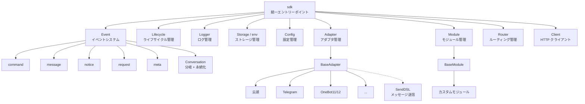

### コアモジュールの説明

| モジュール | 説明 |
|------|------|
| **Event** | イベントシステム。command / message / notice / request / meta の 5 種類のイベント処理と、Conversation 多輪対話機能を提供します。|
| **Adapter** | アダプタマネージャー。複数のプラットフォーム用アダプタの登録、起動、停止を管理します。|
| **Module** | モジュールマネージャー。プラグインの登録、ロード、アンロードを管理し、依存関係の宣言とトポロジカルソートをサポートします。|
| **Lifecycle** | ライフサイクルマネージャー。イベント駆動のライフサイクルフックを提供します。|
| **Storage** | SQLite を基にしたキー値ストレージシステム。一般的な SQL チェーン式クエリをサポートします。|
| **Config** | TOML 形式の設定ファイルを管理します。|
| **Logger** | モジュール化されたログシステム。サブロガーをサポートします。|
| **Router** | HTTP/WebSocket ルーティング管理。抽象層を介して下層バックエンド（現在は FastAPI + Uvicorn）をカプセル化し、デコレータールーティング、ミドルウェア、グループ、リクエスト制限、CORS をサポートします。|
| **Client** | 統一 HTTP/WS クライアント（2.8.0 以前は `HttpClient` で、互換性のエイリアスを保持）。抽象層を介して下層リクエストライブラリ（現在は aiohttp）をカプセル化し、リクエスト統計、リトライ、ログ、WebSocket クライアント、ErisPulse の例外体系等功能を提供します。クライアントとサーバーの WebSocket は `WebSocketConnectionBase` 基底クラスを共有します。|

## 初期化の流れ

下図は `sdk.init()` の完全な初期化プロセスを示しています：

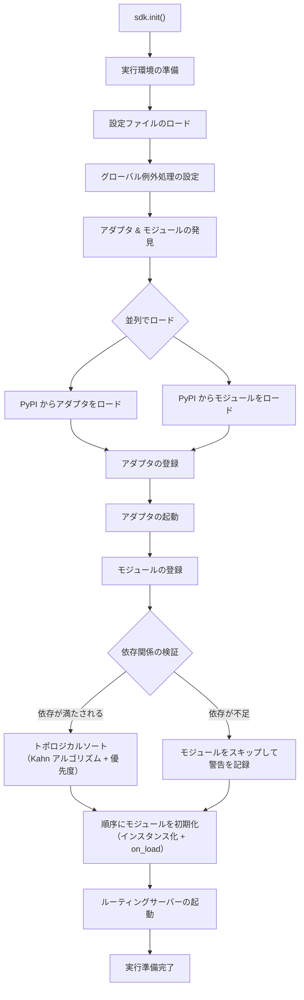

### 初期化段階の詳細

> 完全な初期化の流れを分解した（Finder / Loader / Manager / Router）、下層のエントリーポイント（`init()` / `init_task()` / `init_sync()`）と手動での完全起動については [起動プロセスと手動制御](advanced/startup.md) を参照してください。

## イベント処理の流れ

下図は、プラットフォームからハンドラまでのメッセージの完全な流れを示しています：

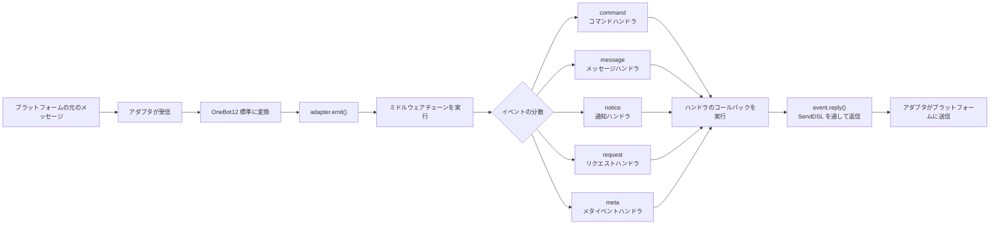

### イベント処理のチェーンの詳細

上記の図は「結果」です。下に `adapter.emit()` の後でフレームワークが**背後で何をしたか**を分解します。これは 3 層の分散チェーンです：

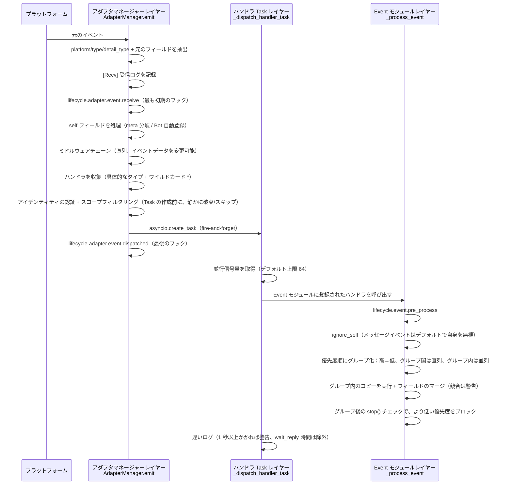

**各ステップでフレームワークが何をしたか、そして何を干预できるか：**

| ステージ | フレームワークが何をしたか | あなたが干预できる |
|------|-------------|-----------|
| 受信 | 標準フィールドを抽出し、`{platform}_raw` の元のデータを保持。`[Recv]` ログを記録 | `adapter.event.receive` を監視して初期イベントを取得 |
| self フィールド | meta イベントは connect/disconnect/heartbeat 分岐を処理。通常のイベントは Bot を自動登録し、`adapter.bot.online` をトリガー | `adapter.bot.online` / `bot.offline` を監視 |
| ミドルウェア | **直列**で実行。戻り値が None でなければイベントデータを置き換える | ミドルウェアを登録してイベントを変更/ブロック |
| 分発と収集 | 具体的なタイプのハンドラを先に取得し、次に `*` ワイルドカードハンドラを取得 | — |
| アイデンティティ次元 | 分発の入口はユーザー > 会話 > Bot > アダプタの順に判定し、イベントを受け取るかどうかを決定（`scope.is_identity_allowed`）。**拒否された場合はイベントは完全に破棄される** | `ErisPulse.scope.identity` をバインド |
| スコープフィルタリング | モジュールの所有者に応じて `scope.is_allowed` を判定（会話レベル > Bot レベル > プラットフォームレベル）。**不通過の場合は静かにスキップ** | スコープのホワイトリスト/ブラックリストを設定 |
| スケジューリング | 各マッチするハンドラは独立した `asyncio.Task` で実行される。`emit()` はハンドラの完了を待たずに即座に返却される | — |
| 優先度 | 高優先度のグループが先に実行される。**グループ間は直列、グループ内は並列**（グループ内の各ハンドラはイベントのコピーを持ち、フィールドをマージし、競合は WARNING として警告）。 | `@command(..., priority=N)` / 登録時に priority を指定 |
| ブロッキング | 各グループの処理後、`event.is_stopped()` をチェックし、マッチした場合は**より低い優先度は実行されない** | `event.mark_processed(stop=True)` / `event.done()` |

> **よくある誤解**：
> 1. **スコープフィルタリングは静かに実行される**— フィルターされたハンドラはエラーもレスポンスも出さず、TRACE ログレベルでのみ表示される（`core.scope.denied`）。"私のモジュールにメッセージが届かない"場合は、まずスコープのバインドを確認してください。
> 2. **ハンドラは天然並列**— フレームワークは各ハンドラに独立した Task を作成しており、**自分で `asyncio.create_task` をラップする必要はない**。
> 3. **同じ優先度のグループ内ではブロッキングされない**— `mark_processed(stop=True)` は、より低い優先度のグループをブロックするだけで、同じグループ内で並行実行中のハンドラは途中で中断されない。
> 4. **遅いログの閾値は固定の 1 秒**— ハンドラの処理時間が 1 秒を超えると、ログに WARNING が出る（`wait_reply` の待機時間は処理時間から除外される）が、実行は中断されない。

> スコープのモジュール次元の 3 級バインド、アイデンティティ次元の認証と出力アクション制限の詳細は [スコープ（scope）](advanced/scope.md) を参照してください。イベントスコープのテキストフィルタリングとコマンドユーザー ACL は [イベント処理の入門](getting-started/event-handling.md) を参照してください。並列上限の設定は [設定ガイド](user-guide/configuration.md#フレームワーク設定) を参照してください。

## ライフサイクルイベント

下図はフレームワーク各コンポーネントのライフサイクルイベントの発生順序を示しています：

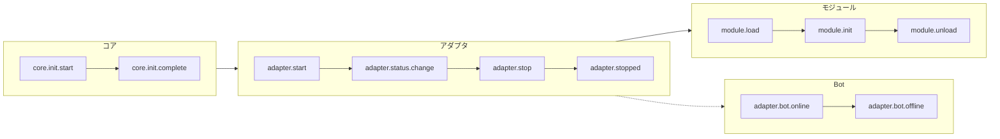

### ライフサイクルイベントの監視

> 完全なイベント監視方法（`lifecycle.on()` / `once()` / `has_handlers()`）、すべてのライフサイクルイベントリストとデータ形式は [ライフサイクル管理](advanced/lifecycle.md) を参照してください。

## モジュールのロード戦略

ErisPulse は 3 つのモジュールロード戦略をサポートし、`get_load_strategy()` が返す `ModuleLoadStrategy` によって宣言されます：

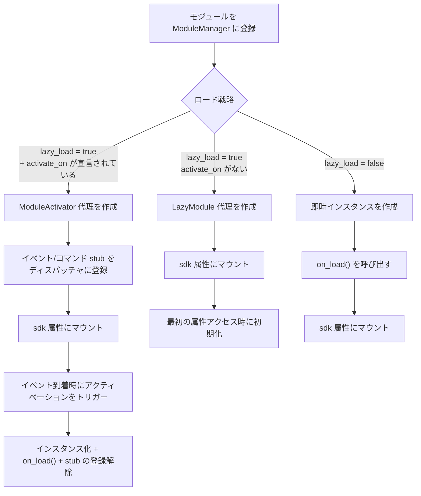

> 詳細は [遅延ロードシステム](advanced/lazy-loading.md)、[ライフサイクル管理](advanced/lifecycle.md) およびモジュールのドキュメントを参照してください。

### イベント駆動遅延アクティベーション（`activate_on`）のトリガーアーキテクチャ

> [!NOTE]
> この機能は ErisPulse **2.8.0+** が必要です。

`activate_on` を使用すると、モジュールは**最初のマッチするイベント/コマンドが到着した時点で**初めてロードされ、常駐メモリを避けることができ、同時にイベントのロスも防げます：

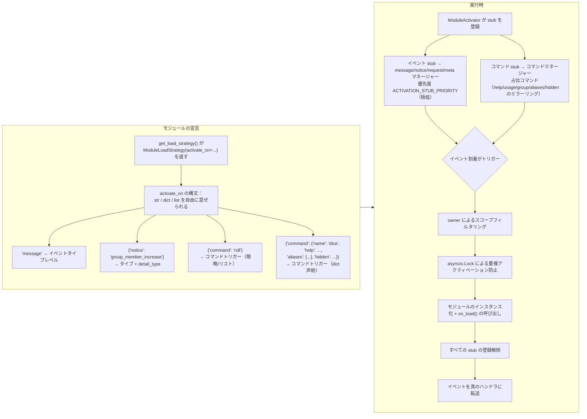

**トリガの意味の要点：**

> 完全な `activate_on` 構文（str / dict / list）、コマンド dict 声明、占位コマンド help のフォールバックチェーン、スコープフィルタリング、失敗の意味については [遅延ロードシステム](advanced/lazy-loading.md#イベント駆動遅延アクティベーションactivate_on) を参照してください。

## 本地プラグインフォルダのアーキテクチャ

> [!NOTE]
> この機能は ErisPulse **2.8.0+** が必要です。

ローカルプラグイン（`plugins/` ディレクトリ）は、パッケージ化して公開する必要がなく、フレームワークの起動時に自動的に発見され、ロードされます：

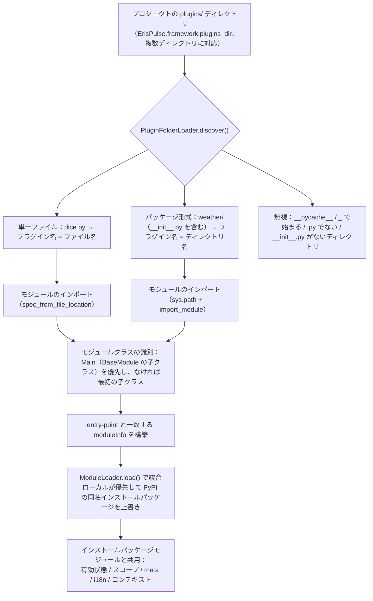

**約束と特性：**

- プラグイン名の由来：単一ファイルはファイル名、パッケージ形式はディレクトリ名
- ローカルプラグイン `moduleInfo.meta.source == "plugin_folder"` で、PyPI インストールパッケージモジュールとシームレスに共存
- 同名の場合はローカルが優先（ローカルの上書きデバッグに便利）、無効化された場合は同名の entry-point 条目も削除

## モジュールのホットリロードアーキテクチャ

ホットリロードは**すべてのモジュールソース**に対して一貫しています：ローカルプラグイン（`plugins/` ディレクトリ）、実行時登録（`sdk.module.register()`）、PyPI インストールパッケージモジュールはすべて `sdk.reload_module()` / `sdk.module.reload()` でホットリロードできます。**デフォルトは全量リロード**（トップレベルパッケ名で import キャッシュをクリアし、依存者コードを再インポート、`full=False` は軽量の逃生門）；`sdk.reload_all_modules()` / `sdk.module.reload_all()` で登録済みのすべてのモジュールを一度に全量リロードできます（pip で一括アップデート後に呼び出すことですべてが有効になります）：

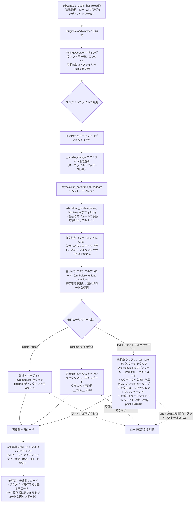

**3 つのソースの違いは発見段階のみ**、検証、アンロード、連鎖リロードは完全に同じです：

- **ローカルプラグイン**（`moduleInfo.meta.source == "plugin_folder"`）：`sys.modules` をクリアした後、`plugins/` ディレクトリを再スキャンします。ファイルが削除された場合は、ロード結果から削除されます。
- **実行時登録**（`source == "runtime"`）：定義モジュールを再インポートし、クラス名で再取得して再登録します。`__main__` に定義されている、またはソースファイルのないクラスは再インポートを拒否します（守衛アラート、エントリースクリプトの再実行を防ぎます）。
- **PyPI インストールパッケージ**：`meta.top_level` に基づいて、`sys.modules` のサブツリーをクリアし、インポートキャッシュをリフレッシュします（entry-point 60 秒キャッシュを突破）。再調査して再インポートします。entry-point が消えた（pip でアンインストールされた）場合は、ロード結果から削除されます。

**デフォルトの意味と信頼性の保証（2.11）：**

- **reload は全量リロード**：デフォルトで、トップレベルパッケージ名に基づいて `sys.modules` をクリアし、依存者コードを再インポートします。`full=False` は、メタデータに基づいてクリアし、PyPI 依存者は直接再インスタンス化するだけです（巨大な依存ツリーのパフォーマンスのための逃生門）。
- **構文検証のゲート**：アンロードのプロセスに入る前に、ファイルごとに構文解析を行い、失敗した場合はリロードを拒否します。古いインスタンスはアンロードされず、サービスを継続します。構文エラーは、モジュールを「半死」状態にすることがありません（巨大なパッケージでファイル数上限を超えた場合は、検証をスキップします）。
- **キャッシュのバックアップ**：`top_level` メタデータが欠落した場合は、「旧モジュールオブジェクト `__name__` 前方一致 → モジュールクラス `__module__` 前方一致」の 2 段階でクリア範囲を推定します。リロードの際には、ソースファイルのバイトコードキャッシュ（`__pycache__`）もクリアし、秒単位で長さが同じ小さな変更でも有効になります。
- **アイデンティティの確認**：リロードが成功した後、新旧のクラスアイデンティティが変化しているかをアサーションし、変化していない場合（C 拡張など、キャッシュがクリアできない場合）は明示的に警告し、`module.reload` イベントに `identity_changed: false` を含めます。`module.get_info()` は `running_identity` / `stale` フィールドで「登録されたバージョン ≠ 実行中のバージョン」を公開します。
- **失敗の確認**：load 失敗の現場（例外 + traceback）は、`module.last_error(名前)` / `get_info()["last_error"]` から直接確認できます。失敗したパスは、そのモジュールの import キャッシュをクリアします。「コードを変更してから再 reload する」ことで、必ず新しいコードを読み込むことができます。
- 重載は、もともと遅延ロードのモジュールを強制的にアクティブにします（明示的なログ）。`reload_all_modules()` は、遅延ロードの戦略を維持し、重載前に既にロード済みのモジュールを再アクティブにし、スリープ（休眠）中のモジュールはスリープのままにします。
- `reload_all_modules()` は依存関係のトポロジカル順序で再ロードし、単一モジュールの失敗は診断を記録してスキップします（全体のロールバックはしない—on_unload の副作用は取り消せないため、単一モジュールのホットリロードのベストエフォートの意味と一致）。重載失敗でロールバックされた状況も同様で、ログには明確に旧インスタンスが終了済みであることが示されます。

## アダプタのホットリロードアーキテクチャ

アダプタのコードレベルのホットリロード（2.11）は、モジュールのパイプラインと同構造です：`sdk.adapter.reload(プラットフォーム名)` / `sdk.reload_adapter(プラットフォーム名)` は、**ローカルプラグイン**と **PyPI インストールパッケージ**の 2 つのソースに対して実行されます：

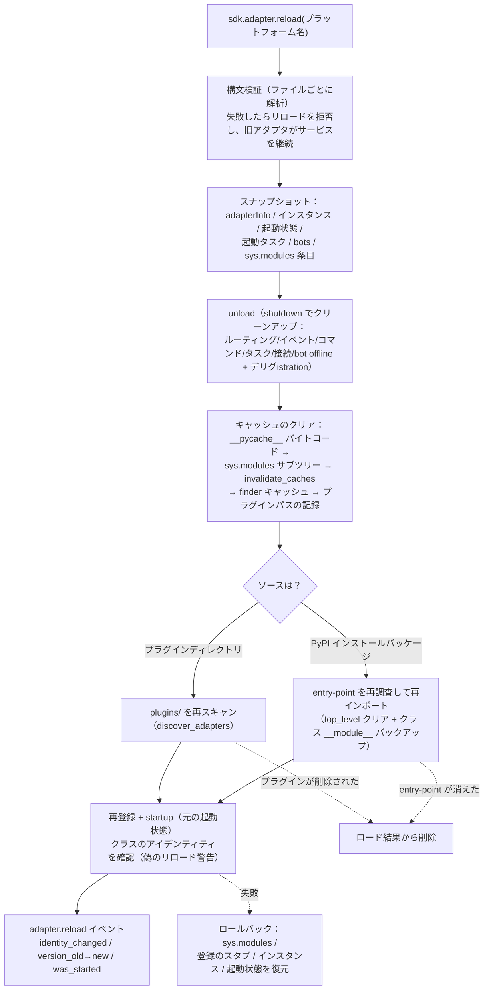

**モジュールのパイプラインとの違い：**

- アダプタには遅延ロードや依存の連鎖リロードがない：リロードは**依存する他のアダプタには連鎖しない**（警告のみ—依存先は登録表を間接的に消費しており、インスタンスの連鎖的な意味はない）。
- 起動は非同期のチェーン（`startup` は `_run_adapter` で発行され、依存のスキップと指数的バックオフリトライを含む）：起動の一時的な失敗は**リロードの失敗とは見なされない**（コードはすでに新しいものに変わっているため）、結果は `adapter.status.change` で通知される。
- `register()` のインスタンスの再利用の落とし穴（同じオブジェクトは旧インスタンスが再利用される）は、「pyc クリア + sys.modules クリア + アイデンティティの確認」の 3 つの手段でバックアップされる。
- ライフサイクルイベント：`adapter.reload`（payload に `adapter_name` / `success` / `full` / `duration_ms` / `identity_changed` / `version_old→new` / `was_started` / `source` を含む）

## 次に進むべきこと

- **起動/終了を手動で制御したい**：[起動プロセスと手動制御](advanced/startup.md) を参照してください。初期化の各段階を分解し、個別にアダプタやルーティングを起動・停止できます。
- **遅延ロードとスリープを理解したい**：[遅延ロードシステム](advanced/lazy-loading.md) を参照してください。`activate_on` イベント駆動遅延アクティベーションの完全な構文が含まれています。
- **モジュールを書くときにライフサイクルを上手く使う**：[ライフサイクル管理](advanced/lifecycle.md) を参照してください。すべてのライフサイクルイベントと監視方法が含まれています。


====
快速上手
====


### 快速开始

# 速習

> **これが最初の一歩です。** 5 分でゼロから ErisPulse ロボットを起動しましょう。まずは効果を見て、その後各ステップを詳しく説明します。

## 60 秒効果：まずロボットが 1 文だけ返信するようにする

**1. インストール**（Python >= 3.10）：

```bash
pip install ErisPulse
```

**2. プロジェクトの初期化**。ウィザードがプロジェクト名の設定、プラットフォームアダプターの選択、および設定の完了を促し、`main.py` と `config/config.toml` を生成します：

```bash
epsdk init
```

**3. `main.py` を開き、以下の 9 行のコードに置き換えます**：

```python
from ErisPulse import sdk
from ErisPulse.Core.Event import command

@command("ping", help="ロボットがオンラインかどうかをテストする")
async def ping_handler(event):
    await event.reply("Pong！ロボットは正常に動作しています。")

if __name__ == "__main__":
    import asyncio
    asyncio.run(sdk.run(keep_running=True))
```

**4. 実行**：

```bash
epsdk run main.py
```

ターミナルには、フレームワークの起動ログとアダプターの接続情報が出力されます。この時点で、接続したプラットフォームでロボットに `/ping` を送信すると、以下のように返信されます：

> Pong！ロボットは正常に動作しています。

この返信が見られれば、フレームワーク、アダプター、イベント処理の連携が確立されたことを意味します。連携がうまくいかない場合は、文末の[問題が発生した場合](#問題が発生した場合)を参照してください。うまくいく場合は、各ステップの選択肢についても以下に説明します。

## ErisPulse のインストール：3 つの方法

上記では最も直接的な pip を使用しています。環境に応じて選択してください。

### pip を使用したインストール

Python のバージョンが 3.10 以上であることを確認し、pip を使用してインストールします：

```bash
pip install ErisPulse
```

既に [uv](https://github.com/astral-sh/uv) をインストールしている場合は、`uv pip install ErisPulse` を使用して、より高速にインストールできます。

プロジェクト環境を汚染せずに `epsdk` コマンドラインツールをグローバルにインストールしたい場合は、`uv tool install` を推奨します：

```bash
uv tool install ErisPulse
```

インストール後、`epsdk` はグローバルに利用可能になります。プロジェクトディレクトリ内で実行すると、プロジェクトの `.venv` を自動的に感知し、`epsdk install` でプロジェクト環境にインストールし、`epsdk run` でプロジェクト環境で実行されます。フレームワーク本体はツール環境から提供されます。詳しくは[インストールの参考](user-guide/installation.md)を参照してください。

### 1 つでインストールするスクリプト（新規環境に推奨）

インストールスクリプトは、環境（Docker、Python、uv）を自動検出し、最適なインストール方法を選択するよう誘導します。多言語（中国語/English/日本語/Русский/繁体中国語）に対応しています。

Windows (PowerShell):
```powershell
irm https://get.erisdev.com/install.ps1 -OutFile install.ps1; powershell -ExecutionPolicy Bypass -File install.ps1
```

macOS / Linux:
```bash
curl -fsSL https://get.erisdev.com/install.sh -o install.sh && chmod +x install.sh && ./install.sh
```

スクリプトは以下を完了するよう誘導します：

- **Docker インストール**（Docker が検出された場合に推奨）：イメージソース（Docker Hub / GHCR）、バージョンチャネル（安定版 / プレビュー版）、Dashboard 管理パネルの設定、ポートの設定を選択
- **グローバル CLI インストール（uv tool、推奨）**：`epsdk` をグローバルコマンドとしてインストールし、仮想環境を必要とせず、uv が Python を自動管理します（システムのバージョンが低くても可能です）；プロジェクトディレクトリ内で実行すると、プロジェクトの `.venv` を自動的に感知します
- **従来のインストール**：自動的に仮想環境を作成し、ErisPulse のバージョンを選択し、オプションで Dashboard 管理パネルモジュールをインストールできます

### Docker を使用する

Docker イメージには、ErisPulse フレームワークと Dashboard 管理パネルが事前インストールされており、`linux/amd64` および `linux/arm64` アーキテクチャをサポートしています。

```bash
# docker-compose.yml をダウンロード
curl -O https://raw.githubusercontent.com/ErisPulse/ErisPulse/main/docker-compose.yml

# Dashboard トークンを設定して起動
ERISPULSE_DASHBOARD_TOKEN=your-token docker compose up -d
```

<details>
<summary>Docker Hub が利用できない場合？</summary>

GitHub Container Registry のイメージを使用する場合は、`docker-compose.yml` の image を次のように変更します：

```yaml
image: ghcr.io/erispulse/erispulse:latest
```

</details>

起動後、`http://<host>:8000/Dashboard` にアクセスし、設定したトークンでログインします。

## プロジェクトの初期化

### インタラクティブな初期化（推奨）

```bash
epsdk init
```

これにより、インタラクティブなガイドが起動し、以下の手順をガイドします：
- プロジェクト名の設定
- ログレベルの設定
- サーバー設定（ホストとポート）
- アダプターの選択と設定
- プロジェクト構造の作成

### ファスト初期化

```bash
# プロジェクト名を指定する高速モード
epsdk init -q -n my_bot

# または、プロジェクト名のみを指定
epsdk init -n my_bot
```

### 手動でのプロジェクト作成

手動でプロジェクトを作成したい場合は：

```bash
mkdir my_bot && cd my_bot
epsdk init
```

## モジュールのインストール

### CLI によるインストール

```bash
epsdk install Yunhu AIChat
```

### 利用可能なモジュールの確認

```bash
epsdk list-remote
```

### インタラクティブなインストール

パッケージ名を指定しない場合、インタラクティブなインストール画面に移行します。

```bash
epsdk install
```

## プロジェクトの実行

```bash
# 通常実行
epsdk run main.py

# ホットリロードモード（開発時に推奨）
epsdk run main.py --reload
```

## IDE補完の有効化（オプション）

ErisPulse はモジュール/アダプターを動的に発見するため、IDE はデフォルトではプラットフォーム固有のメソッドを補完できません。  
以下のコマンドを実行して型のスタブを生成してください：

```bash
epsdk types
```

生成後、インポートした型を変数の型ヒントとして使用することで、正確な補完が得られます（詳細は [IDE補完ガイド](./getting-started/ide-completion.md) を参照してください）：

```python
from _ep_types import Yunhu
from ErisPulse import sdk

adapter: Yunhu = sdk.adapter.get("yunhu")
await adapter.Send.To("group", "123").Board(...)  # プラットフォーム固有のメソッドの補完
```

## プロジェクト構造

初期化後のプロジェクト構造：

```
my_bot/
├── config/
│   └── config.toml          # 設定ファイル
└── main.py                  # エントリーファイル

```

## 設定ファイル

基本的な `config.toml` 設定：

```toml
[ErisPulse.server]
host = "0.0.0.0"
port = 8000

[ErisPulse.logger]
level = "INFO"

[Yunhu_Adapter]
# アダプターの設定
```

## 次のステップ

ロボットが起動したら、目的に応じて選択してください：

### グループ用ロボットを作りたい（メッセージ処理、グループ管理、通知）

- [イベント処理の入門](getting-started/event-handling.md) — メッセージ、通知、リクエストイベントの書き方
- [一般的なタスクの例](getting-started/common-tasks.md) — ストレージ、定期タスク、権限制御

### 自分のモジュール / アダプターを書きたい

- [基本概念](getting-started/basic-concepts.md) — アダプター / モジュール / イベントの設計を理解する
- [モジュール開発の入門](developer-guide/modules/getting-started.md)
- [アダプター開発の入門](developer-guide/adapters/getting-started.md)
- [アーキテクチャ概要](architecture.md) — 可視化されたアーキテクチャ図

### ロボットを長期的に動かしたい

- [デプロイガイド](user-guide/deployment.md)
- [設定ファイルの説明](user-guide/configuration.md)

### 問題に遭遇した場合

- [最初のロボットを作成する](getting-started/first-bot.md) — 最初のロボットの詳細な手順
- [起動プロセスと手動制御](advanced/startup.md) — モジュール / アダプターのロード失敗の診断
- [CLIコマンドリファレンス](user-guide/cli-reference.md) — `epsdk` のすべてのサブコマンド


### 创建第一个机器人

# 最初のロボットを作成する

> [!TIP]
> **この記事を読むタイミング**：ロボットが動作している状態で、最初の `/hello` コマンドハンドラを実装し、`sdk.run` とコマンドデコレータがそれぞれ何をしているのかを理解したい場合。まだ ErisPulse をインストールしておらず、プロジェクトを初期化していない場合は、まず [5 分間クイックスタート](../quick-start.md) の「インストール」「プロジェクトの初期化」「プロジェクトの実行」の 3 ステップを完了してください。必要ない場合はスキップしてください。

クイックスタートを実行したのは第一歩です。この記事では、最初のコマンドハンドラを実装し、フレームワーク内で各行のコードが何を行っているのかを解説します。

## 最初のステップ：最初のコマンドを記述する

`main.py` を開き、シンプルなコマンドハンドラを記述します。

```python
from ErisPulse import sdk
from ErisPulse.Core.Event import command

@command("hello", help="挨拶メッセージを送信します")
async def hello_handler(event):
    """hello コマンドを処理します"""
    user_name = event.get_user_nickname() or "友達"
    await event.reply(f"こんにちは、{user_name}！私は ErisPulse ロボットです。")

@command("ping", help="ロボットがオンラインかどうかをテストします")
async def ping_handler(event):
    """ping コマンドを処理します"""
    await event.reply("Pong！ロボットは正常に動作しています。")

async def main():
    """メインエントリーポイント関数"""
    print("ErisPulse を起動しています...")
    
    # keep_running=True（デフォルト）：フレームワークはブロックして実行を維持し、終了信号（例：Ctrl+C）が受信されるまで待ちます
    await sdk.run(keep_running=True)

if __name__ == "__main__":
    import asyncio
    asyncio.run(main())
```

### `keep_running` パラメータ

`sdk.run(keep_running)` は、フレームワークがブロックして実行を維持するかどうかを制御します。

- **`keep_running=True`（デフォルト）**：`run()` はブロックし続け、終了信号（例：Ctrl+C）が受信されるまで待ちます。これは純粋な bot アプリケーションに適しています。
- **`keep_running=False`**：`run()` は初期化後に即座に返ります。**フレームワークはアンロードされません**——起動されたアダプタ/モジュールはバックグラウンドタスクとしてメッセージイベントの処理を続けます。その後、独自のロジックを実行し、イベントループが終了するまでフレームワークは閉じられません。例：

```python
async def main():
    await sdk.run(keep_running=False)   # 初期化後に即座に返ります
    # フレームワークはバックグラウンドで実行中です。ここでは他の処理を続行できます
    while True:
        await asyncio.sleep(3600)
        print("1時間ごとにチェックします")
```

> `run()` の2つのモードに加えて、`init()`/`uninit()` を使用したライフサイクルの手動制御、個別のアダプタ/ルーティングの起動/停止など、より細かい制御方法もあります。詳細は [起動プロセスと手動制御](../advanced/startup.md) を参照してください。

## 第二ステップ：ロボットの実行

```bash
# 通常実行
epsdk run main.py

# 開発モード（ホットリロードをサポート）
epsdk run main.py --reload
```

## 第三段階：ロボットのテスト

チャットプラットフォームで次のコマンドを送信します：

```
/hello
```

これで、ロボットからの返信が届くはずです。

## コード説明

### コマンドデコレータ

```python
@command("hello", help="挨拶メッセージを送信")
```

- `hello`：コマンド名。ユーザーは `/hello` で呼び出します。
- `help`：コマンドのヘルプ説明。`/help` コマンドで表示されます。

### イベントパラメータ

```python
async def hello_handler(event):
```

`event` パラメータは Event オブジェクトであり、以下を含みます：
- メッセージ内容：`event.get_text()`
- 送信者情報：`event.get_user_id()`、`event.get_user_nickname()`
- プラットフォーム情報：`event.get_platform()`
- グループ情報：`event.get_group_id()`
- 元のデータ：`event.get_raw()`

> 完全な Event オブジェクトのメソッドについては、[Event 包装クラスの詳細](../developer-guide/modules/event-wrapper.md) を参照してください。

### レスポンスの送信

```python
await event.reply("レスポンスの内容")
```

`event.reply()` は、送信者にメッセージを送信するための便利なメソッドです。

## 拡張機能：追加の機能を追加

ErisPulse は、豊富なイベント処理とデータ処理機能を提供します：

- **メッセージの監視**：`@message.on_message()` を使用して、さまざまなメッセージを監視します → [イベント処理の入門](event-handling.md)
- **通知の監視**：`@notice.on_friend_add()` などの通知を監視します → [イベント処理の入門](event-handling.md)
- **データの保存**：`sdk.storage.get/set` を使用してデータを永続化します → [一般的なタスクの例](common-tasks.md)

## よくある質問

### コマンドが反応しない？

1. アダプタが正しく設定されているか確認し、`config/config.toml` 内のアダプタの `status` が `true` であることを確認します。
2. ターミナルのログ出力を確認し、エラー情報（特に `ERROR` レベルのログ）がないか確認します。
3. コマンドのプレフィックスが正しいか確認します（デフォルトは `/` です）。設定ファイルの `[ErisPulse.event.command]` 部分で確認できます。
4. コマンド名のスペルが正しいか、大文字小文字の区別が正しく設定されているか確認します。

### コマンドのプレフィックスを変更するには？

`config.toml` に以下を追加します：

```toml
[ErisPulse.event.command]
prefix = "!"
case_sensitive = false
```

### 複数のプラットフォームをサポートするには？

ErisPulse は OneBot12 標準を用いて、異なるプラットフォームのイベント形式を統一しています。`@command` および `@message` で登録されたハンドラは、すべてのプラットフォームからのイベントを自動的に受け取ります。イベントの元プラットフォームを区別するには、`event.get_platform()` を使用します：

```python
@command("hello")
async def hello_handler(event):
    platform = event.get_platform()
    
    if platform == "yunhu":
        await event.reply("你好！来自云湖")
    elif platform == "telegram":
        await event.reply("Hello! From Telegram")
    else:
        await event.reply("你好！")
```

> 詳細な多プラットフォーム対応のテクニックについては、[よくあるタスクの例](common-tasks.md#多プラットフォーム適応) を参照してください。

## 次のステップ

- **学習の流れに従って進む**：[基本概念](basic-concepts.md)を読んで、コマンドプロセッサの背後でフレームワークが何をしているかを理解する
- **より多くのメッセージタイプに対応したい**：[イベント処理の入門](event-handling.md)、メッセージ / 通知 / 要求 / メタイベントのハンドラの書き方
- **実用的な機能を追加したい**：[一般的なタスクの例](common-tasks.md)、永続化、定時タスク、権限制御の既製コード


### 基础概念

# 基礎概念

> [!NOTE]
> **L1 コア必読**——ドキュメントのトップページにある「L1 コア5編」のうち第2編（モジュール開発入門 → **基礎概念** → Event ラッパークラス → 設定ファイルの説明 → 例外キャッチ）。

ユーザーがメッセージを送信してからボットが返信するまでの間に、どのコンポーネントを経由するのでしょうか？アダプターとモジュールはそれぞれ何を担当しているのでしょうか？このドキュメントを読み終えれば、ハンドラーを書く際に直面する設計上の問いに、サンプルをただ写経するのではなく自分で答えられるようになります。

## イベント駆動アーキテクチャ

ErisPulse はイベント駆動アーキテクチャを採用しており、すべてのやり取りはイベントを通じて伝達・処理されます。

### イベントフロー

```
ユーザーがメッセージを送信
      │
      ▼
プラットフォームが受信
      │
      ▼
アダプターがプラットフォームのネイティブイベントを受信
      │
      ▼
OneBot12 標準イベントに変換
      │
      ▼
イベントシステムに投入
      │
      ▼
登録済みのハンドラーに配信
      │
      ▼
モジュールがイベントを処理
      │
      ▼
アダプターを通じてレスポンスを送信
      │
      ▼
プラットフォームがユーザーに表示
```

### OneBot12 標準

ErisPulse は OneBot12 をコアイベント標準として使用しています。OneBot12 は汎用のチャットボットアプリケーションインターフェース標準であり、統一されたイベント形式を定義しています。

すべてのアダプターはプラットフォーム固有のイベントを OneBot12 形式に変換し、コードの一貫性を保証します。

## コアコンポーネント

### 1. SDK オブジェクト

SDK はすべての機能の統一エントリーポイントであり、コアコンポーネントへのアクセスを提供します。

```python
from ErisPulse import sdk

# コアモジュールへのアクセス
sdk.storage    # ストレージシステム
sdk.config     # 設定システム
sdk.logger     # ログシステム
sdk.adapter    # アダプターシステム
sdk.module     # モジュールシステム
sdk.router     # ルーティングシステム
sdk.client     # HTTP クライアント
sdk.lifecycle  # ライフサイクルシステム
```

> [!WARNING]
> **ルートから統一インポート**：`from ErisPulse.Core import adapter` / `import ErisPulse.Core.adapter`
> このような書き方でバインドされるのはサブモジュールではなく**マネージャーインスタンス**（`AdapterManager` シングルトン）です。`ErisPulse.Core`
> パッケージの re-export は同名のサブモジュールをシャドウイングします。テストの作成、patch、またはモジュールオブジェクト自体が必要な場合は、必ず
> `from ErisPulse import sdk` のルートインポートを使用してください（`sdk.adapter` がマネージャーインスタンスです）。

### 2. Event オブジェクト

Event オブジェクトはイベントデータをカプセル化し、便利なアクセスメソッドを提供します。

```python
@command("info")
async def info_handler(event):
    # イベント情報の取得
    event_id = event.get_id()
    user_id = event.get_user_id()
    platform = event.get_platform()
    text = event.get_text()
    
    # 返信の送信
    await event.reply(f"ユーザー: {user_id}, プラットフォーム: {platform}")
```

### 3. アダプター

アダプターは ErisPulse と外部プラットフォームの間の橋渡し役です。

**役割：**
- プラットフォームのネイティブイベントを受信
- OneBot12 標準形式に変換
- 標準形式のイベントをプラットフォームに送信

**アダプターの例：**
- Yunhu アダプター：Yunhu プラットフォームと通信
- Telegram アダプター：Telegram Bot API と通信
- OneBot11 アダプター：OneBot11 互換のアプリケーションと通信
- Email アダプター：メールの送受信を処理

### 4. モジュール

モジュールは機能拡張の基本単位であり、以下のことができます：

- イベントハンドラーの登録
- ビジネスロジックの実装
- アダプターを呼び出してメッセージを送信
- コアモジュールが提供するサービスの利用

#### モジュール検出メカニズム

ErisPulse は Python の `importlib.metadata.entry_points` を通じてインストール済みのモジュールを検出します。モジュールは `pyproject.toml` でエントリーポイントを宣言します：

```toml
[project.entry-points."erispulse.module"]
MyModule = "my_package:Main"
```

SDK の初期化時に、すべての `erispulse.module` グループのエントリーポイントをスキャンし、モジュールクラスを `ModuleManager` に登録します。その後、依存関係に従ってトポロジカルソートし、順次初期化します。

#### 最小構成のモジュール

```python
from ErisPulse.Core.Bases import BaseModule
from ErisPulse import sdk

class Main(BaseModule):
    def __init__(self):
        self.sdk = sdk
        self.logger = sdk.logger.get_child("MyModule")

    async def on_load(self, event):
        self.logger.info("モジュールがロードされました")

    async def on_unload(self, event):
        self.logger.info("モジュールがアンロードされました")
```

#### モジュールのライフサイクル

- **登録**：SDK がモジュールクラスを検出し、マネージャーに登録
- **ロード**：モジュールインスタンスを作成し、`on_load(event)` を呼び出す（`event = {"module_name": "MyModule"}`）
- **アンロード**：`on_unload(event)` を呼び出し、リソースをクリーンアップ

#### ロード戦略

`get_load_strategy()` を通じてモジュールのロード動作を宣言します：

```python
from ErisPulse.loaders import ModuleLoadStrategy

class Main(BaseModule):
    @staticmethod
    def get_load_strategy():
        return ModuleLoadStrategy(
            lazy_load=True,   # 遅延読み込みするかどうか（デフォルト True）
            priority=0        # ロード優先度、数値が大きいほど先に初期化
        )
```

- **`lazy_load=True`（デフォルト）**：モジュールは初めて `sdk.MyModule` でアクセスされた時に初期化され、起動時間を短縮します
- **`lazy_load=False`**：SDK 起動時に即座に初期化されます。ライフサイクルイベントのリスニングや定期タスクの実行が必要なモジュールに適しています
- **`priority`**：同じ優先度のモジュールは登録順にロードされます。数値が大きいほど先に初期化されます

> 遅延読み込みのメカニズムの詳細については、[遅延読み込みシステム](../advanced/lazy-loading.md) を参照してください。

## イベントタイプ

ErisPulse は 5 種類のイベントをサポートしています：

| イベントタイプ | デコレーター | 説明 |
|---------|--------|------|
| メッセージイベント | `@message.on_message()` | ユーザーが送信したすべてのメッセージ（個人チャット、グループチャット） |
| コマンドイベント | `@command("name")` | コマンドプレフィックスで始まるメッセージ（例：`/hello`） |
| 通知イベント | `@notice.on_friend_add()` など | システム通知（友達追加、グループメンバーの変更など） |
| リクエストイベント | `@request.on_friend_request()` など | ユーザーリクエスト（友達リクエスト、グループ招待） |
| メタイベント | `@meta.on_connect()` など | システムレベルのイベント（接続、切断、ハートビート） |

> 各イベントタイプの詳細な使い方とコード例については、[イベント処理入門](event-handling.md) を参照してください。

## コアモジュールの説明

### Storage（ストレージ）

SQLite ベースのキーバリューストアシステムで、データの永続化に使用されます。

```python
# 値の設定
sdk.storage.set("key", "value")

# 値の取得
value = sdk.storage.get("key", "default_value")

# 一括操作
sdk.storage.set_multi({
    "key1": "value1",
    "key2": "value2"
})

# トランザクション
with sdk.storage.transaction():
    sdk.storage.set("key1", "value1")
    sdk.storage.set("key2", "value2")
```

### Config（設定）

TOML 形式の設定ファイル管理。

```python
# 設定の取得
config = sdk.config.getConfig("MyModule", {})

# 設定の保存
sdk.config.setConfig("MyModule", {"key": "value"})

# ネストされた設定の読み取り
value = sdk.config.getConfig("MyModule.subkey", "default")
```

### Logger（ログ）

モジュール化されたログシステム。

```python
# ログの記録
sdk.logger.info("これは情報メッセージです")
sdk.logger.warning("これは警告メッセージです")
sdk.logger.error("これはエラーメッセージです")

# 子ロガーの取得
child_logger = sdk.logger.get_child("submodule")
child_logger.info("サブモジュールのログ")
```

**属性アクセスのシンタックスシュガー**

`get_child()` メソッドを使用するほかに、**属性アクセス**の方法で子ロガーを作成することもできます。これはより簡潔な**シンタックスシュガー**の書き方です：

```python
# 属性アクセスで子ロガーを作成
sdk.logger.mymodule.info("モジュールメッセージ")

# ネストされたアクセスをサポート
sdk.logger.mymodule.database.info("データベースメッセージ")
```

### Router（ルーティング）

HTTP と WebSocket のルーティング管理。FastAPI + Uvicorn ベース。デコレータールーティング、ミドルウェア、グループ化、レート制限、CORS をサポートします。

```python
from ErisPulse.Core import HttpRequest

@sdk.router.get("MyModule", "/api")
async def handler(request: HttpRequest):
    data = await request.json()
    return {"status": "ok"}
```

> ルーティング API の全容（WebSocket、ミドルウェア、レート制限、CORS など）については、[ルーティングマネージャー](../advanced/router.md) を参照してください。

### Client（ネットワーククライアント）

統一されたネットワーククライアントで、HTTP リクエスト、WebSocket 接続、コネクションプール管理、自動リトライ、タイムアウト制御、リクエスト統計、ライフサイクルイベント統合を集約しています。

```python
from ErisPulse.Core import client

# HTTP リクエスト
resp = await client.get("https://api.example.com/users")
data = await resp.json()

# リトライとタイムアウト付き
resp = await client.get(url, timeout=30, max_retries=3)

# WebSocket 接続
ws = await client.ws_connect("wss://example.com/ws")
async for text in ws.iter_text():
    await ws.send_text(f"Echo: {text}")
```

> ネットワーククライアント API の全容については、[ネットワーククライアント](../advanced/client.md) を参照してください。

## SendDSL メッセージ送信

アダプターはメソッドチェーンによるメッセージ送信インターフェースを提供します。

### 基本的な送信

```python
# アダプターインスタンスの取得
yunhu = sdk.adapter.get("yunhu")

# メッセージの送信
await yunhu.Send.To("user", "U1001").Text("Hello")

# 送信アカウントの指定
await yunhu.Send.Using("bot1").To("group", "G1001").Text("グループメッセージ")
```

### チェーン修飾

```python
# ユーザーをメンション
await yunhu.Send.To("group", "G1001").At("U2001").Text("@メッセージ")

# メッセージに返信
await yunhu.Send.To("group", "G1001").Reply("msg123").Text("返信")

# 全員にメンション
await yunhu.Send.To("group", "G1001").AtAll().Text("お知らせ")
```

### Event の返信メソッド

Event オブジェクトは便利な返信メソッドを提供します：

```python
@command("test")
async def test_handler(event):
    # シンプルなテキスト返信
    await event.reply("返信内容")
    
    # 画像の送信
    await event.reply("http://example.com/image.jpg", method="Image")
    
    # 音声の送信
    await event.reply("http://example.com/voice.mp3", method="Voice")
```

## 遅延読み込みシステム

ErisPulse はデフォルトでモジュールの遅延読み込みを有効にしており、モジュールは初めてアクセスされた時（例：`sdk.MyModule`）にのみ初期化されるため、起動速度が大幅に向上します。

```python
from ErisPulse.loaders import ModuleLoadStrategy

class Main(BaseModule):
    @staticmethod
    def get_load_strategy():
        return ModuleLoadStrategy(
            lazy_load=True,   # 遅延読み込みを有効化（デフォルト）
            priority=0        # ロード優先度、数値が大きいほど先に初期化
        )
```

**遅延読み込みを無効化すべきシナリオ（`lazy_load=False`）：**
- ライフサイクルイベントをリスニングするモジュール（例：`core.init.complete`）
- 定期タスクやバックグラウンドサービスを起動するモジュール
- 他のモジュールがロードされる前に初期化を完了させる必要があるモジュール

> 遅延読み込みのメカニズムと注意事項の詳細については、[遅延読み込みシステム](../advanced/lazy-loading.md) を参照してください。

## 次のステップ

- **L1 パスに沿って続ける**：次は [Event ラッパークラス](../developer-guide/modules/event-wrapper.md) で、イベントオブジェクトのすべての読み書きメソッドを習得しましょう
- **書きながら学びたい**：[イベント処理入門](event-handling.md) ではイベントタイプ別にコピーしてすぐ使えるハンドラーの書き方を紹介しています。[よくあるタスクの例](common-tasks.md) では、永続化、定期タスク、権限制御などのよく使う機能をカバーしています


### 事件处理入门

# イベント処理入門

> [!TIP]
> **この記事を読むべきタイミング**：ロボットにメッセージ、コマンド、通知、リクエストへの反応をさせたい場合、または応答待ち／対話の実装、コマンドがなぜ実行されないかを調査する場合に読む。フレームワークの設計概要だけ知りたい場合は、[基本概念](basic-concepts.md)を参照するだけでよい。必要なければ飛ばしてもよい。

イベントハンドラーは、ロボットがユーザーのメッセージを理解し、反応する場所です。ここでは、5つのイベントタイプに分けて、直接コピーできる書き方を紹介し、パラメータ解析、権限、スロットリング、対話など、実践的なシナリオもカバーします。

## イベントタイプの概要

ErisPulse は以下のイベントタイプをサポートしています：

| イベントタイプ | 説明 | 適用場面 |
|---------|------|---------|
| メッセージイベント | ユーザーが送信するすべてのメッセージ | チャットロボット、コンテンツフィルタ |
| コマンドイベント | コマンドプレフィックスで始まるメッセージ | コマンド処理、機能の入口 |
| 通知イベント | システム通知（友達追加、グループメンバー変更など） | ホームメッセージ、ステータス通知 |
| リクエストイベント | ユーザーのリクエスト（友達リクエスト、グループ招待） | リクエストの自動処理 |
| 元イベント | システムレベルのイベント（接続、ハートビート） | 接続監視、ステータスチェック |

各タイプには、`notice.on_notice()` / `request.on_request()` / `meta.on_meta()` という汎用のレジスタがあります（このタイプの全イベントを受け取ります）。細分化されたデコレータ（例：`on_group_increase`）は、対応するサブタイプのみをサブスクライブします。細分化されたデコレータを優先的に使用してください。

## メッセージイベント処理

> **強く推奨**：イベントハンドラーの `event` パラメータに `Event` クラスの型注釈を追加してください。実行時には注釈がなくても実行できます（フレームワークがイベントインスタンスを渡します）。注釈は IDE の補完と静的チェックに役立ちます。プロジェクトルートディレクトリで `epsdk types` を実行して、型のスタブを生成することで、**モジュール/アダプターのカスタムメソッド**の補完を得ることができます（[IDE補完](../getting-started/ide-completion.md)を参照）。

### すべてのメッセージを監視

```python
from ErisPulse.Core.Event import message, Event

@message.on_message()
async def message_handler(event: Event):
    text = event.get_text()
    user_id = event.get_user_id()
    sdk.logger.info(f"受信した {user_id} のメッセージ: {text}")
```

### プライベートメッセージを監視

```python
from ErisPulse.Core.Event import Event
@message.on_private_message()
async def private_handler(event: Event):
    user_id = event.get_user_id()
    await event.reply(f"こんにちは、{user_id}！これはプライベートメッセージです。")
```

### グループメッセージを監視

```python
from ErisPulse.Core.Event import Event
@message.on_group_message()
async def group_handler(event: Event):
    group_id = event.get_group_id()
    user_id = event.get_user_id()
    sdk.logger.info(f"グループ {group_id} で {user_id} がメッセージを送信しました")
```

### @メッセージを監視

```python
from ErisPulse.Core.Event import Event
@message.on_at_message()
async def at_handler(event: Event):
    # @されたユーザーのリストを取得
    mentions = event.get_mentions()
    await event.reply(f"あなたが@したユーザー: {mentions}")
```

### ワイルドカードと正規表現による監視

4つのメッセージデコレータ（`on_message` / `on_private_message` / `on_group_message` / `on_at_message`）は、`pattern`（glob ワイルドカード）と `regex`（正規表現）をサポートしています。一致しないメッセージは**ハンドラーをトリガーしません**：

```python
from ErisPulse.Core.Event import Event
# glob ワイルドカード：* 任意の文字列、? 1文字、[seq] 文字集合
@message.on_message(pattern="签到*")
async def signin_handler(event: Event):
    await event.reply("签到成功")

# 正規表現：金額を一致させる
@message.on_message(regex=r"\d+\s*元")
async def price_handler(event: Event):
    await event.reply(f"受信した金額：{event.get_text()}")

# pattern と regex が両方指定された場合、両方を一致させる必要がある
@message.on_message(pattern="*元", regex=r"\d+\s*元")
async def combined_handler(event: Event):
    pass
```

`wait_reply` もこれら2つのパラメータをサポートしています（[応答待ち機能](../developer-guide/modules/event-wrapper.md#応答待ち機能)を参照）。

## コマンドイベント処理

### 基本コマンド

```python
from ErisPulse.Core.Event import command

@command("help", help="ヘルプ情報を表示")
async def help_handler(event):
    help_text = """
利用可能なコマンド：
/help - ヘルプを表示
/ping - 接続をテスト
/info - 情報を表示
    """
    await event.reply(help_text)
```

### コマンドの別名

```python
@command(["help", "h"], aliases=["帮助"], help="ヘルプ情報を表示")
async def help_handler(event):
    await event.reply("ヘルプ情報...")
```

ユーザーは以下のいずれかの方法で呼び出すことができます：
- `/help`
- `/h`
- `/帮助`

### コマンドのパラメータ

```python
@command("echo", help="メッセージを返信")
async def echo_handler(event):
    # コマンドパラメータを取得
    args = event.get_command_args()
    
    if not args:
        await event.reply("返信するメッセージを入力してください")
    else:
        await event.reply(f"あなたが言った: {' '.join(args)}")
```

パラメータは、大文字小文字の違いを保持します（大文字小文字を無視するように設定しても、コマンド名の一致は大文字小文字を無視しますが、パラメータの内容には影響しません）。

### 宣言式パラメータとオプション（args= / options=）

手動でパラメータを解析するには、自分で型変換とエラーメッセージの提示を処理する必要があります。`args=` / `options=` を宣言した後、フレームワークは権限チェックが通った後にコマンドパラメータを自動的に解析し、**名前でハンドラーに注入**します。ユーザーの入力が間違っている場合、自動的にローカライズされたエラーメッセージと用法を返し（例外が発生してクラッシュすることはありません）、`/help <コマンド>` は自動的に用法を表示します：

```python
@command(
    "roll",
    args="<count:int> [sides:int=6]",
    options={"verbose": "-v/--verbose", "label": "--label"},
    help="サイコロを振る",
)
async def roll_handler(event, count: int, sides: int = 6, verbose: bool = False, label: str = ""):
    total = sum(random.randint(1, sides) for _ in range(count))
    await event.reply(f"{count}回 {sides}面サイコロを振った、合計点数：{total}")
```

`args=` の位置パラメータの構文：`<count:int>` 必須、`[sides:int=6]` 省略可能（デフォルト値付き）。サポートされる型：

| 型 | 例 | 説明 |
|------|---------|------|
| `str` | `hello` | テキスト（デフォルト型） |
| `int` / `float` | `3` / `0.5` | 数値 |
| `bool` | `是` / `yes` / `はい` / `да` / `true` / `no` / `取消` | ブール値、対話確認（`Event.confirm()`）の確認語リストを再利用 |
| `literal` | `<mode:literal=fast|slow>` | 列挙、指定された値のみを受け入れる；省略形はデフォルトで最初の値を使用 |
| `duration` | `90s`、`1h30m`、`1d` | 時間、秒に換算された float |
| `rest` | `<text:rest>` | 残りの全テキスト（最後に位置する必要がある） |

`options=` は辞書形式で宣言されます：キーはハンドラーのパラメータ名、値はフラグ形式（複数の別名は `/` で区切る）。`bool` に注釈されたパラメータはブールフラグ（存在すれば `True`）です；それ以外（デフォルトは `str`）は値付きオプションで、`--label hello` と `--label=hello` の両方の値をサポートし、型はハンドラーの注釈に従います。オプションは最初に認識され、残りのトークンは `args=` で解析されます（`rest` はオプションを除外した後の残りのテキストをカバーします）。

**動作の要点**：

- 権限チェックはパラメータ解析の前に実行される - 権限がないユーザーは解析をトリガーしない
- 解析失敗（型が不一致 / パラメータ不足 / パラメータ過多 / 未知のオプション）は自動的にローカライズされたエラーと用法を返し、コマンドは引き続き認識される
- 宣言されたパラメータ名はハンドラーの署名に存在する必要がある、そうでなければ登録時に `ValueError` をスローする
- `args=` / `options=` を宣言しないコマンドは、動作が完全に変化しない（後方互換性）

### コマンド管理（cooldown= / rate_limit= / usage_limit= / deprecated=）

手動でクールダウン、レート制限、使用制限、廃止メッセージを宣言で置き換えることができ、これらは任意に組み合わせることができます。

**クールダウン** - 時長の書式は `args=` の `duration` 型と同じ（例：`"30s"`、`"1h30m"`、`"1d"`）：

```python
@command("daily", cooldown="1d", cooldown_key="user", cooldown_reply="今日のサインインは完了しました")
async def daily_handler(event):
    await event.reply("サインイン完了！")
```

**レート制限** - スライディングウィンドウの宣言は `"回数/時間"` の形式（例：`"5/minute"`、`"10/s"`、`"3/2m"`）：

```python
@command("search", rate_limit="5/minute", rate_limit_key="user")
async def search_handler(event):
    await event.reply("検索結果")
```

**使用制限** - 期間内の総回数の上限（例：`"100/day"`、`"10/hour"`、`"500/30d"`）、上限を超えると実行を拒否：

```python
@command("translate", usage_limit="100/day", usage_limit_key="user",
         usage_limit_reply="今日の翻訳回数は上限に達しました")
async def translate_handler(event):
    ...
```

クールダウン/レート制限とは異なり、使用制限は**永続化されたストレージ**にカウントされます（KV キー `erispulse.usage.<key>`、再起動しても失われません）：
ストレージにアクセスできない場合、自動的にメモリ内カウントに退化し、警告を出します（この場合、使用制限は再起動でリセットされます）。カウントは使用制限の期間が切り替わるたびにリセットされ、モジュールがアンロードされたときにクリアされます。

**廃止** - 呼び出されたときに廃止文を自動的に返し、`deprecated_reject=True` で実行を拒否します：

```python
@command("oldcmd", deprecated="新しいコマンド /newcmd を使用してください", deprecated_reject=True)
async def old_handler(event): ...
```

キー粒度（`cooldown_key=` / `rate_limit_key=`）：`"user"`（デフォルト、同一ユーザーが共有）、`"session"`（同一セッションが共有、同じグループ）、`"global"`（すべてのユーザー、すべてのセッションが共有）。

**動作の要点**：

- クールダウン / レート制限 / 使用制限がヒットした場合、デフォルトでは**静かに破棄**されます（対称的なスコープで静かに）
- `cooldown_reply=` / `rate_limit_reply=` / `usage_limit_reply=` を宣言した場合、ヒットするとその文を返します
- コマンドがヒットした時点で認識されます - 治理がヒットしたコマンドは低優先度のメッセージハンドラーに漏れません
- 治理判定はすべての権限チェックとパラメータ解析が完了し、実際の実行の前に実行されます：権限のないユーザーはトリガーされず、パラメータエラーは消費されません
- クールダウンとレート制限を同時に宣言した場合、クールダウンが先に判定されます（クールダウンがヒットした場合、レート制限のウィンドウは占有されません）；使用制限はクールダウン/レート制限の判定後に実行されます
- `deprecated=` はデフォルトで返信文を返した後**実行を継続**します；`deprecated_reject=True` で実行を拒否します（`command.executed` フックは `success=False, error="deprecated"` と記録されます）
- `/help` のリストと単一コマンドのヘルプは自動的に廃止マークと文を表示します
- クールダウンとレート制限の状態はプロセス内メモリに保持され、モジュールがアンロードされたときに自動的にクリアされます；プロセス間共有 / 再起動時の永続化は対象外です（**使用制限のカウントは除く**——ストレージに永続化されます、上記参照）
- 登録時に検証されます（fail-fast）：構文が無効、キー粒度がホワイトリスト値、reply が主宣言と一致しない場合は `ValueError` をスローします

### ハンドラのスロットリング（throttle=）とデバウンス（debounce=）

メッセージハンドラのスパム防止宣言——同じキーのイベントは間隔内に1回しか処理されず、残りは静かに破棄されます：

```python
from ErisPulse import sdk

@sdk.message.on_message(throttle="2s", throttle_key="user")
async def handler(event): ...
```

デバウンスとスロットリングは補完的です：**ウィンドウ内では最後の1つだけ実行**され、前の待機タスクはキャンセルされます（検索候補などの「入力停止後に処理する」シナリオに適しています）：

```python
@sdk.message.on_message(debounce="2s", debounce_key="user")
async def search(event): ...
```

`on_message` / `on_private_message` / `on_group_message` / `on_at_message` はすべてサポートしています；`throttle_key=` / `debounce_key=` はコマンド管理と同じキー粒度（user / session / global）を使用し、時長の書式は `duration` と同じです。スロットリングと `pattern=` / `regex=` などの既存の条件は重複して効果を発揮します（すべて満たす場合にのみトリガーされます）；間隔内に破棄されたイベントは TRACE ログに記録されます；登録時に検証されます；`throttle=` と `debounce=` は意味的に排他的です（同時に宣言すると `ValueError` をスローします）。

> **デバウンスは途中で業務を中断しない**：まだ待機ウィンドウを越えていない待機タスクのみキャンセルされます；すでに越えた、実行中のハンドラは新しいイベントによってキャンセルされません（awaitのどこでも部分的な副作用が発生しないように）。

### 依存注入（Depends）

共通の依存（データベースセッション、設定の読み取りなど）は依存関数として抽出でき、ハンドラは `Depends(依存関数)` をデフォルト値として宣言し、フレームワークは呼び出し前にコンテキストオブジェクトを使って依存関数を呼び出し、名前で注入します：

```python
from ErisPulse.Core import Depends

async def get_session(event):
    return await sdk.module.call("DB", "get_session")

@command("admin")
async def admin_handler(event, db=Depends(get_session)):
    ...
```

デフォルトで**リクエストレベルのキャッシュ**が有効です：イベントの配信内では、同じ依存関数は一度だけ解析され、すべての注入ポイントで結果を共有します（`get_db` は一度のイベントでデータベースセッションを一度だけ作成します）；リクエストをまたいで自動的に再利用されません。`Depends(get_db, use_cache=False)` を使って、依存のキャッシュを無効にできます。

フレームワークの注入ポイントをすべてオーバーライドします：コマンドハンドラ、イベントハンドラ（`message.on_message()` など）、ライフサイクルフック（`sdk.lifecycle.on`）、SSEルートハンドラ。依存関数の最初の引数は注入ポイントのコンテキストオブジェクトです（イベントの場合は `Event`、ライフサイクルの場合はイベント `data`、ルートの場合は `HttpRequest` / `SseEmitter`）；同期と非同期の依存関数を宣言できます。

**他のモジュールのサービスを宣言**（構文糖衣）：

```python
@command("query")
async def query_handler(event, session=Depends.module("DB", "get_session")):
    ...
```

`Depends.module(モジュール名, メソッド名, *固定引数)` は、依存関数内で `sdk.module.call(...)` を呼び出すのと同等です。モジュールのインスタンス化（`__init__`）は対象外です；インスタンス化時にはコンテキストオブジェクトがありません。FastAPI でホストされる HTTP ルートは FastAPI の元の `fastapi.Depends` を使用してください。

**動作の要点**：

- 登録時に検証されます（fail-fast）：依存が呼び出せない、または `args=` / `options=` パラメータと重複する場合は `ValueError` をスローします
- 依存関数がスローする例外とハンドラ自身の例外は、同口径で処理されます（コマンドはエラーを自動的に返します）
- `Depends` を宣言しないハンドラはゼロオーバーヘッドです（配布時にリフレクションが一切ありません）
- FastAPI でホストされる HTTP ルートは FastAPI の元の `fastapi.Depends` を使用してください

### コマンドグループ

```python
@command("admin.reload", group="admin", help="モジュールを再読み込み")
async def reload_handler(event):
    await event.reply("モジュールを再読み込みしました")

@command("admin.stop", group="admin", help="ロボットを停止")
async def stop_handler(event):
    await event.reply("ロボットを停止しました")
```

`group` パラメータはヘルプリストの分類にのみ使用されます；上記例の `admin.reload` は**全体のコマンド名**です（ドットは命名スタイルのため、ユーザーは `/admin.reload` を入力する必要があります）。

### サブコマンド

コマンド名は**スペース区切りの複数トークン形式**に対応し、`/admin add`、`/admin user ban` などのサブコマンドを実現します：

```python
@command("admin", help="管理コマンド")
async def admin_handler(event):
    await event.reply("使い方：/admin add | /admin remove")

@command("admin add", help="管理者を追加")
async def admin_add_handler(event):
    target = event.get_command_args()[0]
    await event.reply(f"管理者 {target} を追加しました")

@command("admin remove", aliases=["a remove"], help="管理者を削除")
async def admin_remove_handler(event):
    await event.reply("管理者を削除しました")
```

マッチングルール（**最長プレフィックスマッチ**）：

- `/admin add x` は `admin add` に優先的にマッチし、`event.get_command_args()` は `["x"]` を返します（サブコマンド名以降の引数）
- `admin` だけが登録されている場合、`/admin add x` は `admin` にマッチし、`get_command_args()` は `["add", "x"]` を返します（歴史的な動作は変更なし）
- 別名は複数トークン形式（例：`a remove`）もサポートし、単一トークンの別名（例：`a`）もサブコマンドに指定できます
- 父子コマンドが同時に登録されている場合、未登録のサブコマンド入力（例：`/admin list x`）は親コマンドにフォールバック

**権限継承**：サブコマンドに `permission` が宣言されていない場合、直近で権限が宣言された祖先コマンド（`admin`）の権限を自動的に継承します——`/admin` を保護すれば、その下のすべてのサブコマンドも自動的に保護されます；サブコマンド自身が宣言した権限が優先されます：

```python
def is_admin(event):
    return event.get_user_id() in {"user123"}

@command("admin", permission=is_admin, help="管理コマンド")
async def admin_handler(event):
    ...

# permission を再宣言する必要はありません、自動的に is_admin を継承します
@command("admin add", help="管理者を追加")
async def admin_add_handler(event):
    ...
```

注意：`master=True` と `hidden` **は継承されません**、必要であればサブコマンドで個別に宣言してください；ユーザー ACL（ホワイトリスト/ブラックリスト）はコマンドのフルネームでマッチし、glob ルールは `"admin*"` のようにサブコマンド全体をカバーできます。

`/help` のコマンド一覧では、サブコマンドは可視の親コマンドの下にインデント表示されます（`admin` → `admin add` は1段階インデント、`admin user` → `admin user ban` は2段階インデント）。

### コマンドの権限とアクセス制御

コマンドの権限は3層に分かれ、上から下へ順に判定されます（**上層が拒否すると下層は判定されません**）：

```python
# ① コマンド権限 ACL（ユーザー側設定）：コマンドのユーザーのホワイトリスト/ブラックリストに基づき、拒否時に「権限不足」を返す
# ② master=True —— フレームワークのオーナーのみ実行可能（フレームワークが自動的にチェックし、拒否時に「権限不足」を返す）
@command("restart", master=True, help="モジュールを再起動")
async def restart_handler(event):
    await event.reply("モジュールを再起動しました")

# ③ permission=呼び出し関数 —— コマンド自身の制御ロジック（True を返す場合に実行される）
def is_admin(event):
    return event.get_user_id() in {"user123", "user456"}

@command("panel", permission=is_admin, help="管理パネル")
async def panel_handler(event):
    await event.reply("管理パネルへようこそ")
```

**コマンドユーザー ACL**（`ErisPulse.event.command.acl`）：ユーザーは任意のコマンドにユーザーのホワイトリスト/ブラックリストを設定でき、コマンド名は正確または glob モードでマッチし、拒否時に「権限不足」を返す：

```toml
# config.toml —— 123456 だけ restart を実行可能；666 は一律拒否
[ErisPulse.event.command.acl.restart]
allow = ["onebot11:123456"]
deny = ["onebot11:666"]
```

判定順序：`deny` がヒット → 拒否；`allow` が空でヒットしない → 拒否；ACL 設定がない場合、`event.command.default_allow` に従う（`false` = 严格モード、ACL がないと拒否；`true` の場合、`master=True` / `permission` にデフォルトで委ねる）。

実行時 API（コマンド名は glob に対応）：

```python
from ErisPulse.Core.Event import command

command.allow_user("restart", "onebot11", "123456")   # 許可リスト
command.deny_user("restart", "onebot11", "666")       # 拒否リスト
command.remove_acl("restart")                          # ホワイトリスト/ブラックリストを削除
command.get_acl("restart")                             # 現在のリストを取得
```

> 命令ハンドラはイベントパッケージからインポートされます：`from ErisPulse.Core.Event import command`；
> または SDK イベントパッケージからアクセスすることもできます：`sdk.Event.command`（これらは同一のシングルトンです）。
> モジュール内では通常 `from ErisPulse.Core.Event import command` としてインポートされています。

コマンドやユーザー間の**イベントレベル**のアクセス制御（特定の人の、特定のグループの、特定の Bot のメッセージを受け取るかどうか）
は、スコープの**アイデンティティ次元**（`scope.identity`）を通じて実現します；**モジュールレベル**の可用性（どのモジュールが使えるか）
は、スコープの**モジュール次元**（`scope.platforms / bots / sessions`）を通じて実現します。
[スコープ（scope）](../advanced/scope.md)を参照してください。

> 建議：コマンド内部でビジネスロジックを連動させるには `master=True` / `permission` を使用します；ユーザー/グループによるアクセス制御にはスコープのアイデンティティ次元を使用します；モジュールの可用性を制御するにはスコープのモジュール次元を使用します。

### コマンドの優先度

```python
# 優先度の数値が大きいほど、実行が早くなります
@message.on_message(priority=10)
async def high_priority_handler(event):
    await event.reply("高優先度のハンドラ")

@message.on_message(priority=1)
async def low_priority_handler(event):
    await event.reply("低優先度のハンドラ")
```

### 並列イベント処理

ErisPulse のイベントシステムは**同優先度は並列、異なる優先度は直列**のスケジューリングモデルを採用しています：

```
イベント到着
    ↓
priority=10 組: [ハンドラC || ハンドラD] 並列 → 結果をマージ
    ↓ (中断されない場合)
priority=0 組: [ハンドラA || ハンドラB] 並列 → 結果をマージ
    ↓
...
```

- **同優先度は並列**：優先度が同じ複数のハンドラは同時に実行され、処理量を向上させます
- **跨優先度は直列**：異なる優先度のグループは順番に実行されます（数値が大きいほど先に実行）、高優先度のハンドラが先に実行されます
- **Copy-On-Write**：ハンドラが変更しない限りコピーを作成せず、オーバーヘッドをゼロにします
- **競合処理**：同優先度の複数ハンドラが同じフィールドを変更した場合、最後に変更された値を使用し、警告ログを記録します
- **中断機構**：任意のハンドラが `event.done()`（デフォルト）または `event.done(claim=False)` を呼び出した後、低優先度のグループをスキップします。認知とブロッキングの違いは下記の[「リンク制御：認知とブロッキング」](#リンク制御認知とブロッキング)を参照してください。

```python
# 例：同優先度ハンドラが並列実行
@message.on_message(priority=0)
async def handler_a(event):
    # タスクAを処理
    event['result_a'] = process_a()

@message.on_message(priority=0)
async def handler_b(event):
    # handler_a と並列実行
    event['result_b'] = process_b()

# 異なる優先度が直列実行
@message.on_message(priority=10)
async def handler_c(event):
    # 優先度が最も高く、最初に実行されます
    pass
```

> **並列上限**：すべてのマッチするハンドラのタスクは**即座に作成**されますが、シグナルマニュアルで**同時実行数の上限**が制限され、デフォルト値は **64**（`ErisPulse.framework.handler_max_concurrency`、ホットアップデート可能）です。上限を超えたタスクはシグナルマニュアルでキューイングされ、前のタスクが完了した後に実行されます。イベントのピーク時にはこれが「圧力調整弁」になります。
>
> **遅延ログ**：個々のハンドラが1秒以上かかる場合、フレームワークはログにWARNINGを出力します（`handler_slow`）。`wait_reply`の待機時間は処理時間から差し引かれるため、「返信を待つ」ことで誤って遅延と判定されることはありません。

## ミドルウェア：配布前に変更または拒否

ミドルウェアはイベント配布**の前**に順序実行され、ファイアウォール、リクエスト制限、イベントの脱敏などの正統な実装ポイントです：

```python
from ErisPulse.Core import adapter

@adapter.middleware
async def firewall(data):
    if _is_banned(data.get("user_id")):
        return False          # 拒否：イベントは破棄され、どのハンドラにも渡されず、出力副作用もありません
    data["checked"] = True    # データを変更して配布を続ける
    # Noneを返す：配布、データは変更なし（従来の動作）
    return data
```

| 戻り値 | 行動 |
|--------|------|
| `False` | **拒否**：イベントは即座に破棄され、どのハンドラにも渡されません |
| `dict` | イベントデータを変更して配布を続ける |
| `None` | 配布、データは変更なし |

拒否された場合、フレームワークはTRACEログを出力し、`adapter.event.blocked`ライフサイクルフックをトリガーします（ミドルウェア名と完全なイベントが渡されます）、イベントがなぜ反応しなかったかを監査できます。

## コマンド配布決定チェーン：なぜコマンドが実行されないのか

1つのコマンドメッセージは次のように処理されます：**コマンドテキスト判定 → コマンド名/別名が一致（一致しなかった場合は類似語の提案）→ 一致した時点で認知 → スコープ → ユーザーACL → マスター → 権限 → クールダウン/レート制限 → 使用制限（usage）→ 廃止（deprecated, notice/rejected）→ パラメータ解析 → 実行**（ミドルウェアはイベント層で拒否できる、上節参照）。1つでも満たさなければ処理は中止されます；治験がヒットした場合、デフォルトでは静かに破棄されます；権限の拒否はユーザーに返信されます；廃止は宣言された文を返すか、拒否します。

テスト中 `ErisPulse-Testing` の `dispatch()` はこの決定チェーンを直接返します（`DispatchTrace`、`trace.explain()` は逐行因果を出力）、プロダクション環境では `ErisPulse.Core.Event.start_dispatch_trace()` を使って同じ記録を収集できます。

さらに `ErisPulse.runtime` は3つの診断APIを提供します：`explain_module(モジュール名)` は「モジュールがなぜロードされなかったか」を回答します（未登録 / ラグジュアリー / 設定で無効 / 依存が不足 / SDKのバージョンが満たさない、順に原因を示します）、`explain_event(イベント)` は「イベントがなぜ反応しなかったか」を回答します（アダプターが未登録 / アイデンティティがブロック / モジュールセッションが遮断 / コマンドが一致しない）、`explain_trace(trace_id)` は「このメッセージが返信されなかった理由」を回答します——trace-idからセッションのトランスクリプトを集めて完全な出入力タイムラインを出力し、返信されたか / 未返信 / トランスクリプトが有効化されていないかを結論づけます；`format_report()` を使って人間が読める結論をレンダリングできます。`explain_trace` は[セッショントランスクリプト](../advanced/transcript.md)に依存します、有効化されていない場合は明確にこの結論を返すか、空の結果ではなく。

## スコープフィルタリング：なぜ私のモジュールがメッセージを受け取らないのか

イベントが到着した後、2つの**静か**なフィルタがあります（どちらも返信せず、エラーも出ません）：

1. **アイデンティティ次元**（`ErisPulse.scope.identity`）：イベントが配布エントリーに到着するとき、ユーザー > グループ > Bot > アダプターの順で受け取るかどうかを判定します。
   拒否された**イベント全体**は直接破棄され、どのハンドラ（コマンドディスパッチャを含む）もトリガーされません。
2. **モジュール次元**（`ErisPulse.scope`）：イベントが特定のモジュールのハンドラ/コマンドに到着したとき、セッション > Bot > プラットフォームの順でそのモジュールが利用可能かどうかを判定し、**通過しない場合は静かにスキップ**されます。

```toml
# 例1：特定のグループのすべてのメッセージをブロードキャストしない
[ErisPulse.scope.identity.sessions.onebot11."group_123"]
deny = true

# 例2：MyModuleを特定のBotにブロック
[ErisPulse.scope.bots.onebot11."123456"]
blocked = ["MyModule"]
```

この場合、そのグループのメッセージが到着したとき、`MyModule` のコマンドとイベントハンドラは**すべてスケジュールされません**。これはバグではなく、フィルタリング機構です——「モジュールが反応しない」ことを調査するときは、まずスコープのアイデンティティとモジュールのバインディングをチェックしてください。

- フィルタリングログは **TRACE** レベルでのみ表示されます（`core.scope.identity_denied` / `core.scope.denied`）、デフォルトの INFO では痕跡が見えません
- フレームワークのハンドラ（コマンドディスパッチャ `scope_exempt=True`）は**モジュール次元**の影響を受けませんが、**アイデンティティ次元**の影響を受けます（イベント全体が破棄されているため）
- コマンド実行前に3つ目のフィルタがあります：コマンドユーザーACL（拒否時に「権限不足」を返す、上節参照）
- 4つ目のフィルタは**イベント上書き**（下節参照）

> [!NOTE]
> **スコープフィルタリングとイベント認知（claim）の関係**：2つの静かのフィルタはすべてハンドラが**スケジュールされる前**に発生します——フィルタでスキップされたハンドラは実行されず、当然認知状態にも影響を与えません。イベントが認知されたかどうかは、**実際に実行されたハンドラ**（コマンドが認知、返信が認知、明示的に呼び出された）によって決定されます；スコープ拒否自体は認知もブロッキングもしません（静かにスキップし、イベントは配布チェーンを完了します）。

> スコープの設定、マッチングの書式、実行時APIは [スコープ（scope）](../advanced/scope.md) を参照してください。

## イベント上書き：モジュールコードを変更せずに、任意のイベントタイプの動作を上書き

> [!NOTE]
> この機能は ErisPulse **2.8.0+** が必要です。

イベントハンドラが登録時に宣言されたパラメータ（`pattern` / `regex` / `master` / `hidden` など）は**開発者のデフォルト**です。
一括上書きシステムは、ユーザーが**イベントタイプごとに**任意のモジュールの動作を上書きできるようにします——OneBot12標準タイプ（meta / message / notice / request）とErisPulse拡張タイプ（command）それぞれに専用の上書き可能なパラメータがあります：

| イベントタイプ | 上書き可能なパラメータ | 作用 |
|---------|-----------|------|
| `message` | `pattern` / `regex` / `detail_types` | テキストトリガー条件 + メッセージサブタイプホワイトリスト |
| `notice` | `detail_types` / `pattern` / `regex` | 通知サブタイプホワイトリスト + テキスト条件 |
| `request` | `detail_types` / `pattern` / `regex` | リクエストサブタイプホワイトリスト + テキスト条件 |
| `meta` | `detail_types` | メタイベントサブタイプホワイトリスト（connect / heartbeat など） |
| `command` | `master` / `hidden` / `aliases` / `prefix` / `help` / `usage` | コマンド実装パラメータ（ユーザー優先） |
| `acl`（command専用） | `allow` / `deny` | コマンドユーザーホワイトリスト/ブラックリスト（コマンド名glob） |

```toml
# message：テキストトリガー条件を上書き（コード内の条件とAND）
[ErisPulse.event.overrides.message.ChatModule]
pattern = "闲聊*"

# notice：特定の通知サブタイプのみを応答
[ErisPulse.event.overrides.notice.MyModule]
detail_types = ["group_increase"]

# command：実装パラメータを上書き（ユーザー優先——絞るか、展開するか）
[ErisPulse.event.overrides.command.MyModule.restart]
master = true
hidden = true

# acl：コマンドユーザーホワイトリスト/ブラックリスト（globで全グループをカバー）
[ErisPulse.event.overrides.acl."roll*"]
allow = ["onebot11:u_vip"]

# ACLのデフォルト（false = 严格モード：ACLがないと拒否）
acl_default_allow = true
```

実行時API（`from ErisPulse.Core.Event import overrides` または `sdk.Event.overrides`，
**タイプサブネームスペース**——各タイプ対称の `set` / `get` / `delete` 三件套）：

```python
from ErisPulse.Core.Event import overrides

overrides.message.set("ChatModule", pattern="闲聊*")   # messageテキスト条件
overrides.notice.set("MyModule", detail_types=["group_increase"])
overrides.command.set("MyModule", "restart", master=True)  # コマンドパラメータ
overrides.acl.set("roll*", deny=["onebot11:u_bad"])    # コマンドユーザーブラックリスト

overrides.message.get("ChatModule")     # {"pattern": "闲聊*"}
overrides.message.delete("ChatModule")  # 開発者デフォルトに戻す
```

- 上書き条件とハンドラコード内の条件は**同時に有効**（AND論理）；`command` パラメータは開発者宣言と**深くマージ**（上書きが優先）
- `detail_types`：イベントに `detail_type` がない場合、放行（未知のイベントを誤って殺さない）
- `pattern` / `regex`：テキストがないイベント（connect / heartbeat など）は制約を受けず、直接放行
- `command` 上書きキー `master` は同期ストレージキー `must_master` にマッピング；コマンドの無効化は `acl` deny で行う
- **キー名マッピングの説明**：`overrides.command.set("My", "restart", master=True)` のパラメータ名
  `master` は設定の別名に過ぎず、実際のストレージキーと `get()` で返されるキー名は**`must_master`** に統一されます
  （`get()` は `{"must_master": true}` を返す）——実行時の判定はストレージキーを読み取るので、`master` キー名で取得しないでください
- 設定は変更されると即座に有効化（ホットアップデート）、形式の検証がアラートされます（未知のパラメータ / 壊れた項目は無視）

## リンク制御：認知とブロッキング

> [!NOTE]
> `event.done()` / `event.mark_processed()` の `claim=` / `stop=` パラメータは ErisPulse **2.7.1+** が必要です。

ErisPulse は「認知」と「ブロッキング」の2つの正交的な概念を解き、`event.done()` で統一的に制御し、コマンド処理の周囲にログ、監査、権限などの観察層を重ねることができます。

**2つの概念の正確な定義**：

- **認知（claim）**：イベントがこのハンドラによって処理されたことをマークします（`_processed` に書き込み）。コマンドディスパッチャーは、イベントが既に認知されている場合、**重複処理を防ぎ**ます。典型的なシナリオ：コマンドがマッチした後に認知し、コマンドディスパッチャーが再度介入しないようにします。
- **ブロッキング（stop）**：イベントが**より低い優先度**のハンドラに伝播しないように阻止します（`_propagation_stopped` に書き込み）。より低い優先度のハンドラはこのイベントを見なくなります。典型的なシナリオ：より高い優先度のハンドラがイベントを完全に処理した後、より低い優先度のハンドラが実行されないようにします。

| `event.done(...)` | 認知 | ブロッキング | シナリオ |
|-------------------|------|------|------|
| `event.done()` | ✔ | ✔ | コマンド / ハンドラが処理を完了した標準的な方法 |
| `event.done(stop=False)` | ✔ | ✘ | 認知のみ、低優先度の観察者（ログ / 統計）が引き続き見られるようにする |
| `event.done(claim=False)` | ✘ | ✔ | ブロッキングのみ（例：ファイアウォール / レート制限）、認知はしない |

`event.done(claim=, stop=)` は `event.mark_processed(claim=, stop=)` の別名で、パラメータと動作は完全に等価です。

```python
@command("help")
async def help_cmd(event):
    event.done()            # 認知 + ブロッキング（コマンド処理の完了の標準的な方法）

@message.on_message(priority=50)
async def observer(event):
    event.done(stop=False)  # 認知のみ：低優先度は実行される（ログ / 統計）

@message.on_message(priority=100)
async def firewall(event):
    if denied(event):
        event.done(claim=False)  # ブロッキングのみ：低優先度は実行されないが、認知はしない
```

### コマンドと返信の block 設定

**コマンドがマッチすると認知**：メッセージが登録されたコマンド名（サブコマンド/別名を含む）にマッチすると、権限や権限判定の結果に関係なく、認知され、デフォルトでブロッキングされます。権限拒否されたコマンドは、低優先度のメッセージハンドラに漏れることはありません（「コマンド拒否後に on_message が再度反応する」二重応答を防ぐ）。

ブロッキングを解除して、低優先度の観察者（ログ / 審査 / 権限）がこれらのメッセージを見られるようにするには、設定を変更できます：

```toml
[ErisPulse.event.command]
block = false   # コマンドメッセージは低優先度のハンドラに流れる

[ErisPulse.event.wait_reply]
block = false   # wait_reply で消費された返信は低優先度のハンドラに流れる
```

> 注意：`block` は**ブロッキング**（stop）のみを制御し、**認知**（claim）には影響しません——マッチしたコマンドは決してメッセージハンドラに重複して消費されません；コマンドにマッチしないメッセージは通常のメッセージハンドラに流れる。

## 通知イベント処理

### 友達追加

```python
from ErisPulse.Core.Event import notice

@notice.on_friend_add()
async def friend_add_handler(event):
    user_id = event.get_user_id()
    nickname = event.get_user_nickname() or "新朋友"
    await event.reply(f"欢迎添加我为好友，{nickname}！")
```

### グループメンバー増加

```python
@notice.on_group_increase()
async def member_increase_handler(event):
    group_id = event.get_group_id()
    user_id = event.get_user_id()
    await event.reply(f"欢迎新成员 {user_id} 加入群 {group_id}")
```

### グループメンバー減少

```python
@notice.on_group_decrease()
async def member_decrease_handler(event):
    group_id = event.get_group_id()
    user_id = event.get_user_id()
    await event.reply(f"成员 {user_id} 离开了群 {group_id}")
```

## リクエストイベント処理

### 友達リクエスト

```python
from ErisPulse.Core.Event import request

@request.on_friend_request()
async def friend_request_handler(event):
    user_id = event.get_user_id()
    comment = event.get_comment()
    
    sdk.logger.info(f"收到好友请求: {user_id}, 附言: {comment}")
    
    # 通过适配器 API 处理请求
    # 具体实现请参考各适配器文档
```

### グループ招待リクエスト

```python
@request.on_group_request()
async def group_request_handler(event):
    group_id = event.get_group_id()
    user_id = event.get_user_id()
    
    await event.reply(f"收到群 {group_id} 的邀请，来自 {user_id}")
```

## 元イベント処理

### 接続イベント

```python
from ErisPulse.Core.Event import meta

@meta.on_connect()
async def connect_handler(event):
    platform = event.get_platform()
    sdk.logger.info(f"{platform} 平台已连接")

@meta.on_disconnect()
async def disconnect_handler(event):
    platform = event.get_platform()
    sdk.logger.warning(f"{platform} 平台已断开连接")
```

### ハートビートイベント

```python
@meta.on_heartbeat()
async def heartbeat_handler(event):
    platform = event.get_platform()
    sdk.logger.debug(f"{platform} 心跳检测")
```

### Bot 状態照会

適切なアダプターが元イベントを送信した後、フレームワークは自動的にBotの状態を追跡し、いつでも照会できます：

```python
from ErisPulse import sdk

# 某個 Bot 是否在线
if sdk.adapter.is_bot_online("telegram", "123456"):
    telegram = sdk.adapter.get("telegram")
    await telegram.Send.To("user", "123456").Text("Bot 在线")

# 列出当前所有在线 Bot
bots = sdk.adapter.list_bots()
for platform, bot_list in bots.items():
    for bot_id, info in bot_list.items():
        print(f"{platform}/{bot_id}: {info['status']}")

# 获取完整状态摘要
summary = sdk.adapter.get_status_summary()
```

## 交互処理

### reply メソッドを使用した返信送信

`event.reply()` メソッドは、@、返信などの機能をサポートする様々な修飾パラメータを備え、メッセージの送信を容易にします：

```python
# 簡単な返信
await event.reply("你好")

# 異なるタイプのメッセージを送信
await event.reply("http://example.com/image.jpg", method="Image")  # 画像
await event.reply("http://example.com/voice.mp3", method="Voice")  # 音声

# @1人
await event.reply("你好", at_users=["user123"])

# @複数人
await event.reply("大家好", at_users=["user1", "user2", "user3"])

# 返信
await event.reply("返信内容", reply_to="msg_id")

# @全員
await event.reply("公告", at_all=True)

# 組み合わせ: @ユーザー + 返信
await event.reply("内容", at_users=["user1"], reply_to="msg_id")
```

### ユーザーの返信を待つ

```python
@command("ask", help="询问用户")
async def ask_handler(event):
    await event.reply("请输入你的名字:")
    
    # ユーザー返信を待つ、タイムアウト30秒
    reply = await event.wait_reply(timeout=30)
    
    if reply:
        name = reply.get_text()
        await event.reply(f"你好，{name}！")
    else:
        await event.reply("等待超时，请重新输入。")
```

> [!TIP]
> **待機中でもコマンドは使用可能**（2.8.3+）：コマンドプレフィックスで始まり、登録済みコマンドに一致するメッセージ（例：`/cancel`）は**コマンドとして実行**され、返信として扱われず、待機は中断されません——ユーザーはいつでもキャンセル/切り替えでき、コマンド実行後も返信を続けることができます。旧来の「テキストをすべて吸収する」動作が必要な場合：設定 `ErisPulse.event.wait_reply.cmdpass = true`、または単回 `wait_reply(cmdpass=True)`。

### 認証付きの待機返信

```python
@command("age", help="询问年龄")
async def age_handler(event):
    def validate_age(event_data):
        """年齢が有効かどうかを検証"""
        try:
            age = int(event_data.get_text())
            return 0 <= age <= 150
        except ValueError:
            return False
    
    await event.reply("请输入你的年龄 (0-150):")
    
    reply = await event.wait_reply(
        timeout=60,
        validator=validate_age
    )
    
    if reply:
        age = int(reply.get_text())
        await event.reply(f"你的年龄是 {age} 岁")
    else:
        await event.reply("输入无效或超时")
```

### コールバック付きの待機返信

```python
@command("confirm", help="确认操作")
async def confirm_handler(event):
    async def handle_confirmation(reply_event):
        text = reply_event.get_text().lower()
        
        if text in ["是", "yes", "y"]:
            await event.reply("操作已确认！")
        else:
            await event.reply("操作已取消。")
    
    await event.reply("确认执行此操作吗？(是/否)")
    
    await event.wait_reply(
        timeout=30,
        callback=handle_confirmation
    )
```

### 確認対話 (confirm)

ユーザーの確認または否定を待つ、自動的に組み込みの中英確認語を認識：

```python
@command("confirm", help="确认操作")
async def confirm_handler(event):
    if await event.confirm("确定要执行此操作吗？"):
        await event.reply("已确认，执行中...")
    else:
        await event.reply("已取消")

# 自定义确认语
if await event.confirm("继续吗？", yes_words={"go", "继续"}, no_words={"stop", "停止"}):
    pass
```

### 選択メニュー (choose)

ユーザーは選択番号または選択肢を返信できます：

```python
@command("choose", help="选择")
async def choose_handler(event):
    choice = await event.choose(
        "请选择颜色：",
        ["红色", "绿色", "蓝色"]
    )
    
    if choice is not None:
        colors = ["红色", "绿色", "蓝色"]
        await event.reply(f"你选择了：{colors[choice]}")
    else:
        await event.reply("超时未选择")
```

**マージモード**：`merge_prompt=True` の場合、選択肢をプロンプトに組み込み、`method` で1つのメッセージとして送信します：

```python
# Markdownで送信する場合、プロンプトに選択肢を追加
choice = await event.choose(
    "## 请选择颜色\n{options}\n请回复编号",
    ["红色", "绿色", "蓝色"],
    method="Markdown",
    merge_prompt=True,
)
```

> `{options}` は選択肢の挿入位置を制御；記載しない場合はプロンプト末尾に追加。
> `placeholder` パラメータでカスタムプレースホルダを指定できます（例：`placeholder="[choices]"`）。
> `options_format="auto"`（デフォルト）は、`method` に応じてスタイルを自動選択：Markdown→無序リスト、Html→有序リスト、その他→テキストリスト。
> テキスト系メソッド（Text/Markdown/Htmlなど）はデフォルトで選択肢を末尾にマージ；非テキスト系メソッド（Imageなど）はデフォルトで2つのメッセージに分割。

### フォーム収集 (collect)

複数ステップでユーザーの入力を収集します：

```python
@command("register", help="注册")
async def register_handler(event):
    data = await event.collect([
        {"key": "name", "prompt": "请输入姓名："},
        {"key": "age", "prompt": "请输入年龄：", 
         "validator": lambda e: e.get_text().isdigit()},
        {"key": "email", "prompt": "请输入邮箱："}
    ])
    
    if data:
        await event.reply(f"注册成功！\n姓名：{data['name']}\n年龄：{data['age']}\n邮箱：{data['email']}")
    else:
        await event.reply("注册超时或输入无效")
```

### 任意イベントを待つ (wait_for)

特定条件を満たす任意のイベントを待つ、同一ユーザーに限らない：

```python
@command("wait_member", help="等待新成员")
async def wait_member_handler(event):
    await event.reply("等待群成员加入...")
    
    evt = await event.wait_for(
        event_type="notice",
        condition=lambda e: e.get_detail_type() == "group_member_increase",
        timeout=120
    )
    
    if evt:
        await event.reply(f"欢迎新成员：{evt.get_user_id()}")
    else:
        await event.reply("等待超时")
```

### 多段対話 (conversation)

対話可能な多段対話コンテキストを作成します：

```python
@command("survey", help="问卷调查")
async def survey_handler(event):
    conv = event.conversation(timeout=60)
    
    await conv.say("欢迎参与问卷调查！")
    
    while conv.is_active:
        reply = await conv.wait()
        
        if reply is None:
            await conv.say("对话超时，再见！")
            break
        
        text = reply.get_text()
        
        if text == "退出":
            await conv.say("再见！")
            break
        
        await conv.say(f"你说了：{text}，继续输入或回复'退出'结束")
```

### 組み込み確認語

ErisPulse は中英の確認語の集合を内蔵しています：

- **確認語** (`CONFIRM_YES_WORDS`): 是、yes、y、确认、确定、好、好的、ok、true、对、嗯、行、同意、没问题...
- **否定語** (`CONFIRM_NO_WORDS`): 否、no、n、取消、不、不要、不行、cancel、false、错、拒绝、不可以...

## イベントデータアクセス

### Event オブジェクトの常用メソッド

```python
@command("info")
async def info_handler(event):
    # 基本情報
    event_id = event.get_id()
    event_time = event.get_time()
    event_type = event.get_type()
    detail_type = event.get_detail_type()
    
    # 発信者情報
    user_id = event.get_user_id()
    nickname = event.get_user_nickname()
    
    # メッセージ内容
    message_segments = event.get_message()
    alt_message = event.get_alt_message()
    text = event.get_text()
    
    # グループ情報
    group_id = event.get_group_id()
    
    # ロボット情報
    self_id = event.get_self_user_id()
    self_platform = event.get_self_platform()
    
    # 原始データ
    raw_data = event.get_raw()
    raw_type = event.get_raw_type()
    
    # プラットフォーム情報
    platform = event.get_platform()
    
    # メッセージタイプの判定
    is_private = event.is_private_message()
    is_group = event.is_group_message()
    is_at = event.is_at_message()
    
    # コマンド情報
    if event.is_command():
        cmd_name = event.get_command_name()
        cmd_args = event.get_command_args()
        cmd_raw = event.get_command_raw()
```

### プラットフォーム拡張メソッド

内蔵メソッドに加えて、各プラットフォームアダプターはプラットフォーム固有のメソッドを登録し、プラットフォーム固有のデータにアクセスしやすくします。

```python
from ErisPulse.Core.Event import message

@message.on_message()
async def handle_message(event):
    platform = event.get_platform()

    # プラットフォームに応じて固有メソッドを呼び出す
    if platform == "telegram":
        chat_type = event.get_chat_type()      # Telegram固有メソッド
    elif platform == "email":
        subject = event.get_subject()           # 郵件固有メソッド
```

どのプラットフォームがどのメソッドを登録したかわからない場合は、特定のプラットフォームが登録したメソッドを照会できます：

```python
from ErisPulse.Core.Event import get_platform_event_methods

methods = get_platform_event_methods("telegram")
# ["get_chat_type", "is_bot_message", ...]
```

> 各プラットフォームが登録した固有メソッドは、対応する [プラットフォームドキュメント](../platform-guide/) を参照してください。

## イベント処理のベストプラクティス

### 1. エラーハンドリング

```python
@command("process")
async def process_handler(event):
    try:
        # ビジネスロジック
        result = await do_some_work()
        await event.reply(f"結果: {result}")
    except ValueError as e:
        # 予期されたビジネスエラー
        await event.reply(f"パラメータエラー: {e}")
    except Exception as e:
        # 予期しないエラー
        sdk.logger.error(f"処理失敗: {e}")
        await event.reply("処理失敗、後で再試行してください")
```

### 2. ログ記録

```python
@message.on_message()
async def message_handler(event):
    user_id = event.get_user_id()
    text = event.get_text()
    
    sdk.logger.info(f"メッセージを処理: {user_id} - {text}")
    
    # モジュール独自のログを使用
    from ErisPulse import sdk
    logger = sdk.logger.get_child("MyHandler")
    logger.debug(f"詳細なデバッグ情報")
```

### 3. 条件処理

```python
@message.on_message(priority=0)
async def conditional_handler(event):
    """条件処理 - ハンドラ内で判定"""
    # 特定ユーザーのメッセージのみ処理
    if event.get_user_id() in ["bot1", "bot2"]:
        return
    
    # 特定のキーワードを含むメッセージのみ処理
    if "キーワード" not in event.get_text():
        return
    
    await event.reply("条件が満たされ、メッセージを処理します")
```

## 次に

- **イベントオブジェクト自体を操作したい**：[Event 包装クラスの詳細](../developer-guide/modules/event-wrapper.md)を参照し、Event 全てのメソッドの権威的なリファレンス
- **より複雑なメッセージを送りたい**：[プラットフォーム特性ガイド](../platform-guide/README.md)で SendDSL 鏈式送信、送信ルール、バッチ構築について詳しく説明；[よくあるタスクの例](common-tasks.md)にリトライ / タイムアウト / バッチの既成コードあり
- **機能を書き終えて設定とデプロイをしたい**：[ユーザー使用ガイド](../user-guide/)に進み、設定ファイルと CLI 管理はすべてそこの中にある


### IDE 补全

# 型スタブ生成（IDE 補完）

> [!TIP]
> **このドキュメントを読むべきケース**：IDE の補完にアダプターのプラットフォーム固有メソッド（例：云湖の `Board`）やモジュールのカスタムメソッドが表示されない場合は、`epsdk types` コマンドを 1 回実行して型スタブを生成すれば解決します。不要であれば読み飛ばしてください。

ErisPulse は entry-points を通じてモジュール/アダプターを動的に検出するため、エントリーポイントからは静的な段階でユーザークラスの具体的な型を知ることができません。
`epsdk types` コマンドは、インストール済みのモジュール/アダプターをスキャンして型スタブファイルを生成します。これにより、ユーザーはこれらの型を変数アノテーションとして使用できるようになり、IDE 補完を受けられます。

## 核心設計原則

スタブファイルは**型のみをエクスポート**し、実行時のインスタンスは一切提供しません。

- すべてのインポートは ``TYPE_CHECKING`` の下で行われ、**実行時のオーバーヘッドはゼロ、動作の変更も一切ありません**
- クラス名はエントリーポイント名の PascalCase 形式を採用します（例: ``yunhu`` → ``Yunhu``）。これは ``sdk.adapter.get()`` / ``sdk.module.get()`` に渡す名前に対応しています
- ユーザーはコード内で通常通り ``sdk.module.get(...)`` / ``sdk.adapter.get(...)`` を使用してインスタンスを取得しますが、インポートされた型は**変数の型注釈**にのみ使用します

## 基本的な使い方

プロジェクトのルートディレクトリで実行します：

```bash
epsdk types
```

現在のディレクトリに `_ep_types.py` が生成され、インストール済みのすべてのモジュール/アダプタの型が含まれます。

## コード内での使用方法

```python
from _ep_types import MyModule, Yunhu
from ErisPulse import sdk

# 導入された型を変数の型ヒントとして使用することで、IDE がそのクラスのメソッドを補完します
my_mod: MyModule = sdk.module.get("MyModule")
my_mod.hello()                  # ← IDE が hello を補完

my_adapter: Yunhu = sdk.adapter.get("yunhu")
await my_adapter.Send.To("group", "123").Board(...)   # ← プラットフォーム固有のメソッドを補完
```

## 動作原理

1. `erispulse.adapter` / `erispulse.module` entry-points のスキャン
2. サブプロセスを介して、対象の Python 環境内でインスペクションを行い、各アダプタ/モジュールの実際のクラス情報を収集（モジュールパスと限定名を含む）
3. `.py` ファイルを生成し、以下を含む：
   - `TYPE_CHECKING` の下ではすべての ``from xxx import Yyy as Zzz`` が有効
   - ``Zzz`` は entry-point 名の PascalCase 形式
4. IDE は ``TYPE_CHECKING`` 部分を読み取り、補完を提供する。実行時にはコードは一切実行されない

生成されたスタブの例：

```python
# _ep_types.py（自動生成）
from typing import TYPE_CHECKING

if TYPE_CHECKING:
    # アダプタ
    from MyAdapter.Core import MyAdapter as MyAdapter
    from YunhuAdapter.Core import YunhuAdapter as Yunhu

    # モジュール
    from MyModule.Core import Main as MyModule

    __all__ = ['MyAdapter', 'Yunhu', 'MyModule']
```

## コマンドオプション

| オプション | 説明 |
|------|------|
| `-o, --output PATH` | 出力ファイルのパスを指定します（デフォルト: `./_ep_types.py`） |
| `--force` | 既存のスタブファイルを上書きします |
| `--adapters-only` | アダプターのみをスキャンします |
| `--modules-only` | モジュールのみをスキャンします |

## 再生成のタイミング

- 新しいモジュールやアダプターをインストール/アンインストールした後
- モジュール/アダプターが公開 API を更新した後
- IDEの補完が機能しない、または型が期限切れになった場合

## SendDSL 標準メソッドとの関係

`SendDSL` 基底クラスには、標準の送信メソッド（Text/Image/Voice/Video/File）が既に組み込まれており、どのような方法で取得した `SendDSL` インスタンスでも、これらのメソッドが補完されます。  
`types` コマンドは主に、**プラットフォーム固有のメソッド**（例：雲湖の `Board`、沙盒の `Dice`）および**モジュール固有のメソッド**を補完するために使用されます。

## 次のステップ

- **どの送信メソッドがすべてのプラットフォームで共通して使えるか知りたい**：[SendDSL 詳解](../developer-guide/adapters/send-dsl.md) をご覧ください。Text / Image / Voice などの標準メソッドの権威ある説明が載っています
- **独自のアダプターを開発している場合**：[アダプター開発入門](../developer-guide/adapters/getting-started.md) からアダプタープロジェクトの作成を始めましょう


====
模块开发
====


### 模块开发入门

# モジュール開発入門

> [!NOTE]
> **L1 コア必読**――トップページの「学習パス」にある5つのコアドキュメントの1つで、モジュール開発に必須です。


このドキュメントに沿って進めると、`/hello` コマンドに応答できる実行可能なモジュールが完成し、モジュールのプロジェクト構造、登録方法、ロード/アンロードフックについても理解できます。今後のすべてのモジュールドキュメントは、この骨組みの上に成り立っています。

## プロジェクト構造

標準的なモジュールの構造：

```
MyModule/
├── pyproject.toml
├── README.md
├── LICENSE
└── MyModule/
    ├── __init__.py
    └── Core.py
```

## pyproject.toml 設定

```toml
[project]
name = "ErisPulse-MyModule"
version = "1.0.0"
description = "モジュール機能の説明"
readme = "README.md"
requires-python = ">=3.10"
license = { file = "LICENSE" }
authors = [ { name = "yourname", email = "your@mail.com" } ]
dependencies = []

[project.urls]
"homepage" = "https://github.com/yourname/MyModule"

[project.entry-points."erispulse.module"]
"MyModule" = "MyModule:Main"
```

## __init__.py

```python
from .Core import Main
```

## Core.py - 基本モジュール

```python
from ErisPulse import sdk
# ルートからのインポートを推奨（2.10+）：よく使うシンボルはルートパッケージから直接インポートでき、深いパスも引き続き互換
from ErisPulse import BaseModule, command

class Main(BaseModule):
    def __init__(self, sdk):
        self.sdk = sdk
        self.logger = sdk.logger.get_child("MyModule")
        self.storage = sdk.storage
    
    @staticmethod
    def get_load_strategy():
        """モジュールのロード戦略を返します"""
        from ErisPulse.loaders import ModuleLoadStrategy
        return ModuleLoadStrategy(
            lazy_load=True,
            priority=0,
            depends=[],  # 任意：依存する他のモジュールのリスト
            # 任意：イベント駆動の遅延アクティベーション――トリガーを宣言すると、最初に一致するイベント/コマンドが到着した時点で自動的にロードされます
            # activate_on=[{"command": {"name": "hello", "help": "挨拶を送る"}}],
        )
    
    async def on_load(self, event):
        """モジュールのロード時に呼び出されます"""
        @command("hello", help="挨拶を送る")
        async def hello_command(event):
            name = event.get_user_nickname() or "フレンド"
            await event.reply(f"こんにちは、{name}さん！")
        
        self.logger.info("モジュールがロードされました")
    
    async def on_unload(self, event):
        """モジュールのアンロード時に呼び出されます"""
        self.logger.info("モジュールがアンロードされました")
```

> **設定の読み取り**：上記の基本例では設定を使用していません。設定を読み取る必要がある場合は、ネストした `ConfigClass` を宣言し、`self.cfg` 経由でリアルタイムに読み取る方法が推奨されます（詳細は [モジュールのコア概念](core-concepts.md#宣言的設定推奨) を参照）。`_load_config()` を手動で呼び出す旧式の書き方は非推奨となりました。

## モジュールのテスト

### ローカルテスト

```bash
# プロジェクトディレクトリでモジュールをインストール
epsdk install ./MyModule

# プロジェクトを実行
epsdk run main.py --reload
```

### コマンドのテスト

コマンドを送信してテストします：

```
/hello
```

## コア概念

### BaseModule 基底クラス

すべてのモジュールは `BaseModule` を継承する必要があり、以下のメソッドを提供します：

| メソッド | 説明 | 必須 |
|------|------|------|
| `__init__(self, sdk)` | コンストラクター（フレームワークが `sdk` インスタンスを渡します） | いいえ |
| `get_load_strategy()` | ロード戦略を返します | いいえ |
| `get_meta()` | モジュール紹介のメタ情報を返します（任意） | いいえ |
| `on_load(self, event)` | モジュールのロード時に呼び出されます | はい |
| `on_unload(self, event)` | モジュールのアンロード時に呼び出されます | はい |

### モジュール紹介 meta

> [!NOTE]
> この機能には ErisPulse **2.8.0+** が必要です。

`get_meta()` を通じて、モジュールの紹介メタ情報（このモジュールが何をするのか、どのカテゴリに属するのかなど）を宣言します。
メタ情報はモジュールの**汎用紹介データ**であり、help モジュール、Dashboard のモジュールリスト、モジュールストアなど、さまざまなインターフェース/エコシステムモジュールから利用されます。

`get_load_strategy()` が `ModuleLoadStrategy` を返すのと同様に、**`ModuleMeta` 設定クラスのインスタンスを返すことが推奨されます**（属性の型付け、IDE 補完）。dict を直接返すことにも対応しています：

```python
class MyModule(BaseModule):
    @staticmethod
    def get_meta() -> ModuleMeta:
        return ModuleMeta(
            name="天気",               # 表示名（デフォルトの登録名）
            description="都市の天気を照会",  # モジュールの概要
            version="1.0.0",
            author="ErisDev",
            group="ツール",               # 機能グループ
            tags=["天気", "照会"],
        )
```

互換的な書き方（dict）：

```python
class MyModule(BaseModule):
    @staticmethod
    def get_meta() -> dict:
        return {
            "name": "天気",
            "description": "都市の天気を照会",
            "version": "1.0.0",
            "author": "ErisDev",
            "group": "ツール",
            "tags": ["天気", "照会"],
        }
```

- `module.get_meta("MyModule")` は解決済みのメタ情報を読み取ります（クラス宣言 > 登録 info の優先順位で、該当モジュールのコマンド名が自動補完されます）。
- `module.get_commands_overview()` は「モジュールの meta + その登録コマンド（エイリアス/グループ/ヘルプ）」を集約した、モジュール別に整理されたコマンドの一覧です。
- コマンドの所属モジュールは `cmd_info["owner"]` から取得できます（登録時にコンテキストシステムが自動的に注入します）。

#### meta フィールドの i18n サポート

メタ情報のフィールド値には、プレーンな文字列、または i18n 辞書 `{"i18n": "key.path", "default": "フォールバックテキスト"}`（設定の `description` と同じ規約）を使用できます。
翻訳キーは `I18nClass` で宣言・登録し、`module.get_meta()` が読み取る際に現在の言語のテキストへ自動的に解決されます：

```python
class MyModule(BaseModule):
    class I18nClass(BaseI18n):
        meta_description: I18nKey = I18nKey(
            default="Weather lookup",
            zh_CN="查询城市天气",
            en="Weather lookup",
        )

    @staticmethod
    def get_meta() -> ModuleMeta:
        return ModuleMeta(
            name="天気",
            description={"i18n": "MyModule.meta_description", "default": "Weather lookup"},
        )
```

### SDK オブジェクト

`sdk` オブジェクトを通じてコア機能にアクセスします：

```python
from ErisPulse import sdk

sdk.storage    # ストレージシステム
sdk.config     # 設定システム
sdk.logger     # ログシステム
sdk.adapter    # アダプターシステム
sdk.router     # ルーティングシステム
sdk.lifecycle  # ライフサイクルシステム
```

## 次のステップ

### 学習パスの続き

- [モジュールのコア概念](core-concepts.md) - モジュールアーキテクチャを深く理解する
- [Event ラッパークラス詳解](event-wrapper.md) - Event オブジェクトを学ぶ

### 作成後は

- [モジュールのベストプラクティス](best-practices.md) - 高品質なモジュールを開発する


### 模块核心概念

# モジュールのコアコンセプト

> [!NOTE]
> **L1 コア必読**——トップページの「読み進めパス」にある5本のコアドキュメントの1つで、モジュール開発に必須です。


このドキュメントでは、モジュールのロードからアンロードまでの完全なライフサイクル、宣言型設定とストレージの使い方を解説します——フレームワークが自動でやってくれることと、自分で書くべきことを整理し、読み終えれば全体像がつかめます。

## モジュールのライフサイクル

### ロード戦略

```python
from ErisPulse.Core.Bases import BaseModule
from ErisPulse.loaders import ModuleLoadStrategy

class MyModule(BaseModule):
    @staticmethod
    def get_load_strategy():
        """モジュールのロード戦略を返す"""
        return ModuleLoadStrategy(
            lazy_load=True,   # 遅延ロードするか即時ロードするか
            priority=0,       # ロード優先度（数値が大きいほど先にロードされる）
            depends=["OtherModule"]  # 任意：依存する他のモジュールを宣言
        )
```

> `depends` で宣言されたモジュールが未登録の場合、現在のモジュールはスキップされ、警告が記録されます。ロード順序はトポロジカルソートで決定され、同一レベルでは `priority` の降順に従います。

> [!NOTE]
> **カスケードアンロード / カスケードリロード**（ErisPulse **2.8.0+**）：他のモジュールから依存されているモジュールをアンロードすると、それに依存しているモジュールは**先にカスケードアンロードされます**（ログにカスケードチェーンが出力されます）。任意のモジュール（ローカルプラグイン / ランタイム登録 / PyPI インストールパッケージ）をホットリロードする際も、依存しているモジュールは同様に**カスケードリロード**され、依存者が無効になったインスタンス参照を保持したまま動作し続けることを防ぎます。循環依存が宣言されている場合は、ロード時に `RuntimeError` で拒否されます。
>
> **reload はフルリロード**（ErisPulse **2.11.0+**）：`reload()` はデフォルトでトップレベルのパッケージ名に基づいて import キャッシュをクリーンアップし、依存者の再インポートを行います。アンロード前に自動で構文チェックを行い（失敗時はアンロードを拒否し、旧インスタンスがサービスを継続）、成功後はコードの同一性を照合します（偽リロードの警告 / `stale` マーク）。ロード失敗時の状況は `sdk.module.last_error(名前)` で直接照会できます（traceback を含む）。

### on_load メソッド

モジュールのロード時に呼び出され、リソースの初期化とイベントハンドラの登録に使用します：

```python
async def on_load(self, event):
    # イベントハンドラを登録
    @command("hello", help="挨拶コマンド")
    async def hello_handler(event):
        await event.reply("こんにちは！")
    
    # SDK 組み込みの HTTP クライアントを使用（コネクションプールは自動管理、session の手動作成は不要）
    # sdk.client からリクエストを送信できます
```

### on_unload メソッド

モジュールのアンロード時に呼び出され、リソースのクリーンアップに使用します：

```python
async def on_unload(self, event):
    # カスタムリソースをクリーンアップ
    # sdk.client はフレームワークが管理するため、手動でクローズする必要はありません
    
    # イベントハンドラを解除（フレームワークが自動的に処理します）
    self.logger.info("モジュールをアンロードしました")
```

> バックグラウンドタスクの作成とクリーンアップ（`self.spawn()` / フレームワークによるフォールバックキャンセル）の詳細は、[ライフサイクル管理](../../advanced/lifecycle.md#バックグラウンドタスクの帰属と自動キャンセル) を参照してください。

### on_before_unload メソッド

> [!NOTE]
> このフックには ErisPulse **2.11.0+** が必要です。

アンロードパイプラインの**最初のステップ**（`on_unload` とリソース回収より前）で発火するオプションフックです——この時点ではモジュールのすべてのリソースがまだ無傷のため、アンロード / 休眠 / リロードの前に状態を `sdk.storage` に保存し、次回の `on_load` で復元するのに適しています（遅延ロード休眠の状態引継ぎはまさにこれに基づいています）：

```python
async def on_before_unload(self, event):
    # event["reason"] はアンロード / リロード / 無効化 / 連鎖 / スリープの意図を示す
    if event["reason"] in ("reload", "dormant"):
        await self.state.aset("snapshot", self.collect_state())
```

フックが失敗した場合は警告が出るだけで、アンロードフローはブロックされません。このフックを宣言していないモジュールの挙動は変わりません。休眠 / 復帰のセマンティクスの詳細は、[遅延ロード休眠](../../advanced/lazy-loading.md#遅延ロード休眠dormant_after) を参照してください。

### アンロードと完全アンロード（purge）

> [!NOTE]
> この機能には ErisPulse **2.8.0+** が必要です。

`unload()` はデフォルトでは**ロードの取り消しのみ**を行い（インスタンスとリソースをアンロード）、登録スタブ（モジュールクラスとメタ情報）は保持します——モジュールは引き続き discover で再検出でき、`register()` を再実行しなくても `load()` で再インスタンス化できます。

**完全アンロード**（モジュールクラスの参照を解放し `sys.modules` をクリーンアップして、プラグインとその専用依存関係を GC で回収できるようにする）が必要な場合は、`purge=True` を渡します：

```python
# ロードの取り消しのみ：登録スタブは保持され、いつでも再 load() できます
await sdk.module.unload("MyModule")

# 完全アンロード：登録スタブを削除 + sys.modules をクリーンアップ（プラグイン由来の場合）
await sdk.module.unload("MyModule", purge=True)
```

| セマンティクス | `unload()` デフォルト | `unload(purge=True)` |
|------|-----------------|----------------------|
| インスタンスとリソースのアンロード（イベント/task/ルート/lifecycle/i18n） | ✅ | ✅ |
| 登録スタブの保持（モジュールクラスとメタ情報） | ✅ | ❌ 削除 |
| `sys.modules` のクリーンアップ（プラグインフォルダ由来のみ） | ❌ | ✅ |
| モジュールクラスが GC で回収可能 | ❌ | ✅ |
| 再ロード | `load()` で直接利用可能 | 先に `register()` + `load()` が必要 |

> `purge=True` の場合、カスケードアンロードされる依存者も同様に purge されます。アンロード後、フレームワークは `gc.collect()` を実行し、モジュールクラス/インスタンスが回収可能かどうかをチェックします。残存参照はログに警告として出力されます（参照元を含む、DEBUG レベル）。

### ライフサイクルの全体像

上記のメソッドをつなげると、フレームワークが1つのモジュールをロード・アンロードする際に**裏で行っているすべての処理**は次のとおりです：

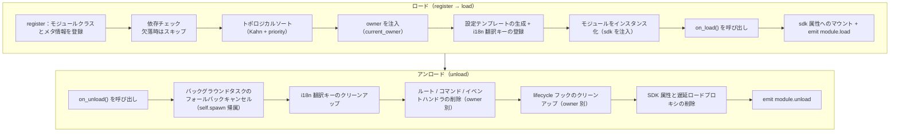

**ロード時にフレームワークがやってくれること**（自分で書くのは `on_load` だけで、残りは自動で完了します）：

| ステップ | フレームワークが自動で行うこと |
|------|-------------|
| owner 注入 | インスタンス化の間、`owner_scope` でモジュール名を囲みます——`on_load` 内で登録したコマンド/イベント/フック/バックグラウンドタスクは**自動的にこのモジュールに帰属**し、アンロード時に owner 単位でワンステップでクリーンアップされます |
| 設定テンプレート | `ConfigClass` を宣言したモジュールでは、フレームワークが `ErisPulse.<ModuleName>` 設定セクションを自動生成/自動投入します |
| i18n 翻訳キー | `I18nClass` を宣言したモジュールでは、翻訳キーが自動登録されます（アンロード時に自動登録解除） |
| 依存トポロジ | `depends` の宣言に基づいてソートし、依存されるモジュールが先にロードされることを保証します。循環依存は `RuntimeError` で拒否されます |
| SDK マウント | インスタンス化後に `sdk.<ModuleName>` にマウントされ、`sdk.MyModule.xxx` でアクセスできるようになります |

**アンロード時にフレームワークがクリーンアップしてくれるもの**（上の U1→U7 に対応）：`on_unload` の実行完了後にフォールバックでクリーンアップします——バックグラウンドタスクの強制キャンセル（`self.spawn` で作成されたもの。グレースフルな終了処理は `on_unload` 内で自前に行ってください）、i18n キー、ルート、コマンド/イベントハンドラ、lifecycle フック、最後に SDK 属性を削除します。`purge=True` を指定した場合はさらに登録スタブの削除 + `sys.modules` のクリーンアップが行われます。

> この自動クリーンアップこそが「`on_load`/`on_unload` を書くだけで、手動 unregister は不要」という安心感の根拠です——フレームワークは owner による帰属を利用して、「登録したものを登録者がクリーンアップする」仕組みをワンステップで実現しています。

## SDK オブジェクト

### コアモジュールへのアクセス

```python
from ErisPulse import sdk

# sdk オブジェクトを通じてすべてのコアモジュールにアクセス
sdk.logger.info("ログ")
sdk.storage.set("key", "value")

# モジュール固有の小さな状態（カウンタ/スイッチ/最終実行時刻）には self.state を優先使用——
# キーには自動的に module.state.<モジュール名>. プレフィックスが付き、モジュールのアンロード/リロード後も残ります：
count = self.state.get("runs", 0) + 1
self.state.set("runs", count)            # 同期（任意のコンテキスト）
await self.state.aset("runs", count)     # 非同期パス
await self.state.aget("runs", 0)
config = sdk.config.getConfig("MyModule")
```

### モジュール間の通信

```python
# 他のモジュールにアクセス
other_module = sdk.OtherModule
result = await other_module.some_method()
```

## アダプタ送信メソッドの照会

新しい標準仕様では、`__getattr__` メソッドをオーバーライドしてフォールバック送信メカニズムを実装することが求められるため、`hasattr` メソッドでメソッドの存在を確認できなくなりました。`2.3.5` から、送信メソッドを照会する機能が新たに追加されました。

### サポートされる送信メソッドの一覧表示

```python
# プラットフォームがサポートするすべての送信メソッドを一覧表示
methods = sdk.adapter.list_sends("onebot11")
# 戻り値: ["Text", "Image", "Voice", "Markdown", ...]
```

### メソッドの詳細情報の取得

```python
# 特定のメソッドの詳細情報を取得
info = sdk.adapter.send_info("onebot11", "Text")
# 戻り値:
# {
#     "name": "Text",
#     "parameters": [
#         {"name": "text", "type": "str", "default": null, "annotation": "str"}
#     ],
#     "return_type": "Awaitable[Any]",
#     "docstring": "テキストメッセージを送信..."
# }
```

## 設定管理

### 宣言型設定（推奨）

v2.5.2 以降、モジュールは `ConfigClass` で設定クラスを宣言でき、アダプタと同じ設定 Schema システムを利用できます。設定は `self.cfg` でリアルタイムに読み込まれ、変更すると即座に反映されます：

```python
from dataclasses import dataclass, field
from ErisPulse.Core.Bases import BaseModule
from ErisPulse.Core.Bases import BaseConfig

@dataclass
class MyModuleConfig(BaseConfig):
    api_key: str = field(
        default="",
        metadata={
            "description": {"i18n": "my_module.api_key", "default": "API キー"},
            "required": True,
            "secret": True,
            "ui": {"widget": "password", "group": "basic", "order": 1},
        },
    )
    timeout: int = field(
        default=30,
        metadata={
            "description": {"i18n": "my_module.timeout", "default": "タイムアウト時間（秒）"},
            "ui": {"widget": "number", "group": "advanced", "order": 2},
        },
    )

class MyModule(BaseModule):
    ConfigClass = MyModuleConfig

    def __init__(self, sdk):
        self.sdk = sdk
        self.logger = sdk.logger.get_child("MyModule")

    async def on_load(self, event):
        self.logger.info("モジュールをロードしました")

    async def on_unload(self, event):
        pass

    async def do_something(self):
        cfg = self.cfg  # リアルタイム読み込み、型安全
        api_key = cfg.api_key
        timeout = cfg.timeout
```

`BaseConfig` は汎用の設定基底クラスで、アダプタ、モジュール、外部プロジェクトなどあらゆるシーンに適用できます。設定フィールドは i18n による多言語説明をサポートしています（詳細は [i18n ドキュメント](../../advanced/i18n.md#設定フィールドの多言語化) を参照してください）。

> [!NOTE]
> モジュール（アダプタを含む）のロード、アンロード、起動・停止などのライフサイクルはフレームワークが一元管理します（`module manager` / `scope` が照会・制御 API を提供します）。`ConfigClass` はビジネスパラメータのみを担うべきであり、モジュール内部で「自分を起動すべきかどうか」を再度判定するロジックをネストさせる必要はありません。

設定 Schema システムはさらに以下もサポートしています（v2.8.0+、詳細は [アダプタ core-concepts](../adapters/core-concepts.md#metadata-規約) を参照）：

- **docstring によるフィールド説明の自動生成**：metadata `description` が宣言されていない場合、docstring の `:ivar フィールド名: 説明` や `Attributes:` セクションから自動的にフォールバック抽出します
- **ネストされた dataclass 設定**：フィールドの型がネスト dataclass の場合、schema/テンプレート/検証が再帰的に処理され、WebUI ではネストされたグループとして描画されます
- **`example` の非書き込みフィールド**：`metadata={"example": True}` のフィールドは config.toml に書き込まれず、`config.full.example` にのみ記録されます（冗長でめったに触れない高度な設定項目に適しています）。ユーザーが手動で設定すると通常どおり永続化されます

### 設定のホットアップデート（on_config_update）

モジュールとアダプタが `on_config_update(old, new)` メソッドを実装すると、**このモジュールに関連する設定が実際に変化した**際にフレームワークが自動でルーティングして呼び出します（設定イベントを自分で購読する必要はありません）。token / スイッチ / レートリミットパラメータの変更が**再起動なしで**反映されます：

```python
class MyModule(BaseModule):
    ConfigClass = MyModuleConfig

    def on_config_update(self, old_config, new_config):
        # ConfigClass を宣言している場合は型安全な設定オブジェクト（未宣言の場合は dict）；
        # 実行時の setConfig() で発火した場合、old_config は None（new のみ値を持つ）
        if old_config is None or new_config.api_key != old_config.api_key:
            self.logger.info("API key が更新されたため、クライアントを再構築します")
            self._client = build_client(new_config.api_key)
```

発火元とルーティングルール：

- **実行時の書き込み**（コードや Dashboard からの `setConfig()` 呼び出し）：設定キーのプレフィックスでルーティングをマッチング——このモジュールの設定キー（またはそのサブキー）の範囲内にある書き込みだけが発火し、その際 `old_config` は `None` になります
- **設定ファイルの編集**（ファイル監視によるツリー全体の比較で発火）：新旧の設定セクションが一致しない場合にのみ発火し、その際 `old` / `new` はそれぞれ変更前・変更後の設定オブジェクトになります
- コールバック内で送出された例外はフレームワークが捕捉して記録し、設定の書き込み自体には影響しません

使い分けの指針：

- `self.cfg` はリアルタイム読み込みです——状態の再構築が不要な単純なパラメータ（タイムアウト秒数など）は次の行のコードで既に新しい値になるため、このフックで手動同期する必要はありません
- 再構築が必要な**ステートフルなリソース**（クライアント接続、コネクションプール、タイマー）のみ、このフックで処理します

### 宣言型翻訳キー（v2.7.0+）

v2.7.0 以降、モジュールは `ConfigClass` を宣言するのと同じように、ネストクラス `I18nClass` で翻訳キーを一括宣言できます。フレームワークはロード時に宣言されたすべての翻訳キーを**自動登録**し、`i18n.register()` を手動で呼び出す必要はありません。また、登録タイミングは設定テンプレートの生成より早いため、設定説明で参照される i18n キーが確実に利用可能になります。

```python
from ErisPulse.Core.Bases import BaseConfig, BaseI18n, I18nKey

class MyModule(BaseModule):
    # 設定クラス（任意）
    @dataclass
    class ConfigClass(BaseConfig):
        welcome_msg: str = field(
            default="ようこそ",
            metadata={
                "description": {"i18n": "mymodule.welcome_msg", "default": "ウェルカムメッセージ"},
            },
        )

    # 翻訳キーコレクションクラス（任意）
    class I18nClass(BaseI18n):
        # 属性名から完全なキーパス <モジュール名>.<属性名> が自動的に組み立てられます
        welcome_msg: I18nKey = I18nKey(
            default="Welcome Message",   # 言語非依存のフォールバック
            zh_CN="ようこそメッセージ",
            zh_TW="ようこそメッセージ",
            en="Welcome Message",
            ja="ウェルカムメッセージ",
            ru="Приветственное сообщение",
        )
        hello: I18nKey = I18nKey(
            default="Hello, {name}!",
            zh_CN="こんにちは、{name}！",
            zh_TW="こんにちは、{name}！",
            en="Hello, {name}!",
            ja="こんにちは、{name}！",
            ru="Привет, {name}!",
        )
```

詳細は [i18n の推奨記法](../../advanced/i18n.md#推奨記法i18nclass-による翻訳キーの宣言v270) を参照してください。

### 手動での設定読み込み（廃止予定）

> **廃止予定**：代わりに [宣言型設定](#宣言型設定推奨) + `self.cfg` によるリアルタイム読み込みを使用してください。

```python
class MyModule(BaseModule):
    def __init__(self, sdk):
        self.sdk = sdk

    def _load_config(self):
        config = self.sdk.config.getConfig("MyModule")
        if not config:
            self.sdk.config.setConfig("MyModule", {"api_key": "", "timeout": 30})
            return {"api_key": "", "timeout": 30}
        return config
```

## ストレージシステム

### 基本的な使い方

```python
# データを保存
sdk.storage.set("user:123", {"name": "山田太郎"})

# データを取得
user = sdk.storage.get("user:123", {})

# データを削除
sdk.storage.delete("user:123")
```

### トランザクションの使い方

```python
# トランザクションを使用してデータの一貫性を確保
with sdk.storage.transaction():
    sdk.storage.set("key1", "value1")
    sdk.storage.set("key2", "value2")
    # いずれかの操作が失敗した場合、すべての変更がロールバックされます
```

## イベント処理

### イベントハンドラの登録

```python
from ErisPulse.Core.Event import command, message

# コマンドを登録
@command("info", help="情報を取得")
async def info_handler(event):
    await event.reply("これは情報です")

# メッセージハンドラを登録
@message.on_group_message()
async def group_handler(event):
    sdk.logger.info(f"グループメッセージを受信: {event.get_text()}")
```

### イベントハンドラのライフサイクル

フレームワークはイベントハンドラの登録と登録解除を自動管理するため、`on_load` 内で登録するだけです。

## 遅延ロード機構

### 動作原理

```python
# モジュールは初めてアクセスされたときにのみ初期化されます
result = await sdk.my_module.some_method()
# ↑ ここでモジュールの初期化がトリガーされます
```

### 即時ロード

即時初期化が必要なモジュール（リスナー、タイマーなど）の場合：

```python
@staticmethod
def get_load_strategy():
    return ModuleLoadStrategy(
        lazy_load=False,  # 即時ロード
        priority=100
    )
```

## エラー処理

### 例外の捕捉

```python
async def handle_event(self, event):
    try:
        # ビジネスロジック
        await self.process_event(event)
    except ValueError as e:
        self.logger.warning(f"パラメータエラー: {e}")
        await event.reply(f"パラメータエラー: {e}")
    except Exception as e:
        self.logger.error(f"処理に失敗しました: {e}")
        raise
```

### ログ記録

```python
# 異なるログレベルを使用
self.logger.debug("デバッグ情報")    # 詳細なデバッグ情報
self.logger.info("実行状態")      # 通常の実行情報
self.logger.warning("警告情報")  # 警告情報
self.logger.error("エラー情報")    # エラー情報
self.logger.critical("致命的エラー") # 致命的エラー
```


### Event 包装类详解

# Event ラッパークラス詳解

> [!NOTE]
> **L1 コア必読**——トップページの「読書パス」にある5つのコアドキュメントの1つで、モジュール開発に必須です。


ハンドラー内の `event` パラメーターが `.get_text()` / `.reply()` / `.wait_reply()` を直接呼び出せるのは、Event ラッパークラスのおかげです。本ドキュメントはその完全なメソッド一覧です——イベントハンドラーを作成する際に必要に応じて参照し、メソッドのシグネチャと動作はすべてここに記載の内容を基準としてください。

## event パラメーターへの型アノテーション追加

イベントハンドラーの `event` パラメーターは **Event ラッパークラス**（dict のサブクラス）です。`Event` の型アノテーションを追加することを**強く推奨**します（実行時はアノテーションがなくても動作しますが、アノテーションは IDE 補完と静的チェックに役立ちます）：

```python
from ErisPulse.Core.Event import Event

@message.on_private_message()
async def handler(event: Event):
    text = event.get_text()   # IDE がすべての便利メソッドを自動補完
    await event.reply(text)   # スペルミスは静的チェック時に検出できます
```

アノテーションを付けない場合、IDE は Event 上のメソッドを認識できず（`get_text()` / `reply()` / `wait_reply()` / プラットフォーム拡張メソッドのいずれも補完されず）、記憶を頼りに入力するしかありません。

> **区別に注意**：イベントハンドラーコールバックの `event` は **Event ラッパークラス**（`Event` でアノテーション）ですが、モジュールライフサイクルメソッド `on_load` / `on_unload` の `event` は通常の **dict**（`dict` でアノテーション）です。両者を混同しないでください。

## コア特性

- **辞書と完全互換**：Event は dict を継承
- **便利メソッド**：多数の便利メソッドを提供
- **ドットアクセス**：ドットによるイベントフィールドへのアクセスをサポート
- **後方互換**：すべてのメソッドは任意

## コアフィールドメソッド

```python
from ErisPulse.Core.Event import command, Event

@command("info")
async def info_command(event: Event):
    event_id = event.get_id()
    platform = event.get_platform()
    time = event.get_time()
    print(f"ID: {event_id}, プラットフォーム: {platform}, 時刻: {time}")
```

## メッセージイベントメソッド

```python
from ErisPulse.Core.Event import message, Event

@message.on_private_message()
async def private_handler(event: Event):
    text = event.get_text()
    user_id = event.get_user_id()
    nickname = event.get_user_nickname()
    await event.reply(f"こんにちは、{nickname}さん！")
```

## メッセージタイプ判定

```python
from ErisPulse.Core.Event import message, Event

@message.on_group_message()
async def group_handler(event: Event):
    is_private = event.is_private_message()
    is_group = event.is_group_message()
    is_at = event.is_at_message()
    await event.reply(f"タイプ: {'個人チャット' if is_private else 'グループチャット'}")
```

## 返信機能

```python
from ErisPulse.Core.Event import command, Event

@command("ask")
async def ask_command(event: Event):
    await event.reply("あなたの名前を入力してください:")
    reply = await event.wait_reply(timeout=30)
    if reply:
        name = reply.get_text()
        await event.reply(f"こんにちは、{name}さん！")

@command("price")
async def price_command(event: Event):
    await event.reply("金額を入力してください（例：5元）:")
    # 返信は正規表現に一致する必要があり、一致しない場合はタイムアウトまで待ち続けます
    reply = await event.wait_reply(timeout=30, regex=r"\d+\s*元")
    if reply:
        await event.reply(f"金額を受け付けました：{reply.get_text()}")
```

#### reply 以外：send_chain

`reply()` では対応できないシナリオ——プラットフォーム固有の修飾メソッド（Expire/Board など）、連続する複数の修飾、
内容パラメーターを持たないアクション型の送信——には `event.send_chain` でターゲットと送信アカウントが設定済みの送信チェーンを取得し、
自由に修飾を追加してから送信してください：

```python
await event.send_chain.At(event.user_id).Text("内容")     # チェーン修飾 + 送信
```

修飾メソッドの一覧は [送信メソッド仕様](../../standards/send-method-spec.md) を参照してください。

## インタラクティブセッションの応用

> [!NOTE]
> このセクションの機能には ErisPulse **2.8.0+** が必要です。

```python
# セッションのタイマーリマインダー：5分間返信がない場合はリマインドし、ユーザーの返信後に自動キャンセル
reminder = event.remind(300, "まだいますか？会話を終えたい場合は「終了」と返信してください")
reminder.cancel()  # 手動でのキャンセルも可能

# タイムアウトエスカレーション：指定時刻に必ず発火（返信ではキャンセルされない）、長時間未処理の場合にオーナーへ通知するなど
event.escalate(1800, lambda e: notify_master("チケットタイムアウト"))

# マルチパス待機：「同意」と「拒否」を同時に待ち、先着順で取得
which, reply = await event.select(
    event.expect(pattern="同意*", user="10001"),
    event.expect(pattern="拒否*", user="10002"),
    timeout=60,
)
if which is None:
    await event.reply("タイムアウト：承認を受信しませんでした")

# セッションレベル待機：同じグループの誰の返信でもマッチ可能（グループ協働）
reply = await event.wait_reply(session=True, prompt="どなたか回答をお願いします！")

# セッション受信箱：現在のセッションの直近20件のメッセージ（ボットを含む、AI コンテキスト / 重複防止の基盤）
messages = await event.history(20)

# メッセージトランザクション：例外発生時にトランザクション内で送信済みのメッセージを自動取り消し
async with event.message_tx():
    await event.reply("処理中です。お待ちください...")
    result = await do_something()
    await event.reply(f"完了：{result}")
```

## コマンド情報の取得

```python
from ErisPulse.Core.Event import command, Event

@command("cmdinfo")
async def cmdinfo_command(event: Event):
    cmd_name = event.get_command_name()
    cmd_args = event.get_command_args()
    await event.reply(f"コマンド: {cmd_name}, 引数: {cmd_args}")
```

## 通知イベントメソッド

```python
from ErisPulse.Core.Event import notice, Event

@notice.on_friend_add()
async def friend_add_handler(event: Event):
    await event.reply("友達登録ありがとうございます！")
```

## メソッド早見表

### コアメソッド

#### イベント基本情報
- `get_id()` - イベントID を取得
- `get_time()` - イベントのタイムスタンプを取得（Unix 秒単位）
- `get_type()` - イベントタイプを取得（message/notice/request/meta）
- `get_detail_type()` - イベントの詳細タイプを取得（private/group/friend など）
- `get_platform()` - プラットフォーム名を取得

#### ボット情報
- `get_self_platform()` - ボットのプラットフォーム名を取得
- `get_self_user_id()` - ボットのユーザーID を取得
- `get_self_account_id()` - ボットのアカウントID を取得（マルチ Bot モード）
- `get_self_info()` - ボットの完全情報辞書を取得

#### セッション識別子
- `get_target_id()` - 統一ターゲット ID を取得（グループチャットは `group_id`、チャンネルは `channel_id`、個人チャットは `user_id` を返し、group → channel → guild → thread → user の順で最初の非空値を採用）
- `get_session_id()` - セッションの一意識別子を取得、形式は `{platform}:{detail_type}:{target_id}`

### メッセージイベントメソッド

#### メッセージ内容
- `get_message()` - メッセージセグメント配列を取得（OneBot12 形式）
- `get_alt_message()` - メッセージの代替テキストを取得
- `get_text()` - プレーンテキスト内容を取得（`get_alt_message()` のエイリアス）
- `get_message_text()` - プレーンテキスト内容を取得（`get_alt_message()` のエイリアス）

#### 送信者情報
- `get_user_id()` - 送信者のユーザーID を取得
- `get_user_nickname()` - 送信者のニックネームを取得
- `get_sender()` - 送信者の完全情報辞書を取得

#### グループ/チャンネル情報
- `get_group_id()` - グループID を取得（グループチャットメッセージ）
- `get_channel_id()` - チャンネルID を取得（チャンネルメッセージ）
- `get_guild_id()` - サーバーID を取得（サーバーメッセージ）
- `get_thread_id()` - トピック/サブチャンネルID を取得（トピックメッセージ）

#### @メッセージ関連
- `has_mention()` - @ボットを含むかどうか
- `get_mentions()` - @されたすべてのユーザーID のリストを取得

### メッセージタイプ判定

#### 基本判定
- `is_message()` - メッセージイベントかどうか
- `is_private_message()` - 個人チャットメッセージかどうか
- `is_group_message()` - グループチャットメッセージかどうか
- `is_at_message()` - @メッセージかどうか（`has_mention()` のエイリアス）

### 通知イベントメソッド

#### 通知操作者
- `get_operator_id()` - 操作者の ID を取得
- `get_operator_nickname()` - 操作者のニックネームを取得

#### 通知タイプ判定
- `is_notice()` - 通知イベントかどうか
- `is_group_member_increase()` - グループメンバー増加イベント
- `is_group_member_decrease()` - グループメンバー減少イベント
- `is_friend_add()` - 友達追加イベント（`detail_type == "friend_increase"` に一致）
- `is_friend_delete()` - 友達削除イベント（`detail_type == "friend_decrease"` に一致）

### リクエストイベントメソッド

#### リクエスト情報
- `get_comment()` - リクエストの添付メッセージを取得

#### リクエストタイプ判定
- `is_request()` - リクエストイベントかどうか
- `is_friend_request()` - 友達リクエストかどうか
- `is_group_request()` - グループリクエストかどうか

#### リクエスト承認（approve / reject）

リクエストハンドラーを登録し、リクエストに対する判断を行います：

```python
from ErisPulse.Core.Event import request

@request.on_friend_request()
async def handle_friend(event):
    request_id = event.get_request_id()   # リクエスト識別子（欠落時は approve/reject が ValueError を送出）
    if event.get_comment() == "合言葉":
        result = await event.approve()    # 承認（備考付き可：approve(comment="ようこそ")）
    else:
        result = await event.reject()     # 拒否
    if result.get("status") != "ok":
        # 標準レスポンス形式、失敗時は message で理由が説明されます（例：34001 リクエストは期限切れ）
        pass

@request.on_group_request()               # グループ申請 / グループ招待
async def handle_group(event):
    await event.approve()
```

> 承認アクションはアダプターの `Request` DSL を通じて実行されます。戻り値、エラーコード、アダプター実装要件については
> [リクエスト操作仕様](../../standards/request-action-spec.md) を参照してください。汎用レジストラー
> `request.on_request()`（タイプを区別しない）も同様に利用できます。

#### チェーン制御（done / is_processed / is_stopped）

- `done(claim=True)` - 取り込み（デフォルト）または後続の低優先度ハンドラーのブロックのみ
- `is_processed()` - 現在のイベントが取り込み済みかどうか
- `is_stopped()` - 現在のイベント処理チェーンがブロックされているかどうか

取り込みとブロックの完全なセマンティクス（優先度の相互作用、コマンドの取り込み）については、
[イベント処理入門 · チェーン制御：取り込みとブロック](../../getting-started/event-handling.md#チェーン制御取り込みとブロック) を参照してください。

### 返信機能

#### 基本返信
- `reply(content, method="Text", at_sender=False, quote=False, at_users=None, reply_to=None, at_all=False, via=None, **kwargs)` - 汎用返信メソッド
  - `content`: 送信内容（テキスト、URL など）
  - `method`: 送信メソッド、デフォルトは "Text"、"Image"/"Voice"/"Video"/"File" などを選択可
  - `at_sender`: 送信者をメンションするかどうか（user_id を自動抽出）
  - `quote`: 現在のメッセージを引用返信するかどうか（message_id を自動抽出）
  - `at_users`: メンションするユーザーのリスト、例：`["user1", "user2"]`
  - `reply_to`: 返信対象のメッセージ ID を手動指定
  - `at_all`: 全メンバーをメンションするかどうか
  - `**kwargs`: 追加パラメーター（例：Mention メソッドの user_id）

- `reply_ob12(message)` - OneBot12 メッセージセグメントを使用して返信
  - `message`: OneBot12 メッセージセグメントのリストまたは辞書、MessageBuilder と組み合わせて構築可能

#### プラットフォーム機能照会
- `supports(method)` - 現在のプラットフォームが特定の送信メソッド（例：`"Image"`、`"Voice"`）をサポートするか確認、`bool` を返します
- `available_methods()` - 現在のプラットフォームで利用可能なすべての送信メソッドを一覧表示、メソッド名のリストを返します

#### 転送機能

> **注意**：転送機能はアダプターの Send DSL を通じて実装する必要があり、Event ラッパークラス自体は直接的な転送メソッドを提供しません。

```python
# メッセージをグループへ転送
adapter = sdk.adapter.get(event.get_platform())
target_id = event.get_group_id()  # または他のグループIDを指定
await adapter.Send.To("group", target_id).Text(event.get_text())
```

> **マルチアカウントデプロイ**：イベント処理チェーン内での送信は**アカウントの明示的な指定が不要**です——フレームワークはイベントディスパッチのエントリポイントで、イベントをトリガーしたアカウント識別子を呼び出しコンテキストに注入します。`Send` / `Api` / `Request` チェーンで明示的に指定されていない場合、自動的にトリガーイベントのアカウントにバインドされます（明示的な `Using()` が常に優先。タイマーなどのイベントコンテキストがないシナリオではデフォルトアカウントを使用します）。つまり、上の例の転送は「このイベントを受信したアカウント」から送信され、追加のコードは不要です。

#### クロスアカウント重複受信

マルチアカウントが同じグループに在籍している場合、同一の物理メッセージが複数のアカウント経由で1回ずつ受信されることがあります。フレームワークは `ErisPulse.framework.cross_account_policy` に従って処理します（デフォルトは `off` で関連付けなし）：

- `mark`：後続のコピーは通常どおりディスパッチされますが、イベントのトップレベルに `multi_receipt` フィールドが注入されます（`{"event_id": 最初に受信したイベントのid, "self_id": 最初に受信したアカウント}`）——モジュールはこのフィールドを読み取り、応答をスキップするかどうかを自ら判断します
- `drop`：コピーはディスパッチのエントリポイントで直接破棄され、モジュールは感知しません

### 返信待機機能

- `wait_reply(prompt=None, timeout=60.0, callback=None, validator=None, method="Text", pattern=None, regex=None)` - ユーザーの返信を待機
  - `prompt`: プロンプトメッセージ。指定した場合はユーザーに送信されます
  - `timeout`: 待機タイムアウト時間（秒）、デフォルトは60秒
  - `callback`: コールバック関数。返信を受信した際に実行されます
  - `validator`: 検証関数。返信が有効かどうかの検証に使用します
  - `method`: プロンプトメッセージの送信メソッド、デフォルトは "Text"
  - `pattern`: glob ワイルドカード（`*` / `?` / `[seq]`）。返信テキストは一致する必要があり、一致しない場合は待機を続けます
  - `regex`: 正規表現。返信テキストは一致する必要があります（`pattern` と `regex` はどちらか一方）。一致しない場合は待機を続けます
  - ユーザーの返信である Event オブジェクトを返し、タイムアウト時は None を返します

#### インタラクションメソッド

- `confirm(prompt=None, timeout=60.0, yes_words=None, no_words=None, method="Text", hint=False)` - 確認対話
  - `True`（確認）/ `False`（否定）/ `None`（タイムアウト）を返します
  - 中国語・英語の確認語の自動認識を内蔵し、語彙セットのカスタマイズも可能
  - `method`: 送信メソッド、デフォルトは "Text"；"Image"/"Markdown" などの非テキスト方式でのプロンプト送信をサポート
  - `hint`: プロンプトの末尾に確認語ヒント（例：「（はい/いいえ）」）を自動追加するかどうか、デフォルトは False

- `choose(prompt, options, timeout=60.0, method="Text", options_format="auto", merge_prompt=False, placeholder="{options}")` - 選択メニュー
  - `options`: 選択肢テキストのリスト
  - 選択肢のインデックス（0 ベース）を返し、タイムアウト時は `None` を返します
  - `method`: 送信メソッド、デフォルトは "Text"；テキスト系メソッド（Text/Markdown/md/Html/h5）はデフォルトで選択肢を末尾にマージします
  - `options_format`: 選択肢の形式（デフォルト： "auto"、method に応じて内蔵スタイルを自動選択）
    - `"auto"`：Markdown→番号なしリスト（`- 1.選択肢`）、Html→番号付きリスト（`<ol>`）、その他→プレーンテキストリスト
    - `"list"`：1行に1つ、例：``1. 選択肢A\n2. 選択肢B``
    - `"inline"`：1行で表示、例：``1.A | 2.B``
    - `"md"`：Markdown 番号なしリスト
    - `"html"`：Html 番号付きリスト
    - `callable`：カスタム関数。``list[str]`` を受け取り ``str`` を返します
  - `merge_prompt`: 1つのメッセージに強制マージして送信するかどうか、デフォルトは False
    - `False`（デフォルト）：テキスト系メソッドは自動マージ；非テキストメソッドは prompt を先に送信し、その後 Text で選択肢を送信します
    - `True`：method が何であれ 1つのメッセージにマージし、ユーザーが指定した method で送信します
  - `placeholder`: 選択肢を挿入するプレースホルダー、デフォルトは `{options}`；prompt 内でこのマーカーが現れる位置が選択肢テキストに置き換えられ、空文字列に設定した場合は常に末尾に追加されます

- `collect(fields, timeout_per_field=60.0)` - フォーム収集
  - `fields`: フィールドのリスト。各項目は `key`、`prompt`、オプションの `validator`、オプションの `method` を含みます
  - `{key: value}` の辞書を返し、いずれかのフィールドがタイムアウトした場合は `None` を返します
  - 各 field は `method` キーで送信メソッドを指定できます。例えば画像を収集する場合は `{"key": "avatar", "prompt": "アイコンを送信してください", "method": "Image"}` を使用します
  - 各 field はオプションで `options` キー（リスト）をサポートし、指定するとそのフィールドは選択問題になります（choose ロジックを自動呼び出し）
  - 各 field はオプションで `options_format`、`merge_prompt`、`placeholder` キーをサポートし、選択肢の形式、メッセージマージ動作、プレースホルダーを制御します

- `wait_for(event_type="message", condition=None, timeout=60.0)` - 任意のイベントを待機
  - `condition`: フィルター関数。`True` を返した場合にマッチします
  - マッチした Event オブジェクトを返し、タイムアウト時は `None` を返します

- `conversation(timeout=60.0)` - マルチターン対話コンテキストを作成
  - `Conversation` オブジェクトを返し、`say()`/`wait()`/`confirm()`/`choose()`/`collect()`/`stop()` をサポートします
  - `is_active` プロパティは対話がアクティブかどうかを示します

#### インタラクションメソッドの例

**confirm() - 確認対話：**

```python
from ErisPulse.Core.Event import Event
@command("delete", help="データを削除")
async def delete_handler(event: Event):
    if await event.confirm("すべてのデータを削除してもよろしいですか？"):
        sdk.storage.delete("all_data")
        await event.reply("データを削除しました")
    else:
        await event.reply("キャンセルしました")
```

**confirm() - ヒント付き：**

```python
# hint=True を指定するとプロンプトの末尾に「（はい/いいえ）」が追加されます
if await event.confirm("続行しますか？", hint=True):
    await event.reply("続行しました")
# ユーザーに表示される内容：続行しますか？（はい/いいえ）
```

**choose() - 選択メニュー：**

```python
from ErisPulse.Core.Event import Event
@command("color", help="色を選択")
async def color_handler(event: Event):
    choice = await event.choose("色を選択してください：", ["赤", "緑", "青"])
    if choice is not None:
        colors = ["赤", "緑", "青"]
        await event.reply(f"選択した色：{colors[choice]}")
```

**choose() - 選択肢のフォーマットとメッセージマージ：**

```python
# inline 形式：選択肢を同じ行に表示
choice = await event.choose("選択してください：", ["A", "B", "C"], options_format="inline")
# 出力：1.A | 2.B | 3.C

# カスタム形式
choice = await event.choose("選択してください：", ["猫", "犬"],
    options_format=lambda opts: " / ".join(opts))
# 出力：猫 / 犬

# options_format="auto"（デフォルト）：method に応じて内蔵スタイルを自動選択
# Markdown → 番号なしリスト
choice = await event.choose(
    "## 選択してください", ["猫", "犬"],
    method="Markdown",  # auto は自動的に md リストと認識
)
# 出力：
# ## 選択してください
# - 1. 猫
# - 2. 犬

# Html → 番号付きリスト
choice = await event.choose(
    "<h2>選択してください</h2>", ["猫", "犬"],
    method="Html", merge_prompt=True,  # auto は自動的に html リストと認識
)
# 出力：
# <h2>選択してください</h2>
# <ol><li>1. 猫</li><li>2. 犬</li></ol>

# マージモード + プレースホルダー
choice = await event.choose(
    "## 選択してください\n{options}\n番号で返信してください",
    ["猫", "犬"],
    method="Markdown", merge_prompt=True,
)

# カスタムプレースホルダー
choice = await event.choose(
    "選択してください: [choices]",
    ["猫", "犬"],
    placeholder="[choices]",
)
```

**collect() - フォーム収集：**

```python
from ErisPulse.Core.Event import Event
@command("register", help="登録")
async def register_handler(event: Event):
    data = await event.collect([
        {"key": "name", "prompt": "名前を入力してください："},
        {"key": "age", "prompt": "年齢を入力してください：",
         "validator": lambda e: e.get_text().isdigit()},
    ])
    if data:
        await event.reply(f"登録が完了しました！{data['name']}さん、{data['age']}歳")
```

**Text 以外のメソッドでの reply：**

```python
await event.reply("http://example.com/img.jpg", method="Image")
await event.reply("http://example.com/audio.mp3", method="Voice")

from ErisPulse.Core.Event import MessageBuilder
segments = MessageBuilder.text("この画像を見てください：").image("http://example.com/img.jpg").build()
await event.reply_ob12(segments)
```

> Conversation マルチターン対話の完全な使い方は [Conversation マルチターン対話](../../advanced/conversation.md) を参照してください。

### コマンド情報

#### コマンド基本
- `get_command_name()` - コマンド名を取得
- `get_command_args()` - コマンド引数のリストを取得
- `get_command_raw()` - コマンドの元テキストを取得
- `get_command_info()` - 完全なコマンド情報辞書を取得
- `is_command()` - コマンドかどうか

### 生データ

- `get_raw()` - プラットフォームの元イベントデータを取得
- `get_raw_type()` - プラットフォームの元イベントタイプを取得

### プラットフォーム拡張メソッド

アダプターは Event ラッパークラスにプラットフォーム固有のメソッドを登録できます。メソッドは対応するプラットフォームの Event インスタンスでのみ使用可能で、他のプラットフォームからアクセスした場合は `AttributeError` が送出されます。

プラットフォームメソッドは `Event.__getattribute__` を通じて内蔵メソッドより優先して適用されるため、`confirm`、`choose`、`collect`、`wait_reply` などの内蔵インタラクションメソッドをオーバーライドして、プラットフォーム独自の実装（ボタン、カードなど）を提供できます。内蔵実装は `_builtin_*` 関数としてエクスポートされ、オーバーライド側から呼び出せます。

```python
# メールイベント - メールメソッドのみ
event = Event({"platform": "email", "email_raw": {"subject": "Hello"}})
event.get_subject()      # ✅ "Hello" を返す
event.get_chat_type()    # ❌ AttributeError

# Telegram イベント - Telegram メソッドのみ
event = Event({"platform": "telegram", "telegram_raw": {"chat": {"type": "private"}}})
event.get_chat_type()    # ✅ "private" を返す
event.get_subject()      # ❌ AttributeError

# 内蔵メソッドは常に利用可能
event.get_text()         # ✅ どのプラットフォームでも
event.reply("hi")        # ✅ どのプラットフォームでも
```

### 登録済みメソッドの照会

```python
from ErisPulse.Core.Event import get_platform_event_methods

methods = get_platform_event_methods("email")
# ["get_subject", "get_from", ...]
```

### `hasattr` と `dir` のサポート

```python
hasattr(event, "get_subject")   # platform="email" の場合のみ True を返す
"get_subject" in dir(event)     # 同上
```

### クロスプラットフォーム拡張（ワイルドカード）

`register_event_method` と `register_event_mixin` はプラットフォーム名として `"*"` を渡すことをサポートしており、登録されたメソッドは**すべてのプラットフォーム**の Event インスタンスで使用可能になります。AI 対話、コンテキスト管理など、クロスプラットフォームでの再利用が必要な機能に適しています。

```python
from ErisPulse.Core.Event.wrapper import register_event_method

@register_event_method("*")
async def ai_chat(self, prompt: str):
    # self は Event インスタンスで、イベントデータと内蔵メソッドにアクセス可能
    await self.reply(f"AI: {prompt}")
```

登録後、どのプラットフォームのイベントハンドラーからでも `event.ai_chat(...)` を呼び出せます。

メソッド解決の優先順位（高い順）：プラットフォーム固有メソッド → ワイルドカードメソッド → 内蔵メソッド → 辞書キーアクセス。

> アダプター開発者が拡張メソッドを登録する方法については、[イベントシステム API - クロスプラットフォーム拡張](../../api-reference/event-system.md#クロスプラットフォーム拡張ワイルドカード) を参照してください。


### 模块开发最佳实践

# モジュール開発のベストプラクティス

> [!TIP]
> **この記事を読むタイミング**：最初のモジュールを書いた後に読むことを推奨します（エンジニアリングのベストプラクティス）。必要なければ飛ばしても、他の機能の使用に影響はありません。


ここでは、モジュール開発における工程的な書き方の約束事項をまとめます：非同期処理はイベントループをブロックしないこと、設定は宣言型にすること、他人のリソースを管理する場合はアンロード時に解放すること——これらを守れば、メモリリーク、バックグラウンドタスクの残留、ホットリロードの失敗といった、モジュール開発で最もよくある問題を回避できます。

## モジュール設計

### 1. 単一責任の原則

各モジュールは1つのコア機能だけを担当するべきです：

```python
# 良い設計：各モジュールは1つの機能だけを担当
class WeatherModule(BaseModule):
    """天気情報取得モジュール"""
    pass

class NewsModule(BaseModule):
    """ニュース情報取得モジュール"""
    pass

# 悪い設計：1つのモジュールが複数の無関係な機能を担当
class UtilityModule(BaseModule):
    """天気、ニュース、ジョークなど複数の機能を含む"""
    pass
```

### 2. モジュール命名規則

```toml
[project]
name = "ErisPulse-ModuleName"  # ErisPulse- で始まる名前
```

### 3. 明確な設定管理

宣言型の設定（`ConfigClass` + `BaseConfig`）を使用することを推奨します。これにより、型安全性、自動テンプレート生成、WebUIフォームサポートなどの機能が得られます：

```python
from dataclasses import dataclass, field
from ErisPulse.Core.Bases import BaseConfig

@dataclass
class MyModuleConfig(BaseConfig):
    api_url: str = field(default="https://api.example.com", metadata={
        "description": {"i18n": "my_module.api_url", "default": "API アドレス"},
    })
    timeout: int = field(default=30, metadata={
        "description": {"i18n": "my_module.timeout", "default": "タイムアウト時間（秒）"},
    })
    cache_ttl: int = field(default=3600, metadata={
        "description": {"i18n": "my_module.cache_ttl", "default": "キャッシュの有効時間（秒）"},
    })

class MyModule(BaseModule):
    ConfigClass = MyModuleConfig

    async def do_something(self):
        cfg = self.cfg  # 型安全、リアルタイム読み取り
        await self._fetch(cfg.api_url, timeout=cfg.timeout)
```

また、手動で設定ストレージを読み書きする方法も引き続き使用できます（[モジュールのコアコンセプト](core-concepts.md#設定管理)を参照）。

### 宣言型の翻訳キー（v2.7.0+）

モジュールは `I18nClass` を使って翻訳キーを一括で宣言し、フレームワークが自動的に i18n システムに登録します。`i18n.register()` を手動で呼び出す必要はありません。

```python
from ErisPulse.Core.Bases import BaseI18n, I18nKey

class MyModule(BaseModule):
    class I18nClass(BaseI18n):
        # プレースホルダー付きの業務翻訳キー
        welcome: I18nKey = I18nKey(
            default="Welcome, {name}!",
            zh_CN="ようこそ、{name}！",
            zh_TW="ようこそ、{name}！",
            en="Welcome, {name}!",
            ja="ようこそ、{name}！",
            ru="Добро пожаловать, {name}!",
        )
        # 設定項目の説明の翻訳
        api_url: I18nKey = I18nKey(
            default="API URL",
            zh_CN="API アドレス",
            zh_TW="API 位址",
            en="API URL",
            ja="API URL",
            ru="API URL",
        )
```

詳細な使い方は [i18n ドキュメント](../../advanced/i18n.md#推奨書き方-i18nclass-を使って翻訳キーを宣言する-v270) を参照してください。

## 非同期プログラミング

### 1. 非同期ライブラリの使用

```python
# 推奨：SDK 内部の HTTP クライアント（非同期、自動ログと統計）
from ErisPulse.Core import client

class MyModule(BaseModule):
    async def fetch_data(self, url):
        resp = await client.get(url)
        return await resp.json()

# sdk.client でも同じ効果
from ErisPulse import sdk

class MyModule(BaseModule):
    async def fetch_data(self, url):
        resp = await sdk.client.get(url)
        return await resp.json()

# aiohttp を直接インポートしないこと（フレームワークの統一管理が難しくなる）
import aiohttp

class MyModule(BaseModule):
    async def fetch_data(self, url):
        async with aiohttp.ClientSession() as session:
            async with session.get(url) as response:
                return await response.json()

# requests を使用しないこと（同期的で、イベントループをブロックする）
import requests

class MyModule(BaseModule):
    def fetch_data(self, url):
        return requests.get(url).json()  # イベントループをブロックする
```

### 2. 正しい非同期操作

```python
from ErisPulse.Core.Event import Event  # event: Event 注釈は強く推奨；カスタムメソッドの補完は epsdk types を参照

async def handle_command(self, event: Event):
    # 結果を待つ必要がある長時間処理：直接 await（ライフサイクルが明確）
    result = await self._long_operation()

async def on_load(self, event: dict):
    # バックグラウンドタスク（ポーリング/タイマー/fire-and-forget）：self.spawn() を使用
    # モジュールのアンロード時にフレームワークが on_unload 後にバックグラウンドタスクをキャンセルし、self への参照を保持しない
    self.spawn(self._poll())
```

> [!NOTE]
> バックグラウンドタスクは `self.spawn()` を推奨します（ErisPulse **2.8.0+**）。**2.8.3 以降**では、裸の `asyncio.create_task` も自動的にモジュールに所属します（Task Factory が自動的に登録され、アンロード時にバックグラウンドタスクをキャンセルし、`self` の参照を保持しません）；`self.spawn()` は非メインループスレッドからメインループにスケジュールするサポートや、明示的な `owner=` 指定が可能なため、引き続き推奨されます。**2.8.3 以前**では、裸のタスクは所属せず、`self` の参照を保持してモジュールインスタンスが回収されず（ホットリロードでリーク）、`self.spawn()` を使用する必要があります。詳細は [ライフサイクル管理](../../advanced/lifecycle.md#バックグラウンドタスクの所属と自動キャンセル) を参照してください。

### 3. リソース管理

```python
async def on_load(self, event):
    # SDK クライアントは接続プールを自動管理するため、session の手動作成は不要
    pass
    
async def on_unload(self, event):
    # 自前でクライアントを作成する場合は、リソースの解放を忘れずに
    pass
```

## イベント処理

### 1. Event パッケージクラスの使用

```python
from ErisPulse.Core.Event import Event
# Event パッケージクラスの便利なメソッドを使用
@command("info")
async def info_command(event: Event):
    user_id = event.get_user_id()
    nickname = event.get_user_nickname()
    await event.reply(f"こんにちは、{nickname}！")

# ダイレクトに辞書をアクセスしないこと
@command("info")
async def info_command(event: Event):
    user_id = event["user_id"]  # 明確さに欠け、間違いやすい
```

### 2. 懒惰なロード（Lazy Load）の適切な使用

```python
# 低頻度コマンドモジュール：activate_on トリガーを宣言し、最初の一致するコマンドが到着した時点で自動的にアクティブ化（ロードを遅らせる）
class CommandModule(BaseModule):
    @staticmethod
    def get_load_strategy():
        return ModuleLoadStrategy(lazy_load=True, activate_on=[
            {"command": {"name": "dice", "help": "サイコロを振る", "aliases": ["d"]}},
        ])

# 低頻度リスナー・モジュール：イベントトリガーを宣言し、イベントが到着した時点で自動的にアクティブ化
class ListenerModule(BaseModule):
    @staticmethod
    def get_load_strategy():
        return ModuleLoadStrategy(lazy_load=True, activate_on=[
            {"notice": "group_member_increase"},
        ])

# 高頻度（メッセージごとに処理する）または起動時に即座に準備が必要なモジュール：即時ロード
class HotListenerModule(BaseModule):
    @staticmethod
    def get_load_strategy():
        return ModuleLoadStrategy(lazy_load=False)

# ユーティリティ・モジュールは lazy load が適しています
class UtilityModule(BaseModule):
    @staticmethod
    def get_load_strategy():
        return ModuleLoadStrategy(lazy_load=True)
```

> `activate_on` の完全な構文（イベントの3形式 / コマンドの簡略化と dict 声明 / help のフォールバックチェーン）は [Lazy Load モジュールシステム](../../advanced/lazy-loading.md#イベント駆動のlazy-activateactivate_on) を参照してください。

### 3. イベントハンドラの登録

```python
from ErisPulse.Core.Event import Event
async def on_load(self, event):
    # on_load でイベントハンドラを登録
    @command("hello")
    async def hello_handler(event: Event):
        await event.reply("こんにちは！")
    
    @message.on_group_message()
    async def group_handler(event: Event):
        self.logger.info("グループメッセージを受信しました")
    
    # 手動で登録解除は不要、フレームワークが自動的に処理します
```

## ユーティリティ・モジュール：他人のリソースを管理するときはアンロード通知を受け止める

**いつ必要になるか**：あなたのモジュールが他のモジュールのリソース（タイマー、サブスクライバー、接続、キャッシュエントリなど）を管理している場合。これらのリファレンスが、相手のモジュールがアンロードされた後も削除されない場合、相手のインスタンスは永遠に回収されません——これはユーティリティ・モジュールで最もよくあるメモリリークの原因です。

```python
from ErisPulse.Core.Bases import BaseModule
from ErisPulse.runtime import off_cleanup, on_cleanup

class MyToolModule(BaseModule):
    def __init__(self):
        self._entries = {}  # {モジュール名: 管理するもの}

    def register(self, entry):
        owner = on_cleanup(self._drop)   # ① 登録時にクリーンアップチェーンに登録し、呼び出し元を自動的に識別
        self._entries.setdefault(owner, []).append(entry)

    def _drop(self, owner: str):
        self._entries.pop(owner, None)   # ② 相手がアンロードされたときにフレームワークが自動的に呼び出す：そのリソースを破棄

    async def on_unload(self, event):
        off_cleanup(self._drop)          # ③ 自分がアンロードされる前にハンドラを解除
```

これで、フレームワークが保証します：

- 相手のモジュールが**アンロード / 禁用**（またはアダプターが閉じる）されたときに、`_drop("相手のモジュール名")` は必ず呼び出されます
- **呼び出し元の識別は自動的**：相手が `on_load` で `sdk.MyToolModule.register(...)` を直接呼び出すか、`sdk.module.call("MyToolModule", "register", ...)` を経由して呼び出すかに関わらず、正しく識別されます
- 時間の管理は不要——ハンドラはフレームワークのクリーンアップチェーン内で呼び出され、リーク診断よりも早く、誤報が発生しません

接続しない場合の結果：相手が `purge` で完全にアンロードされたときにインスタンスが回収されない（リーク診断で「回収不可」と表示される）；もし相手自身が `on_unload` で自分に登録を解除しない場合、リークは永久的になります。

**他人のリソースを管理しない通常のモジュールは、この点を気にする必要はありません**——フレームワークが管理するリソース（コマンド / ハンドラ / ルーティング / バックグラウンドタスクなど）のアンロード時のクリーンアップは自動的です。

> 触発タイミング、呼び出し元識別ルール、タイムアウトとフォールトトレランスなどの詳細は [所有権システム・ユーティリティ・モジュールガイド](../../advanced/ownership.md#ユーティリティ・モジュールガイド他人のモジュールのハンドルを管理する) を参照してください。

## エラー処理

### 1. エラーの分類処理

```python
from ErisPulse.Core.Event import Event
from ErisPulse.Core.Bases.errors import ClientError

async def handle_event(self, event: Event):
    try:
        result = await self._process(event)
    except ValueError as e:
        # 予期された業務エラー
        self.logger.warning(f"業務警告: {e}")
        await event.reply(f"パラメータエラー: {e}")
    except ClientError as e:
        # ネットワークエラー（sdk.client の下層 aiohttp エラーは自動的に変換）
        self.logger.error(f"ネットワークエラー {e.method} {e.url}: {e}")
        await event.reply("ネットワークリクエストに失敗しました。後で再度お試しください。")
    except Exception as e:
        # 予期しないエラー
        self.logger.error(f"不明なエラー: {e}", exc_info=True)
        await event.reply("処理に失敗しました。管理者にお問い合わせください。")
        raise
```

### 2. タイムアウト処理

```python
# 推奨：SDK 内部のクライアントを使用（タイムアウトとリトライが自動で付与）
from ErisPulse.Core import client
from ErisPulse.Core.Bases.errors import ClientTimeoutError

async def fetch_with_timeout(self, url, timeout=30):
    try:
        resp = await client.get(url, timeout=timeout)
        return await resp.json()
    except ClientTimeoutError:
        self.logger.warning(f"リクエストがタイムアウトしました: {url}")
        raise
```

## ストレージ・システム

### 1. トランザクションの使用

```python
# トランザクションを使用してデータの一貫性を確保
async def update_user(self, user_id, data):
    with self.sdk.storage.transaction():
        self.sdk.storage.set(f"user:{user_id}:profile", data["profile"])
        self.sdk.storage.set(f"user:{user_id}:settings", data["settings"])

# ❌ トランザクションを使わないとデータの一貫性が保てない
async def update_user(self, user_id, data):
    self.sdk.storage.set(f"user:{user_id}:profile", data["profile"])
    # ここでエラーが発生すると、上記の設定はロールバックできない
    self.sdk.storage.set(f"user:{user_id}:settings", data["settings"])
```

### 2. バッチ操作

```python
# バッチ操作を使用してパフォーマンスを向上
def cache_multiple_items(self, items):
    self.sdk.storage.set_multi({
        f"item:{k}": v for k, v in items.items()
    })

# ❌ 複数回の呼び出しは効率が悪い
def cache_multiple_items(self, items):
    for k, v in items.items():
        self.sdk.storage.set(f"item:{k}", v)
```

## ログ記録

### 1. ログレベルの適切な使用

```python
# DEBUG: 詳細なデバッグ情報（開発時のみ）
self.logger.debug(f"入力パラメータ: {params}")

# INFO: 正常な実行情報
self.logger.info("モジュールがロードされました")
self.logger.info(f"リクエストを処理しました: {request_id}")

# WARNING: 警告情報、主な機能に影響しない
self.logger.warning(f"設定項目 {key} が設定されていません。デフォルト値を使用します。")
self.logger.warning("APIの応答が遅いです。最適化が必要かもしれません。")

# ERROR: エラー情報
self.logger.error(f"APIリクエストに失敗しました: {e}")
self.logger.error(f"イベント処理に失敗しました: {e}", exc_info=True)

# CRITICAL: 致命的なエラー、即時対応が必要
self.logger.critical("データベース接続に失敗しました。ロボットは正常に動作できません。")
```

### 2. 構造化ログ

```python
# 構造化ログを使用して、解析しやすくする
self.logger.info(f"リクエストを処理しました: request_id={request_id}, user_id={user_id}, duration={duration}ms")

# ❌ 非構造化ログの使用
self.logger.info(f"リクエストを処理しました。ユーザー {user_id} から、{duration} ミリ秒かかりました。")
```

## パフォーマンス最適化

### 1. キャッシュの使用

```python
class MyModule(BaseModule):
    def __init__(self):
        self._cache = {}
        self._cache_lock = asyncio.Lock()
    
    async def get_data(self, key):
        async with self._cache_lock:
            if key in self._cache:
                return self._cache[key]
            
            # データベースから取得
            data = await self._fetch_from_db(key)
            
            # キャッシュ
            self._cache[key] = data
            return data
```

### 2. ブロッキング操作の回避

```python
from ErisPulse.Core.Event import Event
# 非同期操作を使用
async def process_message(self, event: Event):
    # 非同期で処理
    await self._async_process(event)

# ❌ ブロッキング操作
async def process_message(self, event: Event):
    # 同期操作でイベントループをブロック
    result = self._sync_process(event)
```

## セキュリティ

### 1. 敏感データの保護

```python
# 敏感データは設定に保存（宣言型 ConfigClass、secret フィールドはログやエクスポートに含まれない）
from dataclasses import dataclass, field
from ErisPulse.Core.Bases import BaseModule, BaseConfig

@dataclass
class MyModuleConfig(BaseConfig):
    api_key: str = field(
        default="",
        metadata={"description": "API キー", "secret": True},
    )

class MyModule(BaseModule):
    ConfigClass = MyModuleConfig

    def check_api_key(self):
        if not self.cfg.api_key or self.cfg.api_key == "YOUR_API_KEY_HERE":
            raise ValueError("config.toml に有効な API キーを設定してください")

# ❌ 敏感データのハードコード
class MyModule(BaseModule):
    API_KEY = "sk-1234567890"  # これを行わないでください！
```

### 2. 入力の検証

```python
from ErisPulse.Core.Event import Event
# ユーザー入力の検証
async def process_command(self, event: Event):
    user_input = event.get_text()
    
    # 入力長の検証
    if len(user_input) > 1000:
        await event.reply("入力が長すぎます。再度入力してください。")
        return
    
    # 入力形式の検証
    if not re.match(r'^[a-zA-Z0-9]+$', user_input):
        await event.reply("入力形式が正しくありません。")
        return
```

## テスト

### 1. 単体テスト

```python
import pytest
from ErisPulse.Core.Bases import BaseModule

class TestMyModule:
    def test_config_defaults(self):
        """設定のデフォルト値をテスト"""
        config = MyModule.ConfigClass()
        assert config.timeout == 30
```

### 2. 統合テスト

```python
@pytest.mark.asyncio
async def test_command_handling():
    """コマンド処理をテスト"""
    module = MyModule()
    await module.on_load({})
    
    # コマンドイベントをシミュレート
    event = create_test_command_event("hello")
    await module.handle_command(event)
```

## HTTP ルーティングのライフサイクル

モジュールが `router` で登録した HTTP/WebSocket ルーティングは、フレームワークによって**所有権の原則**に基づいてライフサイクルが自動管理されます：

- 登録時のネームスペースが所有権の識別子です。**リロード / アンロード時にフレームワークは自動的にその所有権以下のすべてのルーティングと接続リソースをクリーンアップ**し、手動での登録解除は不要です。
- したがって、**`on_load` では必ずルーティングを再登録する必要があります**。インスタンスレベルのブール値フラグを使って「一度だけ登録する」ような最適化は行わないでください：設定のホットリロードは stop/start をトリガーし、**同一インスタンスを再利用するため、フラグが保持されるとルーティングがクリーンアップ後に** **永久的に失われ、エンドポイントが 404 になり、プロセスを再起動しないと復帰しません**

```python
class MyModule(BaseModule):
    async def on_load(self):
        # 毎回ロード時に必ず再登録
        router.register_http_route("MyModule", "/api/panel", self._panel, methods=["GET"])
```

ルーティングを事前に手動でアンロードしたい場合（動的にエントリをオフラインにするなど）は、明示的に登録解除できます：

```python
from ErisPulse.Core import router

router.unregister_http_route("MyModule", "/api/panel")
```

- ホットリロードの間、クライアント側は一時的にルーティングが 404 になる可能性がありますが、これは一時的な現象です。ブラウザ向けのインタラクティブページでは、404 に対して有限回の自動リトライを実装することを推奨します。

## 部署

### 1. バージョン管理

```toml
[project]
name = "ErisPulse-MyModule"
version = "1.0.0"
```

セマンティックバージョニングに従います：
- MAJOR.MINOR.PATCH
- 主バージョン：互換性のない API 変更
- 次バージョン：互換性のある機能追加
- リビジョン番号：互換性のあるバグ修正

### 2. README ヘッダー

`epsdk create` で生成された README には、ErisPulse のヘッダー（ロゴ + バッジ行）が既に含まれています。2 つの推奨モードがあります：

**モード A — ErisPulse ロゴのみ（デフォルト）：**

```markdown
<div align="center">


# MyModule

**1行で説明**

<p>
  <a href="https://pypi.org/project/ErisPulse-MyModule/"></a>
  <a href="https://pypi.org/project/ErisPulse-MyModule/"></a>
  <a href="./LICENSE"></a>
  <a href="https://github.com/ErisPulse/ErisPulse"></a>
</p>

</div>
```

**モード B — モジュールアイコン × ErisPulse ロゴ（独自アイコンがある場合）：**

```markdown
<div align="center">


<span style="font-size:44px;color:#c8c8c8;margin:0 18px;vertical-align:middle;">×</span>


# MyModule
（バッジ行は上と同じ）
</div>
```

必要に応じて、GitHub スター数やダウンロード数などのバッジを追加できます。ロゴはプロジェクトにダウンロードして、相対パスで参照することもできます（`.github/assets/ErisPulseLogo.png`）。


### 数据模型层（ORM）

# データモデル層（ORM）

> [!TIP]
> **このドキュメントを読むべきとき**: データモデル、自動テーブル作成、リレーションマッピングが必要な場合です。不要であれば読み飛ばしても、他の機能の利用には影響しません。

> [!NOTE]
> **ORM は非同期ネイティブです**: すべての CRUD メソッド（`create` / `get` / `save` / `delete` / `create_table` / QuerySet の終端操作）は `async def` であり、イベントループ内でそのまま `await` して呼び出せます。低層ドライバーは aiosqlite / aiomysql / asyncpg（ストレージバックエンドに応じて切り替わります）で、同期ブロッキングは発生しません。KV ストレージの同期 `get`/`set` は互換レイヤーであり、ORM とは無関係です。

2.9.0 からフレームワークに宣言型データモデル層が組み込まれました: `Model` を継承し `Field` でフィールドを宣言するだけで、自動テーブル作成と CRUD（登録・照会・更新・削除）の能力が得られます。モデルは内蔵ストレージ層の上に直接構築されています。SQLite / MySQL / PostgreSQL のどれを使うかは `ErisPulse.storage.backend` の設定で決まり、**バックエンドを切り替えてもモデルコードは一切変更不要**です。

## モデルの宣言

```python
from ErisPulse.Core.Bases import Model, Field

class User(Model):
    id: int = Field(primary_key=True, autoincrement=True)
    name: str = Field(max_length=64)
    age: int = Field(default=0, ge=0, le=150)
    role: str = Field(default="user", choices=["user", "admin"])
    tags: list = Field(default_factory=list)          # JSON カラム。読み書き時に自動シリアライズ
    bio: str = Field(default="", description={"i18n": "user.bio", "default": "プロフィール"})
```

- テーブル名はデフォルトでクラス名を snake_case にしたもの（`UserProfile → user_profile`）になります。`__tablename__ = "xxx"` で上書き可能です
- `Field` の制約語彙は宣言型設定クラスと共通です（`choices` / `ge` / `le` / `max_length`。`description` も同様に i18n 辞書に対応）。バリデーターエンジンは設定検証と共通の実装です

## フィールドパラメータ

| パラメータ | 説明 |
|------|------|
| `default` | デフォルト値（未指定かつ自動増分でない場合 → NOT NULL 必須） |
| `default_factory` | ミュータブルなデフォルト値のファクトリ（例：`list`） |
| `primary_key` | 主キー（複数指定で複合主キーとなり、テーブルレベルの `PRIMARY KEY (a, b)` に集約される） |
| `autoincrement` | 自動増分主キー（暗黙的に主キーを含み、`create` 後に自動的に値が反映される。単一列主キー専用で、複合主キーとは排他） |
| `max_length` | 文字列の最大長（`VARCHAR(n)` を生成、書き込み時にバリデーション） |
| `nullable` | NULL を許可するかどうか（デフォルトは False） |
| `index` | 通常インデックスを生成 |
| `unique` | 一意制約 |
| `choices` / `ge` / `le` | 列挙 / 数値範囲（書き込み時にバリデーション） |
| `description` | 説明（i18n 辞書、設定クラスと同じ形式） |
| `column_type` | SQL の列型定義の上書き |
| `foreign_key` | 列レベルの外部キー制約（`"テーブル.列"`、`REFERENCES` を生成） |
| `on_delete` | 外部キーの削除アクション：`CASCADE` / `SET NULL` / `RESTRICT` / `NO ACTION` / `SET DEFAULT` |
| `auto_now_add` | 挿入時に現在のタイムスタンプ（浮動小数点型のエポック秒）を自動的に書き込む |
| `auto_now` | 挿入時およびインスタンスの `save()` による更新時に自動的に書き込む（`QuerySet.update` の一括パスでは発動しない） |

## 複合主キーと複合一意

複数の `primary_key=True` フィールドで複合主キーを構成し、`get` / `save` / `delete` はすべての主キー列を基にレコードを特定します。
`__unique_together__` で複合一意グループを宣言します（複数グループ可）：

```python
class Membership(Model):
    __tablename__ = "memberships"
    __unique_together__ = (("user_id", "group_id"),)

    user_id: int = Field(primary_key=True)
    group_id: int = Field(primary_key=True)
    role: str = Field(default="member")

m = await Membership.get(user_id=1, group_id=2)
```

- `autoincrement` は複合主キーと排他的であり、共存させるとモデル定義時にエラーが発生します
- `__unique_together__` は一意インデックスで実装されます（インデックス名に `uq_` プレフィックスを付与）：新規テーブルの場合はテーブル作成時に生成され、**既存テーブルに対しては `create_table()` の実行時に自動的に追加作成されます**。再作成は不要です
- 複合主キーのモデルは現時点ではリレーションマッピング（has-many / belongs-to）をサポートしていません。インスタンスアクセス時に明示的にエラーが発生します

## テーブル作成と CRUD

```python
await User.create_table()                      # 冪等（IF NOT EXISTS）

user = await User.create(name="Alice", age=20) # 挿入（オートインクリメント主キーは自動的にインスタンスへ反映）
got = await User.get(id=user.id)               # 等値条件で最初の1件を取得

users = await User.where(User.age > 18).order_by("-age").limit(10).all()
first = await User.where(User.name == "Alice").first()
total = await User.count(User.age > 18)

user.age = 21
await user.save()                              # 主キーによる更新（先に制約チェック）。主キーがない場合は挿入にフォールバック（オートインクリメント主キーも同様にインスタンスへ反映）
await user.save(update_fields=["age"])         # 部分カラム更新（ホワイトリスト。それ以外のカラムは書き込まれない）
await user.delete()                            # 主キーによる削除

user, created = await User.get_or_create({"age": 20}, name="Alice")      # 見つかればそのまま返す。なければ作成
user, created = await User.update_or_create({"age": 21}, name="Alice")   # 見つかれば defaults を更新して保存。なければ作成

await User.update_all(User.age > 18, role="adult")  # 一括更新
await User.delete_all(User.age > 100)               # 一括削除
```

> [!NOTE]
> `get_or_create` / `update_or_create` は並行競合下では、2つのコルーチンが同時に作成処理に進む可能性があります——一意制約（主キー / `unique` / `__unique_together__`）により、後から到達した側は `StorageOperationError` を受け取ります。冪等なセマンティクスが必要な場合は、例外を捕捉した後にもう一度再クエリを行ってください。

クエリ式は `> >= < <= == !=`、`in_([...])`、および `&`（AND）/ `|`（OR）の組み合わせをサポートしています：

```python
await User.where((User.age > 18) & User.name.in_(["Alice", "Bob"])).all()
```

## トランザクション

ORM の読み書きはフレームワークのストレージ層と同じトランザクションルーティングを共有しています: `storage.atransaction()` のトランザクションコンテキスト内では、`create` / `save` / `delete` およびクエリが自動的にトランザクション接続を再利用し、トランザクションと一体でコミットまたはロールバックされます。単独でコミットされることはありません。

```python
async with storage.atransaction():
    await User.create(name="Alice")
    ...  # ブロック内で例外が発生すると、上の INSERT も一緒にロールバックされます
```

## 宣言型設定クラスとの関係

モデル宣言は `ConfigClass`（`@dataclass + field(metadata=...)`）と**同じ低層を共有**しています。制約語彙、バリデーターエンジン（`validate_field_constraints`）、型カテゴリレジストリ（`python_type_category`）がそれです。ただしクラスの基盤は意図的に分離されています: 設定フィールドはプレーンな値（TOML 往復、一度ロードしてホット更新）、モデルフィールドはカラムデスクリプタ（クラスアクセス = クエリ式、行ごとのインスタンス）。1 つの宣言構文から、それぞれの役割を担う 2 つの基盤が得られます。

### 2 つの宣言の使い分け

| 観点 | 設定クラス `field(metadata=...)` | モデルフィールド `Field()` |
|------|------------------------------|---------------------|
| 適用場面 | モジュールの動作パラメータ（少数、人が読める、ホット更新が必要） | ビジネスデータの記録（多数の行、プログラムによる読み書き、検索が必要） |
| 保存形式 | `config.toml`（コメント保持、TOML 往復） | データベーステーブル（自動テーブル作成、SQL 方言） |
| 値の形式 | プレーンな値（`dataclass` 属性を直接読み取り） | デスクリプタ（クラスアクセス = カラム式、インスタンスアクセス = 行の値） |
| 制約宣言 | `metadata={"choices": ..., "min": ..., "max": ...}` | `Field(choices=..., ge=..., le=..., max_length=...)` |
| 共有基盤 | バリデーターエンジン + 制約語彙 + 型カテゴリレジストリ（共通） | 同左 |

経験則: **「モジュールがどう動くか」は設定クラスで、「ユーザーがどんなデータを生み出したか」はモデルで**扱います。

## 境界と注意点

- バックエンドはグローバルなストレージ設定で決まります。モデルでは `__storage__` クラス属性でカスタム `BaseStorage` インスタンスに上書き可能です（テスト時の注入用）
- `list` / `dict` フィールド（`list[int]`、`dict[str, int]` などのパラメータ化ジェネリクスを含む）は、コンテナ種別ごとに JSON テキストカラムとして保存され、読み書き時に自動シリアライズされます
- 書き込み（`create` / `save`）の前に自動で制約検証が実行され、失敗すると `ValueError`（ローカライズ済みメッセージ）が送出されます
- 自動マイグレーションは**カラム追加**のシナリオに対応済みです（下記参照）。カラム型の変更とカラムの削除は手動で対応する必要があります
- ストレージ接続失敗時の挙動はストレージ層と共通です: フレームワークはクラッシュせず、クールダウン後に自動再接続します

## 自動マイグレーション（フェーズ 2）

`create_table()` はテーブルが既に存在する場合、既存カラムとモデルフィールドを自動的に比較し、**追加されたフィールド**に対して自動で
`ALTER TABLE ADD COLUMN` を実行します（マイグレーション対象カラムは `NOT NULL` 制約を取り除き、既存行には NULL を設定）。
`index=True` を宣言した新規フィールドは、インデックスも同時に作成します。マイグレーションスクリプトを手書きする必要はありません。

```python
# v1 リリース後のモデル進化: email / bio フィールドを追加
class User(Model):
    __tablename__ = "orm_users"

    id: int = Field(primary_key=True, autoincrement=True)
    name: str = Field(max_length=64)
    age: int = Field(default=0)
    email: str = Field(default="")     # 追加: 次 の create_table() で自動的に ADD COLUMN
    bio: str = Field(default="")

await User.create_table()              # 冪等: 追加カラムのみをマイグレーション
```

**境界**: サポートしているのはカラム追加のみです。主キーの変更、カラム型の変更、カラム削除は手動で対応してください（破壊的な
ALTER 誤操作を避けるため）。

## 外部キー（リレーションマッピングの基礎）

`foreign_key="テーブル.カラム"` は列レベルの外部キー制約を宣言し、DDL には `REFERENCES` 句が生成されます。`on_delete` は削除時の動作を宣言します（例：`"CASCADE"` は参照行を連鎖的に削除します）：

```python
class Post(Model):
    __tablename__ = "posts"

    id: int = Field(primary_key=True, autoincrement=True)
    author: int = Field(foreign_key="orm_users.id", on_delete="CASCADE")

    content: str = Field(max_length=255)
```

## リレーションマッピング（relationship）

モデルクラスの本体の中で、クラス属性として `relationship()` を宣言します。**方向は、外部キーカラムがどちらのテーブルで宣言されているかによって自動的に判定されます**:

```python
from ErisPulse.Core.Bases import Model, Field, relationship

class User(Model):
    __tablename__ = "orm_users"

    id: int = Field(primary_key=True, autoincrement=True)
    name: str = Field(max_length=64)

    posts = relationship("Post", foreign_key="author")   # 外部キーは相手側のテーブル → has-many

class Post(Model):
    __tablename__ = "posts"

    id: int = Field(primary_key=True, autoincrement=True)
    author: int = Field(foreign_key="orm_users.id")
    content: str = Field(max_length=255)

    writer = relationship("User", foreign_key="author")  # 外部キーは自テーブル側 → belongs-to
```

**has-many**: インスタンス属性はクエリセットを返し、`QuerySet` の全チェーン機能が利用できます。
`create` を使うと、自テーブルの主キーが相手側の外部キーカラムへ自動的に書き込まれます:

```python
alice = await User.get(name="Alice")

posts = await alice.posts.all()                          # このユーザーの全記事
latest = await alice.posts.order_by("-id").first()
total = await alice.posts.count()
hot = await alice.posts.where(Post.content != "").all()  # 相手テーブルのフィールドに対する条件を追加
await alice.posts.delete()                               # このユーザーのものだけを削除

new_post = await alice.posts.create(content="hi")        # author は自動的に alice.id になる
```

**belongs-to**: `await` するだけで相手のインスタンスが得られます（一致がない場合や外部キーが NULL の場合は `None` を返します）:

```python
post = await Post.get(id=1)
writer = await post.writer          # User インスタンスまたは None
await writer.posts.count()          # 双方向で利用可能
```

**ポイント**:

- `related` にはクラス名の文字列を渡します（モデルクラス名レジストリによって遅延解決され、両側の定義順序は問いません）。モデルクラスを直接渡すことも可能です
- リレーションクエリは相手モデルとそれぞれのストレージバックエンドを使用します（バックエンドをまたぐ JOIN には対応していません。リレーションクエリは独立した 2 本の SQL です）
- リレーションクエリはキャッシュされず、アクセスごとに即時クエリが実行されます。`User.where(...)` を使えば任意のカスタムクエリも引き続き可能です

## 次のステップ

### データベースの変更やクラウドデータベースへのデプロイが必要な場合

- [ストレージバックエンド](../advanced/storage-backends.md) — SQLite / MySQL / PostgreSQL の設定と切り替え。モデルコードは一切変更不要です

### テーブル構造が不要で、少数のキーバリューを保存するだけの場合

- [モジュールのコア概念 - ストレージシステム](modules/core-concepts.md#ストレージシステム) — キーバリューストレージの軽量な使い方。モデルの宣言は不要です


=====
发布与工具
=====


### 发布模块到模块商店

# リリースとモジュールストアのガイド

> [!TIP]
> **この記事を読む必要があるのはいつか**：作品を PyPI / モジュールストアに公開する場合。必要ない場合は飛ばしても、他の機能の使用に支障はありません。

ErisPulse モジュールストアに開発したモジュールやアダプターを公開し、他のユーザーが簡単に発見してインストールできるようにしましょう。

## モジュールストアの概要

ErisPulse モジュールストアは、集中管理されたモジュール登録表です。ユーザーは CLI ツールを使って、コミュニティが提供したモジュールやアダプターを閲覧、検索、インストールできます。

### 閲覧と発見

```bash
# リモートに利用可能なすべてのパッケージを表示
epsdk list-remote

# モジュールのみを表示
epsdk list-remote -t modules

# アダプターのみを表示
epsdk list-remote -t adapters

# リモートパッケージリストを強制的に更新
epsdk list-remote -r
```

ErisPulse 公式サイト ([https://www.erisdev.com/#market](https://www.erisdev.com/#market)) や [ErisPulse Workbench](https://workbench.erisdev.com/) の「モジュールリスト」からオンラインでモジュールストアを閲覧することもできます。

### 提出可能なタイプ

| タイプ | 説明 | Entry-point 組 |
|------|------|----------------|
| モジュール (Module) | ロボットの機能拡張、業務ロジックの実装 | `erispulse.module` |
| アダプター (Adapter) | 新しいメッセージプラットフォームとの接続 | `erispulse.adapter` |

## 速攻リリース

3ステップで完了：プロジェクトの設定 → PyPI へのリリース → モジュールストアへの提出

### 1. pyproject.toml の設定

プロジェクトディレクトリに `pyproject.toml`、`README.md` が存在することを確認し、タイプに応じて entry-points を設定します。

#### モジュール

```toml
[project]
name = "ErisPulse-MyModule"
version = "1.0.0"
description = "モジュール機能の説明"
requires-python = ">=3.10"
license = { text = "MIT" }
authors = [ { name = "yourname" } ]
dependencies = [
    "ErisPulse>=2.0.0",
]

[project.entry-points."erispulse.module"]
"MyModule" = "MyModule:Main"
```

#### アダプター

```toml
[project]
name = "ErisPulse-MyAdapter"
version = "1.0.0"
description = "アダプター機能の説明"
requires-python = ">=3.10"

[project.entry-points."erispulse.adapter"]
"myplatform" = "MyAdapter:MyAdapter"
```

> **注意**：パッケージ名は `ErisPulse-` で始めるのが推奨です。Entry-point のキー名（例：`"MyModule"`）は、SDK 内でのモジュールのアクセス名になります。

### 2. PyPI へのリリース

```bash
# ビルド + リリース（PyPI アカウントが必要）
pip install build twine
python -m build
python -m twine upload dist/*
```

リリースが成功したら、インストールを確認します。

```bash
pip install ErisPulse-MyModule
```

### 3. モジュールストアに提出（ErisPulse Workbench）

モジュールの収録と認証はすべて **ErisPulse Workbench** で行います：**[https://workbench.erisdev.com/](https://workbench.erisdev.com/)**。提出後、`repository_dispatch` でモジュールインデックスリポジトリに配信され、ワークフローが完了するとストアに反映されます（通常数分以内）。

#### 方法1：ウェブサイトから提出（初回推奨）

1. ウェブワークベンチを開き、**GitHub / Codeberg** アカウントでログインします（過去のモジュールは、モジュール詳細ページの「このモジュールを認証」から所有権を取得できます）
2. 左メニューの「新規モジュールを提出」→ フォームに記入：名称 / タイプ（module · adapter）/ PyPI パッケージ名 / 説明（10文字以上）/ 作者 / リポジトリアドレス（github.com または codeberg.org）/ カテゴリ（1 ツール · 2 エンタメ · 3 管理 · 4 通知 · 5 AI · 6 プラットフォーム · 7 分析）/ タグ / 最低 SDK バージョン
3. 提出すると即時有効化され、「未検証」と表示されます（公式審査がまだで、ユーザーがインストール時にリスク警告を確認する必要があります）；「認証審査」が通ると「検証済み」になります

#### 方法2：API による自主提出（CLI / CI 環境）

**① アクセストークンの生成**：ワークベンチの「オープンインターフェース → アクセストークン」ページ → 名前を記入 →「トークン生成」。形式は `epat_` + 40桁の16進数で、**生成時に一度だけ表示されます**；二段階認証を有効にしているアカウントは「動的コード不要」にチェックを付けると、以降のセキュアなエンドポイントで `totp_code` を要求されなくなります。

**② 要求の形式**：

```http
Authorization: Bearer epat_…
Content-Type: application/json
```

リクエストボディは **UTF-8 エンコードの JSON** でなければなりません。Windows 終端ではデフォルトの GBK で、日本語が UTF-8 以外のバイトに変換され、サーバーは拒否します（`415 ENCODING_INVALID` とエラーメッセージが表示され、問題のあるフィールドが明示されます）—— 事前に `chcp 65001` を実行するか、リクエストボディを UTF-8 ファイルに保存して `curl --data-binary @body.json` で送信してください。

**③ モジュールの提出**：

```bash
curl -X POST https://workbench.erisdev.com/api/modules/submit \
  -H "Authorization: Bearer epat_…" \
  -H "Content-Type: application/json" \
  -d '{
    "name": "MyModule",
    "type": "module",
    "package": "ErisPulse-MyModule",
    "description": "モジュール説明、10文字以上",
    "author": "Your Name",
    "repository": "https://github.com/you/MyModule",
    "category": 1,
    "tags": ["ツール"],
    "i18n": ["ja", "en"],
    "min_sdk_version": ">=2.7.0"
  }'
```

**④ 検索と管理**：`GET /api/modules/ops?name=MyModule&type=module` で提出・審査の進捗を確認できます；`POST /api/modules/manage` で編集 / 転正 / 削除ができます；`POST /api/modules/batch` で一括操作が可能です。完全なエンドポイント一覧は、ワークベンチの「使用文書」（トークン / 所有権の認証 / モジュール管理 / FAQ）をご覧ください。

### 4. 既にリリースしたモジュールの管理

ワークベンチの「モジュールリスト」にログイン → 自分のモジュールの詳細ページで、説明、リポジトリ、タグなどを編集できます（バージョン番号は PyPI から自動同期されます）、削除、所有権の認証を開始できます；API 側は `manage` / `batch` エンドポイントを使用します。

> 提出したばかりのモジュールは、リストに反映されるまで数分かかる場合があります。

## 既にリリースしたモジュールの更新

1. `pyproject.toml` の `version` を更新
2. 再びビルドしてアップロード：`python -m build && python -m twine upload dist/*`
3. モジュールストアは自動的に PyPI 上の最新バージョンを同期します

ユーザーは `epsdk upgrade MyModule` でアップデートできます。

## リリース前のチェックリスト

PyPI にプッシュする前に、以下の項目を一つ一つ確認してください：

### コード品質

- [ ] 公開 API に型注釈を付与（関数の引数と戻り値）
- [ ] 公開メソッドにドキュメント文字列を付与（`"""..."""` 形式、`:param` / `:return` / `:raises` を含む）
- [ ] `ruff check` で警告が発生しない
- [ ] テストカバレッジは 80% 以上
- [ ] `pytest` ですべてのテストが通る

### 兼容性

- [ ] `pyproject.toml` に最低 SDK バージョンを宣言：`dependencies = ["ErisPulse>=x.y.z"]`
- [ ] `get_meta()` の `ModuleMeta(min_sdk_version="x.y.z")` で実行時の最低 SDK バージョンを宣言（アダプターはクラス属性 `min_sdk_version` を使用）—— ユーザー環境の SDK が低すぎる場合、フレームワークはロード時に明確なエラーを表示してロードをスキップし、不明なランタイムエラーを回避します
- [ ] Python 3.10 / 3.11 / 3.12 / 3.13 でテスト
- [ ] 対象オペレーティングシステム（Windows / Linux / macOS、該当する場合）でテスト
- [ ] 循環インポートの依存がない

### 設定

- [ ] 宣言的設定（`ConfigClass` + `BaseConfig` / `BotAccountConfig`）を使用する場合、設定フィールドに `description`（i18n 形式が推奨）と `ui` メタデータを付与
- [ ] i18n 翻訳キーを登録している場合、5言語すべて（zh-CN / zh-TW / en / ja / ru）をカバー
- [ ] 敏感なフィールドには `secret=True` を付与

### ドキュメント

- [ ] `README.md` にインストール方法と基本的な使用例を記載
- [ ] `README.md` に設定方法（設定ファイルの例 + 環境変数）を記載
- [ ] `CHANGELOG.md` にすべての変更を記録
- [ ] アダプターはプラットフォームの機能ドキュメントを更新（サポートする Send タイプ、イベントタイプなど）

### リリース

- [ ] `pyproject.toml` のバージョン番号を更新
- [ ] ビルドが通る：`python -m build`
- [ ] PyPI にアップロード：`python -m twine upload dist/*`
- [ ] インストールの検証が通る：`pip install ErisPulse-xxx && epsdk run`

## 開発モードでのテスト

正式リリース前に、ローカルで編集可能なモードでテストできます：

```bash
epsdk install -e /path/to/MyModule
# または
pip install -e /path/to/MyModule
```

## 一般的な質問

### パッケージ名は `ErisPulse-` で始める必要があるか？

必須ではありませんが、強く推奨します。これは PyPI 上で ErisPulse エコシステムのパッケージをユーザーが識別しやすくするためです。

### 1つのパッケージで複数のモジュールを登録できるか？

できます。`entry-points` に複数のキーと値を設定できます：

```toml
[project.entry-points."erispulse.module"]
"ModuleA" = "MyPackage:ModuleA"
"ModuleB" = "MyPackage:ModuleB"
```

### 審査にはどのくらい時間がかかるか？

通常 1〜3 営業日で完了します。モジュールストアの「マイモジュール」で検証ステータスを確認できます。

## Docker イメージでアプリケーションを配布する

PyPI に公開するのに適していない場合（プライベート依存、事前設定環境が必要な場合）、**GitHub Container Registry (GHCR)** を使って Docker イメージを公開し、他のユーザーが `docker pull` で一発起動できるようにできます。

### 適用シーン

- あなたが**完全なロボットアプリケーション**（モジュール + 設定 + 入口スクリプト）を持っていて、ワンクリックで配布したい
- モジュール/アダプターが**プライベートパッケージ**や特別なインストールフローを必要とするため、PyPI に適していない
- ユーザーの使用を容易にする**オールインワン**のデプロイメントを提供したい

### 1. Dockerfile の作成

ErisPulse 公式イメージをベースに、あなたのモジュールを追加するだけです：

```dockerfile
FROM erispulse/erispulse:latest

LABEL org.opencontainers.image.title="ErisPulse-MyModule" \
      org.opencontainers.image.description="モジュール説明" \
      org.opencontainers.image.url="https://github.com/yourname/ErisPulse-MyModule" \
      org.opencontainers.image.source="https://github.com/yourname/ErisPulse-MyModule"

COPY pyproject.toml README.md ./
COPY MyModule/ ./MyModule/

RUN uv pip install --system -e .
```

モジュールに追加のシステム依存（例：SSH クライアントなど）が必要な場合は、`RUN uv pip install` の後に追加します：

```dockerfile
RUN apt-get update && apt-get install -y --no-install-recommends \
    openssh-client \
    && rm -rf /var/lib/apt/lists/*
```

> `erispulse/erispulse:latest` には ErisPulse、ErisPulse-Dashboard、Python 実行環境、uv が含まれているため、再度インストールする必要はありません。

### 2. GitHub Actions ワークフローの作成

`.github/workflows/docker-publish.yml` に作成します：

```yaml
name: Docker イメージの公開

on:
  workflow_dispatch:
  push:
    branches:
      - main
    tags:
      - "v*"

permissions:
  contents: read
  packages: write

env:
  REGISTRY: ghcr.io
  IMAGE_NAME: ${{ github.repository_owner }}/my-bot

jobs:
  docker-publish:
    runs-on: ubuntu-latest

    steps:
      - name: コードをチェックアウト
        uses: actions/checkout@v4

      - name: QEMU のセットアップ (多アーキテクチャ対応)
        uses: docker/setup-qemu-action@v3

      - name: Docker Buildx のセットアップ
        uses: docker/setup-buildx-action@v3

      - name: GitHub Container Registry にログイン
        uses: docker/login-action@v3
        with:
          registry: ${{ env.REGISTRY }}
          username: ${{ github.actor }}
          password: ${{ secrets.GITHUB_TOKEN }}

      - name: Docker メタデータの抽出
        id: meta
        uses: docker/metadata-action@v5
        with:
          images: ${{ env.REGISTRY }}/${{ env.IMAGE_NAME }}
          tags: |
            type=semver,pattern={{version}}
            type=semver,pattern={{major}}.{{minor}}
            type=raw,value=latest

      - name: Docker イメージのビルドとプッシュ
        uses: docker/build-push-action@v6
        with:
          context: .
          file: ./Dockerfile
          platforms: linux/amd64,linux/arm64
          push: true
          tags: ${{ steps.meta.outputs.tags }}
          labels: ${{ steps.meta.outputs.labels }}
          cache-from: type=gha
          cache-to: type=gha,mode=max
```

> `GITHUB_TOKEN` は GitHub Actions が自動提供するため、手動でキーを作成する必要はありません。

### 3. ビルドのトリガー

コードをプッシュするか、タグを打つと自動的にビルドされます：

```bash
# main ブランチにプッシュしてトリガー
git push origin main

# またはタグを打ってトリガー
git tag v1.0.0
git push origin v1.0.0
```

GitHub リポジトリの **Actions** ページから手動でトリガーすることもできます。

### 4. イメージを公開に設定

GHCR イメージはデフォルトで **private** です。他のユーザーがログインせずにプルできるようにするには、GitHub で公開に設定する必要があります：

1. リポジトリにアクセス → **Packages** → 対応するパッケージをクリック
2. **Package settings** → **Danger Zone** → **Change visibility** → **Public**

### 5. ユーザーの使用

ビルドが完了したら、ユーザーは `docker run` で一行で起動できます：

```bash
docker run -d \
  --name my-bot \
  -p 8000:8000 \
  -v $(pwd)/config:/app/config \
  -e TZ=Asia/Shanghai \
  -e ERISPULSE_DASHBOARD_TOKEN=your-token \
  --restart unless-stopped \
  ghcr.io/<your-username>/my-bot:latest
```

または `docker-compose.yml` を使用：

```yaml
services:
  my-bot:
    image: ghcr.io/<your-username>/my-bot:latest
    container_name: my-bot
    ports:
      - "8000:8000"
    volumes:
      - ./config:/app/config
    environment:
      - TZ=Asia/Shanghai
      - ERISPULSE_DASHBOARD_TOKEN=${ERISPULSE_DASHBOARD_TOKEN:-}
    restart: unless-stopped
```

### Docker Hub にも同時に公開する

ワークフローを拡張し、ログインステップの前に Docker Hub にログインし、`images` に Docker Hub のアドレスを追加します：

```yaml
      - name: Docker Hub にログイン
        uses: docker/login-action@v3
        with:
          registry: docker.io
          username: ${{ secrets.DOCKERHUB_USERNAME }}
          password: ${{ secrets.DOCKERHUB_TOKEN }}

      - name: Docker メタデータの抽出
        id: meta
        uses: docker/metadata-action@v5
        with:
          images: |
            docker.io/<your-dockerhub-username>/my-bot
            ghcr.io/${{ github.repository_owner }}/my-bot
```

> `DOCKERHUB_USERNAME` と `DOCKERHUB_TOKEN` は、リポジトリの **Settings → Secrets** に追加する必要があります。

### Docker イメージ vs PyPI リリース

| 特性 | Docker イメージ (GHCR) | PyPI リリース |
|------|---------------------|-----------|
| 分布方法 | `docker pull` で一発起動 | `pip install` + 手動設定 |
| 適用範囲 | 完全なアプリケーション/ソリューション | 単一のモジュール/アダプター |
| プライベート依存 | 天然にサポート | プライベート PyPI ソースが必要 |
| モジュールストア | 不適切 | モジュールストアに提出可能 |
| 多アーキテクチャ | amd64/arm64 をサポート | アーキテクチャに依存しない |

両方の方法は互いに矛盾しません——モジュールを PyPI でモジュールストアに公開すると同時に、GHCR でオールインワンの Docker イメージを提供することも可能です。

## 次に進む

### リリース前に品質を確保する

- [モジュールテスト（ErisPulse-Testing）](testing.md) — 上記のチェックリストを自動テストで実行する
- [モジュールのベストプラクティス](modules/best-practices.md) / [アダプターのベストプラクティス](adapters/best-practices.md) — リリース前のエンジニアリングの仕上げ

### リリース後にユーザーが使いやすいようにする

- [CLI コマンド](../user-guide/cli-reference.md) — ユーザー側の `epsdk install` / `epsdk upgrade` の動作
- [プラットフォーム特性ガイド](../platform-guide/README.md) — アダプター開発者がプラットフォームドキュメントを維持する場所


### 模块测试（ErisPulse-Testing）

# モジュールテスト（ErisPulse-Testing）

> [!TIP]  
> **この記事を読むタイミング**：独自のモジュールに自動テストを書く場合。必要なければスキップし、他の機能の使用に影響はありません。

[ErisPulse-Testing](https://github.com/ErisPulse/ErisPulse-Testing) は公式のテストツールキットです。  
`TestBot`、テスト用イベントファクトリー、出力メッセージのキャプチャとアサーション機能を提供し、モジュールのテストを普通の pytest のように簡単にできます。

```bash
pip install ErisPulse-Testing
```

> フレームワークの開発期にのみ使用する依存関係、実行時には介入しません。実際のアダプタープラットフォームのスモークテストは、フレームワークリポジトリの `tests/devs/test_adapter.py` を使用してください。

## 速習

```python
import pytest
from ErisPulse.Core.Event.command import command
from ErisPulse_Testing import TestBot, create_command_event

async def test_daily(make_testbot):
    async with make_testbot(prefix="/") as bot:
        @command("daily", cooldown="1d", cooldown_reply="今日已签到")
        async def daily(event):
            await event.reply("签到成功！")

        await bot.dispatch(create_command_event("daily", user_id="123"))
        assert bot.last_reply.text == "签到成功！"

        await bot.dispatch(create_command_event("daily", user_id="123"))
        bot.assert_reply_contains("今天已签到")   # 第二次命中冷却
```

`TestBot` は `async with` で使用することを推奨します：起動時に MockAdapter を登録（すべての出力メッセージをキャプチャ）、イベントの重複除去を無効化、設定の上書きを適用します。終了時にはフレームワークのグローバル状態を自動的にクリーンアップし、テストケース間の汚染を防ぎます。

pytest fixtures として利用可能（インストール後自動的に利用可能）：

- `testbot`：function レベルの標準 TestBot（platform=`test`、前缀 `/`）
- `make_testbot(**kwargs)`：カスタムパラメータのファクトリー（`prefix` / `config` / `platform` / `bot_id` ...）

テストプロジェクトの設定に `asyncio_mode = "auto"`（`[tool.pytest.ini_options]`）を追加することを推奨します。  
または、テストケースに `@pytest.mark.asyncio` を付与してください。

## イベントファクトリー

| 関数 | 説明 |
|------|------|
| `create_message_event(text, user_id=..., group_id=None, ...)` | メッセージイベント；`group_id` が空の場合はプライベートチャット |
| `create_command_event("roll 3", prefix="/")` | コマンドメッセージ（自動的に前缀を追加、既に前缀がある場合は重複しない） |
| `create_notice_event(type, ...)` | 通知イベント（例：`friend_add`） |
| `create_request_event(type, ...)` | 要求イベント（例：友達申請） |
| `create_meta_event("connect", ...)` | meta イベント（`connect` で Bot をオンラインにできる） |

すべてのイベントは uuid を使用して一意の `id` を持つため、フレームワークのイベント重複除去を回避できます。

注意：合成されたイベントには**プラットフォームの元の報文は含まれません**（`event.get_raw()` は空の dict を返します）。グループチャット / プライベートチャットなどの状況を判断するには、`event.is_group_message()` / `event.get_detail_type()` / `event.get_group_id()` などのアクセサを使用してください。raw データを直接読み取らないでください。

## TestBot API

### ディスパッチ

```python
trace = await bot.dispatch(event)          # ディスパッチし、ハンドラが実行されるのを待機して、結果を返す
await bot.dispatch(event, drain=False)     # 交互作用の最初のメッセージ：待機しない（wait_reply ハンドラは長く待機）
await bot.send_message("你好")             # メッセージを送信するショートカット
await bot.reply_as("18", user_id="u1")     # wait_reply ユーザーの返信をシミュレート（自動的に waiter の準備を待つ）
```

`dispatch()` は emit 後にすべての処理中の Task を gather し、返却時に処理が完了します。**テストでは sleep を必要としません**。

### 出力メッセージのアサーション

```python
bot.replies                # 全ての出力メッセージ（SentMessage のリスト）
bot.last_reply.text        # 最後の返信のテキスト
bot.replies_to("123")      # 目標でフィルタリング
bot.clear_replies()        # テスト間の隔離
bot.assert_replied()                       # 出力メッセージが存在する
bot.assert_replied(contains="签到", to="123")
bot.assert_not_replied()                   # 出力メッセージが存在しない
bot.assert_reply_contains("签到成功")       # 指定されたテキストを含む出力メッセージが存在する
await bot.wait_for_reply(timeout=2)        # 異なる返信が現れるのを待つ
```

`SentMessage` のフィールド：`text`（テキストの最初の部分）、`segments`（完全なメッセージセグメント）、  
`target_type` / `target_id` / `bot_id`（送信のコンテキスト）、`has_modifier("at")` など。

### モジュールのロード

```python
await bot.load_module("MyModule")   # 既に登録されたモジュール名（entry-point の発見が完了したフレームワーク sdk.init() が必要）
await bot.load_module(MyModule)     # または BaseModule のサブクラス（自動的に register + load、推奨）
await bot.unload_module("MyModule")
```

`on_load` で登録されたコマンド / イベントハンドラはモジュールに属し、アンロード時に自動的にクリーンアップされます。これにより「アンロード後にコマンドが無効になる」ことを直接アサーションできます。  
注意：文字列形式では**entry-point のスキャンは行われません**（TestBot はフレームワークの発見プロセスを初期化しません）。ソフト依存モジュールをテストする場合は、クラスオブジェクトを直接渡すか、`module.register` した後に名前を渡してください。

### 依存の置換（EP>=2.9.0-dev が必要）

```python
with bot.patch_dependency(get_session, fake_session) as mock:
    await bot.dispatch(create_command_event("query"))
    assert mock.called
```

置換されるのは、コマンド登録表で `Depends(get_session)` で宣言された関数です。`with` の終了時に自動的に元に戻ります。

### 設定の上書き

```python
bot = TestBot(prefix="//", config={
    "ErisPulse.event.command.case_sensitive": False,
    "MyModule.api_key": "test-key",     # モジュールの設定（self.cfg から読み取れる）
})
```

設定はメモリ層に注入され、コマンドの前缀などは即座に更新されます。2点注意：

1. **永続化**：上書きはフレームワークの遅延書き込み戦略（デフォルトで約5秒）に従って cwd の `config/config.toml` に落とされます。テスト対象のプロジェクトリポジトリでは、`config/` を `.gitignore` に追加してください。
2. **モジュール実行時の設定書き戻しとの競合（既知の制限）**：テスト対象のモジュールが `self.cfg = ...`（例：サブスクライブリスト）のように設定を一括で書き戻す場合、この点分の上書きと並存すると、ConfigManager の読み書きの一貫性の問題が発生します。モジュールが一括で読み取る場合、上書きされた値が見えない可能性があります。また、上書きされた値も書き戻し時に一括書き戻しによって上書きされる可能性があります（ErisPulse 2.9.0-dev.2 で修正済み、2.8.x では影響あり）。「実行時に設定を書き戻す」用例では、2.8.x では fixture で一括書き戻し方式で関連設定をリセットすることを推奨します。

## ディスパッチの判定チェーン（「コマンドがなぜ実行されなかったか」を調査する場合；EP>=2.9.0-dev が必要）

`dispatch()` は `DispatchTrace` を返します。これは、今回のディスパッチで経過した各判定ポイントの因果チェーンです：

```python
trace = await bot.dispatch(create_command_event("dailyx", user_id="123"))

trace.verdict        # executed / rejected / dropped / failed / no_match / passed
trace.explain()      # 因果の1行ずつ説明（現在の言語）
trace.command        # 命中のコマンド名（未命中の場合は None）
trace.steps("cooldown")  # フェーズごとに判定記録をフィルタ

trace.assert_executed("daily")  # 実行されたことをアサーション（失敗時は因果チェーンを含む）
trace.assert_rejected()         # 権限系の判定で拒否されたことをアサーション
trace.assert_dropped()          # クールダウンなどで静かにドロップされたことをアサーション
trace.assert_no_match()         # コマンドが一致しなかったことをアサーション
```

判定のカバー範囲：コマンドのテキスト判定、コマンドの一致判定（一致しなかった場合は類似語の提案）、作用域、ユーザー ACL、オーナーのチェック、権限関数、クールダウンによるドロップ、パラメータの解析、実行結果、ミドルウェアによる拒否。

本番環境でも、フレームワーク内に `ErisPulse.Core.Event.trace`（`start_dispatch_trace()` / `format_dispatch_trace()`）が用意されており、判定チェーンの収集とレンダリングが可能です。

## 次のステップ

### テストで「コマンドが実行されなかった」問題が発生した場合

### テストが通って、配信の準備が整った場合

- [モジュールの基本概念](modules/core-concepts.md) — モジュールのアーキテクチャと設定宣言の詳細を補完
- [配布とモジュールストアのガイド](publishing.md) — PyPI とモジュールストアへの配布の完全なプロセス


### CLI 命令参考

# CLI コマンドリファレンス

> [!TIP]
> **このドキュメントを参照すべきとき**：`epsdk` コマンドの引数を忘れたとき、コンポーネント管理をスクリプトに組み込みたいとき、run / stop / restart の挙動を制御したいときに参照してください。日常的に `init` / `install` / `run` しか使わない場合は、次の一点だけ覚えていれば十分です：`epsdk <コマンド> --help` でいつでも引数の説明を確認できるので、本文を通読する必要はありません。

`epsdk` は ErisPulse のコマンドラインツールです：プロジェクトの初期化、モジュールとアダプターのインストール / アップグレード、コンポーネントの対話式設定、ボットの実行と停止、環境の診断が、すべてこの 1 つのコマンドで行えます。

> **ヒント**：`epsdk`（コマンドなし）のメインヘルプはカテゴリごとにグループ化して表示されます：**プロジェクト**（init / create / run）、**コンポーネント管理**（install / uninstall / upgrade / list / list-remote / types）、**設定と診断**（config / doctor / i18n）、**その他**（self-update / version）。

---

## パッケージ管理コマンド

| コマンド | エイリアス | 引数 | 説明 |
|------|------|------|------|
| `install` | `i`, `add` | `[package]... [--upgrade/-U] [--pre] [-e PATH] [--user] [--no-deps] [-t DIR] [--index-url URL] [--extra-index-url URL] [--no-cache-dir] [-r FILE] [-c FILE] [--force-reinstall] [--ignore-installed] [--compile/--no-compile] [--prefix DIR] [--src DIR] [--config-settings SETTINGS] [--no-binary FORMAT] [--only-binary FORMAT] [--prefer-binary] [--build-isolation/--no-build-isolation] [--upgrade-strategy {eager,only-if-needed,to-satisfy-only}] [--break-system-packages] [--no-uv]` | モジュール/アダプターのインストール |
| `uninstall` | `rm`, `remove` | `<package>... [--no-uv]` | モジュール/アダプターのアンインストール |
| `upgrade` | `up` | `[package]... [--force/-f] [--pre] [--no-uv]` | 指定モジュールまたはすべてをアップグレード |
| `self-update` | `su`, `update` | `[version] [--pre] [--force/-f] [--no-uv]` | SDK 自身を更新 |

## 診断コマンド

| コマンド | エイリアス | 引数 | 説明 |
|------|------|------|------|
| `doctor` | `diag` | `[--verbose] [--fix]` | 環境を診断してヘルスレポートを出力。`--fix` は自動修復を試みます |

### install

ErisPulse のモジュールまたはアダプターパッケージをインストールします。パッケージ名を指定しない場合は対話式インストール画面に入ります。

**エイリアス：** `i`, `add`

> **uv プロジェクト連携**（2.11.1+）：uv 管理下のプロジェクト内（`uv.lock` または `[tool.uv]` が存在する場合）では、
> `install` / `upgrade` / `uninstall` が自動的に `uv add` / `uv remove` へ切り替わります——依存関係は `pyproject.toml` と `uv.lock` に同期して書き込まれ、
> `uv sync` で epsdk がインストールしたコンポーネントが消えることはなくなります。失敗時は自動的に uv pip / pip 経路へフォールバックします。
> `--user` など uv が対応していない引数は直接 pip を使用します。ターゲット環境の解決順序：
> `ERISPULSE_PYTHON` → `UV_PROJECT_ENVIRONMENT` → プロジェクトの `.venv` → `UV_PYTHON` →
> `VIRTUAL_ENV` → 現在のインタープリター（`epsdk doctor` で完全な決定チェーンを確認できます）。

**引数：**

| 引数 | 短い引数 | 説明 |
|------|--------|------|
| `[package]...` | | インストールするパッケージ名。複数指定可能 |
| `--upgrade` | `-U` | インストール時に最新バージョンへアップグレード |
| `--pre` | | プレリリース版のインストールを許可 |
| `--editable` | `-e` | 編集可能モードでインストール（パスの指定が必要） |
| `--user` | | ユーザーの site-packages ディレクトリにインストール |
| `--no-deps` | | 依存関係をインストールしない |
| `--target` | `-t` | 指定したディレクトリにインストール |
| `--index-url` | | PyPI ミラーの URL を指定 |
| `--extra-index-url` | | 追加の PyPI ミラー URL（複数回指定可能） |
| `--no-cache-dir` | | キャッシュを無効化 |
| `--requirement` | `-r` | requirements ファイルからインストール |
| `--constraint` | `-c` | 制約ファイルからインストール |
| `--force-reinstall` | | 強制的に再インストール |
| `--ignore-installed` | | インストール済みパッケージを無視 |
| `--compile` | | インストール後に .pyc ファイルをコンパイル |
| `--no-compile` | | インストール後に .pyc ファイルをコンパイルしない |
| `--prefix` | | 指定したプレフィックスディレクトリにインストール |
| `--src` | | 編集可能インストール時に使用するソースディレクトリ |
| `--config-settings` | | ビルドバックエンドに渡す設定（複数回指定可能） |
| `--no-binary` | | バイナリパッケージを使用しないよう制限（形式は `:all:` など） |
| `--only-binary` | | バイナリパッケージのみ使用するよう制限（形式は `:all:` など） |
| `--prefer-binary` | | バイナリパッケージを優先選択 |
| `--build-isolation` | | ビルド分離を有効化 |
| `--no-build-isolation` | | ビルド分離を無効化 |
| `--upgrade-strategy` | | アップグレード戦略：`eager`、`only-if-needed`、`to-satisfy-only` |
| `--break-system-packages` | | システムパッケージマネージャーが管理する Python パッケージの変更を許可 |
| `--no-uv` | | uv の代わりに pip を使用 |

**例：**

```bash
# 単一モジュールをインストール
epsdk install Weather

# 複数モジュールをインストール
epsdk install Yunhu Weather

# ミラーからインストールしてアップグレード
epsdk install Weather -U --index-url https://pypi.tuna.tsinghua.edu.cn/simple

# 編集可能モードでインストール（開発モード）
epsdk install -e ./my-adapter
```

### uninstall

インストール済みの ErisPulse モジュールまたはアダプターパッケージをアンインストールします。パッケージ名を指定しない場合は対話式アンインストール画面に入ります。

**エイリアス：** `rm`, `remove`

**引数：**

| 引数 | 説明 |
|------|------|
| `<package>...` | アンインストールするパッケージ名。複数指定可能 |
| `--no-uv` | uv の代わりに pip を使用 |

**例：**

```bash
# 単一モジュールをアンインストール
epsdk uninstall Weather

# 複数モジュールをアンインストール
epsdk uninstall Yunhu Weather
```

### upgrade

インストール済みの ErisPulse コンポーネントをアップグレードします。パッケージ名を指定しない場合は、対話式ですべてをアップグレードします。

**エイリアス：** `up`

**引数：**

| 引数 | 短い引数 | 説明 |
|------|--------|------|
| `[package]...` | | アップグレードするパッケージ名。複数指定可能 |
| `--force` | `-f` | 確認をスキップして強制アップグレード |
| `--pre` | | プレリリース版へのアップグレードを許可 |
| `--no-uv` | | uv の代わりに pip を使用 |

**例：**

```bash
# すべてのパッケージをアップグレード
epsdk upgrade

# 指定パッケージをアップグレード
epsdk upgrade Weather

# 強制アップグレード（確認をスキップ）
epsdk upgrade -f
```

### self-update

ErisPulse SDK 自身を最新バージョンに更新します。

**エイリアス：** `su`, `update`

**引数：**

| 引数 | 短い引数 | 説明 |
|------|--------|------|
| `[version]` | | 更新するターゲットのバージョン番号を指定 |
| `--pre` | | プレリリース版への更新を許可 |
| `--force` | `-f` | 確認をスキップして強制更新 |
| `--no-uv` | | uv の代わりに pip を使用 |

**例：**

```bash
# 最新安定版に更新
epsdk self-update

# 指定バージョンに更新
epsdk self-update 1.2.3

# プレリリース版を許可
epsdk self-update --pre

# 強制更新
epsdk self-update -f
```

> [!NOTE]
> `uv tool install ErisPulse` でインストールした場合、このコマンドは自動的に `uv tool upgrade ErisPulse` へ切り替わります（バージョン指定時は `uv tool install ErisPulse==<バージョン> --force`）。pip で直接ツール環境をアップグレードすると、その変更は uv のマニフェスト復元によって消し去られてしまいます。
> Windows での更新は新しいコンソールウィンドウで行われます：現在の CLI はツール環境のファイルロックを解除するために先に終了する必要があり、ウィンドウに完了が表示されたらターミナルを開き直してください。

---

## 情報照会コマンド

| コマンド | エイリアス | 引数 | 説明 |
|------|------|------|------|
| `list` | `l`, `ls` | `[--type/-t {modules,adapters,all}] [--outdated/-o]` | インストール済みコンポーネントの一覧表示 |
| `list-remote` | `lsr` | `[--type/-t {modules,adapters,all}] [--refresh/-r]` | リモートで利用可能なコンポーネントの一覧表示 |
| `version` | `ver` | | SDK と Python のバージョン情報を表示（`-V` と同等） |

### list

インストール済みの ErisPulse モジュールとアダプターを一覧表示します。

**エイリアス：** `l`, `ls`

**引数：**

| 引数 | 短い引数 | 説明 |
|------|--------|------|
| `--type` | `-t` | タイプを指定：`modules`、`adapters`、`all`（デフォルト） |
| `--outdated` | `-o` | アップグレード可能なパッケージのみ表示 |

**例：**

```bash
# インストール済みのすべてのコンポーネントを一覧表示
epsdk list

# モジュールのみ一覧表示
epsdk list -t modules

# アダプターのみ一覧表示
epsdk list -t adapters

# アップグレード可能なパッケージのみ表示
epsdk list -o
```

### list-remote

リモートリポジトリで利用可能な ErisPulse モジュールとアダプターを一覧表示します。

**エイリアス：** `lsr`

**引数：**

| 引数 | 短い引数 | 説明 |
|------|--------|------|
| `--type` | `-t` | タイプを指定：`modules`、`adapters`、`all`（デフォルト） |
| `--refresh` | `-r` | リモートパッケージリストのキャッシュを強制的に更新 |

**例：**

```bash
# リモートで利用可能なすべてのコンポーネントを一覧表示
epsdk list-remote

# リモートのモジュールのみ一覧表示
epsdk list-remote -t modules

# キャッシュを強制更新してから一覧表示
epsdk list-remote -r
```

---

## 設定コマンド

| コマンド | エイリアス | 引数 | 説明 |
|------|------|------|------|
| `config` | `cfg`, `conf` | `[name] [--list/-l] [--json]` | アダプター/モジュールの宣言型設定項目を対話式で設定 |

### config

アダプター/モジュールの宣言型設定項目を対話式で入力します。ウィザードはアダプター/モジュールが宣言する設定クラス（`ConfigClass` / `AccountConfigClass`）によって駆動され、フォームの自動生成と検証が行われるため、config.toml を手書きする必要はありません。

アダプターはさらにマルチアカウント（bot アカウント）管理に対応しています：アカウントの追加/編集/削除、および有効/無効の切り替えです。

**エイリアス：** `cfg`, `conf`

**引数：**

| 引数 | 短い引数 | 説明 |
|------|--------|------|
| `[name]` | | ターゲット名（アダプターのプラットフォーム名またはモジュール名）。空欄で対話選択へ |
| `--list` | `-l` | すべてのターゲットの設定状態のみ一覧表示（ウィザードには入りません） |
| `--json` | | すべてのターゲットとその設定状態を JSON で出力（CI / スクリプト用）。ウィザードには入りません |

**例：**

```bash
# すべてのアダプター/モジュールの設定状態を確認
epsdk config --list

# 設定状態を JSON で出力（CI / スクリプト用）
epsdk config --json

# 対話式でターゲットを選択して設定
epsdk config

# 指定したアダプターを直接設定
epsdk config yunhu

# 指定したモジュールを直接設定
epsdk config MyModule
```

**説明：**

- 設定状態は 4 段階に分かれます：`準備完了`（検証通過）、`未完成`（必須項目の欠落または検証失敗）、`未設定`（一度も生成されていない）、`設定なし`（ターゲットが設定クラスを宣言していない）
- フィールド値には出所が表示されます：既存の設定では `（現在:値）` と表示され、未設定の場合は schema のデフォルト値が `（デフォルト:値）` と表示されます。Enter キーを押すだけでその値が保持されます
- シークレット系フィールド（`secret` を宣言）は入力時にエコーバックされず、Enter キーで設定済みの値を保持します
- 対話選択モードでは、個々のウィザードが終了すると選択メニューに戻ります（状態は更新済み）。複数のターゲットを連続して設定でき、空欄入力で終了します
- グローバルフォームの検証に失敗し、再入力を断念した場合、そのウィザードは中断され、設定は一切書き込まれません（「有効だが設定が不完全」という中途半端な状態の発生を防ぎます）
- 保存すると即座に `config/config.toml` に書き込まれ、Dashboard と実行中の SDK のどちらからでも参照できます。実行中のアダプターで新しいアカウント設定を適用する必要がある場合は、プロセスを再起動すれば OK です
- `epsdk install`（対話式インストール）と `epsdk init` でアダプターのインストールに成功した後、設定宣言が検出されると自動的にこのウィザードへ案内します。コマンドラインでパッケージ名を直接指定してインストールした場合は、設定に関するヒントの表示のみ行います

---

## 実行制御コマンド

> [!TIP]
> `epsdk run` はプロジェクトディレクトリ内の `.venv` 仮想環境を自動検出して使用し、ボットを実行します
> （`ERISPULSE_PYTHON` 環境変数でインタープリターを明示的に指定することもできます）。`epsdk install` /
> `uninstall` / `upgrade` / `list` も同様にプロジェクトの仮想環境に対して作用します。

| コマンド | エイリアス | 引数 | 説明 |
|------|------|------|------|
| `run` | `r` | `[script] [--reload] [--strict/--no-strict]` | 指定したスクリプトまたは SDK を実行 |
| `stop` | — | `[--force] [--pid PID]` | 実行中のインスタンスを停止（`epsdk run` で起動されたもの） |
| `restart` | — | `[--force] [--pid PID]` | 実行中のインスタンスを再起動（停止後、元の引数で再起動） |

### run

ErisPulse プロジェクトのスクリプトを実行するか、SDK を直接起動します。ホットリロードモードに対応しています。

**エイリアス：** `r`

**引数：**

| 引数 | 説明 |
|------|------|
| `[script]` | 実行するスクリプトファイル。指定しない場合は SDK を実行 |
| `--reload` | ホットリロードモードを有効化：ファイルの変更を監視し、コンポーネント単位のコードホットリロードを自動的にトリガーします（プロセス全体の再起動は不要）。デフォルトでは `.venv`/`.git` などのディレクトリを無視し（`ErisPulse.framework.watch_ignore_dirs` で設定可能）、プラグインディレクトリはプラグイン用ホットリロード watcher が正確に処理します |
| `--strict` / `--no-strict` | 厳格モードを一時的に有効 / 無効化（今回のみ有効、設定には書き込まれません）。デフォルトは `ErisPulse.framework.strict_mode` に従います |

**例：**

```bash
# SDK を直接実行
epsdk run

# 指定したスクリプトファイルを実行
epsdk run main.py

# ホットリロードモードで実行（ファイル変更でコードレベルのホットリロードを自動トリガー）
epsdk run main.py --reload

# SDK のホットリロードモード
epsdk run --reload

# 一時的な厳格モード：起動前セルフチェックに失敗したら終了し、フレームワークの厳格レベルは今回限り最低 1 に引き上げられます
epsdk run main.py --strict

# 一時的な寛容モード（設定で strict_mode が有効でも、今回はとりあえず動かしたい場合）
epsdk run main.py --no-strict
```

**起動前セルフチェック：** `run` は起動前に `config/config.toml` の解析可能性と、インストール済みコンポーネントの必須設定の完全性を素早くチェックします。厳格性はデフォルトで `ErisPulse.framework.strict_mode` に従います（0 以外のときはチェック失敗で終了、0 のときは警告のみで続行）。設定ファイルが存在しない場合は正常な初回起動と見なされ、通知のみで失敗とは判定されません。`--strict` で一時的に有効化：プリチェックに失敗したら終了し、同時にフレームワークの厳格レベルを今回限り最低 1 に引き上げます（不適合コンポーネントはスキップ。`ERISPULSE_FRAMEWORK_STRICT_MODE` 環境変数を通じて実行プロセスに伝達され、設定ファイルには書き込まれません）。`--no-strict` はその逆で、一時的に寛容側へ切り下げます。セルフチェック自体に異常が起きた場合は自動的にスキップされ、ネットワークプローブは含まれないため、起動をブロックすることはありません。

> **`--reload` のスーパーバイズ構造**（2.11.1 以降）：`epsdk run --reload` は「スーパーバイザープロセス + リロード worker 子プロセス」構成で動作します。`.py` ファイルの保存でトリガーされるホットリロードは、すべて worker 内で完結します（排他直列・ストーム統合）。モジュール側の構文エラーは全体プリチェックで拒否され、旧インスタンスがサービスを継続します。`sdk.hard_restart()` のとき worker は終了コード 42 で終了し、スーパーバイザープロセスが理由を表示した後、自動的にまったく新しい worker を立ち上げ直します——フレームワーク本体のアップグレード後、新しいコードが即座に有効になります。

### stop

実行中の ErisPulse インスタンス（`epsdk run` で起動され、同一プロジェクトディレクトリ内で実行されているもの）を停止します。
`run` は起動時にスーパーバイザープロセスの PID、現在のフレームワーク子プロセスの PID、元の起動コマンドを
`.erispulse/runtime.json` に書き込み、`stop` はこれに基づいてインスタンスを特定します。

**停止順序：** POSIX ではまずスーパーバイザープロセスに SIGINT を送信します（Ctrl+C と同じグレースフルな終了処理パス——
finally チェーンがフレームワーク子プロセスを自動終了させます）。タイムアウト時には SIGTERM / SIGKILL へと段階的に引き上げます。Windows には
プロセスシグナルのセマンティクスがないため、先にフレームワーク子プロセスを終了させてからスーパーバイザープロセスを終了させます（スーパーバイザーが強制終了をクラッシュと誤認して
再起動してしまうのを防ぐため）。

**引数：**

| 引数 | 説明 |
|------|------|
| `--force` | グレースフル停止をスキップし、直接強制終了します |
| `--pid PID` | 対象プロセスの PID を直接指定します（実行状態ファイルを上書き。非標準の起動方法用） |

**例：**

```bash
# 現在のプロジェクトの実行インスタンスを停止
epsdk stop

# 強制終了
epsdk stop --force
```

### restart

実行中の ErisPulse インスタンスを再起動します：`stop` と同じセマンティクスで停止した後、状態ファイルに記録された
**元の起動コマンド**で再起動します（フォアグラウンドで現在のターミナルを引き継ぎ、新しいインスタンスが新しい実行状態ファイルを書き込みます）。

**コンテナ内インスタンス（PID 1）**：状態ファイルに記録されたインスタンスがコンテナのメインプロセスである場合（`pid == 1`。公式
イメージの `CMD ["epsdk", "run"]` など）は、終了しての再起動は利用できません——PID 1 が終了するとコンテナも終了するためです。この場合、
代わりにフレームワークプロセスへ `SIGUSR1` を送信し、**プロセス内ホットリスタート**（`sdk.restart()`）をトリガーします：
モジュールとアダプターのコードレベルのホットリロードが行われ、`ep i` で新しくインストールしたアダプターが即座に有効になり、コンテナはオンラインを維持します。プロセス全体の再起動
（フレームワーク自体の更新、構造的な設定変更）が必要な場合は、コンテナを再起動してください（`docker restart <コンテナ>`）。詳細は
[デプロイ → コンテナ内再起動](deployment.md#コンテナ内再起動pid-1-インスタンス) を参照してください。

**引数：** `stop` と同じ（`--force` / `--pid PID`）。

**例：**

```bash
# グレースフル再起動（pip でアダプター/モジュールをアップグレードした後にコードを反映させます。実行中のモジュールは
# sdk.reload_module / sdk.adapter.reload によるコードレベルのホットリロードも利用でき、再起動は不要です）
epsdk restart
```

> [!NOTE]
> `python main.py` のように `epsdk run` を経由しない起動方法は、実行状態ファイルを書き込みません——その種の
> プロセスはシステムツールで管理するか、`epsdk stop --pid <PID>` で PID を指定してください。

---

## プロジェクト管理コマンド

| コマンド | エイリアス | 引数 | 説明 |
|------|------|------|------|
| `init` | — | `[path] [--project-name/-n <name>] [--path <dir>] [--adapter/-a <name>] [--quick/-q] [--force/-f] [--here] [--no-uv] [--no-venv]` | ErisPulse プロジェクトを初期化 |
| `create` | — | `{module,adapter,pack} [--name/-n <name>] [--description/-d <desc>] [--author/-a <name>] [--email/-e <mail>] [--homepage <url>] [--output/-o <dir>] [--force/-f] [--local]` | モジュール/アダプターのスキャフォールドを作成。`pack` はローカルプラグインを公開可能なプロジェクトに変換 |

### init

新しい ErisPulse プロジェクトを初期化します。対話式モードとクイックモードに対応。2.8.4 以降は `pyproject.toml`（依存マニフェスト）を生成し、オプションでプロジェクトの `.venv` 仮想環境を作成してフレームワークとアダプターをインストールでき、さらに**任意のディレクトリの指定**にも対応しています。

**引数：**

| 引数 | 短い引数 | 説明 |
|------|--------|------|
| `[path]` | | ターゲットパス（親ディレクトリを含められます。例：`../apps/mybot`。名前のみの場合は `--project-name` と同等） |
| `--project-name` | `-n` | プロジェクト名 |
| `--path` | | プロジェクトの親ディレクトリ（`-n` と組み合わせて作成場所を指定） |
| `--adapter` | `-a` | インストールするアダプターを事前選択（引数の繰り返し指定またはカンマ区切りが可能）。指定した場合はアダプターの問い合わせと選択をスキップします |
| `--quick` | `-q` | クイックモード。対話式ウィザードをスキップします（デフォルトで `.venv` を作成し依存関係をインストール） |
| `--force` | `-f` | 既存の設定ファイルを強制上書き |
| `--here` | | 現在のディレクトリで初期化し、サブディレクトリを作成しません |
| `--no-uv` | | uv の代わりに pip を使用 |
| `--no-venv` | | 仮想環境の作成と依存関係のインストールをスキップ |

**例：**

```bash
# 対話式で初期化
epsdk init

# クイック初期化（現在のディレクトリに my_bot/ を作成。pyproject.toml + .venv を含む）
epsdk init -q -n my_bot

# クイック初期化＋アダプター事前インストール（非対話。スクリプト / CI 向け）
epsdk init -q -n my_bot --adapter yunhu,telegram

# 任意のディレクトリを指定して初期化（../apps/mybot）
epsdk init ../apps/mybot

# 親ディレクトリとプロジェクト名を組み合わせ
epsdk init -n my_bot --path ../apps

# 既存の設定を強制上書き
epsdk init -f

# 現在のディレクトリで初期化
epsdk init --here -n my_bot

# プロジェクト構造のみ生成し、仮想環境は作成しない
epsdk init --no-venv -n my_bot
```

init の生成物：`main.py`、`pyproject.toml`（依存マニフェスト）、`config/config.toml` + `config.full.example`、`config/ssl/`、`logs/`、`.gitignore`、`README.md`。仮想環境の作成を選択した場合は、追加で `.venv` が生成され、その中に `erispulse` と選択したアダプターがインストールされます。

> [!NOTE]
> `.gitignore` はグループ化テンプレートです：Python バイトコードとビルド成果物、仮想環境と `.env`、ツールキャッシュ、エディタとシステムファイルなどからなり、さらに**実行時ディレクトリの `config/` と `logs/` を丸ごと除外します**——`config.toml` にはアダプターのトークンなどの機密情報が含まれるため、リポジトリへのコミットは推奨されません。共有用の設定スケルトンには `config.full.example` を使用してください。

> [!WARNING]
> **`uv run epsdk run` でボットを実行しないでください**。`uv run` は `pyproject.toml` が存在しないディレクトリで実行されると**使い捨ての分離環境**を作成します——その中で `epsdk install` によりインストールされたアダプターは永続化されません。プロジェクトディレクトリ内で `epsdk run` を使用するか（プロジェクトの `.venv` を自動使用）、または先に仮想環境をアクティブ化してから実行してください。

### create

ErisPulse モジュールまたはアダプターのスキャフォールドプロジェクトを作成します。`pack` サブコマンドは、ローカルプラグイン（`plugins/` ディレクトリ）を公開可能な標準プロジェクトに変換します。

**引数：**

| 引数 | 短い引数 | 説明 |
|------|--------|------|
| `{module,adapter,pack}` | | 作成するタイプ：`module` / `adapter` / `pack`（プラグインをプロジェクトに変換）|
| `--name` | `-n` | プロジェクト名（PascalCase） |
| `--description` | `-d` | プロジェクトの説明 |
| `--author` | `-a` | 作者名 |
| `--email` | `-e` | 作者のメールアドレス |
| `--homepage` | | プロジェクトのホームページ URL |
| `--output` | `-o` | 出力ディレクトリ（デフォルトは現在のディレクトリ） |
| `--force` | `-f` | 既存のディレクトリを強制上書き |
| `--local` | | ローカルプラグインを作成（`module` / `adapter` で利用可能）：`plugins/<name>/` パッケージ構造を生成し、パッケージングなしでインストール可能 |

**例：**

```bash
# 対話式で作成（タイプの選択と情報の入力をガイド）
epsdk create

# Module プロジェクトを直接作成
epsdk create module -n MyModule

# ローカルプラグインを作成（プロジェクトの plugins/ ディレクトリに配置され、起動時に自動検出）
epsdk create module -n MyModule --local

# ローカルアダプタープラグインを作成（同上。パッケージング不要で開発）
epsdk create adapter -n MyAdapter --local

# Adapter プロジェクトを直接作成
epsdk create adapter -n MyAdapter

# ローカルプラグインを公開可能なプロジェクトに変換（対話でプラグインを選択 → メタ情報を補完 → 標準プロジェクトを生成）
epsdk create pack

# 完全な引数指定
epsdk create module -n MyModule -d "モジュールの説明" -a "作者" -e "mail@example.com"

# 出力ディレクトリを指定
epsdk create module -n MyModule -o ./projects

# 既存のディレクトリを強制上書き
epsdk create module -n MyModule -f
```

---

## 言語コマンド

| コマンド | エイリアス | 引数 | 説明 |
|------|------|------|------|
| `i18n` | `language`, `lang` | `[lang] [--list/-l]` | CLI の表示言語を表示または切り替え |

### i18n

現在の CLI の言語を表示、対応言語の一覧表示、表示言語の切り替えを行います。引数を指定しない場合は対話式選択画面に入ります。

**エイリアス：** `language`, `lang`

**引数：**

| 引数 | 短い引数 | 説明 |
|------|--------|------|
| `[lang]` | | 切り替える言語コード（例：`zh-CN`、`en`、`ja`、`ru`） |
| `--list` | `-l` | 対応しているすべての言語を一覧表示 |

**例：**

```bash
# 対話式で言語を選択
epsdk i18n

# 英語に切り替え
epsdk i18n en

# 日本語に切り替え
epsdk i18n ja

# 対応しているすべての言語を一覧表示
epsdk i18n --list
```

---

## 型スタブコマンド

| コマンド | エイリアス | 引数 | 説明 |
|------|------|------|------|
| `types` | `t`, `stub` | `[--output/-o <path>] [--force] [--adapters-only] [--modules-only]` | IDE 補完を有効にするための型スタブファイルを生成 |

### types

インストール済みの ErisPulse モジュールとアダプターをスキャンし、それぞれに `.pyi` 型スタブファイルを生成します。これにより、IDE で正確なコード補完と型チェックのサポートが得られます。

**エイリアス：** `t`, `stub`

**引数：**

| 引数 | 短い引数 | 説明 |
|------|--------|------|
| `--output` | `-o` | 出力パス（デフォルトは現在のディレクトリの `ep-stubs/`） |
| `--force` | | 既存のスタブファイルを強制上書き |
| `--adapters-only` | | アダプターの型スタブのみ生成 |
| `--modules-only` | | モジュールの型スタブのみ生成 |

> **注意：** `--adapters-only` と `--modules-only` は相互に排他で、同時に指定した場合は後者が有効になります。

**例：**

```bash
# インストール済みのすべてのモジュールとアダプターの型スタブを生成
epsdk types

# アダプターのスタブのみ生成
epsdk types --adapters-only

# 指定したディレクトリに出力
epsdk types -o ./typings

# 既存のファイルを強制上書き
epsdk types --force
```

---

## グローバル引数

以下の引数はすべてのコマンドに適用されます：

| 引数 | 短い引数 | 説明 |
|------|--------|------|
| `--help` | `-h` | ヘルプ情報を表示 |
| `--version` | `-V` | バージョン情報を表示 |
| `--verbose` | `-v` | 詳細な出力を表示（`-vv`/`-vvv` のように重ね指定可能） |
| `--no-color` | | カラー出力を無効化（CI / ログ収集に適する） |
| `--no-banner` | | 起動 Banner をスキップ（スクリプト呼び出し / CI 向け。非対話ターミナルと `ERISPULSE_NO_BANNER=1` の場合は自動的にサイレント化） |
| `--yes` | `-y` | すべての対話プロンプトを自動確認（非対話実行） |

---

## 環境診断

### doctor

> [!NOTE]
> このコマンドには ErisPulse **2.7.0+** が必要です。

現在の CLI 実行環境を診断し、ヘルスレポートを出力します。「なぜインストールできない / 接続できない」種の問題の切り分けに使用します。

| 引数 | 説明 |
|------|------|
| `--verbose` | 詳細な診断情報を表示 |
| `--fix` | 診断後に修復可能な問題の自動修復を試みます |

**チェック項目**：
- **Python**：インタープリターのバージョンとパス
- **インストールバックエンド**：`uv` と `pip` のどちらを使用するか
- **ターゲットインタープリター**：パッケージが実際にインストールされるターゲットの Python 環境
- **設定ファイル**：`config/config.toml` が存在するかどうか
- **コンポーネント設定**：インストール済みコンポーネントの宣言型設定の完全性（「インストールしたのに動かない」の多くは必須項目の欠落が原因）
- **設定汚染**（2.11.1+）：過去のアップグレードで残った残留キー（旧バージョンのランタイムがバインドしていたシャドウ状態キーや、遊離した設定セクション）をスキャンし、検出次第通知します
- **PyPI 接続性**：PyPI にアクセスできるか（検出されたコンポーネント数も表示）
- **システムプロキシ**：プロキシが検出されたかどうか

**自動修復（`--fix`）**：
- `config.toml` が存在しない → 現在の言語に応じた初期設定ファイルを生成（`init` によるプロジェクト作成と同じソース）
- コンポーネント設定の「未完成」 → 対話式設定ウィザードを 1 つずつ起動して必須項目を補完（非対話環境では `epsdk config <名前>` の使用を促すヒントを表示）
- 設定汚染の残留キー → 出所を明示した上で確認を経て削除（tomlclass のロスレス経路。コメントと順序は保持）
- Python バージョンが低すぎる、PyPI にアクセスできないなど人手の介入が必要な問題 → 行動提案のみ出力

```bash
# 環境診断を実行
epsdk doctor

# エイリアスを使用
epsdk diag

# 診断して自動修復を試みる
epsdk doctor --fix
```

---

## 対話式インストール

`epsdk install` をパッケージ名を指定せずに実行すると、対話式インストールに入ります：

```bash
epsdk install
```

対話画面で提供されるもの：
1. アダプターの選択
2. モジュールの選択
3. カスタムインストール

## よくある使い方

### モジュールのインストール

```bash
# 単一モジュールをインストール
epsdk install Weather

# 複数モジュールをインストール
epsdk install Yunhu Weather

# モジュールをアップグレード
epsdk install Weather -U
```

### コンポーネントの一覧表示

```bash
# すべてのコンポーネントを一覧表示
epsdk list

# アダプターのみ一覧表示
epsdk list -t adapters

# アップグレード可能なコンポーネントのみ一覧表示
epsdk list -o

# リモートで利用可能なコンポーネントを確認
epsdk list-remote
```

### コンポーネントのアンインストール

```bash
# 単一コンポーネントをアンインストール
epsdk uninstall Weather

# 複数コンポーネントをアンインストール
epsdk uninstall Yunhu Weather
```

### コンポーネントの設定

```bash
# 設定状態を確認
epsdk config --list

# 対話式でターゲットを選択して設定
epsdk config

# 指定したアダプターを設定
epsdk config yunhu
```

### コンポーネントのアップグレード

```bash
# すべてのコンポーネントをアップグレード
epsdk upgrade

# 指定したコンポーネントをアップグレード
epsdk upgrade Weather

# 強制アップグレード
epsdk upgrade -f
```

### プロジェクトの実行

```bash
# 通常実行
epsdk run main.py

# ホットリロードモード
epsdk run main.py --reload
```

### 言語の切り替え

```bash
# 対話式で言語を選択
epsdk i18n

# 直接英語に切り替え
epsdk i18n en

# 対応言語を一覧表示
epsdk i18n --list
```

### 型スタブの生成

```bash
# すべての型スタブを生成
epsdk types

# モジュールの型スタブのみ生成
epsdk types --modules-only
```

### プロジェクトの初期化

```bash
# 対話式で初期化
epsdk init

# クイック初期化
epsdk init -q -n my_bot
```

### スキャフォールドの作成

```bash
# 対話式で作成（タイプの選択と情報の入力をガイド）
epsdk create

# Module プロジェクトを直接作成
epsdk create module -n MyModule

# Adapter プロジェクトを直接作成
epsdk create adapter -n MyAdapter

# 完全な引数指定
epsdk create module -n MyModule -d "モジュールの説明" -a "作者" -e "mail@example.com"

# 既存のディレクトリを強制上書き
epsdk create module -n MyModule -f
```

## 次のステップ

- **コンポーネントをインストールしたら設定を入力**：`epsdk config` の対話式ウィザードを使うか、[設定ファイルの説明](configuration.md) を参照して手動編集
- **コードを書き終えたら IDE 補完が欲しい**：`epsdk types` を実行します。詳細は [型スタブの生成](../getting-started/ide-completion.md) を参照
- **ボットが動かない**：まず `epsdk doctor` で環境を診断し（[環境診断](#環境診断) を参照）、長期デプロイが必要な場合は [デプロイガイド](deployment.md) を参照してください


======
API 参考
======


### 核心模块 API

# コアモジュール API

> [!TIP]
> **いつこのドキュメントを読むべきか**：ストレージ、設定、ログ、モジュール管理、ルーティング、HTTP クライアントなどのコア機能を使う必要があり、具体的なメソッドシグネチャを思い出せないときに、本書を素早く参照してください。不要な場合はスキップしてください。

本ドキュメントは、ErisPulse コアモジュールの API クイックリファレンスであり、メソッドシグネチャと簡単な説明を含みます。詳細な使い方やサンプルについては、各モジュールの「完全なドキュメント」リンクをクリックしてください。

## Storage モジュール

設定可能なバックエンド（SQLite/MySQL/PostgreSQL）に基づくキーバリューストアシステムで、汎用 SQL チェーンクエリをサポートし、バックエンドは設定でワンクリックで切り替え可能です。詳細は [ストレージバックエンド](../advanced/storage-backends.md) を参照してください。

### 基本操作

```python
from ErisPulse import sdk

sdk.storage.set("key", "value")
value = sdk.storage.get("key", default_value)
keys = sdk.storage.keys()
sdk.storage.delete("key")
```

### 一括操作

```python
sdk.storage.set_multi({"key1": "val1", "key2": "val2"})
values = sdk.storage.get_multi(["key1", "key2"])
sdk.storage.delete_multi(["key1", "key2"])
```

### トランザクション操作

```python
with sdk.storage.transaction():
    sdk.storage.set("key1", "value1")
    sdk.storage.set("key2", "value2")
```

### 属性アクセス

```python
sdk.storage.my_key          # sdk.storage.get("my_key") と同等
sdk.storage.my_key = "val"  # sdk.storage.set("my_key", "val") と同等
```

### SQL チェーンクエリ

Storage モジュールは、チェーン呼び出しスタイルの汎用 SQL クエリビルダーを提供し、カスタムテーブルに対する CRUD 操作をサポートします。

```python
sdk.storage.CreateTable("users", {
    "id": "INTEGER PRIMARY KEY AUTOINCREMENT",
    "name": "TEXT NOT NULL",
})

sdk.storage.Table("users").Insert({"name": "Alice"}).Execute()
rows = sdk.storage.Table("users").Select("name").Where("id > ?", 0).Execute()
```

> 完全なチェーンクエリ API（Select/Insert/Update/Delete/Where/OrderBy/Limit、AlterTable、トランザクションなど）については、[SQL クエリビルダー](../advanced/sql-builder.md) を参照してください。

### ストレージバックエンド抽象

`StorageManager` は `BaseStorage` 抽象基底クラスを継承しており、他のストレージメディア（Redis、MySQL など）への拡張をサポートします。

```python
from ErisPulse.Core.Bases.storage import BaseStorage, BaseQueryBuilder
```

### 非同期インターフェース

Storage モジュールと Config モジュールの両方に非同期メソッド（接頭辞 `a`）が用意されています：**非同期がネイティブの主インターフェースで、同期メソッドは互換レイヤーです**（内部でバックグラウンドのイベントループにブリッジして実行されます）。既存の同期コードを変更する必要はありません。非同期ハンドラ内の新しいコードでは、優先的に非同期メソッドを使用してください。

```python
# 非同期ストレージ
value = await sdk.storage.aget("key")
await sdk.storage.aset("key", "value")
await sdk.storage.adelete("key")
keys = await sdk.storage.aget_all_keys()
await sdk.storage.aclear()

# 非同期一括操作
values = await sdk.storage.aget_multi(["k1", "k2"])
await sdk.storage.aset_multi({"k1": "v1", "k2": "v2"})
await sdk.storage.adelete_multi(["k1", "k2"])

# 非同期設定
value = await sdk.config.agetConfig("MyModule.key")
await sdk.config.asetConfig("MyModule.key", "value")
await sdk.config.aforce_save()
await sdk.config.areload()
```

## Config モジュール

TOML 形式の設定ファイル管理で、ドット区切りのキーパスをサポートします。

### API 概要

| メソッド | 説明 |
|------|------|
| `getConfig(key, default)` | 設定を読み取り。`"MyModule.subkey"` のようなドットパスをサポート |
| `getAllConfig()` | 全設定のスナップショット（ディープコピー、ディスク未書き込みの保留値ビューを含む） |
| `setConfig(key, value, immediate=False)` | 設定を書き込み。`immediate=True` の場合は即座にファイルへ保存 |
| `delConfig(key, immediate=False)` | 設定キーを削除（値を空にするのとは異なる）。ファイルから削除し、`config.set` イベントをトリガー（`new_value=None`） |
| `force_save()` | メモリ内の設定を強制的にファイルへ書き込み |
| `reload()` | ファイルから設定を再読み込み |
| `agetConfig(key, default)` | 非同期で設定を読み取り |
| `agetAllConfig()` | 非同期で全設定スナップショットを取得 |
| `asetConfig(key, value, immediate)` | 非同期で設定を書き込み |
| `adelConfig(key, immediate)` | 非同期で設定キーを削除（動作は `delConfig` と同じ） |
| `aforce_save()` | 非同期で強制保存 |
| `areload()` | 非同期で再読み込み |

### 例

```python
config = sdk.config.getConfig("MyModule", {})
value = sdk.config.getConfig("MyModule.timeout", 30)

snapshot = sdk.config.getAllConfig()          # 全量スナップショット（ディープコピー）
sdk.config.delConfig("MyModule.deprecated")  # キーを削除（遅延書き込み）

sdk.config.setConfig("MyModule", {"key": "value"})
sdk.config.setConfig("MyModule.timeout", 60, immediate=True)

# 非同期インターフェース（非同期ハンドラ内で優先使用）
snapshot = await sdk.config.agetAllConfig()
await sdk.config.adelConfig("MyModule.deprecated")  # 非同期でキーを削除
```

> `setConfig` はデフォルトで遅延書き込みを採用しており（5 秒ごとに一括保存）、`immediate=True` を設定すると即座に設定ファイルへ永続化されます。設定変更は `config.set` ライフサイクルイベントをトリガーします。
> `delete` も同様に遅延書き込みと `config.set` イベント（`new_value=None`）をサポートしており、既存の `on_config_update` リスナーは変更なしで削除を検知できます。

## Logger モジュール

Rich 出力ベースのモジュール化ロギングシステムで、子ロガーとモジュールレベルの制御をサポートします。

### 基本的な使い方

```python
sdk.logger.debug("デバッグ情報")
sdk.logger.info("実行情報")
sdk.logger.warning("警告情報")
sdk.logger.error("エラー情報")
sdk.logger.critical("致命的エラー")
```

### 子ロガー

```python
child_logger = sdk.logger.get_child("MyModule")
child_logger.info("サブモジュールログ")

child_logger.get_child("utils")  # ネストをサポート
```

### ログレベル制御

```python
sdk.logger.set_level("DEBUG")                          # グローバルレベル
sdk.logger.set_module_level("MyModule", "DEBUG")       # モジュールレベル

# サポートされるレベル（低い順）：
# TRACE, DEBUG, INFO, WARNING, ERROR, CRITICAL
# TRACE は最下位レベル。フレームワーク内部の詳細なデバッグ情報（イベントディスパッチ、ルート登録など）を出力
sdk.logger.set_level("TRACE")                          # すべてのログを有効化
```

### ログ購読（プッシュ方式）

Dashboard などのモジュールが構造化ログをリアルタイムで受信できるようにするもので、レベルフィルタと履歴の再送をサポートします。

> **低レベルログの明示的な購読**：サブスクライバーの `min_level` はグローバルログレベルより低く設定できます。この場合、低レベルログは**一致するサブスクライバーにのみプッシュ**され、コンソールへ出力されず、メモリにも書き込まれないため、メインのログストリームの汚染を避けられます。
>
> ```python
> # グローバルは INFO でも、DEBUG ログを個別に購読可能
> @sdk.logger.handler("debug-tracer", min_level="DEBUG")
> def on_debug(log_data: dict): ...
> ```

```python
# デコレーター方式
@sdk.logger.handler("my-handler", min_level="INFO")
def on_log(log_data: dict):
    # log_data = {
    #     "timestamp": "2026-06-29T22:00:00.123456",
    #     "level": "WARNING", "level_num": 30,
    #     "module": "ErisPulse.Core.adapter",
    #     "message": "厳格モード：...",
    # }
    pass

# 直接呼び出し方式
sdk.logger.handler("my-handler", min_level="INFO")(on_log)
sdk.logger.remove_handler("my-handler")
```

| メソッド | 説明 |
|------|------|
| `handler(id, *, min_level)(func)` | デコレーター/直接呼び出しの両用。`id` が空の場合は関数名を使用。`min_level` はグローバルレベルより低く設定可能（低レベルログはサブスクライバーにのみプッシュされ、コンソール/メモリには送られない）。登録時に履歴ログを自動再送 |
| `remove_handler(id)` | サブスクライバーを削除 |

### 出力制御

```python
sdk.logger.set_output_file("app.log")
sdk.logger.save_logs("log.txt")
sdk.logger.get_logs("MyModule")
sdk.logger.set_memory_limit(1000)
```

## Adapter モジュール

アダプターマネージャー。マルチプラットフォームアダプターの登録、起動、シャットダウンを管理します。

### API 概要

| メソッド | 説明 |
|------|------|
| `get(platform)` | アダプターインスタンスを取得 |
| `exists(platform)` | アダプターが登録済みか確認 |
| `enable(platform)` / `disable(platform)` | アダプターを有効化/無効化 |
| `is_enabled(platform)` | 有効かどうかを確認 |
| `startup(platforms)` / `shutdown(platforms)` | アダプターを起動/シャットダウン |
| `is_running(platform)` | アダプターが実行中か確認 |
| `list_running()` | 実行中のすべてのアダプターを一覧表示 |
| `platforms` | すべてのプラットフォーム名のリストを取得 |
| `get_info(platform)` | アダプター登録情報（json-safe：meta + クラス名） |
| `get_meta(platform, resolve_i18n=True)` | アダプター紹介メタ情報（`module.get_meta` と整合、i18n 解析をサポート） |

### アダプターイベント

```python
@sdk.adapter.on("message")
async def handle_message(event):
    pass

@sdk.adapter.on("message", platform="yunhu")
async def handle_yunhu_message(event):
    pass
```

### Bot ステータス照会

```python
sdk.adapter.get_bot_info("telegram", "123456")
sdk.adapter.list_bots("telegram")
sdk.adapter.is_bot_online("telegram", "123456")
sdk.adapter.get_status_summary()
```

> 完全なアダプター管理 API については、[アダプターシステム API](adapter-system.md) を参照してください。

## Module モジュール

モジュールマネージャー。プラグインの登録、ロード、アンロードを管理します。

### API 概要

| メソッド | 説明 |
|------|------|
| `get(name)` | モジュールインスタンスまたは遅延ロードプロキシを取得（登録済みだが未ロードの場合はプロキシを返す） |
| `exists(name)` | 登録済みか確認 |
| `is_loaded(name)` | ロード済みか確認 |
| `is_enabled(name)` | 有効か確認 |
| `enable(name)` / `disable(name)` | モジュールを有効化/無効化 |
| `load(name)` / `unload(name)` | モジュールをロード/アンロード |
| `call(module, method, *args, timeout=None, **kwargs)` | 対象モジュールのサービスメソッドをモジュール間で呼び出し（プロトコル化 RPC） |
| `list_registered()` | 登録済みモジュールを一覧表示 |
| `list_loaded()` | ロード済みモジュールを一覧表示 |
| `get_info(name)` | モジュール情報を取得 |
| `get_status_summary()` | モジュールステータスの概要を取得 |

### 属性アクセス

```python
module = sdk.module.get("ModuleName")
module = sdk.module.ModuleName
module = sdk.ModuleName  # 同等のショートカット
```

### モジュール間呼び出し（RPC）

```python
# プロトコル化呼び出し：型付きエラー / 遅延モジュールの自動起動 / owner 帰属 / タイムアウトセマンティクス
result = await sdk.module.call("Chat", "get_history", session_id, n=20)
```

サービス提供側の直接属性アクセス `sdk.module.Chat.get_history(...)` との違い：

| | `module.call()` | 直接属性アクセス |
|---|---|---|
| 対象が未登録/未有効 | `ModuleNotAvailableError` をスロー | `AttributeError` をスロー |
| 遅延ロードモジュール | 自動的に起動 | 非同期初期化モジュールは RuntimeError をスロー |
| `current_owner` | 対象モジュールに帰属 | 呼び出し元のまま |
| タイムアウト | デフォルト 30 秒、上書き可能 | なし |
| scope 監査 | `actions.<呼び出し元>.call` | なし |

### サービス契約（meta.services）

サービス提供側は `get_meta()` の `services` フィールドで対外ホワイトリストを宣言します（`commands` と対称）。宣言後は呼び出し可能な範囲が限定されます：

```python
class ChatModule(BaseModule):
    @staticmethod
    def get_meta() -> ModuleMeta:
        return ModuleMeta(services=["get_history", "translate"])

    async def get_history(self, session_id, n=20): ...
```

- **デフォルト = 開発者は意識不要**：`services` 未宣言時は任意の**公開**メソッドが呼び出し可能（後方互換）。アンダースコア付きプライベートメソッドは常に禁止。制限の主導権はユーザー側の scope 設定にあります
- 宣言後：ホワイトリスト内のメソッドのみ呼び出し可能。範囲外は `ServiceNotProvidedError` をスロー
- 呼び出し元の制限：`scope.set_action("CallerModule", "call", deny="Chat.get_history")`

**サービス紹介（description）**：`services` は dict 形式をサポートし、各サービスの紹介を宣言できます
（純粋な文字列または i18n 辞書に対応）。サービスカタログ / AI 呼び出しポイントの説明として利用されます：

```python
return ModuleMeta(
    services=[
        "get_history",                              # シンプル形式：紹介はメソッド docstring の先頭行から自動取得
        {"name": "translate", "description": "テキストを指定言語に翻訳します"},
        {"name": "summarize", "description": {"i18n": "Chat.meta.svc.summarize", "default": "会話の要約"}},
    ],
)
```

紹介の解析優先順位：**明示的な description（i18n は現在の言語に解析）> メソッド docstring の先頭行 > 空文字列**。

### サービスカタログ（services）

```python
sdk.module.services()
# {'Chat': [{'name': 'get_history', 'signature': '(session_id, n=20)',
#            'description': '会話履歴を取得'}]}

sdk.module.services("Chat")  # 指定モジュールのみ照会
```

**明示的に宣言された** `meta.services` を持つモジュールのみを一覧表示します。各サービスにはメソッドシグネチャ文字列
と紹介テキストが付属し、MCP 化（呼び出しポイントの AI への公開）のためのデータ基盤を提供します。

> ターゲット指定のイベント配信はライフサイクル層に属します：`lifecycle.emit(event, data, to="ModuleName")`。
> 詳細は [モジュール間通信](../advanced/module-communication.md) を参照してください。

## Lifecycle モジュール

イベント駆動のライフサイクルマネージャー。イベントの送出とリスニング機能を提供します。

### API 概要

| メソッド | 説明 |
|------|------|
| `on(event, priority=0)` | デコレーターでイベントハンドラを登録。ドット区切りマッチとワイルドカード `*` をサポート |
| `register(event, handler, priority=0)` | 関数形式でハンドラを登録 |
| `unregister(event, handler=None)` | ハンドラを削除 |
| `emit(event, data, to=None)` | イベントを非同期で発火。`to` で owner を指定するとターゲット配信 |
| `emit_sync(event, data, to=None)` | イベントを同期で発火（非同期ハンドラは create_task でスケジュール） |
| `submit_event(event_type, msg, data, source, to=None)` | 標準形式のイベントを送出（旧バージョン互換） |
| `start_timer(id)` / `stop_timer(id)` | パフォーマンスタイマー |

### 例

```python
@sdk.lifecycle.on("module.init")
async def handle_module_init(event_data):
    print(f"モジュール初期化: {event_data}")

@sdk.lifecycle.on("module")
async def handle_any_module_event(event_data):
    print(f"モジュールイベント: {event_data}")

await sdk.lifecycle.emit("custom.event", {"key": "value"})

# ターゲット配信：Chat モジュールが登録したフックにのみ配信
await sdk.lifecycle.emit("message_received", {"text": "hi"}, to="Chat")
```

> 完全な標準イベントリストと詳細な使い方については、[ライフサイクル管理](../advanced/lifecycle.md) を参照してください。

## Router モジュール

HTTP/WebSocket ルートマネージャー。FastAPI + Uvicorn ベースで、デコレータールート、ミドルウェア、グループ化、レート制限、CORS をサポートします。

> 完全なルーティング API ドキュメント（デコレータールート、WebSocket、ミドルウェア、レート制限、CORS、セキュリティヘッダーなど）については、[ルートマネージャー](../advanced/router.md) を参照してください。

### クイックリファレンス

```python
# HTTP ルート
@sdk.router.get("MyModule", "/api")
async def handler(request: HttpRequest):
    return {"status": "ok"}

# WebSocket ルート
@sdk.router.ws("MyModule", "/ws")
async def ws_handler(ws: WebSocketConnection):
    async for text in ws.iter_text():
        await ws.send_text(f"Echo: {text}")

# ルートグループ
group = sdk.router.group("MyModule", prefix="/v1")
@group.get("/users")
async def list_users(request: HttpRequest):
    return {"users": []}
```

## HTTP Client モジュール

統合ネットワーククライアント。HTTP リクエスト、WebSocket 接続、接続プール管理、自動リトライ、リクエスト統計、ライフサイクルイベント統合を集約します。

> 完全なネットワーククライアントドキュメント（リクエストメソッド、レスポンスオブジェクト、WebSocket クライアント、例外体系など）については、[ネットワーククライアント](../advanced/client.md) を参照してください。

### クイックリファレンス

```python
from ErisPulse.Core import client

# HTTP リクエスト
resp = await client.get("https://api.example.com/users")
data = await resp.json()

# WebSocket
ws = await client.ws_connect("wss://example.com/ws")
async for text in ws.iter_text():
    await ws.send_text(f"Echo: {text}")
```

## SDK デバッグ

### dump_state()

フレームワークの現在の実行状態のスナップショットをエクスポートします。デバッグと診断に使用します。

```python
import json
state = sdk.dump_state()
print(json.dumps(state, indent=2, ensure_ascii=False, default=str))
```

返される構造には、以下のサブシステムの状態が含まれます：

| フィールド | 説明 |
|------|------|
| `sdk` | SDK 初期化状態、Python バージョン、実行プラットフォーム、タイムスタンプ |
| `adapters` | 登録済み/起動済みアダプターのリスト、各プラットフォームの Bot オンライン状態 |
| `modules` | 登録済み/有効/無効/遅延ロードのモジュールリスト |
| `events` | 各種イベントハンドラの数（message/notice/request/meta/commands） |
| `router` | サーバー実行状態、HTTP/WebSocket ルート数 |

> [!NOTE]
> ErisPulse **2.5.2+** で追加

## Interaction インタラクションセッション

wait_reply の保留待機とセッション排他リースを管理します（`sdk.interaction`）。

### よく使うメソッド

```python
# セッション定時リマインダー：5 分間返信がなければリマインド、ユーザーの返信で自動キャンセル
reminder = event.remind(300, "まだいますか？")
reminder.cancel()  # 手動キャンセル

# タイムアウトエスカレーション：時刻になったら必ず届く（返信ではキャンセルされない）
event.escalate(1800, lambda e: notify_master("30 分間未処理"))

# 複数同時待機：早い者勝ち
which, reply = await event.select(
    event.expect(pattern="同意*", user="A"),
    event.expect(pattern="拒否*", user="B"),
    timeout=60,
)

# セッションレベル待機：同じグループ内の誰の返信でもマッチ
reply = await event.wait_reply(session=True, prompt="誰か答えてくれませんか？")

# セッションの現在の所有者を照会（誰がこのユーザーと対話中か）
owner = sdk.interaction.get_owner_of(event)

# セッション排他リースを取得（使用中の場合は None を返す）
lease = sdk.interaction.acquire(event)
if lease:
    try:
        ...  # 排他的インタラクション
    finally:
        lease.release()

# コンテキストマネージャー形式（使用中の場合は SessionOccupiedError をスロー）
with sdk.interaction.hold(event) as lease:
    ...

# 保留中セッションの統計
sdk.interaction.counts()  # {'waits': 2, 'leases': 1, 'timers': 3, 'owners': {'Chat': 3}}
```

モジュールのアンロード / アダプターのシャットダウン時には、その保留中の待機とタイマーが自動キャンセルされ（待機側は即座に `None` を返す）、
返信がマッチした時点で scope 権限が自動的に再確認されます（ユーザーがブラックリスト登録 / モジュールのバインド解除の場合は待機を終了）。

> [!NOTE]
> 本セクションの機能は ErisPulse **2.8.0+** で追加

## Transcript セッション受信トレイ

セッションごとの直近メッセージフローの自動記録と照会（`sdk.transcript`）。AI 対話や
繰り返し防止など、コンテキスト記憶系モジュールの共通基盤として機能します。

### よく使うメソッド

```python
# 簡便な照会（推奨）：現在のセッションの直近 20 件（ユーザーとボットを含む、時間昇順）
messages = await event.history(20)
for m in messages:
    print(m["role"], ":", m["text"])

# マネージャー API
sdk.transcript.append(event, "user", "テキスト")
sdk.transcript.get(event, n=20)
sdk.transcript.clear(event)
```

設定（`ErisPulse.transcript`）：`enabled`（デフォルト有効）、`max_per_session`（セッションごとの上限、デフォルト 50）、
`ttl_hours`（グローバル有効期限、デフォルト 168 時間）。データは独立した SQLite テーブルに保存され、超過/期限切れデータは遅延クリーンアップされます。

> [!NOTE]
> 本セクションの機能は ErisPulse **2.8.0+** で追加


### 事件系统 API

# イベントシステム API

> [!TIP]
> **このドキュメントを読むべきタイミング**：コマンドの登録、メッセージ/通知/リクエストイベントのリッスン、または `event.reply()` / `wait_reply()` / `confirm()` などのイベントインタラクションメソッドを使用する必要がある場合に、本文を参照してください。不要であればスキップしてください。

本ドキュメントでは、ErisPulse イベントシステムの API について詳しく説明します。

イベントシステムは、プラットフォームイベントをタイプごとに 5 種類のハンドラーへディスパッチします：

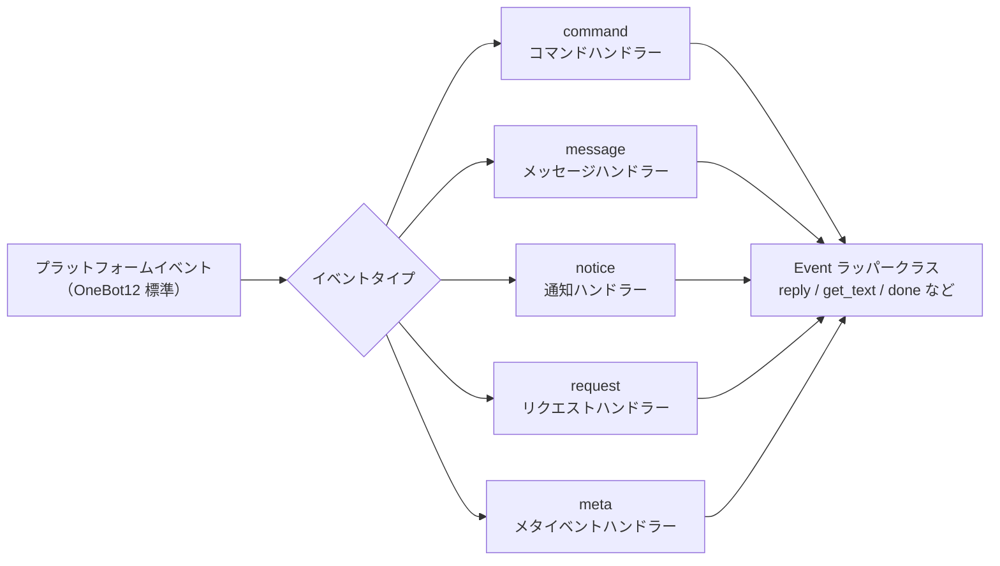

## Command コマンドモジュール

### コマンドの登録

```python
from ErisPulse.Core.Event import command

# 基本コマンド
@command("hello", help="挨拶を送る")
async def hello_handler(event):
    await event.reply("こんにちは！")

# エイリアス付きコマンド
@command(["help", "h"], aliases=["ヘルプ"], help="ヘルプを表示")
async def help_handler(event):
    pass

# 権限付きコマンド
def is_admin(event):
    return event.get("user_id") in admin_ids

@command("admin", permission=is_admin, help="管理者コマンド")
async def admin_handler(event):
    pass

# 非表示コマンド
@command("secret", hidden=True, help="シークレットコマンド")
async def secret_handler(event):
    pass

# コマンドグループ
@command("admin.reload", group="admin", help="モジュールを再読み込み")
async def reload_handler(event):
    pass

# サブコマンド（スペース区切りの複数トークンからなるコマンド名）
# マッチングには最長プレフィックスを採用：/admin add x は admin add に優先的にヒット（args は ["x"]）。
# サブコマンドで permission が宣言されていない場合、親チェーン上で最も近い位置で権限を宣言している祖先コマンドを継承します
@command("admin add", help="管理者を追加")
async def admin_add_handler(event):
    pass
```

**命名競合ルール**：コマンド名はエイリアスよりも優先されます。既存のコマンドと同名のエイリアスを登録した場合、そのエイリアスは無効となり警告が出力されます。既存のエイリアスと同名のコマンドを登録した場合はコマンド名が優先して有効となり、無効となったエイリアスは自動的に削除されます——いずれの競合の場合も WARNING ログが出力され、サイレントに乗っ取られることはありません。

### コマンド情報

すべてのコマンド照会 API はオプションの**セッションコンテキスト**をサポートしています：`event=`（Event または dict）を渡すか、明示的に `platform=` / `bot_id=` / `session_id=` を渡します（event と併用した場合は明示的パラメータが優先されます）。これにより、スコープモジュールの次元で現在のセッションにおいて利用不可のモジュールのコマンドがフィルタリングされます（詳細は advanced/scope.md を参照）。すべてオプションのキーワード引数であり、渡さない場合は従来通りの全量動作が維持されます。

```python
# コマンドヘルプを取得
help_text = command.help()

# セッション認識ヘルプ：現在のセッションで利用可能なコマンドのみを一覧表示
help_text = command.help(event=event)

# 特定のコマンドを取得（マージ・オーバーライド後の有効なパラメータを返す。セッションで利用不可の場合は None を返す）
cmd_info = command.get_command("admin")
cmd_info = command.get_command("admin", event=event)

# すべてのコマンドを取得（セッション認識時は利用不可モジュールのコマンドをフィルタリング）
all_commands = command.get_commands()
all_commands = command.get_commands(event=event)

# コマンドグループ内のすべてのコマンドを取得（セッション認識フィルタリングに対応）
admin_commands = command.get_group_commands("admin")
admin_commands = command.get_group_commands("admin", event=event)

# すべての可視コマンドを取得
visible_commands = command.get_visible_commands()

# セッション認識の可視コマンド（event または明示的キーワードのいずれかで可）
visible_commands = command.get_visible_commands(event=event)
visible_commands = command.get_visible_commands(
    platform=event.get("platform"),
    bot_id=event.get_self_account_id(),
    session_id=event.get_session_id(),
)
```

### 返信を待つ

```python
# ユーザーの返信を待つ
@command("ask", help="ユーザー情報を尋ねる")
async def ask_command(event):
    reply = await command.wait_reply(
        event,
        prompt="お名前を入力してください:",  # すでに上で送信済み
        timeout=30.0
    )
    
    if reply:
        name = reply.get_text()
        await event.reply(f"こんにちは、{name}さん！")

# 検証付きの返信待ち
def validate_age(event_data):
    try:
        age = int(event_data.get_text())
        return 0 <= age <= 150
    except ValueError:
        return False

@command("age", help="ユーザーの年齢を尋ねる")
async def age_command(event):
    await event.reply("年齢を入力してください:")
    
    reply = await command.wait_reply(
        event,
        timeout=60,
        validator=validate_age
    )
    
    if reply:
        age = int(reply.get_text())
        await event.reply(f"あなたの年齢は {age} 歳です")

# コールバック付きの返信待ち
async def handle_confirmation(reply_event):
    text = reply_event.get_text().lower()
    if text in ["はい", "yes", "y"]:
        await event.reply("操作が確認されました！")
    else:
        await event.reply("操作はキャンセルされました。")

@command("confirm", help="操作を確認")
async def confirm_command(event):
    await command.wait_reply(
        event,
        prompt="'はい'または'いいえ'を入力してください:",
        callback=handle_confirmation
    )
```

## Message メッセージモジュール

### メッセージイベント

```python
from ErisPulse.Core.Event import message

# すべてのメッセージをリッスン
@message.on_message()
async def message_handler(event):
    sdk.logger.info(f"メッセージを受信: {event.get_text()}")

# プライベートメッセージをリッスン
@message.on_private_message()
async def private_handler(event):
    user_id = event.get_user_id()
    sdk.logger.info(f"プライベートチャットから: {user_id}")

# グループメッセージをリッスン
@message.on_group_message()
async def group_handler(event):
    group_id = event.get_group_id()
    sdk.logger.info(f"グループチャットから: {group_id}")

# @メッセージをリッスン
@message.on_at_message()
async def at_handler(event):
    mentions = event.get_mentions()
    sdk.logger.info(f"メンションされたユーザー: {mentions}")
```

### 条件付きリッスン

```python
# 優先度を使用して実行順序を制御
@message.on_message(priority=10)  # 数値が大きいほど優先度が高い
async def high_priority_handler(event):
    pass

# ハンドラー内部で条件フィルタリングを実装
@message.on_message()
async def filtered_handler(event):
    if "キーワード" not in event.get_text():
        return
    # キーワードを含むメッセージを処理
    pass
```

## Notice 通知モジュール

### 通知イベント

```python
from ErisPulse.Core.Event import notice

# フレンド追加
@notice.on_friend_add()
async def friend_add_handler(event):
    user_id = event.get_user_id()
    await event.reply("フレンド追加ありがとうございます！")

# フレンド削除
@notice.on_friend_remove()
async def friend_remove_handler(event):
    user_id = event.get_user_id()
    sdk.logger.info(f"フレンド削除: {user_id}")

# グループメンバーの追加
@notice.on_group_increase()
async def member_increase_handler(event):
    user_id = event.get_user_id()
    await event.reply(f"新しいメンバーを歓迎します！")

# グループメンバーの減少
@notice.on_group_decrease()
async def member_decrease_handler(event):
    user_id = event.get_user_id()
    sdk.logger.info(f"グループメンバーが退出: {user_id}")
```

## Request リクエストモジュール

### リクエストイベント

```python
from ErisPulse.Core.Event import request

# フレンドリクエスト
@request.on_friend_request()
async def friend_request_handler(event):
    user_id = event.get_user_id()
    comment = event.get_comment()
    sdk.logger.info(f"フレンドリクエスト: {user_id}, コメント: {comment}")

# グループ招待リクエスト
@request.on_group_request()
async def group_request_handler(event):
    group_id = event.get_group_id()
    user_id = event.get_user_id()
    sdk.logger.info(f"グループ招待: {group_id}, 送信者: {user_id}")
```

## Meta メタイベントモジュール

### メタイベント

```python
from ErisPulse.Core.Event import meta

# 接続イベント
@meta.on_connect()
async def connect_handler(event):
    platform = event.get_platform()
    sdk.logger.info(f"プラットフォーム {platform} が正常に接続されました")

# 切断イベント
@meta.on_disconnect()
async def disconnect_handler(event):
    platform = event.get_platform()
    sdk.logger.info(f"プラットフォーム {platform} が切断されました")

# ハートビートイベント
@meta.on_heartbeat()
async def heartbeat_handler(event):
    sdk.logger.debug("ハートビートを受信")
```

### Bot ステータス照会

アダプターがメタイベントを送信すると、フレームワークは自動的に Bot のステータスを追跡します。照会 API とライフサイクルイベントのリッスンについては、[アダプターシステム API - Bot ステータス管理](adapter-system.md#bot-ステータス管理) を参照してください。

## Event ラッパークラス

Event モジュールのイベントハンドラーは、Event ラッパークラスのインスタンスを受け取ります。これは dict を継承し、便利なメソッドを提供します。メソッドの完全な一覧、パラメータシグネチャ、および動作の詳細については [Event ラッパークラス詳解](../developer-guide/modules/event-wrapper.md) を参照してください。このセクションでは概要のみを紹介します。

### 機能概要

- **イベント基本情報**：`get_id()` / `get_time()` / `get_type()` / `get_detail_type()` / `get_platform()`
- **ボット情報**：`get_self_platform()` / `get_self_user_id()` / `get_self_account_id()` / `get_self_info()`
- **セッション識別**：`get_target_id()`（統一ターゲット ID。`group_id` → `channel_id` → `guild_id` → `thread_id` → `user_id` の順で最初の空でない値を取得）；`get_session_id()`（形式は `{platform}:{detail_type}:{target_id}`、例：`"telegram:private:12345"`）
- **メッセージ内容と送信者**：`get_message()` / `get_alt_message()` / `get_text()` / `get_user_id()` / `get_sender()` / `get_group_id()` など
- **メッセージタイプ判定**：`is_message()` / `is_private_message()` / `is_group_message()` / `is_at_message()` / `has_mention()` / `get_mentions()`
- **返信**：`reply(content, method=..., at_sender=..., quote=..., at_users=..., reply_to=..., at_all=..., via=...)` / `reply_ob12()`；プラットフォーム機能の照会 `supports()` / `available_methods()`；自由送信チェーン `send_chain()` は [SendDSL 詳解](../developer-guide/adapters/send-dsl.md#方法2eventsend_chain) を参照
- **コマンド情報**：`get_command_name()` / `get_command_args()` / `is_command()` など
- **インタラクティブセッション**：`wait_reply()` / `confirm()` / `choose()` / `collect()` / `wait_for()` / `conversation()`
- **ツール**：`to_dict()`（内部キーをフィルタリング）/ `get_raw()` / `get_raw_type()`

> 各メソッドの完全なパラメータ説明と例については [Event ラッパークラス詳解](../developer-guide/modules/event-wrapper.md) を参照してください。マルチターン対話の高度な内容は [Conversation マルチターン対話](../advanced/conversation.md) を参照してください。

### チェーン制御

`event.done(claim=, stop=)` は「クレーム（claim）」と「ブロック（stop）」という 2 つの直交するセマンティクスを統一的に制御します：

- **クレーム（claim）**：イベントが処理済みであることをマークし（`_processed`）、コマンドディスパッチャーはこれに基づいて重複排除をスキップします
- **ブロック（stop）**：低優先度ハンドラーへの伝播を阻止します（`_propagation_stopped`）

```python
# クレーム + ブロック（デフォルト）
event.done()

# クレームのみ、ブロックなし（低優先度のオブザーバーも引き続き確認できる）
event.done(stop=False)

# ブロックのみ、クレームなし（ファイアウォール / レート制限など）
event.done(claim=False)

# mark_processed が本体メソッド、done はそのエイリアス
event.mark_processed()             # event.done() と同等
event.mark_processed(stop=False)   # event.done(stop=False) と同等

# ステータスの照会
event.is_processed()  # クレーム済みかどうか
event.is_stopped()    # 伝播がブロック済みかどうか
```

### プラットフォーム拡張メソッド

アダプターは Event にプラットフォーム固有のメソッドを登録でき、そのメソッドは対応するプラットフォームのインスタンスでのみ利用できます。

#### ユーザー：プラットフォーム拡張メソッドの利用

アダプターがプラットフォーム固有のメソッドを登録すると、イベントハンドラー内で直接呼び出せるようになります。メソッドはプラットフォームごとに異なるため、対応する [プラットフォームドキュメント](../platform-guide/) を参照してください。

```python
from ErisPulse.Core.Event import message

@message.on_message()
async def handle_message(event):
    platform = event.get_platform()

    # プラットフォームに応じて固有メソッドを呼び出す
    if platform == "email":
        subject = event.get_subject()           # メール固有
        attachments = event.get_attachments()   # メール固有
```

#### プラットフォームに登録済みのメソッドの照会

```python
from ErisPulse.Core.Event import get_platform_event_methods

# 特定のプラットフォームに登録されているメソッドを確認
methods = get_platform_event_methods("email")
# ["get_subject", "get_from", "get_attachments", ...]

# 動的に判定して呼び出す
for method_name in get_platform_event_methods(event.get_platform()):
    method = getattr(event, method_name)
    print(f"{method_name}: {method()}")
```

#### プラットフォームメソッドの分離

異なるプラットフォームで登録されたメソッドは互いに干渉しません：

```python
# メールイベント - メールのメソッドのみ
event = Event({"platform": "email", "email_raw": {"subject": "Hello"}})
event.get_subject()      # ✅ "Hello"
event.get_chat_type()    # ❌ AttributeError

# Telegram イベント - Telegram のメソッドのみ
event = Event({"platform": "telegram", "telegram_raw": {"chat": {"type": "private"}}})
event.get_chat_type()    # ✅ "private"
event.get_subject()      # ❌ AttributeError
```

#### `hasattr` / `dir` のサポート

```python
hasattr(event, "get_subject")   # platform="email" の場合のみ True を返す
"get_subject" in dir(event)     # 同様
```

### アダプター：プラットフォーム拡張メソッドの登録

アダプターはデコレーターを通じて Event にプラットフォーム固有のメソッドを登録できます。メソッドの最初のパラメータは `self`（Event インスタンス）で、イベントデータに自由にアクセスできます。

#### 単一メソッドの登録

```python
from ErisPulse.Core.Event import register_event_method

@register_event_method("email")
def get_subject(self):
    """メールの件名を取得"""
    return self.get("email_raw", {}).get("subject", "")

@register_event_method("email")
def get_from(self):
    """送信者を取得"""
    return self.get("email_raw", {}).get("from", {})
```

#### 一括登録（Mixin クラス）

メソッドが多い場合は、Mixin クラスによる一括登録が推奨されます：

```python
from ErisPulse.Core.Event import register_event_mixin

class EmailEventMixin:
    def get_subject(self):
        return self.get("email_raw", {}).get("subject", "")

    def get_from(self):
        return self.get("email_raw", {}).get("from", {})

    def get_attachments(self):
        return self.get("email_raw", {}).get("attachments", [])

# すべてのメソッドを一度に登録
register_event_mixin("email", EmailEventMixin)
```

#### 戻り値の規約

| シナリオ | 戻り値 | ユーザーの使用方法 |
|------|--------|------------|
| データを返す（テキスト、辞書など） | 値をそのまま返す | `subject = event.get_subject()` |
| 操作を実行する（メッセージ送信など） | `asyncio.Task` を返す | `task = event.do_something()` `await` は任意 |

> **推奨**：データを返さないメソッドは `asyncio.Task` を返すようにしてください。そうすることで、`await` するかどうかをユーザーが自由に決定でき、`await` しなかった場合でも操作は最後まで実行されます。

```python
@register_event_method("email")
def forward_email(self, to_address: str):
    """メールを転送する — Task を返し、ユーザーが await するかどうかを自由に決定できる"""
    import asyncio
    return asyncio.create_task(
        self._do_forward(to_address)
    )

# ユーザーは await で結果を待つことができる
await event.forward_email("user@example.com")

# await しない場合でも、操作はバックグラウンドで実行される
event.forward_email("user@example.com")
```

#### メソッドの登録解除

```python
from ErisPulse.Core.Event import unregister_event_method, unregister_platform_event_methods

# 単一メソッドの登録解除
unregister_event_method("email", "get_subject")

# 特定プラットフォームの全メソッドの登録解除（アダプターの shutdown 時に呼び出す）
unregister_platform_event_methods("email")
```

#### 組み込みメソッドのオーバーライド

`register_event_mixin` / `register_event_method` は、Event の組み込みメソッド（`confirm`、`choose`、`collect`、`wait_reply`、`reply` など）のオーバーライドをサポートしています。登録されたプラットフォームメソッドは `Event.__getattribute__` を経由して組み込みメソッドより優先的に有効になるため、アダプターはプラットフォーム特有のインタラクション実装を提供できます。

組み込み実装は `_builtin_*` 関数としてエクスポートされており、オーバーライド側はこれらをフォールバックとして呼び出せます：

```python
from ErisPulse.Core.Event import register_event_mixin, _builtin_choose

class YunhuEventMixin:
    async def choose(self, prompt, options, timeout=60, method="Text"):
        # Yunhu プラットフォームではボタンコンポーネントを使用
        buttons = [[{"text": opt} for opt in options]]
        await self.reply(prompt)
        # ...ボタンコールバックまたはテキスト返信を待つ...
        # 組み込みロジックへフォールバック
        return await _builtin_choose(self, None, options, timeout, "Text")

register_event_mixin("yunhu", YunhuEventMixin)
```

## クロスプラットフォーム拡張（ワイルドカード）

`register_event_method` と `register_event_mixin` は、プラットフォーム名として `"*"` を渡すことをサポートしており、登録されたメソッドは**すべてのプラットフォーム**の Event インスタンスで利用できます。AI 対話、コンテキスト管理など、クロスプラットフォームでの再利用が必要な機能モジュールに適しています。

### クロスプラットフォームメソッドの登録

```python
from ErisPulse.Core.Event.wrapper import register_event_method

@register_event_method("*")
async def ai_chat(self, prompt: str):
    """self は Event インスタンスであり、イベントデータや組み込みメソッドに自由にアクセスできる"""
    await self.reply(f"AI: {prompt}")
```

登録後、すべてのプラットフォームのイベントハンドラーから呼び出せます：

```python
from ErisPulse.Core.Event import message

@message.on_message()
async def handler(event):
    await event.ai_chat(event.get_text())
```

### メソッド解決の優先順位

属性アクセスで Event メソッドを取得する際の解決順序は次の通りです：

1. **プラットフォーム固有メソッド**（現在のプラットフォームのオーバーライド）
2. **ワイルドカードメソッド**（`"*"` で登録されたクロスプラットフォームメソッド）
3. **組み込みメソッド**（`reply`、`confirm` など）
4. **辞書キーとしてのアクセス**

> そのため、ワイルドカードメソッドは組み込みメソッド（`reply` など）をオーバーライドできますが、同名のプラットフォーム固有メソッドがあればさらにそちらが優先されます。

## 優先度システム

イベントハンドラーは優先度をサポートしており、数値が大きいほど優先度が高くなります：

```python
# 高優先度のハンドラーが先に実行される
@message.on_message(priority=10)
async def high_priority_handler(event):
    pass

# 低優先度のハンドラーが後に実行される
@message.on_message(priority=0)
async def low_priority_handler(event):
    pass
```


====
高级主题
====


### Conversation 多轮对话

# Conversation 多輪対話

> [!TIP]
> **このドキュメントを読む必要があるのはいつですか**：多輪対話のステートマシンとチェックポイントの復元が必要な場合です。必要ない場合はスキップしても、他の機能の使用には影響しません。

1 つのコマンドで複数の質問をユーザーに連続して求める必要がある場合（登録時の情報収集、アンケート、設定のガイドなど）、`Conversation` を使用して、同じセッション内で「質問 → 回答を待つ → 検証 → 次のステップ」をつなげます。タイムアウトや再起動後も、チェックポイントから復元できます。

## 対話の作成

`Event` オブジェクトの `conversation()` メソッドを使用して作成します：

```python
from ErisPulse.Core.Event import command

@command("quiz")
async def quiz_handler(event):
    conv = event.conversation(timeout=30)

    await conv.say("🎮 知識クイズへようこそ！")

    answer = await conv.choose("第1問：Pythonの生みの親は誰ですか？", [
        "Guido van Rossum",
        "James Gosling",
        "Dennis Ritchie",
    ])

    if answer is None:
        await conv.say("タイムアウトしました。また次回お試しください！")
        return

    if answer == 0:
        await conv.say("正解です！")
    else:
        await conv.say("不正解です。正解は Guido van Rossum です")

    conv.stop()
```

## コア API

### say(content, **kwargs)

メッセージを送信し、`self` を返してメソッドチェーンを可能にします：

```python
await conv.say("1行目").say("2行目").say("3行目")
```

送信方法を指定することもできます：

```python
await conv.say("https://example.com/image.jpg", method="Image")
```

### wait(prompt=None, timeout=None)

ユーザーからの返信を待機し、`Event` オブジェクトまたは `None`（タイムアウト）を返します：

```python
# 単純な待機
resp = await conv.wait()
if resp:
    text = resp.get_text()

# プロンプトを送信して待機
resp = await conv.wait(prompt="名前を入力してください：")

# カスタムタイムアウトを使用（対話のデフォルトタイムアウトを上書き）
resp = await conv.wait(prompt="10秒以内に返信してください：", timeout=10)
```

### confirm(prompt=None, **kwargs)

ユーザーの確認（はい/いいえ）を待機し、`True` / `False` / `None`（タイムアウト）を返します：

```python
result = await conv.confirm("すべてのデータを削除してもよろしいですか？")
if result is True:
    await conv.say("削除しました")
elif result is False:
    await conv.say("キャンセルしました")
else:
    await conv.say("タイムアウトしました")
```

内蔵の確認用語：`はい/yes/y/確認/確定/好/ok/true/対/うん/行/同意/問題ない/可能/当然...`

内蔵の否定用語：`否/no/n/キャンセル/不/不要/行かない/cancel/false/間違った/間違った/別/拒否...`

### choose(prompt, options, **kwargs)

ユーザーが選択肢から選ぶのを待機し、選択肢のインデックス（0ベース）または `None` を返します：

```python
choice = await conv.choose("色を選択してください：", ["赤", "緑", "青"])
if choice is not None:
    colors = ["赤", "緑", "青"]
    await conv.say(f"選択した色は {colors[choice]} です")
```

ユーザーは番号（`1`/`2`/`3`）または選択肢のテキスト（`赤`）を入力して選択できます。

`options_format="auto"`（デフォルト）は、method に応じて自動的に内蔵のスタイルを選択します：Markdown→無序リスト、Html→順序付きリスト、その他→純粋なテキストリスト。
また、`"list"`、`"inline"`、`"md"`、`"html"`、またはカスタム関数もサポートします。

`merge_prompt=True` を使用して、プロンプトと選択肢を1つのメッセージに統合することもできます。また、オプション挿入位置を制御するプレースホルダ（デフォルトは `{options}`、`placeholder` でカスタマイズ可能）もサポートします：

```python
choice = await conv.choose(
    "## 選択してください\n{options}",
    ["オプションA", "オプションB"],
    method="Markdown",
    merge_prompt=True,
)

# カスタムプレースホルダ
choice = await conv.choose(
    "選択してください: [choices]",
    ["オプションA", "オプションB"],
    placeholder="[choices]",
)
```

### collect(fields, **kwargs)

複数ステップで情報を収集し、データ辞書または `None` を返します：

```python
data = await conv.collect([
    {"key": "name", "prompt": "名前を入力してください"},
    {"key": "age", "prompt": "年齢を入力してください",
     "validator": lambda e: e.get("alt_message", "").strip().isdigit(),
     "retry_prompt": "年齢は数字でなければなりません。再度入力してください"},
    {"key": "city", "prompt": "都市を入力してください"},
])

if data:
    await conv.say(f"登録完了！\n名前: {data['name']}\n年齢: {data['age']}\n都市: {data['city']}")
else:
    await conv.say("登録が中断されました")
```

フィールドの設定：

| パラメータ | 説明 | デフォルト値 |
|------|------|--------|
| `key` | フィールドのキー名（必須） | - |
| `prompt` | プロンプトメッセージ | `"{key} を入力してください"` |
| `validator` | 関数、Event を受け取り、bool を返す | なし |
| `retry_prompt` | 検証失敗時の再試行プロンプト | `"入力が無効です。再度入力してください"` |
| `max_retries` | 最大再試行回数 | 3 |
| `condition` | 関数、既に収集されたデータの辞書を受け取り、bool を返す | なし |

**条件付きフィールド**：`condition` を使用して、条件が満たされた場合にのみフィールドを収集する動的フォームを実現できます：

```python
data = await conv.collect([
    {"key": "has_car", "prompt": "車をお持ちですか？（はい/いいえ）"},
    {"key": "car_brand", "prompt": "車のブランドを入力してください",
     "condition": lambda d: d.get("has_car", "").lower() in ("はい", "yes", "y")},
])
```

### stop()

手動で対話を終了し、`is_active` を `False` に設定します：

```python
conv.stop()
```

### is_active

対話がアクティブかどうかを返します：

```python
if conv.is_active:
    await conv.say("対話はまだ進行中です")
```

## アクティブ状態の管理

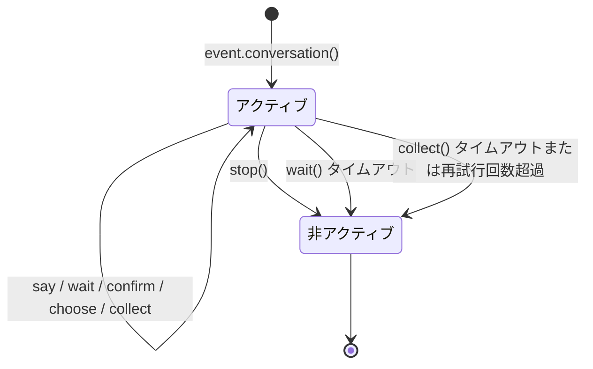

以下の状況で対話は自動的に非アクティブになります：

1. `stop()` メソッドを呼び出す
2. `wait()` がタイムアウトして `None` を返す
3. `collect()` がステップのタイムアウトまたは再試行回数超過で `None` を返す

非アクティブになった後、`wait`/`confirm`/`choose`/`collect` のすべてのインタラクションメソッドは即座に `None` を返し、ユーザーからの入力を待続しません。

## 分岐とジャンプ

### @conv.branch(name) デコレータ

`branch()` を使用して対話の分岐を登録し、`goto()` で分岐間をジャンプします：

```python
@command("menu")
async def menu_handler(event):
    conv = event.conversation(timeout=60)

    @conv.branch("main")
    async def main_menu():
        await conv.say("=== メインメニュー ===\n1. 本人情報\n2. 設定\n3. 終了")
        resp = await conv.wait()
        if resp is None:
            return
        text = resp.get_text().strip()
        if text == "1":
            await conv.goto("profile")
        elif text == "2":
            await conv.goto("settings")
        elif text == "3":
            await conv.say("さようなら！")
            conv.stop()

    @conv.branch("profile")
    async def profile():
        await conv.say("=== 本人情報 ===\n名前: Alice\n0. 戻る")
        resp = await conv.wait()
        if resp and resp.get_text().strip() == "0":
            await conv.goto("main")

    @conv.branch("settings")
    async def settings():
        await conv.say("=== 設定 ===\n1. 通知のオン/オフ\n0. 戻る")
        resp = await conv.wait()
        if resp and resp.get_text().strip() == "0":
            await conv.goto("main")

    await conv.start()  # 最初に登録された分岐から開始
```

### conv.start(name=None)

対話を開始し、デフォルトでは最初に登録された分岐から開始します：

```python
await conv.start()          # 最初の分岐から開始
await conv.start("settings") # 指定された分岐から開始
```

## コンテキストと永続化

### conv.context

各対話インスタンスには、分岐間で状態を共有するための `context` 辞書が内蔵されています：

```python
@conv.branch("step1")
async def step1():
    conv.context["username"] = resp.get_text().strip()
    await conv.goto("step2")

@conv.branch("step2")
async def step2():
    name = conv.context.get("username", "未知")
    await conv.say(f"こんにちは、{name}！")
```

### save() / resume() / clear_saved()

対話は永続化をサポートし、タイムアウトや中断後に復元できます：

```python
# 対話状態を保存する（通常は手動で呼び出す必要はありません、下記の「自動チェックポイント」を参照）
await conv.save()

# ... その後、同じセッションで復元する ...
conv2 = event.conversation()
if await conv2.resume():
    await conv2.say("お帰りなさい！以前の対話を続けましょう")
else:
    await conv2.say("以前の対話は見つかりませんでした")

# 保存された対話を削除する
await conv.clear_saved()
```

ストレージキーにはターゲットの次元が含まれます（`conversation:{platform}:{user_id}:{target_id}`）、同じユーザーの異なるセッション間の対話は互いに上書きされません。`resume()` 時に、ターゲットを含まない旧形式のアーカイブは自動的に移行されます。

## 自動チェックポイントと再起動時の復元

### 自動アーカイブ

フレームワークは以下のタイミングで自動的にチェックポイントを管理します。通常、`save()` を手動で呼び出す必要はありません：

| 時機 | 行動 |
|------|------|
| `goto()` / `start()` で分岐をジャンプする | 自動保存（現在の分岐 + context） |
| `stop()` / `wait()` タイムアウト / `collect()` 失敗 | 自動削除（対話の終端状態） |

### チェックポイント TTL

アーカイブにはタイムスタンプが付いており、`ErisPulse.interaction.checkpoint_ttl`（デフォルト 24 時間）を超えるアーカイブはクリーンアップされます：

- **惰性削除**：復元時にアーカイブが期限切れであることが判明した場合、自動的に削除されます
- **バックグラウンドの自動クリーンアップ**：フレームワークには定期的な GC タスクがあり、最初にチェックポイントを使用した後に惰性で起動され、期限切れのアーカイブを列挙して削除し、長期稼働時にストレージ内の期限切れのチェックポイントが無限に蓄積されることを防ぎます。自動的にクリーンアップされたアーカイブは、その後会話メッセージを受け取った場合、"チェックポイントなし"として扱われます

```toml
[ErisPulse.interaction]
checkpoint_ttl = 86400  # 秒
```

### 再起動時の自動復元

フレームワークが再起動した後、メモリ内の待機中のコルーチンは失われますが、チェックポイントは残ります。`register_resume_handler` を使用して**復元ファクトリ**を登録することで、フレームワークは再起動後にその会話の最初のメッセージを受け取ったときに自動的に対話を継続します：

```python
from ErisPulse.Core.Event.wrapper import Conversation

@Conversation.register_resume_handler()  # platform="onebot11" を渡すことでプラットフォームを限定することも可能
def make_conversation(event) -> Conversation:
    # ファクトリの役割：対話を再構築し、すべての分岐を再登録する
    conv = event.conversation(timeout=60)

    @conv.branch("menu")
    async def menu(conv, event):
        ...

    return conv
```

登録後、`menu` 分岐にあったユーザーが再起動前に最初のメッセージを送信した場合、フレームワークは自動的に：コンテキストを復元 → そのメッセージを認証 → 保存された分岐から対話を継続します。ファクトリを登録していない場合、このメカニズムは無駄なコストがかかりません。

### 復元は即座に引き継ぎ

`resume()` が成功した場合、フレームワークは自動的に2つのことを完了します：

1. **セッションの引き継ぎ**：自動的にそのセッションの排他リースを取得します——他のモジュールは `sdk.interaction.get_owner_of(event)` を使用して「このユーザーが対話で占有されている」ことを感知できます；セッションが他のモジュールによって占有されている場合、復元は失敗（False を返す）し、2つの対話が競合することを防ぎます
2. **履歴の持ち込み**：会話の受信箱から最近の10件のメッセージを `conv.recent_history` に取り込みます（AI モジュールが復元された後、LLM のコンテキストが途切れません）；`resume(with_history=0)` でこの機能をオフにできます

```python
if await conv.resume(with_history=20):
    for m in conv.recent_history:
        print(m["role"], ":", m["text"])
```

### 手動復元（自動メカニズムを使用しない場合）

```python
@command("continue")
async def continue_handler(event):
    conv = event.conversation()
    # ... 分岐を登録する ...
    if await conv.resume():
        conv.goto(conv.get_current_branch())
```

## 代表的なフロー・パターン

### ガイド付き登録

```python
@command("register")
async def register_handler(event):
    conv = event.conversation(timeout=60)

    await conv.say("ようこそ、登録へ！")

    data = await conv.collect([
        {"key": "username", "prompt": "ユーザー名を入力してください（3-20文字）",
         "validator": lambda e: 3 <= len(e.get_text().strip()) <= 20},
        {"key": "email", "prompt": "メールアドレスを入力してください",
         "validator": lambda e: "@" in e.get_text() and "." in e.get_text(),
         "retry_prompt": "メールアドレスの形式が正しくありません。再度入力してください"},
    ])

    if not data:
        await event.reply("登録がキャンセルされました")
        return

    confirmed = await conv.confirm(
        f"登録情報を確認しますか？\nユーザー名: {data['username']}\nメールアドレス: {data['email']}"
    )

    if confirmed:
        await conv.say("✅ 登録完了！")
    else:
        await conv.say("❌ 登録がキャンセルされました")
```

### ループ対話

```python
@command("chat")
async def chat_handler(event):
    conv = event.conversation(timeout=120)
    await conv.say("対話モードに入りました。「終了」で終了します")

    while conv.is_active:
        resp = await conv.wait()
        if resp is None:
            await conv.say("タイムアウトしました。対話は終了します")
            break

        text = resp.get_text().strip()

        if text == "終了":
            await conv.say("さようなら！")
            conv.stop()
        elif text == "help":
            await conv.say("利用可能なコマンド：終了、help、status")
        elif text == "status":
            await conv.say("対話はアクティブです")
        else:
            await conv.say(f"あなたが言ったのは：{text}")
```


### 交互会话系统

# インタラクションセッションシステム

> [!TIP]
> **このドキュメントを読むべきタイミング**：wait_reply、マルチターン対話、タイマーリマインダー、セッション排他、リンクトレースが必要な場合。不要であれば読み飛ばしても、他の機能の利用には影響しません。

> **読み終えると分かること**：`wait_reply` の全パラメータの使い方とキャンセル理由、`.got()` による宣言的マルチターンチェーン、
> セッションタイマー（remind / escalate）、マルチパス待機（expect / select）とセッション排他リース。
>
> **本ドキュメントでは扱わない内容**：マルチターン対話の分岐ステートマシンと再起動復帰（[Conversation マルチターン対話](conversation.md) を参照）；
> 受信箱の保持ポリシー調整項目とランタイムオーバーライド（[セッション受信箱](transcript.md) を参照）。

> [!NOTE]
> 本章の内容には ErisPulse **2.8.0+** が必要です。

ErisPulse は「ユーザーとの継続的なインタラクション」をフレームワークレベルのインフラとして実装しています：1 つの `wait_reply` から、
タイマーリマインダー、マルチパス待機、セッション排他、再起動復帰に至るまで、すべてが統一された
**インタラクションセッションマネージャー**（`Core/Event/interaction.py`、`sdk.interaction`）によってスケジューリングされます。

{!--< tips >!--}
本ドキュメントが扱うすべての機能には**所有者（owner）**が備わっています：インタラクション待機、リース、タイマーはすべて
登録時のモジュール名を記録し、モジュールのアンロード / アダプターのシャットダウン時にはフレームワークが自動的にクリーンアップします。待機側はタイムアウトまで待ちぼうけるのではなく、直ちに通知を受け取ります。
これは所有権システムのインタラクション次元への拡張です（[所有権システム](ownership.md) を参照）。
{!--< /tips >!--}

## 返信待機：wait_reply

**ひとことで言うと**：現在のコルーチンを一時停止して対象ユーザーの次のメッセージを待ち、一致すれば返信イベントを返し、タイムアウトまたはキャンセル時は `None` を返します。`pattern` / `regex` / `validator` で不適切な返信をフィルタリングできます。

`wait_reply` はインタラクションセッションの基礎です——現在のコルーチンを一時停止し、対象ユーザーが次のメッセージで「返信」するのを待ちます。

```python
from ErisPulse.Core.Event import command

@command("ask")
async def ask_command(event):
    reply = await event.wait_reply(prompt="お名前を入力してください:", timeout=30)
    if reply is None:
        await event.reply("タイムアウトしました")
        return
    await event.reply(f"こんにちは、{reply.get_text()} さん！")
```

### 全パラメータ一覧

| パラメータ | 説明 | デフォルト |
|------|------|------|
| `prompt` | 一時停止前に送信されるプロンプトメッセージ | None |
| `timeout` | 待機タイムアウト（秒） | 60 |
| `pattern` | glob フィルタ（`*` / `?` / `[seq]`）、不一致時は待機を継続 | None |
| `regex` | 正規表現フィルタ（pattern と同時に指定した場合は両方の一致が必要）、不一致時は待機を継続 | None |
| `validator` | 検証関数（Event を受け取り bool を返す）、失敗時は待機を継続 | None |
| `callback` | 返信受信時に呼ばれるコールバック（戻り値方式の代わりとなるもう一つの書き方） | None |
| `method` | prompt の送信メソッド | "Text" |
| `session` | **セッションレベル待機**：同一セッション（グループ / チャンネル）内の誰の返信でも一致可能 | False |

```python
# 金額（数字）のみ受け付け、それ以外は待機を継続
reply = await event.wait_reply("金額を入力してください:", regex=r"\d+\s*円", timeout=30)

# セッションレベル待機：グループ協力シーンで、どのメンバーの回答でも一致可能
reply = await event.wait_reply(session=True, prompt="どなたか答えていただけませんか？")
```

### 待機とコマンドの境界（コマンドパススルー）

待機中に**登録済みコマンド**（例：`/cancel`）を含むメッセージを受信した場合、デフォルトではコマンドディスパッチャーにそのままパスされて実行され、
返信として消費されません（設定項目 `ErisPulse.event.wait_reply.cmdpass`、`True` にすると反転——
メッセージはすべて返信として扱われます）。判定テキストの基準はコマンドディスパッチと同一です：`alt_message` を優先し、
存在しない場合はメッセージセグメントの連結にフォールバックします（2.10.1 以降、純粋な message セグメントアダプターにも同様に適用されます）。

### 待機がキャンセルされるケース

待機はもはや「タイムアウトを待つだけ」ではありません——以下の場合、待機は**直ちに終了**し（`wait_reply` は `None` を返します）、
呼び出し元がタイムアウトまで待ちぼうけることはありません：

| トリガー | キャンセル理由（`InteractionCancelled.reason`） | 説明 |
|------|------|------|
| 所有モジュールのアンロード / 無効化 | `owner_unload` | 所有クリーンアップ：待機を登録したモジュールが消滅する際、一緒に回収される |
| アダプターのシャットダウン / 再起動 | `platform_stop` | そのプラットフォームで保留中の待機がすべてキャンセルされる |
| 同一セッションが新しい待機 / リースに置き換えられる | `conflict` | 下記「セッション調停」を参照 |
| 返信者がブラックリストに登録 / owner モジュールのバインド解除 | `revoked` | 返信一致時の**権限再チェック**：scope のアイデンティティ次元 + モジュール次元 |
| ユーザーの返信が一致 | —— | 通常パス。返信イベントを返す |

低レベルの例外は `InteractionCancelled`（`InteractionError` 例外体系に属します）です。
`wait_reply` はこれを `None` の返却に変換済みです。理由が必要な呼び出し元は
`sdk.interaction.register()` の低レベル API を直接使用できます。

### 返信一致の完全な判定チェーン

返信メッセージが到着すると、インタラクションマネージャーは以下の順序で判定します（コマンドマッチングの**前に**実行されます。
対話の連続性を優先——メッセージが他の高優先度ハンドラーに引き取られていても、保留中の対話は完結できます）：

```
セッションキーの一致（正確な user 次元 → セッションレベルへのフォールバック）
  → pattern / regex テキストフィルタ（不一致なら待機継続）
  → validator 検証（失敗なら待機継続）
  → 権限再チェック（scope のアイデンティティ次元 + owner のモジュール次元、失敗時は待機終了）
  → 待機側のウェイクアップ + イベントの引き取り（mark_processed）
```

## 宣言的マルチターン：`.got()` チェーン（2.11+）

`@command` は**マルチターンフロー制御プロキシ**を返し、`.got()` で収集ステップを順次宣言します——ステップ関数は
パラメータ名で収集済みの値（コマンド入口パラメータを含む）を受け取り、型は `type=` / アノテーションに従って自動解析されます。
低レベルでは Conversation にコンパイルされます：各ステップが 1 つの分岐、ジャンプ時にチェックポイントを自動保存し、**再起動後もユーザーの
返信は保存済みのステップから継続します**（復帰ファクトリはデコレート時に自動登録され、モジュールのアンロード時に自動的に登録解除されます）。

```python
@command("weather")
async def weather(event):
    pass  # 入口：最初の .got の prompt は自動送信されるため、手動で質問する必要なし

@weather.got("city", prompt="都市名を直接返信してください")
async def weather_city(event, city: str):
    await event.reply(f"{city}：晴れ、25℃")

@weather.got("days", prompt="何日分の予報？", type=int, retry_prompt="数字を入力してください")
async def weather_days(event, city: str, days: int):
    await event.reply(f"{city} の今後 {days} 日間……")
```

### パラメータ説明

| パラメータ | 説明 |
|------|------|
| `name` | 収集値の名前（後続のステップ関数に注入されるパラメータ名；フロー内で一意、重複宣言時は登録時にエラー） |
| `prompt` | そのステップに入る際に自動送信される質問 |
| `timeout` | ステップごとの待機タイムアウト（秒数または `"90s"` / `"1h30m"` の時間文字列、デフォルト 60s） |
| `type` | 値の型（`int` / `float` / `str`…；解析失敗時は `retry_prompt` を自動再送、最大 `max_retries` 回） |
| `validator` / `pattern` / `regex` | 返信のフィルタリングと検証（セマンティクスは [`wait_reply`](#返信待機wait_reply) と同一） |
| `session` | セッションレベル待機（同セッション内の誰でも一致可能） |
| `cmdpass` | コマンドパススルーの三状態（デフォルトでは `/cancel` などのコマンドは待機中も通常どおり実行される） |

### セマンティクスと境界

- **いずれかのステップでタイムアウト / 中断 → フロー全体が終了**し、チェックポイントがクリアされます（`wait_reply` と同じセマンティクス）；
  ステップ関数内ではいつでも `event.reply(...)` で中間結果を出力できます
- **同一ユーザーが同時に持てる保留中のインタラクションは 1 つだけ**——2 つ目のフローの待機が前のものを置き換えます
  （`InteractionCancelled("conflict")`）；排他制御が必要な場合は
  [セッションリース](#セッション排他acquire--hold--get_owner_of) を併用してください
- 収集値はフロー内にのみ存在します；再起動を跨いで複雑な状態を保持するオーケストレーションが必要な場合は、直接
  [Conversation](conversation.md) を使用してください（`context` + `branch/goto` + 手動チェックポイント）
- `@command` が返すのはプロキシオブジェクトです：呼び出し動作、`__name__`、docstring、カスタム属性は
  元の関数と完全に一致します；`command.unregister(プロキシ)` は自動的にアンラップします

## セッションタイマー：remind / escalate

「タイムアウト」を戻り値から、オーケストレーション可能なプリミティブへと変えます。タイマーはインタラクションセッションに紐付けられ、
モジュールのアンロード / アダプターのシャットダウン時に自動キャンセルされます。1 セッションあたりのアクティブな remind の上限は 5 個です。

### remind：返信がないとリマインド

```python
@command("ticket")
async def ticket_command(event):
    await event.reply("チケットを送信しました。処理結果はここで通知します")
    # 5 分間返信がなければ穏やかに 1 度催促；ユーザーの返信で自動的にキャンセルされる
    event.remind(300, "まだいますか？結果が出次第、すぐにお知らせします")
    reply = await event.wait_reply(timeout=3600)
    ...
```

- `event.remind(delay, text=None, *, callback=None)`：期限到来時に現在のセッションへ `text` を送信します
  （または `callback(event)` を実行、同期 / 非同期両対応）。**強制検証**：`text` と
  `callback` はどちらか一方のみ指定できます（どちらも指定しないと `ValueError` がスローされます）
- `Reminder` ハンドルを返します：`reminder.cancel()` で手動キャンセル、`reminder.expired` で状態照会
- ユーザーがそのセッションで**返信すると自動的にキャンセル**されます——これこそが「リマインド」のセマンティクスです：
  リマインドはユーザーが沈黙しているときにだけ現れます
- `Conversation` 内でも同様に利用可能：`conv.remind(120, "まだ考えていますか？")`

### escalate：時刻到来時に確実に実行されるエスカレーション

```python
event.escalate(1800, lambda e: notify_master(f"チケットが 30 分間未処理：{event.get_command_args()}"))
```

`remind` との唯一の違い：**ユーザーの返信ではキャンセルされない**——エスカレーションアクション（オーナーへの通知、有人対応への切り替え）は
「タイムアウト時に必ず届く」という約束であり、手動の `cancel()` / モジュールのアンロード / アダプターのシャットダウンでのみキャンセルされます。

| | `remind` | `escalate` |
|---|---|---|
| 期限到来時の動作 | テキスト送信 / callback 実行 | callback 実行 |
| ユーザーの返信 | **自動キャンセル** | 影響なし |
| 所有クリーンアップ（アンロード / プラットフォーム停止） | キャンセル | キャンセル |
| 1 セッションあたりの上限 | 5 | 無制限（所有クリーンアップが最終的なセーフティネット） |

## マルチパス待機：expect + select

**ひとことで言うと**：`expect` は期待を記述するだけで待機は登録せず、`select` が複数の期待をまとめて保留します。いずれかが先に一致した時点で `(インデックス, 返信イベント)` を返し、一致しなかったものは自動的にクリーンアップされます。

複数の期待を同時に保留し、**早い者勝ち**です——典型的なシーン：管理者の承認を待つと同時にユーザーの取り消しを待つ、
複数人による協調投票など。

```python
which, reply = await event.select(
    event.expect(pattern="承認*", user="10001"),
    event.expect(pattern="拒否*", user="10002"),
    event.expect(validator=lambda e: e.get_text() == "保留", session=True),
    timeout=60,
)
if which is None:
    await event.reply("60 秒以内に承認結果が届きませんでした")
elif which == 0:
    await event.reply("承認済み")
elif which == 1:
    await event.reply("拒否済み")
```

- `event.expect(...)` は**期待の記述**を構築します（待機は何も登録しません）：`pattern` / `regex` / `validator` / `user`（返信者を限定）/ `session`（誰でも回答可能）をサポートします
- `event.select(*expectations, timeout=60)`：一括登録 → いずれかが一致した時点で
  `(インデックス, 返信イベント)` を返す → 一致しなかった待機は自動キャンセル；すべてタイムアウトした場合は `(None, None)` を返します。
  **強制検証**：最低 1 つの expectation を渡す必要があり、そうでなければ `ValueError` がスローされます
- 一致したイベントはすでにフレームワークが引き取り済み（`mark_processed`）のため、他のハンドラーによって重複消費されることはありません

{!--< tips >!--}
`select` はマルチスレッドの `asyncio.wait` による手動オーケストレーションと比べて：期待が不一致のときの自動クリーンアップ、
一致イベントの自動引き取り、権限再チェックと所有クリーンアップがすべて有効——Future を自分で管理する必要はまったくありません。
{!--< /tips >!--}

> [!NOTE]
> 2.10.1 以降、`select` は**集約待機**となりました：すべての期待は単一エントリ + カスタム一致判定に統合され、
> 同一キーの複数パス（同じ user に異なる pattern を 2 つ登録するなど）が互いにキャンセルし合うことはなく、いずれかのパスが先に一致した時点で返ります。
> 返信テキストの判定基準は `alt_message` 優先 + メッセージセグメントへのフォールバック（コマンドディスパッチと同一）です。
>
> 境界に関する説明：`event.wait_for(...)` はアダプターのイベントバスに直接紐付けられ、ミドルウェアと
> detail_type の条件フィルタを**経由しません**（身元の受け入れ判定はディスパッチ入口で担保されます）；完全なパイプラインを必要とする待機には
> `wait_reply` / `select` を使用してください。

## セッション排他：acquire / hold / get_owner_of

所有権は「リソース」から「セッション」へと拡張されます——「このユーザーは現在誰に占有されているか」が第一級のクエリとなります。

```python
# 照会：このセッションは現在、誰が対話中か？（空きの場合は None を返す）
owner = sdk.interaction.get_owner_of(event)
if owner and owner != "MyModule":
    return  # 他のモジュールが対話中のため、邪魔しない

# 排他リース：セッションを独占（deny 戦略、占有中の場合は None を返す）
lease = sdk.interaction.acquire(event)          # デフォルト TTL は 1 時間、ttl= で指定可能
if lease is None:
    return  # すでに占有されている
try:
    ...  # 独占インタラクション
finally:
    lease.release()
```

コンテキストマネージャー形式（取得に失敗すると `SessionOccupiedError` がスローされます）：

```python
with sdk.interaction.hold(event) as lease:
    ...  # 抜ける際に自動解放
```

リースは `renew(ttl)` による延長をサポートします；TTL は遅延期限切れ方式——期限切れのリースは次回アクセス時に自動的にクリーンアップされます。

`Conversation.resume()` で対話を復帰する際、フレームワークは自動的にリースを取得します（
[Conversation マルチターン対話](conversation.md) の「復帰即引き継ぎ」を参照）——
復帰した対話は必然的にセッションを保持するため、他のモジュールが割り込むことはありません。

## セッション受信箱：event.history

> 保持ポリシー（7 日間 / 条数上限）とランタイムオーバーライド API、リスクと監査については[セッション受信箱](transcript.md)の専用ドキュメントを参照してください。

セッションごとの直近メッセージフローの統一記録（ユーザー + ボットの双方）で、AI コンテキスト、
リピート防止、行動分析系モジュールにとっての**共有ファクト基盤**です——各モジュールが個別に履歴を保存する必要はもうありません。

```python
messages = await event.history(20)   # 現在のセッションの直近 20 件、時刻昇順
for m in messages:
    print(m["role"], ":", m["text"])  # role: "user" / "bot"
```

- 自動記録：受信メッセージ（role=user）+ ボットの送信テキスト（role=bot）
- ストレージ：独立した SQLite テーブル、保持ポリシー = セッションごとの上限（デフォルト 50）+ グローバル TTL（デフォルト 7 日間）
- 書き込み方式：メモリバッファ + バックグラウンドでの一括ディスク書き込み（遅延は最大 1 秒）、照会インターフェースはディスク未書き込みのバッファ行を自動的にマージするため、同一プロセス内の「自分の書き込みの読み取り」は影響を受けません；正常終了時（`sdk.uninit` / プロセス終了）には自動的にフラッシュされます。**ハードクラッシュ / 強制終了時には直近約 1 秒分の記録が失われる可能性があります**：この基盤は直近コンテキストキャッシュとしての位置づけであり、監査レベルの永続化には適しません
- 設定：`ErisPulse.transcript = {enabled = true, max_per_session = 50, ttl_hours = 168}`
- マネージャー API：`sdk.transcript.append() / get() / clear()`、`aflush()` / `flush()` による手動フラッシュ

## メッセージトランザクション：message_tx

トランザクション内のすべての送信は自動的に台帳へ記録されます；**異常終了時には送信済みメッセージが逆順に自動取り消しされます**
（アダプターが `delete_message` を実装していない場合はスキップされますが、台帳への記録は通常どおり行われます）。

```python
async with event.message_tx():
    await event.reply("処理中です。お待ちください")
    result = await do_something()          # ここで例外がスローされると →
    await event.reply(f"完了: {result}")   # 直前の「処理中」が自動取り消しされる
```

トランザクション外の送信は台帳に記録されません（ゼロオーバーヘッド）；トランザクション内ではいつでもレシート台帳を読み取れます。典型的な用途は**自己削除ボット**
（送信と同時に遅延取り消しをスケジュール）と送信監査です：

```python
import asyncio
from ErisPulse.runtime import get_send_receipts

async def delayed_delete(adapter, message_id: str, delay: float):
    await asyncio.sleep(delay)
    await adapter.delete_message(message_id)

async with event.message_tx():
    await event.reply("一時的な通知")
    for r in get_send_receipts() or []:
        # 各レシートには platform / bot_id / message_id / trace_id が含まれる
        asyncio.create_task(delayed_delete(adapter, r["message_id"], 30))
```

レシートの読み取りは**トランザクションスコープ**です：`message_tx()` トランザクション内でのみ非 `None` を返し、
トランザクション外では常に `None` です；すべての送信（トランザクション外を含む）を捕捉する必要がある場合は `message.sending/sent`
フックを使用してください（[リンクトレース](#リンクトレースtrace-id) の `trace_id` フィールドを参照）。

## リンクトレース：trace-id

すべての受信イベントは自動的にトレース ID を取得し（`event["id"]` を再利用、欠落時は生成）、以下に渡って引き継がれます：

- ハンドラーコンテキスト（`get_current_trace_id()` で読み取り）
- 送信（`[Send]` ログ行に `[trace:...]` を付加、`message.sending/sent` フックの `trace_id` フィールド）
- ライフサイクルフックデータ（dict に `_trace_id` を自動補完）
- 宛先指定イベント（`lifecycle.emit(..., to=...)`）とメッセージトランザクションレシート

1 つのメッセージが複数のモジュールによってリレー処理される場合でも、チェーン全体を同一の ID で紐付けられます（ログ / スロークエリ / 監査）。

## 他のシステムとの関係

- **所有権**：待機 / リース / タイマーはすべて owner を記録し、アンロード時に即座に回収されます（[所有権システム](ownership.md)）
- **スコープ**：返信一致時の再チェックはアイデンティティ + モジュール次元；モジュール間呼び出しの監査は送信（アウトバウンド）次元で行われます（[スコープ](scope.md)）
- **Conversation**：マルチターン対話はインタラクションセッションの上に構築された分岐ステートマシンです（[Conversation](conversation.md)）。
  その待機も本ページのすべてのキャンセル / 再チェック / 所有セマンティクスを同様に享受します


### 模块间通信

# モジュール間通信

> [!TIP]
> **この記事を読むタイミング**：RPCによるモジュール間呼び出し、サービス契約、宛先指定イベント、またはコールドスタート時のイベントリプレイが必要な場合。必要なければ飛ばしても、他の機能の使用に影響はありません。

> **この記事を読んだ後には**：3層通信モデル（RPC / 宛先指定イベント / ブロードキャスト）の選択のコツ、`meta.services` によるサービス契約とサービスディレクトリ、出向き監査の設定方法、およびラグドウォーキングとコールドスタート時のイベントリプレイについて理解できます。
>
> **この記事では扱いません**：ライフサイクルイベントシステム自体の登録 / 発火 / 優先度のメカニズム（[ライフサイクル管理](lifecycle.md)を参照）；ラグドロードの設定と activate_on の宣言（[ラグドロードシステム](lazy-loading.md)を参照）。

> [!NOTE]
> 本章の内容は ErisPulse **2.8.0+** が必要です。

ErisPulse では、モジュール間には**3層の通信モデル**が存在し、「点対点 → 宛先指定 → ブロードキャスト」の順序で構成されています：

| 層 | API | 意味 | 代表的なシナリオ |
|---|---|---|---|
| **RPC** | `await sdk.module.call("Chat", "get_history", ...)` | 点対点のリクエスト-レスポンス、契約 / 監査 / タイムアウト付き | 他のモジュールの機能を呼び出す（履歴の取得、翻訳、返金など） |
| **宛先指定イベント** | `await lifecycle.emit("message_received", {...}, to="Chat")` | 指定されたモジュールが登録したライフサイクルフックにのみ配信 | 上流の状態変化を下流に通知する（「新しいメッセージを受け取りました」など） |
| **ブロードキャスト** | `await lifecycle.emit("config.updated", {...})` | フレームワーク全体で見えるライフサイクルイベント | 設定のホットアップデート、モジュールの起動 / 終了 |

{!--< tips >!--}
選択のコツ：**返り値が必要な場合は `call` を使い、特定のモジュールのフックに通知したい場合は `emit(..., to=...)` を使い、全員に通知したい場合は `emit(...)` を使う**。
{!--< /tips >!--}

## RPC: module.call

```python
result = await sdk.module.call("Chat", "get_history", session_id, n=20)
```

`sdk.module.Chat.get_history(...)`（変更なし）の属性アクセスとの違いは以下の通りです：

| | `module.call()` | 属性アクセス |
|---|---|---|
| 目標が登録されていない / 有効になっていない | `ModuleNotAvailableError` をスロー | `AttributeError` をスロー |
| ラグジュアリーなモジュール | **自動的に起動**（イベント駆動モジュールはアクティベーションロックを通過） | 非同期初期化モジュールは `RuntimeError` をスロー |
| `current_owner` | **ターゲットモジュール**に帰属（内部の wait_reply / 送信 / ログは正しい帰属） | 呼び出し元に保持 |
| タイムアウト | 30秒（`timeout=` で上書き、None でタイムアウトなし） | なし |
| scope 審査 | 呼び出し元が出口のゲートを通過 `actions.<呼び出し元>.call` | なし |
| 契約検証 | `meta.services` のホワイトリスト | なし |

### エラー体系

```
ModuleError                      # モジュールシステムのエラー基底クラス
└── ModuleCallError              # 跨モジュール呼び出しの基底クラス（module / method 属性を含む）
    ├── ModuleNotAvailableError  # 目標が登録されていない / 有効になっていない / 起動に失敗
    ├── ServiceNotProvidedError  # メソッドが services ホワイトリストにない / 私的メソッド / 存在しない
    └── ModuleCallTimeoutError   # クロージャー関数がタイムアウト
```

すべて `ErisPulseError` 体系に属し、`from ErisPulse.Core import ModuleCallError` でキャッチ可能です。

## サービス契約: meta.services

サービス提供者は `get_meta()` で公開するホワイトリストを宣言します（`commands` と対称）：

```python
from ErisPulse.Core.Bases import BaseModule, ModuleMeta

class ChatModule(BaseModule):
    @staticmethod
    def get_meta() -> ModuleMeta:
        return ModuleMeta(
            name="チャット",
            services=[
                "get_history",                                       # 簡単な形
                {"name": "translate", "description": "テキストを指定された言語に翻訳する"},  # 説明付き
            ],
        )

    async def get_history(self, session_id, n=20): ...
    async def translate(self, text, target_lang): ...
    def _internal_helper(self): ...   # 下線付きメソッドは外部から呼び出し禁止
```

**開発者は無感覚なデフォルト**：

- `services` を宣言していない → **公開**メソッドはすべて `module.call()` で呼び出せる（属性アクセスと同様）、宣言は不要
- 宣言後 → ホワイトリストに絞られ、越境呼び出しは `ServiceNotProvidedError` をスロー——「これが外部に約束したメソッド」を明示する
- 制限の**主制御権はユーザー側**：`scope.actions` の設定が「誰が誰を呼び出せるか」を決定（後述の審査参照）、モジュール作者の `services` はサービス面の宣言に過ぎず、2つの層は互いに置換不可能

**サービス紹介**：各サービスに人間 / AI が読める説明を付ける——不要なら何も書かなくてよい、説明は**メソッドの docstring 首行**（フレームワークは docstring 形式を要求している）から自動取得：

```python
async def translate(self, text, target_lang):
    """テキストを指定された言語に翻訳する"""    # ← この行がサービス紹介として自動取得される
    ...
```

**パラメータ提示**：呼び出し元（特に AI エージェント）は各パラメータの意味を知る必要がある。不要なら何も書かなくてよい、提示はメソッドの docstring の **`:param:` 行**から自動取得：

```python
async def render_card(self, html, width=800, height=0):
    """HTMLを画像ファイルにレンダリングする

    :param html: レンダリングするHTMLテキスト          ← 自動的にパラメータ提示として取得される
    :param width: 画布の幅ピクセル、0は内容に応じて自動調整
    :param height: 画布の高さピクセル、0は内容に応じて自動調整
    """
```

微調整が必要な場合（docstring を上書き / 多言語対応）は dict 形式で `description` と `parameters` を宣言（両方とも i18n 辞書に対応；`parameters` は**パラメータ**と docstring をマージし、docstring が優先、宣言されたが存在しないパラメータはフィルタリングされる）：

```python
services=[
    {"name": "translate", "description": "テキストを指定された言語に翻訳する"},
    {"name": "summarize", "description": {"i18n": "Chat.meta.svc.summarize", "default": "会話の要約"}},
    {
        "name": "render_card",
        "description": "HTMLを画像ファイルにレンダリングする",
        "parameters": {"html": "HTMLテキスト", "width": "幅ピクセル、0は自動調整"},
    },
]
```

## サービスディレクトリ: services()

```python
sdk.module.services()
# {'Chat': [{'name': 'get_history', 'signature': '(session_id, n=20)',
#            'description': 'テキストを指定された言語に翻訳する',
#            'parameters': {'session_id': 'セッションID', 'n': '返却件数'}}]}

sdk.module.services("Chat")   # 指定されたモジュールのみを照会
```

- **明示的に `meta.services` を宣言したモジュール**のみをリストアップ（宣言していないモジュールはディレクトリに表示されない）
- 各サービスにはメソッドのシグネチャ文字列（`inspect.signature` から抽出）、説明文、パラメータ提示が付く
- **ラグジュアリーなモジュールもディレクトリに表示される**（サービス発見はロードより先に発生）——呼び出し元はこれにより、`call()` でターゲットモジュールを起動するかを判断できる
- トポロジーにも反映される：`sdk.module.get_topology()` の各モジュール項目に `services` フィールドが含まれる

{!--< tips >!--}
**MCP 化の道筋**：サービスディレクトリ（名前 + シグネチャ + 説明 + パラメータ提示）は MCP tool の形状に相当する——各サービスは自然に ``{"name", "description", "parameters"}`` になる。将来、フレームワークは ``services()`` を直接 MCP サーバエンドポイントとして公開し、AI がモジュールの能力を発見して呼び出せるようにする。また、``scope.actions.call`` 審査は AI 呼び出しのセキュリティゲートとして自然に機能する。
{!--< /tips >!--}

## 出力審査: 誰が誰を呼び出せるか

`module.call()` は**呼び出し元モジュール**の立場で scope の出力ゲートを通過する：

```toml
[ErisPulse.scope.actions.CallerModule.call]
deny = ["Chat.get_history"]        # CallerModule が Chat の get_history を呼び出すことを禁止
# allow = ["Chat.get_*"]           # またはホワイトリスト：get で始まるサービスのみを許可
```

- `name` の形式は `<ターゲットモジュール>.<メソッド名>`、正確な一致 / glob / `re:` 正規表現が可能
- フレームワーク層の呼び出し（owner コンテキストがない、例：起動スクリプト）は審査制約を受けない
- 拒否された呼び出しは `ModuleCallError` をスロー（TRACE ログ `core.module.call_denied`）

設定方法は [作用域（scope）](scope.md) の出力側の詳細を参照。

## 指定イベント: lifecycle.emit の to パラメータ

ライフサイクルイベントは指定送信をサポート：`to` でターゲット所有者（owner）を指定すると、イベントはその owner として登録されたフックにのみ配信される（`on_load` 内で登録されたフックは自動的に本モジュールに帰属）、他のモジュールやワイルドカード `*` ハンドラは感知しない。

```python
from ErisPulse.Core.lifecycle import lifecycle

# 投递元：イベントは Chat モジュールが登録したフックにのみ投递される
await lifecycle.emit("message_received", {"text": "hi", "from": "u1"}, to="Chat")

# 訂閱元（Chat モジュール内）：同名のフックを登録し、owner は登録時に自動的に記録される
@lifecycle.on("message_received")
async def on_message_received(data): ...

@lifecycle.on("message")          # 点式の親前缀も同様に有効（owner でフィルタリング）
async def on_any(data): ...
```

意味の詳細：

- ターゲット owner に登録されたフックがない → イベントは**静かに破棄**（**存在しない場所には送らない**）、`lifecycle.has_handlers("message_received")` で事前に検出可能
- `data` が dict の場合、`_trace_id` が自動的に付与される（既存値を上書きしない）、全トラッキングと連携
- ブロードキャストと指定は同じフック登録を共有：`emit(...)` に `to` を指定しないと全フレームワークにブロードキャスト、`to` を指定すると同一イベントはターゲットモジュールにのみ見える
- `emit_sync` / `submit_event`（互換 API）も `to=` パラメータをサポート

> [!NOTE]
> 指定イベントは軽量な通知であり、**ターゲットの検証やラグジュアリーな起動は行わない**；ターゲットの存在性検証、契約審査、または返り値が必要な場合は、[RPC: module.call](#rpcmodulecall) を使用してください。

## ラグジュアリーなモジュールと呼び出し

`module.call()` はラグジュアリーなモジュールに対して**透明な起動**を行う：

- イベント駆動ラグジュアリーなモジュール（`activate_on` で宣言）→ 活性化ロック `_activate()` を通る、活性化後はトリガースタブが自動的に登録解除
- 通常のラグジュアリーなモジュール → 同期初期化または通常のロード経路（冪等）
- 起動に失敗 → `ModuleNotAvailableError`

つまり：**呼び出し元はターゲットモジュールがロードされているかどうかを気にする必要はない**、また、ターゲットを起動するために特定のイベントを待つ必要もない。

指定イベント（`lifecycle.emit(..., to=...)`）はラグジュアリーな起動を行わない——ターゲットがロードされていないとフックが存在しない、イベントは静かに破棄される；確実に送信したい場合は `module.call()` を使用してください。

## クールスタート時の再再生

新規インストール / 再起動のモジュールは一部のチャットを逃した——`get_load_strategy(replay=...)` により、フレームワークはモジュールが準備された後、会話の受信箱に含まれる最近のメッセージを**再再生**してモジュール自身に送る：

```python
from ErisPulse.loaders import ModuleLoadStrategy

class MyAIModule(BaseModule):
    @staticmethod
    def get_load_strategy():
        return ModuleLoadStrategy(
            lazy_load=False,
            priority=100,
            replay="5m",        # 最近の5分間を再再生（"1h" / "300"秒の形式も可）
        )

    async def on_load(self, event):
        @message.on_message()
        async def handle(e):
            if e.get("replayed"):
                # 合成イベント：コンテキストの補完のみ、送信などの副作用は発生しない
                ...
```

意味の詳細：

- データソースは[会話の受信箱](interaction.md#会話受信箱eventhistory)（`sdk.transcript.recent()`）であり、モジュールのロード完了後にバックグラウンドで実行され、起動をブロックしない
- 合成イベントには `replayed: True` フラグ、`platform / detail_type / user_id / alt_message` が含まれ、**本モジュールのハンドラにのみ分発される**——他のモジュールには再再生の影響を受けない
- 受信箱が有効 / 記録がない / 時間の宣言が不正（`replay_invalid` 警告）の場合は静かにスキップされる

## イベントの冪等性と重複除去

プラットフォームの websocket 再接続後に同じイベントが重複送信されることがよくある（同じ `event["id"]`）——配信エントリは id に基づいて LRU で重複除去（容量 4096）、同じ id のイベントは1回しか配信されない。

```toml
[ErisPulse.framework]
event_dedupe = true   # 既定で有効；テスト環境で固定 id の合成イベントを生成する場合は無効化可能
```

アダプターが**登録**（新接続のライフサイクルの起点）されたときに、自動的に重複除去キャッシュがリセットされる。


### MessageBuilder 详解

# MessageBuilder 详解

> [!TIP]
> **この記事を読む必要があるのは**：複雑な / 複数のメッセージセグメントを構築する場合です。必要ない場合は飛ばしても、他の機能の使用に影響はありません。

`MessageBuilder` は ErisPulse が提供する OneBot12 標準のメッセージセグメント構築ツールであり、構造化されたメッセージ内容を構築するために使用します。`Send.Raw_ob12()` と併用します。

## 導入方法

`MessageBuilder` は以下の2つの導入方法をサポートしています（効果は同じで、1つ目の方法を推奨します）：

```python
from ErisPulse.Core.Event import MessageBuilder        # 推奨、パッケージからのエクスポート
from ErisPulse.Core.Event.message_builder import MessageBuilder  # モジュールを直接インポート
```

## 雙モードメカニズム

MessageBuilder は、Python の descriptor メカニズム（`__get__`）を用いて、クラスレベルとインスタンスレベルの異なる動作を実現する 2 つの使用モードを提供します。クラスからメソッドを呼び出す場合、`__get__` は静的メソッドの実行結果を返します。インスタンスから呼び出す場合、`self` を返すことで、メソッドチェーン（連鎖呼び出し）をサポートします。

### チェーン呼び出しモード（インスタンス）

`MessageBuilder()` をインスタンス化して使用し、各メソッドは `self` を返すため、連鎖呼び出し（メソッドチェーン）が可能で、最後に `.build()` を用いてメッセージセグメントのリストを取得します。

```python
from ErisPulse.Core.Event.message_builder import MessageBuilder

segments = (
    MessageBuilder()
    .text("你好！")
    .image("https://example.com/photo.jpg")
    .build()
)
# [
#     {"type": "text", "data": {"text": "你好！"}},
#     {"type": "image", "data": {"file": "https://example.com/photo.jpg"}}
# ]
```

### 快速構築モード（静的）

クラスから直接メソッドを呼び出すことで、各メソッドは直接メッセージセグメントのリストを返し、単一のメッセージセグメント構築に適しています。

```python
# build() を必要とせず、直接 list[dict] を返します
segments = MessageBuilder.text("你好！")
# [{"type": "text", "data": {"text": "你好！"}}]
```

## メッセージセグメントの種類

| メソッド | タイプ | データパラメータ | 説明 |
|------|------|---------|------|
| `text(text)` | text | `text` | テキストメッセージ |
| `image(file)` | image | `file` | 画像メッセージ |
| `audio(file)` | audio | `file` | 音声メッセージ |
| `video(file)` | video | `file` | 動画メッセージ |
| `file(file, filename?)` | file | `file`, `filename` | ファイルメッセージ |
| `mention(user_id, user_name?)` | mention | `user_id`, `user_name` | ユーザーを@でメンション |
| `at(user_id, user_name?)` | mention | `user_id`, `user_name` | `mention` の別名 |
| `reply(message_id)` | reply | `message_id` | メッセージへの返信 |
| `at_all()` | mention_all | - | 全員を@でメンション |
| `custom(type, data)` | 自定義 | 自定義 | 自定義メッセージセグメント |

## Send との連携

構築されたメッセージセグメントのリストは、`Send.Raw_ob12()` を使用して送信されます：

```python
from ErisPulse import sdk
from ErisPulse.Core.Event.message_builder import MessageBuilder

# チェーンで構築 + 送信
segments = (
    MessageBuilder()
    .mention("user123", "張三")
    .text(" こちらの画像をご覧ください")
    .image("https://example.com/photo.jpg")
    .build()
)
await sdk.adapter.myplatform.Send.To("group", "group456").Raw_ob12(segments)
```

### Event との連携（返信）

```python
from ErisPulse.Core.Event import command

@command("report")
async def report_handler(event):
    await event.reply_ob12(
        MessageBuilder()
        .text("📊 日報集計\n")
        .text("本日完了したタスク: 5\n")
        .text("進行中のタスク: 3")
        .build()
    )
```

## ツールメソッド

### copy()

現在のビルダーをコピーし、同じ基礎内容に基づいて複数のメッセージバリエーションを作成します：

```python
base = MessageBuilder().text("基礎内容").mention("admin")

# 同じプレフィックスに基づいて異なるメッセージを構築
msg1 = base.copy().text(" 変体A").build()
msg2 = base.copy().text(" 変体B").image("img.jpg").build()
```

### clear()

追加されたメッセージセグメントをクリアし、同じビルダーを再利用します：

```python
builder = MessageBuilder()

for user_id in ["user1", "user2", "user3"]:
    builder.clear()
    msg = builder.mention(user_id).text(" 你好！").build()
    await adapter.Send.To("user", user_id).Raw_ob12(msg)
```

### len() / bool()

```python
builder = MessageBuilder()
print(bool(builder))   # False

builder.text("Hello")
print(len(builder))    # 1
print(bool(builder))   # True
```

## 自定义メッセージセグメント

`custom()` メソッドを使用してプラットフォーム拡張メッセージセグメントを追加します：

```python
# プラットフォーム固有のメッセージセグメントを追加
segments = (
    MessageBuilder()
    .text("フォームに記入してください：")
    .custom("yunhu_form", {"form_id": "12345"})
    .build()
)
```

> 自定义メッセージセグメントは、対応するプラットフォームのアダプターでのみ有効であり、他のアダプターは認識できないメッセージセグメントを無視します。

## 完整例

### 複数要素のメッセージ

```python
segments = (
    MessageBuilder()
    .reply(event.get_id())                    # 元のメッセージに返信
    .mention(event.get_user_id())             # 送信者を@する
    .text(" これはあなたのクエリ結果です：\n")             # テキスト
    .image("https://example.com/chart.png")   # 画像
    .text("\n詳細データは添付ファイルをご覧ください：")
    .file("https://example.com/data.csv", filename="data.csv")
    .build()
)
await event.reply_ob12(segments)
```

### 静的ファクトリ + チェーン混合

```python
# 単一のメッセージセグメントを迅速に構築
simple_msg = MessageBuilder.text("シンプルなテキスト")

# チェーンで複雑なメッセージを構築
complex_msg = (
    MessageBuilder()
    .at_all()
    .text(" 📢 お知らせ：")
    .text("今日の午後3時に会議があります")
    .build()
)
```


### 网络客户端

# ネットワーククライアント

> [!TIP]
> **この記事を読むタイミング**：出力用の HTTP / WebSocket リクエストが必要な場合。不要であれば読み飛ばしても、他の機能の使用に影響はありません。

ErisPulse は、HTTP リクエスト、WebSocket 接続、接続プール管理を統合した統一されたネットワーククライアントを提供しています。モジュールやアダプターは、**このクライアントを優先して使用**する必要があります。`aiohttp` / `httpx` / `requests` などのサードパーティライブラリを直接インポートしてはいけません。

## 概要

ネットワーククライアントの主な機能：

- **統一されたインターフェース**：`get` / `post` / `put` / `delete` / `patch` / `request` メソッドを提供
- **WebSocket クライアント**：`ws_connect` を使用してクライアント WebSocket 接続を確立
- **自動ログ記録**：すべてのリクエストに対して自動的にログと統計情報を記録
- **ライフサイクル統合**：リクエストごとに `client.request` ライフサイクルイベントがトリガーされ、WS 接続は `client.ws.connect` イベントをトリガー
- **リトライサポート**：自動リトライ回数と間隔を設定可能
- **タイムアウト制御**：接続タイムアウトとリクエストタイムアウトを個別に制御
- **接続プールの再利用**：aiohttp.ClientSession に基づく接続プール管理
- **例外体系**：aiohttp の例外を ErisPulse の例外 (ClientError 体系) に自動的に変換

## 速習

### HTTP リクエスト

```python
from ErisPulse.Core import client

# GET リクエスト
resp = await client.get("https://httpbin.org/get")
data = await resp.json()
print(resp.status)  # 200

# POST リクエスト
resp = await client.post(
    "https://httpbin.org/post",
    json={"key": "value"},
)
data = await resp.json()
```

### WebSocket 接続

```python
from ErisPulse import client   # 2.10+ からのルートインポート（ErisPulse.Core.client の深いパスも互換性あり）

ws = await client.ws_connect("wss://example.com/ws")

async for text in ws.iter_text():
    await ws.send_text(f"Echo: {text}")
```

#### 出力接続の自動プール登録（2.10+）

`ws_connect` で確立された接続は**デフォルトでフレームワークの接続プールに登録**されます（`track=False` で無効化可能）：
`connections.list(owner=...)` で確認でき、その接続にブロードキャストが可能です。接続が閉じられたり、リモートが切断されたりすると自動的に登録解除されます。
**モジュールのアンロード / アダプターの停止時に、フレームワークがその名下のすべての出力接続を一括で閉じる**ため、リークを防ぎます。

```python
from ErisPulse import client, connections

ws = await client.ws_connect("wss://example.com/ws")
print(ws.id, ws.owner)   # 登録済み：接続 ID と所有者

# owner コンテキストが利用できない場合（例：ツールスレッドのコールバック）は、明示的に所有者を指定し、アンロード時に自動回収されるようにします：
ws2 = await client.ws_connect("wss://example.com/ws2", owner="MyAdapter")
```

接続プールとブロードキャストの詳細は [接続プールとブロードキャスト](connections.md) を参照してください。

## HttpResponse

すべてのリクエストメソッドは `HttpResponse` オブジェクトを返します：

```python
from ErisPulse.Core import client

resp = await client.get("https://httpbin.org/get")

resp.status       # int - HTTP ステータスコード (例: 200, 404)
resp.reason       # str | None - ステータスの説明 (例: "OK")
resp.headers      # 応答ヘッダー (大文字小文字を区別しない)
resp.content_type # str | None - Content-Type
resp.url          # 最終的な URL (リダイレクトにより変更される可能性がある)
resp.raw          # ベースの生の応答オブジェクト (現在は aiohttp.ClientResponse)

# 応答本文の読み取り
body = await resp.read()       # bytes
text = await resp.text()       # str
data = await resp.json()       # JSON を解析
text = await resp.text("gbk")  # 指定されたエンコーディング
```

## リクエストメソッド

### GET

```python
from ErisPulse.Core import client

resp = await client.get(
    "https://api.example.com/users",
    params={"page": "1", "limit": "10"},
    headers={"Authorization": "Bearer token"},
)
```

### POST

```python
from ErisPulse.Core import client

# JSON リクエスト本文
resp = await client.post(
    "https://api.example.com/users",
    json={"name": "Alice", "age": 30},
)

# フォームリクエスト本文
resp = await client.post(
    "https://api.example.com/login",
    data={"username": "admin", "password": "123"},
)

# 原始データ
resp = await client.post(
    "https://api.example.com/upload",
    data=b"raw bytes",
    headers={"Content-Type": "application/octet-stream"},
)

# ファイルアップロード (files パラメータを使用、aiohttp をインポートする必要はない)
# 形式: {フィールド名: ファイルオブジェクト/bytes/(filename, file)/(filename, file, content_type)}
resp = await client.post(
    "https://api.example.com/upload",
    data={"description": "プロフィール画像"},            # 任意: 通常のフォームフィールドも同時に送信可能
    files={
        "file": ("photo.png", open("photo.png", "rb"), "image/png"),
    },
)

# 簡単な書き方: ファイルオブジェクトを直接渡す
resp = await client.post(
    "https://api.example.com/upload",
    files={"file": open("photo.png", "rb")},
)

# メモリ内のデータを直接アップロード (ファイルに落とす必要はない)
import io

resp = await client.post(
    "https://api.example.com/upload",
    files={"file": ("data.txt", io.BytesIO(b"file content"), "text/plain")},
)
```

### PUT / DELETE / PATCH

```python
from ErisPulse.Core import client

resp = await client.put("https://api.example.com/users/1", json={"name": "Bob"})
resp = await client.delete("https://api.example.com/users/1")
resp = await client.patch("https://api.example.com/users/1", json={"age": 31})
```

### 一般的な request

```python
from ErisPulse.Core import client

resp = await client.request(
    "OPTIONS",
    "https://api.example.com/resource",
    headers={"Origin": "https://example.com"},
)
```

## パラメータの説明

### HTTP リクエストパラメータ

| パラメータ | 型 | 説明 |
|------|------|------|
| `url` | `str` | リクエスト URL |
| `params` | `dict[str, str]` | クエリパラメータ (オプション) |
| `headers` | `dict[str, str]` | 追加のリクエストヘッダー (オプション) |
| `data` | `Any` | リクエスト本文 (フォームまたは原始データ) (オプション) |
| `json` | `Any` | JSON リクエスト本文 (オプション) |
| `files` | `dict[str, Any]` | ファイルアップロードフィールド (オプション、multipart/form-data を自動構築) |
| `timeout` | `float` | 今回のリクエストのタイムアウト (秒) (オプション、デフォルト値を上書き) |
| `max_retries` | `int` | 今回の最大リトライ回数 (オプション、デフォルト値を上書き) |

### ws_connect パラメータ

| パラメータ | 型 | 説明 |
|------|------|------|
| `url` | `str` | WebSocket サーバーの URL |
| `headers` | `dict[str, str]` | 追加のリクエストヘッダー (オプション) |
| `heartbeat` | `float` | ハートビートの間隔 (秒) (オプション) |

## タイムアウトとリトライ

```python
from ErisPulse.Core import Client

# タイムアウトをカスタムしたクライアントを作成
client = Client(
    timeout=60,           # リクエスト全体のタイムアウト 60秒
    connect_timeout=5,    # 接続のタイムアウト 5秒
    max_retries=3,        # 失敗時に自動リトライ 3回
    retry_delay=2,        # リトライ間隔 2秒
)

# 単回のリクエストでタイムアウトを上書き
resp = await client.get("https://slow-api.example.com/data", timeout=120)
```

> [!NOTE]
> クライアントクラスは 2.8.0 から `Client` に名前が変更されました（`sdk.client` の属性名は変更されません）；旧名 `HttpClient` は互換性のエイリアスとして残され、古いコードは変更する必要はありません。

## デフォルトヘッダーのカスタマイズ

```python
client = Client(
    headers={
        "Authorization": "Bearer token",
        "X-App-Id": "my-app",
    },
    user_agent="MyBot/1.0",
)
```

## リクエスト統計

```python
from ErisPulse.Core import client

# 統計情報の確認
stats = client.stats
# {"total_requests": 42, "total_errors": 1, "total_bytes_sent": 0, "total_bytes_received": 0}

# 統計情報のリセット
client.reset_stats()
```

## ライフサイクルイベント

### HTTP リクエストイベント

リクエスト完了後に `client.request` イベントがトリガーされ、監視に利用できます：

```python
from ErisPulse.Core import lifecycle

@lifecycle.on("client.request")
async def on_request(event_data):
    print(f"{event_data['method']} {event_data['url']} -> {event_data['status']} ({event_data['elapsed']}s)")
```

### WebSocket 接続イベント

WebSocket 接続確立後に `client.ws.connect` イベントがトリガーされます：

```python
from ErisPulse.Core import lifecycle

@lifecycle.on("client.ws.connect")
async def on_ws_connect(event_data):
    print(f"WS 接続: {event_data['url']}")
```

## コンテキストマネージャー

```python
# コンテキストマネージャーとして使用し、セッションを自動的に閉じる
async with Client(timeout=30) as client:
    resp = await client.get("https://httpbin.org/get")
    data = await resp.json()
```

## WebSocket クライアント

`client.ws_connect()` を使用して WebSocket クライアント接続を確立し、`ClientWebSocket` オブジェクトを返します。クライアントとサーバーの WebSocket は同じ `WebSocketConnectionBase` 基底クラスを共有し、send/receive/iter のインターフェースは完全に一致します。

### 基本的な使い方

```python
from ErisPulse.Core import client

ws = await client.ws_connect("wss://example.com/ws", heartbeat=30)

await ws.send_text("Hello")
await ws.send_bytes(b"\x00\x01\x02")
await ws.send_json({"type": "ping"})
```

### メッセージの受信

#### 高レベルメソッド（推奨）

メッセージの種類を自動的にフィルタリングし、切断時に `WebSocketDisconnect` をスローします：

```python
from ErisPulse.Core import client
from ErisPulse.Core.Bases.errors import WebSocketDisconnect

ws = await client.ws_connect("wss://example.com/ws")

# 単一のメッセージ受信
text = await ws.receive_text()    # str
data = await ws.receive_bytes()   # bytes
obj = await ws.receive_json()     # dict / list

# メッセージのイテレーション受信 (切断時に自動的に停止)
async for text in ws.iter_text():
    print(text)

async for data in ws.iter_bytes():
    print(data)

async for obj in ws.iter_json():
    print(obj)
```

#### 低レベルメソッド

`receive()` と `iter_messages()` を使用して、メッセージの種類を識別し、TEXT / BINARY / CLOSE / ERROR を区別します：

```python
from ErisPulse.Core import client
from ErisPulse.Core.Bases.websocket import WSMessage

ws = await client.ws_connect("wss://example.com/ws")

# 単一のメッセージ受信
msg = await ws.receive()
# msg.type  -> WSMessage.TEXT / WSMessage.BINARY / WSMessage.CLOSE / WSMessage.ERROR
# msg.data  -> str | bytes | None

# メッセージのイテレーション受信 (CLOSE/ERROR の時点で自動的に停止)
async for msg in ws.iter_messages():
    if msg.type == WSMessage.TEXT:
        print(f"テキスト: {msg.data}")
    elif msg.type == WSMessage.BINARY:
        print(f"バイナリ: {len(msg.data)} bytes")
```

### WSMessage

`WSMessage` は、下層ライブラリに依存しない統一された WebSocket メッセージタイプです：

| 属性 | 型 | 説明 |
|------|------|------|
| `type` | `str` | メッセージの種類: `WSMessage.TEXT` / `WSMessage.BINARY` / `WSMessage.CLOSE` / `WSMessage.ERROR` |
| `data` | `Any` | メッセージのデータ |

### ClientWebSocket の属性

| 属性 | 型 | 説明 |
|------|------|------|
| `url` | `URL` | 接続の URL |
| `headers` | `Headers` | 応答ヘッダー |
| `closed` | `bool` | 接続が閉じられているかどうか |
| `raw` | `object` | 下層の生のオブジェクト (aiohttp.ClientWebSocketResponse) |

### ライフサイクルフック

`サービス側 WebSocketConnection` と同様に、`on_disconnect` と `on_error` のコールバックをサポートします：

```python
from ErisPulse.Core import client

ws = await client.ws_connect("wss://example.com/ws")

@ws.on_disconnect
async def handle_disconnect(ws, reason="unknown"):
    print(f"接続が切断されました: {reason}")

@ws.on_error
async def handle_error(ws, error=""):
    print(f"接続エラー: {error}")
```

### 接続の閉じ

```python
await ws.close(code=1000, reason="正常な切断")
```

## 例外体系

ErisPulse は、統一された例外階層を定義しており、`sdk.client` から発生するリクエストは、aiohttp の例外を自動的に ErisPulse の例外に変換します。

> **後方互換性**：`aiohttp.ClientSession` を直接使用する旧モジュール/アダプターは完全に影響を受けません。例外の変換は、`sdk.client` からリクエストを発生させた場合にのみ有効で、`aiohttp` を直接使用するコードは、`aiohttp.ClientError` などの元の例外をキャッチし続けます。両方の方法を共存させることができます。

### 例外階層

```
ErisPulseError
├── ClientError                  # HTTP/WS クライアントリクエスト例外の基底クラス
│   ├── ClientConnectionError    # 接続失敗 (DNS 解析失敗、接続拒否、ネットワーク不可)
│   ├── ClientTimeoutError       # 接続タイムアウトまたはリクエストタイムアウト
│   └── HTTPStatusError          # HTTP 4xx/5xx ステータスコードエラー
└── WebSocketError               # WebSocket 例外の基底クラス
    └── WebSocketDisconnect      # WebSocket 接続切断 (クライアントとサーバー共通)
```

### 例外のキャッチ

```python
from ErisPulse.Core import client
from ErisPulse.Core.Bases.errors import (
    ClientError,
    ClientConnectionError,
    ClientTimeoutError,
    HTTPStatusError,
    WebSocketDisconnect,
    WebSocketError,
)

# HTTP リクエスト例外の処理
try:
    resp = await client.get("https://api.example.com/data")
    data = await resp.json()
except ClientConnectionError:
    print("サーバーに接続できません")
except ClientTimeoutError:
    print("リクエストがタイムアウトしました")
except ClientError as e:
    print(f"リクエストが失敗しました: {e}")

# WebSocket 例外の処理
try:
    ws = await client.ws_connect("wss://example.com/ws")
    async for text in ws.iter_text():
        await ws.send_text(f"Echo: {text}")
except WebSocketDisconnect as e:
    print(f"接続が切断されました: code={e.code}, reason={e.reason}")
except WebSocketError as e:
    print(f"WebSocket エラー: {e}")
```

### 統一的なキャッチ

`ClientError` を使用して、HTTP/WS クライアントリクエストのすべての例外を一括でキャッチします：

```python
from ErisPulse.Core.Bases.errors import ClientError

try:
    resp = await client.get("https://api.example.com/data")
except ClientError as e:
    print(f"クライアントエラー: {e}")
```

### HTTPStatusError

リクエスト後にステータスコードを確認して例外をスローする必要がある場合、手動で使用できます：

```python
from ErisPulse.Core.Bases.errors import HTTPStatusError

resp = await client.get("https://api.example.com/data")
if resp.status >= 400:
    raise HTTPStatusError(resp.status, await resp.text())
```

## アダプターでの使用

アダプターはグローバルクライアントまたは独自のクライアントインスタンスを使用して、プラットフォームAPIリクエストを送信できます：

```python
from ErisPulse.Core import client
from ErisPulse.Core.Bases import BaseAdapter
from ErisPulse.Core.Bases.errors import ClientError

class MyAdapter(BaseAdapter):
    async def call_api(self, endpoint, **params):
        try:
            resp = await client.post(
                f"https://api.platform.com/{endpoint}",
                json=params,
                headers={"Authorization": f"Bearer {self.token}"},
            )
            return await resp.json()
        except ClientError as e:
            self.logger.error(f"API 調用が失敗しました: {e}")
            raise
```

> `from ErisPulse import sdk` を使用して `sdk.client` を使うこともできます。効果は同じです。

## 最適な実践

1. **グローバルクライアントを優先する**：`from ErisPulse.Core import client` を使用してグローバルシングルトンを取得し、フレームワークによる統一的な管理と監視が可能
2. **aiohttp の直接インポートを避ける**：`client` を使用して `aiohttp.ClientSession` を代用し、将来の下層実装の変更に伴うコード変更を必要としない。旧コードは直接 aiohttp を使用しても正常に動作し、両方の方法を共存させることができる
3. **ErisPulse 例外体系を使用する**：`sdk.client` からリクエストする際は `aiohttp.ClientError` ではなく `ClientError` をキャッチし、特定の HTTP ライブラリに依存しないコードを保証する。直接 aiohttp を使用する旧コードは影響を受けない
4. **適切なタイムアウトを設定する**：API の応答速度に応じて適切なタイムアウト時間を設定し、長時間のブロッキングを防ぐ
5. **リトライメカニズムを使用する**：不安定な API にはリトライを有効にして信頼性を高める
6. **リクエスト統計を監視する**：`sdk.client.stats` または `client.request` ライフサイクルイベントを使用してリクエスト状況を監視する
7. **WebSocket では高レベルメソッドを使用する**：`iter_text` / `iter_json` などの高レベルメソッドを優先し、メッセージの種類を識別する必要がある場合にのみ `iter_messages` を使用する


### SQL 查询构建器

# SQL クエリビルダ

> [!TIP]
> **このドキュメントを読むタイミング**：チェーン式の SQL クエリやカスタムストレージバックエンドが必要な場合。不要な場合はスキップしても、他の機能の使用に影響はありません。

ErisPulse の Storage モジュールは、チェーン式の呼び出しスタイルを採用した汎用的な SQL クエリビルダを提供し、カスタムテーブルの作成、クエリ、更新、削除操作をサポートしています。

## 架構設計

```
Bases/storage.py                    Core/storage.py
┌─────────────────────┐             ┌──────────────────────────┐
│  BaseStorage (ABC)  │◄────────────│  StorageManager          │
│  BaseQueryBuilder   │             │  (backend dispatch:      │
│    (ABC)            │             │   sqlite/mysql/postgres) │
└─────────────────────┘             │  SQLiteQueryBuilder      │
                                    │  AlterTableBuilder       │
                                    └──────────────────────────┘
```

- `BaseStorage` / `BaseQueryBuilder` は抽象基底クラスで、統一されたインターフェースを定義します。フレームワークには、SQLite / MySQL / PostgreSQL の 3 種類の実装が内蔵されています（カスタムバックエンドもこの方式で拡張可能です。詳しくは[ストレージバックエンド](storage-backends.md)をご覧ください）。
- `StorageManager` は `ErisPulse.storage.backend` 設定に従って具体的なバックエンドをスケジュールします。デフォルトは SQLite で、完全に後方互換性があります。

## 導入

```python
from ErisPulse import sdk
# または
from ErisPulse.Core import storage

# ABC 基底クラス（型注釈またはカスタム実装用）
from ErisPulse.Core.Bases.storage import BaseStorage, BaseQueryBuilder
```

## テーブル管理

### テーブル作成

```python
sdk.storage.CreateTable("users", {
    "id": "INTEGER PRIMARY KEY AUTOINCREMENT",
    "name": "TEXT NOT NULL",
    "age": "INTEGER DEFAULT 0",
    "email": "TEXT"
})
```

### テーブルの存在確認

```python
if sdk.storage.HasTable("users"):
    print("users テーブルは既に存在しています")
```

### テーブル削除

```python
sdk.storage.DropTable("users")
```

### テーブル構造の変更

```python
# 列の追加
sdk.storage.AlterTable("users").AddColumn("email", "TEXT").Execute()

# テーブル名の変更
sdk.storage.AlterTable("users").RenameTo("members").Execute()

# 連鎖的な複数操作
sdk.storage.AlterTable("users") \
    .AddColumn("phone", "TEXT") \
    .AddColumn("address", "TEXT") \
    .Execute()
```

## チェーン呼び出しによるクエリ

### データの挿入

```python
# 単一行挿入（辞書を渡す）
sdk.storage.Table("users").Insert({"name": "Alice", "age": 30}).Execute()

# バッチ挿入（辞書のリストを渡す）
sdk.storage.Table("users").InsertMulti([
    {"name": "Bob", "age": 25},
    {"name": "Charlie", "age": 35},
    {"name": "Dave", "age": 40}
]).Execute()
```

### データの取得

> **重要**：`Select()` は `list[tuple]`（タプルのリスト）を返します。辞書ではなく、列の順序に従ってインデックスでアクセスする必要があります。

```python
# 全列を取得
rows = sdk.storage.Table("users").Select().Execute()
# rows: [(1, "Alice", 30), (2, "Bob", 25), ...]

# 指定列を取得
rows = sdk.storage.Table("users").Select("name", "age").Execute()
# rows: [("Alice", 30), ("Bob", 25), ...]

# インデックスで値を取得
for row in rows:
    name = row[0]   # "Alice"
    age = row[1]    # 30
```

#### タプルを辞書に変換

`ToDict()` をチェーン内で呼び出すことを推奨します。SELECT の結果は自動的に辞書で返されます（列名 → 値）：

```python
# ToDict チェーン：結果は list[dict] で、列名はクエリメタデータから自動取得（SELECT * に対しても同様）
rows = sdk.storage.Table("users").Select("name", "age").ToDict().Execute()
# rows: [{"name": "Alice", "age": 30}, {"name": "Bob", "age": 25}, ...]

for row in rows:
    print(row["name"], row["age"])

# ExecuteOne でも同様に有効
row = sdk.storage.Table("users").Select("name", "age") \
    .Where("id = ?", 1) \
    .ToDict() \
    .ExecuteOne()
# row: {"name": "Alice", "age": 30} または None
```

> `ToDict()` はチェーン呼び出しのマーカー（self を返す）です：`ToDict()` を呼び出さないチェーンは元の `list[tuple]` の振る舞いを保ち、完全に後方互換性があります。`copy()` はこのマーカーを保持します。

手動で zip を使用する方法（ToDict と同等、チェーンを変更できない場合に適しています）：

```python
columns = ["id", "name", "age"]
rows = sdk.storage.Table("users").Select(*columns).Execute()

# 方法1：ループ内で zip
for row in rows:
    record = dict(zip(columns, row))
    print(record["name"], record["age"])

# 方法2：一度に辞書のリストに変換
records = [dict(zip(columns, row)) for row in rows]
```

#### 単一行の取得

```python
row = sdk.storage.Table("users").Select("name", "age") \
    .Where("id = ?", 1) \
    .ExecuteOne()

# row は tuple または None
if row is not None:
    name = row[0]  # "Alice"
    age = row[1]   # 30
```

### 条件フィルタ

> `Where(condition, *params)` は、複数のパラメータを渡すことで、複数の `?` プレースホルダに対応します。

```python
# 単一条件（1つのプレースホルダ、1つのパラメータ）
rows = sdk.storage.Table("users").Select("name") \
    .Where("age > ?", 18) \
    .Execute()

# 1つの Where で複数のプレースホルダを使用
rows = sdk.storage.Table("users").Select("name") \
    .Where("age > ? AND age < ?", 20, 40) \
    .Execute()

# Where を複数回呼び出す（AND で連結）
rows = sdk.storage.Table("users").Select("name") \
    .Where("age > ?", 20) \
    .Where("age < ?", 40) \
    .Execute()
```

### ソート、ページング

```python
# 昇順
rows = sdk.storage.Table("users").Select("name", "age") \
    .OrderBy("name") \
    .Execute()

# 降順
rows = sdk.storage.Table("users").Select("name") \
    .OrderBy("age", desc=True) \
    .Execute()

# ページング
rows = sdk.storage.Table("users").Select("name") \
    .OrderBy("id") \
    .Limit(10) \
    .Offset(20) \
    .Execute()
```

### データの更新

```python
# 条件付き更新
sdk.storage.Table("users") \
    .Update({"age": 31}) \
    .Where("name = ?", "Alice") \
    .Execute()

# 全件更新
sdk.storage.Table("users") \
    .Update({"status": "active"}) \
    .Execute()
```

### データの削除

```python
# 条件付き削除
sdk.storage.Table("users") \
    .Delete() \
    .Where("name = ?", "Bob") \
    .Execute()

# 全件削除
sdk.storage.Table("users").Delete().Execute()
```

### カウントと存在確認

```python
# カウント
count = sdk.storage.Table("users").Count()
count = sdk.storage.Table("users").Where("age > ?", 18).Count()

# 存在確認
exists = sdk.storage.Table("users").Where("name = ?", "Alice").Exists()
```

## クエリ条件の再利用

`copy()` を使用してビルダーを深くコピーし、基本条件を再利用します：

```python
base = sdk.storage.Table("users").Where("age > ?", 20)

# 同じ条件に基づいてクエリを実行
rows = base.copy().Select("name").OrderBy("name").Limit(5).Execute()

# 同じ条件に基づいてカウント
count = base.copy().Count()

# 同じ条件に基づいて存在確認
exists = base.copy().Where("name = ?", "Alice").Exists()
```

## ビルダーのリセット

```python
builder = sdk.storage.Table("users").Select("name").Where("age > ?", 18)
builder.clear()

# クエリを再構築
builder.Select("name", "age").Where("name = ?", "Alice")
rows = builder.Execute()
```

## トランザクションでの使用

チェーン呼び出しはトランザクションを完全にサポートします：

```python
# トランザクションをコミット
with sdk.storage.transaction():
    sdk.storage.Table("users").Insert({"name": "Eve", "age": 22}).Execute()
    sdk.storage.Table("users").Update({"age": 23}).Where("name = ?", "Eve").Execute()

# ロールバックの例
try:
    with sdk.storage.transaction():
        sdk.storage.Table("users").Delete().Where("name = ?", "Alice").Execute()
        raise Exception("force rollback")
except Exception:
    pass
# Alice のレコードは依然として存在します
```

## 非同期のネイティブ API

2.8.0 以降、ストレージ層は非同期をネイティブの主インターフェースとしています。すべての終端メソッドには、`a` が付いた非同期版が用意されており、非同期ハンドラ内ではイベントループのブロッキングを避けるために推奨されます：

```python
# 非同期トランザクション
async with sdk.storage.atransaction():
    await sdk.storage.aset("key1", "value1")
    await sdk.storage.aset("key2", {"nested": True})

# 非同期チェーンクエリ
rows = await sdk.storage.Table("users").Select("name", "age").ToDict().aExecute()
row = await sdk.storage.Table("users").Select("*").Where("id = ?", 1).aExecuteOne()
total = await sdk.storage.Table("users").Where("age > ?", 18).aCount()
exists = await sdk.storage.Table("users").Where("name = ?", "Alice").aExists()

# 非同期 KV
await sdk.storage.aset("app.name", "MyApp")
value = await sdk.storage.aget("app.name")
keys = await sdk.storage.aget_all_keys()
```

| 同期（互換層） | 非同期ネイティブ |
|------|------|
| `get` / `set` / `delete` | `aget` / `aset` / `adelete` |
| `get_all_keys` / `clear` | `aget_all_keys` / `aclear` |
| `get_multi` / `set_multi` / `delete_multi` | `aget_multi` / `aset_multi` / `adelete_multi` |
| `transaction()` | `atransaction()` |
| `CreateTable` / `DropTable` / `HasTable` | `aCreateTable` / `aDropTable` / `aHasTable` |
| `Execute` / `ExecuteOne` / `Count` / `Exists` | `aExecute` / `aExecuteOne` / `aCount` / `aExists` |

## 戻り値の説明

| 操作 | 戻り値の型 | 説明 |
|------|---------|------|
| `Select().Execute()` | `list[tuple]` | タプルのリスト、列の順序で並べ替え |
| `Select().ExecuteOne()` | `tuple \| None` | 単一行のタプルまたは None |
| `Insert().Execute()` | `int` | 受影響された行数 |
| `InsertMulti().Execute()` | `int` | 挿入された行数 |
| `Update().Execute()` | `int` | 受影響された行数 |
| `Delete().Execute()` | `int` | 受影響された行数 |
| `Count()` | `int` | 一致する行数 |
| `Exists()` | `bool` | 存在するか |

### 戻り値の処理例

```python
# Select はタプルを返し、インデックスで値を取得します
rows = sdk.storage.Table("users").Select("name", "age").Execute()
first_name = rows[0][0]  # 最初の行、最初の列 name
first_age = rows[0][1]   # 最初の行、2番目の列 age

# 推奨：列名リスト + zip を使って辞書に変換、コードの可読性が向上
cols = ["name", "age"]
rows = sdk.storage.Table("users").Select(*cols).Execute()
for row in rows:
    d = dict(zip(cols, row))
    print(d["name"], d["age"])

# ExecuteOne は単一行のタプルまたは None を返します
row = sdk.storage.Table("users").Select("name").Where("id = ?", 1).ExecuteOne()
name = row[0] if row else None

# Insert/Update/Delete は影響された行数を返します
affected = sdk.storage.Table("users").Delete().Where("age < ?", 18).Execute()
print(f"削除されたレコード数: {affected}")
```

## パラメータ化されたクエリ

すべての WHERE パラメータは `?` プレースホルダを使用し、パラメータは `Where()` の追加引数として渡します（**タプルやリストではありません**）：

```python
# 正しい ✓ — 複数のパラメータを個別に渡す
sdk.storage.Table("users").Where("age > ? AND name = ?", 18, "Alice").Execute()

# 正しい ✓ — Where を複数回呼び出す
sdk.storage.Table("users").Where("age > ?", 18).Where("name = ?", "Alice").Execute()

# 間違っている ✗ — タプルを渡さないでください
sdk.storage.Table("users").Where("age > ? AND name = ?", (18, "Alice")).Execute()
# これはタプル全体を最初のプレースホルダの値として扱います

# 間違っている ✗ — SQL インジェクションのリスクがあります
sdk.storage.Table("users").Where(f"name = '{user_input}'").Execute()
```

### Where パラメータの渡し方

```python
# Where(condition: str, *params: Any)
# params は可変引数で、個別に渡します

# 単一パラメータ
.Where("name = ?", "Alice")

# 複数パラメータ
.Where("age > ? AND age < ?", 18, 60)

# LIKE クエリ
.Where("name LIKE ?", "A%")

# IN クエリ（プレースホルダを手動で構築する必要があります）
.Where("name IN (?, ?, ?)", "Alice", "Bob", "Charlie")
```

## カスタムストレージバックエンド

2.8.0 以降、抽象層は**非同期メソッドをネイティブ契約**としています：`BaseStorage` を継承して非同期抽象メソッドを実装し、同期 `get/set/Execute` などは基底クラスが自動的にブリッジで提供します：

```python
from ErisPulse.Core.Bases.storage import BaseStorage, BaseQueryBuilder

class MyQueryBuilder(BaseQueryBuilder):
    async def aExecute(self):
        # 実際の実行ロジックを実装
        ...

    async def aExecuteOne(self):
        ...

    async def aCount(self):
        ...

    async def aExists(self):
        ...


class MyStorage(BaseStorage):
    async def aget(self, key, default=None):
        ...

    async def aset(self, key, value):
        ...

    # 他の非同期抽象メソッドとトランザクション接続のフックを実装 ...
    def Table(self, table_name):
        return MyQueryBuilder(self, table_name)
```

> [!TIP]
> トランザクション接続ルーティング（`conn` キーワード引数）を実装したくない場合は、クラス属性を
> `_SUPPORTS_CONN_ROUTING = False`（デフォルト）のままにしておけば、トランザクション機能は使用可能ですが、隔離性は制限されます。
> 純粋な SQL バックエンドの場合は、`Core/Bases/sql_base.py` の `SQLStorageBase` +
> `SQLQueryBuilder` を直接継承し、接続管理と方言の実行フーニャーを提供するだけで済みます。詳しくは
> [ストレージバックエンド](storage-backends.md)を参照してください。


### 路由系统

# ルーティングマネージャー

> [!TIP]
> **この記事を読むタイミング**：HTTP / WebSocket / SSE ルーティング（接続プールによるブロードキャストを含む）が必要な場合。不要な場合はスキップしても、他の機能の使用に影響はありません。


ErisPulse ルーティングマネージャーは、HTTP および WebSocket ルーティングを一元的に管理し、複数アダプタのルーティング登録とライフサイクル管理をサポートします。内部では抽象層を介してラップされており、現在は FastAPI + Uvicorn が使用されています。

## 概要

ルーティングマネージャーの主な機能：

- **デコレータによるルーティング**：`@http` / `@get` / `@post` / `@put` / `@delete` / `@ws` デコレータによる高速登録
- **自動注入**：ルーティングハンドラは FastAPI クラスをインポートする必要がなく、フレームワークが自動的に抽象オブジェクトを注入
- **ルーティンググループ**：プレフィックスとバージョン番号付きの `RouteGroup` をサポート
- **ルーティングミドルウェア**：glob パターンマッチングによるリクエストのインターセプト
- **リクエスト制限**：スライディングウィンドウによる制限
- **CORS サポート**：ワンクリックで CORS を有効化
- **セキュリティヘッダー**：自動的にセキュリティレスポンスヘッダーを追加
- **自動ドキュメント**：OpenAPI に基づくインタラクティブなドキュメント
- **WebSocket サポート**：WebSocket 接続の完全な管理、カスタム認証およびライフサイクルフック
- **ライフサイクル統合**：ErisPulse ライフサイクルシステムとの深層統合
- **SSL/TLS サポート**：HTTPS および WSS セキュア接続をサポート
- **ホームエントリ**：モジュールをルートルーティング `/` に登録し、国際化をサポートするショートカットボタン

## 抽象型

ErisPulse はサーバーサイドの抽象型を提供し、モジュールが FastAPI に直接依存しないようにします。

| 抽象型 | FastAPI に対応 | 説明 |
|---------|-------------|------|
| `HttpRequest` | `fastapi.Request` | HTTP リクエストのラッパー、インターフェースは完全に互換性があります |
| `WebSocketConnection` | `fastapi.WebSocket` | WebSocket 接続のラッパー、ライフサイクルフックを追加 |
| `WebSocketDisconnect` | `fastapi.WebSocketDisconnect` | WebSocket 接続切断の例外 |

> `WebSocketConnection` は `WebSocketConnectionBase` を継承し、クライアント側の WebSocket (`ClientWebSocket`) と同じ send/receive/iter/close インターフェースを共有します。クライアントとサーバー側の WebSocket は同じビジネスロジックコードを使用できます。
>
> `.raw` 属性を使用して、下層の FastAPI ネイティブオブジェクトにアクセスできます。FastAPI クラスを使用するコードも完全に互換性があります。

## デコレータによるルーティング（推奨）

### 登録形態：単引数（推奨）と二引数

デコレータによるルーティングは二つの形態をサポートし、**単引数を推奨**します。これはコマンド/イベントトリガーと一致し、名前空間は自動的に現在のモジュールに属します。

```python
from ErisPulse import router

# 単引数（推奨）：自動的にモジュール名/hello → 実際のパス /my_module/hello
@router.get("/hello")
async def hello():
    return {"ok": True}

# 単引数 WebSocket：@ws("chat") → /my_module/chat
@router.ws("chat")
async def chat(ws):
    ...

# 二引数：明示的にモジュール名を指定（ルールは変更なし、モジュール間/ツールコードの登録時に使用）
@router.get("other_module", "/info")
async def get_info(request):
    return {"method": request.method, "path": str(request.url)}
```

> [!NOTE]
> 単引数の形態は、モジュール/アダプタの**ロードコンテキスト**内で登録する必要があります（ロード時にフレームワークが自動的に属するモジュールを注入）。
> 属するコンテキストがない場所で呼び出すと、`ValueError` が発生し、明示的にモジュール名を渡すように通知されます。

### HTTP デコレータ

```python
from ErisPulse import router, HttpRequest

# 抽象型を明示的に注釈することもできます
@router.post("/data")
async def post_data(request: HttpRequest):
    data = await request.json()
    return {"received": data}

@router.put("/data/{item_id}")
async def update_data(request):
    return {"updated": True}

@router.delete("/data/{item_id}")
async def delete_data(request):
    return {"deleted": True}
```

> **自動注入ルール**：ハンドラの最初の引数が `request` または `req` であり、FastAPI の型注釈がない場合、フレームワークは自動的に `HttpRequest` を注入します。引数がない場合やリクエスト引数名でない場合は影響を受けません。

#### レスポンス返却の約束（2.10+）

ハンドラの返り値は**タプルの約束**（推奨の書き方、明確にステータスコードを制御）をサポートし、dict/str/Response は従来通りです。

```python
@router.post("/login")
async def login(request):
    if not check_token(request):
        # (body, status_code) → 401 JSON
        return {"error": "unauthorized", "message": "token が無効です"}, 401
    # (body, status_code, headers) さらにレスポンスヘッダーも追加できます
    return {"user_id": 1}, 200, {"X-Request-Cost": "12ms"}

# または respond() ヘルパー関数を使用（message はレスポンス本体に自動的にマージされます）
from ErisPulse import respond

@router.get("/me")
async def me():
    return respond({"user_id": 1}, status_code=200, message="ok")
```

パス/クエリパラメータは FastAPI のネイティブ注釈を使用できます（`item_id: int`、`page: int = 1`）。
ミドルウェアは[ルーティングミドルウェア](#ルーティングミドルウェア)のセクションを参照してください。

### WebSocket デコレータ

```python
from ErisPulse import WebSocketConnection, WebSocketDisconnect

# 基本的な WebSocket（単引数の形態）
@router.ws("ws")
async def websocket_handler(ws):
    async for msg in ws.iter_text():
        await ws.send_text(f"Echo: {msg}")

# ライフサイクルフックを含む WebSocket
@router.ws("/ws/chat")
async def chat(ws: WebSocketConnection):
    @ws.on_disconnect
    async def on_disconnect(ws, reason="unknown"):
        print(f"ユーザー切断: {reason}")

    @ws.on_error
    async def on_error(ws, error=""):
        print(f"接続エラー: {error}")

    async for msg in ws.iter_text():
        await ws.send_text(f"Echo: {msg}")

# 認証付きの WebSocket（トークンは環境変数から読み込み、コード内にハードコードしないでください）
import os

async def ws_auth(ws: WebSocketConnection) -> bool:
    token = ws.query_params.get("token")
    expected = os.environ.get("ERISPULSE_WS_TOKEN", "")
    return bool(expected) and token == expected

@router.ws("secure_ws", auth_handler=ws_auth)
async def secure_ws_handler(ws):
    while True:
        data = await ws.receive_text()
        await ws.send_text(f"Echo: {data}")
```

> **注意**：WebSocket ハンドラと認証ハンドラも自動注入がサポートされます。`WebSocketConnection` を取得するには、パラメータの注釈を必要としません。`fastapi.WebSocket` を注釈することも可能です。ただし、抽象型を使用することを推奨します。

### 接続の自動登録（接続プール、2.10+）

`@ws` / `@sse` で確立された接続は**デフォルトでフレームワークの接続プールに自動登録**されます（`track=False` で無効化）：
ハンドラ内では `ws.id` / `ws.join_group(...)` が使用でき、任意のモジュールで
`connections.list(namespace=...)` を使用して本モジュールの接続を確認し、グループにブロードキャストできます。
[接続プールとブロードキャスト](connections.md)を参照してください。

## 伝統的な登録方法

```python
async def hello_handler(request):
    return {"message": "Hello World"}

# 基本的な登録
router.register_http_route(
    module_name="my_module",
    path="/hello",
    handler=hello_handler,
    methods=["GET"],
)

# 限流とドキュメント情報付き
router.register_http_route(
    module_name="my_module",
    path="/api/data",
    handler=data_handler,
    methods=["POST"],
    rate_limit="10/minute",
    summary="データエンドポイント",
    tags=["API"],
)
```

### WebSocket 登録

```python
from ErisPulse.Core import WebSocketConnection

async def websocket_handler(ws: WebSocketConnection):
    async for msg in ws.iter_text():
        await ws.send_text(f"Echo: {msg}")

# 基本的な登録
router.register_websocket(
    module_name="my_module",
    path="/ws",
    handler=websocket_handler,
)

# 認証付きの登録（推奨）
async def auth_handler(ws: WebSocketConnection) -> bool:
    token = ws.query_params.get("token")
    return token == "secret"

router.register_websocket(
    module_name="my_module",
    path="/secure_ws",
    handler=websocket_handler,
    auth_handler=auth_handler,
)
```

**パラメータの説明：**

| パラメータ | 説明 | デフォルト値 |
|------|------|--------|
| `module_name` | モジュール名（必須） | - |
| `path` | WebSocket パス | - |
| `handler` | ハンドラ関数 | - |
| `auth_handler` | 認証関数、`False` を返すと接続が自動的に切断されます | `None` |
| `auto_accept` | 自動的に `accept()` するかどうか | `True` |

> **推奨**：`auth_handler` を使用して接続を確認するよう推奨します。`auto_accept` を `False` に設定するのは、接続フローを完全に制御する必要がある場合にのみ行います。

## WebSocket ライフサイクルフック

`WebSocketConnection` は切断とエラーのコールバックを提供し、手動の try/catch が不要です。

```python
from ErisPulse.Core import WebSocketConnection

@router.ws("my_module", "/ws")
async def my_ws(ws: WebSocketConnection):
    # デコレータ方式で登録
    @ws.on_disconnect
    async def on_close(ws, reason="unknown"):
        print(f"切断理由: {reason}")

    # 直接呼び出すこともできます
    async def on_err(ws, error=""):
        print(f"エラー: {error}")
    ws.on_error(on_err)

    # 通常のビジネスロジック
    async for msg in ws.iter_text():
        await ws.send_text(f"Echo: {msg}")
```

## ルーティンググループ

```python
# プレフィックス付きのルーティンググループを作成
group = router.group("my_module", prefix="/v1")

@group.get("/users")
async def list_users(request):
    return {"users": []}

@group.post("/users")
async def create_user(request):
    return {"created": True}

# 実際のパス: /my_module/v1/users
```

## ルーティングミドルウェア

ミドルウェアは glob パターンでパスをマッチングできます：

```python
@router.middleware("/my_module/*")
async def auth_middleware(request, call_next):
    token = request.headers.get("Authorization")
    if not token:
        return {"error": "Unauthorized"}
    return await call_next(request)

@router.middleware("/my_module/admin/*")
async def admin_middleware(request, call_next):
    return await call_next(request)
```

## リクエスト関連 ID（X-Request-ID）

2.7.0 から、各 HTTP リクエストには `X-Request-ID` という関連 ID が付与され、ログ / リレーショナルトレースの連携に使用されます：

- **生成ルール**：クライアントが送信した `X-Request-ID` リクエストヘッダーを優先して使用（分散トレースの場面）。なければ、UUID を生成
- **レスポンスヘッダー**：レスポンスには `X-Request-ID` を返し、クライアントがリクエストとログを対応させるのに便利
- **ライフサイクルイベント**：`server.request` と `server.response` イベントのデータに `request_id` フィールドが追加

```python
# モジュールでリクエストイベントを監視し、request_id でリクエスト-レスポンスを連携
@sdk.lifecycle.on("server.request")
async def on_request(data):
    print(f"[{data['request_id']}] {data['method']} {data['path']}")

@sdk.lifecycle.on("server.response")
async def on_response(data):
    print(f"[{data['request_id']}] -> {data['status_code']}")
```

クライアントはトレースを跨いで ID をカスタマイズできます：

```bash
curl -H "X-Request-ID: my-trace-id" http://localhost:8080/my_module/health
```

## リクエスト制限

ルーティングに対してスライディングウィンドウアルゴリズムを使用してリクエスト制限を行います：

```python
@router.get("my_module", "/limited", rate_limit="10/minute")
async def limited_endpoint(request):
    return {"ok": True}

@router.post("my_module", "/submit", rate_limit="5/minute")
async def submit_data(request):
    return {"submitted": True}
```

リクエスト制限の形式：`{回数}/{時間ウィンドウ}`、例えば `10/minute`、`100/hour`。

## CORS 設定

```python
router.setup_cors(
    allow_origins=["https://example.com"],
    allow_methods=["GET", "POST"],
    allow_headers=["*"],
)
```

`config.toml` で設定することもできます：

```toml
[router.cors]
allow_origins = ["https://example.com"]
allow_methods = ["GET", "POST"]
allow_headers = ["*"]
```

## セキュリティヘッダー

```python
router.setup_security_headers()
```

`X-Content-Type-Options`、`X-Frame-Options`、`X-XSS-Protection` などのセキュリティヘッダーを自動的に追加します。

`config.toml` で設定することもできます：

```toml
[router.security]
enabled = true
```

## 自動ドキュメント

Router はデフォルトで OpenAPI によるインタラクティブなドキュメントを有効にします：

```python
# ドキュメントを無効化
router.disable_docs()

# ドキュメント情報をカスタマイズ
router.set_docs_info(
    title="My API",
    description="API ドキュメント",
    version="1.0.0"
)
```

## パス処理

ルーティングパスは自動的にモジュール名をプレフィックスとして追加し、衝突を回避します：

```python
# モジュール "my_module" にパス "/api" を登録
# 実際にアクセスするパスは "/my_module/api"
router.register_http_route("my_module", "/api", handler)
```

> [!WARNING]
> ルーティングパス（モジュール名のプレフィックスを含む）は**大文字小文字を区別**します。登録時のモジュール名が大文字小文字で、実際のパスもその通りです：モジュール名が `Test` の場合、`/api` を登録した実際のパスは `/Test/api` となり、`/test/api` にアクセスすると 404 が返されます。

## システムルーティング

ルーティングマネージャーは以下のシステムルーティングを自動的に提供します：

### ヘルスチェック

```
GET /health
# 返り値:
{"status": "ok", "service": "ErisPulse Router"}
```

### ホームページ

```
GET /
# ErisPulse ブランドページを返す
```

ルートルーティング `/` は ErisPulse ブランドページを表示し、ダッシュボードの可用性を自動検出し、エントリーボタンを追加します。

## ホームエントリ

ルーティングマネージャーは外部モジュールがルートルーティング `/` にショートカットエントリーボタンを登録できるようにし、ユーザーがモジュールの管理ページにすばやくアクセスできるようにします。

### エントリーの登録

```python
# 簡単な登録
router.register_home_entry(
    name="私のパネル",
    url="/mymodule/admin",
)

# イコン付きの登録（SVG）
router.register_home_entry(
    name="コンソール",
    url="/console",
    icon_svg='<svg width="18" height="18" viewBox="0 0 24 24" fill="none" stroke="currentColor" stroke-width="1.8"><path d="M4 17l6-6-6-6"/><path d="M12 19h8"/></svg>',
)

# 国際化をサポートする登録（i18n ディクショナリ形式）
router.register_home_entry(
    name={"i18n": "mymodule.home.entry", "default": "私のパネル"},
    url="/mymodule/admin",
)
```

**パラメータの説明：**

| パラメータ | 型 | 説明 | 必須 |
|------|------|------|------|
| `name` | `str` / `dict` | ボタンの表示テキスト；`{"i18n": "key", "default": "テキスト"}` ディクショナリを渡すと国際化を使用 | はい |
| `url` | `str` | ボタンのリンク先 | はい |
| `icon_svg` | `str` | オプションの SVG イコン | いいえ |

### ダッシュボードの自動登録

`sdk.Dashboard` が利用可能であることが検出された場合、ルーティングマネージャーはダッシュボードボタンを自動的にエントリーリストの先頭に追加します。手動で登録する必要はありません。

## ライフサイクルの統合

```python
from ErisPulse.Core import lifecycle

@lifecycle.on("server.start")
async def on_server_start(event):
    print(f"サーバーが起動しました: {event['data']['base_url']}")

@lifecycle.on("server.stop")
async def on_server_stop(event):
    print("サーバーが停止中です...")
```

## リクエストオブジェクトの高度なプロパティ

`HttpRequest` は `method` / `query` / `headers` / `json` / `body` の基本的な面に加え、
認証ミドルウェア、切断感知の長時間タスクなどでよく使用される高機能を透過します：

| プロパティ / メソッド | 説明 |
|-------------|------|
| `request.session` | セッション dict（セッションミドルウェアが必要）、リクエスト間で保持 |
| `request.auth` | 認証情報（認証ミドルウェアが書き込む） |
| `request.user` | 現在のユーザーオブジェクト（認証ミドルウェアが書き込む） |
| `request.url_for(name, **params)` | リバースルーティング：ルーティング名から URL を生成 |
| `await request.is_disconnected()` | クライアントが切断されたかどうか（SSE / 長時間タスクのループ終了に使用） |
| `request.raw` | 下層の Starlette リクエストオブジェクト（緊急対応、下節の互換性説明参照） |

## 緊急対応：router.app

`router.app` は下層の FastAPI アプリケーションインスタンスを直接公開します（遅延作成、最初のアクセス時に web スタックをロードし、コアルーティングを登録）。デコレータで表現できない状況をカバーします—サブアプリのマウント、グローバルミドルウェア、FastAPI エコシステムへの接続（StaticFiles / バックグラウンドタスクテンプレートなど）：

```python
from ErisPulse.Core import router
from starlette.staticfiles import StaticFiles

app = router.app
app.mount("/static", StaticFiles(directory="static"), name="static")
```

> [!WARNING]
> **互換性の境界**：`router.app` は緊急対応手段であり、安定した契約ではありません—取得するのは現在の web スタック（FastAPI/Starlette）のインスタンスです。フレームワークが将来的に下層の web 実装を移行した場合、`app` 内部構造（ミドルウェアの順序、Starlette 特定の API）に依存するコードは**破壊的変更**に遭遇します。優先的に `@router.http` / `HttpRequest` 抽象層（`request.raw` も同様）を使用し、`.app` の使用をモジュールの独立したアダプタ層に限定してください—移行時に 1 か所だけを変更すれば済みます。

## 最適実践

1. **優先的に抽象型を使用**：`fastapi.Request` / `fastapi.WebSocket` に依存しないように、`HttpRequest` / `WebSocketConnection` を使用
2. **自動注入を活用**：ハンドラの最初の引数を `request` または `req` とし、型注釈なしでも `HttpRequest` を取得できるように
3. **単引数形態を優先**：モジュールのロードコンテキストでは優先的に単引数形態（自動的に名前空間に属する）を使用；モジュール間/ツールコードの登録時は明示的にモジュール名を渡す
4. **ルーティンググループの使用**：同一モジュールの複数のルーティングは `group()` で整理
5. **セキュリティを考慮**：セキュアな操作には認証メカニズムとセキュリティヘッダーを実装
6. **適切なリクエスト制限**：高頻度のエンドポイントにはリクエスト制限を設定
7. **ライフサイクルフックの使用**：`@ws.on_disconnect` / `@ws.on_error` を使って WebSocket のエラーを処理し、手動の try/catch を避ける
8. **緊急対応の使用を限定**：`router.app` / `request.raw` は抽象層で表現できない場合にのみ使用し、依存を 1 箇所に限定し、フレームワークの下層移行時の適応範囲を最小限に抑える


### 生命周期管理

# ライフサイクル管理

> [!TIP]
> **この記事を読むべきタイミング**：フレームワークのライフサイクルイベント（起動 / 加載 / 状態変化）をサブスクライブする必要がある場合。不要な場合はスキップしても、他の機能の使用に影響はありません。

> **この記事でわかること**：ライフサイクルイベントの登録 / トリガー / 定向配信メカニズム、4種類のトリガーAPIの違いと選択方法、フレームワークが事前に埋め込んだすべてのフックポイント（core / module / adapter / server / messageなど）のデータ形式。
>
> **この記事では扱わないこと**：モジュール自身が実装するライフサイクルメソッド（`on_load` / `on_unload`、[モジュール開発ガイド](../developer-guide/modules/getting-started.md)参照）；起動プロセスの各段階の詳細（[起動フローと手動制御](startup.md)参照）。

モジュールのロード失敗、設定の変更、メッセージの送信、コマンドの実行などの節目に通知を受け取り、独自のロジック（監査、統計、アラート、連動）を実行したい場合は、フレームワークのライフサイクルイベントをサブスクライブしてください。フレームワークは各重要な節点にフックポイントを埋め込んでおり、`@sdk.lifecycle.on("イベント名")` で一行で接続できます。本文末尾には、すべてのフックポイントの一覧が付いています。

システムは3種類のトリガー方法をサポートしています：
- `await lifecycle.emit("event", data)` — 精簡版、任意のデータを渡す（`to="Owner"` の場合、指定したオーナーにだけ配信）
- `lifecycle.emit_sync("event", data)` — 同期版（非非同期コンテキストで使用）
- `await lifecycle.submit_event("event", ...)` — 旧版と互換、標準イベント形式を自動構築

## イベント処理メカニズム

### ハンドラの登録

```python
from ErisPulse import sdk

# デコレータ形式
@sdk.lifecycle.on("module.load")
async def on_module_load(data):
    print(f"モジュールのロード: {data}")

# プログラミング形式での登録
sdk.lifecycle.register("module.load", on_module_load, priority=10)

# 登録解除
sdk.lifecycle.unregister("module.load", on_module_load)

# オーナーごとの一括登録解除（モジュール/アダプターのアンロード時にフレームワークが自動的に呼び出す）
removed = sdk.lifecycle.unregister_by_owner("MyModule")
print(f"クリーンアップされたライフサイクルフック: {removed} 個")
```

### 优先度

ハンドラは `priority` パラメータをサポートし、数値が大きいほど先に実行されます（モジュールローダーと同様）：

```python
@sdk.lifecycle.on("adapter.event.receive", priority=10)  # 最初に実行
async def first_handler(data):
    pass

@sdk.lifecycle.on("adapter.event.receive", priority=0)  # 後に実行
async def second_handler(data):
    pass
```

### 点式構造イベント

イベントをトリガーすると、その親イベントもトリガーされます：
- `module.load` をトリガーすると、`module` もトリガーされます
- `adapter.event.receive` をトリガーすると、`adapter.event` と `adapter` もトリガーされます

### ワイルドカード

`*` を登録することで、すべてのイベントをキャッチできます：

```python
@sdk.lifecycle.on("*")
async def on_anything(data):
    print(f"イベントを受信: {data}")
```

### 定向配信（emit to=）

> [!NOTE]
> この機能は ErisPulse **2.8.0+** が必要です。

`emit()` で `to` パラメータを指定すると、定向配信モードになります。イベントは、その所有者（owner）として登録されたハンドラにだけ配信されます（モジュールの `on_load` 内で登録されたフックは、自動的にそのモジュールに所属します）。他のモジュールやワイルドカード `*` ハンドラは感知しません。

```python
# 投递方：イベントは Chat モジュールが登録したフックにだけ配信
await sdk.lifecycle.emit("message_received", {"text": "hi"}, to="Chat")

# 訂閱方（Chat モジュール内）：同名フックを登録し、owner は登録時に自動的に記録される
@sdk.lifecycle.on("message_received")
async def on_message_received(data): ...

@sdk.lifecycle.on("message")   # 点式の親プレフィックスも同様に有効（owner でフィルタリング）
async def on_any(data): ...
```

- 対象の owner に登録されたフックがない場合 → イベントは**消費されない**（`has_handlers()` で事前に検出可能）
- `data` が dict の場合、自動的に `_trace_id` を含める（既存値を上書きしない）
- `emit_sync` / `submit_event` でも `to=` パラメータをサポート
- モジュール間通信の3層モデル（RPC / 定向 / ブロードキャスト）は [モジュール間通信](module-communication.md) を参照

### 一回限りの登録（once）

2.7.0 から、`lifecycle.once()` で登録したハンドラは**一度トリガーされると自動的に登録解除**されます。これは「初回完了」のような一回限りのフックに適しています：

```python
@sdk.lifecycle.once("core.init.complete")
async def on_first_ready(data):
    print("初回完了、以降はトリガーされない")
```

- `on()` と同じ優先度パラメータの意味（`priority` 数値が大きいほど先に実行）
- 自動的に登録解除され、手動で `unregister` する必要はない
- 同期/非同期ハンドラの両方をサポート

### 監視者検索（has_handlers）

ホットパスの短絡処理では、`has_handlers()` を使って監視者がいるかどうかを事前に判断し、不要なイベントのループやタスクのスケジューリングを避けることができます：

```python
if sdk.lifecycle.has_handlers("message.sending"):
    await sdk.lifecycle.emit("message.sending", send_ctx)
```

- 精確なイベント名、ワイルドカード `*`、親イベントの3つのマッチングをカバー
- 監視者がいない場合は `False` を返し、`emit` を安全にスキップできる

## フックブレークポイント一覧

プラットフォームからフレームワークに入った 1 件のメッセージが処理完了までに辿る、典型的なライフサイクルイベントのシーケンス：

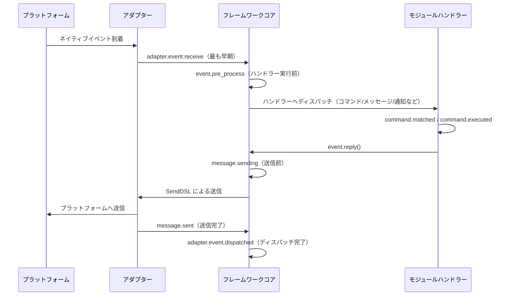

フレームワークには以下のフックブレークポイントが組み込まれており、ユーザーは `@sdk.lifecycle.on()` を使って任意のブレークポイントをリッスンし、カスタムロジックを実装できます。

### コア初期化

| フック名 | 発火タイミング | データ |
|---------|---------|------|
| `core.init.start` | SDK 初期化の開始 | `{}` |
| `core.init.stage` | 初期化の各段階の開始（バックグラウンドで発火） | `{"stage": str}`。値：`discovery` / `adapter_register` / `adapter_start` / `module_register` / `module_init` / `adapter_start_deferred` / `router_start` |
| `core.init.complete` | SDK 初期化の完了 | `{"duration": float, "success": bool, "stages": {stage: float}, "adapters": {"enabled": [str], "disabled": [str]}, "modules": {"enabled": [str], "disabled": [str]}, "error": str(失敗時のみ)}` |
| `core.uninit.complete` | SDK のアンイニシャライズ完了 | `{"duration": float, "success": bool, "adapters_closed": int, "modules_unloaded": int, "module_properties_cleared": int, "module_properties_to_clear": [str], "error": str(失敗時のみ)}` |

**例：起動進捗の表示**

```python
@sdk.lifecycle.on("core.init.stage")
def show_stage(data):
    print(f"[起動] フェーズに入りました: {data['stage']}")
```

### 設定変更

| フック名 | 発火タイミング | データ |
|---------|---------|------|
| `config.set` | 設定項目が変更された | `{"key": str, "old_value": Any, "new_value": Any}` |
| `config.updated` | config.toml の外部編集後にツリー全体の変更を検出 | `{"old_config": dict, "new_config": dict, "config_file": str}` |

**例：設定の監査**

```python
@sdk.lifecycle.on("config.set")
def audit_config(data):
    print(f"[監査] {data['key']}: {data['old_value']} -> {data['new_value']}")
```

### モジュールライフサイクル

| フック名 | 発火タイミング | データ |
|---------|---------|------|
| `module.register` | モジュールクラスがマネージャーに登録される | `{"module_name": str, "success": bool}` |
| `module.load` | モジュールのロード完了（インスタンス化成功）。失敗時は payload に `"error": str, "traceback": str` が追加で含まれる（失敗時の情報は `module.last_error(名前)` でも照会可能） | `{"module_name": str, "success": bool}` |
| `module.init` | モジュールの初期化完了（遅延ロードを含む） | `{"module_name": str, "success": bool}` |
| `module.before_unload` | アンロードパイプラインの最初のステップ（`on_unload` とリソース回収より前に実行。モジュールインスタンスフック `on_before_unload` も同時に発火） | `{"module_name": str, "reason": str}`。`reason` の値：`unload` / `reload` / `disable` / `cascade` / `dormant` |
| `module.sleep` | モジュールのスリープ完了（遅延ロード休眠：リソースは解放済み、アクセス時に自動的に復帰） | `{"module_name": str, "success": bool}` |
| `module.unload` | モジュールのアンロードまたは無効化（`disable` と `unload` は依存側に対等に通知され、`on_dependency_lost` の契約に「無効化」を含む） | `{"module_name": str, "success": bool, "reason": str}`。`reason` の値：`unload` / `reload` / `disable` / `cascade` / `dormant` |
| `module.rollback` | ホットリロード失敗時のロールバック完了（スナップショット復元 + 旧インスタンスの `on_load` 再実行後） | `{"module_name": str, "success": bool}`。`success` は `on_load` の再実行が成功したかを示す（False の場合、旧インスタンスはクリーンアップ済み状態のまま） |
| `module.reload` | モジュールのホットリロード完了（依存側のカスケードリロードを含む） | `{"module_name": str, "success": bool, "full": bool, "duration_ms": int}`。単一モジュールの場合は `"identity_changed": bool`（False = プロセス内で古いコードが実行されている可能性あり、C 拡張のキャッシュなど）と `"version_old": str, "version_new": str` も含まれる。全量リロード（`reload_all`）時は `module_name` が `"All"` となり、payload に `"results": dict[str, bool]` が追加で含まれる |

> **モジュールインスタンスフック `on_before_unload`**：`module.before_unload` イベントに対応するオプションのライフサイクルメソッドです。`event["reason"]` に呼び出しの目的が示されるため、リソース解放前に状態を `sdk.storage` に保存しておき、復帰 / リロード後に `on_load` で復元するのに適しています（遅延ロード休眠の状態継続はまさにこれに基づいています）。フックが失敗した場合は警告が出るだけで、アンロード処理はブロックされません。

### アダプターライフサイクル

| フック名 | 発火タイミング | データ |
|---------|---------|------|
| `adapter.load` | アダプターの登録完了 | `{"platform": str, "success": bool}` |
| `adapter.reload` | アダプターのコードレベル ホットリロード完了 | `{"adapter_name": str, "success": bool, "full": bool, "duration_ms": int, "identity_changed": bool, "version_old": str, "version_new": str, "was_started": bool, "source": str}`。`identity_changed=False` = プロセス内で古いコードが実行されている可能性あり |
| `adapter.rollback` | アダプターのホットリロード失敗時ロールバック完了（旧登録状態の復元後） | `{"adapter_name": str, "replayed": bool, "success": bool}`。`replayed=True` は旧インスタンスの `start()` を再実行済みであることを示し、`success` は再実行が成功したかを示す |
| `adapter.start` | アダプターの起動 | `{"platforms": [str]}` |
| `adapter.status.change` | アダプターの状態変化 | `{"platform": str, "status": str, "retry_count": int, "error": str(失敗時のみ)}`。status の全値：`starting` / `started` / `start_failed` / `stopping` / `stopped` / `stop_failed` / `skipped-dependency` / `disabled` |
| `adapter.stop` | アダプターの停止 | `{"platforms": [str]}` |
| `adapter.stopped` | アダプターの停止完了 | `{"platforms": [str]}` |
| `adapter.bot.online` | Bot オンライン | `{"platform": str, "bot_id": str, "info": dict, "status": str}` |
| `adapter.bot.offline` | Bot オフライン | `{"platform": str, "bot_id": str, "status": str}` |

### イベント受信と処理

| フック名 | 発火タイミング | データ |
|---------|---------|------|
| `adapter.event.receive` | 外部プラットフォームイベントの受信（最も早期） | `{"platform": str, "event_type": str, "raw_event_type": str}` |
| `adapter.event.blocked` | ミドルウェアによるイベント拒否（`False` を返す。イベントは破棄され、どのハンドラーにも渡されない） | `{"middleware": str, "platform": str, "event_type": str, "detail_type": str, "event": dict, "_trace_id": str}` |
| `adapter.event.dispatched` | イベントのディスパッチ完了 | `{"platform": str, "event_type": str, "raw_event_type": str, "onebot_handlers_count": int}` |
| `event.pre_process` | イベントハンドラー実行開始前 | `{"event_type": str, "platform": str, "detail_type": str}` |

**例：イベント統計**

```python
event_counter = {}

@sdk.lifecycle.on("adapter.event.receive")
def count_events(data):
    platform = data["platform"]
    event_counter[platform] = event_counter.get(platform, 0) + 1

@sdk.lifecycle.on("adapter.event.dispatched")
def log_unhandled(data):
    if data["onebot_handlers_count"] == 0:
        print(f"[未処理] {data['platform']}/{data['event_type']}")
```

### メッセージ送信

| フック名 | 発火タイミング | データ |
|---------|---------|------|
| `message.sending` | メッセージ送信直前 | `{"platform": str, "method": str, "detail_type": str, "target_id": str, "bot_id": str}` |
| `message.sent` | メッセージ送信完了 | `{"platform": str, "method": str, "detail_type": str, "target_id": str, "bot_id": str}` |

**例：メッセージ送信の監査**

```python
@sdk.lifecycle.on("message.sending")
def log_sending(data):
    print(f"[送信] -> {data['platform']}/{data['detail_type']}/{data['target_id']} via {data['method']}")
```

### コマンドシステム

| フック名 | 発火タイミング | データ |
|---------|---------|------|
| `command.matched` | コマンドがマッチし実行直前 | `{"command": str, "args": list[str], "platform": str, "user_id": str}` |
| `command.executed` | コマンド実行完了 | `{"command": str, "args": list[str], "platform": str, "user_id": str, "success": bool, "error": str(失敗時のみ)}` |

**例：コマンド統計**

```python
@sdk.lifecycle.on("command.matched")
def count_commands(data):
    print(f"[コマンド] /{data['command']} from {data['user_id']}@{data['platform']}")
```

### HTTP ルーティング

| フック名 | 発火タイミング | データ |
|---------|---------|------|
| `server.request` | HTTP リクエスト受信 | `{"method": str, "path": str, "client_ip": str, "request_id": str}` |
| `server.response` | HTTP レスポンス送信 | `{"method": str, "path": str, "status_code": int, "client_ip": str, "request_id": str}` |

> `request_id` は [X-Request-ID リクエスト相関 ID](router.md#请求关联-idx-request-id) です。クライアントのリクエストヘッダーを優先して使用し、なければ UUID を自動生成します。これを使ってリクエストとレスポンスの 2 つのイベントを関連付けることができます。

**例：リクエストログ**

```python
@sdk.lifecycle.on("server.response")
def log_http(data):
    print(f"[HTTP] {data['method']} {data['path']} -> {data['status_code']}")
```

### WebSocket

| フック名 | 発火タイミング | データ |
|---------|---------|------|
| `server.start` | ルーティングサーバーの起動 | `{"base_url": str, "host": str, "port": int, "success": bool, "error": str(失敗時のみ)}` |
| `server.stop` | ルーティングサーバーの停止 | `{}` |
| `server.websocket.connect` | WebSocket 接続の確立 | `{"path": str, "module_name": str, "client_ip": str}` |
| `server.websocket.disconnect` | WebSocket 接続の切断 | `{"path": str, "module_name": str, "reason": str, "error": str(例外時のみ)}` |

**例：WebSocket 接続モニタリング**

```python
@sdk.lifecycle.on("server.websocket.connect")
def on_ws_connect(data):
    print(f"[WS] 接続: {data['path']} from {data['client_ip']}")

@sdk.lifecycle.on("server.websocket.disconnect")
def on_ws_disconnect(data):
    print(f"[WS] 切断: {data['path']} ({data['reason']})")
```

### ストレージ接続状態

ストレージバックエンド接続プールの確立・障害・復旧（いずれもバックグラウンドで発火し、ストレージ操作をブロックしません）：

| フック名 | 発火タイミング | データ |
|---------|---------|------|
| `storage.ready` | ストレージバックエンドの接続プール準備完了（イベントループごとの最初のプール構築成功時） | `{"backend": str}` |
| `storage.unreachable` | 接続リトライを使い切りクールダウン期間に移行（期間中の操作は即座に失敗） | `{"backend": str, "error": str, "cooldown": float}` |
| `storage.recovered` | クールダウン終了後に再接続が成功し、ストレージが再び利用可能に | `{"backend": str}` |

**例：ストレージ障害アラート**

```python
@sdk.lifecycle.on("storage.unreachable")
def alert_storage_down(data):
    print(f"[アラート] ストレージバックエンド {data['backend']} に到達できません: {data['error']}、{data['cooldown']}秒後に自動再接続します")

@sdk.lifecycle.on("storage.recovered")
def notify_storage_back(data):
    print(f"[復旧] ストレージバックエンド {data['backend']} が利用可能に戻りました")
```

### HTTP クライアント

`sdk.client` のリクエストと接続イベント（いずれもバックグラウンドで発火）：

| フック名 | 発火タイミング | データ |
|---------|---------|------|
| `client.request.success` | HTTP リクエスト成功 | `{"method": str, "url": str, "status": int, "elapsed": float}` |
| `client.request.failed` | HTTP リクエストのリトライを使い切り最終的に失敗 | `{"method": str, "url": str, "error": str, "attempts": int, "elapsed": float}` |
| `client.ws.connect` | WebSocket 接続の確立 | `{"url": str}` |

### 国際化

| フック名 | 発火タイミング | データ |
|---------|---------|------|
| `i18n.language.changed` | フレームワーク言語の切替（`i18n.set_language`） | `{"language": str, "previous": str}` |

## 標準イベント定義

```python
STANDARD_EVENTS = {
    "core": ["init.start", "init.stage", "init.complete", "uninit.complete"],
    "module": ["load", "before_unload", "init", "sleep", "unload", "register", "reload"],
    "adapter": [
        "load", "start", "status.change", "reload", "stop", "stopped",
        "event.receive", "event.blocked", "event.dispatched",
        "bot.online", "bot.offline",
    ],
    "server": [
        "start", "stop",
        "request", "response",
        "websocket.connect", "websocket.disconnect",
    ],
    "event": ["pre_process"],
    "message": ["sending", "sent"],
    "command": ["matched", "executed"],
    "config": ["set", "updated"],
    "storage": ["ready", "unreachable", "recovered"],
    "client": ["request.success", "request.failed", "ws.connect"],
    "i18n": ["language.changed"],
}
```

## 完全なAPIリファレンス

### 登録と解除

| メソッド | 説明 |
|------|------|
| `@lifecycle.on(event, *, priority=0)` | デコレータでハンドラを登録 |
| `lifecycle.register(event, handler, *, priority=0)` | プログラミングで登録 |
| `lifecycle.unregister(event, handler=None)` | ハンドラの登録解除（handler=Noneの場合は、該当イベントのすべてのハンドラを解除） |

### トリガー

| メソッド | 説明 |
|------|------|
| `await lifecycle.emit(event, data=None, *, to=None)` | 非同期でトリガー、ハンドラは**並列実行**（相互にブロックせず、返却時はすべて完了）、返り値は優先度順に連鎖的にdataを置き換え；`to` にオーナーを指定した場合は、特定のオーナーにだけ配信 |
| `lifecycle.fire(event, data=None, *, to=None)` | **バックグラウンドで発行（投げて即離）**：ハンドラはバックグラウンドタスクで並列実行、待機せず、返り値なし；ハンドラがいない場合はオーバーヘッドなし。高頻度ホットパスや観測イベント（`server.request` / `storage.ready`）に適する。停止シーケンスや順序依存消費（`config.set`）は `emit` を使う |
| `lifecycle.emit_sync(event, data=None, *, to=None)` | 同期でトリガー、非同期ハンドラは `create_task` でスケジュール |
| `await lifecycle.submit_event(event_type, *, source, msg, data, to=None, background=False)` | 旧版と互換、標準イベント形式を自動構築；`background=True` の場合は `fire` でバックグラウンドで発行 |

**4種類のトリガーAPIの比較**：

| メソッド | 呼び出し形態 | ハンドラの完了を待つか | 代表的な使用場面 |
|------|---------|------------------|---------|
| `emit` | `await`（非同期） | **待つ**——ハンドラは並列実行、完了時に返却、返り値は優先度順に連鎖的にdataを置き換え | 通常のトリガー；順序依存消費（`config.set`）や停止シーケンスは必ずこれを使う |
| `fire` | 直接呼び出し（同期で返却） | **待たない**——バックグラウンドタスクで並列実行、返り値なし；ハンドラがいない場合はオーバーヘッドなし | 高頻度ホットパスや観測イベント（`server.request` / `storage.ready`） |
| `emit_sync` | 直接呼び出し（同期） | 同期ハンドラは即時完了；非同期ハンドラは `create_task` でスケジュール（返り値は返せない） | 非非同期コンテキスト（同期コード）でイベントをトリガー |
| `submit_event` | `await`（非同期） | 待つ（`background=True` の場合は `fire` と同じで待たない） | 旧版と互換：`source` / `msg` / `timestamp` を自動構築する |

### ユーティリティ

| メソッド | 説明 |
|------|------|
| `lifecycle.start_timer(timer_id)` | タイマーの開始 |
| `lifecycle.get_duration(timer_id)` | 経過時間を取得（秒） |
| `lifecycle.stop_timer(timer_id)` | タイマーを停止し、経過時間を返す |
| `lifecycle.list_hooks()` | すべての登録されたフックとハンドラ数をリストアップ |
| `lifecycle.clear()` | すべてのハンドラとタイマーをクリア |

## モジュールでの使用例

```python
from ErisPulse.Core.Bases import BaseModule
from ErisPulse import sdk

class Main(BaseModule):
    async def on_load(self, event):
        # 簡単なメッセージ統計を実装
        self.msg_count = 0
        
        @sdk.lifecycle.on("adapter.event.receive")
        async def count(data):
            if data["event_type"] == "message":
                self.msg_count += 1
        
        # すべてのコマンドを監視
        @sdk.lifecycle.on("command.matched")
        async def log_cmd(data):
            sdk.logger.info(f"コマンド実行: /{data['command']} by {data['user_id']}")
        
        # 設定変更の監査
        @sdk.lifecycle.on("config.set")
        def audit(data):
            sdk.logger.info(f"設定変更: {data['key']} = {data['new_value']}")
```

## バックグラウンドタスクの帰属と自動キャンセル

> [!NOTE]
> この機能には ErisPulse **2.8.0+** が必要です。

モジュールが作成した asyncio バックグラウンドタスクが `on_unload` 内でキャンセルされないままだと、`self` への参照を保持し続けるためモジュールインスタンスが回収されなくなります（ホットリロード後に古いインスタンスが残留します）。フレームワークは以下のフォールバック機構を提供しています：

- **`self.spawn(coro)`**（モジュール内での推奨）：タスクは自動的にモジュール名に帰属し、モジュールのアンロード時にフレームワークが `on_unload` の**後**で終了していないタスクをフォールバックでキャンセルし、警告を記録します
- **`spawn_background(coro)`**（`ErisPulse.runtime`）：現在の `owner_scope` コンテキストを自動的にキャプチャします。`cancel_owner_tasks(owner)` で帰属ごとにキャンセルでき、`cancel_all_background_tasks()` は `sdk.uninit()` 用のフォールバックです
- **アダプター**：シャットダウン時にプラットフォーム名義のバックグラウンドタスクも同様にフォールバックでキャンセルします

**メインループ登録前のタスク**（2.12+）：`spawn_background()` と `run_main_loop()` は、利用可能なメインループがない場合に一時的なイベントループを作成する代わりに、ペンディングキュー（上限 `PENDING_TASK_QUEUE_MAX`、デフォルト 1024）に入るようになりました。`sdk.run()` がメインループを登録する際に、キューを一括してフラッシュします。キューが満杯の場合は新しいタスクを破棄して警告を発します。owner 指定のキャンセルでは、その owner のペンディングタスクも同時に削除されます。終了時にも滞留タスクが残っている場合は警告を発して破棄します。`run_main_loop()` はエンキューパスでは `None` を返します。

```python
async def on_load(self, event):
    # 推奨：バックグラウンドタスクには self.spawn() を使用。アンロード時にフレームワークが自動的にフォールバックでキャンセルします
    self.spawn(self._poll())

async def on_unload(self, event):
    # 細かな制御が必要なシナリオでは、引き続き自身でキャンセルし、終了処理の完了を待つことを推奨します
    if self._poll_task:
        self._poll_task.cancel()
        await asyncio.gather(self._poll_task, return_exceptions=True)

async def _poll(self):
    while True:
        await asyncio.sleep(60)
        ...
```

> [!IMPORTANT]
> フレームワークのフォールバックは**強制キャンセル**（`cancel_owner_tasks`）であり、`on_unload` が返された後に実行されます。そのため、グレースフルな終了処理が必要なタスク（flush バッファ、状態の永続化、接続のクローズ）は、`on_unload` 内で自身で `cancel()` + `await` を行って完了させる**必要があります**——フォールバックが終了処理を保持してくれるとは期待しないでください。フレームワークが保証するのは「`self` を保持するタスクが残留しないこと」だけであり、「グレースフルさ」は保証しません。結果を `await` する必要があるタスクは直接 `await` し、バックグラウンドタスクに投げないでください。

## 注意事項

1. **ハンドラは同期または非同期**：システムは自動的に正しく呼び出します
2. **データの伝達**：`emit()` モードでは、ハンドラが `None` 以外の値を返すと、後続のハンドラに渡される `data` を変更します
3. **イベント名の命名規則**：点式構造のイベント名を使用することを推奨し、親イベントの監視が容易になります
4. **エラーの隔離**：1つのハンドラの例外は他のハンドラの実行に影響しません
5. **同期トリガーの制限**：`emit_sync()` では非同期ハンドラは fire-and-forget でスケジュールされ、返り値は返せません
6. **ライフサイクルのクリーンアップ**：`sdk.uninit()` を呼び出すと、すべての登録されたハンドラとタイマーがクリアされます
7. **ロード優先性**：フレームワーク初期化段階でイベントを監視したい場合は、高優先度を設定し、遅延ロードを無効化することを推奨します


### 懶加载系统

# ラグロードモジュールシステム

> [!TIP]  
> **この記事を読む必要があるタイミング**：ラグロードモジュールを使用する場合、または activate_on イベント駆動型のアクティベーションを使用する場合。それ以外の場合はスキップしても、他の機能の使用に影響はありません。

ErisPulse SDK のラグロードモジュールシステムは、モジュールの初期化を**実際にアクセスされたタイミングまで遅らせます**。起動フェーズではプレースホルダーエージェントのみを登録し、使用されなかったモジュールは起動時間やメモリを占有しません。

## 概要

ErisPulse のコア機能の 1 つである遅延ロードモジュールシステムは、以下の方法で動作します。

- **遅延初期化**：モジュールは、初めてアクセスされたときにのみ実際に読み込まれ、初期化されます。
- **透明な使用**：開発者にとって、遅延ロードモジュールは通常のモジュールと使用上ほとんど違いがありません。
- **自動依存管理**：モジュールの依存関係は、使用されるときに自動的に初期化されます。
- **ライフサイクルサポート**：`BaseModule` を継承したモジュールに対しては、ライフサイクルメソッドが自動的に呼び出されます。

## 動作原理

### LazyModule クラス

ラグジュアリー・ロード・システムの中心となるのが `LazyModule` クラスです。これは、最初にアクセスされたときにのみモジュールを実際に初期化するラッパーです。

### 初期化プロセス

モジュールが初めてアクセスされたとき、`LazyModule` は以下の操作を実行します：

1. モジュールクラスの `__init__` パラメータ情報を取得します
2. パラメータに基づいて `sdk` リファレンスを渡すかどうかを決定します
3. モジュールの `moduleInfo` 属性を設定します
4. `BaseModule` を継承したモジュールの場合、`on_load` メソッドを呼び出します
5. `module.init` ライフサイクルイベントをトリガーします

## イベント駆動型遅延起動（activate_on）

> [!NOTE]
> この機能は ErisPulse **2.8.0+** が必要です。

`lazy_load=True` のモジュールはデフォルトで**最初の属性アクセス時**にのみロードされます。モジュールがコマンド/イベントハンドラを登録している場合、従来の方法では `lazy_load=False` として即時ロードするしかありませんでした。`activate_on` は第三の選択肢を提供します：**トリガを宣言し、最初の一致するイベント/コマンドが到着した時点でモジュールを自動的にアクティブ化する**——メモリに常駐させることなく、トリガのエントリポイントを失うこともありません。

```python
from ErisPulse.loaders import ModuleLoadStrategy

class MyModule(BaseModule):
    @staticmethod
    def get_load_strategy():
        return ModuleLoadStrategy(
            lazy_load=True,
            activate_on=[
                # ---- イベントトリガ（受動的到着、ユーザーの意識を必要としない）----
                "message",                                    # タイプレベル：任意のメッセージイベント
                {"notice": "group_member_increase"},          # タイプ + 単一 detail_type
                {"message": ["private", "group"]},            # タイプ + 複数 detail_type

                # ---- コマンドトリガ（能動的入力、Help に表示されるプレースホルダーコマンド）----
                {"command": "roll"},                          # 簡易表記：コマンド名
                {"command": ["roll", "dice"]},                # コマンド名リスト
                {"command": {                                 # dict 形式で宣言（name は必須）
                    "name": "dice",
                    "help": "サイコロを振る",
                    "usage": "/dice",
                    "group": "娯楽",
                    "aliases": ["d"],
                    "hidden": False,
                }},
            ],
        )
```

### コマンド dict 形式の宣言パラメータ

dict 形式は `@command()` デコレータのユーザーレベルのパラメータを反映し、モジュールのロード前にプレースホルダーコマンドを登録するのに使用されます。

| パラメータ | 型 | デフォルト | 説明 |
|------|------|------|------|
| `name` | `str` | **必須** | コマンド名；`on_load` での `@command(name)` と一致する必要がある。一致しない場合、アクティブ化後にプレースホルダーが削除され、コマンドは存在しなくなる |
| `help` | `str` | フォールバックチェーン | Help に表示される説明；未宣言の場合、フォールバックチェーンから値を取得する（以下参照） |
| `usage` | `str` | 自動生成 | 使用法行；デフォルトは `{prefix}{name}` |
| `group` | `str` | `None` | コマンドグループ |
| `aliases` | `list[str]` | `[]` | 別名を同時に登録し、**別名の入力でもトリガとして機能する** |
| `hidden` | `bool` | `False` | `True` の場合、プレースホルダーコマンドも非表示（アクティブ化後の実際のコマンドの非表示の意味と一致）；コマンド名を知っているユーザーの入力でもトリガとして機能する |

**サポートされていない** `priority` / `permission` / `master`：プレースホルダーコマンドの役割はトリガの起動だけであり、権限チェックはアクティブ化後の実際のコマンドが実行する（プレースホルダー段階で権限チェックを行うと、「コマンド入力による起動」が無効になる）。

### 占位コマンドの Help フォールバックチェーン

モジュールがロードされていない場合、Help に表示されるコマンドの説明は以下の順序で取得されます（最初に見つかった値を使用）：

1. dict 形式で宣言されたコマンドレベルの `help`（最も正確）
2. モジュールの `get_meta()` の `description`
3. モジュールの `__description__` 属性
4. パッケージのメタデータの `Summary`（PyPI パッケージの概要）
5. 一般的なメッセージ：「このコマンドは遅延ロードモジュール X から来ています。初めて使用すると、モジュールが自動的にロードされます」

### トリガの意味

- **イベントスタブ**：対応するイベントマネージャーに非常に低い優先度（`ACTIVATION_STUB_PRIORITY`）で登録され、すべての通常のハンドラの後にバックアップとしてトリガされる。アクティブ化後、現在のイベントはモジュールの実際のハンドラに転送される
- **コマンドスタブ**：プレースホルダーコマンドを登録する。アクティブ化後、プレースホルダーは削除され、実際のコマンドがトリガを引き継ぐ
- **再入防止**：`asyncio.Lock` を使用して、並行トリガ時に一度だけアクティブ化されるように保証する
- **スコープフィルタリング**：スタブにはモジュールの所有者アイデンティティが含まれ、モジュールが Bot / セッション / プラットフォームに対して有効化されていない場合はトリガされない
- **失敗時の処理**：アクティブ化に失敗した場合はクールダウン期間（`ACTIVATE_RETRY_COOLDOWN_SECS`、30秒）に入る。クールダウン中はイベントが短絡的に処理され、繰り返し試行されない。クールダウン後に再トリガされると、自動的に再試行され、スタブは全期間保持される
- **重複排除**：同名のコマンドが簡易表記と dict 形式で混在して宣言された場合、重複は排除され（dict が優先される）。dict で `name` が欠落している、またはイベントの `detail_type` が dict として誤って記述された場合は警告が表示され、無視される

> アーキテクチャ図と完全な意味については、[アーキテクチャ概要](../architecture.md#イベント駆動型遅延起動activate_onトリガアーキテクチャ)を参照してください。

## 懒惰ロードの休眠（dormant_after）

> [!NOTE]
> この機能は ErisPulse **2.11.0+** が必要です。

長期間使用されていない遅延ロードモジュールに対して、フレームワークはその**休眠**を可能にします。これにより、実行時のリソース（タスク、接続、イベントの登録など）を解放しますが、遅延ロードプロキシと登録のスタブは保持されます。モジュールは「登録済みだがロードされていない」状態に戻り、次回の属性アクセス、`module.call`、`activate_on` イベントによって**透明に再起動**されます（再インスタンス化され、`on_load` が実行されます）。再起動のための API は一切不要です。休眠後のシステムの状態は、「一度も起動されていない」場合と完全に同一です。

### 宣言方法

```python
@staticmethod
def get_load_strategy():
    return ModuleLoadStrategy(
        lazy_load=True,
        dormant_after="30m",   # 30 分間の無使用で自動的に休眠；宣言しない場合は休眠しない（デフォルト）
    )
```

時間の指定は、コマンド管理の `cooldown` と同じ形式です（`90s` / `1h30m` / `1d`）。スクリーナーは固定間隔（60 秒）でスキャンを行い、実際の休眠時刻は閾値 + 最大でスキャン間隔分のずれがあります。また、手動で休眠させることも可能です：`await sdk.module.sleep("モジュール名")`。明示的な `unload` は完全なアンロード（遅延プロキシも削除）になります。

### 状態の継続

休眠前にフレームワークは `on_before_unload(reason="dormant")` をトリガーします（アンロードの最初のステップ、リソースはまだ有効）。モジュールは `sdk.storage` に状態を保存します。再起動後は `on_load` で状態を復元します：

```python
async def on_before_unload(self, event):
    if event["reason"] in ("dormant", "reload", "disable"):
        await self.sdk.storage.aset(f"{self._module_name}:counter", self._count)

async def on_load(self, event):
    self._count = await self.sdk.storage.aget(f"{self._module_name}:counter") or 0
```

### 意味と境界

- **依存先の安全性**：遅延モジュールの依存先は、永続的なプロキシ（`sdk.<Name>`）または `module.call` を通じてアクセスします。休眠前後で動作は一貫しています。直接に実際のインスタンスの参照を持つことは反パターンです（監査ツールで漏れが確認できます）。
- **イベントの到達**：休眠中のモジュールはイベントを受け取らなくなります。イベントによって再起動が必要なモジュールは、`activate_on` を同時に宣言してください（イベントが先に再起動し、その後転送されます）。「コマンドが反応しない」問題を調査する際は、モジュールが休眠状態にあるかどうかを確認してください。
- **再起動失敗時の自己修復**：再起動（再初期化）に失敗した場合、30 秒間のクールダウンに入り、クールダウン後に再びアクセスすると自動的に再試行されます。永久的に失敗することはありません。

## 懒惰ロードの設定

### グローバル設定

設定ファイルでグローバルな遅延ロードを有効または無効にします：

```toml
[ErisPulse.framework]
enable_lazy_loading = true  # true=遅延ロードを有効にする(デフォルト), false=遅延ロードを無効にする
```

### モジュールレベルの制御

モジュールは `get_load_strategy()` 静的メソッドを実装することで、ロード戦略を制御できます：

```python
from ErisPulse.Core.Bases import BaseModule
from ErisPulse.loaders import ModuleLoadStrategy

class MyModule(BaseModule):
    @staticmethod
    def get_load_strategy():
        """モジュールのロード戦略を返す"""
        return ModuleLoadStrategy(
            lazy_load=False,  # Falseを返すと即時ロード
            priority=100      # ロードの優先度、数値が大きいほど優先度が高い
        )
```

## ラグロードモジュールの使用

### 基本的な使い方

開発者にとって、ラグロードモジュールは通常のモジュールと使用方法にほとんど違いはありません：

```python
# SDKを介してラグロードモジュールにアクセス
from ErisPulse import sdk

# 以下のようにアクセスするとモジュールのラグロードがトリガーされます
result = await sdk.my_module.my_method()
```

### モジュールの取得の統一されたエントリーポイント

SDK属性、モジュールマネージャー属性を通じてアクセスする場合でも、`module.get()`で検索する場合でも、
「登録済みだがまだロードされていない」ラグロードモジュールに対しては、すべて同じラグロードプロキシが返り、
そのプロパティにアクセスすることで初めてモジュールの初期化がトリガーされます：

```python
# 3つの方法で取得できるのはすべてラグロードプロキシです（モジュールがロードされていない場合）、動作は一貫しており、ユーザーには透明です
sdk.my_module          # ロードをトリガーするエントリーポイント
sdk.module.my_module   # 同様にラグロードプロキシを返します
sdk.module.get("my_module")  # これもラグロードプロキシを返します。この操作自体はロードをトリガーしません

# プロキシの任意の属性にアクセスすることで、モジュールの初期化が実際に行われます
result = await sdk.my_module.my_method()
```

`module.get()`は**検索**用のインターフェースであり、ロードをトリガーしません：
- モジュールが既にロード済み → 実際のインスタンスを返します
- モジュールが登録済みだが未ロード → ラグロードプロキシを返します（プロパティにアクセスしたときに初期化されます）
- モジュールが未登録 → `None`を返します

明示的にロードをトリガーするには、`await sdk.load_module("my_module")`を使用してください。

### 非同期初期化

非同期初期化が必要なモジュールについては、まず明示的にロードすることを推奨します：

```python
# まずモジュールを明示的にロード
await sdk.load_module("my_module")

# その後モジュールを使用
result = await sdk.my_module.my_method()
```

### 同期初期化

非同期初期化を必要としないモジュールについては、直接アクセスできます：

```python
# 直接アクセスすると自動的に同期初期化されます
result = sdk.my_module.some_sync_method()
```

## 最佳実践

ロード戦略を選択する際は、以下の決定フローを参考にしてください。

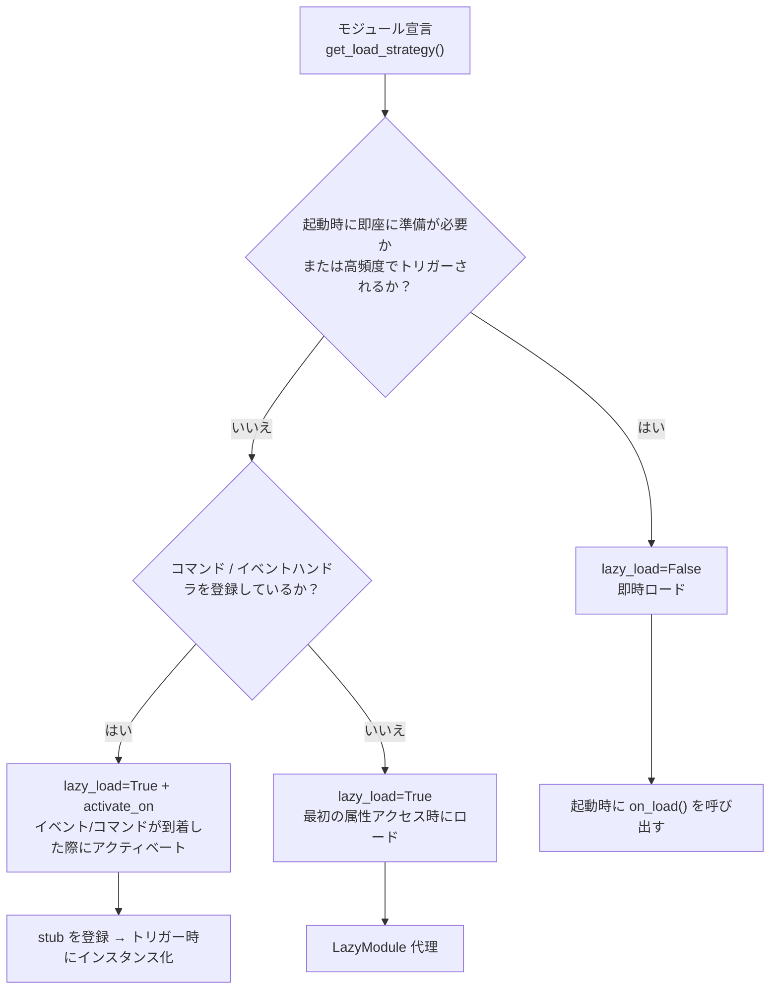

### 懒惰ロード（lazy_load=True）を使用することを推奨する場面

- 他のモジュールによって呼び出されるだけの受動的なユーティリティモジュール（例：データクエリモジュール、フォーマット変換器など）
- コマンド/イベントハンドラを登録しているが高頻度で使用されないモジュール — `activate_on` を使ってトリガを宣言し、最初の一致するイベント/コマンドが到着した際に自動的にアクティベートする。これにより、lazy_loadを放棄せずに済む。

### 懒惰ロードを禁止することを推奨する場面（lazy_load=False）

- 起動時に即座に準備が必要なモジュール（他のモジュールに基礎サービスを提供するコアモジュールなど）
- 高頻度でトリガーされるリスナー（各メッセージごとに処理が必要） — `activate_on` による転送には1回のアクティベートオーバーヘッドがあるため、高頻度の場面では即時ロードした方が直接的
- タイマータスクモジュール
- アプリケーション起動時に初期化が必要なモジュール

> `priority` パラメータは、即時ロードされるモジュール間の初期化順序を制御します。数値が大きいほど先に初期化されます。同じ優先度のモジュールは登録順にロードされます。

## 注意事項

1. モジュールが遅延ロードを使用している場合、ErisPulse内で他のモジュールによって一度も呼び出されない場合、そのモジュールは決して初期化されません。
2. モジュール内にEventの監視など、他のモジュールを積極的に監視するモジュールが含まれている場合、2つの選択肢があります：`activate_on` トリガーを宣言して遅延ロードを維持し、イベントが到達したときに自動的にアクティブ化するか、または即時ロードを必要とすることを宣言する（`lazy_load=False`）か、さもなければモジュールの正常な業務に影響を及ぼす可能性があります。
3. 特殊な要望がない限り、遅延ロードを無効にすることは推奨しません。そうしないと、依存管理やライフサイクルイベントなどの問題が生じる可能性があります。
4. `activate_on` のコマンド dict 声明において、`name` はモジュールの `on_load` で `@command()` によって登録された実際のコマンド名と一致する必要があります。一致しない場合、モジュールがアクティブ化された後にプレースホルダーコマンドが解除され、宣言と実装が一致しないコマンドは存在しません。


### 国际化（i18n）系统

# 国際化 (i18n) システム

> [!TIP]
> **この記事を読む必要があるのは**：多言語の文案、翻訳の登録、言語の検出が必要な場合です。必要ない場合は、他の機能の使用に影響を与えることなく、この記事は飛ばしてください。

ErisPulse v2.5.0 以降、完全な国際化 (i18n) 機能が内蔵されています。フレームワークのコアおよび CLI インターフェースは、システム言語に応じて表示されるテキストを自動的に切り替えることができ、外部モジュールが独自の翻訳を登録することもサポートしています。

## 支援言語

| 言語 | コード | 説明 |
|------|------|------|
| 简体中文 | `zh-CN` | デフォルト言語（フレームワークの原生言語） |
| 繁體中文 | `zh-TW` | 繁体中文（香港/澳门/台湾） |
| English | `en` | 英文（一般的フォールバック言語） |
| 日本語 | `ja` | 日本語 |
| Русский | `ru` | ロシア語 |

## 早速体験

### 環境変数による切り替え

```bash
# Windows PowerShell
$env:ERISPULSE_LANG = "en"
epsdk run

# macOS / Linux
ERISPULSE_LANG=ja epsdk run
```

### 設定ファイルによる切り替え

`config/config.toml` に以下を追加します：

```toml
[ErisPulse.i18n]
language = "zh-TW"
```

`"auto"`（デフォルト値）に設定すると、システム言語を自動検出します。

### コード内で手動で切り替え

```python
from ErisPulse import i18n

# 言語を手動で設定
i18n.set_language("en")
print(i18n.get_language())  # "en"

# 自動検出に戻す
i18n.reset_language()
```

## 言語検出メカニズム

フレームワークは、以下の優先順位でユーザーの言語を検出します：

1. **環境変数 `ERISPULSE_LANG`** — 最も高い優先順位で、テストや一時的な切り替えに使用
2. **Windows API** — `GetUserDefaultLocaleName`（Windowsに限定、Git Bashなどのツールが `LANG` を上書きする影響を受けない）
3. **環境変数** — `LANGUAGE` > `LC_ALL` > `LC_MESSAGES` > `LANG`（Unix/macOSの標準）
4. **システムロケール** — `locale.getlocale()` / `locale.getdefaultlocale()`
5. **デフォルト** — en（英語）

### 近接マッピング原則

検出された言語が正確に一致しない場合、サポートされている言語に近接する原則でマッピングされます：

- `zh-TW`, `zh-HK`, `zh-MO`, `zh-Hant` → **繁体中国語**
- その他のすべての `zh-*`（例: `zh-CN`, `zh-SG`）→ **簡体中国語**
- `en-US`, `en-GB`, `en-AU` など → **英語**
- `ja-JP` → **日本語**
- `ru-RU` → **ロシア語**
- その他の未認識の言語 → **簡体中国語（デフォルト）**

## モジュールでの i18n の使用

独自のモジュールに翻訳テキストを登録することで、多言語をサポートできます。

### 推奨方法：I18nClass を使って翻訳キーを宣言する（v2.7.0+）

v2.7.0 以降、モジュールやアダプターは `ConfigClass` を宣言するのと同じように、ネストされたクラス `I18nClass` を使って翻訳キーを宣言できます。フレームワークはロード時に**自動的に**宣言されたすべての翻訳キーを登録します。手動で `i18n.register()` を呼び出す必要はありません。

```python
from dataclasses import dataclass, field

from ErisPulse.Core.Bases import BaseConfig, BaseI18n, BaseModule, I18nKey


class MyModule(BaseModule):
    # 設定クラス（オプション）
    @dataclass
    class ConfigClass(BaseConfig):
        welcome_msg: str = field(
            default="欢迎",
            metadata={
                # ここでは i18n キー mymodule.welcome_msg を参照
                "description": {"i18n": "mymodule.welcome_msg", "default": "欢迎消息"},
            },
        )

    # 翻訳キー集合クラス（オプション）
    # 宣言されたキーはフレームワークによって自動的に登録され、
    # ConfigClass がデフォルト設定を生成するよりも優先されます
    class I18nClass(BaseI18n):
        # 属性名が自動的に結合されて完全なキー経路 <モジュール名>.<属性名> になります
        welcome_msg: I18nKey = I18nKey(
            default="Welcome Message",   # 言語に依存しないデフォルト値、どの言語にも登録されません
            zh_CN="欢迎消息",
            en="Welcome Message",
            ja="ウェルカムメッセージ",
            ru="Приветственное сообщение",
            zh_TW="歡迎訊息",
        )
        # 业务で使用する他の翻訳キー
        hello: I18nKey = I18nKey(
            default="Hello, {name}!",
            zh_CN="你好，{name}！",
            zh_TW="你好，{name}！",
            en="Hello, {name}!",
            ja="こんにちは、{name}！",
            ru="Привет, {name}!",
        )

        # 完全なキー経路を明示的に指定することもできます（属性名の結合を使わない）
        custom: I18nKey = I18nKey(
            key="mymodule.deep.nested.key",
            default="Default text",
            zh_CN="默认文本",
            zh_TW="預設文本",
            en="Default text",
            ja="デフォルトテキスト",
            ru="Текст по умолчанию",
        )
```

#### なぜ I18nClass が推奨されるのか？

| シナリオ | 手動 i18n.register() | I18nClass 宣言式 |
|------|-----------------------|------------------|
| 設定の説明に参照される i18n キー | 手動で登録する必要があり、設定生成前に登録する必要がある | フレームワークが設定生成前に自動的に登録する |
| 多言語翻訳の宣言 | on_load() 内に散在する | クラス内で一括して宣言され、一目瞭然 |
| キー名の命名の一貫性 | 拼写ミスが発生しやすい | 属性名がキー名の接尾辞として使用され、IDE による補完が可能 |
| アンロード時のクリーンアップ | 手動で unregister_domain() を呼び出す必要がある | フレームワークが統一されたドメインで登録する |

#### I18nClass のキー経路ルール

- **デフォルト**：``<モジュール登録名>.<属性名>`` を完全なキー経路として使用
  - 例：モジュール名が ``MyModule``、属性 ``welcome`` → キー経路 ``MyModule.welcome``
- **明示的**：``I18nKey(key="...")`` パラメータを使って任意のドット区切り経路を指定
  - 深層ネストされたキー名（例：``mymodule.config.basic.token``）に適している

#### アダプターでの使用

アダプターも `I18nClass` をサポートしており、使用方法は完全に同じです：

```python
from ErisPulse.Core import BaseAdapter
from ErisPulse.Core.Bases import BaseConfig, BaseI18n, I18nKey


class MyAdapter(BaseAdapter):
    @dataclass
    class ConfigClass(BaseConfig):
        endpoint: str = field(
            default="",
            metadata={
                # 設定の説明は adapter.MyAdapter.endpoint キーを参照
                "description": {"i18n": "MyAdapter.endpoint", "default": "API 地址"},
            },
        )

    class I18nClass(BaseI18n):
        # 集中して設定の説明に参照されるキーとその他の業務用キーの多言語訳を宣言
        endpoint: I18nKey = I18nKey(
            default="API Endpoint",
            zh_CN="API 地址",
            zh_TW="API 位址",
            en="API Endpoint",
            ja="APIアドレス",
            ru="API адрес",
        )
```

アダプターの `I18nClass` は `__init__` 階段（つまり設定テンプレート生成の前）に自動的に登録され、設定の説明に参照される i18n キーが利用可能になります。

### 手動でカスタム翻訳を登録する（旧方法）

`I18nClass` を使用しない場合、`i18n.register()` を直接呼び出して翻訳テキストを登録することもできます。

```python
from ErisPulse import i18n

# 中文翻訳を登録
i18n.register("zh-CN", {
    "my_module.welcome": "欢迎使用我的模块！",
    "my_module.goodbye": "再见！",
    "my_module.hello": "你好，{name}！",
}, domain="my_module")

# 英文翻訳を登録
i18n.register("en", {
    "my_module.welcome": "Welcome to my module!",
    "my_module.goodbye": "Goodbye!",
    "my_module.hello": "Hello, {name}!",
}, domain="my_module")
```

### 翻訳の使用

```python
from ErisPulse import i18n

# 簡単な翻訳
i18n.t("my_module.welcome")  # 現在の言語が自動的に使用されます

# フォーマットパラメータ付き
i18n.t("my_module.hello", name="Alice")

# デフォルト値を指定（翻訳キーが存在しない場合に返される）
i18n.t("my_module.unknown_key", default="默认文本")
```

### モジュールクラスでの使用

```python
from dataclasses import dataclass, field
from ErisPulse import i18n
from ErisPulse.Core.Bases import BaseConfig, BaseModule

@dataclass
class MyModuleConfig(BaseConfig):
    welcome_msg: str = field(
        default="欢迎",
        metadata={
            "description": {"i18n": "my_module.welcome_msg", "default": "欢迎消息"},
            "ui": {"widget": "text", "group": "basic", "order": 1},
        },
    )

class MyModule(BaseModule):
    ConfigClass = MyModuleConfig

    async def on_load(self, event):
        # 実時で設定を読み取る（各アクセスで最新値が反映される）
        self.logger.info(self.cfg.welcome_msg)
        self.logger.info(i18n.t("my_module.welcome"))

    @command("hello")
    async def hello_handler(self, event):
        name = event.get_user_nickname() or "friend"
        await event.reply(i18n.t("my_module.hello", name=name))

    async def on_unload(self, event):
        pass
```

### 翻訳のアンロード

```python
# ドメイン全体の翻訳をアンロード
i18n.unregister_domain("my_module")
```

---

## 設定フィールドの多言語対応

v2.5.2 以降、設定の Schema は i18n を全面的にサポートします。ユーザーが見られるすべてのテキストフィールドは i18n キーを参照でき、WebUI およびその他の消費者は、現在の言語に応じて自動的に対応するテキストに解析します。

### 対応する i18n フィールド

| フィールド | 位置 | 説明 |
|------|------|------|
| `description` | field metadata | フィールドの説明 |
| `options[].label` | `ui.options` | select コントロールのオプションラベル |
| `placeholder` | `ui.placeholder` | 入力欄のプレースホルダー |
| `group_labels` | `_schema_meta` | グループ表示名（Dashboard のセクションタイトル） |

すべての i18n フィールドは `{"i18n": "key", "default": "テキスト"}` の形式を採用し、純粋な文字列はそのまま透過されます（後方互換性を保つため）。

### i18n フィールドの宣言

すべてのユーザーが見られるテキストフィールドは i18n をサポートします：

```python
from dataclasses import dataclass, field
from ErisPulse.Core.Bases import BaseConfig

@dataclass
class MyAdapterConfig(BaseConfig):
    # description i18n
    token: str = field(
        default="",
        metadata={
            "description": {"i18n": "my_adapter.token", "default": "プラットフォーム Token"},
            "required": True,
            "secret": True,
            "ui": {
                "widget": "password",
                "group": "basic",
                "order": 1,
                # placeholder i18n
                "placeholder": {"i18n": "my_adapter.token.ph", "default": "Token を入力してください"},
            },
        },
    )
    # options label i18n
    mode: str = field(
        default="a",
        metadata={
            "description": {"i18n": "my_adapter.mode", "default": "実行モード"},
            "ui": {
                "widget": "select",
                "group": "basic",
                "order": 2,
                "options": [
                    {"label": {"i18n": "my_adapter.mode.a", "default": "モードA"}, "value": "a"},
                    {"label": {"i18n": "my_adapter.mode.b", "default": "モードB"}, "value": "b"},
                ],
            },
        },
    )

    # group_labels i18n（グループ表示名）
    _schema_meta = {
        "group_labels": {
            "basic": {"i18n": "my_adapter.group.basic", "default": "基本設定"},
        }
    }
```

`default` はバックアップテキストです。翻訳が登録されていない場合、または検索に失敗した場合に表示されます。

### secret 脱敏と設定検証

`"secret": True` とマークされたフィールドは、2.7.0 以降、**脱敏保護**が自動で適用されます：

- **テンプレート生成時の脱敏**：`dataclass_to_toml_with_comments()` が設定テンプレートを生成する際、secret フィールドの実際の値はファイルに書き込まれません（空のプレースホルダーとして表示され、機密情報がディスク上に残らないようにします）。
- **一般的な脱敏ツール**：`redact_secret(value)` は非空値を `***` に置き換え、空値はそのまま返します。これはログ出力などの場面で使用できます。

```python
from ErisPulse.Core.Bases.config_schema import redact_secret

redact_secret("sk-xxxxxx")  # '***'
redact_secret("")           # ''
```

**設定検証**（`validate_config()`）は、`required` の非空チェックに加えて、2.7.0 以降、以下の検証もサポートします：

| 検証項目 | メタデータ | 例 |
|--------|--------|------|
| 型の一致 | フィールドの宣言型 | `int` 型のフィールドに文字列を渡すとエラーになります |
| 列挙制約 | `ui.options` またはトップレベルの `options` | 値は許可されたオプションに属している必要があります |
| 数値範囲 | トップレベルの `min` / `max` | `metadata={"min": 1, "max": 65535}` |

```python
from ErisPulse.Core.Bases.config_schema import validate_config

@dataclass
class C(BaseConfig):
    mode: str = field(default="a", metadata={"ui": {"widget": "select", "options": ["a", "b"]}})
    port: int = field(default=80, metadata={"min": 1, "max": 65535})

errors = validate_config(C(mode="x", port=70000))  # 2つのエラー：列挙制約と範囲制約
```

### 設定の翻訳登録

設定フィールドの i18n キーは、通常の翻訳キーと同じように `i18n.register()` を使って登録できます：

```python
from ErisPulse import i18n

# 登録する中国語（default と同じでも、異なるものでも可）
i18n.register("zh-CN", {
    "my_adapter.token": "プラットフォーム Token",
}, domain="my_adapter")

# 登録する英語
i18n.register("en", {
    "my_adapter.token": "Platform Token",
}, domain="my_adapter")
```
> **推奨方法**：`I18nClass` を使って翻訳キーを宣言し、フレームワークが自動的に登録します（上記「推奨方法」の章を参照）。  
> 手動で `i18n.register()` や `register_config_i18n()` を呼び出す必要はありません。

また、便利な関数 `register_config_i18n()` も提供されており、設定クラスからキーを自動的に抽出して登録できます：

```python
from ErisPulse.Core.Bases.config_schema import register_config_i18n

# 自動的に description.default を zh-CN の翻訳として登録
register_config_i18n(MyAdapterConfig, "zh-CN")

# 手動で英語の翻訳を提供
register_config_i18n(MyAdapterConfig, "en", {
    "my_adapter.token": "Platform Token",
})
```

### WebUI での消費方法

`get_config_schema()` が返す schema では、i18n ディクショナリはそのまま透過されます。WebUI のフロントエンドは、現在の言語に応じて `i18n.t()` を呼び出して解析できます。

i18n をサポートしないフロントエンドに直接文字列を返す必要がある場合、`resolve_config_schema()` を使用します。この関数は、`description`、`options[].label`、`placeholder`、`group_labels` をすべて現在の言語の文字列に解析します：

```python
from ErisPulse.Core.Bases.config_schema import resolve_config_schema

# すべての i18n フィールドが現在の言語の文字列に解析されています
schema = resolve_config_schema(MyAdapterConfig)
print(schema["fields"]["token"]["description"])    # "プラットフォーム Token" または "Platform Token"
print(schema["fields"]["token"]["placeholder"])   # "Token を入力してください" または "Enter Token"
print(schema["fields"]["mode"]["options"][0]["label"])  # "モードA" または "Mode A"
print(schema["group_labels"]["basic"])             # "基本設定" または "Basic"
```

> `BaseConfig`、`BotAccountConfig`、`register_config_i18n()`、`resolve_config_schema()`  
> などの型とツール関数の実際の定義は `ErisPulse.Core.Bases.config_schema` にあります。  
> `ErisPulse.runtime.config_schema` は互換性のための shims として残されています。  
> **推奨は `ErisPulse.Core.Bases` から一括でインポートすること**（i18n 翻訳キーに関連する型は例外で、`ErisPulse.Core.Bases.i18n_schema` にあります）。

## API リファレンス

### I18nManager

#### 核心メソッド

| メソッド | 説明 |
|------|------|
| `t(key, default=None, **kwargs)` | 翻訳テキストを取得する（`gettext()` はエイリアス） |
| `set_language(lang)` | 手動で言語を設定する |
| `get_language()` | 現在の言語を取得する |
| `reset_language()` | 自動検出にリセットし、環境を再検出する |
| `get_supported_languages()` | すべてのサポート言語のリストを取得する |
| `has_translation(key, lang=None)` | 翻訳キーが存在するか確認する |
| `register(lang, translations, domain)` | 自定義翻訳を登録する |
| `unregister_domain(domain)` | 指定されたドメインのすべての翻訳をアンロードする |
| `reload()` | 内部翻訳を再読み込みし、言語を再検出する |

#### `t()` メソッドの詳細

```python
def t(self, key, /, default=None, **kwargs):
```

- `key` — 翻訳キー（位置引数のみ、`**kwargs` の `key=` と衝突しない）
- `default` — 翻訳が存在しない場合に返すデフォルト値、デフォルトは `None`（キー名そのものを返す）
- `**kwargs` — 翻訳値中の `{placeholder}` を埋め込むためのフォーマットパラメータ

例：

```python
# 翻訳定義: "greeting": "你好，{name}！欢迎来到{place}。"
i18n.t("greeting", name="Alice", place="ErisPulse")
# 戻り値: "你好，Alice！欢迎来到ErisPulse。"
```

### BaseI18n / I18nKey（宣言的翻訳キー）

v2.7.0 から、`ErisPulse.Core.Bases` はクラス属性に基づく翻訳キーの宣言ツールを提供しています（`ErisPulse.Core.Bases` から統一的にインポートすることを推奨します）：

> ``I18nKey.default`` は**言語に依存しないデフォルトテキスト**であり、どの言語にも登録されません。  
> 翻訳を有効にするには、少なくとも1つの言語パラメータ（``zh_CN=`` / ``en=`` / ``ja=`` など）を明示的に渡す必要があります。  
> これにより、各国の開発者は `default` を自分の母国語で自由に記入でき、フレームワークはその内容を一切仮定しません。

| 名称 | 説明 |
|------|------|
| `I18nKey(default, *, key=None, zh_CN, zh_TW, en, ja, ru)` | 単一の翻訳キーの宣言、`default` は言語に依存しないデフォルト |
| `BaseI18n` | 翻訳キー集合の基底クラス（`BaseConfig` と命名を揃える）、子クラスはクラス属性で複数の `I18nKey` を宣言する |
| `BaseI18n.register(prefix="", domain="app")` | クラスメソッド：宣言されたすべてのキーを i18n システムに登録する |
| `key` | `I18nKey` のエイリアス（より簡潔な書き方） |

使用例：

```python
from ErisPulse.Core.Bases import BaseI18n, key

class MyKeys(BaseI18n):
    # 簡潔なエイリアス書き方
    hello = key(
        default="Hello",
        zh_CN="你好",
        zh_TW="你好",
        en="Hello",
        ja="こんにちは",
        ru="Привет",
    )
    bye = key(
        default="Bye",
        zh_CN="再见",
        zh_TW="再見",
        en="Bye",
        ja="さようなら",
        ru="До свидания",
    )

# 独立使用（手動で登録）
MyKeys.register(prefix="myapp.", domain="myapp")
```

### SDK インスタンスからのアクセス

```python
from ErisPulse import sdk

# sdk.i18n は直接インポートした i18n と同じオブジェクト
sdk.i18n.set_language("en")
print(sdk.i18n.t("core.sdk.init.starting"))
```

## 実行時設定

### 設定APIを介してi18n設定を読み取る

```python
from ErisPulse.Core.Bases import I18nConfig
from ErisPulse.runtime import get_i18n_config

config = get_i18n_config()
print(config["language"])  # "auto" または具体的な言語コード

# I18nConfig は dataclass であり、設定テンプレートの生成に使用可能
schema = I18nConfig.__dataclass_fields__
```

### 設定項目の説明

`config/config.toml` の `[ErisPulse.i18n]` 部分で：

```toml
[ErisPulse.i18n]
# 表示言語。選択可能な値:
# - "auto"      — システム言語を自動検出（デフォルト）
# - "zh-CN"     — 簡体字中国語
# - "zh-TW"     — 繁体字中国語
# - "en"        — 英語
# - "ja"        — 日本語
# - "ru"        — ロシア語
language = "auto"
```

---

## 最佳実践

### 翻訳キーの命名

ドットで区切られた名前空間形式の命名を推奨します：

```
<モジュール名>.<カテゴリ>.<説明>
```

例：`my_module.command.hello_desc`、`core.adapter.start_failed`

### 多言語のカバー

すべての言語の翻訳を一度に提供する必要はありません。不足している言語は自動的に英語にフォールバックされ、英語もなければキー名そのものが表示されます。

### 動的コンテンツ

ユーザー名、数値などの動的に生成されるコンテンツについては、`{placeholder}` 形式でフォーマットします：

```python
# 翻訳定義
"user_count": "現在オンラインのユーザー：{count} 人"

# 使用
i18n.t("user_count", count=len(users))
```

### ログメッセージ

モジュールがフレームワークの Logger を使用している場合、これらのメッセージも自動的に現在の言語で表示されます：

```python
self.logger.info(i18n.t("my_module.startup"))
```

## CLI i18n との関係

CLI には**独立**した国際化モジュール (`ErisPulse.CLI.i18n`) があり、フレームワークのコアの国際化モジュールとは完全に分離されています。

- **Core i18n** — フレームワークのコアモジュールで使用され、外部モジュールは翻訳を登録できます。
- **CLI i18n** — コマンドラインインターフェース内で使用され、Core と翻訳データを共有しません。

この設計により、CLI の翻訳の変更がフレームワークのコアの安定性に影響を与えることがありません。


### 统一控制面（scope）

# スコープ（scope）

> [!TIP]
> **この記事を読むべきタイミング**：モジュールの可用性、イベントの受信制限、または出力アクションの制限を制御する必要がある場合。不要な場合は飛ばしても、他の機能の使用に影響はありません。

> **読了後は**：3つのスコープ次元（モジュールの可用性 / イベント受信 / 出力アクション）それぞれの設定経路、判定優先順位と拒否時の挙動、実行時のAPIの使い方、およびブロッキングがどのように可視化されるか（`scope.blocked` イベント）を理解できます。
>
> **本記事では対象外**：リソースの所有権と解放回収（[所有権（owner）システム](ownership.md)を参照）；コマンドACLとイベントの上書き（[イベント処理入門](../getting-started/event-handling.md)を参照）。

> [!NOTE]
> この機能は ErisPulse **2.8.0+** が必要です。

スコープは4つの質問に答える：**どのモジュールが使えるか、どのイベントを受け取るか、特定のモジュールがどのようなテキストを処理するか、モジュールが外部にどのようなアクションを実行できるか**。制御権はすべてユーザーに委ねられます。モジュール / アダプタ / プロセッサ / 出力呼び出しの登録時に**上層**（設定 `ErisPulse.scope` または実行時 `sdk.scope`）で一括して宣言し、イベントパイプラインはエントリ、プロセッサフィルタ、出力ゲートで自動的に読み取り、実行します。

| 次元 | 制御対象 | 拒否時の挙動 | 設定経路 |
|------|---------|---------|---------|
| **① モジュール** | どのモジュールが使えるか（プラットフォーム / Bot / セッションの3段階） | フィルタリングされたモジュールはトリガーされず、返信もされません（`scope.blocked` イベントをブロッキング）。対象となるコマンドは既に認証済みで、ブロックされます。 | `scope.platforms / bots / sessions` |
| **② 身分** | イベントを受け取るかどうか（アダプタ / Bot / セッション / ユーザーの4段階） | エントリで完全に破棄されます（`scope.blocked` イベントをブロッキング）。 | `scope.identity.*` |
| **③ 出力** | モジュールがどのような出力呼び出し（メッセージ / API / リクエスト、メソッドレベルの白黒リスト）を実行できるか | 失敗応答（`retcode=34601`）が返されます。 | `scope.actions` |

> **関連システム**：コマンドは特別なメッセージイベントハンドラであり、そのユーザーの白黒リスト（ACL）と実装パラメータの上書きはコマンドシステムが独自に保持します（`ErisPulse.event.command`）。[イベント処理入門](../getting-started/event-handling.md)と[設定ガイド](../user-guide/configuration.md)を参照してください。

{!--< tips >!--}
1. `from ErisPulse.Core import scope` でシングルトンをインポート（`sdk.scope` は同じオブジェクト）
2. 判定：`scope.is_allowed(...)` / `scope.is_identity_allowed(...)` / `scope.is_action_allowed(...)` は、それぞれ①②③の3つのゲートに対応します
3. 読み書き：次元化されたパラメータメソッド（IDEで補完可能）—— `scope.set_module(...)` / `scope.set_identity(...)` / `scope.set_action(...)`；また、辞書式のバックアップとして `scope.get(path)` / `scope.set(path, v)` / `scope.delete(path)` もあります
4. イベントハンドラのテキスト条件の上書きは、[イベント処理入門 · イベントの上書き](../getting-started/event-handling.md#イベントの上書き-モジュールコードを改ざんせず任意のイベントタイプの挙動を上書き)を参照してください；コマンドACL / パラメータの上書きは[イベント処理入門](../getting-started/event-handling.md)を参照してください
{!--< /tips >!--}

## マッチングエントリの構文（全システムで統一）

スコープのすべての「名前リスト」（モジュール名、身元キー、出力エントリ）は、同一のマッチング構文（`ErisPulse.Core.text_match`）を使用します：

| 構文 | 例 | 説明 |
|------|------|------|
| 精確名 | `"Chat"` | 全値比較、**大文字小文字は区別しない** |
| glob | `"Tool*"`、`"spam_*"` | `*` 任意の文字列 / `?` 1文字 / `[seq]` 文字集合、大文字小文字は区別しない |
| 正規表現 | `"re:^Danger.*"` | `re:` で始まる宣言、正規表現 `search` で一致、デフォルトは大文字小文字は区別しない |

- 不正な正規表現は**静かに無効化**される（エラーは発生せず、クラッシュもしない）
- デコレータのパラメータ（`pattern=` / `regex=`）は固定された意味を持つ：`pattern` は glob、`regex` は正規表現のソースコード（`re:` プレフィックスは付けない）；スコープの設定内の正規表現エントリは**必ず** `re:` プレフィックスを付ける必要がある

## グローバルバックアップ：`default_allow`

`default_allow` は**唯一のグローバルバックアップ**スイッチ（デフォルト `true`）で、2つの判定次元に一括して効果を及ぼします：

- **モジュール次元**：どのバインディングにも一致しない → `default_allow` で許可 / 拒否を決定
- **身元次元**：どの戦略にも一致しない → `default_allow` で許可 / 拒否を決定

`false` に設定すると「暗黙の拒否」厳密モードが有効になり、ホワイトリスト方式で管理されるため、**明示的に許可されていないものはすべて拒否**されます。

> **例外**：③ 出力次元は**`default_allow`の影響を受けない**——これは独立した絞り込みスイッチであり、デフォルトはすべて許可され、明示的なルールでのみ制限される（フレームワーク層の owner が空の呼び出しは常に許可される）。このように厳密なグローバルモードでも、すべてのモジュールのメッセージ返信が意図せず遮断されることはない。コマンド ACL には独立した `ErisPulse.event.command.default_allow` バックアップがあり、互いに影響しない。

## 設定ファイル

```toml
[ErisPulse.scope]
default_allow = true        # グローバルバックアップ（false = 暗黙の拒否厳密モード）
cache_size = 1024           # LRUキャッシュサイズ

# ── ① モジュール次元（優先度：セッション > Bot > プラットフォーム）──
[ErisPulse.scope.platforms.onebot11]
modules = ["Chat", "Tool*"]   # ホワイトリスト：正確な名前 / glob / re: 正規表現
blocked = ["re:^Danger"]
[ErisPulse.scope.bots.onebot11."123456"]
modules = ["Chat"]
merge = true                  # プラットフォームレベルのバインディングに追加（デフォルトは全体を上書き）
[ErisPulse.scope.sessions.onebot11."789012345"]
modules = ["Chat"]

# ── ② 身元次元（優先度：ユーザー > セッション > Bot > アダプタ）──
[ErisPulse.scope.identity.adapters.onebot11]
deny = true                   # アダプタ全体のイベントを完全に破棄
[ErisPulse.scope.identity.bots.onebot11."123456"]
deny = true
[ErisPulse.scope.identity.sessions.onebot11."g_blocked"]
deny = true
[ErisPulse.scope.identity.users.onebot11]
allow = ["u_admin"]           # ユーザー鍵は glob / re: 正規表現をサポート
deny = ["u_bad", "spam_*"]

# ── ③ 出力次元（デフォルトはすべて許可され、明示的な絞り込みのみ制限）──
[ErisPulse.scope.actions.MyModule]
send = { deny = true }                                    # 送信を完全に禁止
api = { allow = ["get_*"] }                               # クエリ系の標準APIのみ許可
request = { deny = true }                                 # リクエスト処理を禁止
```

## ① モジュール次元

**一言で言うと**：プラットフォーム / Bot / セッションの3段階でバインド制御を行い、"このコンテキストでどのモジュールが有効か"を制御します。フィルタリングされたモジュールはトリガされず、応答もしません（一致したコマンドは引き続き認領され、ブロックされます）。

「あるコンテキストで、どのモジュールが有効か」を回答します。デフォルトではすべて開放です。バインドを設定した場合にフィルタリングが開始され、**モジュールとアダプタは一切変更不要です**。

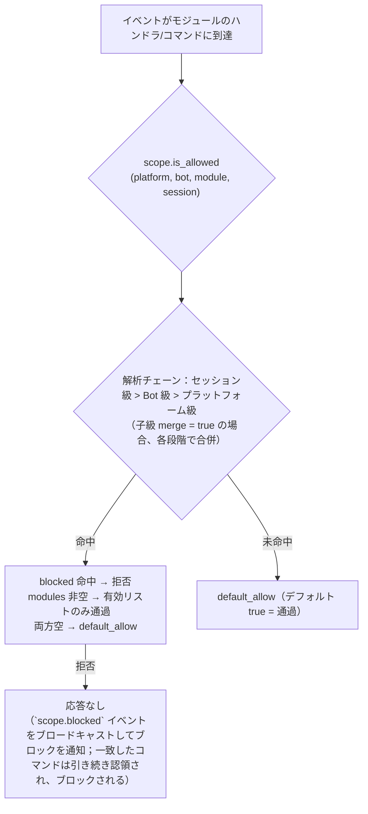

- **解析優先度**：セッション級 > Bot 級 > プラットフォーム級、高優先度のバインドは低優先度を**全体的に上書き**します。  
  子級バインドに `merge = true` を指定した場合は、低優先度と**各項目ごとに合併**されます（`modules` / `blocked` はそれぞれ独立に合併され、`merge` 自体は項目としてカウントされません）。
- **デフォルトの意味**：フィルタリングされたモジュールのコマンドやハンドラはトリガされず、応答もしません。TRACE レベルのログで確認可能（`core.scope.denied`）。  
  同時に `scope.blocked` ライフサイクルイベントをブロードキャストして、誰がブロックされたか、なぜブロックされたかを観測できます。  
  一致した**コマンド**は引き続き認領され、ブロックされます——コマンドのテキストは低優先度のメッセージハンドラに漏れることなく、二重応答の混乱を解消します。
- **フレームワークレベルのハンドラ**（`scope_exempt=True` または owner が空）は影響を受けません。モジュール名が空（フレームワーク層のリソース）の場合は常に通過します。
- **セッション感知のヘルプとコマンド照会**：コマンド照会 API（`command.help` / `get_command` / `get_commands` / `get_group_commands` / `get_visible_commands`、および `module.get_commands_overview`）は、任意の `event=` または明示的な `platform=` / `bot_id=` / `session_id=` キーワードをサポートします。  
  現在のセッションで無効なモジュールのコマンドは結果に含まれません（`get_command` は None を返し、単一コマンドのヘルプは「未登録」として扱われ、デフォルトの意味と一致します）。  
  コンテキストを渡さない場合は、全量の動作を維持します。

### バインドの継承（merge）

デフォルトでは、全体的な上書きの意味が明確で予測可能です。上級バインドに**追加**したい場合は、子級に `merge = true` を指定します：

```toml
[ErisPulse.scope.platforms.onebot11]
modules = ["Chat", "Tool"]      # プラットフォーム級：Chat、Tool を有効

[ErisPulse.scope.bots.onebot11."123456"]
modules = ["Music"]
merge = true                    # この Bot の実効値 = ["Chat", "Tool", "Music"]
```

- 合併ルール：`modules` と `blocked` はそれぞれ**合併**されます。バインド内では `blocked` が `modules` より優先されます。
- 鏈式合併：プラットフォーム → Bot → セッションの順に段階的に追加され、各段階で `merge` または上書きを独立して決定します。

## ② 身元次元（イベント受容）

**一言で言うと**：ユーザー／セッション／Bot／アダプターの4段階の戦略に基づき、イベント配信の入口で「受容すべきでないイベント」を完全に破棄し、deny は allow より優先されます。

「どのユーザーのイベントを受け入れるか」を決定します。拒否されたイベントは**配信の入口で完全に破棄**されます——ミドルウェアや任意のハンドラ（フレームワークレベルを含む）には一切渡らず、TRACE レベルのログ（`core.scope.identity_denied`）でのみ確認できます。

- **解析優先度**：ユーザー > セッション > Bot > アダプター。最も具体的に設定された戦略を採用します。deny は allow より優先されます。
- 各段階のバインディングは二元的な戦略です：`{ allow = true }` または `{ deny = true }`
- ユーザーのキーには glob / 正規表現（例：`"spam_*"` で一括してスパムユーザーをブロック）が使用可能です。
- 代表的な使い方——上位階層で deny し、個別のユーザーに対して allow を設定することで「例外的に許可」を実現します：

```toml
[ErisPulse.scope.identity.adapters.onebot11]
deny = true
[ErisPulse.scope.identity.users.onebot11]
allow = ["u_admin"]   # アダプター階層で拒否されていても、u_admin のイベントは許可されます
```

## ③ 出站次元（制限モジュールが発信する呼び出し）

**一言で言うと**：メソッド単位のホワイトリスト・ブラックリストによって、モジュールが発信するメッセージ / API / リクエスト呼び出しを制限し、拒否された呼び出しはネットワークリクエストを一切行わず、直接 `retcode=34601` を返します。

制限されるモジュールの**発信アクション**：メッセージ送信 / 標準APIアクション / リクエスト操作。  
3つのアクションはそれぞれ下層DSLに対応します：`Event.reply` と `Send`（send）、`Api` / `call_api`（api）、`Request` の accept/reject（request）。イベントハンドラ実行中にモジュールが発信する出站呼び出しは、モジュールのオーナーを含み、この次元で一括して判定されます。

### 規則の形態（インライン表）

各アクションのルールはインライン表です：`{ allow = [...], deny = true|[...] }`。  
同一アクションには1つのルールしか設定できません（TOMLのキーは重複不可、全禁止と細粒度のどちらか1つを選択）：

```toml
[ErisPulse.scope.actions.MyModule]
send = { deny = true }                                  # 送信を全禁止（Event.reply / Send DSL）
# またはメソッド単位の細粒度設定：send = { allow = ["Text", "Image*"], deny = ["File"] }
api = { allow = ["get_*"] }                             # 限定的に取得系標準APIを許可
# またはアクション単位のブラックリスト：api = { deny = ["set_*", "leave_*"] }
request = { deny = true }                               # リクエストのaccept/reject処理を禁止
```

- `send` の項目は**送信メソッド名**（`Text` / `Image` / `File` ...）に一致する
- `api` の項目は**標準アクション名**（`get_group_info` / `set_group_name` ...）に一致する
- 項目は正確な名前 / glob / `re:` 正規表現（全システムと統一された構文で、大文字小文字は区別しない）
- `allow` に1つの文字列を記述することは、1つの項目のリストと同義です：`send = { allow = "Text" }`

### 判定の意味

**デフォルトは全許可**——設定がなければ、またはオーナーが空（フレームワーク層の内部呼び出し）であれば許可されます。  
ルールが設定された場合、以下の順序で判定されます：

1. `deny = true` → 拒否
2. `deny` リストに呼び出し名が一致 → 拒否
3. `allow` リストが空でなく、呼び出し名が一致しない（または呼び出しに名前がない）→ 拒否
4. その他の場合 → 許可

拒否された呼び出しはネットワークリクエストを一切行わず、標準の失敗レスポンスを直接返します（`retcode = 34601`、[api-response §5.3](../standards/api-response.md#53-フレームワーク拡張返却コード34xxx-プラットフォームエラーセグメントの下3桁カスタマイズ)を参照）。  
3つのアクションは互いに独立しており、1つだけを制限することも可能です。

```python
# 実行時API
sdk.scope.set_action("MyModule", "send", deny=True)              # 送信を全禁止
sdk.scope.set_action("MyModule", "send", allow=["Text"])         # 送信はテキストのみ許可
sdk.scope.is_action_allowed("MyModule", "send", name="Image")    # False
sdk.scope.is_action_allowed("MyModule", "api", name="get_user_info")  # 規則に従って判定
sdk.scope.delete_action("MyModule", "send")                      # 許可を復元
sdk.scope.get_action("MyModule", "send")                         # そのアクションの現在のルール
```

## 実行時API

スコープの実行時APIは3つの層に分かれています：**判定**（3つの質問）、**次元ごとの読み書き**（各次元の `set` / `get` / `delete` パラメータ化メソッド、署名はすべて型注釈付き、IDEで補完可能）、**辞書式バックアップ**（ドット区切りのパスで任意の節に直接アクセス）。

```python
from ErisPulse import sdk

scope = sdk.scope
```

### 判定（3つの質問）

```python
scope.is_allowed("onebot11", "123456", "Chat")                 # ① モジュール次元
scope.is_allowed("onebot11", "123456", "Chat", "789012345")    # セッションレベルを含む
scope.is_allowed("onebot11", "123456", None)                   # フレームワーク層のリソース -> True

scope.is_identity_allowed("onebot11", "123456", "group_9", "u1")   # ② 身元次元

scope.is_action_allowed("MyModule", "send")                    # ④ 出力次元
scope.is_action_allowed("MyModule", "send", name="Image")      # メソッドレベルの細粒度
```

### ① モジュール次元

```python
# バインディング（パラメータによって階層が決まります：session_id > bot_id > プラットフォームレベル）
scope.set_module("onebot11", bot_id="123456", modules=["Chat", "Tool*"])
scope.set_module("onebot11", blocked=["re:^Danger"])                       # プラットフォームレベル
scope.set_module("onebot11", bot_id="123456", session_id="g9", modules=["Chat"])  # セッションレベル
scope.set_module("onebot11", bot_id="123456", modules=["Music"], merge=True)      # 現在のバインディングと並列に結合
scope.set_module("onebot11", bot_id="123456", modules=["Chat"], persist=False)    # 実行時のみ

# 読み取り / 削除
scope.get_module("onebot11", bot_id="123456")   # {"modules": ["Chat"], "blocked": []}
scope.delete_module("onebot11", bot_id="123456")
```

> `merge=True` は**書き込み時に並列に結合**（現在のバインディングとエントリを結合）です；階層間の解析時の `merge = true` 設定は上記の[バインディング継承](#バインディング継承merge)をご覧ください——これらは独立したメカニズムです。

> **実行時バインディング（`persist=False`）の意味**：実行時バインディングは独立したオーバーライド層に保存され、**任意の後続の設定書き込み / 設定ファイルのホットアップデートでも削除されません**（設定ツリーが再構築された後に、書き込み順に自動的に再実行されます、実行時削除も含みます）。これらは永続化されず、プロセスの再起動後に失われます；モジュールのアンロード時に、そのモジュールが書き込んだ実行時バインディングはバックアップでクリーンアップされます。その後、同一のパスで `persist=True` を実行すると、ユーザー永続化の意味で実行時ルールが上書きされます。

### ② 身元次元

```python
# 戦略のバインディング（パラメータによって階層が決まります：user > session > bot > adapter；allow / deny のどちらか一方）
scope.set_identity("onebot11", user_id="u_bad", deny=True)
scope.set_identity("onebot11", user_id="spam_*", deny=True)    # キーは glob / re: 正規表現をサポート
scope.set_identity("onebot11", bot_id="123456", session_id="g9", allow=True)

# 読み取り / 削除
scope.get_identity("onebot11", user_id="u_bad")   # {"deny": True}
scope.delete_identity("onebot11", user_id="u_bad")
```

### ③ 出力次元

```python
# 制限ルールの設定（allow: str|list；deny: bool|str|list；ルール全体の置換）
scope.set_action("MyModule", "send", deny=True)                    # 送信を完全に禁止
scope.set_action("MyModule", "send", allow=["Text"])               # テキスト送信のみ許可
scope.set_action("MyModule", "api", deny=["set_*", "leave_*"])     # 管理系APIを禁止

# 読み取り / 削除
scope.get_action("MyModule", "send")       # {"allow": ["Text"]} 元のルール
scope.delete_action("MyModule", "send")    # 個別のアクションを削除
scope.delete_action("MyModule")            # モジュールのすべてのアクション制限を削除
```

### 一般的な操作

```python
scope.get("platforms")   # 辞書式バックアップ：ドット区切りのパスで任意の節を読み取り
scope.topology()         # 全設定ツリー（ダッシュボード用）
scope.stats()
# {"module_calls": .., "module_filtered": .., "identity_checks": .., "identity_denied": ..,
#  "action_checks": .., "action_denied": .., "cache_hits": .., "cache_misses": ..}
scope.reset_stats()
scope.clear()           # 全設定をクリア（メモリ上でのみ有効）
```

### 高度な操作：辞書式ドット区切りパスバックアップ

次元化されたメソッドは日常的なシナリオをカバーします；任意のノード（または将来追加される次元）に直接アクセスする必要がある場合、**辞書式API**を使用できます——`get` / `set` / `delete` はドット区切りのパスを受け取り（dictの深さのマージ、書き込み後すぐに読み取り可能）、`scope[path]` / `scope[path] = v` / `del scope[path]` / `path in scope` プロトコルも提供します：

```python
scope.set("bots.onebot11.123456", {"modules": ["Chat"], "blocked": []})
scope.set("identity.users.onebot11.u_bad", {"deny": True})
scope.get("actions.MyModule.send")

scope["platforms.onebot11"]        # 読み取り（存在しない場合はKeyErrorを送出）
scope["platforms.onebot11"] = {...}  # 書き込み
del scope["platforms.onebot11"]      # 削除
"actions.MyModule" in scope          # 存在確認
```

## 拦截の可視化：`scope.blocked` イベント

スコープのフィルタリング（モジュールのフィルタ / 身元の拒否）が発生すると、**`scope.blocked`** というライフサイクルイベントがブロードキャストされ、"誰がブロックされたか、どのレベルでブロックされたか"をサブスクライブ、統計、ダッシュボードで表示可能になります——ブロックはデフォルトで返信されませんが、不可知のブラックボックスではありません。

| フィールド | 説明 |
|------|------|
| `dimension` | `"module"`（モジュール次元のフィルタ）/ `"identity"`（身元の受信拒否） |
| `module` | フィルタされたモジュール名（モジュール次元のみ） |
| `platform` / `bot_id` / `session_id` / `user_id` | ブロックが発生したソースコンテキスト |

```python
from ErisPulse.Core.lifecycle import lifecycle

@lifecycle.on("scope.blocked")
def on_blocked(data):
    print(f"ブロックされた：{data['dimension']} {data.get('module') or data.get('user_id')}")
```

- イベントは `fire` でバックグラウンドでブロードキャストされます（リスナーがいない場合はオーバーヘッドがなく、ホットパスを遅らせません）
- キャッシュヒットによる重複のブロックは**再ブロードキャストされません**——同じ組み合わせはキャッシュが失効するたびに1回だけブロードキャストされます
- `adapter.event.blocked`（ミドルウェアによる拒否）とは区別されます：これはイベントレベルの破棄であり、本イベントはスコープの受信ゲートのモジュール / 身元フィルタリングです

## キャッシュとホットアップデート

- `is_allowed` / `is_identity_allowed` / `is_action_allowed` の結果は**LRUキャッシュ**（`scope.cache_size` で調整可能）が付いており、`set` / `delete` / 設定のホットアップデート（`config.updated` / `config.set`）で自動的に失効します
- すべての次元の設定は**即座に有効**になります、再起動は不要です
- スコープは**イベントごとの判断**であり、イベント間で状態を記憶しません：設定が変わると、次のイベントは新しいルールに従います

## 設定フォーマットの検証

ロード時 / ホットアップデート時に各セクションの設定フォーマットを検証します：型の間違ったセクション（例：`platforms` が文字列に設定されている）、不正な出力ルール（例：`allow` が数値に設定されている）、未知のアクション名、未知のトップレベルのキー（例：`alow` というスペルミス）は **WARNING** として出力され、対応するセクション / 条目は無視され、他の合法な設定は正常に有効になります——間違った設定は静かに失効するのではなく、警告されます。

## 一般的な問題と注意事項

### 1. 設定の階層と上書き

- モジュール次元：セッションレベル > Botレベル > プラットフォームレベル、**全体的に上書き**（子レベルで `merge = true` の場合は各エントリを並列に結合）。プラットフォームで `Chat` を許可し、Bot で `Music` を追加したい場合は、Bot レベルで `merge = true` を書くか、両方をリストに書く
- 身元次元：ユーザー > セッション > Bot > アダプタ、**最も具体的な**設定された戦略を取ります（例外許可ができます）
- コマンドのユーザーブラックリスト/ホワイトリスト：正確なコマンド名が glob キーに優先されます（`event.command.acl` を参照）

### 2. モジュール/コマンドが反応しない

まず作用域が原因かどうかを疑います：

```python
from ErisPulse import sdk

print(sdk.scope.is_allowed(event.get_platform(), bot_id, "MyModule", session_id))
print(sdk.scope.is_identity_allowed(event.get_platform(), bot_id, session_id, user_id))
print(sdk.scope.stats())   # module_filtered / identity_denied > 0 なら、ブロック記録がある
```

フィルタされた場合、デフォルトでは返信されません（モジュール次元と身元次元、ルールを暴露しないように）；`scope.blocked` ライフサイクルイベントをブロードキャストし、統計は継続的に蓄積されます；ACL で拒否されたコマンドは「権限不足」の返信を表示します。

### 3. 出力アクションが拒否されたときのトラブルシューティング

```python
from ErisPulse import sdk

print(sdk.scope.get("actions.MyModule"))
print(sdk.scope.stats())   # action_denied > 0 なら、呼び出しがブロックされている
```

ブロックは**明示的**です：拒否された呼び出しは `retcode = 34601` の標準の失敗レスポンスを返し、ネットワークリクエストは発生しません。

### 4. セッション識別子のプラットフォーム間隔離

`(platform, session_id)` 組み合わせが唯一の識別子です。`scope.sessions.onebot11."789"` は onebot11 でのみ作用し、telegram 上で同じ `789` のセッションには影響しません。身元次元のユーザーキーも同様です。

## 拓撲ツリーアプリケーションプログラミングインターフェース

`ModuleManager.get_topology()` と `AdapterManager.get_topology()` は、モジュール/アダプタの所属関係データを提供します。`sdk.get_topology()` は、作用域 `scope` を含む一括集約を行います：

```python
from ErisPulse import sdk

topology = sdk.get_topology()
# {
#   "modules": {                                   # モジュール → 持有するリソース
#     "Chat": {
#       "loaded": True, "enabled": True,
#       "commands": ["chat", "translate"],
#       "handlers": {"message": 2, "notice": 1},
#       "routes": {"http": ["/Chat/api"], "ws": [], "sse": []},
#       "lifecycle_hooks": 3,
#     }
#   },
#   "adapters": {                                  # アダプタ → Bot → 作用域
#     "onebot11": {
#       "status": "started", "enabled": True,
#       "bots": {"123456": {"status": "online", "scope": {...}}},
#       "scope": {"modules": [...], "blocked": [...]},
#     }
#   },
#   "scope": {                                     # 作用域（モジュール / 身元 / 出力アクション）
#     "platforms": {...}, "bots": {...}, "sessions": {...},
#     "identity": {"adapters": {...}, "bots": {...}, "sessions": {...}, "users": {...}},
#     "actions": {...},
#   },
# }
```

- モジュールのトポロジーは、登録されたコマンド、イベントハンドラ、HTTP/WS/SSEルート、ライフサイクルフックを統合し、モジュールリソースツリーを描画するのに便利です。
- アダプタのトポロジーは、各アダプタの状態、下位のBotの状態、およびプラットフォーム/Botレベルの作用域バインディング（モジュール次元）を統合します。
- **JSON安全出力**：`get_topology(json_safe=...)` はデフォルトで `True` であり、返された構造は直接 `json.dumps` できます——モジュール `info` は純粋なデータの `meta` サブテーブルのみ保持されます（`module_class` / `strategy` などの実行時オブジェクトは除外）、その他のノード（アダプタ作者が Bot `info` に挿入した任意のオブジェクトを含む）もバックアップで浄化されます（クラスオブジェクトは `__name__` を取得し、シリアライズできないオブジェクトは `str()` に退化します）。ダッシュボード / WebUI は直接シリアライズして返すことができます；原始オブジェクトが必要な場合は `json_safe=False` を渡します。


### 归属权（owner）系统

# 帰属システム

> [!TIP]
> **いつこのドキュメントを読むべきか**：リソースリークの調査、アンロード時のクリーンアップチェーンの理解、または帰属リソースの宣言を行う際。不要であれば読み飛ばしても、他の機能の利用には影響しません。

> **読み終えると分かること**：owner コンテキストがどのようにリソースを自動帰属させるか、帰属リソースの全体表、アンロード/無効化時の
> クリーンアップチェーンの完全なシーケンス、そしてどのリソースがアンロード時にクリーンアップされないか（設計上の境界）。
>
> **本ドキュメントで扱わないこと**：リソースが「いつ有効になるか」の権限判定（[スコープ](scope.md) を参照）；
> バックグラウンドタスクの推奨記述方法と強制キャンセルの境界（[ライフサイクル管理 · バックグラウンドタスクの帰属と自動キャンセル](lifecycle.md#バックグラウンドタスクの帰属と自動キャンセル) を参照）。


帰属はモジュールの「プラグアンドプレイ」の基石です：モジュールが読み込み期間中に登録したすべてのフレームワークリソースは自動的に記名され、
アンロード/無効化時に記名に基づいて一括回収されます——モジュール作者はリソースを宣言するだけで、クリーンアップロジックを手書きする必要はありません。

> **関連システム**：スコープはイベントディスパッチ時に「リソースが有効かどうか」を決定し、
> 帰属はライフサイクルにおいて「リソースの帰属先と、誰がアンロードされたときに回収されるか」を決定します。
> スコープの詳細は[統一コントロールプレーン](scope.md)を、バックグラウンドタスクの詳細は
> [ライフサイクル管理](lifecycle.md#バックグラウンドタスクの帰属と自動キャンセル)を参照してください。

{!--< tips >!--}
1. 帰属は**登録の瞬間**に `current_owner` に基づいて自動記録され、モジュールコードは一切変更不要
2. アンロード/無効化は同じクリーンアップチェーン（`_cleanup_module_registrations`）を共用し、各ステップの失敗は警告のみで中断しない
3. ユーザー設定セマンティクスのリソース（永続化オーバーライド / scope ルール / コマンド ACL）はモジュールのアンロード時にクリーンアップ**されない**
4. ツールモジュールが管理する外部ハンドルは `on_cleanup(cb)` でクリーンアップチェーンに組み込め、相手モジュールのアンロード時に自動コールバックされる（[ツールモジュールガイド](#ツールモジュールガイド他のモジュールのハンドルを管理する) を参照）
{!--< /tips >!--}

## owner コンテキスト機構

owner はコンテキスト変数 `current_owner` を通じて伝達されます（`ErisPulse.runtime.context`）：

```python
from ErisPulse.runtime import owner_scope, get_current_owner

with owner_scope("MyModule"):
    # この区間内で登録されるすべてのリソースは自動的に MyModule に帰属します
    assert get_current_owner() == "MyModule"
```

フレームワークは以下のタイミングで自動的に owner を注入します（モジュール/アダプターのコードで手動ラップは不要）：

| タイミング | owner 値 | 場所 |
|------|----------|------|
| モジュール `load()` | モジュール名 | インスタンス化 + `on_load` の全期間 |
| アダプター `start()` / `restart()` | プラットフォーム名 | アダプター起動の全期間 |
| `activate_on` 遅延ロード stub 登録 | モジュール名 | プレースホルダーコマンド/ハンドラー登録 |
| イベントハンドラー実行時 | ハンドラーの帰属モジュール名 | handler / コマンドエントリでの再注入 |

実行時の再注入とは、モジュールが `on_load` 内で宣言したコマンドハンドラーの**実行中**に
登録型 API（`sdk.adapter.on()`、`overrides.*.set(persist=False)` など）を呼び出した場合も、
同様に自動的に当該モジュールに帰属することを意味します。

### bind_owner：帰属をコールバックとスレッドエントリに縫い込む

`owner_scope` はコードブロックに作用します。`bind_owner(fn)` はコンテキストを関数そのものに「縫い込み」ます——
ラップした瞬間に `current_owner` をキャプチャし、その後は誰が、どのスレッドやイベントループから呼び出しても、
元の owner の身分で実行されます。新規スレッドはデフォルトで空のコンテキストを持ち
（Timer / watcher / サードパーティのスレッドプールのトリガーパスでは `current_owner` が None になります）、
その中で作成されたタスクは帰属テーブルに入らず、モジュールのアンロード時にキャンセルできません
（loop を跨いだ残留の原因の一つ）が、ラップすれば帰属が随伴します：

```python
from ErisPulse.runtime import bind_owner

class MyModule(BaseModule):
    async def on_load(self, event):
        # サードパーティのスケジューラ / スレッドプールに渡す前にラップします：
        external_scheduler.submit(bind_owner(self._poll))

    async def _poll(self):
        # 実行中は current_owner == "MyModule" となり、アンロード時に正しく回収されます
        ...
```

- `async` 関数は `async` のまま維持され、owner はすべての `await` を跨いで有効になります。通常の関数は同期実行中のみ有効です
- フレームワーク自身のエントリ（`self.spawn()` / コマンドハンドラー）はすでに自動的に帰属を持ち運ぶため、この関数は**フレームワーク外のトリガーパス**（外部スケジューラ、`threading.Timer`、コールバック登録表など）にのみ使用します

## 帰属リソースの全体像

モジュールが読み込みコンテキスト内で登録した以下のリソースはすべて帰属が記録され、アンロード/無効化時に自動回収されます：

| リソース | 登録方法 | クリーンアップ呼び出し |
|------|----------|----------|
| コマンド | `@command()` / コマンド dict 宣言 | `command.unregister_by_owner()` |
| イベントハンドラー | `@message` / `@notice` / `@request` / `@meta` | `handler.unregister_by_owner()` |
| アダプターイベントリスナー | `sdk.adapter.on()` / `raw=True` | `adapter.unregister_handlers_by_owner()` |
| アダプターミドルウェア | `@sdk.adapter.middleware` | 同上 |
| ルーティング（HTTP/WS/SSE） | `router.http()` / `websocket()` / `sse()` | ネームスペース別 + owner 別の二重フォールバック |
| ルーティングミドルウェア | `@router.middleware()` / `add_middleware()` | `router.unregister_all_by_owner()` |
| Dashboard ホームエントリ | `router.register_home_entry()` | `unregister_home_entries_by_owner()` |
| カスタムセッションタイプ | `register_custom_type()` | `unregister_custom_types_by_owner()` |
| プラットフォームイベントメソッドの注入 | `register_event_method()` / `register_event_mixin()` | `unregister_event_methods_by_owner()`（モジュールのアンロード時に自動回収、旧クロージャのリークは解消） |
| バックグラウンドタスク | `self.spawn()` | `cancel_owner_tasks()` |
| 外部帰属クリーンアップフック（ツールモジュール管理） | `runtime.on_cleanup(cb)` | `run_owner_cleanups()`（アンロード/無効化/アダプター終了チェーン内でトリガー） |
| ライフサイクルフック | `lifecycle.register()` | `lifecycle.unregister_by_owner()` |
| マスター身元プロバイダー | `master.provider` | `master.unregister_by_owner()` |
| i18n 翻訳キー | `I18nClass` 宣言（domain=モジュール名） | `i18n.unregister_domain()` |
| イベントオーバーライド（ランタイム） | `overrides.*.set(persist=False)` | `overrides.unregister_by_owner()` |
| インタラクションセッション（wait_reply 待機 / リース） | `event.wait_reply()` / `sdk.interaction.acquire()` | `interaction.cancel_by_owner()`（待機側は即座にキャンセルを受け取る） |
| コンテキストデータ | `runtime/context` owner 別に記録 | モジュール単位で精密にクリーンアップ |

アダプター側の対応リソース（プラットフォーム名を owner とする）は、アダプターの `shutdown()` / `restart()`
時に `_cleanup_adapter_resources` によって回収され、さらに以下を含みます：

| リソース | クリーンアップ呼び出し |
|------|----------|
| アダプター固有の `on()` ハンドラーとミドルウェア | `adapter.unregister_handlers_by_owner(platform)` |
| プラットフォームイベントメソッド拡張（`EventMixin`） | `unregister_platform_event_methods(platform)` |
| カスタムセッションタイプ | `unregister_custom_types_by_owner(platform)` |
| インタラクションセッション（当該プラットフォームで保留中の wait_reply / リース） | `interaction.cancel_by_platform(platform)` |
| i18n 翻訳ドメイン（domain=設定キー） | `i18n.unregister_domain(設定キー)` |
| 細粒度ネームスペースルーティング | `router.unregister_all_by_owner(platform)` |

## アンロード/無効化のクリーンアップシーケンス

`unload()` と `disable()` は同じクリーンアップチェーンを共用します（各ステップは独立した try/except で、
失敗はログ記録のみで**後続のクリーンアップを中断しません**）：

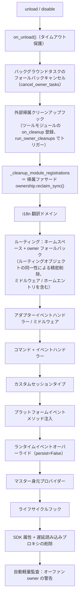

`sdk.uninit()` の終了時には別途グローバルフォールバックがあります：全アダプター shutdown → 全モジュール unload →
`router.stop()`（ルーティング/ミドルウェア/ホームエントリのクリア）→ `cancel_all_background_tasks()` →
イベントハンドラーとフックのクリア。

## 帰属の統一ファサード（ownership）

クリーンアップチェーンの16のステップは帰属統一ファサード `ErisPulse.Core.ownership` の下に集約され、
4つの動詞が「登録解除・カウント・スキャン・監査」をカバーします——各サブシステムの `*_by_owner` 登録解除
関数は変更されず、ファサードの内部実装として維持されます：

| 動詞 | 用途 |
|------|------|
| `ownership.reclaim(owner)` | owner 名下の全リソースを統一的に登録解除（タスクキャンセル → クリーンアップフック → 登録系リソース；非同期完全版） |
| `ownership.reclaim_sync(owner)` | 登録系リソースの登録解除（同期版、同期アンロードパス用） |
| `ownership.counts(owner=None)` | owner の登録中リソースの読み取り専用統計（None は全 owner） |
| `ownership.orphans()` | オーファンスキャン：リソースは登録中だが owner は既に登録解除済み（リークの確証リスト） |
| `ownership.audit(owner, deep=)` | リーク監査レポート（カウント + オーファン + オプションの gc インスタンス全数調査） |

```python
from ErisPulse.Core import ownership

ownership.reclaim_sync("MyModule")       # {'commands': 1, 'routes_http': 2, ...}
ownership.counts("MyModule")             # 登録中リソースのカウント
ownership.orphans()                      # [{"owner": "ghost", "total": 2, ...}]
```

**監査エントリ**：

- アンロード / リロード後の**自動軽量監査**：オーファン owner リソースを検出した時点で WARNING 警告（オーバーヘッドゼロのカウントスキャン）
- `sdk.module.audit(name, deep=True)`：モジュールインスタンスの gc 全数調査——インスタンスが回収できない場合、
  参照元の型を提示（「誰が旧インスタンスを掴んでいるか」を特定）；グローバル一時停止のオーバーヘッドがあるため、明示的なトラブルシューティングにのみ使用
- 深い全数調査は明示的な操作であり、設定キーは設けず、自動修復も行いません

## 入れ子ライフサイクル（ownership.nest）

> 本セクションの機能には ErisPulse **2.12+** が必要です。

あるモジュール（親）が別の一連の owner（子）を管理することを許可し、親が回収されると子も一括して回収されます。典型的なシナリオ：
スクリプトエンジンモジュール内でのサブプラグインの実行、Dashboard によるパネル拡張の管理、ツールモジュールによる外部レジストリエントリの代行管理。

```python
from ErisPulse.Core import ownership

ownership.nest("ScriptEngine", "ScriptEngine.plugin_a")
ownership.nest("ScriptEngine", "ScriptEngine.plugin_b")

ownership.nested_children("ScriptEngine")
# frozenset({"ScriptEngine.plugin_a", "ScriptEngine.plugin_b"})

ownership.unnest("ScriptEngine", "ScriptEngine.plugin_a")
```

| 項目 | 規約 |
|----|------|
| 回収順序 | 子が親より先；同一レベルは登録の逆順（後で登録されたものから回収） |
| 回収範囲 | リソースレベル（タスク / 接続 / ルーティング / コマンド / tracked リソース / クリーンアップフック）、**子のモジュールレベル `on_unload` はトリガーされない** |
| 循環検出 | `nest` は自己循環と既存の逆方向チェーンを拒否し、`False` を返して警告 |
| 子の先行消滅 | 子が独立して回収される（`reclaim` / `reclaim_sync`）際に自動的に `unnest` され、親側に dangling な関係は保持されない |
| タイムアウト | 個々の子の回収は `CLEANUP_CALLBACK_TIMEOUT_SECS` に制約される；タイムアウト時は警告し、親子関係を解除して続行 |
| 可観測性 | `ownership.counts(parent)` に `nested` カウントが追加；`ownership.orphans()` はネスト関係に対して推移閉包を計算し、親が消滅した残留関係も露出される |

**なぜ子の `on_unload` をトリガーしないのか**：モジュールの完全なアンロードはマネージャーレベルのフロー（遅延プロキシ、
sdk 属性、イベントブロードキャスト）を経由する必要がありますが、`ownership` ファサードはリソース回収のみを担当し、
レイヤーを跨ぐ呼び出しはアンロードロックの再入リスクをもたらします。子の `on_unload` が必要な場合は、
親が自身の `on_unload` 内で明示的に呼び出します：

```python
await self.sdk.module.unload(child, reason="cascade")
```

同期エントリ（`sdk.module.disable` など）はまず非同期カスケードをマークし、バックグラウンドタスクが子リソースを回収します；
`reclaim_sync` は非同期カスケードが進行していない場合にのみ、自身で子の登録系リソースをカスケードします。

## ホットリロード失敗時のロールバック

ホットリロードは「**アンロード前のスナップショット → 失敗時の自動復元 → on_load のリプレイ**」です：新バージョンの構文エラー、
依存関係の欠落、読み込み失敗時には、旧インスタンスと登録状態（レジストリエントリ、sdk 属性、sys.modules
エントリ）が自動的に復元され、その後帰属コンテキスト内で**旧インスタンスの `on_load` をリプレイ**します（`reason`
は `"rollback"`）。これにより、アンロード段階で切断された外部リソースが再構築されます；終了後、
`module.rollback` イベント（ペイロード `{module_name, success}`）を発行します。

アダプターのホットリロード失敗も同様に旧登録状態を復元します；旧インスタンスが実行状態にあり、旧起動タスクが既に終了している場合、
ロールバック後に `start()` をリプレイし、`adapter.rollback` イベント（ペイロード
`{adapter_name, replayed, success}`）を発行します。切断 / bot offline などの unload 副作用
は依然として取り消せません。リプレイと `adapter.rollback` イベントには ErisPulse **2.12+** が必要です。

境界に関する注意：

- リプレイの失敗またはタイムアウトは**警告のみ**で、ロールバックを取り消しません——旧インスタンスは「クリーンアップ済み」状態に留まります
  （2.11.2 以前の動作と一致）。ログに明確に提示されます
- サードパーティが実行時に手動でキャッシュした旧インスタンスへの参照は復元範囲外です
- 対象パッケージが既にアンロードされている（entry-point が消失）場合はアンロード成功とみなし、ロールバックしません
- `on_unload` のペイロードには `reason`（`unload` / `reload` / `disable` /
  `cascade` / `dormant` / `load-failed`）が含まれ、モジュールは `reload` 時に
  リロードを跨いで存続すべきリソースのクローズを延期できます

ホットリロードの完全な能力境界、ループを跨ぐセマンティクス、モジュール側のガイドラインについては次のセクションを参照してください。

## ホットリロードの境界

ホットリロードはコードの置換、登録の再構築、失敗したリロードのロールバックが可能です——しかし、それは**プロセスの再起動ではありません**。
回収されるのは**帰属システムに登録されているランタイムリソース**です；どの owner にも属さないリソース、ユーザー
設定セマンティクスのデータ、サードパーティライブラリ内部にキャッシュされた参照は、リロードと共に消えることはありません。

### 能力の境界

| 対象 | リロード後の動作 | 説明 |
|------|-----------|------|
| モジュールコード / クラス定義 | 対応、再インポート | 旧 `sys.modules` エントリはクリアされる |
| `on_unload` / `on_load` | 対応、順次トリガー | 失敗ロールバック時に `on_load` をリプレイ（前セクション参照） |
| コマンド / ハンドラー / ルーティング / ライフサイクルフック | 対応、自動的に登録解除して再登録 | 帰属回収チェーンを経てクリーンアップ |
| `spawn_background` / `spawn_later` / `spawn_thread` | 対応、owner 別にキャンセル | スレッドは観測登録のみで強制終了は不可 |
| メインループ上の任意の `asyncio.create_task` | 対応、自動帰属キャンセル | タスクファクトリが傍受（サードパーティライブラリ内部での作成を含む） |
| ストレージブリッジループ上で派生したタスク | 対応、自動帰属キャンセル | ブリッジループにもタスクファクトリが導入済み |
| `ownership.track()` で登録されたリソース | 対応、`release()` を呼び出し | タスクファクトリが届かない Loop-bound リソース |
| `on_cleanup` フック | 対応、トリガー | ツールモジュールはこれにより管理していたハンドルを破棄 |
| 永続化オーバーライド（`persist=True`）/ 設定ファイル | 非対応、保持 | ユーザーアセット |
| サードパーティライブラリ内部にキャッシュされたオブジェクト参照 | 非対応 | フレームワークからは見えないため、モジュール自身が参照を解除する必要がある |
| モジュールが自身で `new` したイベントループ / 生スレッド | 回収しない | 以下のガイドラインを参照 |

### 3層リソースガバナンス

1. **シームレス傍受層**——イベントループレベルのタスクファクトリ。owner コンテキスト内での任意のタスク作成は自動的に帰属し、
   メインループとストレージブリッジループをカバーします。
2. **帰属化スケジューリング層**——`spawn_background` / `spawn_later` / `spawn_thread`。
3. **協調登録層**——`ownership.track()` / `on_cleanup()`。構造的に
   届かないリソース（Loop-bound 接続プール、サードパーティ client）用です。

### イベントループの境界

| ループ | 作成者 | タスクファクトリ | 用途 |
|------|--------|-----------|------|
| メインループ | `sdk.run()` / `sdk.init()` | 導入済み | すべてのビジネスコード |
| ストレージブリッジループ | `AsyncBridge`（初回の同期ストレージ呼び出し） | 導入済み | 同期ストレージ API のバックグラウンド実行 |
| 一時ループ | `spawn_background` のフォールバック | 未導入、使用後即クローズ | メインループ未準備時の最終手段 |

**一時ループは最終手段です**：呼び出し元スレッドを同期的にブロックし、ループが閉じられた後にコルーチン内部でさらに派生した
サブタスクは失われます（ログに `temp_loop_fallback` 警告が出力されます）。この警告が表示された場合は、モジュールが誤った
タイミングでバックグラウンドタスクをスケジューリングしたことを意味します。

**ループを跨ぐキャンセルはベストエフォートです**：`cancel_owner_tasks` がタスクが他の実行中のループ上にあることを検出した場合、
`call_soon_threadsafe` でキャンセルを投函し `cross_loop_task_residual`
警告を出しますが、その終了を**待機しません**（ループを跨ぐ待機は安全ではないため）。この警告が表示された場合は、
イベントループを自作していないか確認すべきです。

### モジュール側のガイドライン

```python
# 推奨
spawn_background(self._poll())            # 帰属化バックグラウンドタスク
spawn_later(30, lambda: self._cleanup())  # 帰属化遅延タスク
spawn_thread("poller", self._loop_body)   # 帰属化スレッド（エントリは自動的に owner を帯びる）
ownership.track(pool)                     # Loop-bound リソースを明示的に登録
await sdk.storage.aget(key)               # 非同期コンテキストでは非同期 API を直接使用

# 避けるべき
asyncio.create_task(self._poll())         # 生呼び出し：参照がなく GC されやすい
asyncio.new_event_loop()                  # 自作ループ：帰属システムは完全に届かない
threading.Thread(target=self._loop_body)  # 生スレッド：エントリに owner コンテキストがない
self._storage.get(key)                    # 非同期コンテキストでの同期ストレージ呼び出し：メインループをブロックする
```

### トラブルシューティングチェックリスト

1. ログに `cross_loop_task_residual` がある？→ リソースが自作ループ上に存在する
2. ログに `temp_loop_fallback` がある？→ バックグラウンドタスクがメインループの準備前にスケジューリングされた
3. `attached to a different loop` エラー？→ 自作ループまたはループを跨ぐ接続オブジェクトの再利用を確認する
4. `ownership.orphans()` に出力がある？→ owner 名下のリソースがアンロード後も生存している

## 設計上の境界：アンロード時にクリーンアップされないリソース

帰属は**モジュールコードが登録したランタイムリソース**のみを回収します。以下のリソースは**ユーザー設定セマンティクス**に属し
（制御権はユーザーにあり、意図的に設定されている可能性があります）、モジュールのアンロード後も設定と共に永続的に保持されます：

| リソース | セマンティクス | 説明 |
|------|------|------|
| `overrides.*.set(persist=True)` | 永続化オーバーライド | 設定ファイルに書き込まれ、再起動を跨いで有効；モジュールのアンロードでは削除しない（ユーザーの明示的設定） |
| `scope.set_action()` などのスコープルール | 権限コントロールプレーン | ユーザー/Dashboard が管理し、モジュールのアンロードではルールを回収しない |
| `overrides.acl.set(persist=True)` | コマンド ACL | 同上 |
| Conversation `save()` 永続化 | マルチターン会話アーカイブ | データアセットはクリーンアップしない |

ランタイムの一時書き込み（`persist=False`）は owner と共に回収されます——**永続化するかどうかが
「ユーザーアセット」と「モジュールのランタイム状態」の境界線です**。

## 内部実装：帰属の仕組み

**一言で言えば**：アトリビューションチェーン（contextvar の伝播）が「誰の勘定に記録されるか」を決め、キャンセルチェーン（タスク登録表）が「アンロード時にキャンセルできるか」を決めます——2つのチェーンは独立して動作し、リソースが正しくクリーンアップされるには両方が揃う必要があります。

帰属システムは**2つの独立したチェーン**で構成されており、それらの役割分担を理解することが帰属問題のトラブルシューティングの前提です：

### アトリビューションチェーン（contextvar の伝播）

`runtime/context.py` の `current_owner` などの ContextVar は**アトリビューション**を担当します——
「この瞬間にこのコードが登録したリソース/発した呼び出しが誰の勘定に記録されるか」。伝播ルールは Python
contextvars のセマンティクスに従います：

| 実行パス | context が伝播するか | アトリビューション結果 |
|---------|----------------|---------|
| 同期呼び出しチェーン / `await` チェーン | ✅ 伝播 | 正しいアトリビューション |
| `owner_scope` 内の `asyncio.create_task` | ✅ 伝播（task は作成時点の context をコピー） | タスク**内部**のフレームワーク呼び出しは正しくアトリビュートされる |
| `run_in_executor` / 生スレッド | ❌ 非伝播 | アトリビューション喪失 |
| 自作イベントループ | ❌ 非伝播 | アトリビューション喪失 |

> アトリビューション ≠ 登録：context の伝播は「誰の勘定に記録されるか」にのみ影響し、リソースがクリーンアップされるかどうかは
> 後述のキャンセルチェーンに入ったかどうかに依存します。

### キャンセルチェーン（タスク登録表）

`runtime/tasks.py` の `_owner_tasks` 登録表は**ライフサイクル**を担当します——
「owner 名下にどの未完了タスクがあり、アンロード時に一括キャンセルされるか」。タスクが登録表に入る経路：

1. **明示的スケジューリング**：`spawn_background()` / `self.spawn()` → 作成時に
   `current_owner` をキャプチャ（または明示的な `owner=` 引数）→ 登録表に登録；
2. **Task Factory による自動登録**（2.8.3）：`install_owner_task_factory()`
   がフレームワーク起動時にメインイベントループへ導入——**あらゆる**タスク作成（サードパーティライブラリ内部の
   `create_task` を含む）がファクトリを通過する際に `current_owner` を読み取り、None でなければ登録。

登録表は自己クリーンアップします：各タスクには `done_callback` が付いており、完了した時点で表から削除されるため、リークはありません。

### キャンセルシーケンス（モジュールのアンロード）

```
module.unload()
  → on_unload(event)                    # モジュール自身のクリーンアップ（フォールバックのタイムアウト保護）
  → フレームワークが当該 owner のコマンド/イベント/フック/ルーティングを登録解除
  → cancel_owner_tasks(owner)           # タスク登録表によるフォールバックキャンセル
      → 順次 task.cancel()              # 現在キャンセルロジックを実行中のタスク自身を除外
      → await gather(pending, timeout)  # 回収を待機（タイムアウト時はブロックしない）
```

### トラブルシューティングのアプローチ

- **リソースがクリーンアップされない** → 登録表を確認：`get_owner_tasks("MyModule")` にそのタスクが含まれているか；
  含まれていなければ、登録パスが帰属チェーンを通っていない（import 時 / スレッド / 独立ループ）。上の表と突き合わせて特定します。
- **アトリビューションエラー** → エラーが起きた時点の `get_current_owner()` の値を確認；非同期遅延実行
  （コールバック/タスク）のアトリビューションは実行時ではなく作成時の context から取得されます。

## モジュール作者ガイド

### 推奨記述方法

```python
from ErisPulse import sdk
from ErisPulse.Core.Event import command
from ErisPulse.runtime import owner_scope, spawn_background

class MyModule(BaseModule):
    async def on_load(self, event):
        # フレームワークリソース：自動帰属、手動クリーンアップ不要
        self.task = self.spawn(self.polling())      # バックグラウンドタスク
        sdk.router.register_home_entry("マイモジュール", "/my")  # ホームエントリ

        # モジュール固有リソース：owner_scope で包めば帰属システムに組み込まれる
        with owner_scope("MyModule"):
            self.client.on_event(self._handle)      # 仮想的なカスタム登録

    async def on_unload(self, event):
        # フレームワークリソースは自動回収済み。owner_scope でカバーできない固有リソースのクリーンアップのみ必要
        await self.client.close()
```

### 注意事項

- **import 時の登録は帰属なし**：モジュールのトップレベル（import 時）で登録されたフック/ハンドラーは
  `owner_scope` より前に発生するため、フレームワークレベルのリソース（owner=None）とみなされ**クリーンアップされません**。
  必ず `on_load()` 内で登録してください。
- **カスタム domain の i18n 登録**：`i18n.register(domain=...)` の domain
  がモジュール名と異なる場合は自動回収されません。domain=モジュール名を維持してください。
- **バックグラウンドタスクには `self.spawn()` を推奨**：2.8.3 以降は生の `asyncio.create_task` も**自動的に暗黙帰属**します
  （Task Factory が自動登録し、アンロード時にフォールバックキャンセル）；ただし `self.spawn()` が依然として推奨記述方法です——
  非メインループスレッドからメインループへのスケジューリング、明示的な `owner=` 指定、fire-and-forget の GC 防止に対応しています。
  **2.8.3 以前**のバージョンでは生タスクは帰属しないため、`self.spawn()` を使う必要があります。
- クリーンアップチェーンの「失敗は警告のみ」：単一ステップのクリーンアップ例外は他のリソース回収を妨げません。ログは DEBUG/WARNING
  レベルで確認でき、トラブルシューティング時には TRACE を有効化できます。

### 登録タイミング → 帰属結果の対応表

| 登録シナリオ | 帰属結果 | 説明 |
|---------|---------|------|
| `on_load()` 内でフレームワーク API（コマンド/イベント/lifecycle/ルーティングデコレーター）経由で登録 | モジュールに帰属 | アンロード時に自動登録解除 |
| モジュールのトップレベル（import 時）での登録 | **帰属なし**（owner=None） | クリーンアップされないため使用しないこと |
| `self.spawn()` で作成されたバックグラウンドタスク | モジュールに帰属 | アンロード時に自動キャンセル |
| `owner_scope("Name")` 内でサードパーティ API 経由で登録 | モジュールに帰属 | サードパーティのコールバックが scope 内で同期的に実行されることに依存 |
| 生の `asyncio.create_task`（`loop.create_task` / `ensure_future` を含む） | **自動帰属**（Task Factory、2.8.3+） | 作成の瞬間に `current_owner` を読み取り、owner コンテキスト内で自動登録、アンロード時にフォールバックキャンセル；下記の[内部実装](#内部実装帰属の仕組み)を参照 |
| サードパーティライブラリの非同期コールバック（aiohttp / APScheduler など）内部で作成されたタスク | **自動帰属**（Task Factory、2.8.3+） | コールバック実行時に `current_owner` が注入されていれば（フレームワークハンドラー実行期間など）、タスクは自動登録される |
| `run_in_executor`（スレッドプール） | **帰属なし**（asyncio.Task ではない） | スレッドはタスクファクトリの管轄外のため、ライフサイクルは自己管理が必要 |
| 独立イベントループ（自作 loop）内での登録 | **帰属なし** | Task Factory はメインループにのみ導入；contextvars もイベントループを跨いで伝播しない |

> 原則：**帰属は登録の瞬間の `current_owner` コンテキストに従います**；非同期の遅延、
> スレッドプール、独立ループはいずれもこのコンテキストから離脱します——帰属が必要な場合は明示的に `owner_scope` に入ってください。

## ツールモジュールガイド：他のモジュールのハンドルを管理する

**シナリオ**：定期タスク、レジストリ、接続プールといった「ツールモジュール」は、他のモジュールの代わりにものを保管します——
相手が `on_load` 内で `sdk.Cron.on_trigger(handler)` を呼び出すと、あなたのコンテナには相手のインスタンスを指す
コールバックが保存されます。フレームワークは相手が登録したすべてのフレームワークリソースを自動的にクリーンアップしますが、
あなたの**プライベートコンテナ内の参照**はクリーンアップできません：相手がアンロードされた後もあなたのコンテナがそのインスタンスを引き留めているため、
GC による回収ができません（メモリリーク、`purge` のリーク診断が「回収不可」と報告します）。

**解決策**：相手のものを登録する同じ関数内で `on_cleanup()` を呼び出すと、
フレームワークは相手のアンロード / 無効化時にあなたのクリーンアップ関数を自動的にコールバックします：

```python
from ErisPulse.Core.Bases import BaseModule
from ErisPulse.runtime import off_cleanup, on_cleanup

class CronModule(BaseModule):
    def __init__(self):
        self._entries = {}  # {モジュール名: そのモジュールが管理するコールバックのリスト}

    def on_trigger(self, handler):
        # 呼び出し元モジュール名を自動識別（on_load からの直接呼び出し / module.call いずれも正しく処理）、
        # 戻り値は解析された owner で、そのまま記名キーとして使用可能
        owner = on_cleanup(self._drop)
        self._entries.setdefault(owner, []).append(handler)

    def _drop(self, owner: str):
        """相手モジュールがアンロード/無効化された際にフレームワークが自動的に呼び出す：ハンドルを破棄するだけでよい"""
        self._entries.pop(owner, None)

    async def on_unload(self, event):
        off_cleanup(self._drop)  # ③ 自身のアンロード前にフックを登録解除し、フックテーブルが self を保持するのを回避
```

フレームワークが保証する動作：

| 項目 | 動作 |
|--------|------|
| トリガータイミング | 相手モジュールの unload / disable、またはアダプターの終了——いずれもフレームワークのクリーンアップチェーン内でトリガーされ、purge のリーク診断より早い |
| 呼び出し元の識別 | 直接呼び出しでは `current_owner` を取得；`module.call()` 経由の呼び出しでは呼び出し元（`current_caller`）を取得；`on_cleanup(cb, owner="モジュール名")` で明示的に指定することも可能。**強制検証**：owner が解決できない場合（3つのソースすべてが欠落）は `ValueError` をスロー——プライベートツールモジュールは自身の読み込みコンテキスト内でフックを登録すべきです |
| コールバックシグネチャ | `cb(owner: str)`、同期 / 非同期いずれも可；非同期はタイムアウト保護付き（`CLEANUP_CALLBACK_TIMEOUT_SECS`、デフォルト 10 秒） |
| フォールトトレランス | 個々のコールバックの例外 / タイムアウトはログ記録のみで、他のフックとクリーンアップチェーンには影響しません |
| 重複登録 | 同一の `(owner, callback)` は冪等に重複排除 |

**不要な場合**：相手が登録したのがフレームワークリソース（コマンド、イベントハンドラー、ルーティング、
バックグラウンドタスクなど）であれば、フレームワークが完全に自動でクリーンアップします（上記の[帰属リソースの全体像](#帰属リソースの全体像)を参照）。
あなたのプライベートコンテナ内に保持している相手のハンドルにのみ `on_cleanup` が必要です。
モジュール開発の視点からのクイックリファレンス版は
[ベストプラクティス · ツールモジュール](../developer-guide/modules/best-practices.md#ツールモジュール他のものを管理する際はアンロード通知を受け止める) を参照してください。


### 影子模块与灰度转正

# シャドウモジュールとカナリア昇格

> [!TIP]
> **このドキュメントを読むべきタイミング**：カナリアリリース——新バージョンの並行トライアル実行、動作比較、昇格・ロールバックが必要なとき。不要であればスキップしても、他の機能の利用には影響しません。

> **読み終えるとわかること**：シャドウモジュールの5つの分離ゲート、動作 diff のアライメント方法、
> `promote` による昇格と失敗時のロールバック手順、そしてフレームワークでは防げない誠実な限界。
>
> **このドキュメントでは扱わないこと**：通常モジュールのホットリロードとオーナーのクリーンアップに関する汎用メカニズム
> （[オーナー（owner）システム](ownership.md) を参照）。


シャドウ = 同一モジュールの**新バージョン**であり、独立した owner（例：`roll_shadow`）として本番の旧バージョンと
共存しながらトライアル実行します：実際のイベントの**コピー**を受け取り、そのアウトバウンドは本当に送信されるのではなく
**傍受して記録**されます——`shadow_diff` で2つのバージョンの動作を比較し、無害であることを確認したら `promote` で
ワンクリック昇格、`dismiss` でいつでも破棄できます。**モジュールコードは一切変更不要、全工程がランタイム API 駆動**：
`load / unload / reload` と同種の運用アクションであり、Dashboard / カスタム管理モジュールから直接
呼び出せ、書くべき設定項目は一切ありません。

{!--< tips >!--}
1. 起動：``await sdk.module.shadow_start("roll", source="path/to/v2")``
   ——新バージョンのコードは独立した owner（デフォルトはパス名）として旧バージョンと共存
2. シャドウは実際のディスパッチと依存グラフには参加しません：同名コマンドはシャドウのカタログに入り、ルートは登録のみでマウントせず、
   ライフサイクルブロードキャストはサイレント、`module.call` と依存解決は引き続き v1 を指します
3. 昇格は常に人間が確認します：``await sdk.module.promote_shadow("roll")``、失敗時は
   自動ロールバックで旧インスタンスがサービスを継続；``dismiss_shadow`` でいつでも破棄
{!--< /tips >!--}

## クイックスタート

```python
# v2 コード：通常のモジュールの書き方、シャドウを一切意識しない（任意のディレクトリ、例：downloads/roll_v2/）
```

```python
# 本番ボット内で（Dashboard / 管理モジュールから呼び出し）、1行でカナリアを起動：
await sdk.module.shadow_start("roll", source="downloads/roll_v2")
# → シャドウは独立した owner "roll_v2" として v1 と共存し、アウトバウンドは傍受・記録される

# トライアル実行中に動作を比較：
report = sdk.module.shadow_diff("roll")
# {"shadow_owner": "roll_v2", "count": 3, "aligned": [...]}
```

- **v1 の実際の送信**：受信箱（transcript）からの bot タイムライン
- **v2 の送信意図**：シャドウ台帳（アウトバウンドゲートが記録した「送りたかったもの」）
- 両者は `trace_id` で整列されます——同じメッセージについて、2つのバージョンがそれぞれなぜ発火した/しなかった、
  何を送りたかった/実際に送ったのかが一目瞭然

問題ないことを確認したら昇格：

```python
await sdk.module.promote_shadow("roll")   # 昇格、失敗時は自動的に v1 へロールバック
await sdk.module.dismiss_shadow("roll")   # または：シャドウを破棄
```

## 5つの分離ゲート

| ゲート | メカニズム |
|----|------|
| イベントコピー | シャドウハンドラーはイベントの**独立したコピー**を受け取る（`shadow` マーク付き）——シャドウによる改変 / 引き取り / 伝播停止はコピーにのみ作用し、元のイベントチェーンには影響しない |
| アウトバウンドゲート | シャドウの `Send` DSL と `Api` 呼び出しはすべて傍受して記録（成功形状のフェイクレスポンスを返却）、実際には送信しない——シャドウが重複して返信することはない |
| ストレージオーバーレイ | シャドウの KV 書き込みはメモリ上のオーバーレイに入り、実DBへの永続化は破棄；読み取りはまずオーバーレイを確認し、ミスなら実DBへ透過（カナリアは実際のデータに対して実行）；削除はトゥームストーンとして記録 |
| ルートブロック | シャドウの HTTP/WS/SSE ルートは登録のみでマウントしない；同名コマンドはシャドウのコマンドカタログに入り、プラットフォームイベントメソッドの注入は禁止 |
| ライフサイクルサイレント | シャドウは自身のライフサイクルイベントをブロードキャストせず、エコシステムの依存グラフに参加しない（`module.call` と依存解決は引き続き v1 を指し、未完成品が依存されるのを回避） |

設定の継承：シャドウはデフォルトで**元モジュールの設定セクションを継承**します（そうでないとカナリアの結果が歪みます）。昇格後は設定がそのまま有効になります。

## 誠実な限界（防げないもの）

- フレームワーク経由の送信 / API / KV ストレージ / 統一 HTTP クライアントは**すべて傍受可能**；
  モジュールがフレームワークを迂回して生の `aiohttp` を起動したり、スレッドを立てて外部システムへ書き込むことは——フレームワークでは防げません
- **ORM の読み書きはオーバーレイのセマンティクス外**です（行単位の overlay は SQL レイヤーではクリーンに実装できない）——
  シャドウ期間中は ORM 書き込み分離への依存を避けることを推奨
- **シャドウソースはローカルパス**：新バージョンのコードはパスからインポートされ、独立した owner としてロード；同一 PyPI パッケージは
  同一インタプリタ内では `sys.modules` の単一キー制限を受け、新旧2バージョンの共存は不可能
- リーク監査器（`sdk.module.audit`）はシャドウリソースの帰属を可視化；フレームワークを迂回した副作用も、
  少なくとも無音のままにはなりません

## 昇格とロールバック

`promote` の流れ：現在のバージョンをスナップショット（カスケード依存を含む）→ 完全にアンロード → シャドウが実名で登録・ロード → いずれかのステップで失敗した場合は自動的にロールバックし、旧インスタンスがサービスを継続（ベストエフォートのセマンティクス：`on_unload` で実行された副作用は取り消せず、ロールバック後の旧インスタンスは終了処理済みの状態となる）。昇格に成功したシャドウのリソースは回収され、バインドは解除される。元モジュールの設定セクションはその場で有効になる。

**永続化に関する注意**：promote はランタイムでの切り替えです——再起動後も v2 で実行されるため、新しいバージョンを**永続的にインストール**する必要があります（新バージョンの `pip install -U` 実行 / プラグインファイルの置き換え）。ランタイムの切り替えはパッケージ管理を代行してはくれません。Dashboard の「昇格して永続化」は、昇格の成功後にバックグラウンドで pip を実行し、アップロード時にディスクへ書き込まれた whl 原本をインストールすることで、このステップを自動化します。通常の `promote` ではディスクへの書き込みは行われません。

## 3つのハード境界

| 境界 | 説明 |
|------|------|
| pip 排他 | シャドウ期間は**展開のみでインストールしない**：whl の原本を `shadows/<module>/` に保存するのは昇格後の永続化のためだけであり、シャドウ実行中は pip インストールを行わず、インストール済みパッケージの上書きによる本番環境の挙動ドリフトを回避します |
| promote はディスクに書き込まず | `promote_shadow` は実行時の切り替えのみを行い、パッケージマネージャーには書き込みません。再起動後は v1 にロールバックされます（設定では依然として旧バージョンを指しています）。再起動後も v2 を維持したい場合は「昇格して永続化」または手動の `pip install` を使用してください |
| サードパーティ依存関係 = プロセスにインストール済みのバージョン | シャドウが import するサードパーティライブラリは**現在のプロセスにインストール済みのバージョン**を使用します。whl が宣言する新規依存関係は自動インストールされず、依存関係が不足している場合はシャドウのロードに失敗します（エラーはそのままスローされます） |

> whl の取り込み、`list_shadows` および「昇格して永続化」（`shadow_ingest_whl` /
> `shadow_promote_persist` / `shadow_persist_status`）には ErisPulse **2.12+** が必要です。
> 旧バージョンの SDK では自動的に基本シャドウ（展開して起動するのみで、永続化なし）に縮退し、Dashboard の機能検出により自動的に切り替わります。

運用向けクエリインターフェース：`sdk.module.list_shadows()` は現在のすべてのバインディング
`{元モジュール名: シャドウ owner 名}` を返し、Dashboard / スクリプトでの集約表示に使用できます。

whl の取り込みと「昇格して永続化」の実装は SDK に帰属します：展開 / ディスクへの保存 / pip
オーケストレーションは SDK のバージョン進化に伴って変化し、Dashboard は単なる呼び出しエントリに過ぎません。


### 启动流程与手动控制

# 起動フローと手動制御

> [!TIP]
> **いつこのドキュメントを読むべきか**：起動チェーンを手動で駆動したい、起動順序をカスタマイズしたい、または起動失敗を調査する必要がある場合。不要であればスキップしても、他の機能の使用には影響しません。


ErisPulse の `await sdk.run()` / `await sdk.init()` は、起動チェーン全体を「1行のコード」にカプセル化しています。しかし、起動フローを完全にカスタマイズしたい場合（例：部分ロード、動的登録、ホットプラグ、カスタムロード戦略の注入）、このチェーンの内部で実際に何が起きているのか、そして各ステップをどう手動で駆動するのかを理解する必要があります。

このドキュメントでは、起動チェーンを独立したステップに分解し、それぞれの責務と呼び出し順序を説明し、完全な手動起動の例を示します。

> このドキュメントは、[最初のボット](../getting-started/first-bot.md) を既に実行したことがあり、`sdk.run(keep_running=True/False)` の2つのモードを理解していることを前提としています。本ドキュメントでは `init()` の**内部**におけるチェーンの分解と、`init()`/`init_task()`/`init_sync()` などのより低レベルなエントリポイントに焦点を当てます。

## SDK トップレベルエントリ一覧

`run()` の2つの `keep_running` モードに加え、SDK はいくつかのより低レベルな初期化エントリを提供しています。違いは**非同期性、戻り値、例外のラップ有無**です：

| エントリ | 非同期性 | 戻り値 | 例外処理 | 適用シナリオ |
|------|--------|--------|----------|----------|
| `await sdk.run(True)` | async、ブロックして維持 | `None`（終了時に自動 `uninit`） | モジュール/アダプタのエラーはインターセプトされ、プロセスをダウンさせない | 純粋な bot アプリケーション |
| `await sdk.run(False)` | async、ブロックしない | `None`（自動アンロードしない） | 同上 | 初期化後にカスタムロジックを実行 |
| `await sdk.init()` | async、await 必須 | `bool` | 内部でコンポーネントの例外をキャッチし、失敗時は `False` を返す | ライフサイクルの手動制御（`uninit()` と併用） |
| `sdk.init_task()` | async、Task を返しブロックしない | `asyncio.Task` | `init()` と同様 | 他の初期化の並行実行、またはイベントループがまだ実行されていない場合 |
| `sdk.init_sync()` | **同期**、現在のスレッドをブロック | `bool` | `init()` と同様 | コマンドラインスクリプト、イベントループのない同期エントリ |

> **よくある誤解**：`await sdk.init()` は `await sdk.run(keep_running=False)` と**等価ではありません**。2つの違いがあります：① `init()` は `bool` を返し（失敗時は `False`）、`run()` は `None` を返す；② `init()` は初期化のみを行い**自動アンロードしない**のに対し、`run()` はイベントループ終了時に自動的に `uninit()` します。したがって、手動でアンロードをペアリングしたりカスタムライフサイクルが必要な場合は、`init()` + `uninit()` を使用してください。

## 起動チェーン全体像

`sdk.init()`（正確にはその内部の `Initializer.init()`）は、以下の順序でフレームワーク全体を立ち上げます：

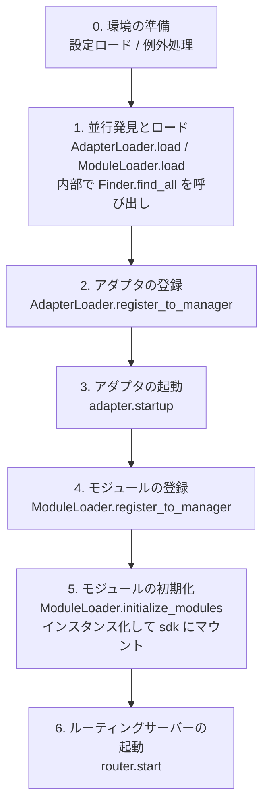

対応するコアコンポーネント：

| 層 | コンポーネント | 責務 |
|----|------|------|
| 発見 | `AdapterFinder` / `ModuleFinder` | インストール済みパッケージの entry-points からアダプタ/モジュールを**発見** |
| ロード | `AdapterLoader` / `ModuleLoader` | 発見 + インポート + メタデータ読み取り + 有効/無効の判定、オブジェクトリストを返す |
| 登録 | `*Loader.register_to_manager` | オブジェクトを対応するマネージャーに登録 |
| 管理 | `sdk.adapter` / `sdk.module` | アダプタ/モジュールインスタンスを管理し、起動・停止インターフェースを提供 |
| 初期化 | `ModuleLoader.initialize_modules` | モジュールインスタンスを作成して `sdk` にマウント（依存のトポロジカルソートを処理） |
| ルーティング | `sdk.router` | HTTP / WebSocket サーバー |

> **重要**：`Finder` と `Loader` は2つの層です。`Loader` の内部には**すでに** `Finder` が保持されています（`AdapterLoader` は `AdapterFinder` を、`ModuleLoader` は `ModuleFinder` を内蔵）。ほとんどのシナリオでは `Loader` だけを使用すればよく、「インポートせずに一覧表示だけ」が必要な場合にのみ `Finder` を単独で使用します。

## 各ステップの詳細

### 1. 発見層：Finder

Finder は「どのパッケージがアダプタ/モジュールを提供しているかを見つける」ことだけを担当し、インポートもインスタンス化も行いません。

```python
from ErisPulse.finders import AdapterFinder, ModuleFinder

adapter_finder = AdapterFinder()
module_finder = ModuleFinder()

# すべてのインストール済みアダプタ/モジュールの entry-points を検索
adapter_entries = adapter_finder.find_all()    # list[EntryPoint]
module_entries = module_finder.find_all()      # list[EntryPoint]

# 名前で単一のエントリを検索
entry = module_finder.find_by_name("MyModule")  # EntryPoint | None
```

各 `EntryPoint` は `.load()` で対応するクラスを取得できますが、通常は手動で呼び出す必要はありません——Loader が行います。

### 2. ロード層：Loader

Loader は Finder の上に「インポート + メタデータ読み取り + 有効/無効の判定」を実装しています。

```python
from ErisPulse.loaders import AdapterLoader, ModuleLoader
from ErisPulse import sdk

adapter_loader = AdapterLoader()
module_loader = ModuleLoader()

# load() 内部：finder.find_all() を呼び出し → entry-point を順次処理 → 三つ組を返す
adapter_objs, enabled_adapters, disabled_adapters = await adapter_loader.load(sdk.adapter)
module_objs, enabled_modules, disabled_modules = await module_loader.load(sdk.module)
```

`load()` が返す三つ組：

| 戻り値 | 意味 |
|--------|------|
| `objs` (`dict`) | 名前 → オブジェクト（アダプタクラス / モジュールラッパーオブジェクト） |
| `enabled` (`list[str]`) | 有効化された名前（設定で無効化されていない） |
| `disabled` (`list[str]`) | 無効化された名前 |

#### ロード失敗時の診断情報

モジュール/アダプタがロードまたは初期化段階で例外をスローした場合、フレームワークはそのコンポーネントをスキップして他のコンポーネントのロードを継続し、同時に**ユーザーコードフレームの要約**を出力します。これにより、デフォルトの INFO レベルのままでエラー発生位置を特定でき、手動で DEBUG に切り替える必要はありません：

```
[ERROR] [ModuleLoader] entry-point からのモジュール MyModule のロードに失敗、スキップしました: 'NoneType' object has no attribute 'platform'
  → MyModule/Core.py:42 in on_load
      adapter = sdk.platform
  → AttributeError: 'NoneType' object has no attribute 'platform'
  → ヒント: ログレベルを DEBUG に上げると完全なスタックトレースを確認できます；モジュール MyModule の実装コードを確認してください
```

診断情報は `ErisPulse.runtime.diagnostics` モジュールによって生成され、フレームワーク内部のフレームを自動的にフィルタリングし、あなたのコードフレームのみを保持します。カスタムロードロジックで再利用する場合：

```python
from ErisPulse.runtime import log_diagnostic

try:
    risky_init()
except Exception as e:
    log_diagnostic(e)  # 自動的にユーザーコードフレームを抽出し ERROR ログに書き込む
```

このモジュールは、`extract_user_frame()`（構造化フレーム情報を返す）と `format_diagnostic_block()`（複数行テキストを返す）という2つの低レベル関数も提供しています。

### 3. 登録層：register_to_manager

Loader が生成したオブジェクトをマネージャーに登録し、`sdk.adapter` / `sdk.module` がそれらを認識できるようにします。

```python
# アダプタを登録（bool を返し、すべて成功したかどうかを示す）
await adapter_loader.register_to_manager(enabled_adapters, adapter_objs, sdk.adapter)

# モジュールを登録
await module_loader.register_to_manager(enabled_modules, module_objs, sdk.module)
```

登録後、アダプタはアダプタマネージャーに、モジュールはモジュールマネージャーに登録されていますが、**どちらもまだ起動/インスタンス化されていません**。

### 4. アダプタの起動

```python
# すべての登録済みアダプタを起動
await sdk.adapter.startup()
# またはプラットフォームを指定
await sdk.adapter.startup("yunhu")
await sdk.adapter.startup(["yunhu", "telegram"])
```

> 登録 ≠ 起動。`register_to_manager` は登録のみを行い、`startup` が初めてアダプタの `start()` を呼び出してプラットフォームとの接続を確立します。

### 5. モジュールの初期化

モジュールはアダプタより1ステップ多く——**インスタンス化**して `sdk` にマウントする必要があります（これにより `sdk.MyModule.xxx` で呼び出せるようになります）。このステップでは、モジュール間の依存関係の宣言とトポロジカルソートも処理します。

```python
success = await module_loader.initialize_modules(
    enabled_modules, module_objs, sdk.module, sdk
)
```

インスタンス化に成功すると、モジュールは `sdk.<ModuleName>` に出現します。

### 6. ルーティングサーバーの起動

```python
await sdk.router.start(
    host="0.0.0.0",
    port=8000,
    ssl_certfile=None,
    ssl_keyfile=None,
)
```

ルーティングサーバーは、アダプタの Webhook / WebSocket コールバックを受信する役割を担います。起動しない場合、server モードのアダプタはメッセージを受信できません。

## 完全な手動起動の例

以下のコードは `await sdk.init()` のコアフローと**等価**ですが、各ステップがあなたの手に委ねられており、任意のステップでカスタムロジックを挿入できます：

```python
import asyncio
from ErisPulse import sdk
from ErisPulse.loaders import AdapterLoader, ModuleLoader

async def manual_startup():
    # 0. 環境の準備（設定のロード、グローバル例外処理の登録）
    #    _prepare_environment は init() 内部の前処理ステップ；手動フローでも先に呼び出す必要があり、
    #    呼び出さないと Loader が設定を読めず、すべてのアダプタ/モジュールを誤って無効と判定してしまいます。
    if not await sdk._prepare_environment():
        print("環境準備に失敗しました")
        return False

    # 1. ローダーの作成（内部にそれぞれ Finder を保持）
    adapter_loader = AdapterLoader()
    module_loader = ModuleLoader()

    # 2. 並行発見とロード（init() 内部と同様に gather を使用）
    (adapter_objs, enabled_adapters, disabled_adapters), \
    (module_objs, enabled_modules, disabled_modules) = await asyncio.gather(
        adapter_loader.load(sdk.adapter),
        module_loader.load(sdk.module),
    )

    # 3. アダプタの登録
    await adapter_loader.register_to_manager(
        enabled_adapters, adapter_objs, sdk.adapter
    )

    # 4. アダプタの起動
    if enabled_adapters:
        await sdk.adapter.startup()

    # 5. モジュールの登録
    await module_loader.register_to_manager(
        enabled_modules, module_objs, sdk.module
    )

    # 6. モジュールの初期化（インスタンス化 + sdk へのマウント）
    if enabled_modules:
        await module_loader.initialize_modules(
            enabled_modules, module_objs, sdk.module, sdk
        )

    # 7. ルーティングサーバーの起動
    await sdk.router.start(host="0.0.0.0", port=8000)

    print("手動起動が完了しました")
    return True

async def main():
    ok = await manual_startup()
    if ok:
        # ブロックして実行を維持（手動フローは自動的にブロックしない）
        await asyncio.Event().wait()

if __name__ == "__main__":
    asyncio.run(main())
```

### いつ手動起動を使うべきか？

ほとんどの場合、手動起動は**必要ありません**。`await sdk.run()` が上記のすべてを既に行っています。手動起動が価値を持つのは、以下のシナリオのみです：

- **部分ロード**：指定したアダプタ/モジュールのみをロードし、他をスキップする
- **動的登録**：実行時に条件に応じて新しいアダプタ/モジュールを登録する
- **カスタム順序**：デフォルトのロード順序を変更する必要がある場合（例：特定のモジュールを先に起動してからアダプタを起動する）
- **戦略の注入**：Loader にカスタムの厳格モードマネージャーやロード戦略などを注入する
- **デバッグ/診断**：あるステップで失敗した際、手動で駆動して問題を特定する

## 実行時のきめ細かい制御

### ローカルプラグインのホットリロード

`sdk.enable_plugin_hot_reload()` はローカルプラグインディレクトリ（`plugins/`）のソース変更を監視し、自動リロードします：
`epsdk run` では自動的に有効になっているため手動呼び出しは不要です；**素の `sdk.run()` で起動**する場合にプラグインのホットリロードが必要なときは、
`run()` の前に1回呼び出してください（ローカルプラグインディレクトリのみを対象とし、pip でインストールしたモジュール/アダプタには影響しません）：

```python
sdk.enable_plugin_hot_reload()
sdk.run()
```


`sdk.run()` で起動を完了した場合でも、SDK 全体を再起動することなく、実行時に各サブシステムを個別に制御できます：

### アダプタのホット起動・停止

```python
# 特定のアダプタをホットリスタート（接続を修復、他のプラットフォームには影響しない）
await sdk.adapter.shutdown("yunhu")
await sdk.adapter.startup("yunhu")

# 実行中に新しいプラットフォームを立ち上げる
await sdk.adapter.startup("telegram")

# 特定のプラットフォームを一時的にオフラインにする
await sdk.adapter.shutdown("telegram")
```

> `adapter.startup()` はアダプタがマネージャーに**登録済み**であることを要求します。登録は `init()`/`run()` の内部で行われるため、これは起動**後**のきめ細かい制御です。

### ルーティングサーバー

```python
# webhook サーバーを一時的にオフラインにする
await sdk.router.stop()

# 再起動（例：ポートを変更した場合）
await sdk.router.start(host="0.0.0.0", port=9000)
```

### モジュールのオンデマンドロード

```python
# （遅延ロードの可能性がある）モジュールを手動でロードする
await sdk.load_module("MyModule")
```

## グレースフルシャットダウン

2.7.0 以降、`sdk.shutdown()` は**プログラムによるグレースフルシャットダウン**を提供します：シャットダウンイベントを設定し、`await sdk.run(keep_running=True)` で停止しているメインループを戻らせ、さらに `uninit()` をトリガーしてリソースクリーンアップを完了させます。

```python
# 任意のコルーチン内で呼び出し、グレースフル終了をトリガー（run() の停止が戻り、自動的に uninit）
sdk.shutdown()
```

典型的な使用例：

```python
async def shutdown_after_idle():
    await asyncio.sleep(3600)
    sdk.shutdown()  # アイドル1時間後にグレースフル終了
```

**シグナル処理**：`run()` 内部では `SIGTERM` / `SIGHUP` ハンドラーを登録し、システムシグナルをグレースフルシャットダウンに変換します——コンテナオーケストレーション（Docker `docker stop`）や `systemd` がサービスを停止する際、プロセスは強制終了されるのではなく `uninit()` クリーンアップを完了します。また `SIGUSR1` ハンドラーも登録されており、プロセス内ソフトリスタート（`sdk.restart()`）に変換されます——`epsdk restart` はコンテナ内 PID 1 インスタンス（終了するとコンテナが終了し、外部から再起動できない）に対し、代わりにこのシグナルを送信してコンポーネントのホットリロードをトリガーします。SIGUSR1 ホットリスタートチャネルには ErisPulse **2.12+** が必要です。

- Windows は `loop.add_signal_handler` をサポートしないため、シグナルハンドラーは自動的にスキップされます（`sdk.shutdown()` または Ctrl+C によるシャットダウンは引き続き可能）
- `sdk.shutdown()` を繰り返し呼び出すのは安全です（イベントが既に設定された後の再呼び出しは何もしません）

## アンロードフロー

起動の逆操作は `await sdk.uninit()` で、逆順にクリーンアップします：

1. すべてのアダプタをシャットダウン（`adapter.shutdown()`）
2. すべてのモジュールをアンロード
3. すべてのイベントハンドラーをクリーンアップ
4. マネージャーと SDK 上のモジュール属性をクリーンアップ

手動起動のシナリオでは、終了前に `uninit()` を呼び出してグレースフルシャットダウンを保証することを忘れないでください：

```python
try:
    await asyncio.Event().wait()   # 実行を維持
finally:
    await sdk.uninit()
```

## 再起動

SDK は2つの再起動方法を提供しており、どちらも自分で先にアンロードする必要はありません——フレームワークが自動的に処理します：

| 方式 | 呼び出し | 動作 | 適用シナリオ |
|------|------|------|----------|
| ホットリスタート | `await sdk.restart()` | 同一プロセス内での**コンポーネント層コードレベルホットリロード**：全モジュールが統一リロードパイプラインを通過（全体構文事前チェック / スナップショットロールバック / アイデンティティ検証）、アダプタはまず **entry-point を再発見**（実行中に新規インストール/アンインストールされたアダプタが即時有効）してから、1つずつコードレベルでリロード | pip でのアップグレードやコンポーネントインストール後にコードを有効化、モジュールのホット更新 |
| ハードリスタート | `await sdk.hard_restart()` | `uninit()` 後に**終了コード 42** でプロセスを終了し、外部スーパーバイザーが新しいプロセスを立ち上げ | フレームワーク自体のアップグレード（アップグレード後のフレームワークコードは新プロセスでのみ有効）、C 拡張の副作用、リソースリークの疑い |

```python
# ホットリスタート：コンポーネント層コードレベルホットリロード（最も一般的；pip で新規インストールしたアダプタも立ち上がる）
await sdk.restart()

# ハードリスタート：プロセスを終了し、外部スーパーバイザーに再起動を委ねる（下記「スーパーバイザーガイド」参照）
await sdk.hard_restart("sdk self-update")  # スーパーバイザー表示用のオプション reason
```

> **2つの注意点**：
> 1. これらのメソッドはどちらもバックグラウンドタスクで再起動を実行し、**即座に `True` を返します。これは「再起動タスクがスケジュールされた」ことを示すものであり、「再起動が完了した」ことを示すものではありません**。実際の再起動はバックグラウンドで行われ、現在のイベントチェーンの中断を避けます。
> 2. `hard_restart()` の仕組みは：アンロードして設定をディスクにフラッシュした後、**終了コード 42**（`HARD_RESTART_EXIT_CODE`）でプロセスを終了します——**それ自体は新しいプロセスを立ち上げません**。外部スーパーバイザーが終了コード 42 を検出した後に再起動する必要があります。直接 `python main.py` で実行し、スーパーバイザーが何もない場合、プロセスはコード 42 で終了したらそのまま終わり、**自動的に再起動しません**（フレームワークが警告を出します）。

> **ホットリスタートの相互排他と統合**（2.11.1 以降）：すべてのホットリロード操作（単一モジュールリロード / 全量リロード / アダプタリロード / 休眠 / 新規プラグインのホットロード）は全体を通じて相互排他です——保存ストーム下で連続トリガーしても並行で交錯することはなく、進行中の restart が新しいリクエストを受け取ると自動的に統合されます（リクエストが通常のリロードのロック保持期間中に発生した場合も同様に統合・キューイングされ、完了後に最大1ラウンド補完実行します）。構文エラーを含むファイルを保存した場合、全体のリロードラウンドはアンロード前に**集約的な構文事前チェック**で拒否され（すべてのエラーファイルと行番号を一括で列挙）、アダプタ層はこのラウンドのリロードをスキップし、`restart` は失敗と判定し、すべての旧インスタンスがサービスを継続します；修復後に再度 `restart` を実行すればよいだけです。

### いつハードリスタートを使うべきか？

ホットリスタートはすでにほとんどのシナリオをカバーしています（pip でのアップグレード/コンポーネントインストール、モジュールコードのホット更新、**実行中に新規インストールされたアダプタを含む**）。ハードリスタートが必要なのは、以下のシナリオのみです：

- **フレームワーク自体のアップグレード**：ErisPulse 本体をアップグレードした後、新しいフレームワークコードは完全に新しいプロセスでのみ有効になります（Python はロード済みのフレームワークコードを再 import しません）。
- **バイナリライブラリ（C 拡張）の副作用**：ホットリスタートは同一プロセス内で行われるため、C 拡張、開かれたファイルディスクリプタ、スレッドなどのプロセスレベルリソースを解放できません；ハードリスタートは完全に新しいプロセスに切り替わるため、これらの副作用は完全にリセットされます。
- **リソースリークの調査**：メモリやハンドルのリークが疑われる場合、ハードリスタートでクリーンな環境を取得できます。

> Dashboard 管理パネルの「フレームワーク再起動」機能は、内部で `hard_restart()` を呼び出しています。

### 終了コード 42 の契約

ハードリスタートはプロセス間の協調動作です：**SDK は終了（コード 42）を担当し、スーパーバイザーは再起動を担当します**。

| 役割 | 動作 |
|------|------|
| SDK（ハードリスタートされる側） | `uninit()` → 設定をディスクにフラッシュ → ハードリスタートマーカーを書き込み（理由 / PID、スーパーバイザー表示用）→ `os._exit(42)` |
| スーパーバイザー | 子プロセスの終了コードが 42 であることを検出 → ハードリスタート理由を表示 → 同じコマンドを再起動 |

> `sdk.is_supervised()` で現在のプロセスがスーパーバイザーによって起動されたかどうかを照会できます（環境変数 `ERISPULSE_SUPERVISED` を検出）。CLI `run` コマンドは子プロセスを起動する際にこのマーカーを自動的に注入します；systemd / Docker などの外部スーパーバイザーは注入しないため、`is_supervised()` は `False` を返し、この場合ハードリスタート後にフレームワークは「スーパーバイザーが検出されませんでした」という警告を出します。

### スーパーバイザーガイド

あなたに適したスーパーバイザーを選択し、ハードリスタートを実際に機能させましょう：

#### 1. CLI run コマンド（開発/シンプルなデプロイ、推奨）

`epsdk run main.py` には監視ループが組み込まれています：子プロセスの終了コードを検出し、42 の場合は即座に再起動（ハードリスタート理由も表示）；その他の異常終了コードは指数バックオフで自動リトライ；`Ctrl+C` はまず子プロセスをグレースフルに終了させます（コード 0 は正常終了とみなし、再起動しません）。

```bash
epsdk run main.py
```

`epsdk run --reload`（開発用ホットリロードモード、2.11.1 以降）も同様に「監視プロセス + リロード worker 子プロセス」構造を採用しています：worker 内で `.py` ファイルを保存すると**コンポーネントレベルのホットリロード**がトリガーされます（フレームワーク全体は再起動しない）；ハードリスタートは監視プロセスが新しい worker を再起動するため、フレームワークをアップグレードした後の新しいコードは即座に有効になります。

#### きめ細かいリロード判定（2.12+）

`.py` の保存後、実行時のソースコードの帰属に基づいて最小のリロード単位を選択し、パス文字列で推測しません：

| 変更ファイル | 処理 |
|----------|------|
| プラグインディレクトリ（`ErisPulse.framework.plugins_dir`）内 | プラグインホットリロード watcher が処理、dev watcher は重複トリガーしない |
| ロード済みモジュールのソース（`pip install -e` と site-packages を含む） | `sdk.reload_module(モジュール名)` |
| 登録済みアダプタのソース | `sdk.reload_adapter(プラットフォーム名)` |
| エントリスクリプト | プロセスレベル再起動（終了コード 42、スーパーバイザーが再起動） |
| フレームワーク自体のソース（`ErisPulse` パッケージ内） | プロセスレベル再起動 |
| 複数の owner に同時一致 / 帰属不能 | 保守的にプロセスレベル再起動 |

`epsdk upgrade` などの一括アップグレードシナリオでは、`sdk.reload_all_modules()` を使用して登録済みの
全モジュールを一度にリロードできます（依存のトポロジカル順序に従い、単一モジュールの失敗はスキップされロールバックしない）。プロセスの再起動は不要です。

スクリプトモード（`epsdk run main.py --reload`）はスクリプトを worker 化しません：スクリプト子プロセス内に
dev watcher をマウントし、`component_reload_pid` を `.erispulse/runtime.json` に書き込みます；親プロセスは
このマーカーを確認した後、モジュール/アダプタ/プラグインの変更を子プロセスに処理させ、エントリスクリプトまたはフレームワークソースの
変更のみがスクリプトプロセスの再起動を引き起こします。

#### 2. systemd（Linux サーバー）

`RestartForceExitStatus=42` により、終了コード 42 も再起動をトリガーします（デフォルトの `on-failure` は非ゼロコードにのみ有効）：

```ini
[Service]
ExecStart=/usr/bin/python3 /opt/mybot/main.py
Restart=on-failure
RestartForceExitStatus=42
RestartSec=2
User=mybot
```

#### 3. Docker / docker-compose

コンテナ内の PID 1 はアプリケーションプロセスであり、終了コード 42 の後にコンテナが終了します——`restart` ポリシーで自動再起動させます：

```yaml
services:
  bot:
    build: .
    restart: unless-stopped   # すべての終了（42 を含む）で再起動
```

> コンテナ内の `epsdk restart` は PID 1 インスタンスに対して SIGUSR1 によるプロセス内ホットリスタートを行い、コンテナは終了しません；
> プロセス全体の再起動は `restart` ポリシーが担います。詳細は [デプロイ → コンテナ内再起動](../user-guide/deployment.md#容器内重启pid-1-实例) を参照してください。

#### 4. PM2（Node エコシステム運用）

```bash
pm2 start main.py --name mybot --interpreter python3
# 42 は終了コードとみなされ、PM2 はデフォルトで再起動；restart_delay を設定してデバウンス
pm2 set mybot.restart_delay 2000
```

#### 5. supervisord

```ini
[program:mybot]
command=python3 /opt/mybot/main.py
autorestart=true
exitcodes=0,2,42    # 42 も「正常終了だが再起動が必要」とみなす
```

#### 6. 純 Python カスタムスーパーバイザー

```python
import subprocess, sys, time

while True:
    p = subprocess.Popen([sys.executable, "main.py"])
    code = p.wait()
    if code == 42:          # ハードリスタート要求
        time.sleep(0.5)
        continue
    if code == 0:           # 正常終了
        break
    time.sleep(3)           # 異常終了、バックオフリトライ
```

> **スーパーバイザーがない場合の動作**：直接 `python main.py` で実行した場合、`hard_restart()` を呼び出すとプロセスはコード 42 で終了し、再起動されません。この場合は上記のいずれかのスーパーバイザーを導入する必要があります。


### 性能基准与调优

# パフォーマンスベンチマークとチューニング

> [!TIP]
> **いつこのドキュメントを読むべきか**：イベントのスループットやレイテンシの数値に関心がある場合、デプロイ前のキャパシティ評価、バージョンアップグレード前後のパフォーマンスリグレッションを比較したい場合に読んでください。必要がなければ読み飛ばしても、他の機能の利用には影響しません。

## 実測ベンチマーク（2026-10-05、Python 3.13.14）

同一マシン上での前後2回の実測（ウォームアップ + 複数回のサンプリングによるパーセンタイル算出）、NoneBot2 2.5.0 は独立環境の対照。
すべての数値はリポジトリ同梱のベンチマークで再現可能：`python tests/performance/benchmark.py`。

### イベントディスパッチ（ops/s、値が高いほど良い）

| ベンチマーク項目 | ErisPulse | NoneBot2 2.5.0 | 比較 |
|---|---|---|---|
| バス単一ハンドラ逐次レイテンシ | **9,189** | 3,021 | 3.0× |
| バスフラッドスループット（1000 イベント/ラウンド） | **9,877** | 2,055 | 4.8× |
| 10 ハンドラ/イベント スループット | **4,309** | 435 | 9.9× |
| コマンドヒット（/コマンド） | **2,165** | 677 | 3.2× |
| コマンドミス（コマンド以外のメッセージ） | **10,818** | 921 | 11.7× |
| メッセージブリッジ単一ハンドラ（デフォルト全パイプライン） | **2,804** | 2,144 | 1.3× |

### その他サブシステムの能力（最適化後）

| ベンチマーク項目 | ops/s | ベンチマーク項目 | 数値 |
|---|---|---|---|
| getConfig ホット読み取り | 1,086,957 | ORM 単一 create | 407/s |
| KV aset（sqlite） | 1,659 | GET /health（ASGI） | 1,188/s |
| KV aget（sqlite） | 3,333 | module.call RPC | 148,905/s |
| エンドツーエンドメッセージ往復 | 298 | 混合負荷 | 142/s |

### 起動時間

| フェーズ | ErisPulse | NoneBot2 |
|---|---|---|
| インタプリタ空転対照 | 59.5ms | — |
| コールドインポート | 241.7ms | 249.6ms |
| sdk.init / NoneBot init | 30.8ms | 162.3ms |

## ベンチマークの実行とリグレッション比較

```bash
# クイックモード（サンプル数は約1/4、スモークテスト用）
python tests/performance/benchmark.py --quick

# 完全なベースラインをファイルに保存（8スイート：config/event/storage/send/router/module/overall/startup）
python tests/performance/benchmark.py --json baseline.json

# 旧ベースラインとの比較（差分が±5%の閾値内ならノイズとみなす）
python tests/performance/benchmark.py --compare baseline.json

# HTMLレポート / ストレージスイートのバックエンド指定
python tests/performance/benchmark.py --html report.html
python tests/performance/benchmark.py --backend mysql
```

> CI に関する注意：ベンチマークの数値はマシンによって変動するため、`--compare` の ±5% 閾値は**同一マシン**での前後比較（アップグレード検証）にのみ適しており、マシンをまたぐゲート判定には適していません。

## チューニングのポイント

1. **メッセージブリッジの全経路におけるボトルネックはセッション記録**：デフォルトで transcript 記録が有効（2.9 以降はメモリバッファ + バックグラウンドでの一括永続化）；監査要件がない場合は無効化可能で、全経路のスループットは約 2,804 → 3,774 ops/s に向上
2. **GC 管理**：`ErisPulse.framework` の proactive_gc 設定グループ（interval / full_every / memory_growth_mb / `idle_only`）——イベントのピーク時には自動的に GC をスキップ；init フェーズでの `gc.freeze()` は組み込み済み
3. **ストレージバックエンド**：ローカル単体の sqlite（WAL）で十分；マルチインスタンスでデータ層を共有する場合は mysql / postgres に切り替え（[ストレージバックエンド](storage-backends.md) を参照）
4. **ホットパスは最適化組み込み済み**（2.9 以降、設定不要）：transcript の一括永続化、i18n キャッシュ、ログレベルガード、マッチャーの事前コンパイル、設定の遅延書き込みと統一フラッシュ
5. **コマンド制御状態の上限**：クールダウン/レート制限/クォータの状態テーブルは上限 4096 件（超過時は最も古いものから削除）、超大規模グループ向けのデプロイでも調整不要

## メモリ診断

「実行するほどにメモリを多く消費する」問題を調査する際、疑わしい処理の前後にラベル付きのスナップショットを打つことで、同名のラベルが自動的に増分（RSS + tracemalloc 両指標）を計算します。

```python
from ErisPulse.runtime import log_snapshot, snapshot

class MyModule(BaseModule):
    async def on_load(self, event):
        snapshot("MyModule.load")            # dict（ラベルによる RSS delta 含む）を取得して返す

    async def on_unload(self, event):
        log_snapshot("MyModule.unload")      # 同じ口径で取得し TRACE レベルのログに記録
```

- `snapshot(label)` はマシンで読み取れる dict を返し、アサーションや報告に適しています。`log_snapshot(label)` は TRACE レベルのログに直接書き込み、一時的な調査に適しています。
- label は容量制限付きで、呼び出し回数に応じてメモリが漏れることはありません。`/metrics` エンドポイントのプロセス指標と併用することで、長期的な傾向を観察できます。
- モジュールのアンロード後に残る増加は、通常、所有権の欠如を示しています（[所有権システム](ownership.md)の `bind_owner` タスク項目を参照）。


### runtime 工具带

# runtimeツールベルト

> [!TIP]
> **このドキュメントを読むべきタイミング**: `ErisPulse.runtime` パッケージが提供する、直接 import できるランタイムツールを一括で把握したいとき。各機能の詳細な使い方は対応するトピックドキュメントに記載されており、本ページはクイックリファレンス索引 + トピックに属さない一部の機能の使い方説明です。

`ErisPulse.runtime` はフレームワークの集約エクスポート層です。各モジュールに散らばっているランタイムツールを単一のエントリーポイントに集約し、スクリプト、モジュール、アダプターのコードからは統一して `from ErisPulse.runtime import X` の形で利用できるため、深い階層のパスを覚える必要がありません。

## 機能クイックリファレンス

| カテゴリ | 名前 | 用途 | 詳細 |
|------|------|------|------|
| 所有権 | `bind_owner` | owner コンテキストをコールバック / スレッドエントリに紐付ける | [所有権システム](ownership.md) |
| 所有権 | `owner_scope` / `get_current_owner` | コードブロックレベルの所有権コンテキスト | [所有権システム](ownership.md) |
| 所有権 | `get_owner_tasks` / `cancel_owner_tasks` | 特定 owner のバックグラウンドタスクの照会 / キャンセル | [所有権システム](ownership.md) |
| バックグラウンドタスク | `spawn_background` / `spawn_later` / `spawn_thread` | バックグラウンドコルーチン / 遅延タスク / スレッドタスク | [ライフサイクル管理](lifecycle.md) |
| バックグラウンドタスク | `cancel_all_background_tasks` / `run_main_loop` | バックグラウンドタスクの集約とメインループ登録 | [ライフサイクル管理](lifecycle.md) |
| イベントコンテキスト | `get_current_trace_id` | 現在のトレース ID の取得 | [リンクトレーシング](interaction.md#リンクトレーシングtrace-id) |
| イベントコンテキスト | `get_send_receipts` | メッセージトランザクションの送信レシート台帳の取得 | [メッセージトランザクション](interaction.md#メッセージトランザクションmessage_tx) |
| イベントコンテキスト | `get_current_event_account` / `get_current_caller` / `get_handler_waits` | イベントアカウント / 呼び出し元 / 待機テーブルの読み取り | [インタラクションセッションシステム](interaction.md) |
| メモリ | `snapshot` / `log_snapshot` | label 付き RSS + tracemalloc スナップショット（増分を自動計算） | [メモリ診断](performance.md#メモリ診断) |
| メモリ | `get_rss_mb` / `get_traced_mb` | 現在のプロセスのメモリ使用量 | [メモリ診断](performance.md#メモリ診断) |
| 設定パース | `dict_to_dataclass` | dict → 型安全な dataclass インスタンス | 次のセクションを参照 |
| 設定パース | `dataclass_to_defaults_dict` / `dataclass_to_toml_with_comments` | dataclass → デフォルト値 dict / コメント付き TOML シリアライズ | [宣言的設定](../developer-guide/configuration.md) |
| トラブルシューティング | `explain_module` / `explain_event` / `explain_trace` | モジュール / イベント / メッセージチェーンの診断 | [起動時のトラブルシューティング](startup.md) と [イベント処理](../getting-started/event-handling.md) |
| トラブルシューティング | `format_diagnostic_block` / `log_diagnostic` / `extract_user_frame` | 例外診断ブロックの描画とユーザーフレームの抽出 | [起動フロー](startup.md) |
| 例外フォールバック | `setup_exception_handling` / `global_exception_handler` | グローバル例外ハンドラの登録 | [起動フロー](startup.md) |
| セキュリティ | `redact_secret` | ログ / レポート内の機密値のマスキング | [起動フロー](startup.md) |
| メトリクス | `metrics` / `MetricsRegistry` | ランタイムメトリクスレジストリ（`/metrics` エンドポイントのデータソース） | [デプロイガイド](../user-guide/deployment.md) |

## dict_to_dataclass：dict → 型安全オブジェクト

宣言的 dataclass 設定の「逆方向」——任意の dict（API レスポンス、webhook
payload、ユーザー入力）を宣言に従って型安全なインスタンスにパースし、手書きの
`data.get("x", default)` チェーンを置き換えます：

```python
from dataclasses import dataclass, field
from ErisPulse.runtime import dict_to_dataclass

@dataclass
class WebhookPayload:
    order_id: str
    amount: float = 0.0
    tags: list = field(default_factory=list)
    remark: str = ""

payload = dict_to_dataclass(WebhookPayload, {
    "order_id": "A-1024",
    "amount": "99.5",          # str → float 自動変換
    "unknown_key": "無視",      # 未宣言フィールドは自動的に無視
})
payload.amount                   # 99.5（float）
```

- 型変換（str → int/float など）、デフォルト値の補完、ネストされた dataclass の再帰的補完
- 環境変数によるオーバーライド：フィールドに `metadata={"env": "NAME"}` が指定されている場合、優先順位は 環境変数 > データ > デフォルト値
- 宣言的設定クラス（`ConfigClass` / `BaseConfig`）のホットリロードコールバック内部では、まさにこれによって dict → 設定オブジェクトの変換が行われています


====
技术标准
====


### 会话类型标准

# ErisPulse セッションタイプ標準

> [!TIP]
> **このドキュメントを読むべきケース**：アダプターでプラットフォームのネイティブセッションを標準タイプ（private/group/channel/guild/thread）にマッピングする場合や、モジュールで `Send.To()` にどのターゲットタイプを渡せばよいかわからない場合、`event.reply()` の自動変換を把握したい場合に本ドキュメントを参照してください。不要な場合はスキップしてください。

このドキュメントでは、受信イベントタイプと送信ターゲットタイプを含む、ErisPulse がサポートするセッションタイプの標準を定義します。

## 1. 基本概念

### 1.1 受信タイプ && 送信タイプ

ErisPulse は2種類のセッションタイプを区別します：

- **受信タイプ（Receive Type）**：受信するイベントの `detail_type` フィールド
- **送信タイプ（Send Type）**：メッセージ送信時に `Send.To()` メソッドへ渡すターゲットタイプ

### 1.2 タイプマッピング関係

```
受信タイプ (detail_type)     送信タイプ (Send.To)
─────────────────        ────────────────
private                 →        user
group                   →        group
channel                 →        channel
guild                   →        guild
thread                  →        thread
user                    →        user
```

**重要なポイント**：
- `private` は受信時のタイプであり、送信時の標準タイプは `user` です
- `group`、`channel`、`guild`、`thread` は受信時と送信時でタイプが同じです
- **推奨パス**：`event.reply()` を直接使用する——タイプ変換とターゲット推論が自動的に行われ、手動処理は不要です（`private` → `user` の自動変換はここで行われます）
- **手動送信時**：送信タイプを直接渡してください（例：`Send.To("user", ...)`）。手動で `Send.To("private", ...)` のように受信タイプを渡しても自動変換されますが、推奨されません（§6.1 参照）

## 2. 標準セッションタイプ

### 2.1 OneBot12 標準タイプ

#### private
- **受信タイプ**：`private`
- **送信タイプ**：`user`
- **説明**：一対一のプライベートチャットメッセージ
- **ID フィールド**：`user_id`
- **対応プラットフォーム**：プライベートチャットをサポートするすべてのプラットフォーム

#### group
- **受信タイプ**：`group`
- **送信タイプ**：`group`
- **説明**：グループチャットメッセージ。各種形式のグループ（Telegram の supergroup など）を含みます
- **ID フィールド**：`group_id`
- **対応プラットフォーム**：グループチャットをサポートするすべてのプラットフォーム

#### user
- **受信タイプ**：`user`
- **送信タイプ**：`user`
- **説明**：ユーザータイプ。一部のプラットフォーム（Telegram など）では、プライベートチャットを private ではなく user として表現します
- **ID フィールド**：`user_id`
- **対応プラットフォーム**：Telegram などのプラットフォーム

### 2.2 ErisPulse 拡張タイプ

#### channel
- **受信タイプ**：`channel`
- **送信タイプ**：`channel`
- **説明**：チャンネルメッセージ。複数ユーザーへのブロードキャスト形式のメッセージをサポートします
- **ID フィールド**：`channel_id`
- **対応プラットフォーム**：Discord、Telegram、Line など

#### guild
- **受信タイプ**：`guild`
- **送信タイプ**：`guild`
- **説明**：サーバー/コミュニティメッセージ。通常、Discord の Guild レベルのイベントに使用されます
- **ID フィールド**：`guild_id`
- **対応プラットフォーム**：Discord など

#### thread
- **受信タイプ**：`thread`
- **送信タイプ**：`thread`
- **説明**：トピック/サブチャンネルメッセージ。コミュニティ内のサブディスカッションに使用されます
- **ID フィールド**：`thread_id`
- **対応プラットフォーム**：Discord Threads、Telegram Topics など

## 3. プラットフォームタイプマッピング

### 3.1 マッピングの原則

アダプターは、プラットフォームのネイティブタイプを ErisPulse 標準タイプにマッピングする役割を担います：

```
プラットフォームネイティブタイプ → ErisPulse 標準タイプ → 送信タイプ
```

### 3.2 一般的なプラットフォームのマッピング例

#### Telegram
```
Telegram タイプ         ErisPulse 受信タイプ   送信タイプ
─────────────────      ────────────────       ───────────
private                private                 user
group                  group                   group
supergroup             group                   group  # group にマッピング
channel                channel                 channel
```

#### Discord
```
Discord タイプ         ErisPulse 受信タイプ   送信タイプ
─────────────────      ────────────────       ───────────
Direct Message         private                user
Text Channel           channel                channel
Guild                  guild                  guild
Thread                 thread                 thread
```

#### OneBot11
```
OneBot11 タイプ       ErisPulse 受信タイプ   送信タイプ
─────────────────      ────────────────       ───────────
private                private                user
group                  group                  group
discuss                group                  group  # group にマッピング
```

## 4. カスタムタイプの拡張

### 4.1 カスタムタイプの登録

アダプターはカスタムセッションタイプを登録できます：

```python
from ErisPulse.Core.Event import register_custom_type

# カスタムタイプの登録
register_custom_type(
    receive_type="my_custom_type",
    send_type="custom",
    id_field="custom_id",
    platform="MyPlatform"
)
```

### 4.2 カスタムタイプの使用

登録後、システムは自動的にこのタイプの変換と推論を処理します：

```python
# 自動推論
receive_type = infer_receive_type(event, platform="MyPlatform")
# 戻り値: "my_custom_type"

# 送信タイプへの変換
send_type = convert_to_send_type(receive_type, platform="MyPlatform")
# 戻り値: "custom"

# 対応する ID の取得
target_id = get_target_id(event, platform="MyPlatform")
# 戻り値: event["custom_id"]
```

### 4.3 カスタムタイプの登録解除

```python
from ErisPulse.Core.Event import unregister_custom_type

unregister_custom_type("my_custom_type", platform="MyPlatform")
```

## 5. 自動タイプ推論

イベントに明示的な `detail_type` フィールドがない場合、システムは存在する ID フィールドに基づいてタイプを自動推論します：

> [!NOTE]
> **2.7.0+ での動作変更**：`detail_type` は、**既知のセッションタイプ**（標準またはカスタム）である場合にのみ直接採用されます。notice/request イベントの `detail_type`（`group_member_increase`、`friend_increase` など）は**セマンティックサブタイプ**でありセッションタイプではないため、代わりに ID フィールドに基づいて正しいセッションタイプが推論されます。

### 5.1 推論の優先順位

```
優先順位（高い順）：
1. group_id     → group
2. channel_id   → channel
3. guild_id     → guild
4. thread_id    → thread
5. user_id      → private
```

### 5.2 使用例

```python
# イベントに group_id のみがある場合
event = {"group_id": "123", "user_id": "456"}
receive_type = infer_receive_type(event)
# 戻り値: "group"（group_id を優先使用）

# イベントに user_id のみがある場合
event = {"user_id": "123"}
receive_type = infer_receive_type(event)
# 戻り値: "private"

# notice イベントの detail_type はセマンティックサブタイプであり、2.7.0+ では ID フィールドから推論されます
event = {"type": "notice", "detail_type": "group_member_increase", "group_id": "123"}
receive_type = infer_receive_type(event)
# 戻り値: "group"（"group_member_increase" ではなく）
```

## 6. API 使用例

### 6.1 メッセージ送信

```python
from ErisPulse import adapter

# ユーザーに送信
await adapter.myplatform.Send.To("user", "123").Text("Hello")

# グループに送信
await adapter.myplatform.Send.To("group", "456").Text("Hello")

# 自動変換 private → user：受信タイプを手動で渡すのは非推奨の書き方です（互換性の問題が生じる可能性があります）
await adapter.myplatform.Send.To("private", "789").Text("Hello")
# 内部で自動変換されます: Send.To("user", "789")
# 推奨される方法：手動送信時は送信タイプ user を直接使用するか、event.reply() で自動変換を利用してください（6.2 参照）
```

### 6.2 イベントへの返信

```python
from ErisPulse.Core.Event import Event

# Event.reply() は自動的にタイプ変換を処理します（推奨パス）
await event.reply("返信内容")
# 内部で正しい送信タイプが自動的に使用されます（private → user などの変換はここで自動的に行われます）
```

### 6.3 コマンド処理

```python
from ErisPulse.Core.Event import command

@command(name="test")
async def handle_test(event):
    # システムが自動的にセッションタイプを処理します
    # group_id か user_id かを手動で判断する必要はありません
    await event.reply("コマンドが正常に実行されました")
```

## 7. コア API リファレンス

### 7.1 タイプ変換

```python
from ErisPulse.Core.Event import convert_to_send_type, convert_to_receive_type

# 受信タイプ → 送信タイプ
convert_to_send_type("private")  # → "user"
convert_to_send_type("group")    # → "group"

# 送信タイプ → 受信タイプ
convert_to_receive_type("user")   # → "private"
convert_to_receive_type("group")  # → "group"
```

### 7.2 ID フィールドの照会

```python
from ErisPulse.Core.Event import get_id_field, get_receive_type

get_id_field("group")    # → "group_id"
get_id_field("private")  # → "user_id"

get_receive_type("group_id")  # → "group"
get_receive_type("user_id")   # → "private"
```

### 7.3 ワンステップで送信情報を取得

```python
from ErisPulse.Core.Event import get_send_type_and_target_id

event = {"detail_type": "private", "user_id": "123"}
send_type, target_id = get_send_type_and_target_id(event)
# send_type = "user", target_id = "123"

# Send.To() に直接使用
await adapter.Send.To(send_type, target_id).Text("Hello")
```

### 7.4 ターゲット ID の取得

```python
from ErisPulse.Core.Event import get_target_id

event = {"detail_type": "group", "group_id": "456"}
get_target_id(event)  # → "456"
```

## 8. ユーティリティメソッド

```python
from ErisPulse.Core.Event import (
    is_standard_type,
    is_valid_send_type,
    get_standard_types,
    get_send_types,
    clear_custom_types,
)

is_standard_type("private")     # True
is_standard_type("custom_type") # False

is_valid_send_type("user")      # True
is_valid_send_type("invalid")   # False

get_standard_types()  # {"private", "group", "channel", "guild", "thread", "user"}
get_send_types()      # {"user", "group", "channel", "guild", "thread"}

clear_custom_types()                # すべてクリア
clear_custom_types(platform="discord")  # 指定したプラットフォームのみクリア
```

## 9. ベストプラクティス

### 7.1 アダプター開発者

1. **標準マッピングを使用**：新しいタイプを作成するのではなく、可能な限り標準タイプにマッピングしてください
2. **正しい変換**：受信タイプと送信タイプのマッピング関係が正しいことを確認してください
3. **元データの保持**：`{platform}_raw` に元のイベントタイプを保持してください
4. **ドキュメントでの説明**：アダプターのドキュメントでタイプマッピング関係を説明してください

### 7.2 モジュール開発者

1. **ユーティリティメソッドを使用**：`get_send_type_and_target_id()` などのユーティリティメソッドを使用してください
2. **ハードコーディングを避ける**：`if group_id else "private"` のようなコードを書かないでください
3. **すべてのタイプを考慮**：コードは private/group だけでなく、すべての標準タイプをサポートする必要があります
4. **柔軟な設計**：フィールドに直接アクセスするのではなく、イベントラッパーのメソッドを使用してください

### 7.3 タイプ推論

- **detail_type を優先使用**：明示的なフィールドがある場合は推論を行いません
- **推論の適切な使用**：明示的なタイプがない場合にのみ使用してください
- **優先順位に注意**：推論の優先順位を理解し、予期しない結果を避けてください

## 10. よくある質問

### Q1: 送信時に private を user に変換するのはなぜですか？

A: これは OneBot12 標準の要件です。`private` は受信時の概念であり、送信時には `user` を使用する方がセマンティクスに適しています。

### Q2: 新しいセッションタイプをサポートするには？

A: `register_custom_type()` でカスタムタイプを登録するか、標準タイプの `channel`、`guild` などを直接使用してください。

### Q3: イベントに detail_type がない場合は？

A: システムは存在する ID フィールドに基づいて自動的に推論します。優先順位は group > channel > guild > thread > user です。

### Q4: アダプターは Telegram の supergroup をどのようにマッピングしますか？

A: アダプターの変換ロジックで、`supergroup` を標準の `group` タイプにマッピングしてください。

### Q5: メールなどの特殊なプラットフォームはどのように処理しますか？

A: 汎用性のないタイプやプラットフォーム固有のタイプについては、`{platform}_raw` と `{platform}_raw_type` を使用して元データを保持し、アダプター側で処理してください。

## 11. 関連ドキュメント

**アダプター向け（マッピングと変換）**：
- [イベント変換標準](event-conversion.md) - 完全なイベント変換仕様
- [送信メソッド仕様](send-method-spec.md) - Send クラスのメソッド命名とパラメータ仕様
- [アダプター開発ガイド](../developer-guide/adapters/) - アダプター開発の完全ガイド

**モジュール向け（タイプ変換を手動で処理したくない場合）**：
- `event.reply()` を使用するだけで、タイプ変換とターゲット推論が自動的に行われます。詳細は [Event ラッパークラス解説](../developer-guide/modules/event-wrapper.md) を参照してください


====
生态模块
====


### ErisPulse-App 安装与使用

# ErisPulse-App

> [!TIP]
> **このドキュメントを読むべきとき**：スマートフォンやパソコン上でグラフィカルインターフェースを使ってボットインスタンスの作成・実行・管理を行いたい場合——ターミナルに触れず、Python 環境も別途インストールせずに済むようにしたいときに読んでください。不要な場合はスキップしてください。

[ErisPulse-App](https://github.com/ErisPulse/ErisPulse-App) は ErisDev が直接メンテナンスしている**公式マルチプラットフォームクライアント**（Android / Windows / Linux / macOS すべてリリース済み）です。
完全にネイティブなグラフィカル管理インターフェースを提供し、スマートフォンやパソコン上で複数のボットインスタンスを作成・実行・管理できます。
ターミナルも、Python 環境の別途インストールも不要です。

> [!IMPORTANT]
> ErisPulse-App は**スタンドアロンでインストールするクライアントプログラム**であり、`epsdk install` でインストールするモジュールではありません。
> Python ランタイムと ErisPulse SDK が内蔵されており、インストールするだけで使用可能——**スマートフォン上でも直接実行できます**。

## 機能の概要

- **複数インスタンス管理**：複数のインスタンスを作成 / 起動 / 停止 / 削除、ポートとアクセストークンは自動割り当て、新規環境または既存環境のクローンが可能
- **概要ダッシュボード**：アダプター / モジュール / オンラインのロボット / イベント総数の統計、CPU / メモリ使用量のアラート色変更
- **モジュールストア**：検索とタグによる絞り込み、ワンクリックでのインストール / アップグレード / アンインストール、指定バージョンのインストール、pipのミラーソースとGitパッケージのサポート
- **イベントストリーム + イベントビルダー**：リアルタイムのイベント表示、可視化されたテストイベントの構築とアダプターへの送信
- **監視**：ログ / ライフサイクル / 審計の三合一ビュー
- **コマンド管理**：プレフィックスとエイリアスなどのグローバル設定、起動 / 停止とプラットフォームのホワイトリスト / ブラックリスト
- **ロボットの概要 / 設定 / ファイル管理**：ネイティブインターフェースでインスタンスを直接操作
- **バックグラウンド常駐**：Androidのフォアグラウンドサービスによる保活；Windowsではシステムトレイに最小化、ウィンドウを閉じてもインスタンスを中断しない
- **モジュール動的ウィンドウ**：モジュールが登録したページは自動的にサイドナビゲーションに表示（ダッシュボードと同じグループ）、クリックで直ちにアクセス

## サポート対象プラットフォーム

すべてのプラットフォームのインストーラーは [GitHub Releases](https://github.com/ErisPulse/ErisPulse-App/releases) からダウンロードできます。必要に応じて選択してください：

| プラットフォーム | インストールパッケージ | 説明 |
|------|--------|------|
| Android | `online-*.apk` / `offline-*.apk` | **スマートフォンで直接実行**、PCは不要 |
| Windows | `windows-x64-setup.exe` / `windows-x64.zip` | インストール版 / インストール不要版 |
| Linux | `linux-x64.tar.gz` | 解凍後すぐに使用可能 |
| macOS | `macos-arm64.zip` | Apple Silicon（arm64） |

Flutter コードベースで全プラットフォームをカバーしています。

## インストール方法（Android / スマートフォンで直接実行）

GitHub Releases から APK をダウンロードしてインストールしてください。2 種類のビルドがあります。

| ビルド | 実行時イメージ | 適用場面 |
|------|-----------|---------|
| `erispulse-app-online-*.apk` | 初回起動時にダウンロード | インストールパッケージが小さく、ネットワーク環境が良い場合に適しています |
| `erispulse-app-offline-*.apk` | APK に事前にパッケージ化 | オフラインで自己完結、インストール後にインターネット接続が不要です |

どちらのビルドもインストール手順は同じです。

1. APK をダウンロードしてインストールし、起動時に通知権限を許可してください（バックグラウンドサービスの維持に使用します）
2. ホーム画面に初期化の横長バナーが表示されたら、実行をクリックして最初の初期化を実行してください（進行状況とログの表示が可能です）
3. インスタンスを作成して起動します
4. App 内の管理画面でアダプタとモデルの API キーを設定します

> オフラインパッケージは自己完結型です。インストール後はネットワーク接続が不要です。初回起動時のダウンロードが遅いまたは不安定な場合は、設定ページでダウンロードソースをミラー（ghfast / gh-proxy）に切り替えてください。

### インストール方法（デスクトップ版：Windows / Linux / macOS）

1. [GitHub Releases](https://github.com/ErisPulse/ErisPulse-App/releases) から対応するプラットフォーム用のインストールパッケージをダウンロードしてください。
   （Windows は `setup.exe` または無印の `zip`、Linux は `tar.gz`、macOS は `zip`）
2. インストールして起動します
3. ウェルカムページでインストールする ErisPulse SDK のバージョンを選択してください（デフォルトは最新版です）
4. インスタンスを作成して起動します

---

## 動作原理

```
┌────────────────────────────────────────────────────┐
│  ErisPulse-App (Flutter)                            │
│                                                    │
│  ネイティブ UI ── Dashboard REST / WS API          │
│       │                                            │
│       ├── Android：フォアグラウンドサービス + proot + Ubuntu rootfs│
│       │        + Python + ErisPulse インスタンス     │
│       └── デスクトップ版：内蔵 Python + 直接プロセス管理 │
└────────────────────────────────────────────────────┘
```

- **Android**：インスタンスは、フォアグラウンドサービス（background isolate）によってホストされる proot（ユーザースペース chroot）内で実行されます。UI が閉じても、ロボットは継続的に動作し、クラッシュした場合は自動的に再起動します。
- **デスクトップ版**：インスタンスは、App の直接の子プロセスとして実行されます。Windows では、システムトレイに最小化して常駐（ウィンドウを閉じてもインスタンスは中断されません）。App の再起動後は、まだ実行中のインスタンスの管理を自動的に復元し、終了時にはすべてのインスタンスを一括して停止します。
- すべてのプラットフォームのネイティブ UI は、`127.0.0.1:<port>/Dashboard/*` の REST / WebSocket API を介してインスタンスと通信し、[ErisPulse-Dashboard](dashboard.md) と同じ API を共有します。

## SDKとの関係

- Appに埋め込まれたErisPulse SDK：Android用はUbuntuイメージにパッケージ化され、デスクトップ用はPyPIからインストールされます
  （歓迎ページでバージョンを選択可能、デフォルトは最新版）
- App内のインスタンスとコマンドライン`epsdk`で作成されたインスタンスは同等であり、同じモジュール/アダプタを使用できます
- モジュール開発者は[Dashboardウィンドウ登録API](dashboard.md)を使用してカスタムページを登録できます：
  ウィンドウは自動的にAppのサイドナビゲーションに表示され（Dashboardと同じグループに分類）、クリックすると対応するページがレンダリングされます

---

## 次のステップ

- **デスクトップ / サーバー上でブラウザを使って管理**：[ErisPulse-Dashboard](dashboard.md)（App と同一の API とウィンドウグループを共有）
- **最初のプラットフォームに接続**：App 内蔵の管理画面で設定が完了でき、各プラットフォームの詳細は[プラットフォーム特性一覧](../platform-guide/README.md)を参照
- **コマンドラインに慣れている方へ**：App 内のインスタンスは `epsdk` で作成したものと完全に同等です。[クイックスタート](../quick-start.md)から始めてください


### Dashboard 使用与视窗注册

# ErisPulse-Dashboard

> [!TIP]
> **このドキュメントを読むべきとき**：Web画面でボットを視覚的に管理したい場合（モジュールの有効化・無効化、設定編集、ログ閲覧、イベントストリームの監視など）、または自分のモジュール用のDashboard管理ページを登録したい場合にお読みください。必要ない場合はスキップして構いません。

[ErisPulse-Dashboard](https://pypi.org/project/ErisPulse-Dashboard/) はErisDevが直接メンテナンスする**Web管理パネルモジュール**で、ErisPulseに視覚的なランタイム管理インターフェースを提供します：モジュールの有効化・無効化、設定編集、ログ閲覧、イベントストリーム監視など。

> [!IMPORTANT]
> DashboardはErisPulseフレームワークの**内蔵機能ではありません**。別途インストールが必要です：
>
> ```bash
> epsdk install Dashboard
> ```

Dashboardは、他のErisPulseモジュールがカスタム管理ページをサイドバーに登録することもサポートしています。登録後、ユーザーはDashboard内で直接そのモジュール専用のビューページに切り替えることができ、独立したフロントエンドを別途開発する必要はありません。

> [!NOTE]
> ビュー登録は**オプション機能**です。
>
> - Dashboardモジュールが**未インストール**または**未ロード**の場合、`sdk.Dashboard.register_view()` を呼び出すと例外がスローされます
> - モジュール自体の他の機能に影響が及ばないよう、登録コードは必ず `try/except` で囲んでください
> - 登録前にDashboardが利用可能かどうかを確認することをお勧めします：`hasattr(sdk, 'Dashboard') and sdk.Dashboard`

---

## 動作原理

```
モジュールの on_load()
  → sdk.Dashboard.register_view(...) を呼び出し
  → Dashboardバックエンドがビュー情報を保存
  → WebSocketでフロントエンドに通知
  → フロントエンドがサイドバーナビ項目 + ページコンテナを動的に作成
  → ユーザーがクリックしてモジュールのビューを表示
```

---

## 登録API

```python
sdk.Dashboard.register_view(
    id="MyModule",                    # 必須、一意の識別子
    title="マイモジュール",             # 中国語名
    title_en="My Module",             # 英語名
    icon_svg='<svg>...</svg>',        # サイドバーアイコンSVG
    html_content='<div>...</div>',     # ページのHTMLコンテンツ
    js_content='function xxx() {}',    # ページのJavaScriptロジック
    css_content='.my-style {}',        # 任意のカスタムCSS
    iframe_url='',                     # iframeモードのURL（html_contentとどちらか一方を指定）
    loader="loadMyModuleView",         # このページに切り替えた際に呼び出されるJS関数名
    group="group_extensions",          # サイドバーグループ
    group_title="",                    # カスタムグループの中国語名
    group_title_en="",                 # カスタムグループの英語名
)
```

### パラメータ説明

| パラメータ | 型 | 必須 | 説明 |
|------|------|------|------|
| `id` | `str` | はい | ビューの一意識別子、モジュール名の使用を推奨 |
| `title` | `str` | いいえ | 中国語表示名、デフォルトは `id` を使用 |
| `title_en` | `str` | いいえ | 英語表示名、デフォルトは `title` を使用 |
| `icon_svg` | `str` | いいえ | サイドバーアイコンの完全なSVG文字列 |
| `html_content` | `str` | いいえ* | インジェクションモードのページHTMLコンテンツ |
| `js_content` | `str` | いいえ | ページのJavaScriptコード |
| `css_content` | `str` | いいえ | ページのカスタムCSSスタイル |
| `iframe_url` | `str` | いいえ* | iframeモードのURL、設定すると `html_content` は無視されます |
| `loader` | `str` | いいえ | ページアクティブ時に自動的に呼び出されるJS関数名 |
| `group` | `str` | いいえ | サイドバーグループ識別子、デフォルトは `group_extensions` |
| `group_title` | `str` | いいえ | カスタムグループの中国語タイトル |
| `group_title_en` | `str` | いいえ | カスタムグループの英語タイトル |

> *`html_content` と `iframe_url` のうち少なくとも一方を指定する必要があります。そうでない場合、ページは空白になります。

---

## 2つのインジェクションモード

### モード1：HTML/JSインジェクション（推奨）

HTML、JS、CSSの文字列を直接提供すると、Dashboardがその内容をページに注入します。このモードはDashboardのスタイルと完全に一致しており、Dashboardが提供するCSSクラス名の使用を推奨します。

```python
sdk.Dashboard.register_view(
    id="HelloPage",
    title="ハローページ", title_en="Hello",
    icon_svg='<svg viewBox="0 0 24 24" fill="none" stroke="currentColor" stroke-width="2"><circle cx="12" cy="12" r="10"/></svg>',
    html_content='<h1 class="page-title">Hello World</h1><div class="card"><div class="card-body">これはサンプルページです</div></div>',
    group="group_tools",
)
```

> APIルートやJSインタラクションなどを含む完全な天気モジュールの例は、下記の[完全なモジュール例](#完全なモジュール例)を参照してください。

### モード2：iframe埋め込み

モジュールが独自のHTMLページURLを提供し（ルートの登録は自身で行う必要があります）、Dashboardがiframeとして埋め込みます。完全に独立したUIや複雑なインタラクションが必要なシナリオに適しています。

```python
sdk.Dashboard.register_view(
    id="MyVisualizer",
    title="データ可視化", title_en="Data Visualizer",
    iframe_url="/MyVisualizer/view",
    group="group_tools",
)
```

> iframeモードでは、認証用の `token` パラメータがURLに自動的に追加されます。

---

## サイドバーグループ

モジュールはビューが属するサイドバーグループを指定できます。Dashboardには以下の組み込みグループがあります：

| グループ識別子 | 中国語名 | 位置 |
|---------|--------|------|
| `group_overview` | 概要 | 第1グループ |
| `group_events` | イベント | 第2グループ |
| `group_extensions` | 拡張 | 第3グループ（デフォルト） |
| `group_system` | システム | 第4グループ |
| `group_tools` | ツール | 第5グループ |

組み込みグループ名を指定すると、モジュールのビューはそのグループの末尾に追加されます：

```python
group="group_tools"  # "ツール"グループに追加
```

カスタムグループ名（`group_` で始まらない名前）を使用することもでき、Dashboardが自動的に新しいグループを作成します：

```python
group="my_group",
group_title="マイグループ",
group_title_en="My Group",
```

---

## よく使うCSSクラス名

モジュールのビューでHTMLインジェクションモードを使用する場合、視覚的一貫性を保つためにDashboardの既存のCSSクラス名を直接使用できます：

| クラス名 | 用途 |
|------|------|
| `page-title` | ページタイトル、例：`<h1 class="page-title">タイトル</h1>` |
| `card` | カードコンテナ |
| `card-header` | カードのタイトルバー |
| `card-body` | カードのコンテンツ領域 |
| `grid-2` | 2カラムグリッドレイアウト |
| `grid-3` | 3カラムグリッドレイアウト |
| `btn` | 基本ボタン |
| `btn-primary` | メインボタン（青） |
| `btn-secondary` | サブボタン |
| `btn-icon` | アイコンボタン |
| `btn-danger` | 危険な操作用ボタン |

DashboardはCSS変数でテーマカラーを制御しており、モジュールのビュー内で直接参照できます：

| CSS変数 | 用途 |
|----------|------|
| `var(--bg-p)` | メイン背景色 |
| `var(--bg-s)` | サブ背景色 |
| `var(--bg-t)` | 第3背景色（カードなど） |
| `var(--tx-p)` | メインテキスト色 |
| `var(--tx-s)` | サブテキスト色 |
| `var(--tx-t)` | 補助テキスト色 |
| `var(--bd)` | ボーダー色 |
| `var(--accent)` | アクセントカラー |
| `var(--ok-c)` | 成功色 |
| `var(--er-c)` | エラー色 |

これらの変数はDashboardのライト/ダークテーマに応じて自動的に切り替わるため、モジュール側で追加の処理は不要です。

---

## 認証とAPI呼び出し

モジュールのビューのJSからモジュール独自のAPIを呼び出す際は、認証のためにDashboardのトークンを付ける必要があります：

```javascript
var token = localStorage.getItem('__ep_tk__');
var resp = await fetch('/YourModule/api/data', {
    headers: { 'Authorization': 'Bearer ' + token }
});
var data = await resp.json();
```

モジュールのAPIエンドポイントがトークンを検証するかどうかは自由に決定できます。検証が必要な場合は、リクエストヘッダーから抽出できます：

```python
async def _api_data(self, request):
    token = request.headers.get("Authorization", "").replace("Bearer ", "")
    if not token:
        return {"error": "Unauthorized"}, 401
    return {"data": "hello"}
```

---

## 完全なモジュール例

以下は完全な天気モジュールの例で、ビューの登録方法、APIデータの提供方法、アンロード時のリソースクリーンアップ方法を示しています：

```python
from ErisPulse import sdk
from ErisPulse.Core.Bases import BaseModule
from ErisPulse.Core.Event import command


class Main(BaseModule):
    def __init__(self):
        self.sdk = sdk
        self.logger = sdk.logger.get_child("Weather")
        self.config = self._load_config()

    @staticmethod
    def get_load_strategy():
        from ErisPulse.loaders import ModuleLoadStrategy
        return ModuleLoadStrategy(lazy_load=False, priority=50)

    async def on_load(self, event):
        self._register_routes()
        self._register_dashboard_view()
        self.logger.info("天気モジュールがロードされました")

    async def on_unload(self, event):
        self._unregister_routes()
        if hasattr(self.sdk, 'Dashboard') and self.sdk.Dashboard:
            self.sdk.Dashboard.unregister_view("Weather")
        self.logger.info("天気モジュールがアンロードされました")

    def _load_config(self):
        config = self.sdk.config.getConfig("Weather")
        if not config:
            default = {"city": "北京", "api_key": ""}
            self.sdk.config.setConfig("Weather", default)
            return default
        return config

    def _register_routes(self):
        r = self.sdk.router
        r.register_http_route("Weather", "/api/current",
                              handler=self._api_current, methods=["GET"])

    def _unregister_routes(self):
        r = self.sdk.router
        try:
            r.unregister_http_route("Weather", "/api/current")
        except Exception:
            pass

    async def _api_current(self, request):
        return {
            "city": self.config.get("city", "北京"),
            "temp": 25,
            "humidity": 60,
        }

    def _register_dashboard_view(self):
        try:
            dashboard = self.sdk.Dashboard
            dashboard.register_view(
                id="Weather",
                title="天気", title_en="Weather",
                icon_svg='<svg viewBox="0 0 24 24" fill="none" stroke="currentColor" stroke-width="2"><circle cx="12" cy="12" r="5"/><line x1="12" y1="1" x2="12" y2="3"/><line x1="12" y1="21" x2="12" y2="23"/><line x1="4.22" y1="4.22" x2="5.64" y2="5.64"/><line x1="18.36" y1="18.36" x2="19.78" y2="19.78"/><line x1="1" y1="12" x2="3" y2="12"/><line x1="21" y1="12" x2="23" y2="12"/><line x1="4.22" y1="19.78" x2="5.64" y2="18.36"/><line x1="18.36" y1="5.64" x2="19.78" y2="4.22"/></svg>',
                html_content='''
                    <h1 class="page-title">天気検索</h1>
                    <p style="color:var(--tx-s);margin-bottom:16px">現在の天気情報を表示</p>
                    <div class="grid-2">
                        <div class="card">
                            <div class="card-header">現在の天気</div>
                            <div class="card-body">
                                <div id="weather-info" style="font-size:14px;color:var(--tx-s)">「更新」をクリックして読み込み</div>
                            </div>
                        </div>
                        <div class="card">
                            <div class="card-header">操作</div>
                            <div class="card-body">
                                <button class="btn btn-primary" onclick="refreshWeather()">更新</button>
                            </div>
                        </div>
                    </div>
                ''',
                js_content='''
                    async function loadWeatherView() { await refreshWeather(); }
                    async function refreshWeather() {
                        var el = document.getElementById('weather-info');
                        if (!el) return;
                        el.textContent = '読み込み中...';
                        try {
                            var resp = await fetch('/Weather/api/current', {
                                headers: { 'Authorization': 'Bearer ' + localStorage.getItem('__ep_tk__') }
                            });
                            var data = await resp.json();
                            el.innerHTML = '<p>都市: ' + (data.city || '--') + '</p>' +
                                           '<p>温度: ' + (data.temp || '--') + '°C</p>' +
                                           '<p>湿度: ' + (data.humidity || '--') + '%</p>';
                        } catch (e) {
                            el.textContent = '読み込み失敗: ' + e.message;
                        }
                    }
                ''',
                loader="loadWeatherView",
                group="group_tools",
            )
        except Exception as e:
            self.logger.warning(f"Dashboardビューの登録に失敗しました: {e}")
```

---

## ビューの登録解除

モジュールのアンロード時には `unregister_view()` を呼び出して、登録済みのビューをクリーンアップする必要があります：

```python
async def on_unload(self, event):
    if hasattr(self.sdk, 'Dashboard') and self.sdk.Dashboard:
        self.sdk.Dashboard.unregister_view("Weather")
```

登録解除後、DashboardのフロントエンドはWebSocketを通じてサイドバーナビ項目とページコンテンツをリアルタイムで削除するため、ユーザーがページを再読み込みする必要はありません。

---

## 注意事項

1. **ロード順序** — Dashboardのロード優先度は `99999`（高優先度）です。あなたのモジュールの優先度はこれより低い値（例：`50`）にし、Dashboardが先にロードを完了するようにしてください
2. **防御的プログラミング** — Dashboardモジュールが未インストールまたは未ロードの可能性があるため、ビュー登録時は `try/except` で囲んでください
3. **リソースクリーンアップ** — `on_unload` 内で `unregister_view()` を呼び出し、登録済みのビューを削除してください
4. **IDの一意性** — `id` パラメータはDashboard全体で一意である必要があります。モジュール名をそのまま使用することを推奨します
5. **SVGアイコン** — `icon_svg` は完全な `<svg>` タグである必要があります。サイズは `viewBox="0 0 24 24"` を使用し、`stroke="currentColor"` でDashboardのテーマカラーを継承することを推奨します
6. **JS関数の命名** — `js_content` 内の関数名は一意なもの（例：`loadWeatherView`）にし、他のモジュールとの衝突を避けてください
7. **動的更新** — モジュールがビューを登録/登録解除すると、DashboardのフロントエンドはWebSocketを通じてサイドバーをリアルタイムで更新します。ページの再読み込みは不要です

---

## 次のステップ

- **PCを開かずにスマホでボットを管理したい**：[ErisPulse-App](app.md)（公式マルチプラットフォームクライアント。Dashboardと同じAPIセットを共有しており、モジュールのビューも同様に利用可能）
- **ビューにバックエンドデータAPIを提供したい**：[ルートマネージャー](../advanced/router.md)でHTTPルートを登録します。メソッドの早見表は[コアモジュールAPI - Router](../api-reference/core-modules.md)を参照
- **ビュー内でリアルタイムログ / イベントストリームを表示したい**：[ログサブスクリプション（プッシュモード）](../api-reference/core-modules.md)と[ライフサイクル管理](../advanced/lifecycle.md)


### Cron 定时任务

# ErisPulse-Cron

> [!TIP]  
> **このドキュメントを読む必要があるタイミング**:  
> モジュールで定時/遅延実行のロジック（定時アラーム、周期的な監視、Cron 式によるスケジューリング）が必要で、フレームワークの再起動後にタスクが失われないことを望む場合にこのドキュメントを読む。不要であればスキップしてください。

[ErisPulse-Cron](https://github.com/wsu2059q/ErisPulse-Cron) は ErisPulse エコシステムの**定時タスクスケジューラーモジュール**であり、他のモジュールに統一された定時タスク API を提供します。このモジュールは、一度限りのタイマー、間隔繰り返し、Cron 式の 3 種類のタスクタイプをサポートし、コールバックにパラメータを渡すことができ、SQLite による永続化により、再起動してもタスクが失われません。

> [!IMPORTANT]  
> Cron は ErisPulse フレームワークの内蔵機能ではなく、個別にインストールする必要があります:  
>  
> ```bash
> epsdk install Cron
> ```

インストール後は `sdk.Cron` を通じてすべてのインターフェースにアクセスできます。  
---

## 機能速覧

- **3 種類のタイミング設定**：1 回限り (`once`)、間隔によるループ (`interval`)、Cron 式 (`cron`)
- **コールバック引数**：`callback_data` を作成時に渡すことで、トリガー時に元のデータを返却し、タスクの元を識別可能
- **永続化**：SQLite に保存 (`sdk.storage`) され、フレームワークの再起動後も自動的に復元
- **遅れ対応戦略**：即時実行 / 飛ばす / 再スケジューリング、タスクごとに選択可能
- **タスク管理**：一時停止、再開、キャンセル、手動実行、期限切れタスクのクリーンアップ
- **Dashboard 連携**：[ErisPulse-Dashboard](dashboard.md) をインストールしている場合、管理ウィンドウが自動的に登録される

## 速習

```python
from ErisPulse import sdk

# 1. コールバックハンドラの登録
@sdk.Cron.on_trigger
async def handle_trigger(info):
    data = info["callback_data"]
    print(f"タスクがトリガーされました: {info['task_id']}, データ: {data}")

# 2. タイマーの作成
task_id = sdk.Cron.once(
    delay=60,
    callback_data={"type": "reminder", "msg": "水分補給の時間です"},
)
```

---

## API 概要

### タスクの作成

```python
# 一回限り：600 秒遅延してトリガー
sdk.Cron.once(delay=600, callback_data={"order_id": "123"}, label="注文のタイムアウト通知")

# 間隔ループ：300 秒ごとにトリガー、最大 100 回
sdk.Cron.interval(interval_seconds=300, callback_data={"monitor": "server-1"}, max_runs=100)

# Cron 式：平日の毎日 9:30
sdk.Cron.cron(expression="30 9 * * 1-5", callback_data={"type": "daily_report"})

# 一般的なオプションパラメータ：trigger_at（絶対タイムスタンプ）、delay（最初の遅延）、timezone、
# max_runs（0=無限）、label、source（作成者モジュール名）、missed_policy（遅れ時のポリシー）
```

一般的な Cron 式：`*/5 * * * *`（5 分ごと）、`0 8 * * *`（毎日 8 時）、`30 9 * * 1-5`（平日の 9:30）、`0 0 1 * *`（毎月 1 日）。

### コールバック

```python
@sdk.Cron.on_trigger
async def my_handler(info):
    # info には task_id / task_type / callback_data / label / source /
    # run_count / max_runs / created_at / last_run / trigger_time が含まれる
    ...
```

複数のハンドラを登録可能で、すべて順次実行され、1 つのハンドラの例外は他のハンドラに影響しない。

### タスクの管理

```python
sdk.Cron.cancel(task_id)                  # キャンセル
sdk.Cron.pause(task_id)                   # 一時停止
sdk.Cron.resume(task_id)                  # 再開（reschedule=True で次回トリガーを再計算）
await sdk.Cron.trigger_now(task_id)       # 手動で即時トリガー（元のスケジュールには影響しない）
sdk.Cron.get_task(task_id)                # 1 つのタスクを取得
sdk.Cron.list_tasks(source="MyModule")    # タスク一覧（source/status/task_type によるフィルタリング可能）
sdk.Cron.delete_task(task_id)             # タスク記録を削除
sdk.Cron.cleanup()                        # 7 日前に完了/キャンセルされたタスクをクリーンアップ
```

### 遅れ時のポリシー（missed_policy）

フレームワークの再起動後に、トリガー時間に遅れたタスクに対して：

| ポリシー | 行為 |
|------|------|
| `fire_immediately` | 即時トリガー（デフォルト） |
| `skip` | 今回のトリガーをスキップし、次回を待つ |
| `reschedule` | 現在時刻から次回トリガーを再計算 |

## モジュールのアンロード時の動作

Cron のタスクデータは**永続化されたアセット**です。タスクを作成したモジュールがアンロードまたは無効化されても、既に作成されたタスクは削除されません。ただし、そのモジュールが登録したコールバックハンドルはクリーンアップされます。所有権システムに基づく[外部クリーンアップフック](../advanced/ownership.md#ツールモジュールガイド-他のモジュールのハンドルを管理する)により、Cron が他のモジュールのコールバックを管理する場合、自動的に所有者を記録します。その他のモジュールがアンロードまたは無効化された際に、そのコールバックハンドルは自動的に破棄され、他のモジュールのインスタンスが正常にリサイクルされることが保証されます。

- タスク作成元のモジュールが**再ロード**された後、`on_trigger` を再び実行することで、再びトリガーを受け取ることができます。
- 使用しなくなったタスクは `sdk.Cron.cancel(task_id)` / `delete_task(task_id)` を使用してクリーンアップできます。

## 次のステップ

- **タスクのトリガー後にユーザーにメッセージを送信**：コールバック内で [Send DSL](../developer-guide/adapters/send-dsl.md) または `event.reply()`（[イベントシステム API](../api-reference/event-system.md) を参照）を使用してリマインダーを送信します。
- **視覚的にスケジュールされたタスクを管理**：[ErisPulse-Dashboard](dashboard.md) をインストールすると、Cron が自動的に管理用のウィンドウを登録します。
- **モジュールのアンインストール時のコールバックのクリーンアップの詳細**：[所有権（owner）システム](../advanced/ownership.md)


### Takumi 图片渲染

# ErisPulse-Takumi

> [!TIP]
> **このドキュメントを読むタイミング**：HTML / ノードツリー / Jinjaテンプレートを画像にレンダリングしてチャットプラットフォームに送信したい場合（統計カード、ランキング、長文の画像）に読む。必要なければスキップしてください。

[ErisPulse-Takumi](https://pypi.org/project/ErisPulse-Takumi/) は ccd2s が維持する **サードパーティの画像レンダリングモジュール** です。[takumi-py](https://github.com/BalconyJH/takumi-py) に基づいており、Bot が HTML、ノードツリー、Jinja テンプレート、SVG、アニメーションを画像にレンダリングできるようにします。モジュールには **中英文字体**（Noto Sans SC / Roboto / Source Code Pro）が内蔵されており、追加の設定は不要です。

> [!IMPORTANT]
> Takumi **は** ErisPulse フレームワークの組み込み機能ではなく、個別にインストールする必要があります：
>
> ```bash
> epsdk install Takumi
> ```

適用シーン：

- データ/統計をカード画像にレンダリングする
- Markdown / 長文をレイアウトが安定した画像にレンダリングし、プラットフォームのスタイル差異を回避する
- SVG / アニメーションを生成し、動的な視覚効果を実現する
- 中英混排の画像（内蔵フォントで即座に使用可能）

---

## インストールと有効化

```bash
epsdk install Takumi
```

インストール後、モジュールは自動的にロードされ、設定で有効化を確認します：

```toml
[Takumi]
enabled = true
```

---

## 速習

モジュールが自動的にロードされた後、モジュールマネージャーから取得するか、`sdk` ショートカットを使用します：

```python
from ErisPulse import sdk

takumi = sdk.module.get("Takumi")
# 同義の書き方：takumi = sdk.Takumi
```

### HTML のレンダリング

```python
png = takumi.render_html(
    """
    <div class="card">
      <h1>你好，ErisPulse</h1>
      <p>由 Takumi 渲染</p>
    </div>
    """,
    stylesheets=["""
    .card {
      width: 800px;
      padding: 48px;
      color: white;
      background: #111827;
      font-family: "Noto Sans SC";
    }
    """],
    width=800,
    height=None,   # 内容に応じて自動的に高さを調整
    lang="zh-CN",
)
```

### ノードツリーのレンダリング

```python
png = takumi.render_node(
    {
        "type": "text",
        "text": "中文和 English 都可直接渲染",
        "style": {"fontSize": 48, "color": "#111827"},
    },
    width=800,
    height=None,
    lang="zh-CN",
)
```

`png` は `bytes` であり、`event.reply(png, method="Image")` を使用して送信できます（[レンダリング結果の送信](#レンダリング結果の送信)を参照）。

---

## レンダリング API

`sdk.Takumi` は、下層の `takumi_py.Renderer` のすべての機能をプロキシしています：すべてのレンダリング、測定、SVG、アニメーション、テンプレートメソッドは `sdk.Takumi` 上で直接呼び出すことができます。これらのメソッドに対して、モジュールは**自動的に内蔵フォントのフォールバックスタック**（`takumi.families`）を注入します。手動で `font_families` を渡す場合は、呼び出し側の設定を尊重します。

### メソッド概要

| カテゴリ | メソッド | 戻り値 | 説明 |
|------|------|------|------|
| 静的レンダリング | `render_html(html, ...)` | `bytes` | HTML文字列をレンダリングする |
| | `render_node(node, ...)` | `bytes` | ノードツリー（dict）をレンダリングする |
| | `render_template(name, ctx, ...)` | `bytes` | Jinjaテンプレートをレンダリングする |
| | `render_compiled(node, ...)` | `bytes` | 事前コンパイルされたノードをレンダリングする |
| SVG 出力 | `render_svg_html(html, ...)` | `str` | SVGを出力する（HTML入力） |
| | `render_svg_node(node, ...)` | `str` | SVGを出力する（ノードツリー入力） |
| | `render_svg_template(name, ctx, ...)` | `str` | SVGを出力する（テンプレート入力） |
| | `render_svg_compiled(node, ...)` | `str` | SVGを出力する（事前コンパイル入力） |
| アニメーション | `render_animation(scenes, ...)` | `bytes` | 複数フレームのアニメーションをエンコードする |
| | `render_sequence_at_time(scenes, time_ms, ...)` | `bytes` | シーケンスの特定の時間フレームを取得する |
| 測定 | `measure_node(node, ...)` | `dict` | ノードツリーのレイアウトを測定する |
| | `measure_html(html, ...)` | `dict` | HTMLのレイアウトを測定する |
| | `measure_compiled(node, ...)` | `dict` | 事前コンパイルされたノードを測定する |
| コンパイル | `compile_node(node)` | `CompiledNode` | ノードツリーをコンパイルする |
| | `compile_html(html, ...)` | `CompiledNode` | HTMLをコンパイルする |
| フォント | `register_font(font)` | `list[str]` | 自定義フォントを登録し、familyリストを返す |
| | `register_fonts(fonts)` | `list[str]` | フォントを一括登録する |

> `CompiledNode` は `resource_urls()` メソッドを公開しており、HTTP(S) イメージ参照を事前に発見できるため、リソースの事前準備が可能です。

### 一般的なパラメータ

以下のパラメータは、静的レンダリングと SVG メソッドに適用されます（アニメーションメソッドには `fps` などがあります。対応する例を参照してください）：

| パラメータ | 型 | デフォルト値 | 説明 |
|------|------|--------|------|
| `stylesheets` | `list[str]` | `None` | ドキュメントレベルの CSS 文字列リスト；内側の `style` は HTML と一緒に解析されます |
| `width` | `int \| None` | `1200` | ビューポートの幅（ピクセル）；`None` はレイアウトに応じて推測されます |
| `height` | `int \| None` | `630` | ブレンドの高さ（ピクセル）；`None` は内容に応じて自動的に高さを調整します（[ビューポートと出力形式](#ビューポートと出力形式)を参照） |
| `lang` | `str \| None` | `None` | BCP-47 言語タグ（例：`zh-CN`）、テキスト整形と改行に影響します |
| `font_families` | `list[str]` | 自動注入 | フォントフォールバックスタック；便利なメソッドは自動的に内蔵フォントを注入します |
| `format` | `str` | `"png"` | 出力形式（[ビューポートと出力形式](#ビューポートと出力形式)を参照） |
| `device_pixel_ratio` | `float` | `1.0` | デバイスピクセル比、出力解像度を制御します |
| `time_ms` | `int` | `0` | アニメーションのサンプリング時刻（ミリ秒） |
| `dithering` | `str` | `"none"` | ドッジングアルゴリズム：`none` / `ordered-bayer` / `floyd-steinberg` |
| `quality` | `int \| None` | `None` | 有損エンコードの品質 |
| `lossless` | `bool \| None` | `None` | 無損圧縮かどうか |
| `images` | `list` | `None` | 今回のレンダリングの画像リソース（`ImageResource` または `(src, bytes)` タプル） |
| `keyframes` | `Mapping` | `None` | 構造化されたキーフレーム、`@keyframes` を書く必要はありません |
| `options` | `RenderOptions` | — | `RenderOptions(...)` でパラメータを一括で渡す、上表のフィールドと同じ |

完全なフィールド定義は `takumi_py.RenderOptions` を参照してください。

### ノードツリーの例

```python
png = takumi.render_node(
    {
        "type": "container",
        "style": {"padding": "32px", "backgroundColor": "#111827"},
        "children": [
            {"type": "text", "text": "タイトル", "style": {"fontSize": 32, "color": "white"}},
            {"type": "text", "text": "本文", "style": {"fontSize": 18, "color": "#9ca3af"}},
        ],
    },
    width=800,
    height=None,
    lang="zh-CN",
)
```

### Jinja テンプレートの例

```python
png = takumi.render_template(
    "card.html.jinja",
    {"title": "Takumi", "subtitle": "Jinja to image"},
    stylesheets=["""
    .card {
      width: 800px;
      padding: 48px;
      color: white;
      background: #111827;
    }
    """],
    width=800,
    height=None,
    lang="zh-CN",
)
```

> `filters={...}` を使用してカスタム Jinja フィルターを注入するか、`environment=...` を使用して完全な `jinja2.Environment` を渡すことができます。テンプレートディレクトリと環境設定は [takumi-py テンプレートドキュメント](https://github.com/BalconyJH/takumi-py/blob/main/docs/guides/templates.md) を参照してください。

### SVG 出力の例

```python
svg = takumi.render_svg_html(
    '<div class="card">Hello</div>',
    stylesheets=[".card { width: 800px; color: black; }"],
    width=800,
    height=None,
)
```

### アニメーションの例

```python
from takumi_py import AnimationScene

webp = takumi.render_animation(
    [
        AnimationScene(
            {"type": "container", "style": {"width": "100%", "height": "100%", "backgroundColor": "black"}},
            duration_ms=100,
        ),
        AnimationScene(
            {"type": "container", "style": {"width": "100%", "height": "100%", "backgroundColor": "white"}},
            duration_ms=100,
        ),
    ],
    width=64,
    height=64,
    fps=20,
    format="webp",
)
```

> 各フレームは `AnimationScene(node, duration_ms=...)` で構成され、`duration_ms` は正数でなければなりません。

---

## ビューポートと出力形式

### 出力形式

| シナリオ | `format` の値 |
|------|---------------|
| 静的画像 | `png`（デフォルト）/ `jpeg` / `jpg` / `webp` / `ico` / `raw` |
| アニメーション | `webp`（デフォルト）/ `apng` / `gif` |

`format="raw"` は行主序の RGBA バイナリを返し、カスタムピクセル処理に使用します。

### `width` と `height` について

`width` と `height` の役割は非対称です：

- `width` は**ビューポートの幅**で、テキストとレイアウトはそれに応じて改行、リフローようにします。**固定値**（例：`800`）でなければなりません。そうでなければ、画布は内容の自然な幅に伸縮し、テキストは改行せず、サイズは制御できません。
- `height` は**画布の高さ**で、内容に応じて増加します。`height` のデフォルト値は `630` です。`height=None` を渡すと、Takumi は**内容に応じて自動的に画布の高さを調整**します（auto viewport）。

> [!TIP]
> **推奨の組み合わせ：固定 `width` + `height=None`。** 固定サイズの画布や切り抜き効果が必要な場合にのみ、具体的な `height` を渡してください。

> [!NOTE]
> `width` / `height` のいずれかは技術的に `None` を渡して、レイアウトに応じて推測させることもできます（ノード自身がサイズを宣言している場合）。両方を渡した場合、出力サイズは確定値になります。

---

## フォント

### 内蔵フォント

| フォント | family | カテゴリ |
|------|--------|------|
| Noto Sans SC | `Noto Sans SC` | sans-serif |
| Roboto | `Roboto` | sans-serif |
| Roboto Italic | `Roboto` | sans-serif（italic） |
| Source Code Pro | `Source Code Pro` | monospace |
| Source Code Pro Italic | `Source Code Pro` | monospace（italic） |

モジュール属性：

| 属性 | 説明 |
|------|------|
| `takumi.fonts` | 内蔵フォントファイル名リスト |
| `takumi.families` | 登録されたフォント familyリスト |

### 自動注入

`sdk.Takumi` 上のすべてのレンダリング、測定、SVG、アニメーション、テンプレートメソッドは、自動的に `takumi.families` をフォントフォールバックスタックとして注入します。`takumi.renderer`（原生インスタンス）または `create_renderer()` で作成された独立したインスタンスを直接呼び出す場合は、`font_families=takumi.families` を手動で渡す必要があります。

### 自定義フォント

```python
from takumi_py import FontResource

families = takumi.renderer.register_font(
    FontResource(
        font_bytes,
        name="MyFont",
        weight=400,
        style="normal",
        generic_family="sans-serif",
    )
)
```

`register_font` は登録された family 名のリストを返し、後続のレンダリング時に `font_families` として渡すことができます。

---

## レンダラーインスタンス

### 原生 Renderer

`takumi.renderer` は元の `takumi_py.Renderer` インスタンスです。直接呼び出す場合は、`font_families` を手動で渡す必要があります：

```python
png = takumi.renderer.render_html(
    "<div>你好</div>",
    font_families=takumi.families,
    lang="zh-CN",
)
```

### 独立 Renderer

フォント / 画像 / リソースキャッシュを分離する必要がある場合（長寿命プロセス、マルチテナント環境）、独立した `Renderer` を作成できます。内蔵のフォントは自動的に登録されます：

```python
renderer = takumi.create_renderer(cache_max_bytes=64 * 1024 * 1024)

png = renderer.render_html(
    "<div>独立 Renderer</div>",
    font_families=takumi.families,
    width=800,
    height=None,
    lang="zh-CN",
)
```

`create_renderer()` は `takumi_py.Renderer` の構造子パラメータを受け取ります：

| パラメータ | 型 | デフォルト値 | 説明 |
|------|------|--------|------|
| `load_default_fonts` | `bool` | `False` | takumi-py に含まれるフォントをロードするかどうか（内蔵フォントは常にロードされます） |
| `fonts` | `list[FontResource]` | `None` | 追加で登録する自定義フォント |
| `cache_max_bytes` | `int \| None` | `None` | リソースキャッシュの上限（バイト）；`0` は無効化 |
| `persistent_images` | `list` | `None` | 永続化する画像リソース |

> 独立したインスタンスはモジュールのプロキシを経由しないため、統一された内蔵フォントフォールバックスタックを保持するには、`font_families=takumi.families` を明示的に渡す必要があります。`font_families` を明示的に渡した場合、モジュールは呼び出し側の設定を尊重し、デフォルトのフォールバックスタックを注入しません。`RenderOptions(font_families=...)` でも同様です。

---

## レンダリング結果の送信

レンダリングされた画像は `bytes` であり、イベントの返信として直接送信できます：

```python
from ErisPulse import sdk

takumi = sdk.Takumi
png = takumi.render_html("<div>hello</div>", lang="zh-CN")

# 方法1：Imageメソッドで返信する
await event.reply(png, method="Image")

# 方法2：OneBot12メッセージセグメントで返信する
from ErisPulse.Core.Event import MessageBuilder
await event.reply_ob12(
    MessageBuilder().image(png).build()
)
```

> 画像の異なるプラットフォームでのラッピングは、アダプタによって統一的に処理されます。詳しくは [MessageBuilder 詳解](../advanced/message-builder.md) と [送信メソッド仕様](../standards/send-method-spec.md) を参照してください。

---

## 設定

```toml
[Takumi]
enabled = true
```

---

## 次に進む

- **レンダリング結果を送信する方法**：`event.reply(png, method="Image")` などの返信方法は [イベントシステム API - 返信メソッド](../api-reference/event-system.md) を参照
- **より複雑な出力メッセージの構築**（画像 + 文字 + @）：[メッセージビルダー](../advanced/message-builder.md)
- **レンダリング + 定期送信**：[ErisPulse-Cron](cron.md) と組み合わせて周期的なデータカードを作成


====
平台概览
====


### 平台特性与 SendDSL 通用语法

# ErisPulse PlatformFeatures ドキュメント

> 基準プロトコル：[OneBot12](https://12.onebot.dev/) 
> 
> 本ドキュメントは**プラットフォーム固有機能ガイド**であり、以下の内容を含みます：
> - 各アダプターが対応するSendメソッドの連鎖呼び出し（チェーン呼び出し）例
> - プラットフォーム固有のイベント/メッセージ形式の説明
> 
> 一般的な使用方法については以下を参照してください：
> - [基本概念](../getting-started/basic-concepts.md)
> - [イベント変換標準](../standards/event-conversion.md)  
> - [APIレスポンス仕様](../standards/api-response.md)

---

## プラットフォーム固有の機能

このセクションは、各アダプターの開発者が保守し、OneBot12 標準との差異と拡張機能を説明するためのものです。以下の各プラットフォームの詳細ドキュメントを参照してください：

- [保守説明](maintain-notes.md)

- [雲湖プラットフォームの特徴](yunhu.md)
- [雲湖ユーザープラットフォームの特徴](yunhu_user.md)
- [Oopzプラットフォームの特徴](oopz.md)
- [Telegramプラットフォームの特徴](telegram.md)
- [OneBot11プラットフォームの特徴](onebot11.md)
- [OneBot12プラットフォームの特徴](onebot12.md)
- [SnowLumaプラットフォームの特徴](snowluma.md)
- [メールプラットフォームの特徴](email.md)
- [Kook(開黒啦)プラットフォームの特徴](kook.md)
- [Matrixプラットフォームの特徴](matrix.md)
- [企業微信プラットフォームの特徴](wecom.md)
- [Bilibiliプラットフォームの特徴](bilibili.md)
- [Minecraftプラットフォームの特徴](minecraft.md)
- [QQ公式ロボットプラットフォームの特徴](qqbot.md)
- [花楓コーヒーハウス](ideaura.md)
- [Discord](discord.md)
- [Webhookプロトコルブリッジ](webhook.md)
- [WeChat公式アカウント](wechatmp.md)

> さらに `sandbox` アダプターもありますが、このアダプターにはプラットフォーム特有のドキュメントを保守する必要はありません。

---

## 共通インターフェース

### Send 連鎖呼び出し
すべてのアダプターが以下の標準的な呼び出し方法に対応しています：

> **注意：** ドキュメント内の `{AdapterName}` は実際のアダプター名（例： `yunhu`、`telegram`、`onebot11`、`email` など）に置き換えてください。

1. タイプとIDを指定： `To(type,id).Func()`
   ```python
   # アダプターインスタンスの取得
   my_adapter = adapter.get("{AdapterName}")
   
   # メッセージの送信
   await my_adapter.Send.To("user", "U1001").Text("Hello")
   
   # 例：
   yunhu = adapter.get("yunhu")
   await yunhu.Send.To("user", "U1001").Text("Hello")
   ```
2. IDのみ指定： `To(id).Func()`
   ```python
   my_adapter = adapter.get("{AdapterName}")
   await my_adapter.Send.To("U1001").Text("Hello")
   
   # 例：
   telegram = adapter.get("telegram")
   await telegram.Send.To("U1001").Text("Hello")
   ```
3. 送信アカウントを指定： `Using(account_id)`
   ```python
   my_adapter = adapter.get("{AdapterName}")
   await my_adapter.Send.Using("bot1").To("U1001").Text("Hello")
   
   # 例：
   onebot11 = adapter.get("onebot11")
   await onebot11.Send.Using("bot1").To("U1001").Text("Hello")
   ```
4. 直接呼び出し： `Func()`
   ```python
   my_adapter = adapter.get("{AdapterName}")
   await my_adapter.Send.Text("Broadcast message")
   
   # 例：
   email = adapter.get("email")
   await email.Send.Text("Broadcast message")
   ```

#### 非同期送信と結果処理

Send DSLのメソッドは `asyncio.Task` オブジェクトを返します。つまり、結果をすぐに待つかどうかを選択できます：

```python
# アダプターインスタンスの取得
my_adapter = adapter.get("{AdapterName}")

# 結果を待たずに、メッセージをバックグラウンドで送信
task = my_adapter.Send.To("user", "123").Text("Hello")

# 送信結果を取得する必要がある場合は、後から待機できます
result = await task
```

#### 送信ルールデコレーター

実際の開発では、送信成功後に後続のロジックを実行する、失敗時に自動リトライ、タイムアウト取消、送信進捗の監視などが必要になることがよくあります。Send DSLには送信ルールデコレーターが組み込まれており、連鎖メソッドを通じてルールを追加できます：

| メソッド | 説明 |
|--------|------|
| `.Hook(callback)` | 送信成功後に実行されるコールバック（複数回呼び出し可能） |
| `.Retry(times=1)` | 失敗時に自動でN回リトライ（初回を含め計N+1回） |
| `.Timeout(seconds)` | 単回送信のタイムアウト、超過で取消（Retryと併用可） |
| `.Defer(seconds)` | 送信を遅延（プロセス内タイマー、永続化なし） |
| `.OnProgress(callback)` | 各段階の進捗コールバック、SendContextを渡す |
| `.OnError(callback)` | 最終失敗時のエラーコールバック（一度のみ発火） |

```python
yunhu = adapter.get("yunhu")

# 送信成功後にポイントを減算
await (yunhu.Send.To("user", "123")
       .Hook(lambda r: deduct_points("123"))
       .Text("消費が完了しました"))

# 失敗時リトライ + タイムアウト取消 + 進捗監視
def on_progress(ctx):
    print(f"段階: {ctx.stage}, 試行: {ctx.attempt + 1}/{ctx.max_attempts}")

task = (yunhu.Send.To("user", "123")
        .Retry(3)              # 最大3回リトライ
        .Timeout(10)           # 毎回10秒でタイムアウト
        .OnProgress(on_progress)
        .OnError(lambda ctx: notify_admin(ctx.error))
        .Text("重要なお知らせ"))
```

ルールメソッドは `self` を返すため、送信メソッド（Text/Imageなど）の前に呼び出す必要があります。`SendContext` には `stage`（pending/sending/retrying/success/failed/timeout）、`attempt`、`elapsed`、`error`、`result` などのフィールドが含まれ、監視に便利です。

#### 一括構築モード（Build）

1つのチェーン内で複数の送信メソッドを構築し、最後に一括実行します。「一度に複数のメッセージを送る」シナリオに適しています：

```python
yunhu = adapter.get("yunhu")

# 複数のメッセージを構築し、一括送信
results = await (yunhu.Send.To("user", "123")
                .Build()                     # ビルドモードに入る
                .Text("通知1")
                .Image("pic.jpg")
                .Text("通知2")
                .send_all())                 # 一括実行
# results = [Text結果, Image結果, Text結果]
```

`.send_all()` はデフォルトで**並列**実行されます（同時送信で効率が高い）。メッセージの到着順序を保証する必要がある場合は、`.Sequential()` を呼び出して逐次実行します：

```python
# 逐次実行（順序保証）+ 失敗時リトライ
await (yunhu.Send.To("group", "456")
       .Build()
       .Sequential()                # 順番に送信
       .Retry(2)                     # 失敗した項目はそれぞれリトライ
       .Text("1つ目のメッセージ").Text("2つ目のメッセージ")
       .send_all())
```

一括実行は**失敗継続**ポリシーを採用しています：ある項目が失敗しても他の項目は中断されず、失敗した項目は自動的にリトライされます。一括実行でもバッチ全体の `Hook`（全成功後に発火）、`OnError`（失敗があると発火）、`OnProgress`（進捗コールバック）に対応しています。

> より詳細なルールと一括構築の説明については、[SendDSL 詳解](../developer-guide/adapters/send-dsl.md) を参照してください。

### イベントリスニング
イベントのリスニング方法は3種類あります：

1. プラットフォームネイティブイベントのリスニング：
   ```python
   from ErisPulse.Core import adapter, logger
   
   @adapter.on("event_type", raw=True, platform="{AdapterName}")
   async def handler(data):
       logger.info(f"{AdapterName}のネイティブイベントを受信: {data}")
   ```

2. OneBot12標準イベントのリスニング：
   ```python
   from ErisPulse.Core import adapter, logger

   # OneBot12標準イベントをリッスン
   @adapter.on("event_type")
   async def handler(data):
       logger.info(f"標準イベントを受信: {data}")

   # 特定プラットフォームの標準イベントをリッスン
   @adapter.on("event_type", platform="{AdapterName}")
   async def handler(data):
       logger.info(f"{AdapterName}の標準イベントを受信: {data}")
   ```

3. Eventモジュールによるリスニング：
    `Event`のイベントは `adapter.on()` 関数をベースとしているため、`Event`が提供するイベント形式はOneBot12標準イベントです

    ```python
    from ErisPulse.Core.Event import message, notice, request, command

    message.on_message()(message_handler)
    notice.on_notice()(notice_handler)
    request.on_request()(request_handler)
    command("hello", help="挨拶メッセージを送信", usage="hello")(command_handler)

    async def message_handler(event):
        logger.info(f"メッセージを受信: {event}")
    async def notice_handler(event):
        logger.info(f"通知を受信: {event}")
    async def request_handler(event):
        logger.info(f"リクエストを受信: {event}")
    async def command_handler(event):
        logger.info(f"コマンドを受信: {event}")
    ```

中でも最も推奨されるのは `Event` モジュールを使用したイベント処理です。`Event` モジュールは豊富なイベントタイプと豊富なイベント処理メソッドを提供しているためです。

---

## 標準形式
参考用として、ここでは簡単なイベント形式を示します。詳細情報が必要な場合は、上記のリンクを参照してください。

> **注意：** 以下の形式は基本的なOneBot12標準形式であり、各アダプターはこのベースに拡張フィールドを追加している場合があります。詳細は各アダプターの固有機能説明を参照してください。

### 標準イベント形式
すべてのアダプターが実装しなければならないイベント変換形式：
```json
{
  "id": "event_123",
  "time": 1752241220,
  "type": "message",
  "detail_type": "group",
  "platform": "example_platform",
  "self": {"platform": "example_platform", "user_id": "bot_123"},
  "message_id": "msg_abc",
  "message": [
    {"type": "text", "data": {"text": "こんにちは"}}
  ],
  "alt_message": "こんにちは",
  "user_id": "user_456",
  "user_nickname": "ExampleUser",
  "group_id": "group_789"
}
```

### 標準レスポンス形式
#### メッセージ送信成功
```json
{
  "status": "ok",
  "retcode": 0,
  "data": {
    "message_id": "1234",
    "time": 1632847927.599013
  },
  "message_id": "1234",
  "message": "",
  "echo": "1234",
  "{platform}_raw": {...}
}
```

#### メッセージ送信失敗
```json
{
  "status": "failed",
  "retcode": 10003,
  "data": null,
  "message_id": "",
  "message": "必要なパラメータが不足しています",
  "echo": "1234",
  "{platform}_raw": {...}
}
```

---

## コントリビューション

より多くの開発者にアダプタードキュメントの執筆と保守への参加をご案内しています！以下の手順に従ってコントリビューションを提出してください：
1. [ErisPuls](https://github.com/ErisPulse/ErisPulse) リポジトリをForkします。
2. `docs/platform-features/` ディレクトリにMarkdownファイルを作成し、`<プラットフォーム名>.md` の形式で命名します。
3. この `README.md` ファイルに、ご自身が貢献したアダプターへのリンクおよび関連公式ドキュメントを追加します。
4. Pull Request を提出します。

ご支援ありがとうございます！

